The next two days were spent exploring Braga and the more touristy Guimarães, known as the "birthplace of Portugal". I had 
already visited both cities in December 2024, and you can read about them in my previous blog post, [A Magical Visit to Braga and Guimarães](). 
However, it was really nice to see the same places in completely different surroundings, 
this time with beautiful spring flowers everywhere, adding vibrant colours and making the cities feel full of life. In 
December, they had a magical Christmas atmosphere, and the orange trees were full of fruit, so both seasons have their 
own unique charm. Since we stayed in Braga's city centre, we could easily walk into town, even in the evening, to get some food and enjoy 
the beautiful squares filled with colourful flowers. Besides exploring the city itself, we also visited Bom Jesus do Monte 
and the Sanctuary of Our Lady of Sameiro, managing to fit everything into a single day.

  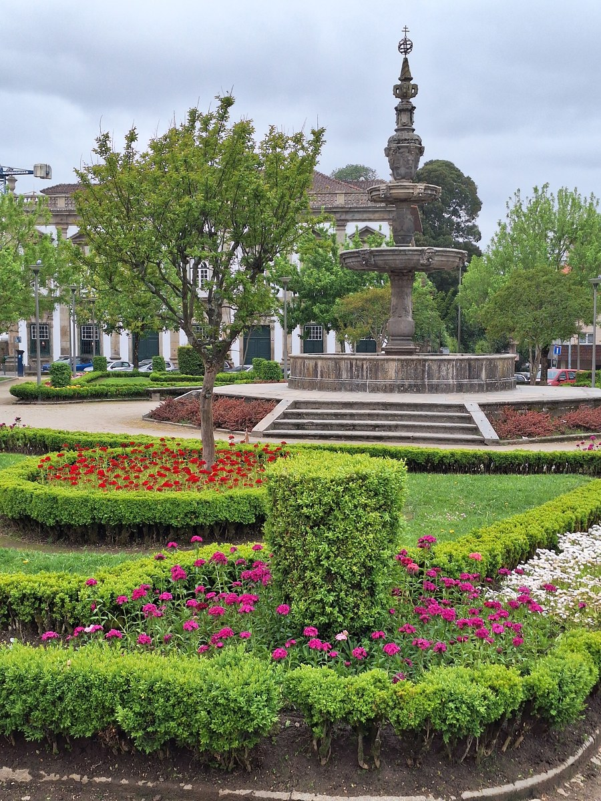
  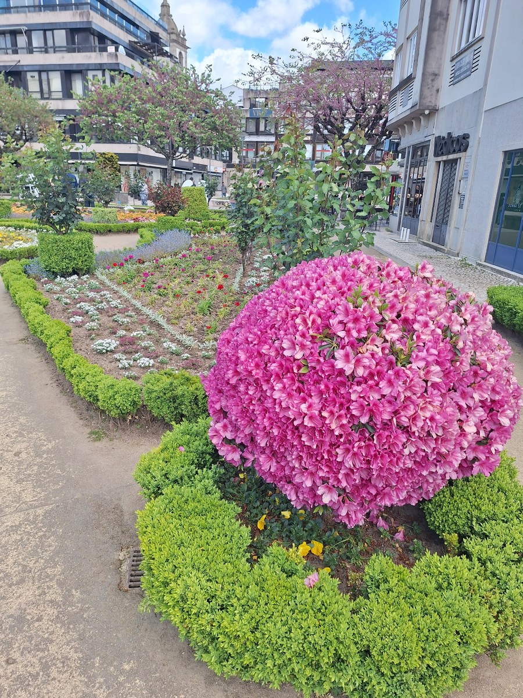

  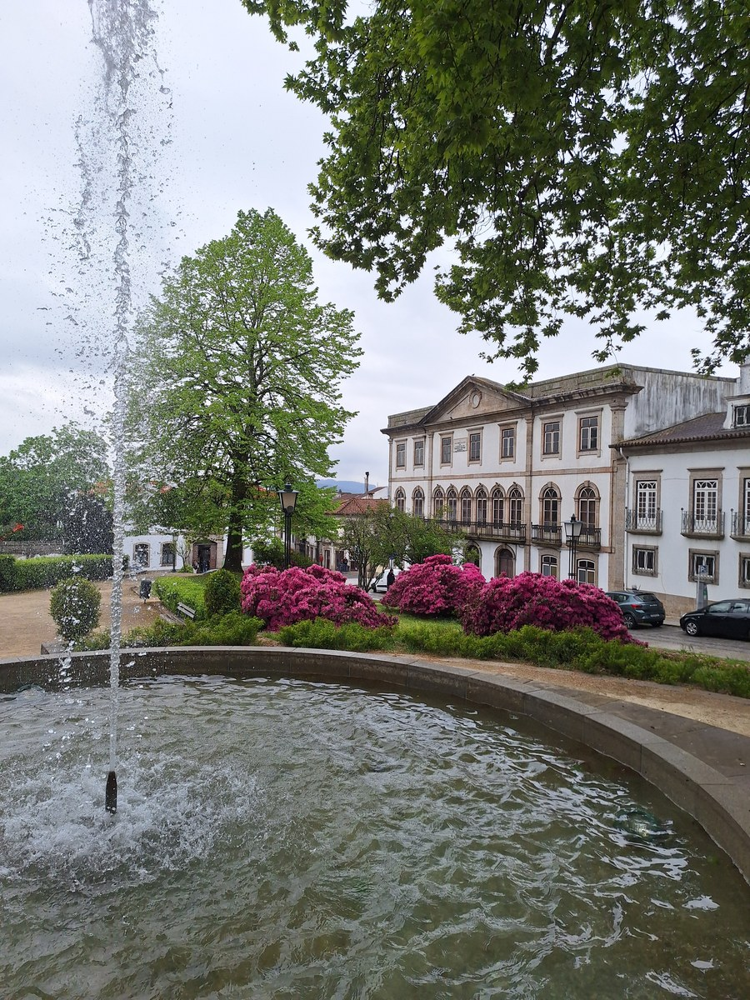
  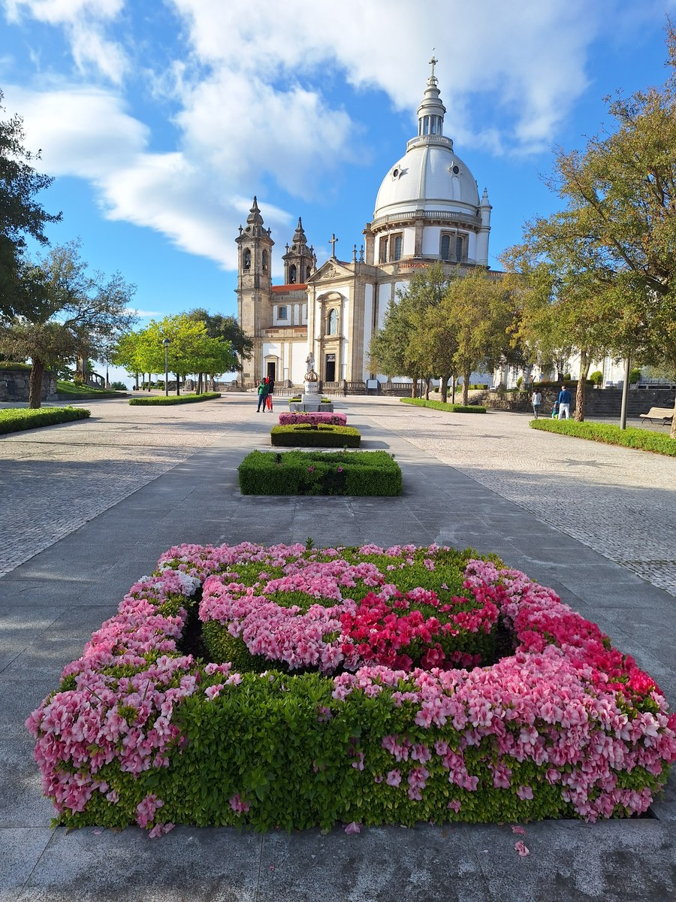

The day we visited Guimarães, the weather was at its worst. It was raining in the morning, although the forecast promised 
some improvement later, so we decided to go anyway. During my previous visit, I hadn't had the chance to see the **Sanctuary 
of Penha**, so we headed there first. Many visitors treat it as much more than just a sanctuary, it's one of Guimarães' 
main recreational areas, where locals come to walk, picnic, and escape the city. Although the weather did not allow us to 
enjoy the views, we could see that Penha Mountain offers much more than just the sanctuary itself. Around the church, 
there were information boards showing the PR3 hiking route, as well as picnic areas where visitors can relax surrounded 
by nature. The area is covered with forest and dotted with impressive granite rock formations, creating a landscape that 
looked perfect for a longer walk and exploration. We noticed several paths leading between the huge boulders and through 
the woodland, and it definitely felt like a place worth returning to on a sunny day, when we could properly enjoy the views 
over Guimarães and the surrounding countryside. 
It was gloomy and dark, and it actually started raining while we were walking around the sanctuary. We rushed back to the 
car, but luckily, by the time we reached the city, the rain had stopped and we even enjoyed some sunshine later that afternoon. 

  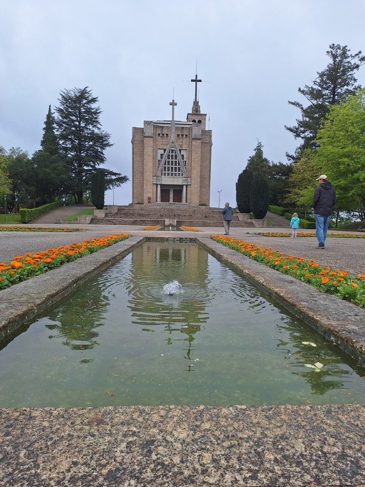
  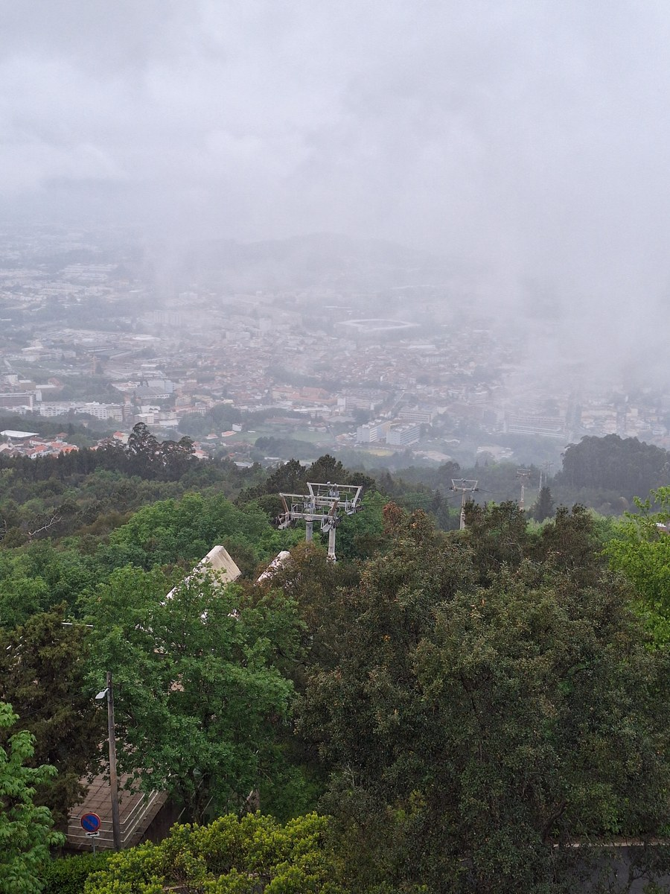

The following day, our goal was to travel further north from Braga to the surroundings of Ponte de Lima, where we planned 
to combine a visit to this medieval town with two short hikes nearby.
We decided to begin the day in the **Bertiandos and São Pedro de Arcos Lagoons Protected Landscape**. We parked next to the 
visitor centre, where a large school bus was parked because a group of children were taking part in outdoor classes. They 
stayed inside the visitor centre, which our daughter also visited while looking for a toilet. She became very interested 
in what the children were doing, and it took some convincing before she agreed to start the hike.
The protected landscape offers five marked walking trails ranging from a short 1.6 km boardwalk around the lagoon to a 12.5 
km route exploring much of the reserve. We chose the 2.9 km River Trail (PR3), which turned out to be the perfect option with 
our daughter, combining forest, wetlands, wooden boardwalks, and geocaching without being too long
 It had been raining on our drive 
from Braga, so the forest was still very wet. Although the rain had stopped, we could constantly feel drops of water falling 
from the trees. 

  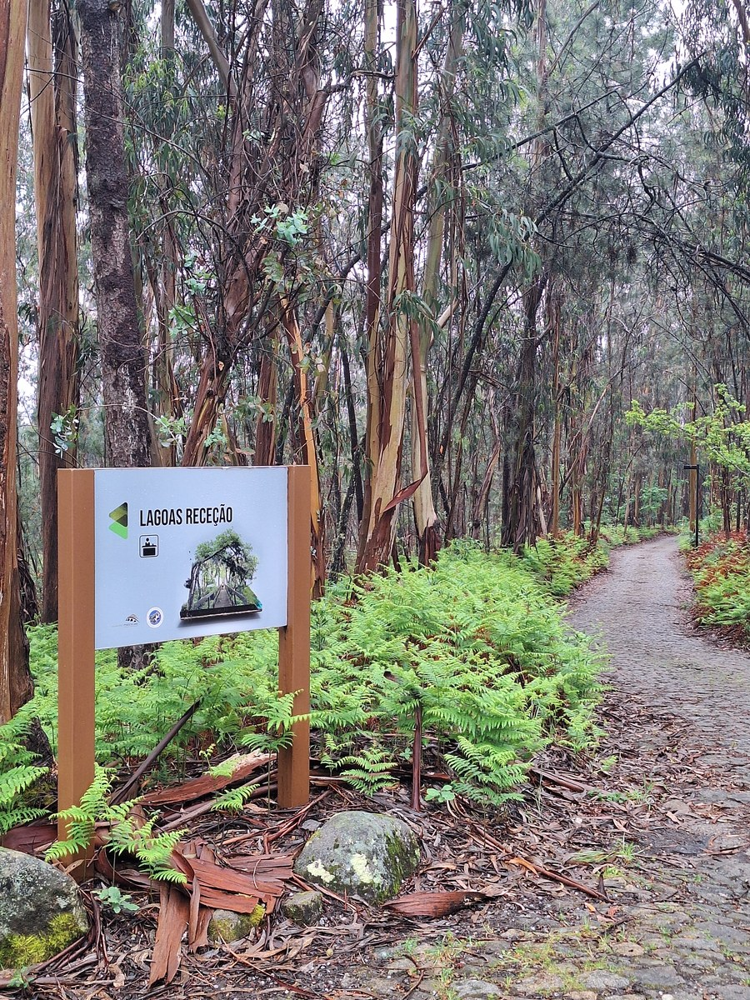
  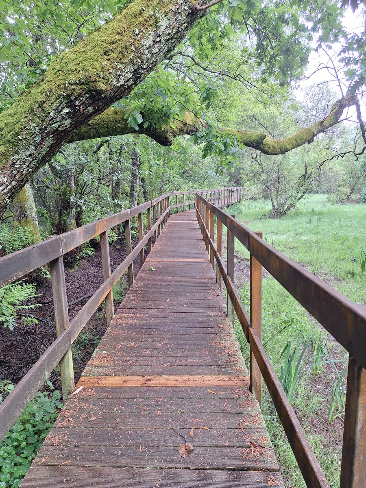

The forest looked mysterious, and to make the walk more exciting for our daughter, we checked whether 
there were any nearby geocaches. There were two, which was enough to keep her motivated throughout the hike.
Geocaching is a real-world treasure hunt where participants use a smartphone or GPS device to search for hidden containers, 
called geocaches, that have been placed by other users. The game turns an ordinary walk or hike into an adventure, as each 
cache becomes a small goal to discover.
When travelling with children, geocaching can be a great way to keep them engaged and motivated. During our hikes, it gave 
our daughter a sense of purpose and excitement, encouraging her to keep walking and explore the surroundings. Instead of 
focusing on the distance, she was eager to search for the next hidden cache, making the journey just as enjoyable as the 
destination. She has been playing this game with her father for quite some time, and she was especially excited to find 
one hidden beneath a huge eucalyptus tree, although unfortunately the notebook inside was completely wet.
The hike itself turned out to be very enjoyable. It wasn't too long, and we saw huge cushions of moss soaked with water. 
There were also many lichens growing on the trees, indicating the clean air in the area. I believe we saw Ramalina, a 
shrubby, fruticose lichen that serves as an excellent bio-indicator because it requires clean, unpolluted air to thrive.

  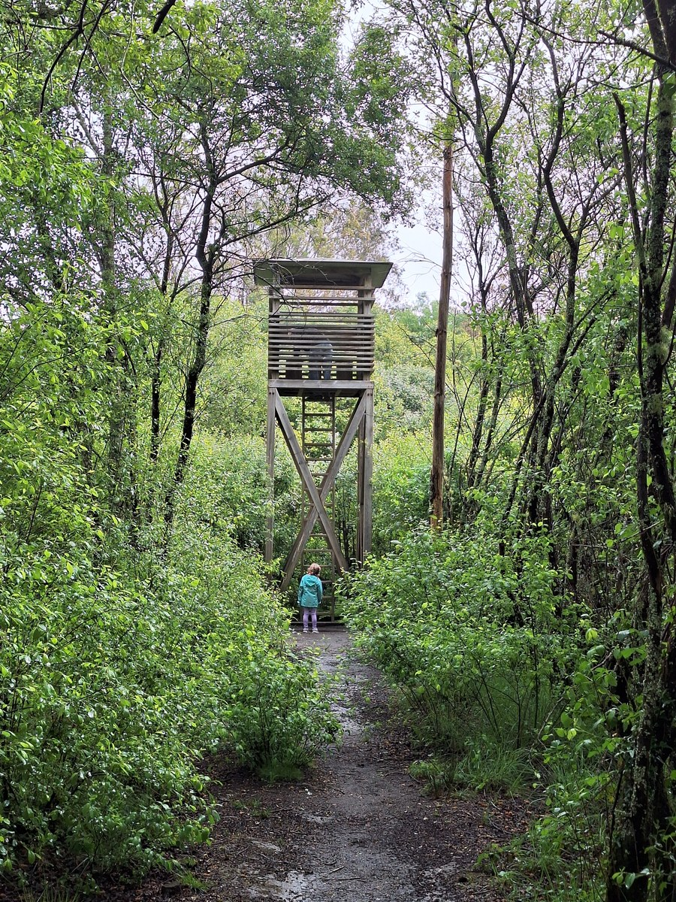
  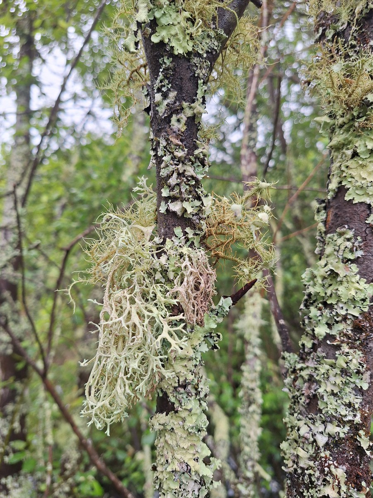

During the hike, we met only a few other people, making the whole area feel peaceful and relaxing. The elevated wooden 
boardwalks were well marked, and there were several birdwatching hides and observation points along the route. In the 
second half of the hike, we walked alongside the Estorãos River after first circling the freshwater lagoons on wooden 
boardwalks. Because the ground around the lagoons is naturally muddy, wet, and fragile, an extensive network of elevated 
walkways has been built, allowing visitors to cross the wetlands without sinking into the mud or damaging the delicate 
habitat.

On our way back towards the town, we stopped at a local restaurant for lunch. Afterwards, we were ready to explore **Ponte 
de Lima**, one of the most charming towns in northern Portugal and often described as the oldest town in the country. Located 
on the banks of the Lima River, it is famous for its medieval bridge, flower-filled riverside gardens, and relaxed atmosphere. 
The town's name literally means "Bridge over the Lima", referring to the historic stone bridge that became an important 
crossing on the Roman road connecting Braga with Astorga.

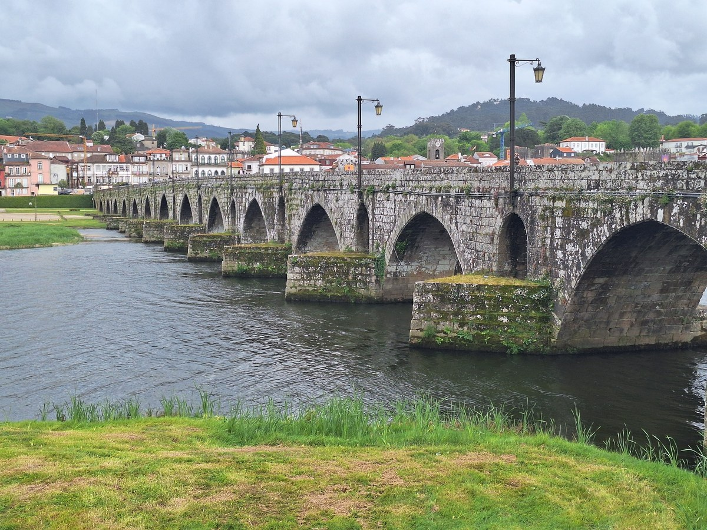

In April, Ponte de Lima is especially beautiful because its parks and riverbanks are filled with spring flowers and lush 
greenery, including spectacular wisteria. We parked next to Parque Temático do Arnado, where we found orange trees, fountains, 
lovely seating areas, and an incredible display of flowering wisteria. There were many different shades of purple, and the 
plants had been trained to form tunnels that visitors could walk through with flowers hanging overhead. Fallen petals 
covered the paths, creating the illusion of purple carpets throughout the park. This was definitely my favourite place 
in the town. There was also a playground in the middle of the park, which kept our daughter happily occupied for quite a 
while. Good playgrounds were actually surprisingly difficult to find during our trip around Portugal.

  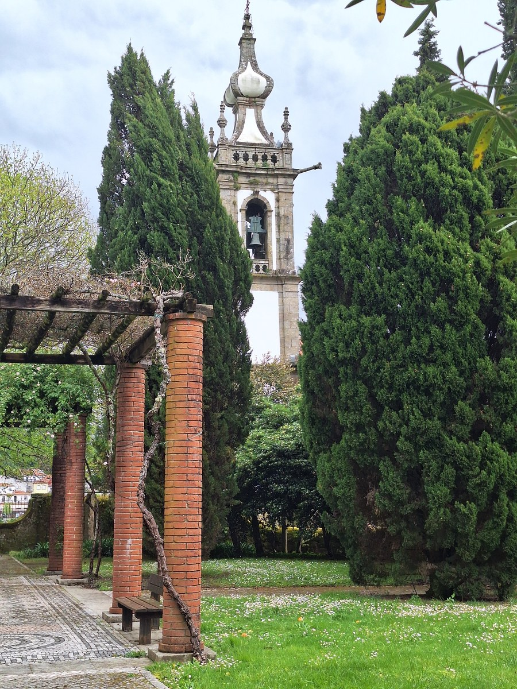
  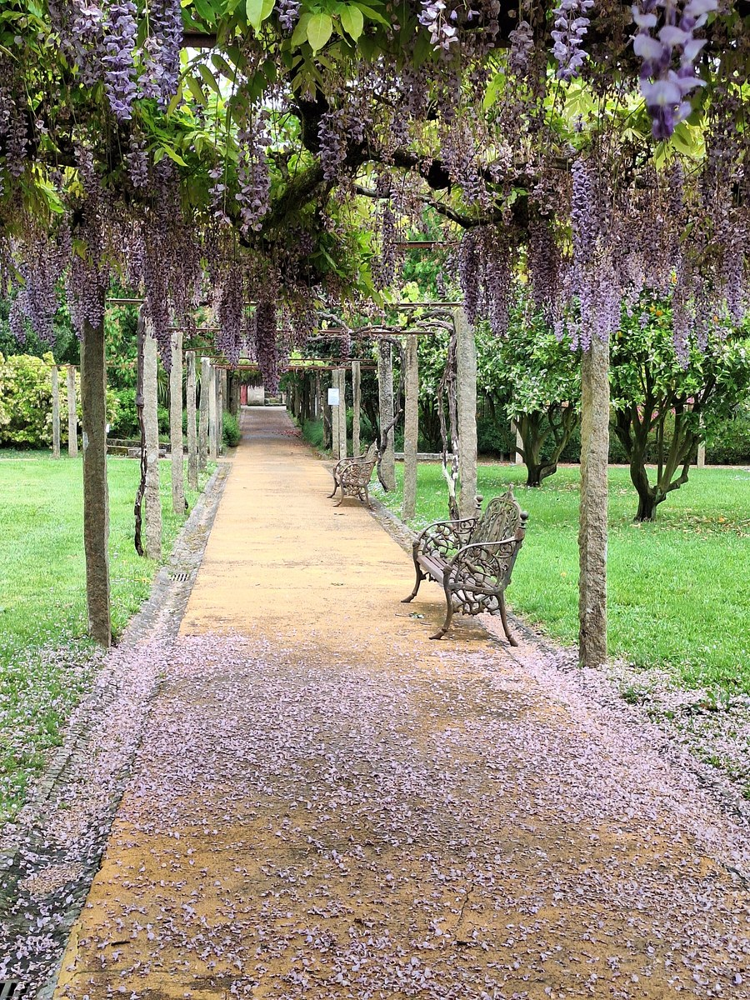

After leaving the park, we walked towards the town centre, crossing the famous bridge with Igreja de Santo António da Torre 
Velha standing beside it. The bridge is also closely connected with the Camino de Santiago, as Ponte de Lima is one of the 
important stops on the Portuguese route to Santiago de Compostela. While walking through the town, we noticed several 
pilgrims resting near the bridge, taking a moment to relax before continuing their journey. We also saw signs offering 
simple and affordable accommodation for pilgrims, which made it clear that this centuries-old tradition is still very 
much part of everyday life in Ponte de Lima.

The historic centre is quite small but full of old buildings. Some are abandoned or not particularly 
well restored, yet this only adds to the town's character. We passed the fountain in Camões Square overlooking the old 
Roman bridge before wandering through narrow streets towards the small green square near the Estátua de António Feijó, 
where we were surprised to see a large stork's nest.

  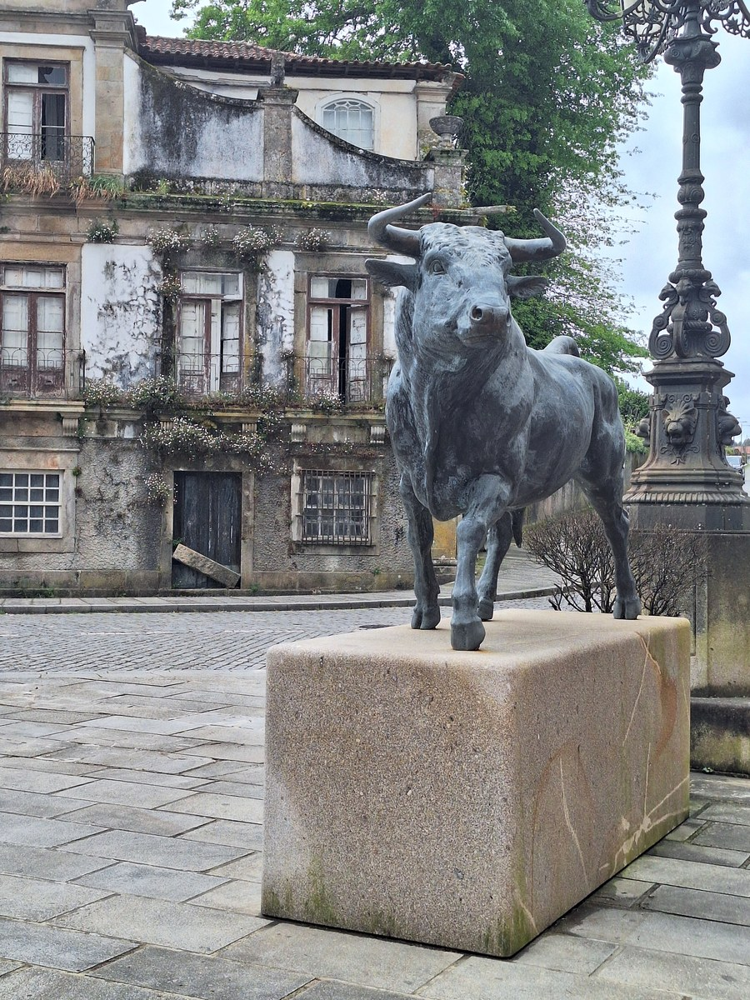
  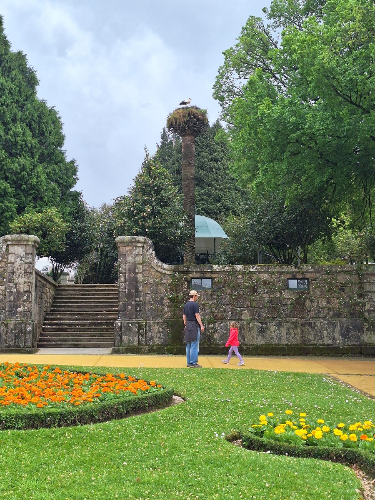

We also spent some time around the Paço do Marquês de Ponte de Lima. From the top of the castle walls, there are lovely 
views over the town below. The palace houses the Interpretation Centre of Military History, a museum that we decided not 
to visit, as it didn't seem particularly suitable with our daughter, although it may be interesting for visitors with an 
interest in military history.
Afterwards, we followed the main street, R. Agostinho José Taveira, admiring the historic buildings before reaching the 
riverbank and the famous Avenida dos Plátanos. This is a wonderful place to escape the summer heat, sit on a bench beneath 
the trees, and enjoy the peaceful views of the river. We eventually returned along the river to the bridge, which we crossed 
once again to reach our car.

  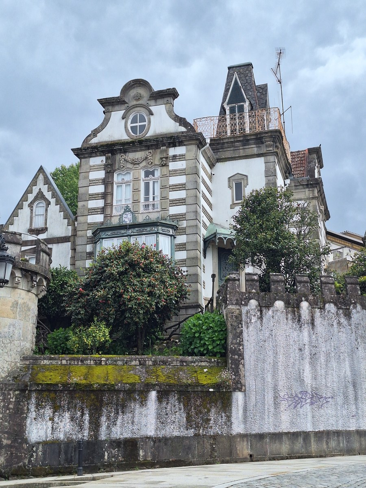
  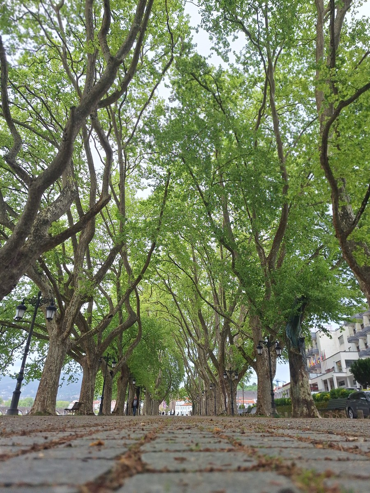

We still had enough time for one final stop closer to the mountains at **Passadiços e Moinhos da Ribeira de S. João**, which 
turned out to be a wonderful surprise. Although it is only a short walk (less than 2km), it is packed with interesting 
features, including wooden boardwalks, suspension bridges, small wooden buildings that were probably former watermills, 
and beautiful scenery. Our daughter especially loved crossing the swinging bridges and running along the wooden walkways, 
so she happily completed the whole route without any complaints. I think it is a fantastic place to visit with children, 
as there is always something interesting to look at around the next corner.

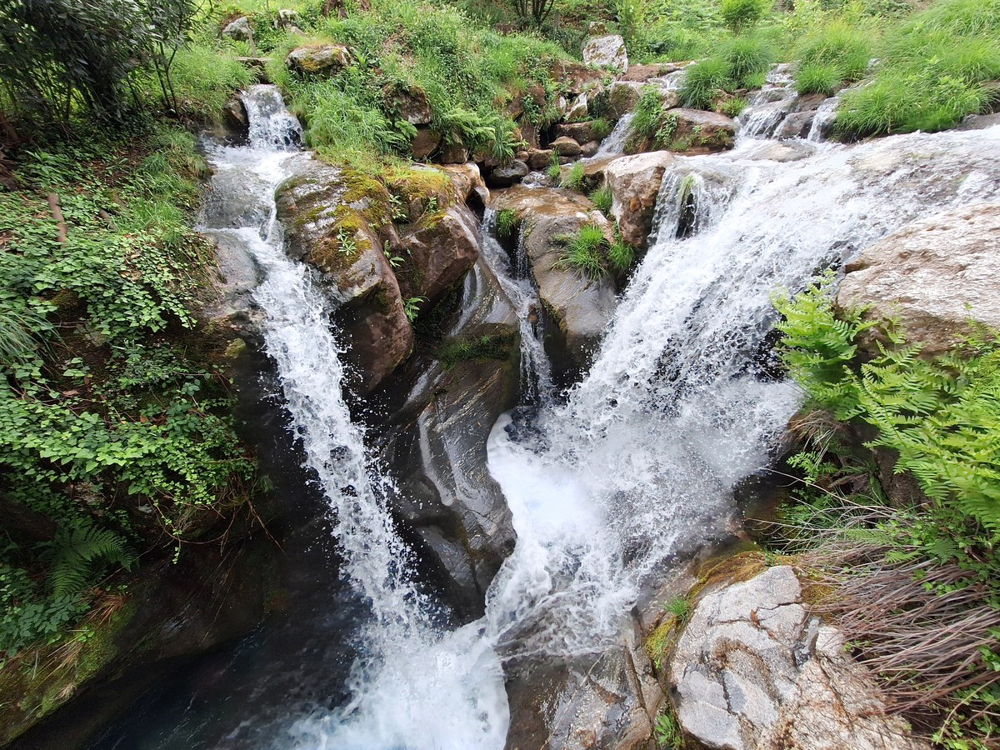

  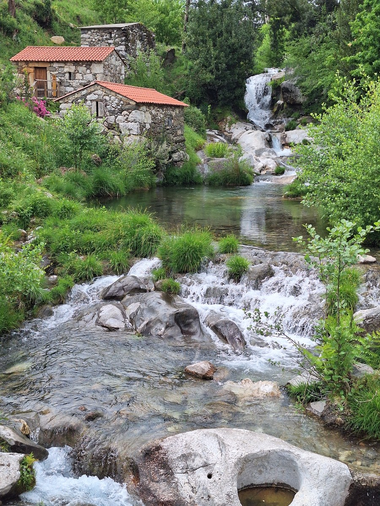
  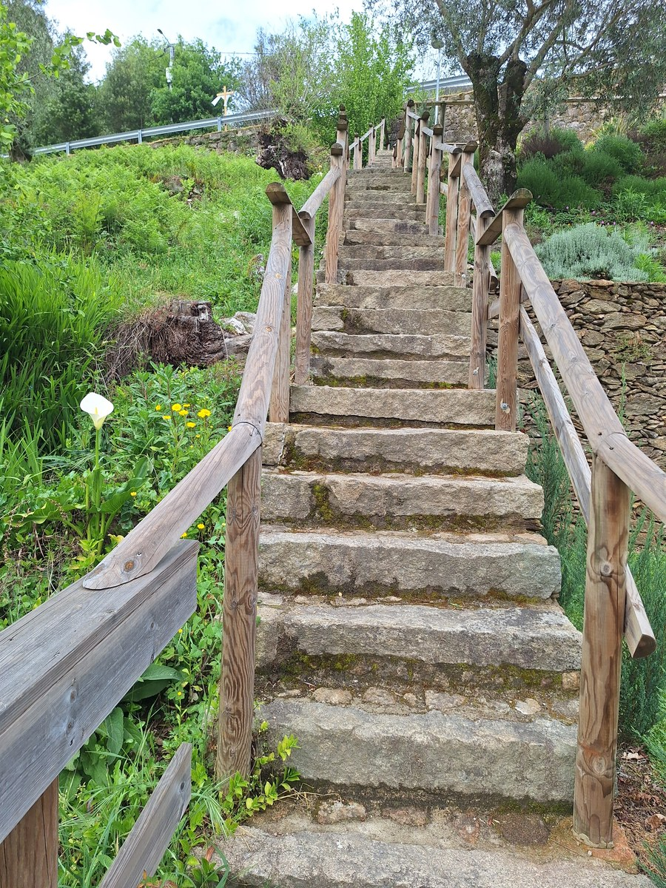

There was a modern-looking information centre, but unfortunately it was closed, as were the toilets next to the Ecomuseum. 
We met only a few people leaving as we arrived, so for most of our visit we had the place almost entirely to ourselves. 
One thing that was slightly confusing is that the trail consists of two separate sections divided by a road. We started 
with the larger loop, where the main waterfalls are located. Afterwards, we walked along the road past the local church 
until we reached the Ecomuseum, where the second section of the trail begins behind the museum building. This means you 
have to walk along the road twice to complete the full route. As there is no pavement and the road is quite winding, it 
is worth being especially careful if you are visiting with children.

  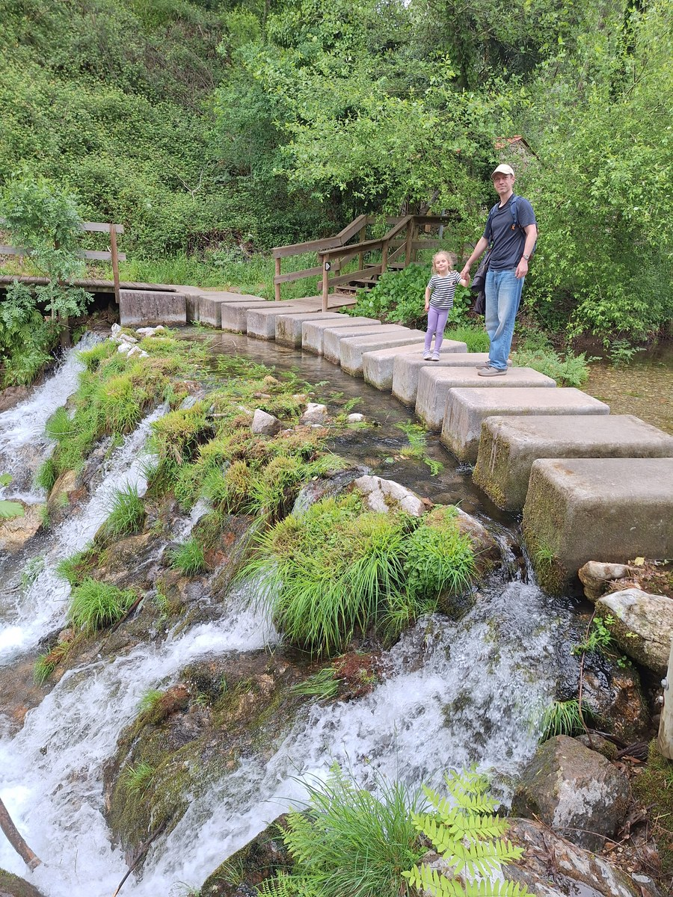
  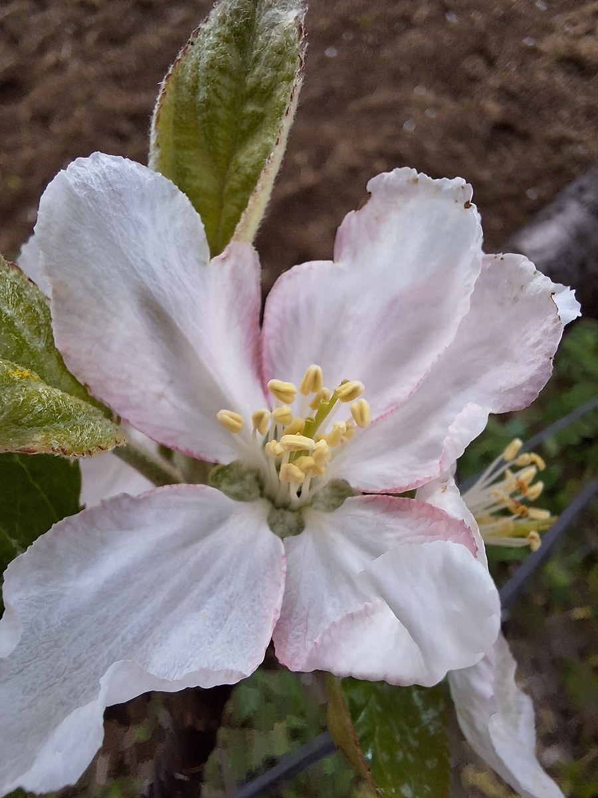

Although the route is short, it is much more varied than we expected. In less than an hour, we crossed several bridges, 
explored waterfalls, admired the old mills, and enjoyed the peaceful forest scenery. It felt like a perfect final stop 
before returning to Braga.

Ponte de Lima turned out to be one of the highlights of our northern Portugal trip. We initially came for a quick visit 
to the town and two short walks, but the combination of spring flowers, peaceful landscapes, and family-friendly trails 
made us wish we had planned more time here. It is exactly the kind of place where slowing down is part of the experience.

__Practical info:__

* National Park Lagoas de Bertiandos e São Pedro d'Arcos: free entrance   
Hikes are described on the [official website](https://lagoas.cm-pontedelima.pt/informacoes/atividades/percursos-e-rotas/poi/percurso-do-rio-pr-3)
that also includes pdf of each hike (we did PR3) with detailed description version in Spanish and English
Duration of the visit: 2 hours
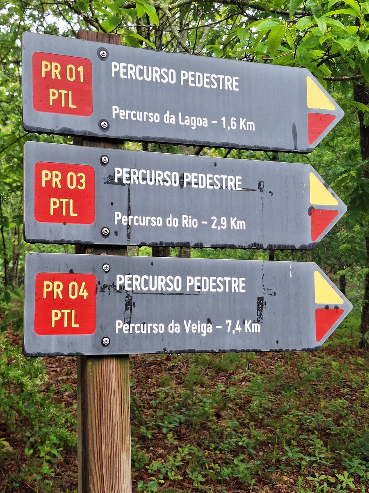

* Ponte de Lima:
[Parking](https://maps.app.goo.gl/R2tQfwCrHU248e6q9), there were plenty of free parkings along the river   
Free public toilet on Camões Square   
Interpretation Center Of Military History - €1 entry fee 
Ponte de Lima sightseeing: 1.5–2 hours   
* Restaurant: [NACOS Restaurante](https://maps.app.goo.gl/99sAeSKDWcBVUKgW7)
* Passadiços e moinhos da Ribeira de S.João: free entrance.    
Duration of the visit:45–60 minutes
There is a small free car park next to the start of the trail, but it only has space for a few vehicles. We also noticed 
a few additional parking spaces near the Ecomuseum. The largest parking area we found was an [open gravel field beside 
the church](https://maps.app.goo.gl/HveHTcM2D8PDLaaT9), just off the main road. It is probably intended mainly for church visitors, but it can also be a convenient 
place to park if the smaller car parks are full. 

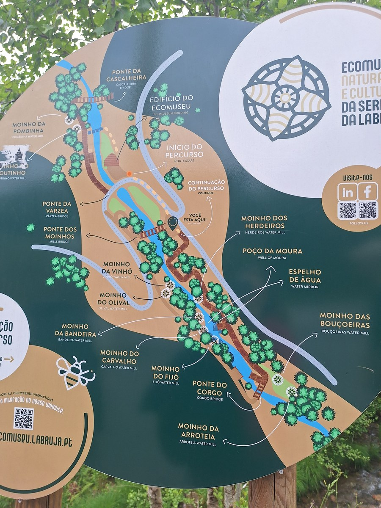

