We decided to use one of the longer weekends in May to finally explore an area of Belgium that I had never visited before. 
We were looking for longer hikes rather than short family walks, so we left our daughter with her grandparents and headed 
towards Liège. The weather, however, had other plans. The forecast for the long weekend was surprisingly bad, with storms 
expected across Belgium. Since our apartment was in Liège and the weather looked better around 13th-century castle complex 
of **Alden Biesen**, we decided to make the most of the situation and stop there on the way.

## Alden Biesen - An Easy Hike Around the Castle
We decided to follow the hike marked with an orange cross, which leads through the fields around the castle and is about 
8.2 km long. The hike starts right at the grand gates of the castle, where we passed a nice sitting area and a small wooden 
trailer called De Bij-Mobiel. It turned out to be a trailer designed in Limburg to teach the public about bees and biodiversity. 
It highlights how essential honeybees and solitary bees are for cross-pollination, which is vital for the massive fruit 
orchards in this region. It must be a fantastic place to visit during the blossoms in spring. 

  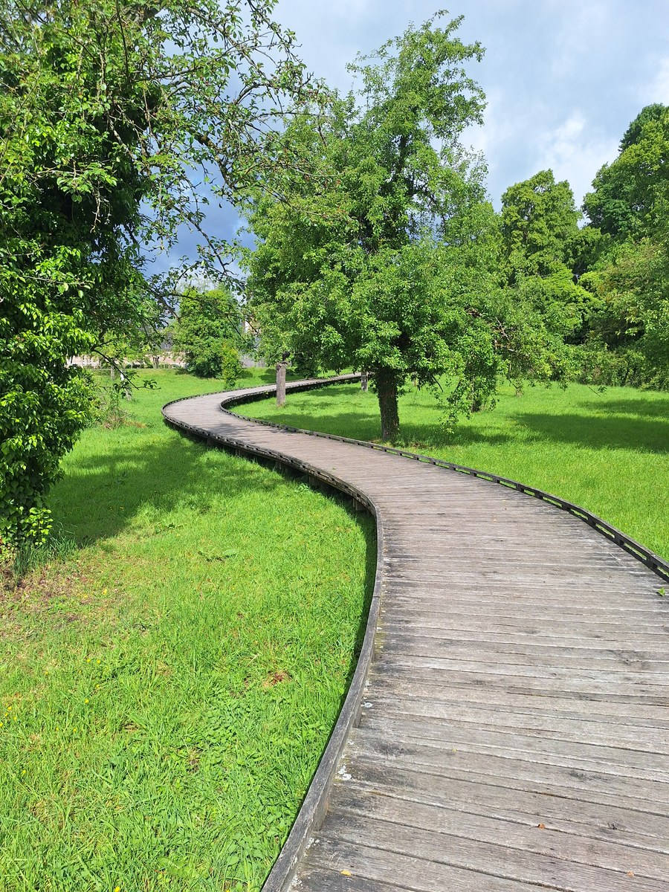
  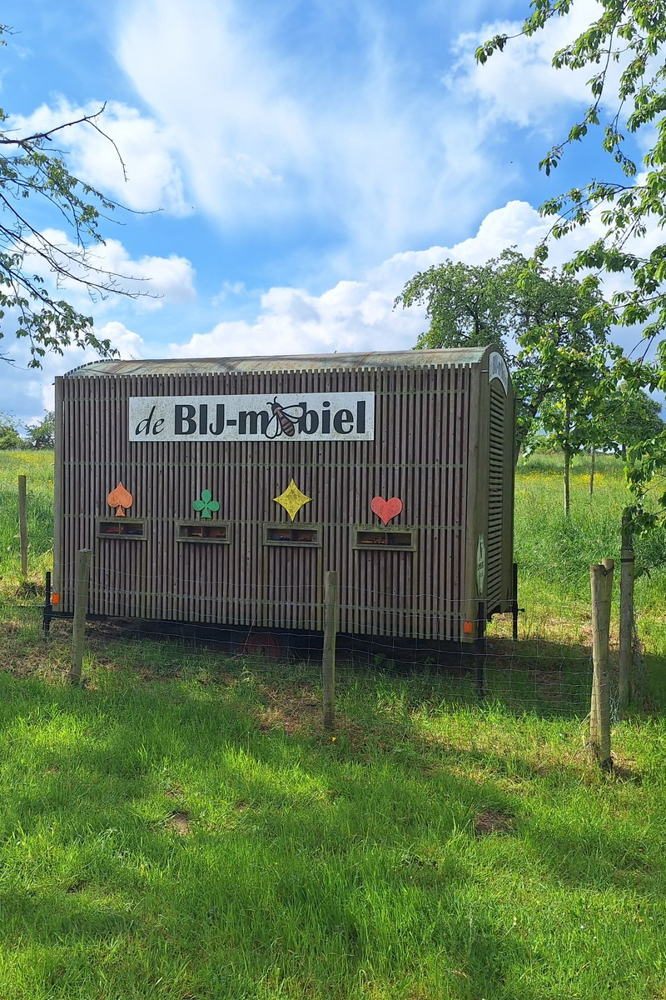

Leaving the castle walls 
behind, the orange cross guided us through farmland, forested stream valleys and lush wetlands, where we found some wooden 
paths next to the Demer River. We passed multiple nice picnic benches along the route and really enjoyed the beautiful 
diversity of this loop. After the hike, we also explored the castle's inner courtyard and French garden on our way back 
to the parking area.

  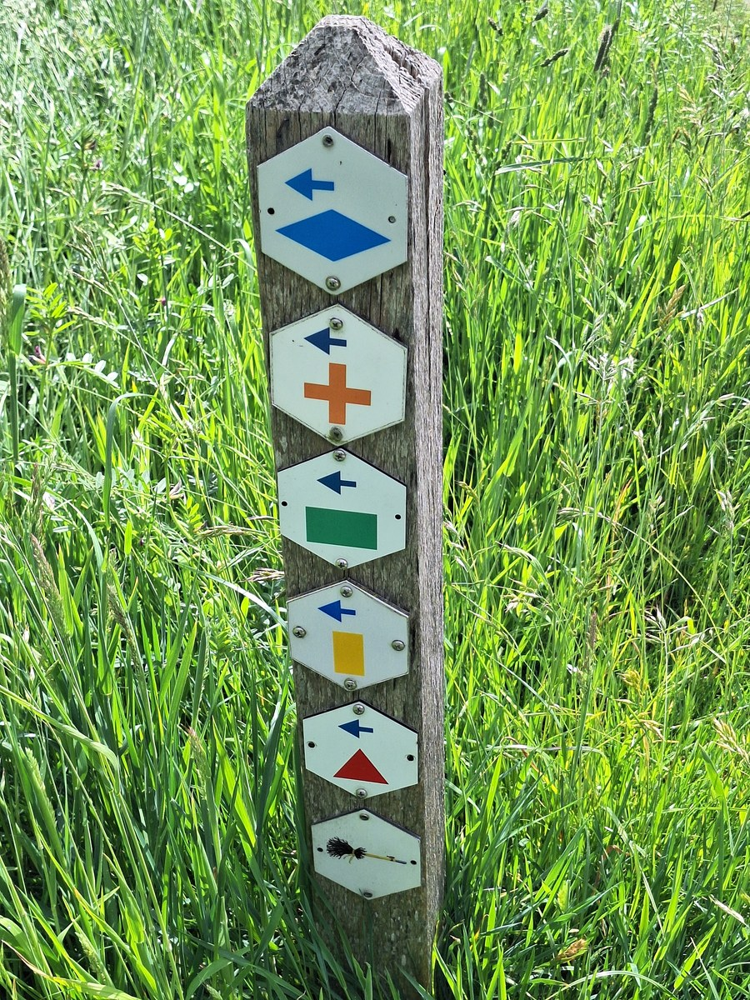
  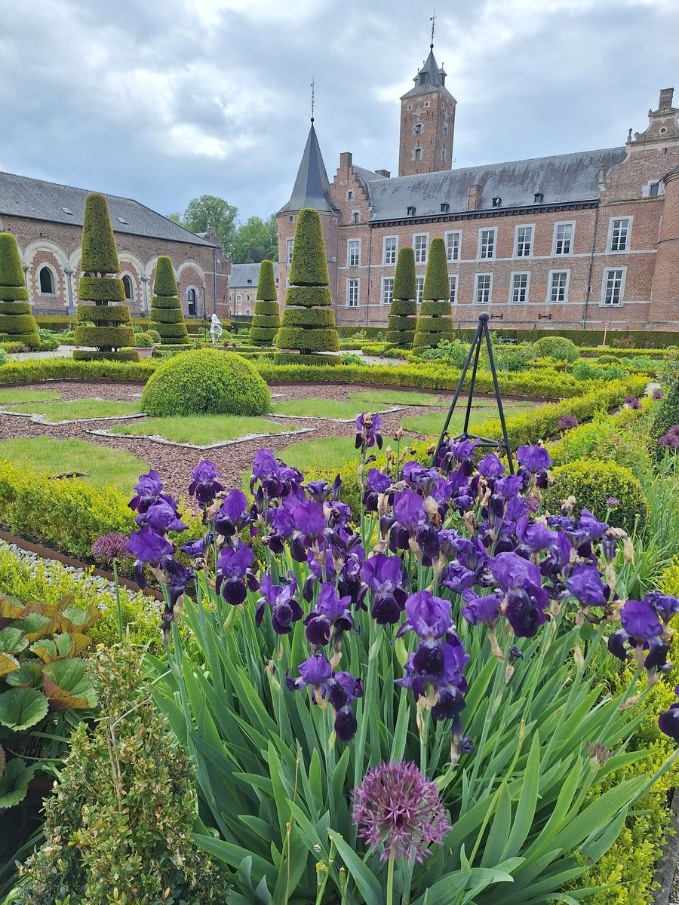

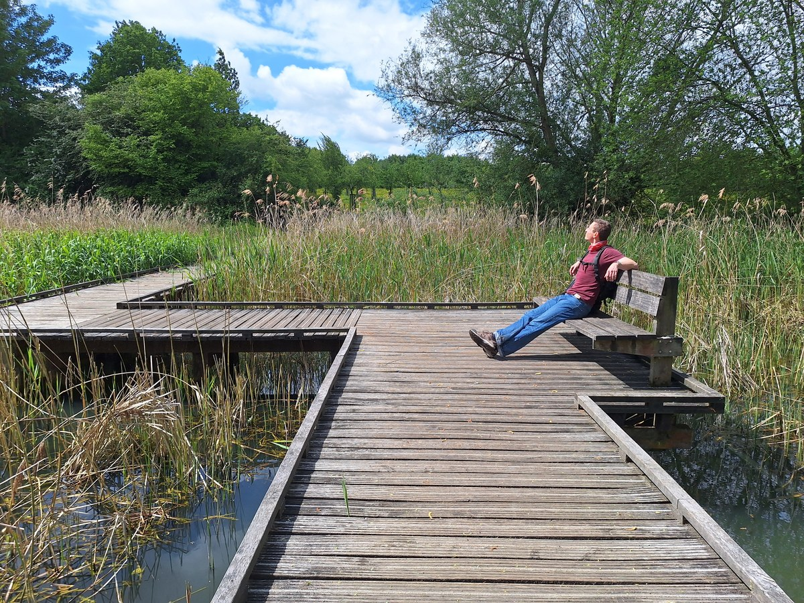

## Esneux - A Hike Interrupted by a Storm
Despite the unstable weather, we decided to visit Esneux and try a hike along the Ourthe River. Unfortunately, after only 
the first 1.5 km, we were stopped by heavy rain and thunder. Since the bridge where we could cross the river was probably 
6 km into the hike, we would not have had any possibility of shortening the route if the weather became even more unpleasant.
Once the storm had passed, we walked uphill to St. Hubert's Church and then followed the path along the fence of Château 
Le Fy, slowly going down the slope towards Rue Grandfosse. From there, we walked back to the car along the river, passing 
the train station on the way. It was not the hike we originally planned, but at least we managed to explore a little bit 
of the area between the storms.

## Hautes Fagnes - A Long Hike Through Forest and Open Landscapes
The next day, the weather forecast was much better, but only until 4 pm, so we had to make sure to be at the start of the 
hike by 10 am at the latest. We still had 60 km to drive from our apartment, so it took us about an hour without traffic. 
However, you need to follow local roads to get there, so it can take longer depending on the traffic. The parking next to 
the restaurant and small chapel was quite empty when we arrived. I had some paths marked in the Organic Maps app that I 
wanted to follow, but we had to adjust our route because of wet sections that we couldn't pass. The previous few days had 
definitely been much rainier than the rest of the month. At the beginning, we walked on very well-defined paths in the 
forest. However, every time we tried to go deeper into the forest using smaller paths, we were stopped by very muddy terrain, 
so we decided to stick to the main path. One of the things I particularly liked in the open landscape was the cotton grass 
growing everywhere. The fluffy white seed heads stood out beautifully against the green and brown vegetation and made the 
landscape look almost covered in small pieces of cotton. 

  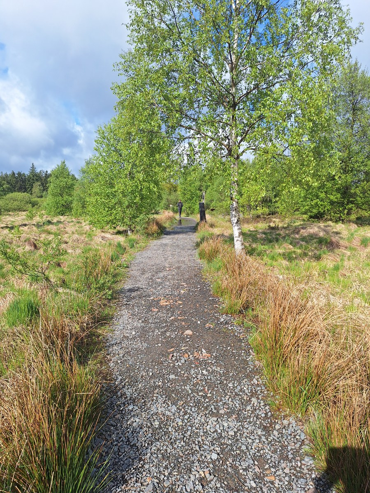
  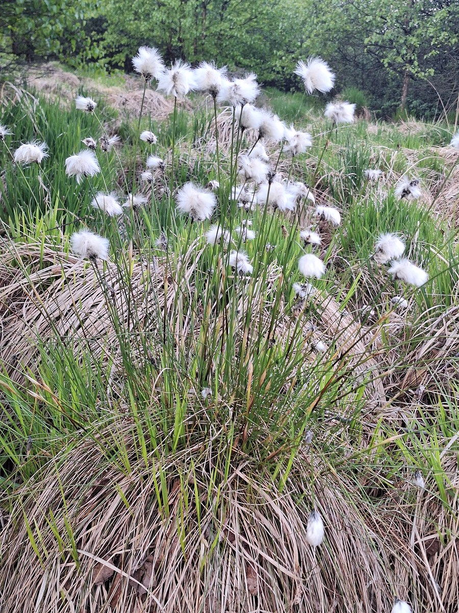

The forest was very quiet and big, with signs indicating mountain-bike 
paths in the area. We walked partially on these paths and later turned onto smaller paths through the forest. The furthest point 
we reached was a nice viewpoint with a roofed platform and some benches. From there, we could hear and see water cascades 
in the valley below us. I had seen a small path on the map leading steeply down to the creek, and we decided to try it. 
This was, for me, the most interesting part of the hike, with more rocks and a narrow, steep path, which I personally like 
much more.
We very quickly reached the stream, where we surprisingly noticed many people on the other side. I saw a nearby hike called 
Promenade de la Hoëgne, which was leading along the river, and I think this was part of that route until the Pont du 
Centenaire bridge. The area around the stream was really interesting, with wooden boardwalks and bridges, but it was 
definitely the most crowded part of the hike. We had to wait many times to let people pass because they were significantly 
slower than us and the path was very narrow, so it wasn't easy to overtake. 

  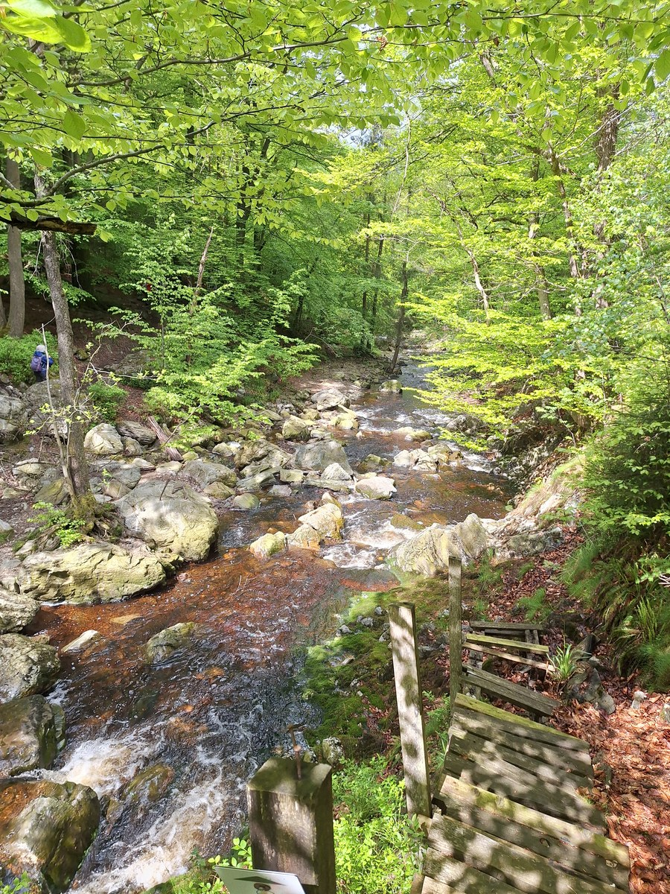
  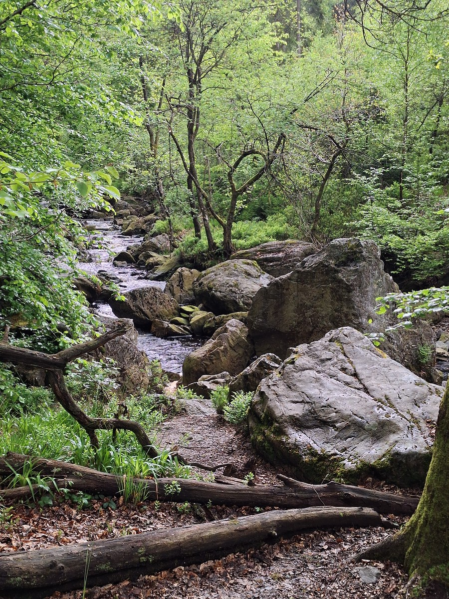

One thing that immediately caught my attention 
was the colour of the water in some of the streams. It was surprisingly dark, almost reddish-brown, and looked a bit like 
tea. The water was actually clear enough to see the rocks underneath. The colour comes from organic matter released by the 
peat and vegetation in this wetland landscape, giving the streams their characteristic dark colour. From the bridge, we decided to head back in 
the direction of the parking area where we had left the car. After only a couple hundreds of metres, we were alone again. 

  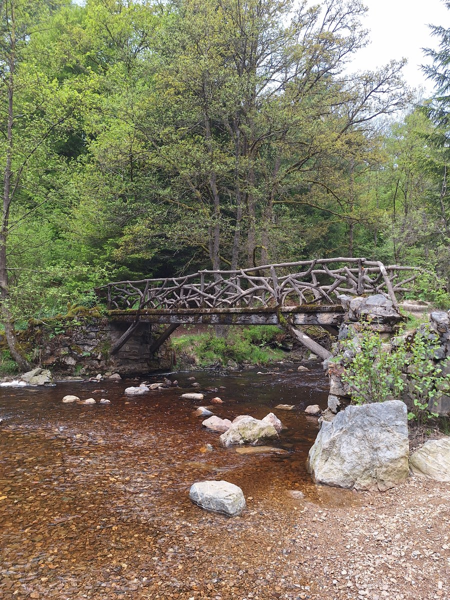
  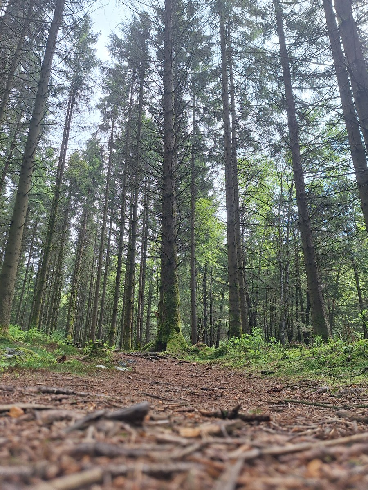

I was asking myself, Where are these characteristic boardwalks that I saw in so many photos? We actually reached them during 
the last 3 kilometres of the hike. By that time, my husband was already complaining about pain in his feet, and it turned 
out that he had multiple blisters. Therefore, when we reached the last path towards the parking area, we decided that I 
would continue on a small loop on the other side of the main road to see what it looked like, while he would wait in the 
car. When we split up, I crossed the main road next to Le Mont Rigi hotel and entered the area called Hautes Fagnes, which 
was very different from the rest of the hike. The landscape there is very open, with not many trees on the horizon, but 
you need to follow wooden paths because the main area is above the ground. You can enjoy beautiful walks here on boardwalks.
I just did a quick 3 km loop to check it out, but you can do a much longer hike on that side of the main road, all the way 
to another nature reserve, Fagne de Brackvenn (parking Nahtsief). 

 

  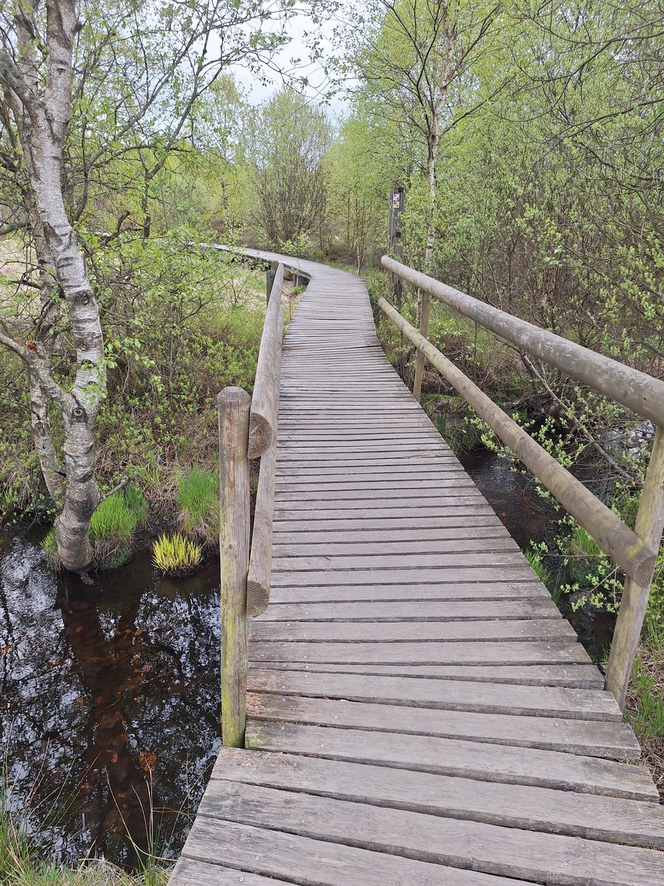
  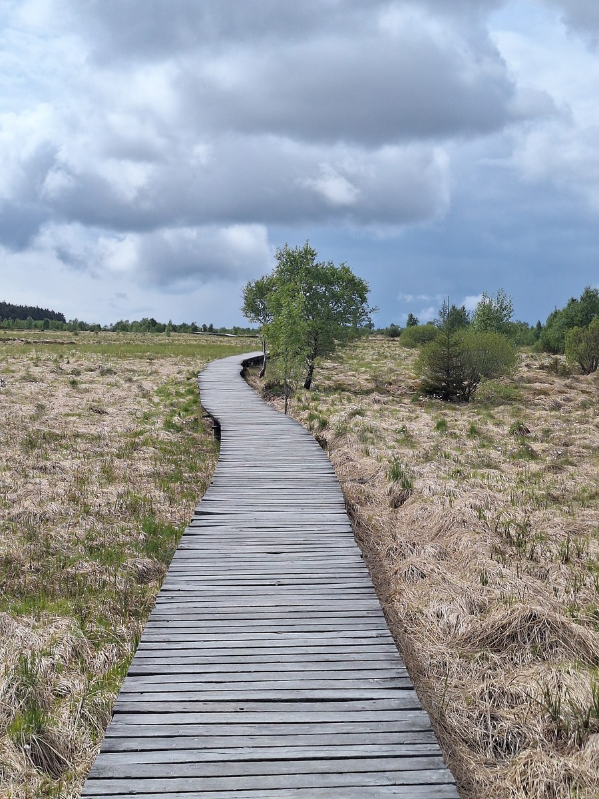

For people who really want to stand on the highest peak 
of Belgium, you can drive a bit further to the Signal de Botrange parking area. However, it is basically just a hilltop 
with stairs next to the parking area, so we decided to skip it. Someone decided to build the stairs in 1923 to bring the 
symbolic top up to exactly 700 metres, as the natural peak is lower. Of course, it can be a starting point for another 
amazing hike in this area. That was an intense hike, but with beautiful landscapes and very few people, apart from the 
short section along the stream close to Pont du Centenaire and the area around the parking lot, which has the famous 
boardwalks.

## Vallon du Ninglinspo - Beautiful but Too Crowded
On the last day, after checking out, we started the day with a hike in the Vallon du Ninglinspo area. That was the biggest 
disappointment of our trip. First, we had to park the car a bit further from the start because, even before 10 am, the 
two small parking areas were already full of cars. Very quickly, the hike became a bit confusing. There were tapes between 
the trees in some places indicating that we should follow a different route because of changes being made in the area, but 
it was really not clear where to go. Sometimes the arrows were even pointing in directions where crossing the stream was 
not possible. It was also very crowded, and the further we got, the worse it became. There were a lot of people with small 
children, but actually, this hike was not easy. I would not recommend it for families with young kids because of the many 
slippery rocks, mud and places where it was necessary to take bigger steps. I noticed that many children were struggling.
We also had to wait multiple times because people were having problems crossing the narrowest parts of the path, which 
were particularly muddy that day. We had the impression that too many tourists had damaged the landscape. There were too 
many footsteps everywhere, and it looked like nature was suffering from the high number of visitors.

 

  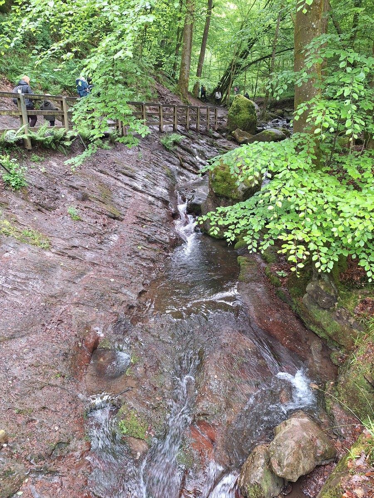
  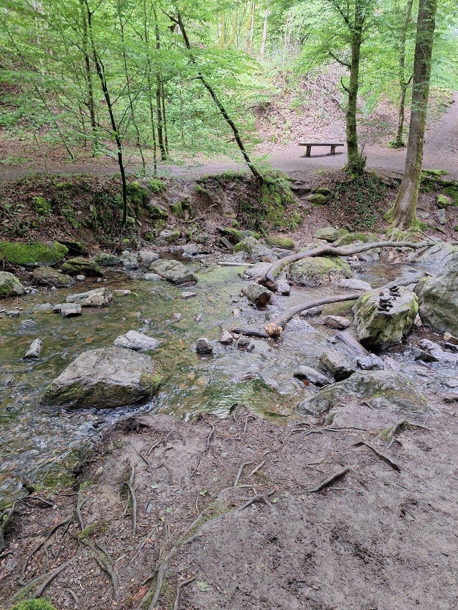

Halfway through the regular hike, after about 3 km, we decided to extend the route and make an additional 6 km loop to La 
Charmille du Haut Marêt, a charming 573 m long path with more than 4,500 hornbeam trees forming a tunnel. During this 
additional hike, we hardly met anyone. We enjoyed this part the most because we could finally experience beautiful and 
quiet nature. We simply followed good-looking paths that were also visible on the map in Organic Maps and found the place 
without any issues. On the way back, we passed through another side of the forest and turned the wrong way only once, around 
the 8 km mark. That part was pretty flat, with paths that were easy to walk on. There were also signs indicating biking 
routes. Once we came back to the Ninglinspo route, the other half was very easy to hike. It was a wide and nice path 
through the forest. There weren't many views, so it was definitely less interesting than the first part, but there were 
no difficult sections with rocks or extensive mud.

 

  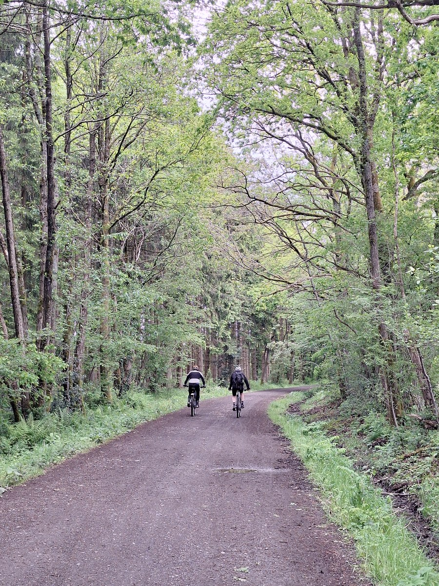
  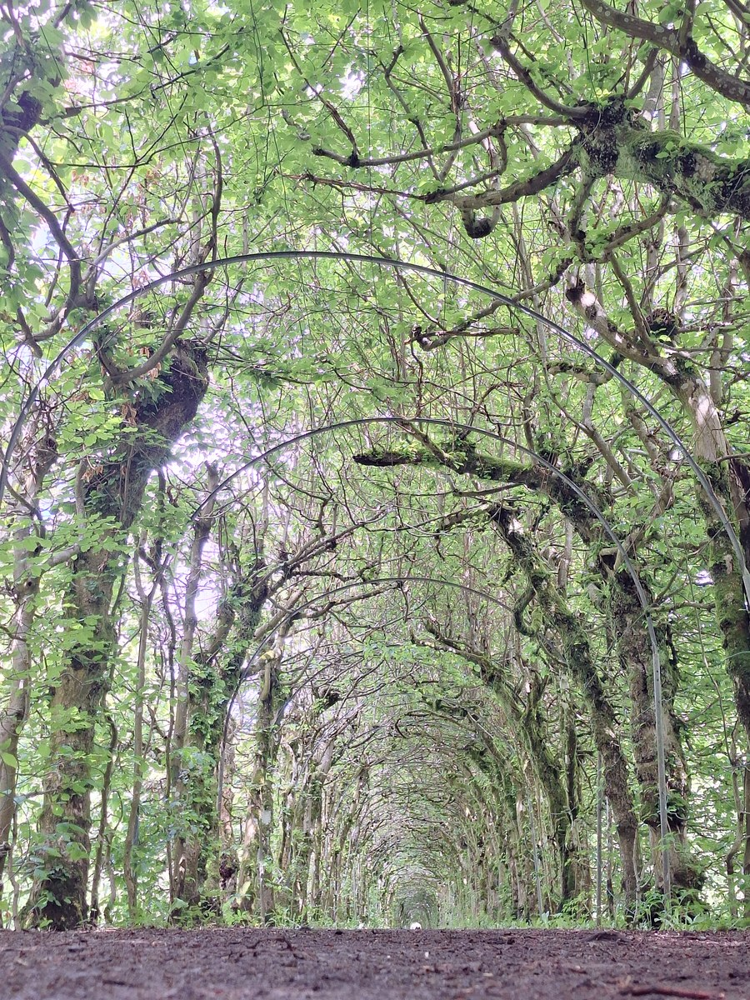

## Heid Des Gattes - A Short Extra Hike Near Aywaille
Since we still had some time and the weather was stable, we decided to stop at Heid Des Gattes, near Aywaille.
I did the hike myself, while my husband stayed on a bench next to the riverbank because his blisters were getting really 
painful after the morning hike. I still felt like doing some more hiking, though. After a steep climb, the terrain became 
flat, and views of the city and river below opened up between the trees. I passed some small houses on the top and followed 
a very visible path until I reached a field with two donkeys. It was time to find the path leading back to the parking area. 
It was narrow and steep, but I quickly reached the lower sections of the hill. 

  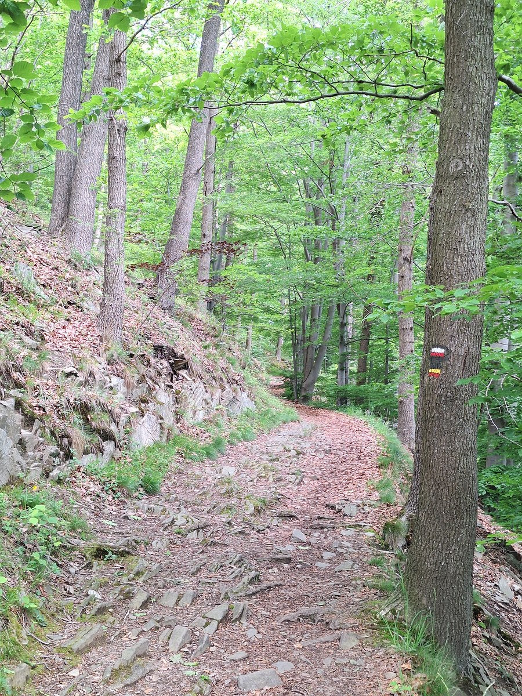
  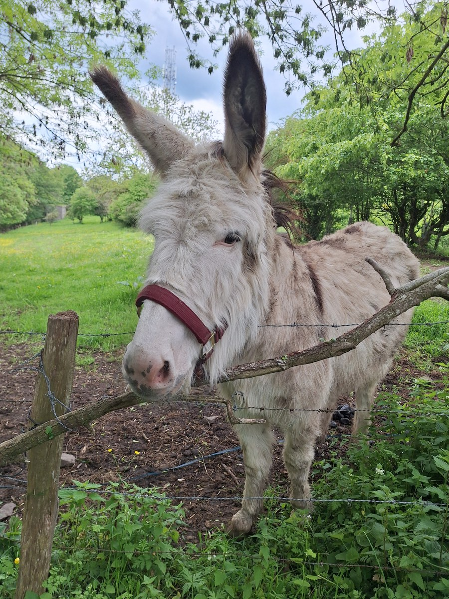

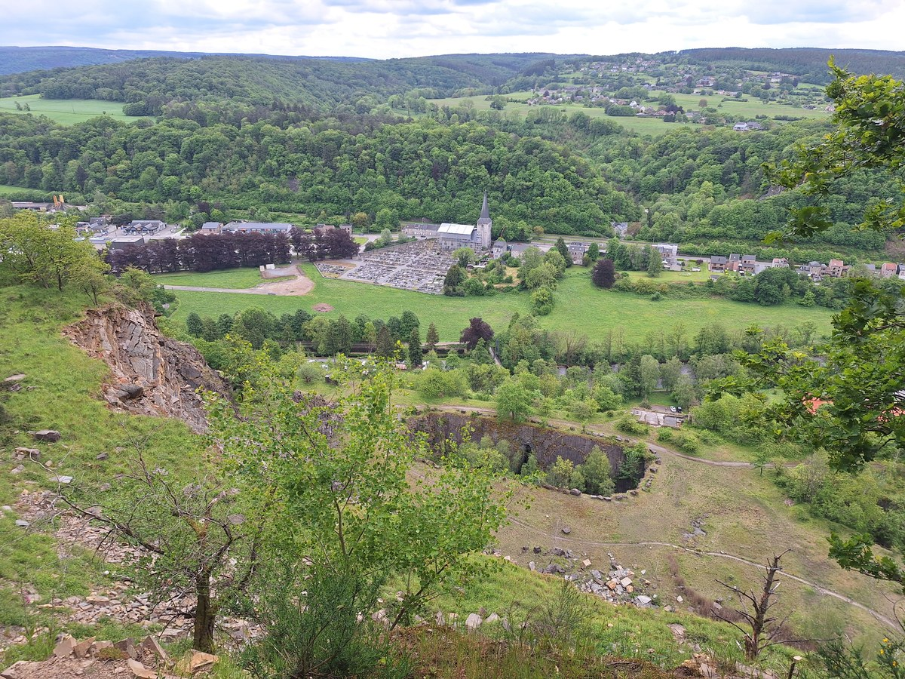

On the way down towards the area where the 
goats were supposed to be, I noticed something quite unusual from the top of the hill. There was a large, deep hole in the 
ground, almost like a crater, with trees growing at the bottom. It was quite impressive to see from above.
What surprised me most was how sudden the drop was. There was no fence or other protection along much of the edge, so it 
looked like someone not paying attention could easily fall several metres down. There were some huge rocks placed along 
parts of the edge, but they didn't seem to protect all of the potentially dangerous sections. Later, I learned that this 
area contains several old quarries, so I assume this could have been one of the old quarry excavations. There were no goats 
to be found in the area. There was an information board about approaching the goats and feeding them, so I'm not sure if 
you need to visit the place at a specific time of year or on specific days to see them, or if they are no longer there 
permanently. After that, it was time to head back to pick up our daughter from her grandparents and continue back to Leuven.

  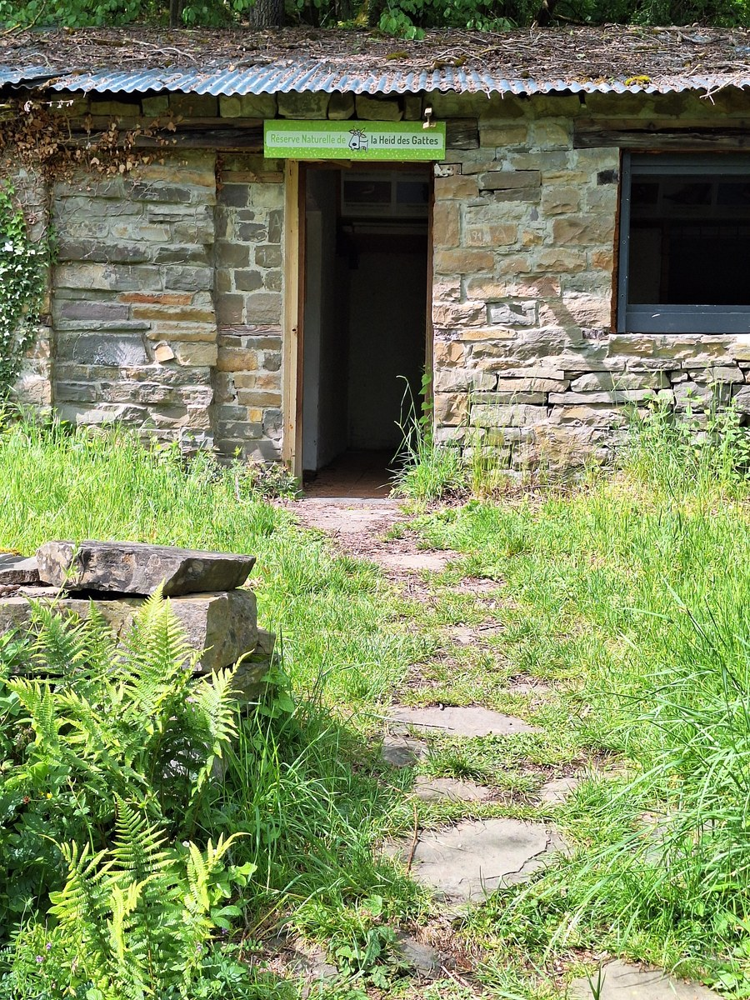
  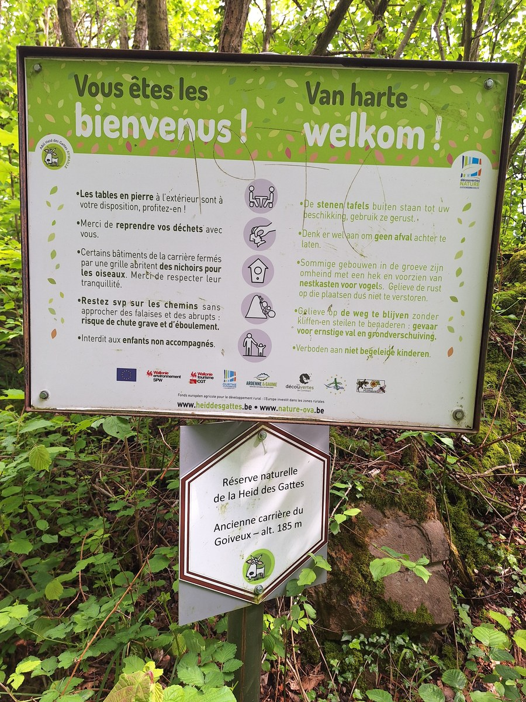

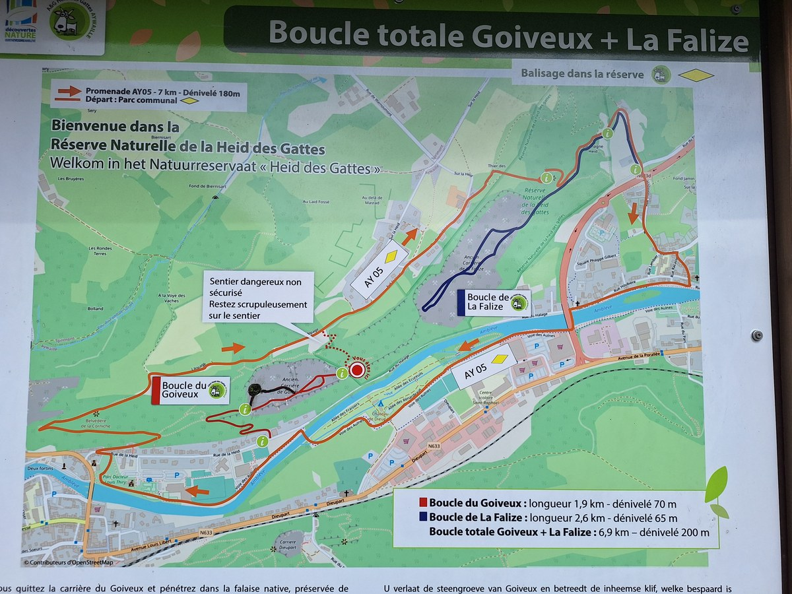

__Practical info:__

**Alden Biesen**   
Hike description: https://www.wandeleninlimburg.be/en/wandellus/alden-biesen-orange-cross-193
Hike duration: 1h 45min
Hike distance: 9 km
Free parking: https://maps.app.goo.gl/eoudxYgX2bHpea5j8
Castle: http://www.alden-biesen.be/
De Bij-Mobiel: https://www.boomgaardenstichting.be/activiteiten/projecten/de-bij-mobiel

**Esneux**
Free parking next to the bridge: https://maps.app.goo.gl/4evZeH9sQ6nLW2499

**Hautes Fagnes**
Free parking next to La Baraque Michel restaurant: https://maps.app.goo.gl/ut7yH3u1873iRfbZA
Hike duration: 5h 45min
Hike distance: 23 km
Signal de Botrange: https://maps.app.goo.gl/6pebocht3KyJWsk3A

**Balade du Ninglinspo**
Parking: along the road, since the paid parking was completely full before 10 am. We also noticed a second parking area, 
which was free, but it was also full and half of it was closed because of construction.
It is dangerous to walk along the road with all the cars parked on both sides, creating deep mud on the sides of the road. 
I hope there will be new parking soon because the area is currently very chaotic.
Hike duration: 3h 45min
Hike distance: 12.5 km

**Aywaille**   
Free parking: big parking next to https://maps.app.goo.gl/EBUZt4bvPvUK93Zh9
I followed a path marked on Organic Maps that was not visible on Google Maps.
Hike duration: 1h
Hike distance: 4 km

**Where we stayed**
Airbnb apartment in Liège: https://www.airbnb.com/rooms/1362297371259597564

