Our flight to Podgorica was very late in the evening, so we didn't even take a day off work. Directly from the airport, we took a taxi to our Airbnb apartment, which we could access using self-check-in. 
This was very convenient. We spent next five days exploring Montenegro in September, with Zabljak and Durmitor National Park as the main highlights of our trip. We were hoping for sunny weather 
and beautiful mountain views, but the first two days turned out to be quite rainy. Despite the challenging conditions, we managed to explore some beautiful hiking trails and discover this 
amazing part of Montenegro.

## Day 1

Our first day in the capital was sunny and hot, with temperatures exceeding 32°C. We did some grocery shopping in the morning, had breakfast in the apartment and then left for the bus station, 
which was within walking distance as our apartment was in a very convenient location. The bus to Zabljak was at noon, despite the fact that I had booked an earlier one. After buying the tickets 
online, I received an email saying that our chosen connection was no longer available and that the next one we could take was at 11:43. During the journey, we passed wildfires next to the road, 
with many more visible on the distant slopes. The road became very winding, and the smell of burning forest was still noticeable inside the bus, so I wasn't feeling very well. During the last 20 
minutes of the bus ride (2 hours and 30 minutes in total), the weather changed dramatically, and we arrived in rainy conditions. Luckily, there was a small wooden chalet housing the tourist information 
centre, so we could run there immediately and wait under the roof until the rain stopped. After a while, we decided to make a quick dash to our apartment, which was just a couple of hundred metres 
further away, as we could already check in. I had planned to go for a walk in the area that afternoon, but unfortunately, we only managed to visit a restaurant and a supermarket during the short 
periods without rain.

## Day 2 

Our apartment was located 2.5 km from the famous **Black Lake** (Crno Jezero), which was the starting point for our hike. Unfortunately, the weather on our first day was disappointing. It was gloomy 
and drizzling, but I was really hoping for better conditions later in the day or once we reached higher elevations in the mountains. There were already quite a lot of tourists at the lake, carrying 
umbrellas, and we couldn't see much of the surrounding scenery. We started our hike towards the next lake, called **Zminje Lake** (Zminje Jezero). It wasn't far away, the walk was easy and relaxing, 
and although we passed some people, there weren't many.

  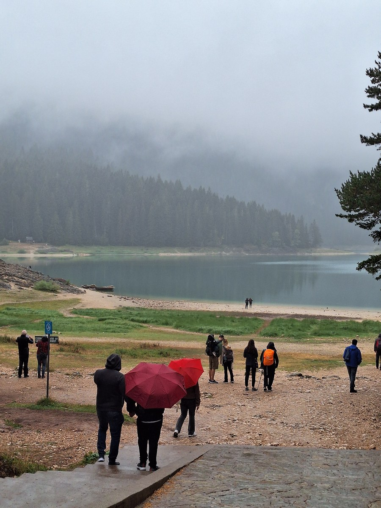
  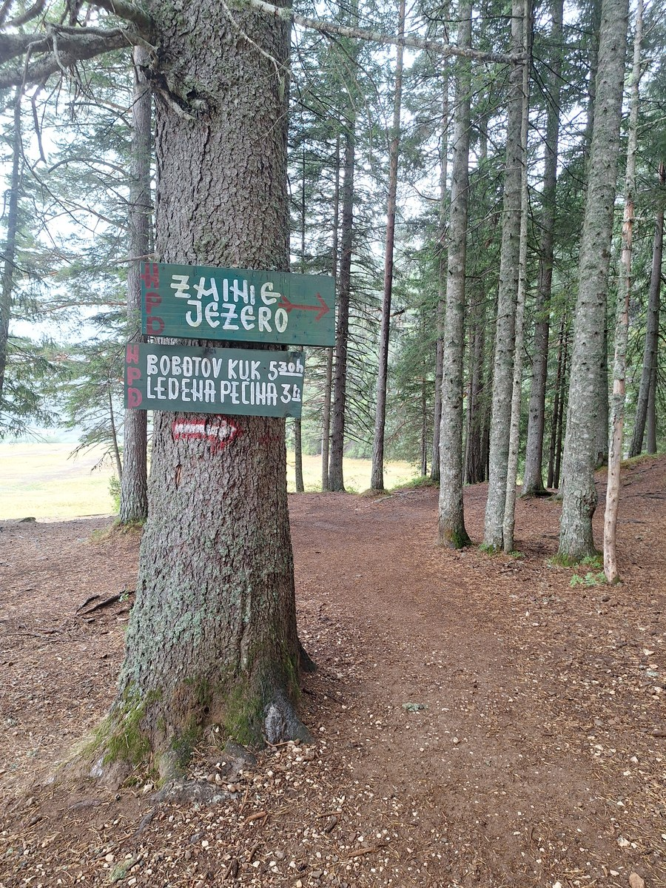

  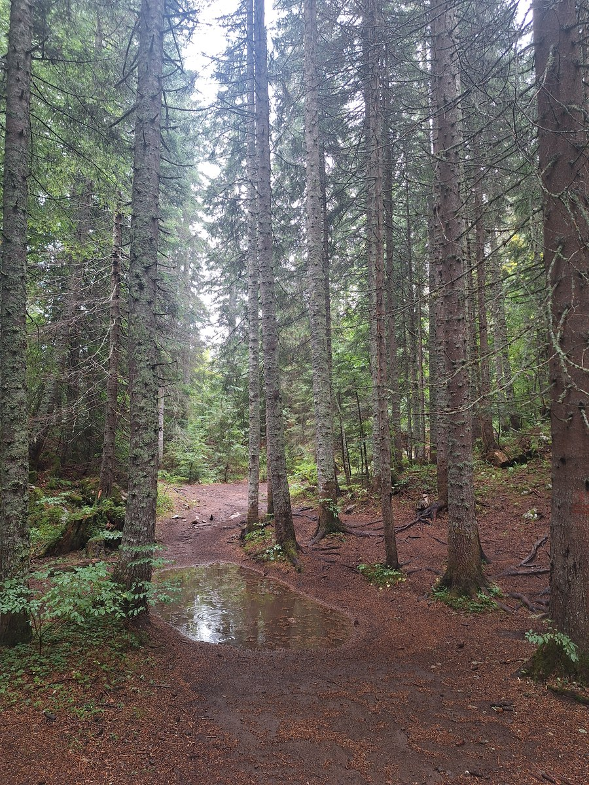
  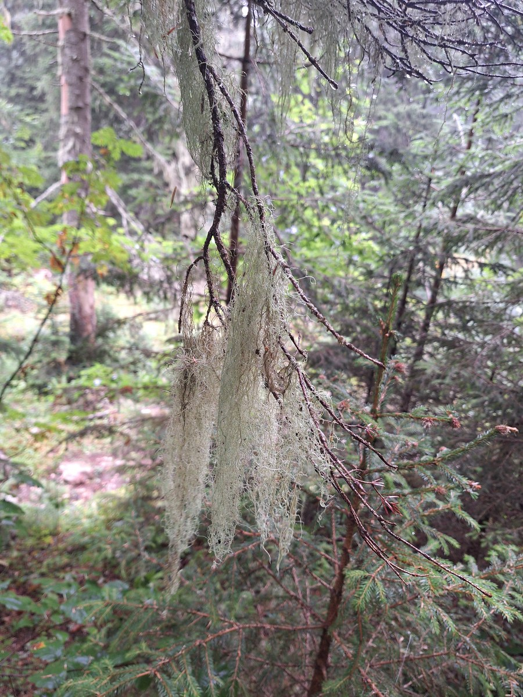

The lake itself didn't look particularly pretty, but it might look completely different in sunny weather, like the conditions we experienced over the following days (we noticed a huge difference when we visited Black Lake again in sunny weather). This lake might be a good destination for people looking for a quiet spot close to the famous Black Lake (just a 3 km walk away), which was full of tourists even on a rainy afternoon. Its name translates as "Snake Lake" because, according to an old legend, it was once inhabited by snakes. I had watched a youtube movie about snakes in this national park and was really hoping not to encounter any!

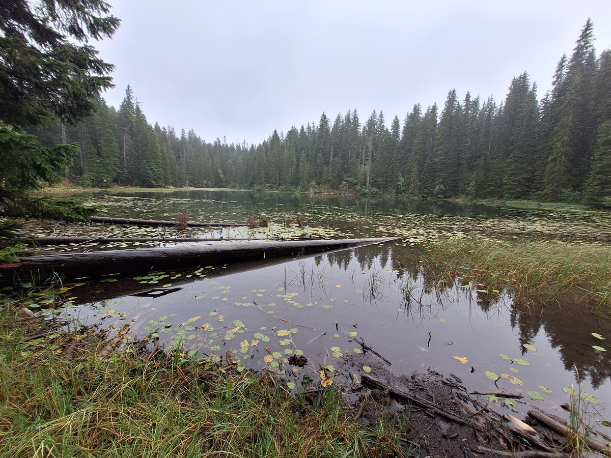

After passing the lake, the terrain became steeper, but the path continued through the forest. At one point, we reached our first large clearing, surrounded 
by a misty landscape: **Crepulj Poljana**. There were some small wooden huts that were falling apart and had been abandoned, making this place look very mysterious.

  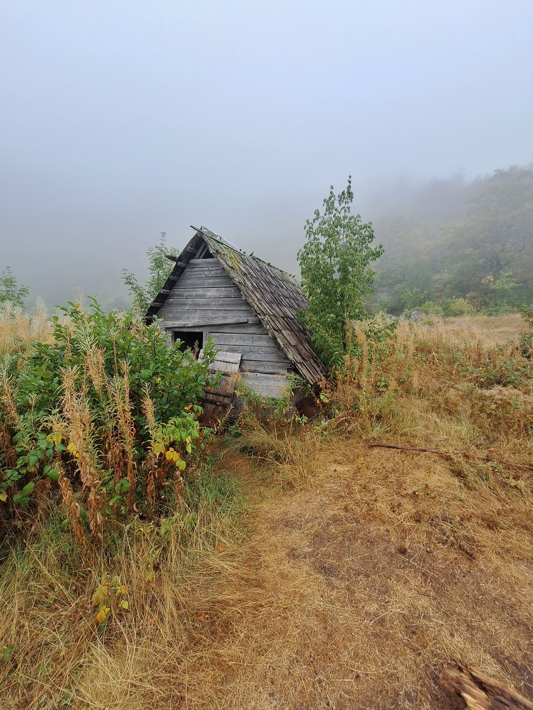
  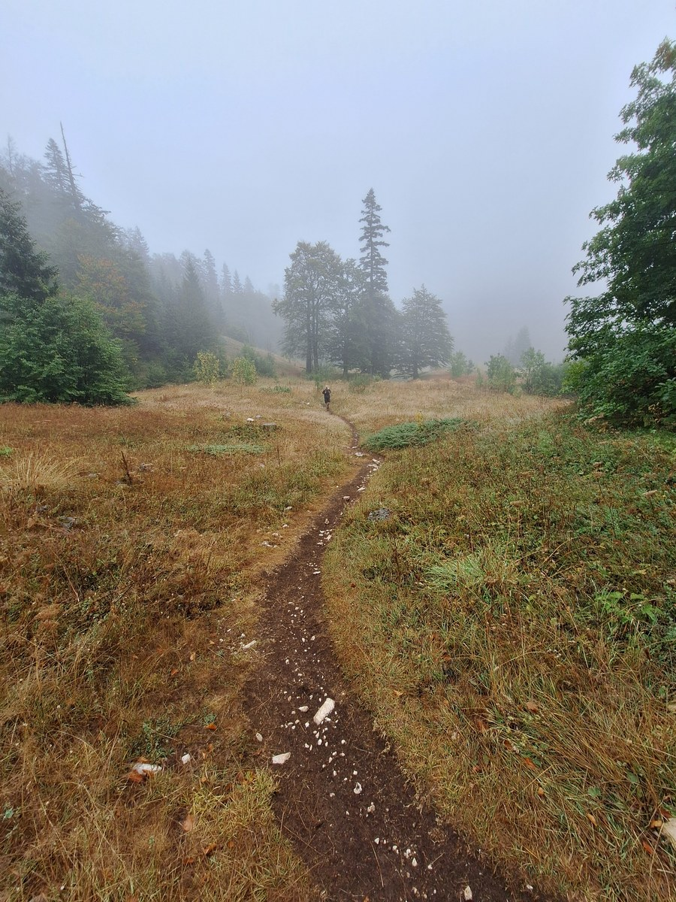

Beyond this point, the path became much steeper, with fewer trees and no forest cover, just more rocks, small trees and bushes. After some time, we came across a wooden sign pointing in two directions. 
The right-hand turn led to **Jablan Lake** (Jablan Jezero), which was our destination. From this point onwards, the path was very rocky but less steep. However, walking over huge rocks in the mist and occasional 
drizzle slowed us down considerably. It was also very easy to lose the path, which happened to us a few times. We ended up among very wet trees or in dangerous spots and had to turn around. Some sections 
were slippery, and the soil along the edges was unstable, so we had to be very careful because of the weather conditions. Waterproof hiking gaiters would have been very useful that day, but we had 
forgotten to bring them on this trip.

  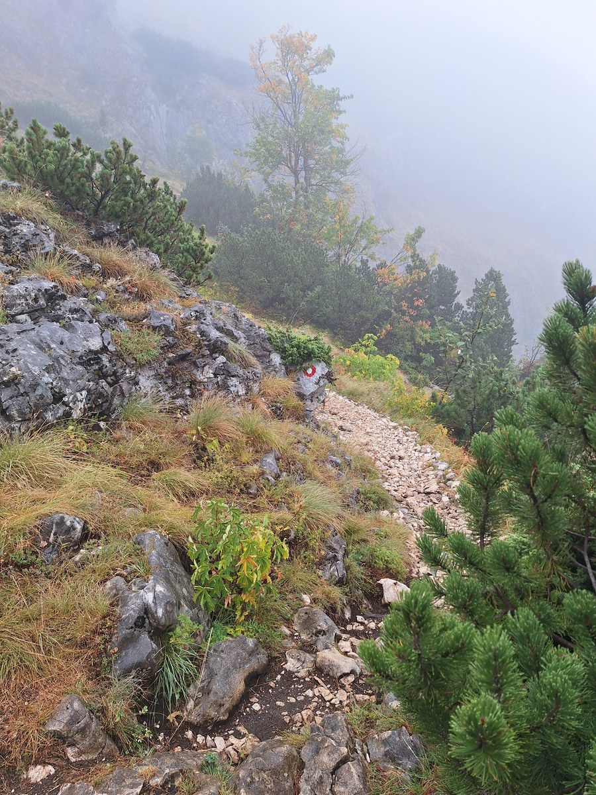
  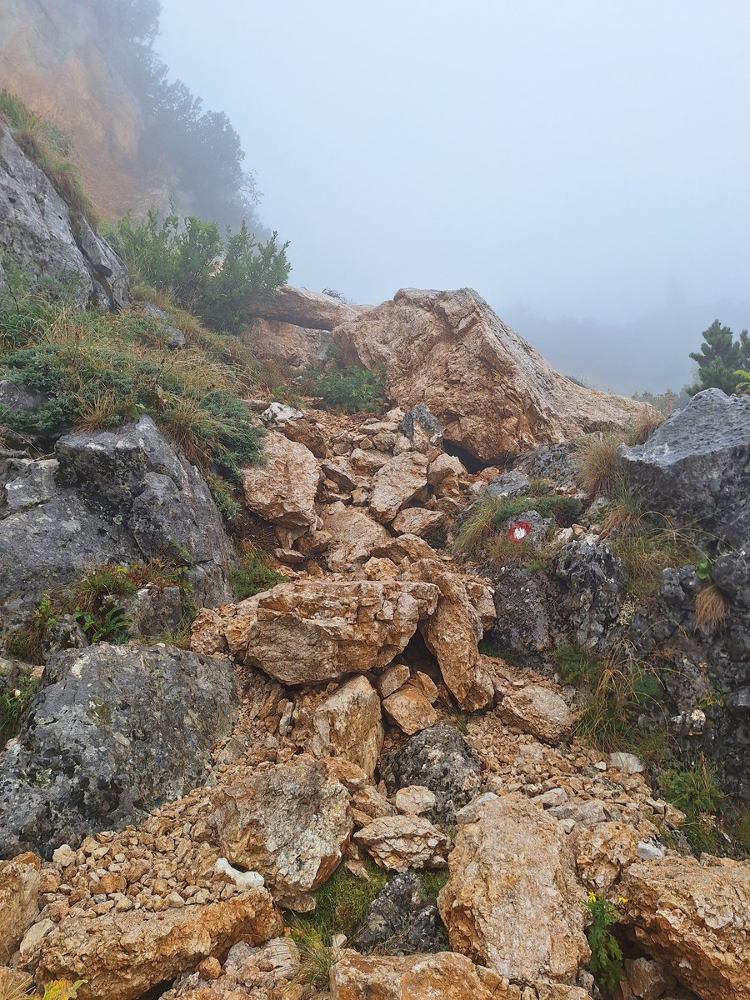

After following the last short, rocky section leading uphill again, we passed Red Rock (**Crvena Greda**, 2,164 m) without reaching the summit, as the path went around it. There was a way to reach the peak, 
but since the mist was very thick and we couldn't see anything anyway, we decided it wasn't worth the extra effort and additional risk in such bad weather conditions. We could clearly see this massif 
from the terrace of our apartment, but we only got a proper view of it the following day, when the weather finally turned sunny. It had a beautiful, warm orange colour when the sun was rising early 
in the morning, which is the reason why it is called Red Rock. It was now time to start descending, first over the rocks and then along a path that became easier and easier to walk on, but also muddier 
as we entered the forest again. We couldn't see any of the surrounding views, including the panoramic view of Jablan Lake, which should have been visible below us (possible to reach with additional detour). By this point, our shoes and socks 
were completely soaked, and the path had become very slippery. However, we had met only a few people during the last five hours, so it was very relaxing in the mountains: so quiet and peaceful.

  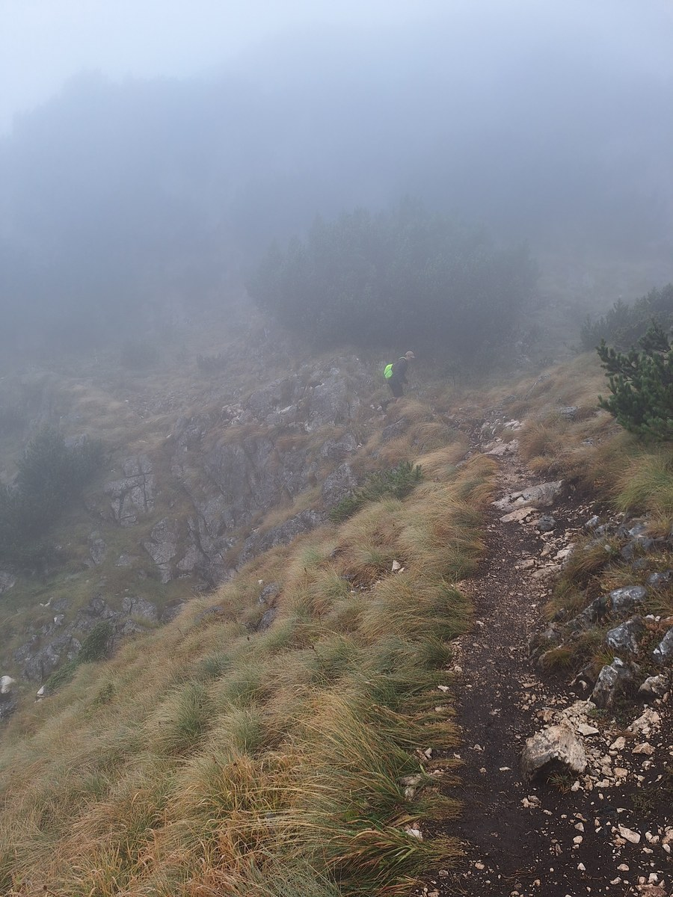
  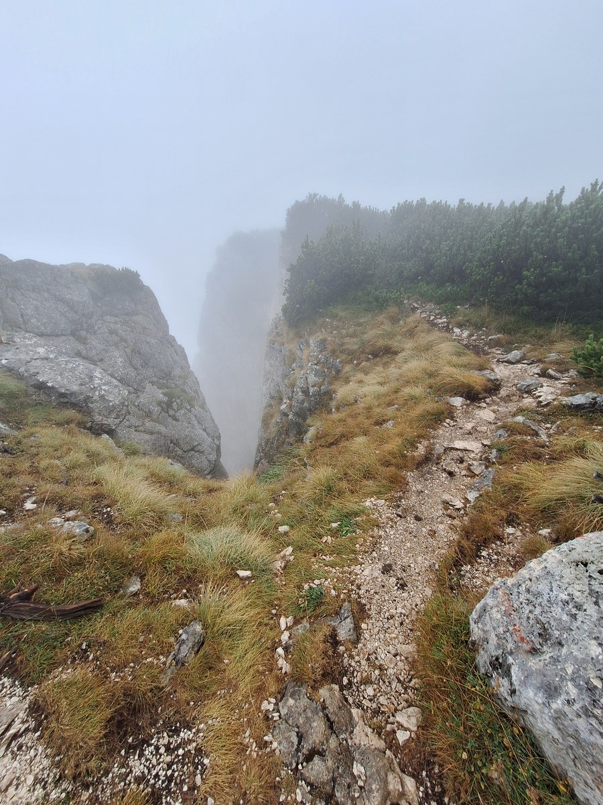

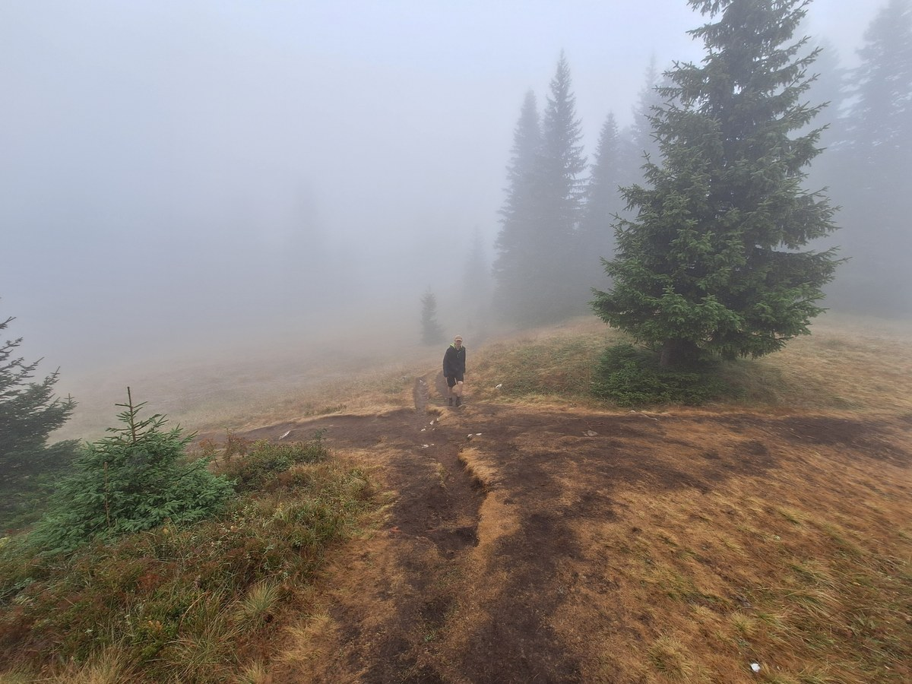

After passing **Barno Lake** (Barno Jezero), we reached another part of Zabljak, where a few campsites and small wooden houses for rent are located.
After changing our wet shoes for dry ones, we only had enough energy left to grab some takeaway food from a nearby food stand, rest and try to wash and dry our hiking shoes in preparation for the next 
day, which was going to be full of adventures as we were heading towards the highest peak of the country.

## Practical info:

**Taxi from Podgorica Airport to the city**

There were boards at the airport displaying fixed prices depending on the final destination. The fare to Podgorica was €20. However, we were surprised to see another couple getting into the taxi that the driver was taking us to. It looks like taxi drivers efficiently collect passengers travelling alone or in pairs and simply earn double the price for the same ride.

**Bus ticket from Podgorica to Zabljak**

We purchased our tickets online using the website [busticket4.me](https://busticket4.me/en). The process was easy, but it turned out that the connection we had selected was not available, and we had to take the next one instead. We were notified by email that our tickets were valid for any connection that day. The driver simply tore off part of each ticket and collected the tickets from all passengers. The bus was right on time, and it was easy to find the right one to take, as all buses were clearly marked with their destinations. What surprised us was that the driver was smoking on the bus towards the end of the journey. There are paid toilets next to the bus station, but the cleanliness was far from satisfactory.

[Bus station](https://maps.app.goo.gl/DfxDbLs7tQ8DqXe78)   
[Nice bakery nearby](https://maps.app.goo.gl/cdNVNr94A777WreW8)   
[Parking area](https://maps.app.goo.gl/RYuvdfY6ctsoh79P6) where the bus stops in Zabljak

**Groceries in Zabljak**

We were very lucky to have a large VOLI supermarket very close to our apartment, as well as a nice bakery that was also open on Sundays. The chocolate and cherry croissants were really nice, and they were quite big too, making them perfect for our hikes. There was another supermarket, Aroma Centar, at the entrance to the town from the main road. We noticed it when approaching Zabljak from Podgorica by bus, but it was smaller, so we wouldn't recommend going there. If you have rented a car, it makes sense to do your bigger grocery shopping in Podgorica, which has much larger supermarkets with a much wider selection of products. Supermarkets in Zabljak had a much more limited range.

Bakery [Pekara Maja](https://maps.app.goo.gl/nLeWmkAZ8qDJMnyY7)

**Entrance ticket to Durmitor National Park (Nacionalni park Durmitor)**

Day ticket: €5.00 per person per day
Annual Parks Pass: €13.50 per person (covers all national parks in Montenegro and is issued to individuals with an ID).

Note that we couldn't purchase this ticket online (online sales of annual tickets for 2026 are currently suspended). It turned out that it was only available in Zabljak, at the information centre in the city centre, and not at the ticket office at the main entrance to Black Lake. Therefore, we had to buy day passes on the first day, which were immediately validated using a scanner. You should still keep your ticket with you throughout the day in case you encounter park rangers elsewhere in the park. For the following day, we bought day tickets online and saved them in our Google Wallet. A park ranger was patrolling Sedlo Pass when we arrived by taxi, but he asked us to show our tickets on our phones. I didn't even manage to open them in my wallet before he let us pass, so he didn't scan the QR code to validate the tickets. Therefore, we used the same tickets again on subsequent days when walking around Black Lake, and they were successfully scanned at the ticket office next to the lake. We had read that park rangers sometimes walk along the more popular hiking paths and check visitors' tickets. It feels like the system isn't working very well, and it would be very easy to simply buy a one-day ticket and try to use it every day until someone checks it with a scanner, like the ranger at Sedlo Pass. There are many paths leading to Black Lake, so it's easy to avoid the ticket office.

[Information centre](https://maps.app.goo.gl/XiwYiWqXVsY3gnn46) where you can buy annual tickets
Day ticket available [online](https://buy.prestopay.me/en/p/ON9NM3)

**Weather**

The weather wasn't great, as the first two days were rainy and wet. These were also the first few days with this kind of weather after a very hot summer. Podgorica was still extremely hot, and the climate changed very rapidly during the last 20 km of the journey. Luckily, we chose the day with the most stable weather for our most demanding hike. Two out of the three full days in Zabljak were rain-free, but we had exhausted ourselves with demanding hikes during the first two days, so we had to choose an easier hike for the last day. It would have been great to switch our plans for the first and third days, but the weather was difficult to predict. We found this website, where you can check the weather forecast for specific peaks, and it worked better for predicting the weather on the second and third days:

[Meteoblue](https://www.meteoblue.com/en/weather/week/bobotov-kuk_montenegro_3203879) forecast for Bobotov Kuk

**Hike details**
Our GPX track: [download](/assets/Montenegro/First-hike/RK_gpx%20_2026-09-12_0957.gpx)  
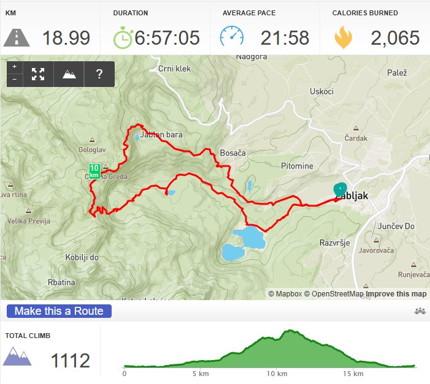

**Budget Overview (for 5 days, 2 adults)**

| Category | Total Cost (€) |
|-----------|---------------:|
| Flights | 256 |
| Transportation (taxi, bus) | 105 |
| Accommodation | 207 |
| Restaurants | 120 |
| Groceries | 66 |
| Activities | 20 |
| **Total** | **774** |

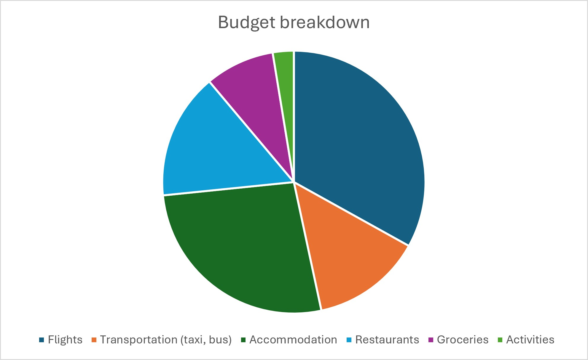

**Accomodation**

The AirBnb [place in Podgorica](https://www.airbnb.com/rooms/1313189502927486870?guests=1&adults=1&s=67&unique_share_id=cc3797c3-f70f-4737-8bea-2ad1b0f86077)
we are happy to recommend due to perfect location, safety and cleanness.
We weren't particularly happy with the place we found on Booking.com in Zabljak. However, we hadn't booked our accommodation well in advance, as we usually do, since this was a spontaneous weekend trip. The good thing about the apartment was its location: very close to a supermarket and the main road leading to Black Lake, where most of the hikes start. Unfortunately, the apartment had a serious condensation problem, with a lot of water accumulating on the inside of the windows. It constantly felt too humid, and we couldn't dry our clothes at all, even with an electric heater. I can only imagine that this problem would become even worse in winter.