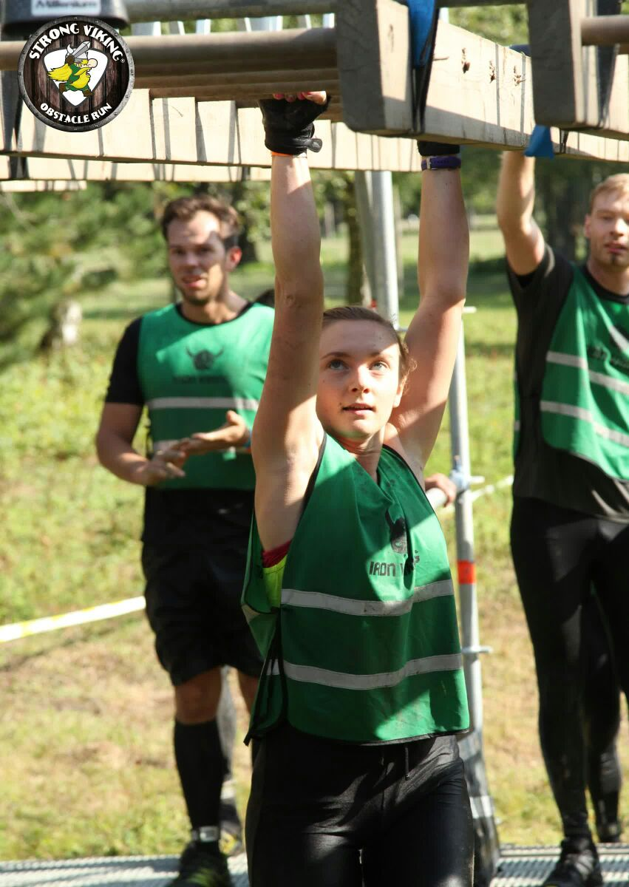
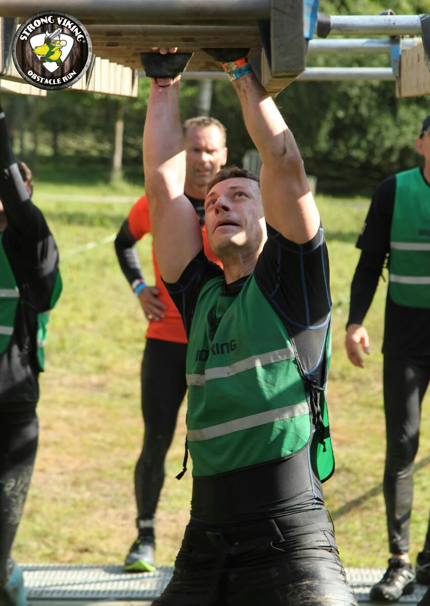
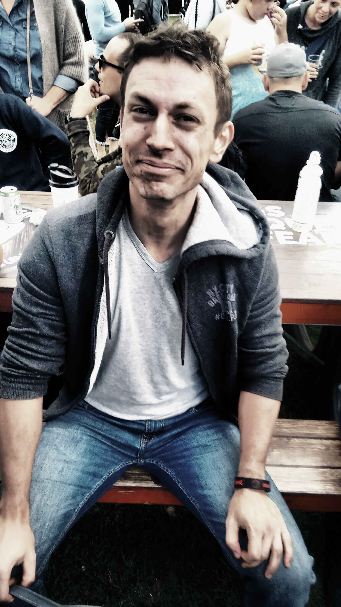
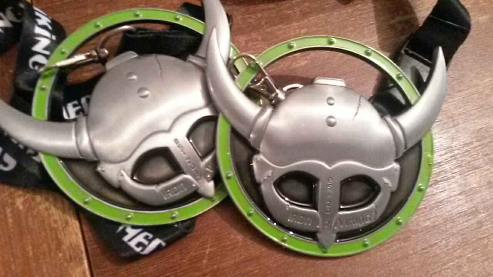
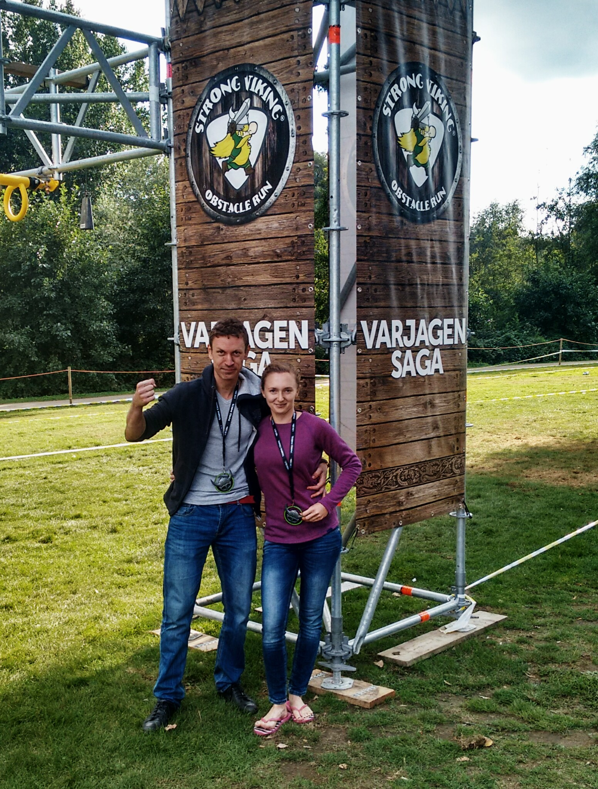

"Dit doen we nooit meer!" dat besloten we na ongeveer 32 km (al vloekte ik een jaar geleden, tijdens onze
eerste poging, precies hetzelfde :p). Dit jaar waren we snel genoeg om niet uit de wedstrijd gehaald te worden en finishten we de
Iron Viking (Water Edition) in 6 u 54 min. Het doel was om een volledige marathon met +100 obstakels binnen 7,5 uur te lopen.
De obstakels waren erg divers. Bij sommige had je vooral kracht nodig om zware gewichten op te tillen en te sleuren (die waren
makkelijker voor Sebastian). Ik gaf duidelijk de voorkeur aan de obstakels met ringen, metalen buizen en touwen om je aan voort te bewegen. Voor mij,
als klimster, waren die makkelijker, maar nog altijd een flinke uitdaging en enorm veel plezier!

De monkey bars horen bij de makkelijkere obstakels... maar tijdens de tweede ronde (na 29 km lopen) werd het
toch een pak lastiger :p

Doordat er plots geen water meer was in de douches, moesten we de hele terugweg van het evenement behoorlijk vuil
afleggen :p

We zijn erg trots op jullie, Vikingmedailles! OORAH! :D

De pijn bleef nog enkele dagen hangen, bij Sebastian iets langer, maar de herinneringen aan deze run koesteren we voor altijd.

