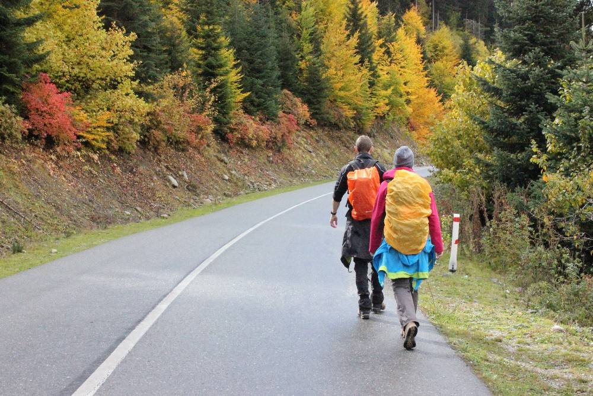
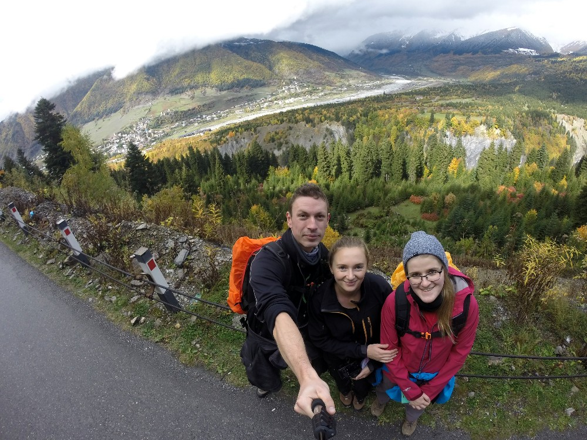
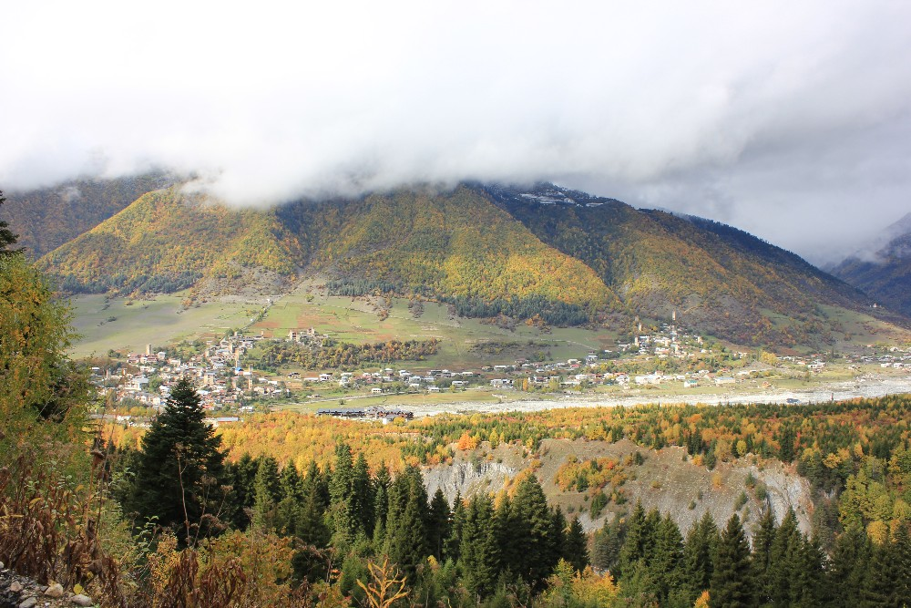
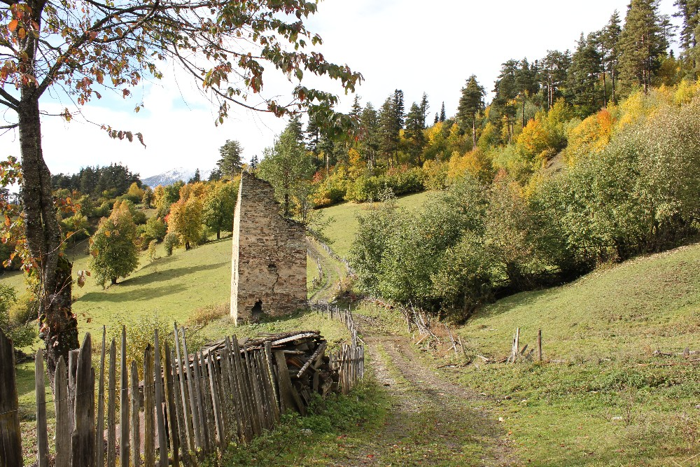
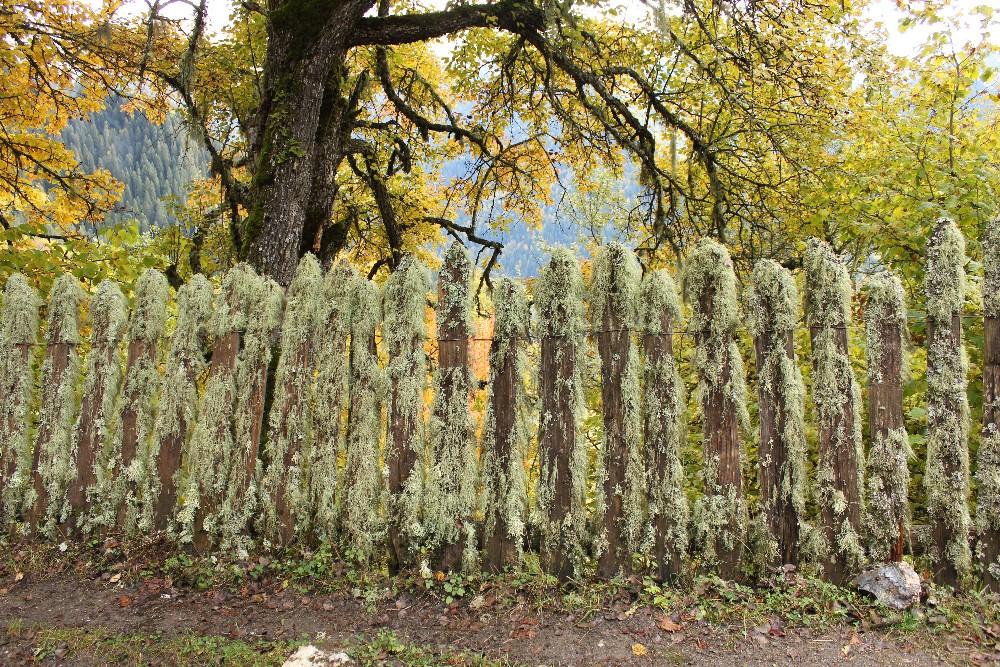
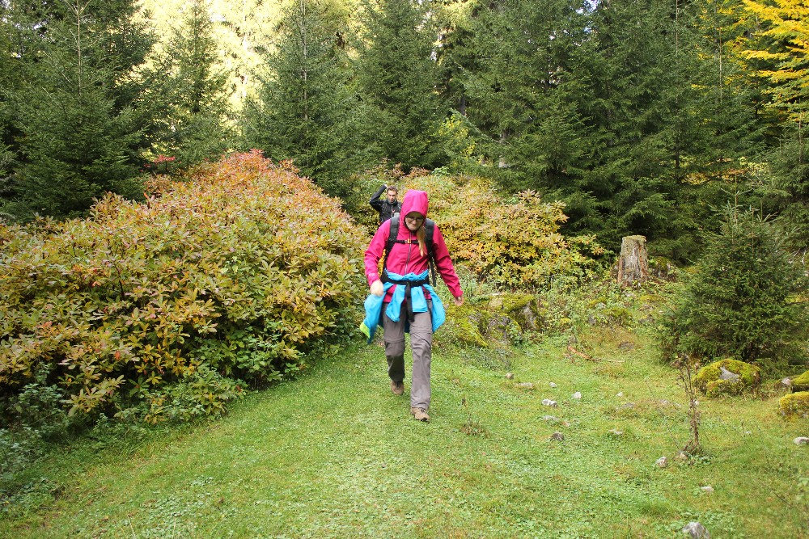
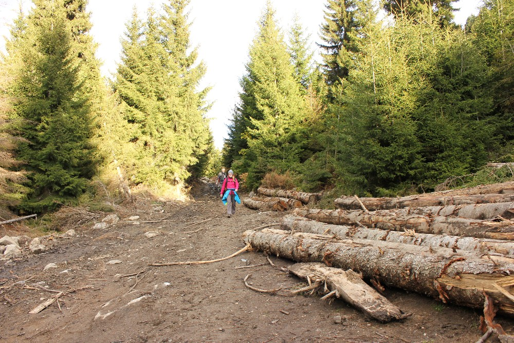
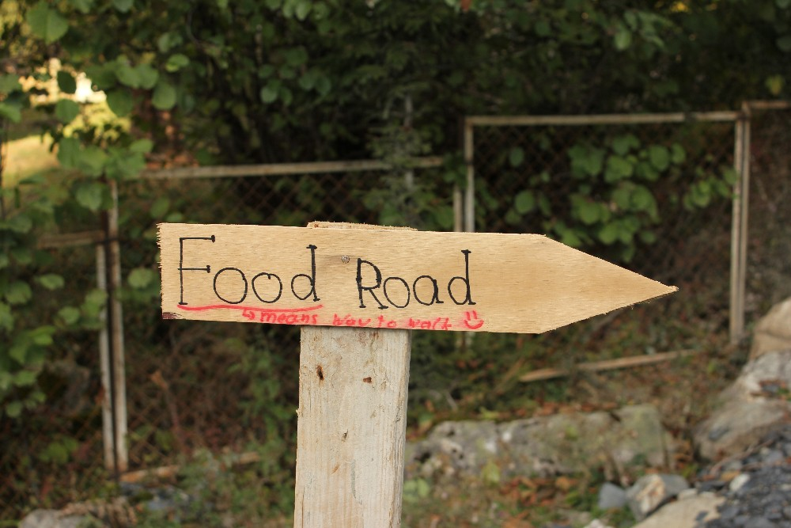
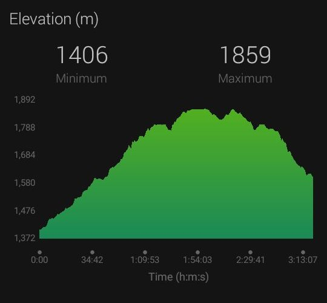
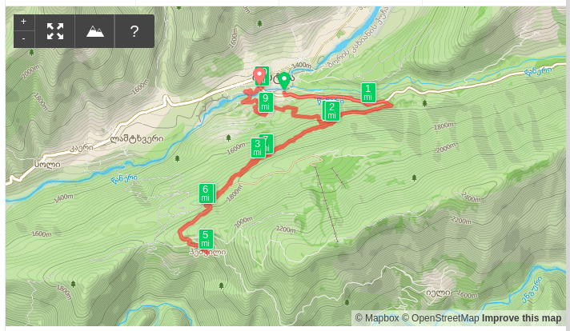

Eindelijk, om 13 uur hield het op met regenen en konden we aan onze eerste wandeling in Georgië beginnen! :D
herfstkleuren

De wandeling, in de richting van het kabelbaanstation van Hatsvali, is ongeveer 7 km lang en je kan er makkelijk een
taxi naartoe nemen om wat tijd te winnen. Het stuk langs de weg is namelijk niet het boeiendste.

Ons team :)

Een mooi uitzicht over heel Mestia, met ook het kleine vliegveld waar we later onze vlucht naar Koetaisi namen.

Omdat de kans klein was dat de kabelbaan door het slechte weer zou draaien, verlieten we de
betonweg en volgden we het pad naar het uitkijkpunt Heshkili. Met wat kleine, oude hutten eromheen en weiden
vol koeien leek het wel een plek die iedereen allang vergeten was.

Wat ik als bioloog erg interessant vond, zijn de korstmossen die op de omheiningen en boomstammen groeien. Deze
soorten zijn gevoelig voor luchtvervuiling, en dat ze hier in zulke dichte slierten naar beneden hangen, zegt genoeg over hoe zuiver de lucht is!

Op de terugweg naar het dorp zagen we links een pad dat ons naar dezelfde plek zou moeten brengen, maar dan weg
van de betonweg en door een veel boeiendere omgeving. Over het algemeen was het hoofdpad makkelijk te volgen, al moesten we
een paar keer door struikgewas ploeteren of op het einde een open plek oversteken.

Dit houten bordje markeert het begin van de kortere weg door het bos. Op de heenweg hadden we het niet opgemerkt,
want er ligt een werf omheen die het echt lastig maakt om het te vinden!

De wandeling was niet zwaar, maar precies goed voor de eerste dag, ondanks de afstand van 17 km. Heb je meer tijd, dan
kan je ze verlengen van het uitkijkpunt Heshkili naar het bovenste kabelbaanstation (het pad dat naar links gaat)
of zelfs verder richting de Mentashi-piek (volgens de kaart en de tips van anderen).

