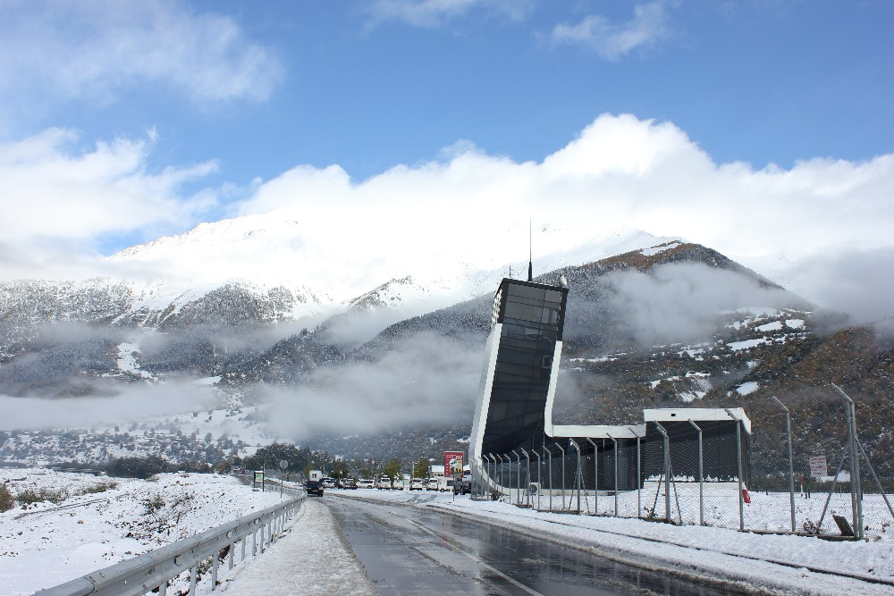
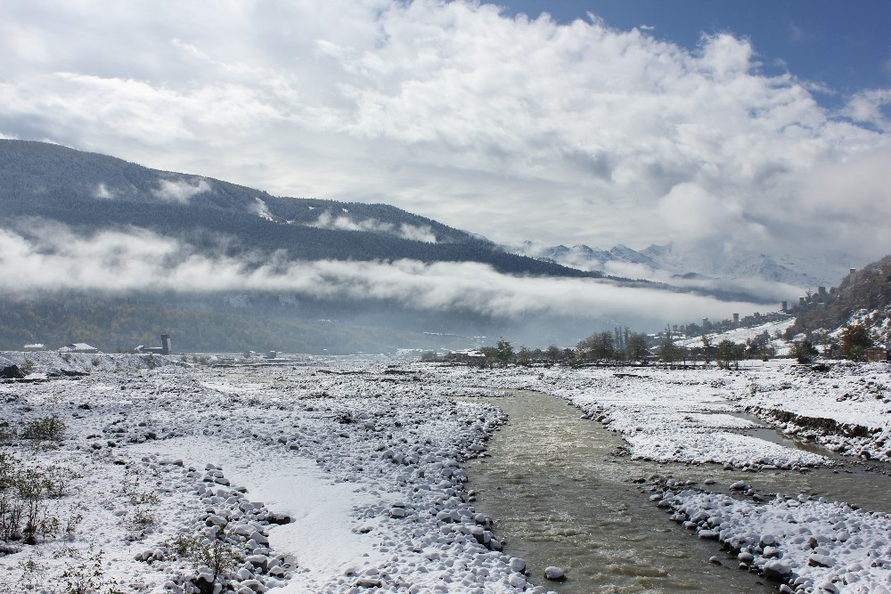
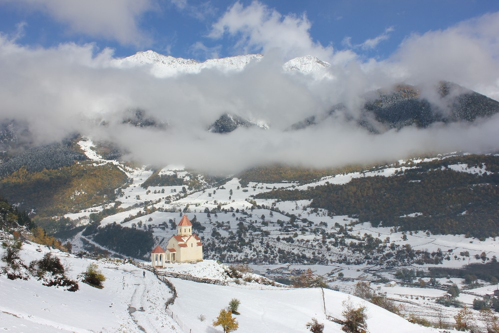
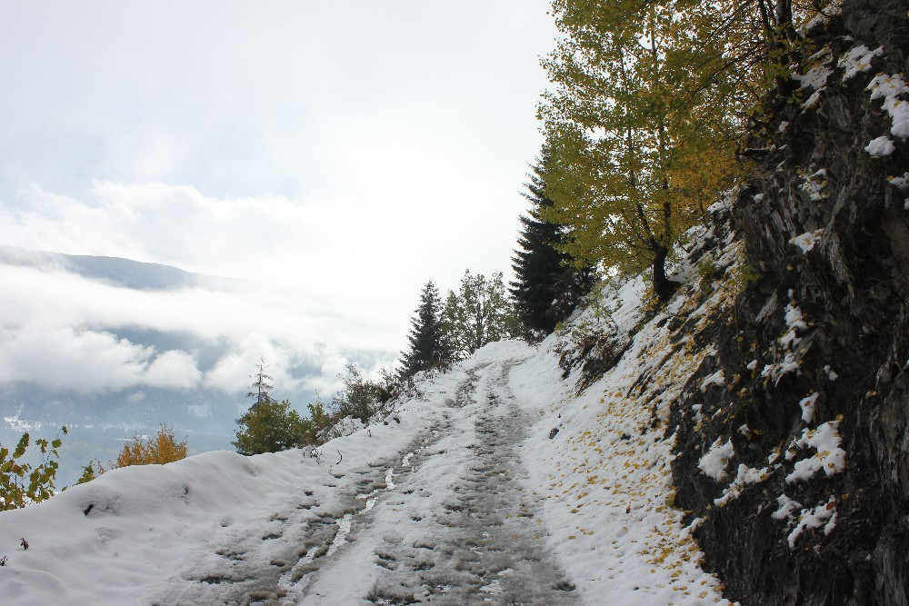
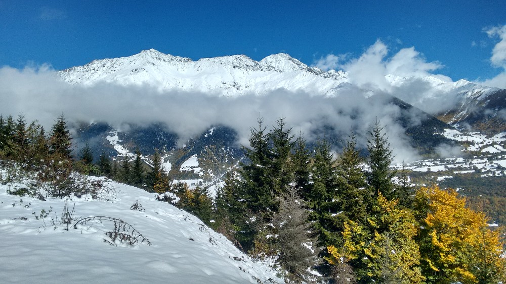
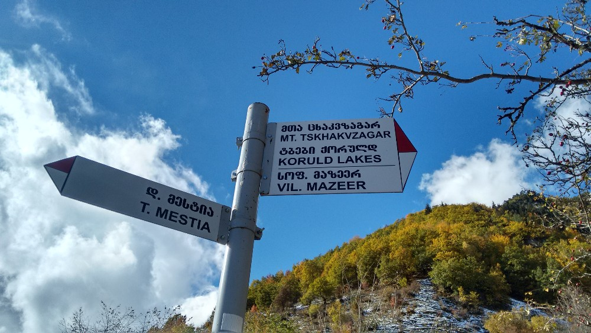
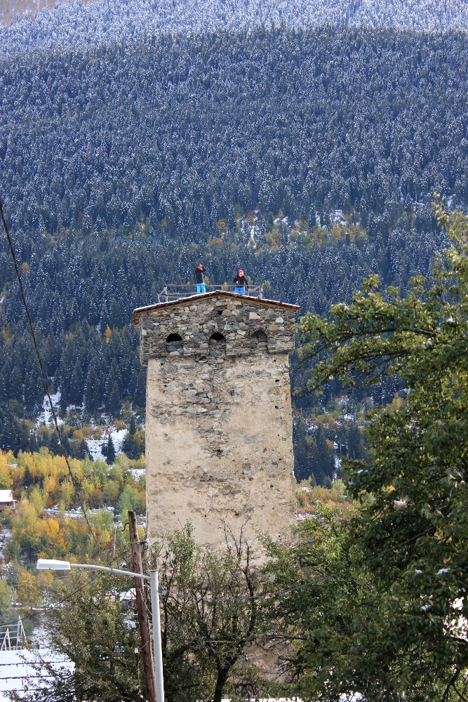

De ochtend verwelkomde ons met sneeuwval! In Duitsland was de herfst amper begonnen, dus we stonden echt versteld
van het witte landschap rondom ons. Zodra de sneeuwval eindelijk ophield, besloten we een korte wandeling te maken naar de kerk die we op een heuvel
aan de overkant van het dorp zagen liggen. Zoals altijd bij mij werd dat uiteindelijk een wandeling van 10 km met 500 m hoogteverschil :p

Eerst moesten we voorbij Queen Tamar Airport in Mestia, en dat ziet er behoorlijk straf uit! Ik moet toegeven dat ik dol ben op de
ligging van deze luchthaven, zo dicht bij de bergen!

Daarna slaat het pad links af en steekt het de rivier de Mulkhra over.

Het pad begint vlak bij de kerk en kronkelt over de steile flank van de Tskhakvzagari, een top van 2359 m hoog.

In de zon werd het warmer, de sneeuw begon te smelten ... waardoor we het grootste deel van de tocht glijdend hebben afgelegd, over een mengeling van
modder (met koeienvlaaien erdoor?) en sneeuw. Niet meteen ideale omstandigheden!

Maar zodra de lucht openbrak en we de besneeuwde toppen rondom ons konden bewonderen, dachten we niet meer aan
de modder. Het uitzicht was werkelijk prachtig!

Na ongeveer 2 u. wandelen komt het pad uit op het pad dat naar de Koruldimeren leidt. Dat hebben we gebruikt om terug naar Mestia af te dalen.
Dat stuk was erg steil en in combinatie met de modder werd het een hele uitdaging om niet te vallen.

Je kan sommige torens in Mestia bezoeken en er zelfs bovenop klimmen, maar de wiebelende, oude ladders konden ons daar niet toe
verleiden. Let op de bovenste verdieping na de sneeuwval, die kan erg glad zijn!

## Praktische info:
  * toegang tot de Khergiani-toren – 2 lari
