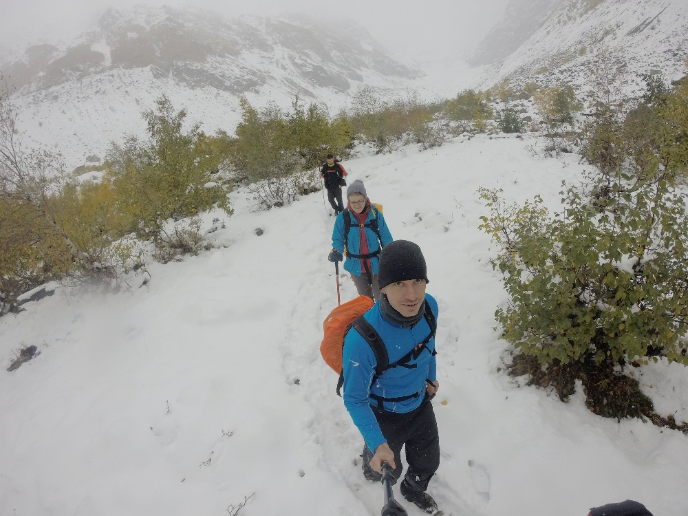
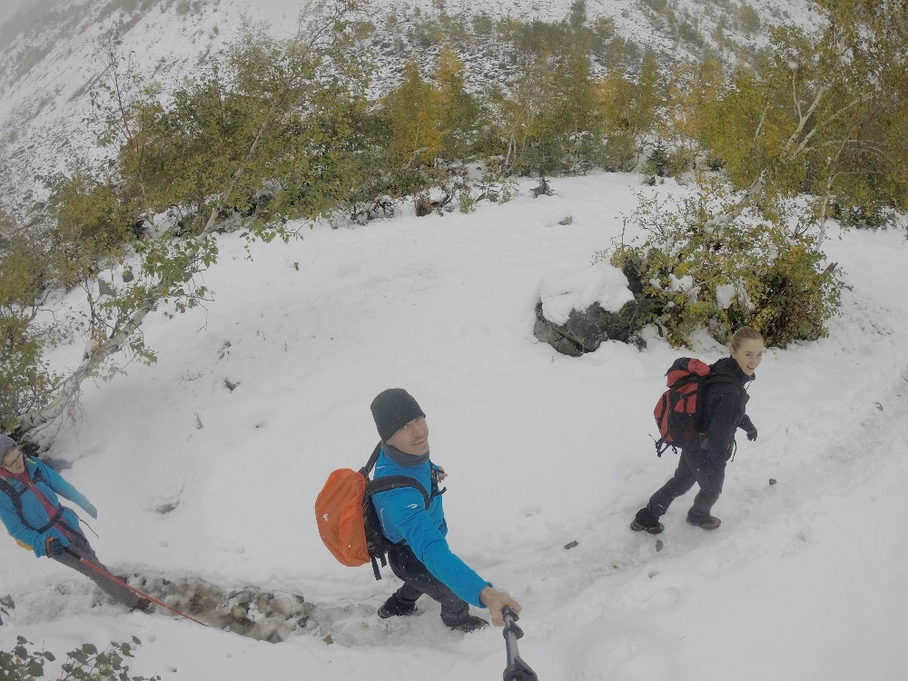
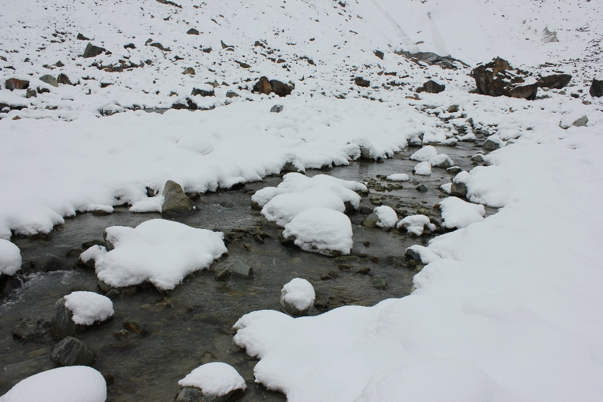
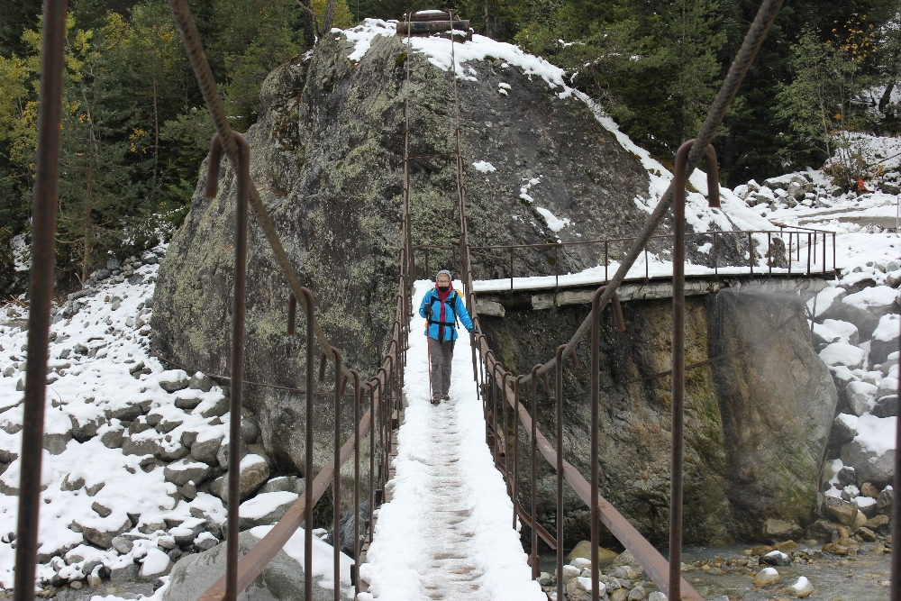
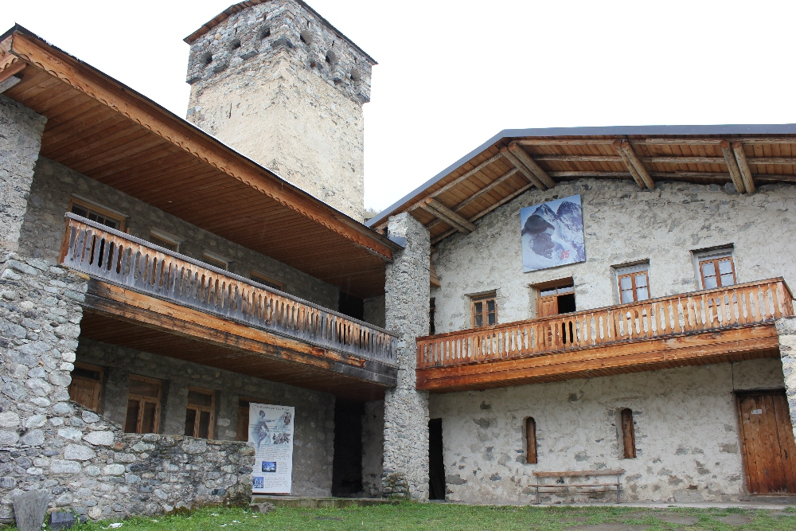
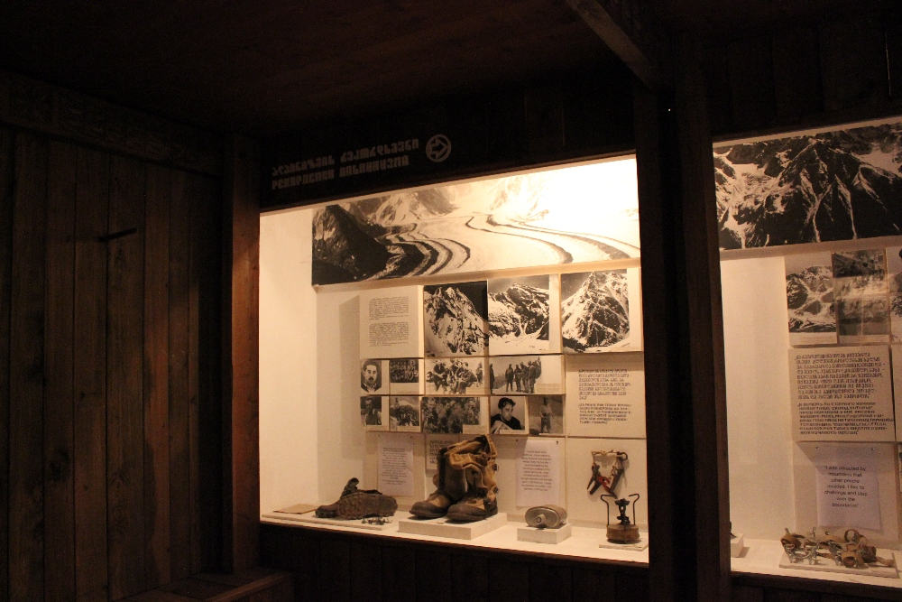
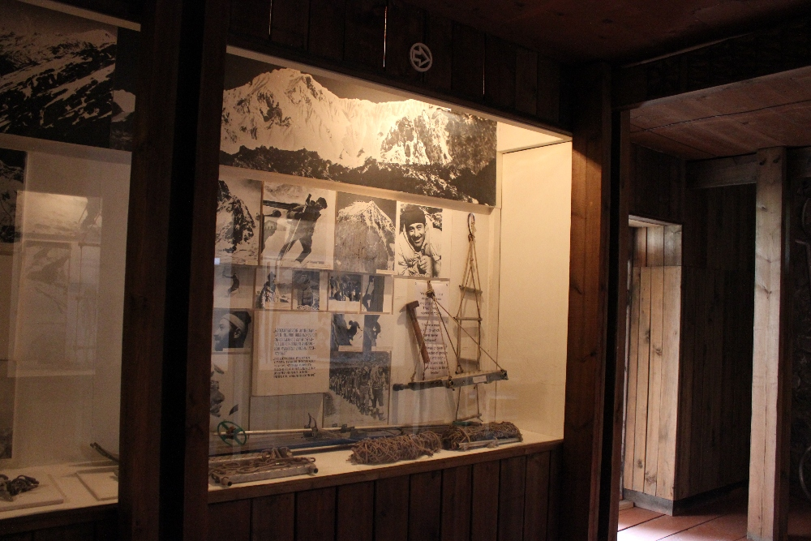
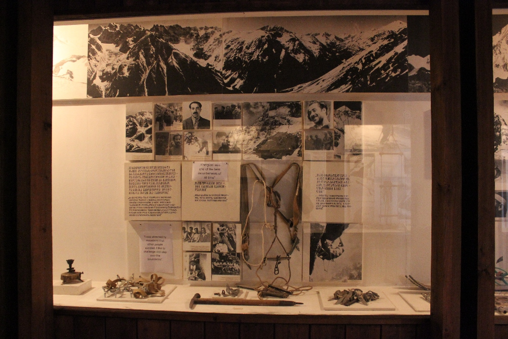

Een van de populairste bestemmingen voor een wandeling in de buurt van Mestia is de Chaaladi-gletsjer. Je geraakt er met een
heel makkelijke wandeling langs een onverharde weg, die sommigen zelfs saai zouden noemen. Luidruchtige camions, die af en aan
reden naar een mysterieuze werf in de streek, maakten er een eerder onaangename ervaring van. Gelukkig werden we van die eerste
kilometers gered door een vriendelijke Brit die ons spontaan een lift aanbood tot aan het begin van het pad naar de gletsjer, een
aanbod dat we met plezier aannamen! Aan het einde van de weg ligt een parking waar we de auto achterlieten en na het oversteken
van een oude, smalle, ijzige brug kon de echte wandeling beginnen. Het pad van bijna 7 km (heen en terug) loopt door het bos.
Jammer genoeg zorgden zware wolken die dag voor heel slecht zicht en dus geen schitterende uitzichten.

Omdat onze wandeling die dag heel kort bleek te zijn, besloten we een van de drie musea in Mestia te bezoeken en kozen we voor het
Mikheil Khergiani House Museum. De keuze lag voor de hand, ik kon mijn kans om het huis van deze legendarische Georgische alpinist
te bezoeken toch niet laten liggen :) Het museum toont een collectie oude klimuitrusting, persoonlijke spullen van deze klimmer, veel
foto's, medailles die Khergiani in ontelbare wedstrijden won en andere aandenkens. Hij werd door de Sovjet-Unie geëerd voor zijn
prestaties. Hij stierf tijdens een van zijn beklimmingen in de Dolomieten, op 37-jarige leeftijd. Hoewel het museum niet erg groot is,
maakt het duidelijk welke opmerkelijke beklimmingen hij deed en hoeveel invloed hij had op andere naties, en dan vooral op de Britten,
die hem "de tijger van de rotsen" noemden. Je kon er bovendien een van de kenmerkende torens van Mestia bezoeken (die met het museum
verbonden is) en zien hoe de mensen daar meer dan 60 jaar geleden leefden.

## Praktische info:
  * Toegang tot het museum - 3 lari
