Eindelijk zonnige dagen, en die kans lieten we niet liggen voor nog een trektocht. Deze keer was het het eerste deel van de vierdaagse tocht
 naar Ushguli. In het begin loopt het pad langs Hotel Tetnuldi, waar we in de verte nu al een fantastisch uitzicht op de Ushba hadden!

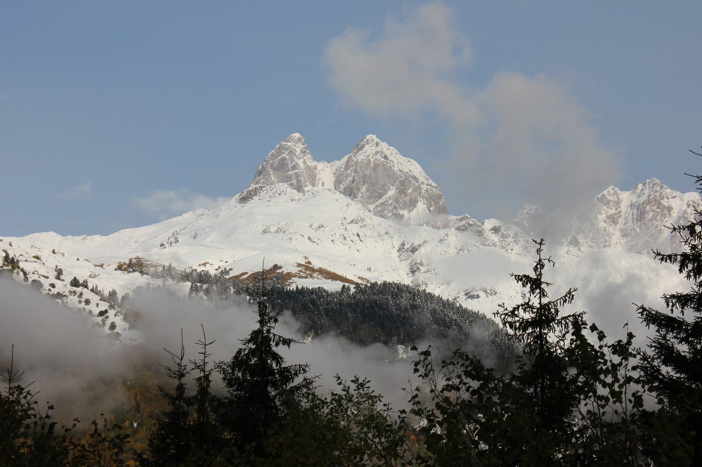

In tegenstelling tot de dag ervoor konden we dankzij een perfect heldere hemel verschillende bergketens zien. Na een tijdje kwamen we een kudde
 wilde paarden tegen, die totaal geen aandacht aan ons besteedden. Ze zien er prachtig uit met de bergen en het dorp Mestia op de achtergrond.

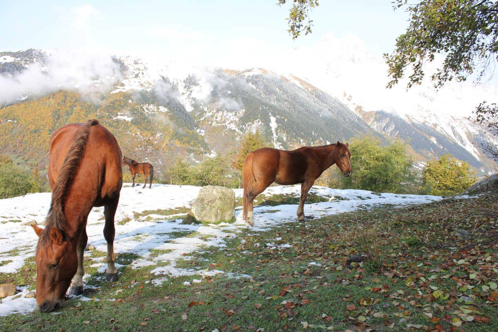

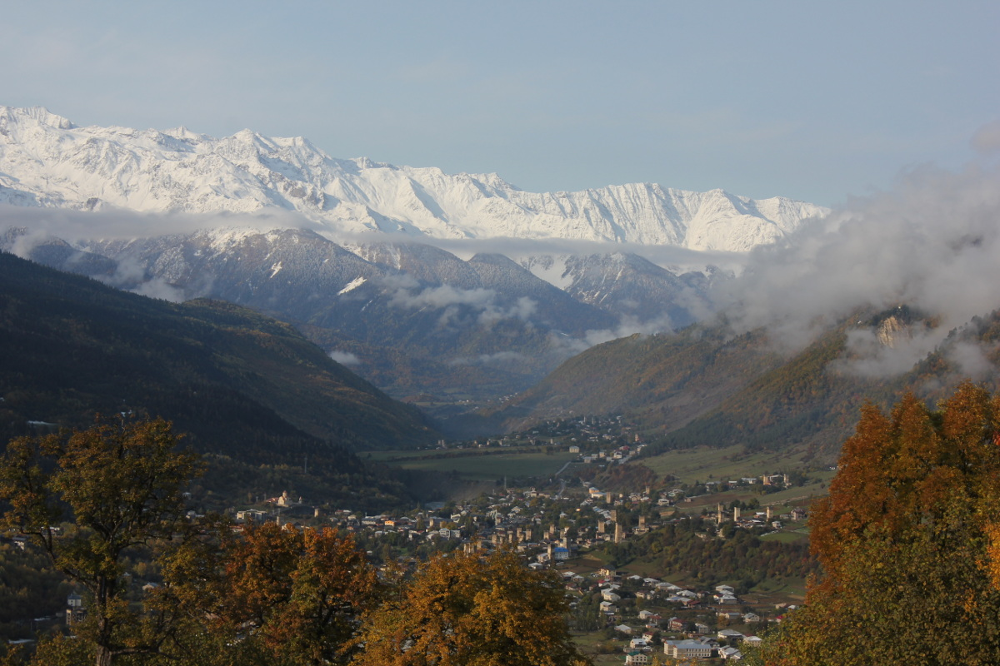

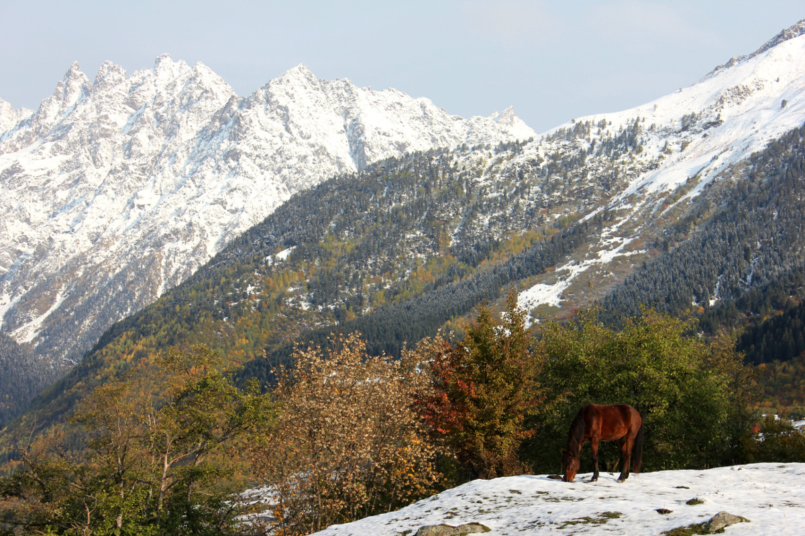

Een breed pad leidde ons enkele kilometers door de velden tot aan een houten wegwijzer die de richting naar de nabijgelegen dorpjes aangaf. Wij
gingen rechtdoor, waarna het pad heel smal, modderig en steil werd. Takken en dicht struikgewas maakten dit stuk het lastigste van allemaal. Daarna
werd het pad opnieuw gemakkelijk en aangenaam, en splitste het zich in een paar varianten die allemaal dezelfde kant op gingen.

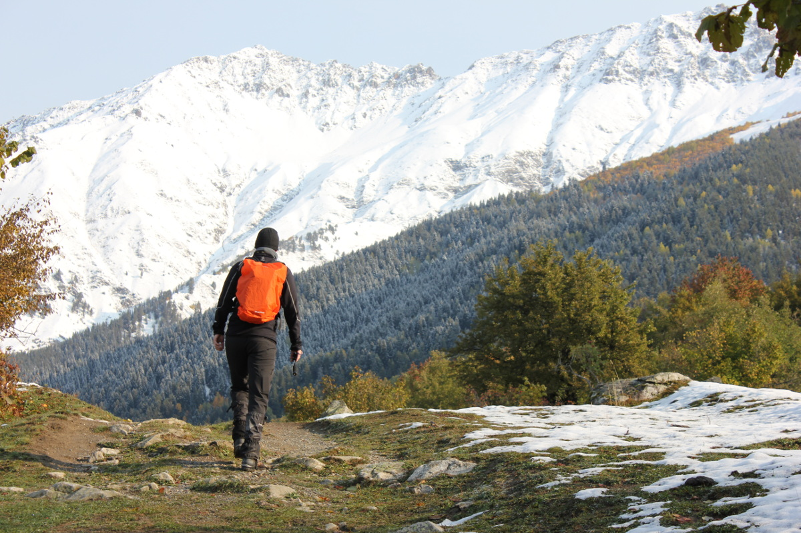

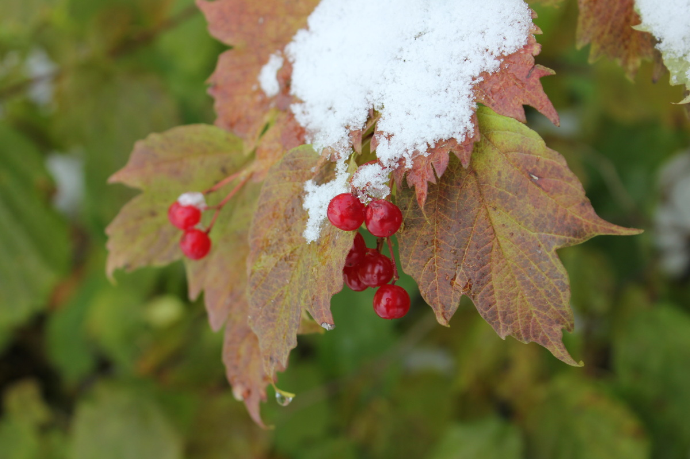

In de verte zagen we de enige weg naar Ushguli, met zware vrachtwagens erop. Enkele dorpjes in de vallei zagen er behoorlijk oud en
vervallen uit, al stonden de torens die zo kenmerkend zijn voor deze streek nog altijd overeind. Op een bepaald moment besloten we terug te keren naar
Mestia, en uit nieuwsgierigheid kozen we de weg door een van de dorpjes lager in de vallei. De gebouwen leken verlaten
en we zagen er niemand, op één blaffende hond na. Op de smalle paadjes in het dorp kwamen we in tien centimeter diepe modder vast te zitten,
gelukkig viel er niemand in! We besloten grotendeels dezelfde weg terug te nemen om nog meer modderige en onaangename verrassingen te vermijden :) We kwamen
tijdens deze erg fijne wandeling van 20 km op die stralende, warme dag maar een handvol toeristen, wat paarden en één hond tegen.

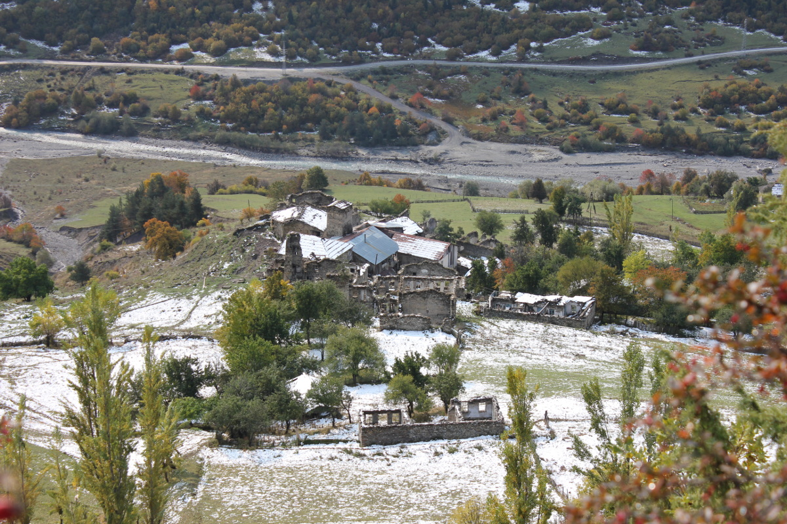

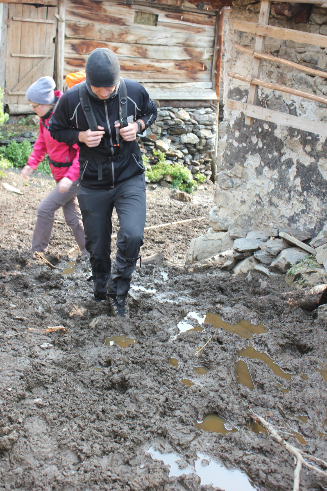

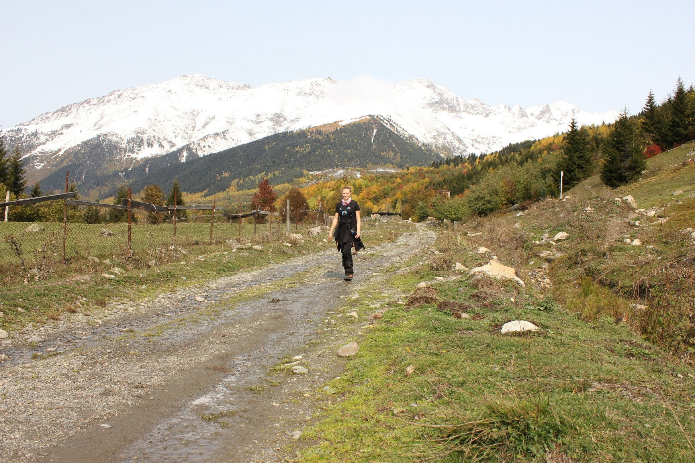

Zoals altijd sloten we de wandeling af in een van de restaurants in Mestia, wachtend op een stevige maaltijd om de inspanningen van de dag te compenseren. Deze keer
 kregen we als voorgerecht koud geserveerde courgetterolletjes met een vulling van knoflook-walnotenpasta :)

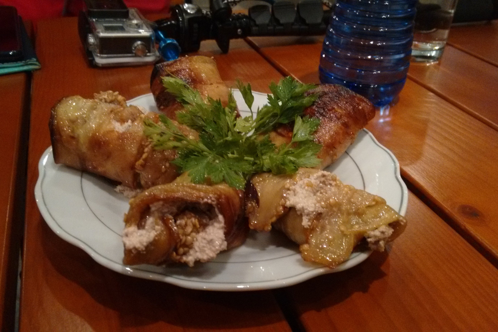

## Praktische info:

Op de kaart hieronder zie je onze wandeling en de afstand. We deden er bijna 3 uur over om er te geraken en ongeveer evenveel (pauzes inbegrepen) voor de terugweg.
We haastten ons niet, we genoten gewoon van de dag.

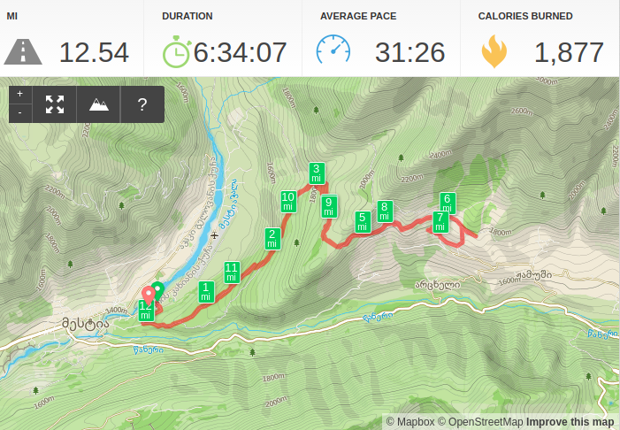

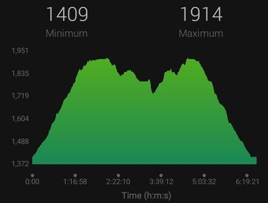

