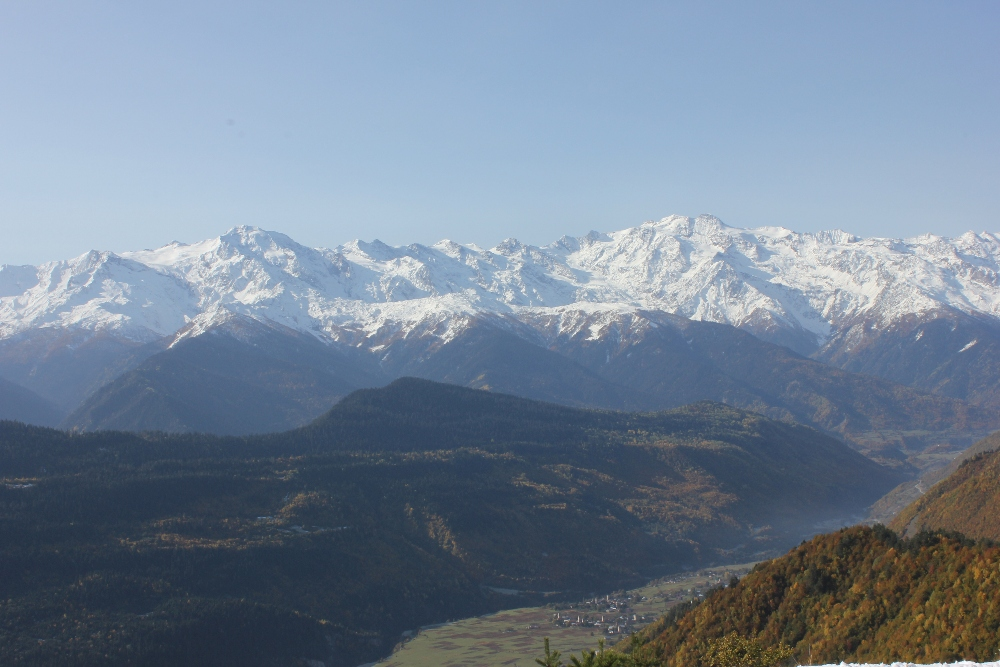
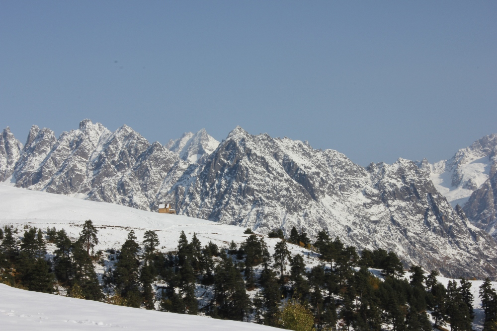
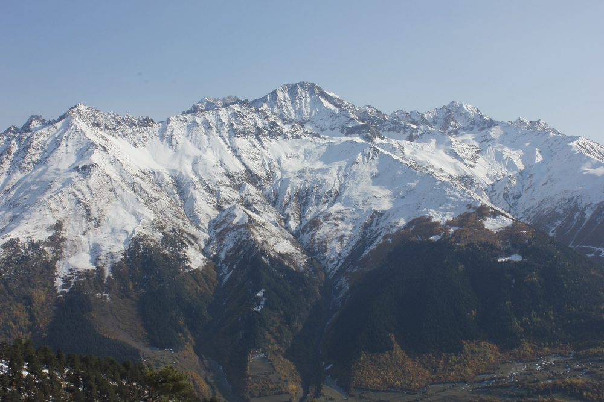
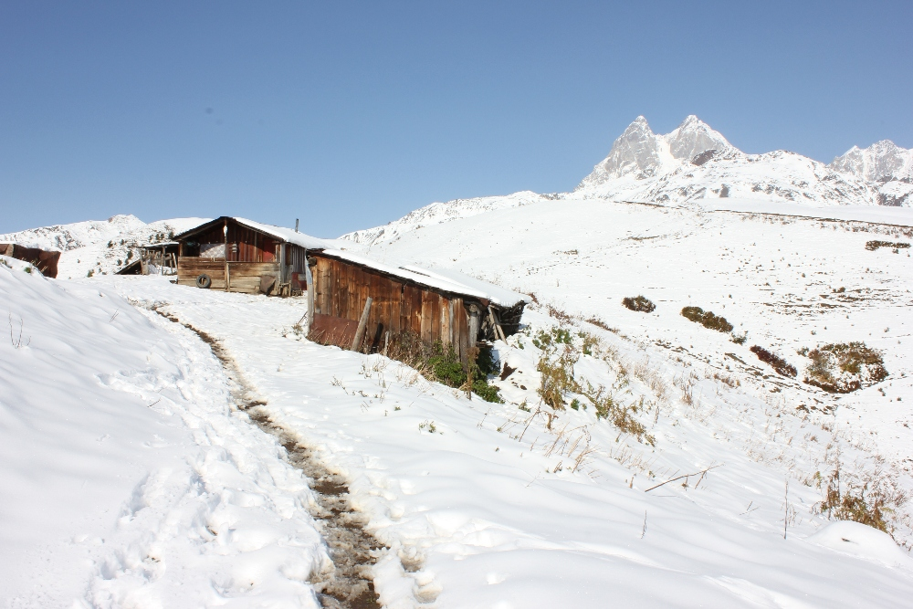
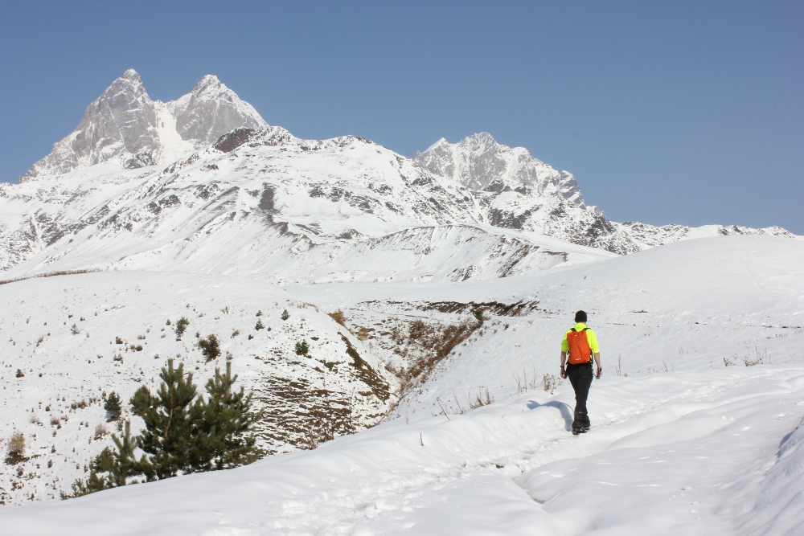
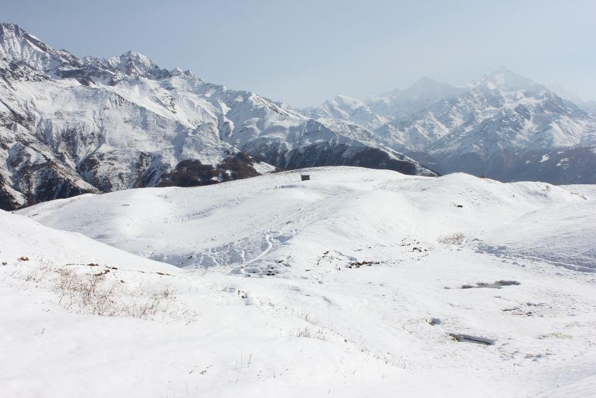
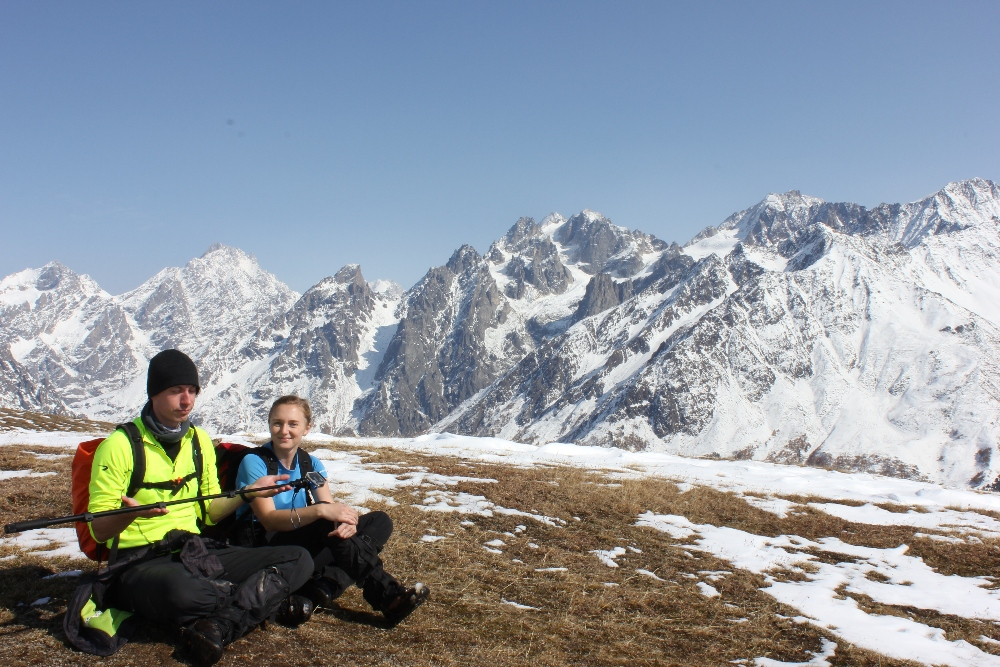
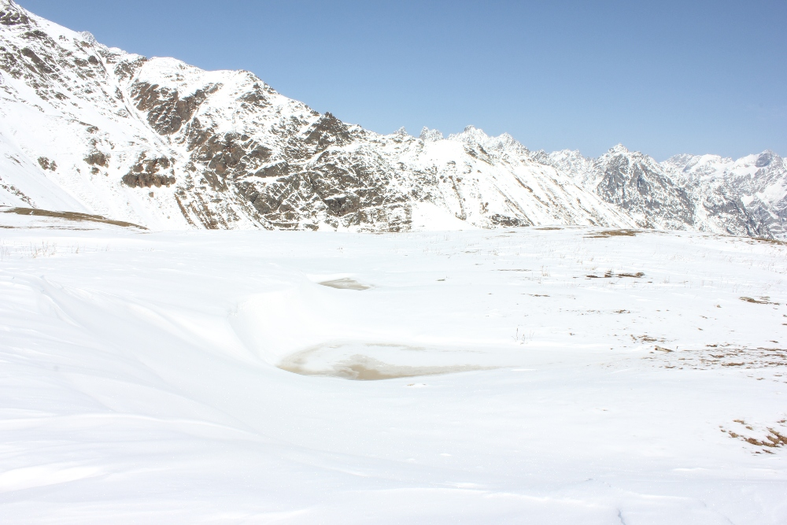
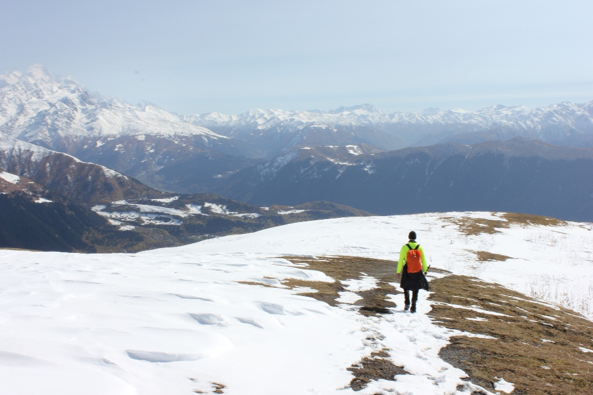

De langste en zwaarste trektocht hadden we voor de laatste dag van ons verblijf in Mestia gepland, want de weersvoorspellingen
gaven ons een erg grote kans op het stabiele weer dat je voor zo'n lange wandeling nodig hebt. Voor het eerste stuk zijn er
verschillende varianten: je kan het pad nemen dat naast de kerk begint die we in
[deze post]() beschreven en dat volgen tot aan het bordje richting de Koruldimeren
(vlak bij de plek waar we de paarden tegenkwamen), of je kan starten bij de Khergiani-toren, waar we die eerder vermelde
wandeling beëindigden. Deze keer kozen we voor nog een andere variant, die vlak bij het politiekantoor en het Queen Tamar-plein in Mestia begint.
Na een kort stuk door het dorp loopt dit pad stroomopwaarts, om dan scherp af te buigen naar de hellingen rechts,
waar het erg smal en steil wordt. Na een tijdje kwamen we op een breed pad in het bos uit, dat we het volgende
anderhalf uur volgden, voortdurend bergop, en hoe hoger we kwamen, hoe meer modder en sneeuw er opdook.

Uiteindelijk bereikten we, 2 uur nadat we ons appartement hadden verlaten, het uitkijkpunt op de berg Tskhakzasari, met een houten platform
dat enkele meters boven de grond uitsteekt en een groot kruis ernaast. Vanaf deze plek konden we genieten van een adembenemend uitzicht
op de vele bergketens die ons langs alle kanten omringden :)

Terwijl we ons pad verder volgden, werd het wat vlakker, maar de verse sneeuw, die soms tot aan onze knieën kwam,
maakte dit stuk even zwaar. Goede schoenen en een waterdichte broek zijn dus zeker aan te raden! Het pad passeert een paar oude
houten schuurtjes die er verlaten uitzagen; berghutten zijn er in deze streek ook niet.

Van het uitkijkplatform tot aan de Koruldimeren stapten we 2,5 uur aan één stuk door. Na een korte pauze bij de
groep bergmeren (die door de sneeuw erop bijna niet te zien waren) voor een hapje en wat foto's, keerden we
terug naar Mestia. De meren liggen aan de voet van de Oesjba en je kan nog verder klimmen naar een volgend uitkijkpunt
(op ongeveer 3.000 m).

We besloten langs hetzelfde pad terug te keren als waarlangs we gekomen waren. De hele dag was het erg zonnig en onze grote fout
was dat we geen zonnebril en zonnecrème gebruikten. We verbrandden ... deze bergen leerden ons die les op de harde manier ;)

## Info over de route:
  * Moeilijkheidsgraad: matig
  * Afstand: 19 km
  * Hoogteverschil: 1300 m

