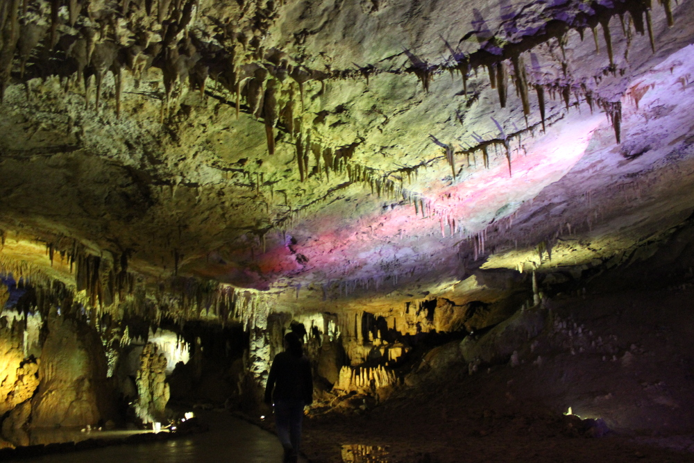
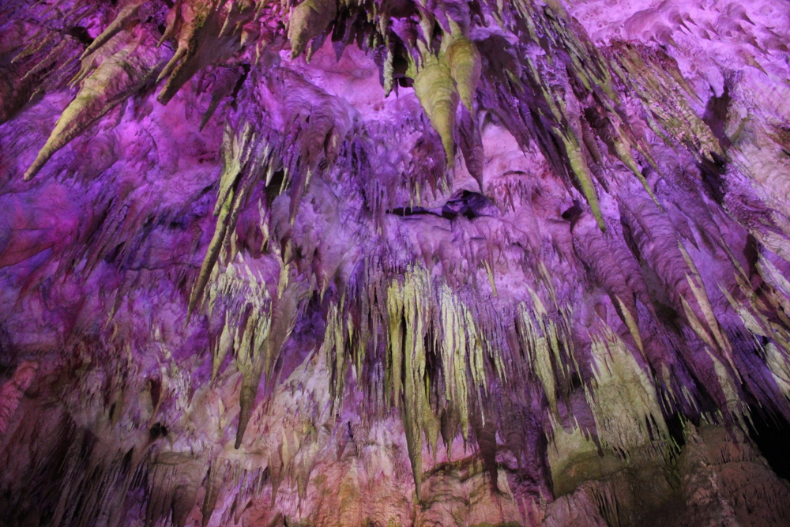
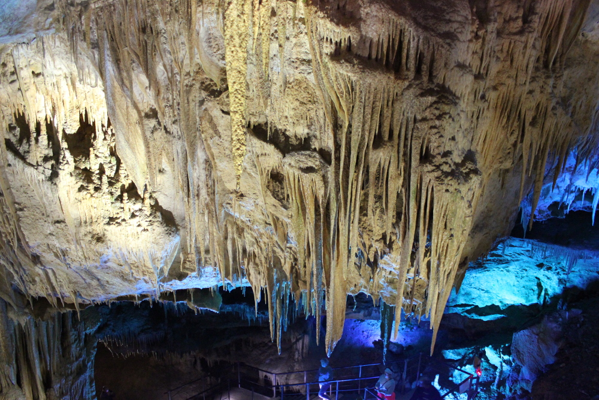
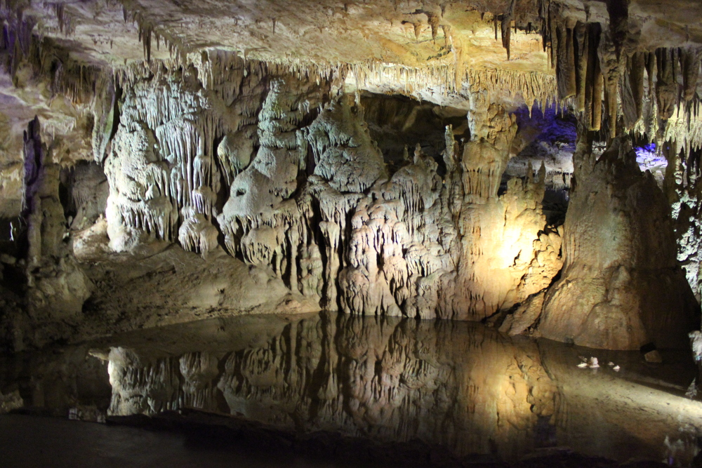
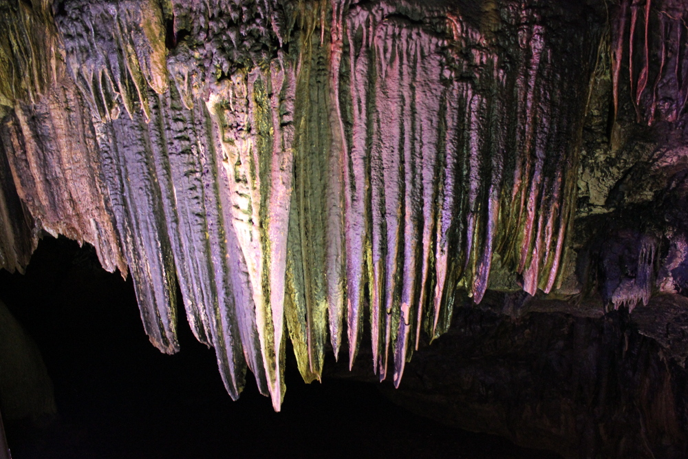
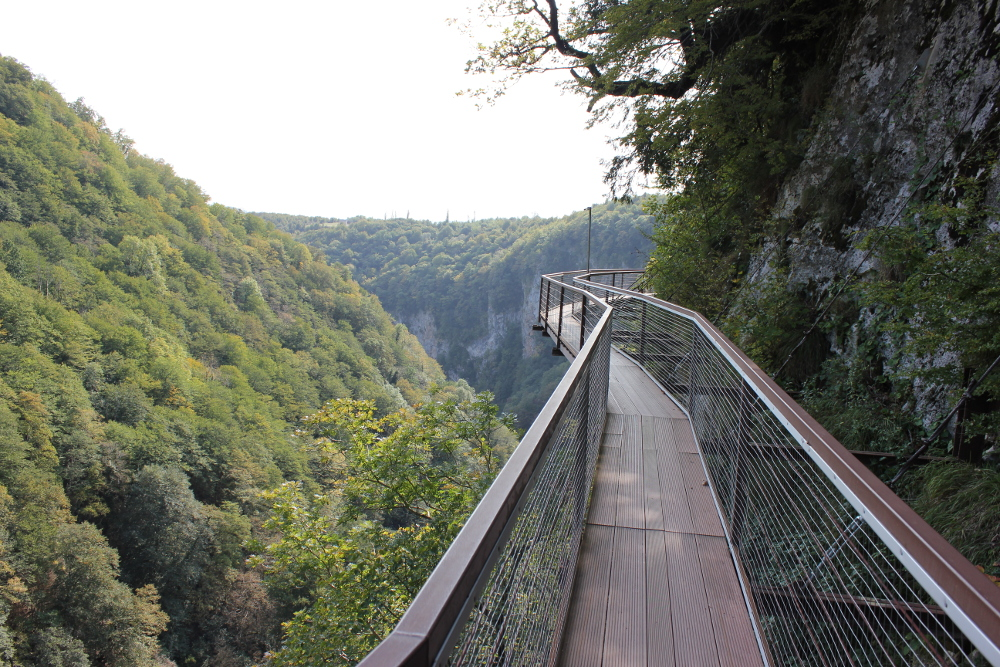
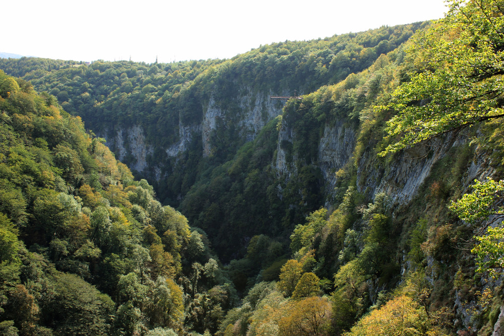
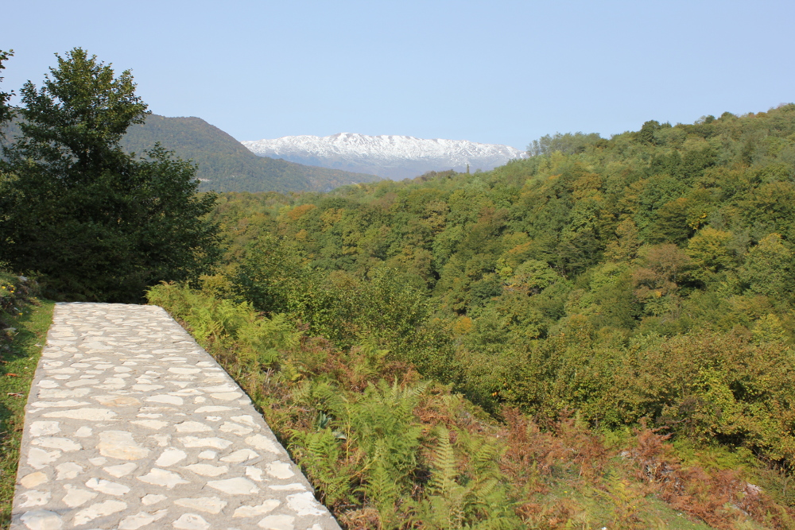
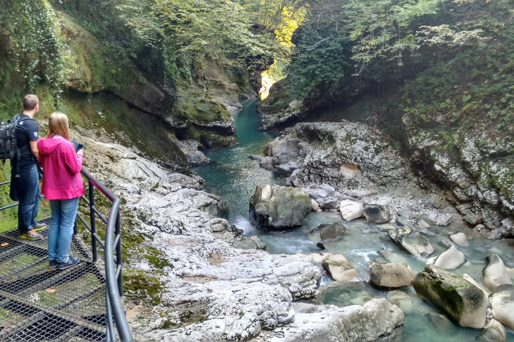
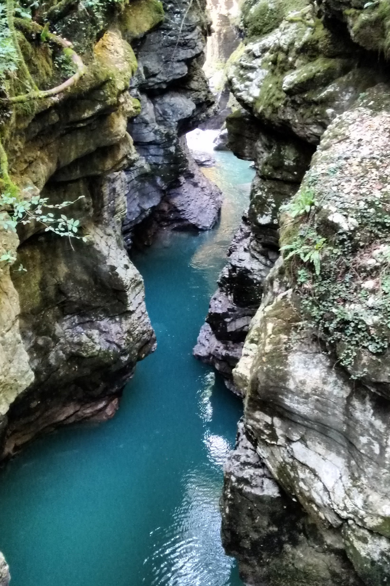

We hadden bijna drie volle dagen in Kutaisi gepland voor we 's ochtends vroeg terugvlogen naar Berlijn. Dat was ruim voldoende om de stad te verkennen, inkopen te doen
 op een lokale markt en enkele natuurmonumenten in de buurt te bekijken. Met de gastheer van ons guesthouse als persoonlijke chauffeur konden we
  de Prometheusgrot en twee canyons bezoeken: Martvili en Okatse.

We bereikten de grot in minder dan een uur en waren echt blij dat er maar een paar andere auto's op de parking stonden. Onze groep telde dan ook zo'n
20 mensen, wat in vergelijking met het hoogseizoen, wanneer elke groep tot 200 mensen kan tellen, bijzonder aangenaam was! Dankzij die kleine groep kon onze
 gids in de grote zalen halt houden en ons extra details vertellen over deze verbluffende grot :) De gangen zijn samen 1.400 m lang
 en tellen ongeveer 800 treden tot 80 m onder het aardoppervlak, dus het was een goeie oefening voor de benen (onze reisgezel denkt daar anders over :p).
  De temperatuur in de grot blijft het hele jaar rond 14 ºC en zorgt voor de stabiele omstandigheden die nodig zijn om allerlei grotformaties te vormen.
  Dat proces verloopt wel bijzonder traag: een stalactiet heeft ongeveer 100 jaar nodig om 1 cm te groeien! De grot werd in 1984 ontdekt, maar is pas
   sinds 2012 open voor bezoekers. Er waren ondergrondse meren en rivieren, omringd door ongelooflijke stalagmieten en stalactieten. Allerlei lampen langs de
   wandelroute zetten de spectaculaire vormen van de verschillende grotformaties in de verf. Vlak bij de uitgang van de grot kun je optioneel een boottochtje maken dat
    vertrekt op een ondergrondse rivier en je naar buiten brengt.

Als volgende bestemming hadden we de Okatse-canyon gekozen. Volgens de maquette vlak bij de ingang zouden we vanaf het platform tegen de berghelling
 een prachtig uitzicht op de canyon moeten hebben. Onze wandeling is in totaal 7 km lang (je kunt ze bijna halveren door op de terugweg
  een taxi te nemen). Het grootste deel gaat over een goed pad door een bos waar een familie schattige biggetjes woont en ... je raadt het al
   ... koeien. Helemaal op het einde hangt er een 780 meter lange loopbrug aan de rand van de klif, waar je met open lucht onder je
    voeten wandelt ... waar sommige mensen wat sneller van gaan ademen :) Toen we vanaf het uitstekende uitkijkplatform langs de lange helling naar beneden keken, zagen we op
    één plek een beekje tussen eindeloos veel bomen. Jammer genoeg viel het uitzicht ons wat tegen na onze wandelingen rond Mestia (waarschijnlijk gewoon een kwestie
     van vergelijken).

De Martvili-canyon was de laatste plek die we die dag bezochten, en zeker niet de minste. Interessante kalksteenformaties, watervallen en weelderige begroeiing vormen
een landschap waar we echt van opkeken. De ondergaande zon maakte het tafereel puur magisch, een mooie afsluiter van de uitstap :) Ook hier kon je
een boottocht maken (tegen betaling). Het is behoorlijk klein, maar zeker de moeite om langs te gaan.

## Praktische info:

Toegangsprijzen voor de verschillende plekken:

  * Prometheusgrot - 20 lari (studenten 5 lari) met gids (50 min) + boottocht in de grot - 15 lari (ongeveer 10 min)
  * Okatse-canyon - 15 lari (studenten 5 lari)
  * Martvili-canyon - 15 lari (studenten 5 lari)

