Op weg naar Chinatown besloten we te stoppen voor een middagmaal op een minder toeristische plek, tussen de lokale bevolking in het
Maxwell food centre, een van de vele hawker centres in Singapore!

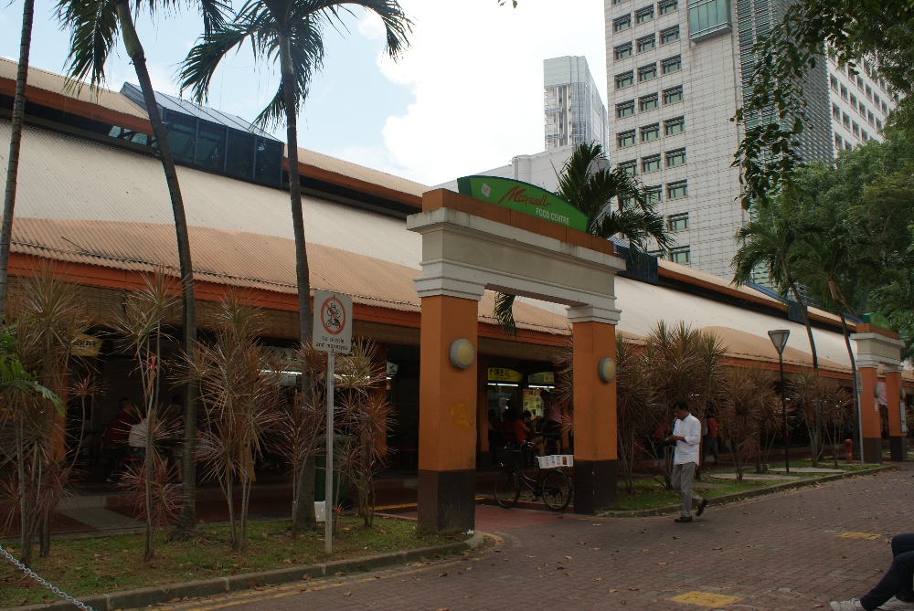

Je vindt er tientallen kraampjes met een enorme verscheidenheid aan eten, verfrissende lokale dranken en zoete lekkernijen.

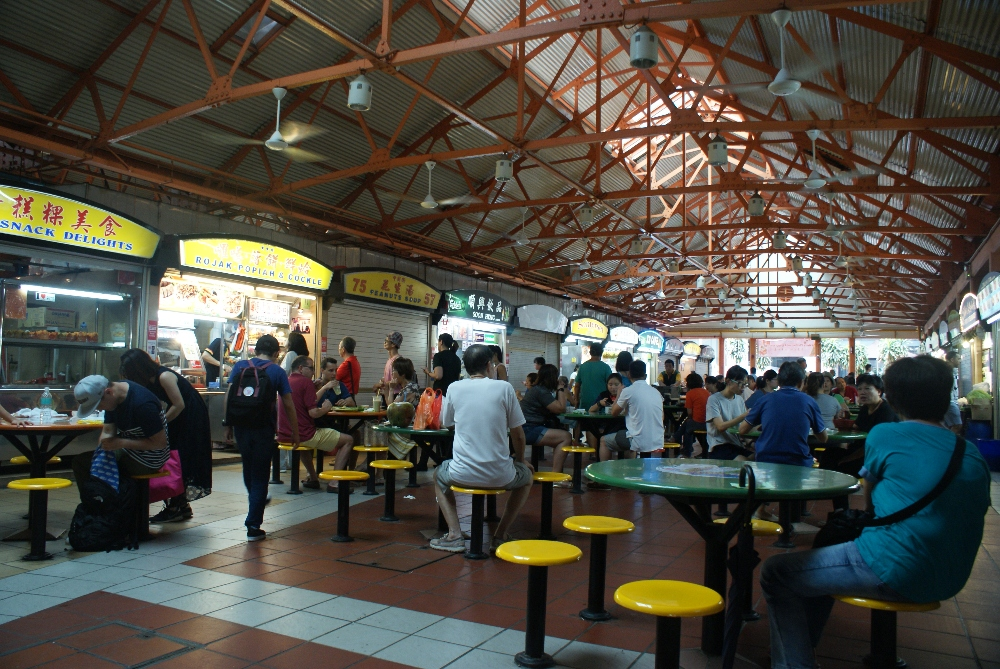

Als voorgerecht probeerden we gefrituurde dumplings (3 S$) aan kraampje nummer 92, gevuld met vlees en groenten, sappig
vanbinnen en heel krokant vanbuiten, heerlijk!

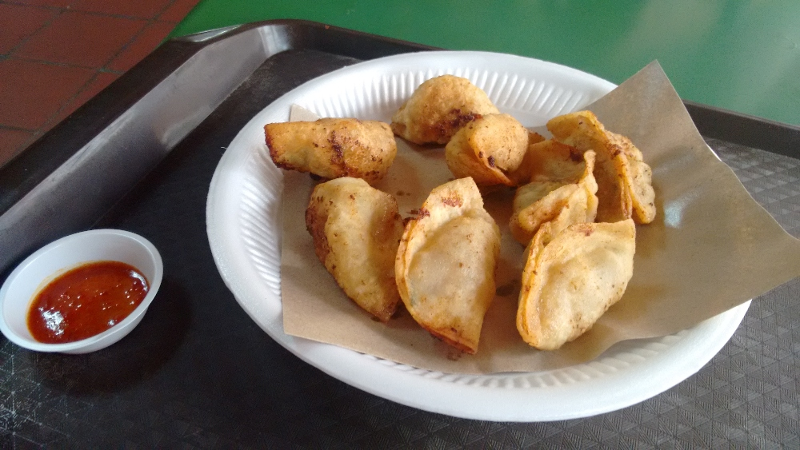

Tian-Tian Chicken Rice aan kraampje 10&amp;11, een heel eenvoudige maaltijd met malse kip en interessant gekruide rijst
(3,5 S$ voor een kleine portie), het eten verdween in geen tijd van het bord!
Dit kraampje versloeg Gordon Ramsey in de "Hawker Heroes Challenge” en is erg beroemd in Singapore. We proefden ook
hot&amp;sour soup (kraampje 92) en rijst met ei, kip en groenten. Dat laatste werd met indrukwekkende
kracht en snelheid op het bord geschept. Het oogt misschien niet als een gastronomisch avondmaal, maar de smaken waren geweldig en het kostte maar 3,1 S$.

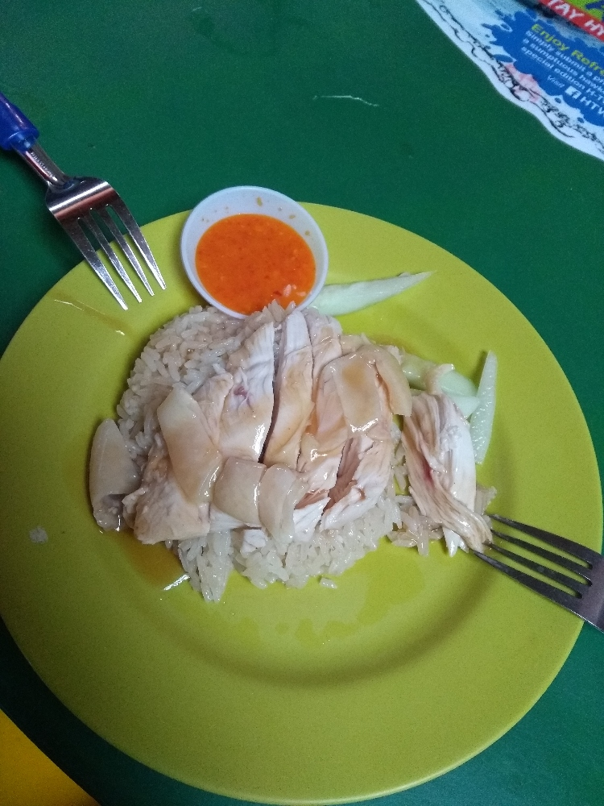

Suikerrietsap (1,2 S$) is hier erg populair, maar voor mij veel te zoet. Sebastian vond zijn koffie met drie lagen wel lekker: een
bodem van koffiesiroop, daarboven gecondenseerde melk en bovenaan sterke koffie :)

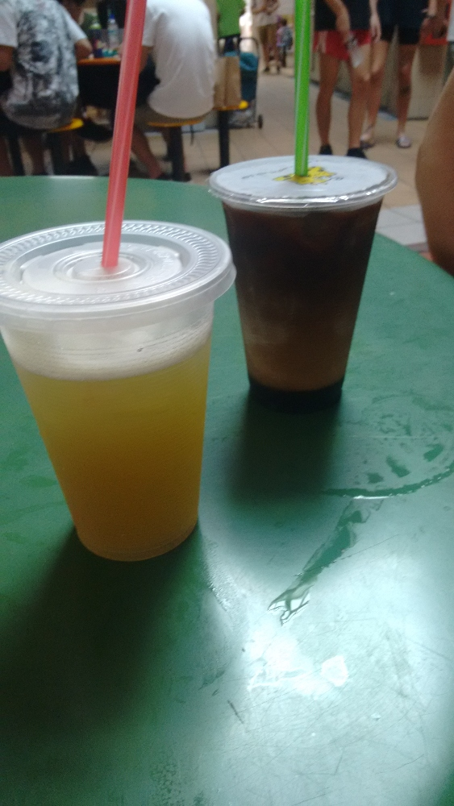

Het Buddha Tooth Replic Museum was de eerste tempel die ons opviel in de wijk Chinatown. Hou er rekening mee dat je gepast
gekleed moet zijn om deze (en andere) tempel(s) binnen te gaan. Vanbinnen is de tempel rijkelijk versierd met glanzend goud.

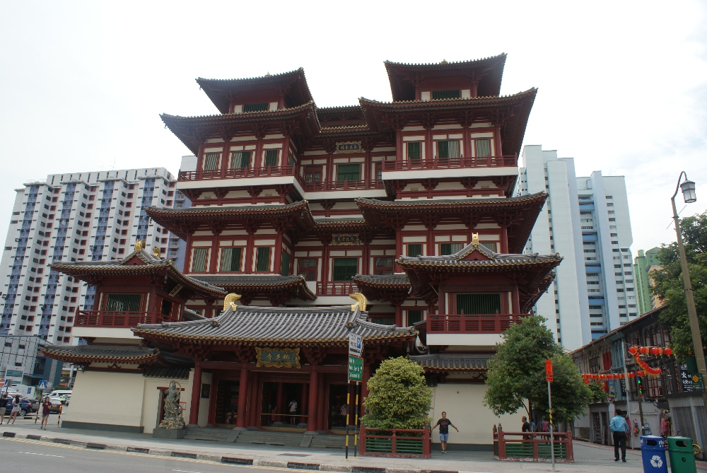
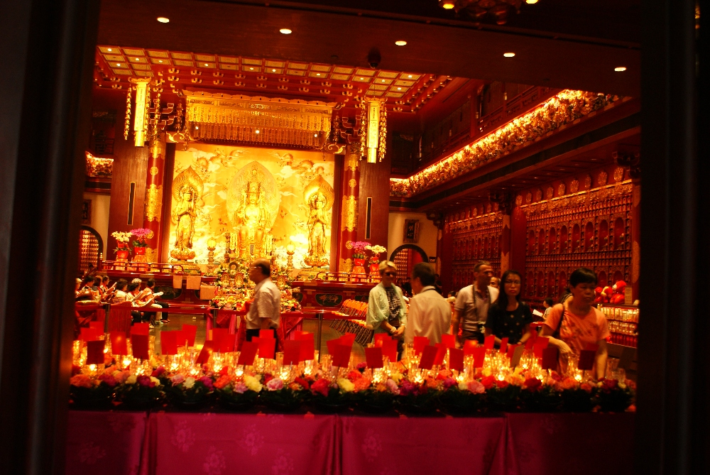

Het Chinatown-complex, geopend in 1984, is een plek vol souvenirs, traditionele Chinese decoraties, kleding en
lokaal eten. In een steegje in de buurt zagen we ook namaakhorloges en illegale dvd's te koop liggen. Vanbinnen overheersen
rood en goud, de kleuren van traditionele Chinese versieringen.

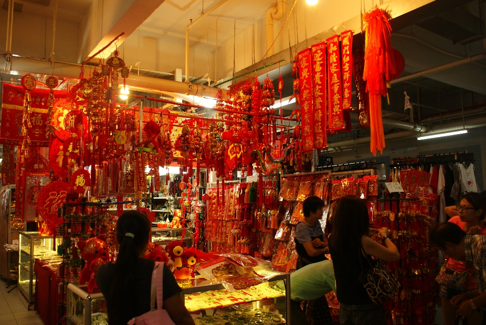

Oh, wat is dat voor een vreselijke geur! Een vuilniszak die een paar uur in de zon heeft liggen rotten? Bedorven vlees? Nee! We
naderen een kraampje met durians :D Nu wordt het meteen duidelijk waarom het streng verboden is om durians mee te nemen op het
openbaar vervoer. De volgende keer adem ik niet door mijn neus en probeer ik ze :p

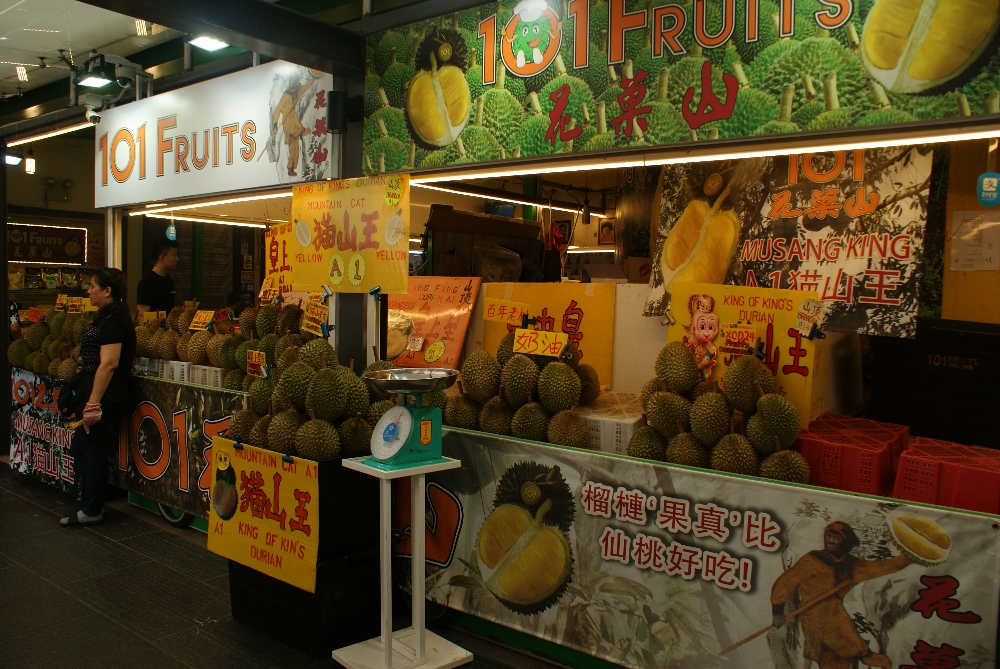

Een paar dagen later zag ik in een van de Chinese supermarkten koekjes, chocolade en snoep met duriansmaak. Omdat ik
erg nieuwsgierig was naar die smaak, kocht ik een reep chocolade. Je kan je mijn verbazing voorstellen toen ik ontdekte dat die
producten naar het verse fruit ruiken! :O Oef.... Ik raad je af om er eentje open te maken op een openbare plek ;) Intussen zit de
chocolade stevig verpakt in een plastic zakje op het balkon te wachten tot iemand ze durft te proeven! :D

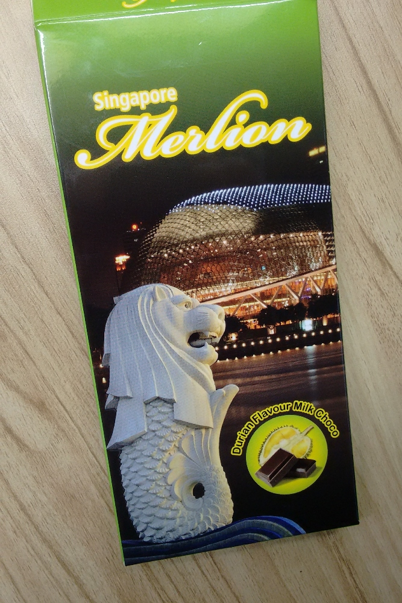

Chinatown zit vol smalle straatjes, kleine winkeltjes, kleermakers waar je een kostuum op maat kunt bestellen dat al na 6 uur
aangepast en klaar is, massagesalons en restaurants. Het eten hier lijkt echter erg goed op wat je in het Maxwell
centre vindt, maar dan aan het dubbele van de prijs. Ik zou je aanraden om voor de goedkopere en authentiekere optie te gaan, zeker als
je met een klein budget reist.

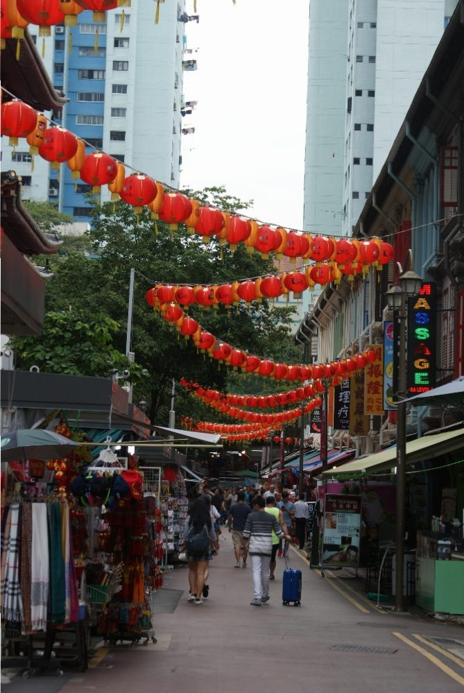
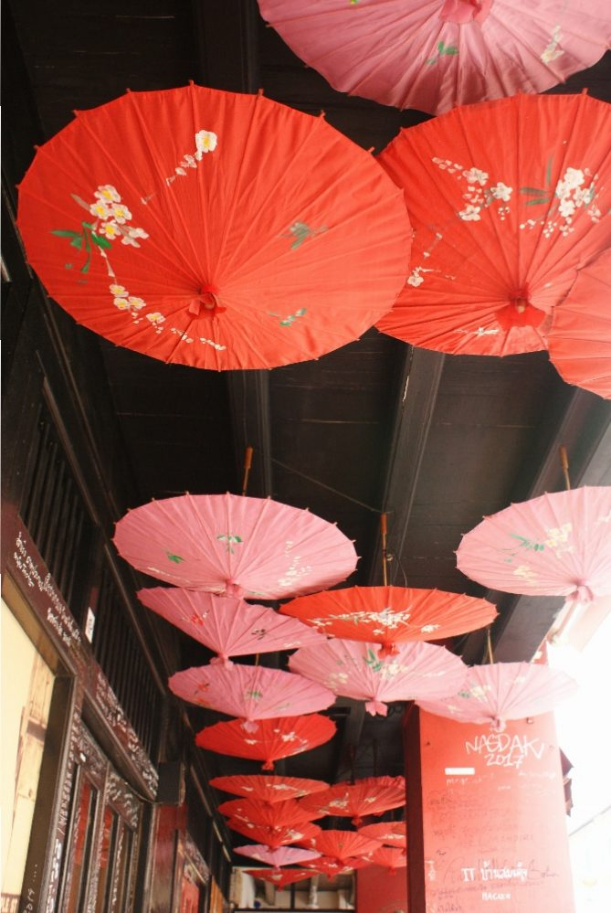

De Sri Mariamman-tempel is de oudste en belangrijkste hindoetempel van Singapore, uniek door de kleurrijke beeldengroep
boven de ingang. Je mag hem bezoeken, maar denk eraan om je schoenen uit te doen!

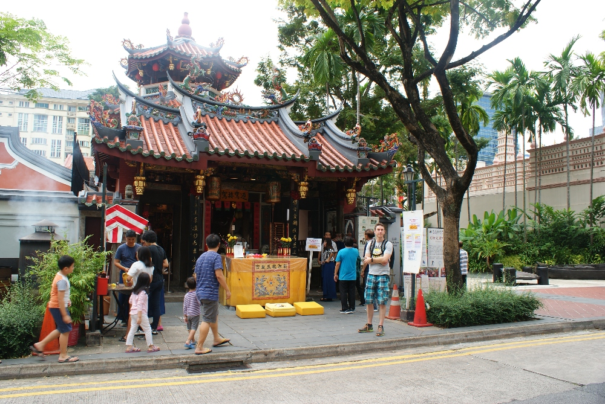

De Thian Hock Keng-tempel is de oudste en belangrijkste gebedsplaats van de Hokkien (een Chinese dialectgroep)
in het land.

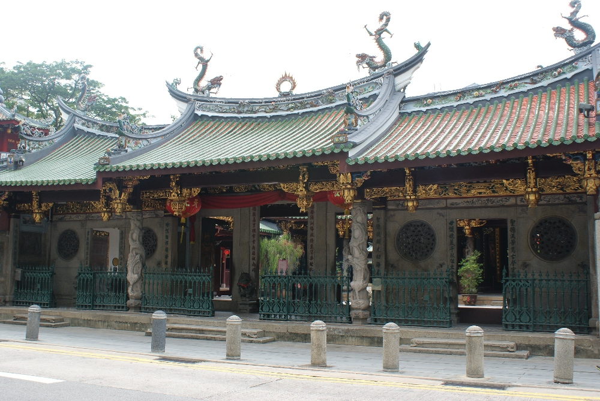
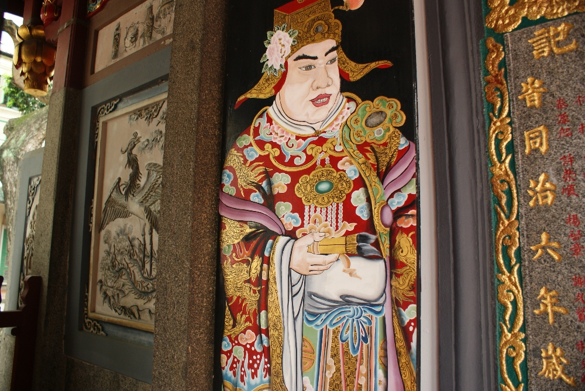

Het Oasia-hotel vlak bij Tanjong Pagar valt op tussen de andere gebouwen, die vooral uit staal en glas bestaan. Dit gebouw
heeft een unieke bordeauxrode kleur en een paar enorme tuinen met zwembaden, een uitzonderlijke combinatie! :O

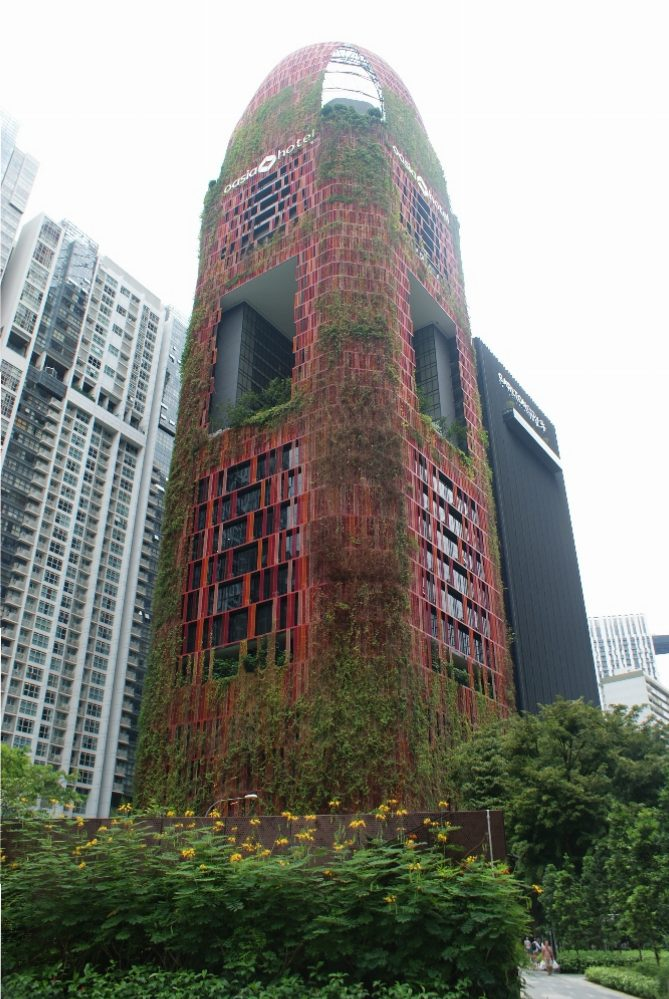

## Praktische info:
  * Eten in het Maxwell centre in de prijsklasse 3-7 S$, drank 1-2 S$
  * MRT-station - Tanjong Pagar (startpunt van onze wandeling)

