## St John's Island en Kusu Island

18 S$ voor een retourticket, vertrek aan Marina South Pier. Er zijn maar een paar afvaarten per dag, dus check
de actuele dienstregeling online.

Na 25 minuten kwam de boot eerst aan bij St John's Island, waar ik een paar uur op het strand heb gewandeld
en gezonnebaad. Je komt er veel katten tegen die in de schaduw liggen uit te rusten. De tijd gaat hier traag. Op het
infobord op het eiland staat dat deze plek dienstdeed als quarantainestation voor onder andere cholera. Later
kwam er een afkickcentrum voor drugsverslaafden en uiteindelijk werd het eiland in 1975 omgevormd tot een
weekendbestemming. Vandaag is het een populaire plek om te ontsnappen aan de stad :)

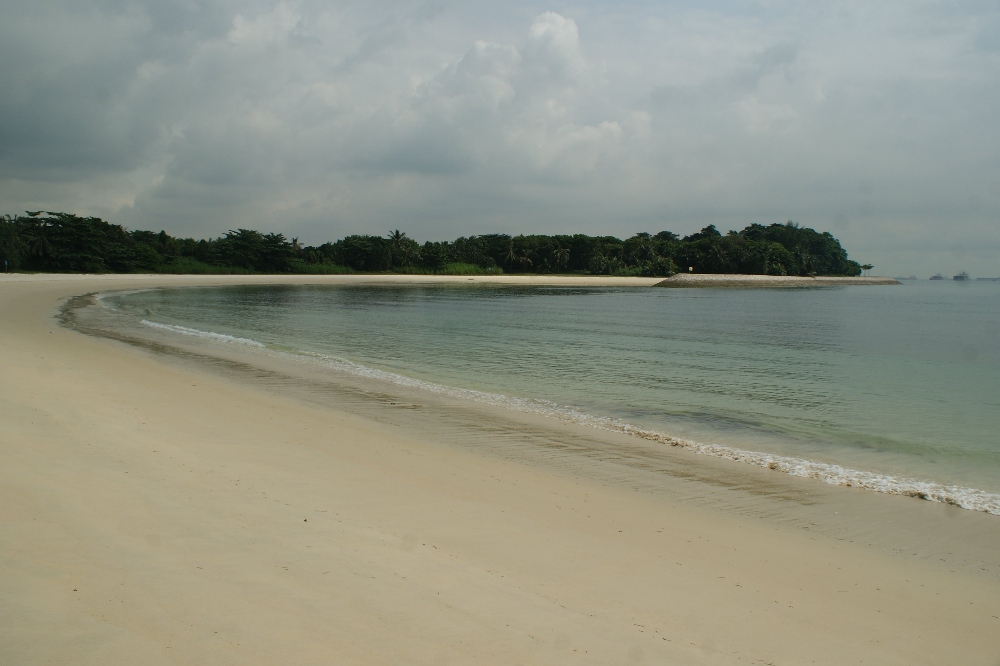
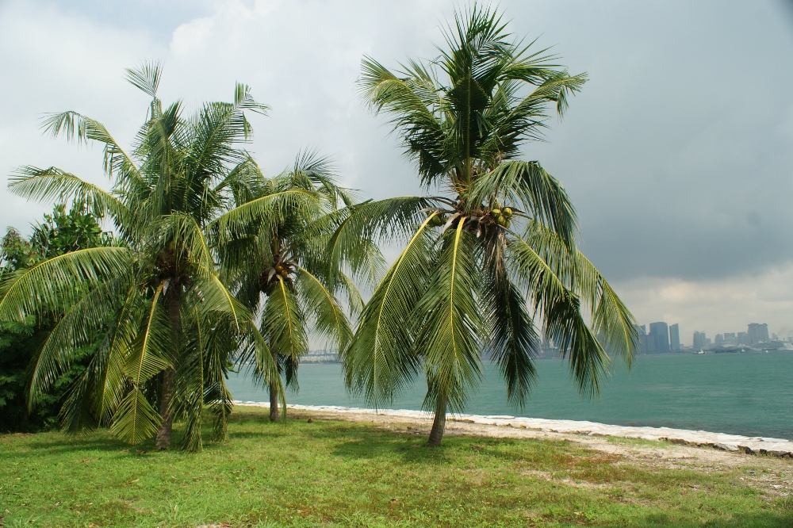

Dezelfde boot bracht ons naar onze volgende halte, Kusu Island. Volgens de legende veranderde een reusachtige
schildpad zichzelf in dit eiland om schipbreukelingen te redden. Nu vind je er twee tempels, stranden en
picknickplekken waar de inwoners van Singapore aan het drukke stadsleven kunnen ontsnappen. De mensen zijn
die dappere dieren niet vergeten en daarom is er op het eiland een opvang voor schildpadden. Het viel me op dat
een paar van hen een gouden schild hadden. Men gelooft dat een schildpad aanraken geluk brengt :)

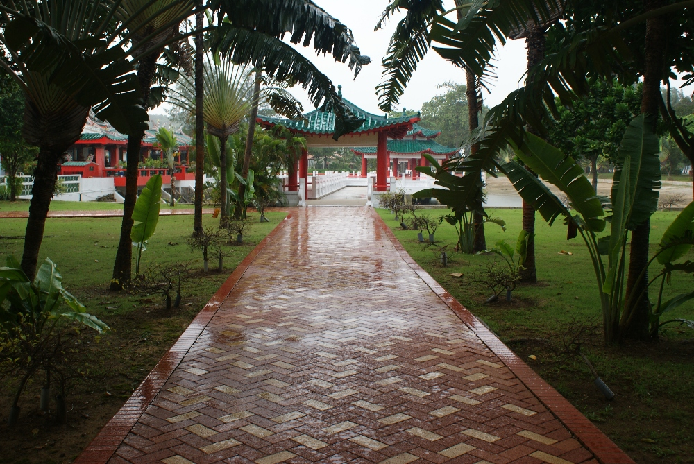
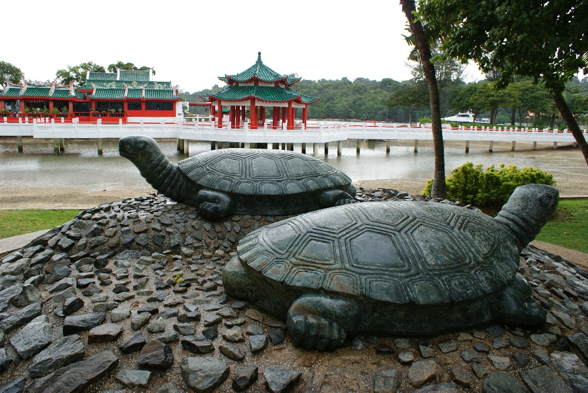
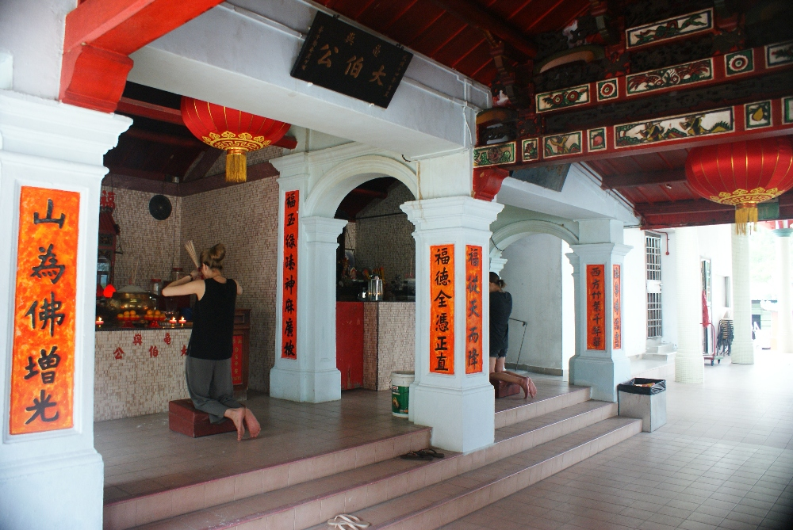

## Duriankraam

Ah Di Dempsey Durian stall, 7 Dempsey Road, Singapore

Het leek me een slim idee om de koning der vruchten te proeven op een van de beste adressen van Singapore. Ik
vermoed dat de ervaring een pak minder goed zou zijn met eentje uit Chinatown :p Zelfs de kenmerkende geur van
rijpe durian was bij elke kraam anders, afhankelijk van de variëteit en de versheid van het fruit. King of Kings
was de variëteit die wij proefden (ongeveer 20 S$ per kg): heel zoet van smaak met een romige structuur (niet zo
verwonderlijk, want de vrucht bestaat voor de helft uit koolhydraten en voor de helft uit vet :p). De plastic
wegwerphandschoenen kwamen goed van pas, want het vruchtvlees bleek de consistentie van een plakkerige pudding
te hebben :D Ik heb gehoord dat je deze vrucht een paar keer moet proberen om echt te weten of je een durianfan
bent of niet. Ik moet trouwens toegeven dat de smaak bij elke hap anders was :) Volgens sommige studies zijn
genen die de zwavelstofwisseling regelen verantwoordelijk voor de ondraaglijke geur van deze vrucht (al hadden
we na een paar minuten helemaal geen last meer van die geur). De eigenaar van de kraam is echt een expert en
herkent moeiteloos vruchten van goede kwaliteit door eraan te ruiken en er met zijn machete op te kloppen.

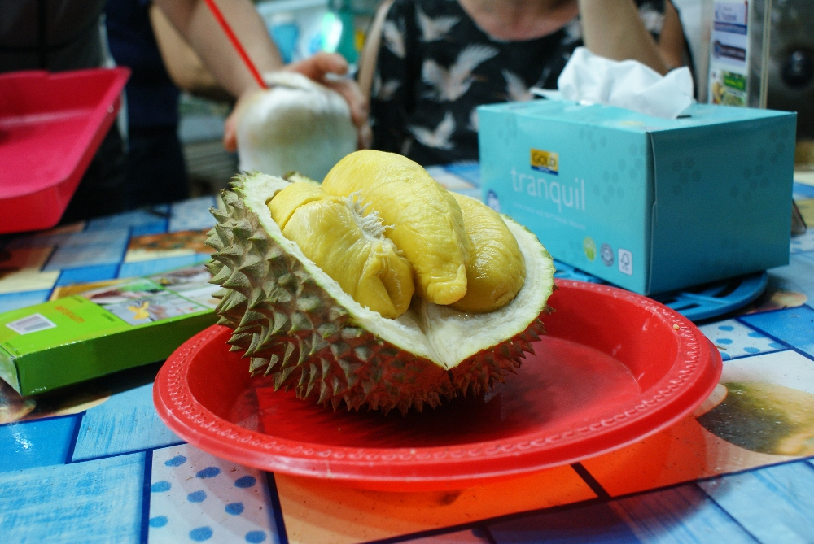
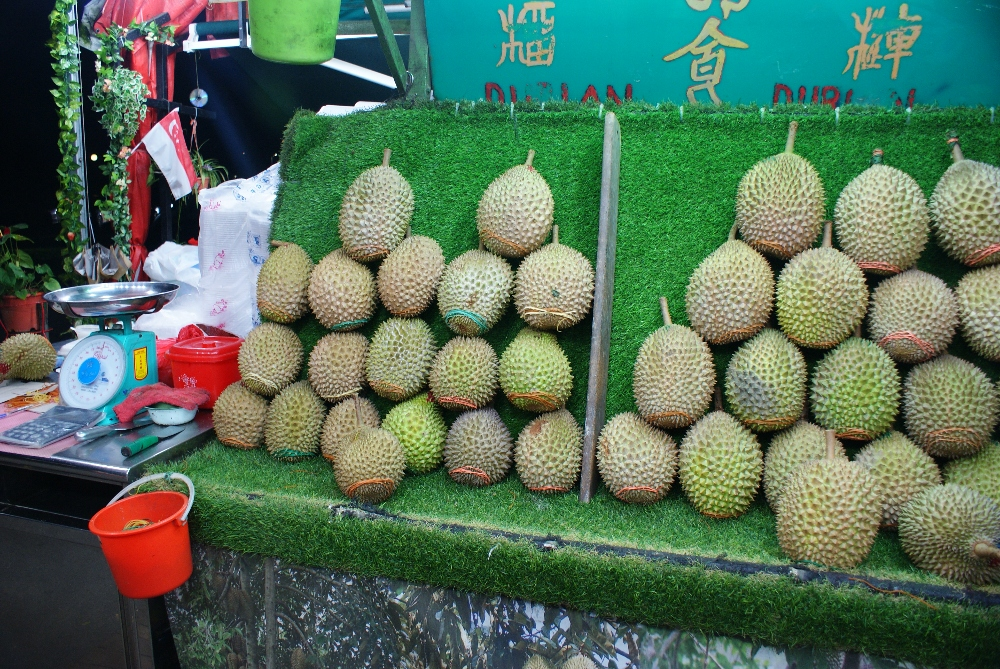
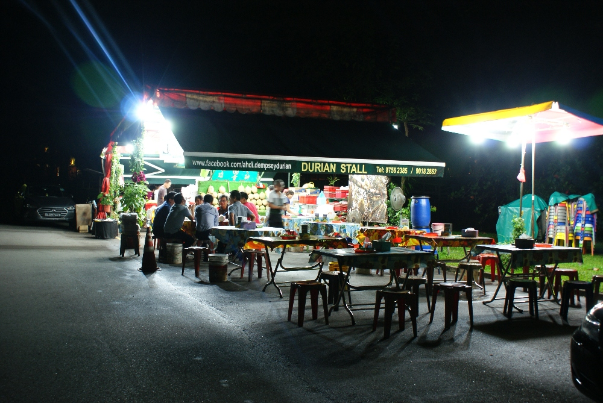

## Sands Sky Park - het uitkijkplatform

21 S$ toegang, tickets online gekocht

Mooi uitzicht op de hele Marina Bay, Gardens by the Bay, de Esplanade Theatres en de wolkenkrabbers. Je vindt het
op de 57ste verdieping van het Marina Bay Sands hotel. Het is zeker de moeite om er 's avonds naartoe te gaan, om
van de zonsondergang te genieten en de spectaculair verlichte supertrees in Gardens by the Bay te zien. Hotelgasten
kunnen ook in de infinity pool, die wij enkel van een afstand konden bewonderen. Er is ook een bar waar je met dat
fantastische uitzicht een drankje kunt drinken :)

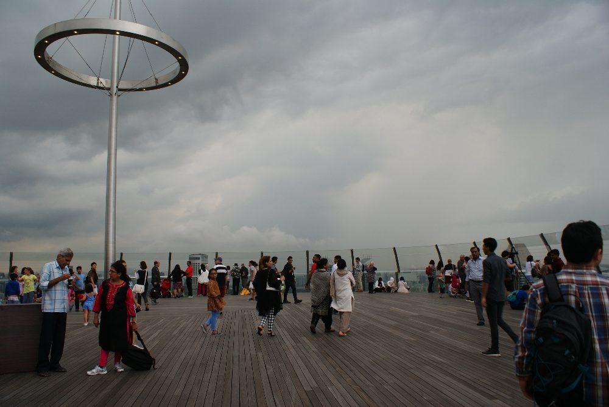
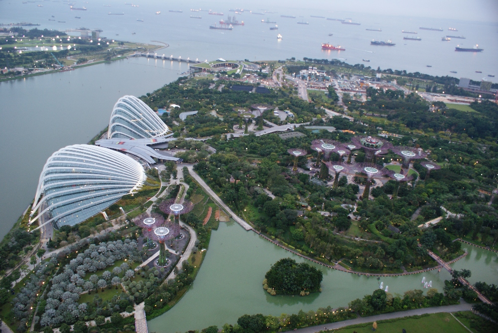
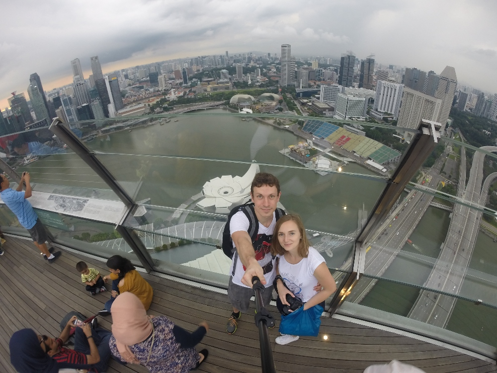

## Bukit Timah en het natuurreservaat MacRitchie

gratis toegang

Onze wandeling begon vlak bij het MRT-station Beauty World. Nadat we de top van Bukit Timah (163,63 m) hadden bereikt,
liepen we in de richting van het MacRitchie-reservoir, om uiteindelijk te eindigen aan de parking Venus, waar we de bus
namen naar een van de MRT-stations in de buurt. In totaal was de wandeling ongeveer 14 km lang. Water was enkel
verkrijgbaar aan het Rangers Station, dus denk eraan om zelf snacks en veel water mee te nemen. De TreeTop Walk, enkel
bereikbaar vanaf het Ranger Station (eenrichtingsverkeer), is 250 m lang en hangt op het hoogste punt 25 m boven de
bosbodem. Deze vrijstaande hangbrug is het pronkstuk van het park (open van dinsdag tot zondag, van 9 tot 17 uur). We
zagen apen (eentje wilde onze tassen stelen!), een klein slangetje (een gebandeerde vliegende slang), hagedissen en heel
wat interessante planten. We zijn gewend om met zware rugzakken te stappen, maar deze tocht heeft ons echt uitgeput! De
hoge temperaturen en een luchtvochtigheid die nog hoger lag dan in de stad maakten deze dag erg zwaar, maar het was het
waard! :D

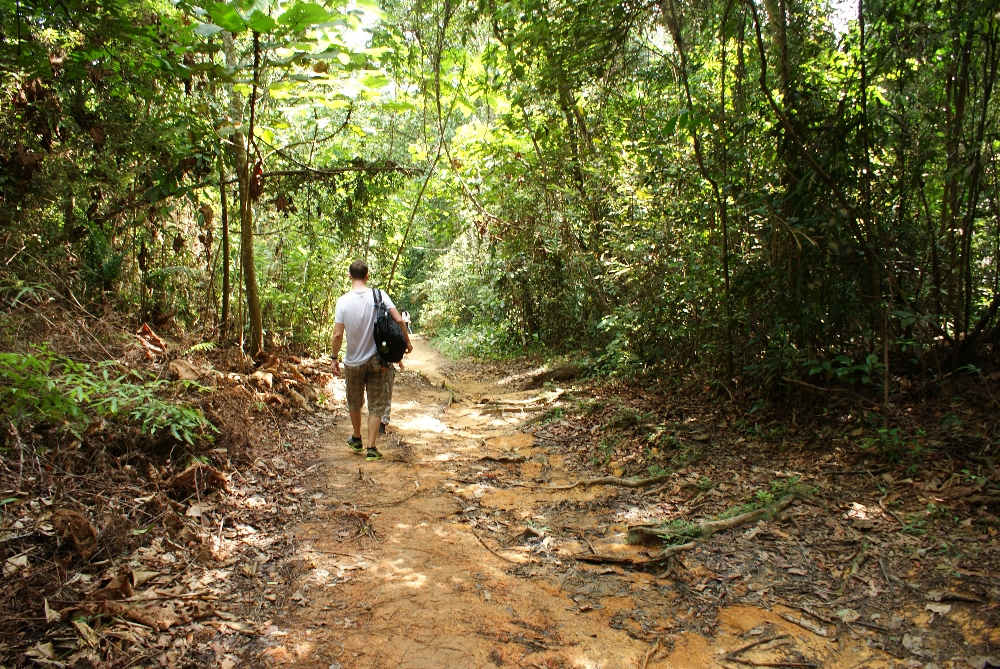
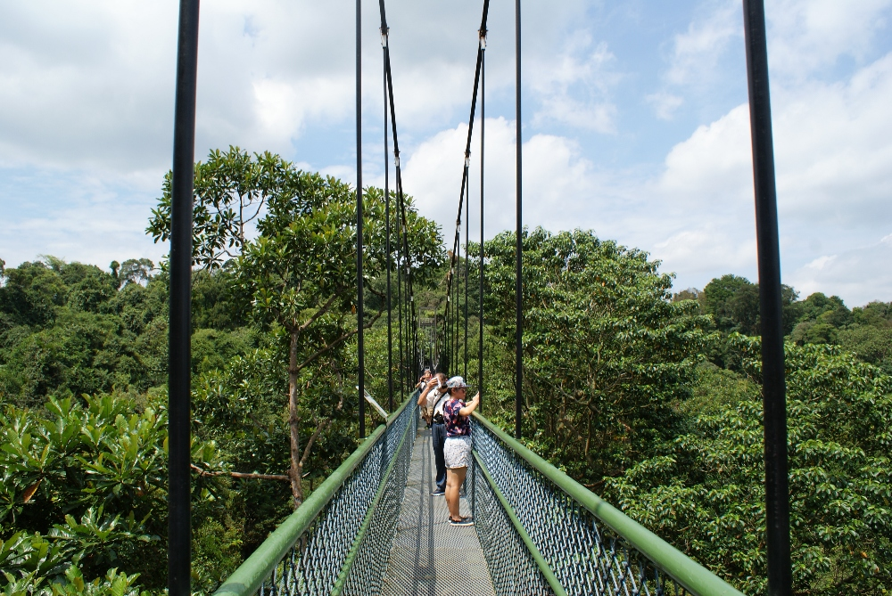
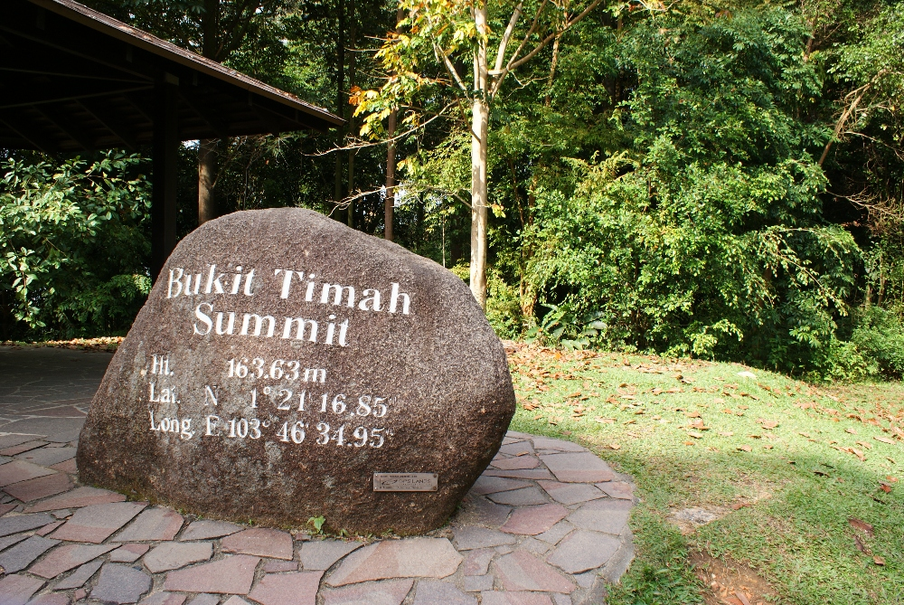

## Haw Par Villa
262 Pasir Panjang Rd, Singapore, gratis toegang

In 1937 gebouwd door twee Chinese broers als een plek om traditionele Chinese waarden te onderwijzen. Nu is het
omgevormd tot een themapark met taferelen uit de Chinese cultuur, folklore en mythologie. We vonden er ontelbare
kleurrijke beelden, van sumoworstelaars over zeemeerminnen tot de lachende Boeddha. Het aantal verschillende taferelen
in het park was overweldigend voor mij ... of misschien kwam dat door de hoge temperaturen :p Het is heel anders dan de
rest van Singapore, dus je zou er echt eens langs moeten gaan om een idee te krijgen van de Chinese folklore.

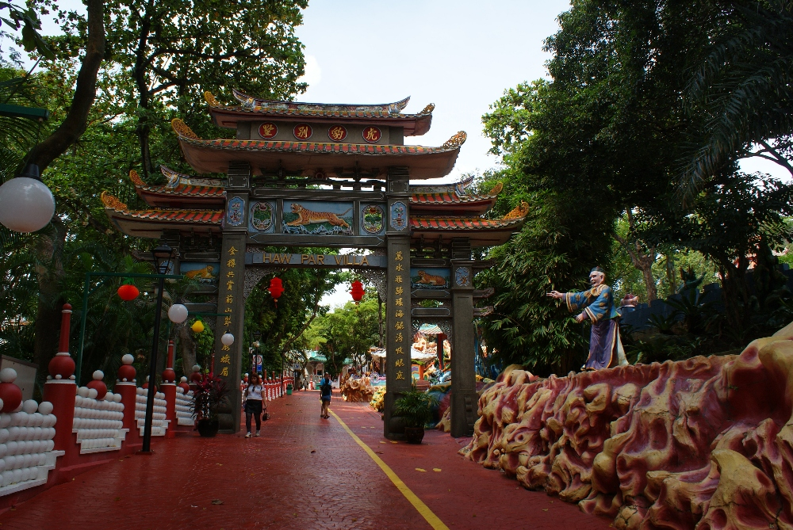
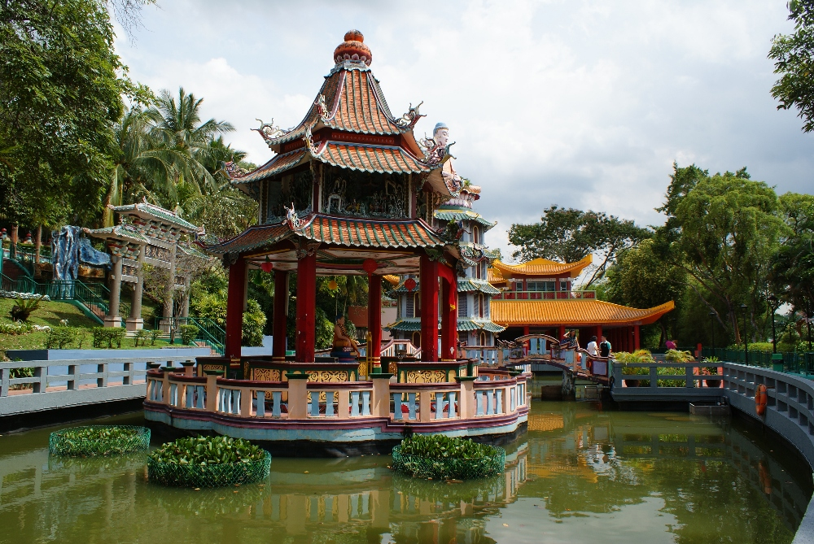
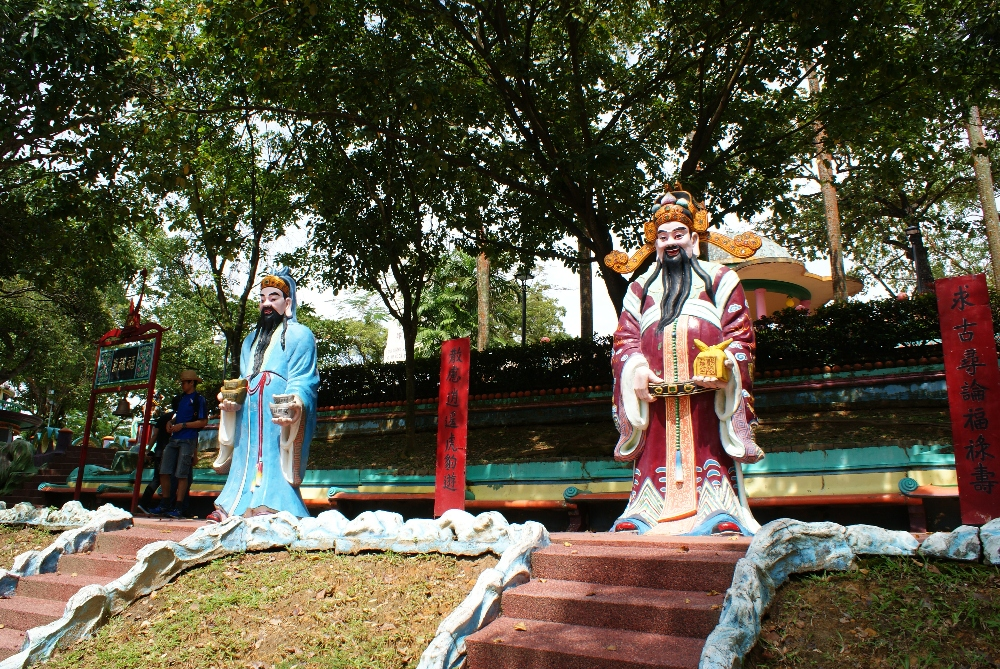

## Sentosa Island

tot eind 2018 gratis toegang via de brug

We kwamen het eiland op via de boardwalk vanaf het MRT-station Harbour Front. De enorme, witte naam "Santosa" op een
groene heuvel doet ons denken aan het beroemde "Hollywood"-bord in Los Angeles ;) Er zijn heel wat attracties op het
eiland (Universal Studios Singapore, Adventure Park of het Trick Eye Museum). Je kan voor elk apart een ticket kopen,
of een combiticket voor meerdere attracties nemen en zo geld besparen. Wij besloten gewoon door het westelijke deel van
het eiland te wandelen (dat over het algemeen best groot is!), langs de Merlion, de wereldbol van Universal Studios en
een stuk van de Imbiah trail. Er zijn ook een paar openbare stranden en heel wat plekken om te eten.

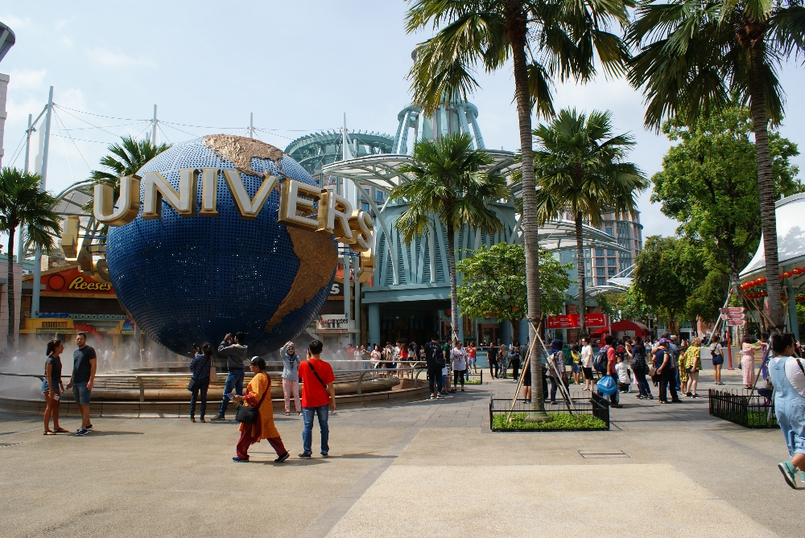
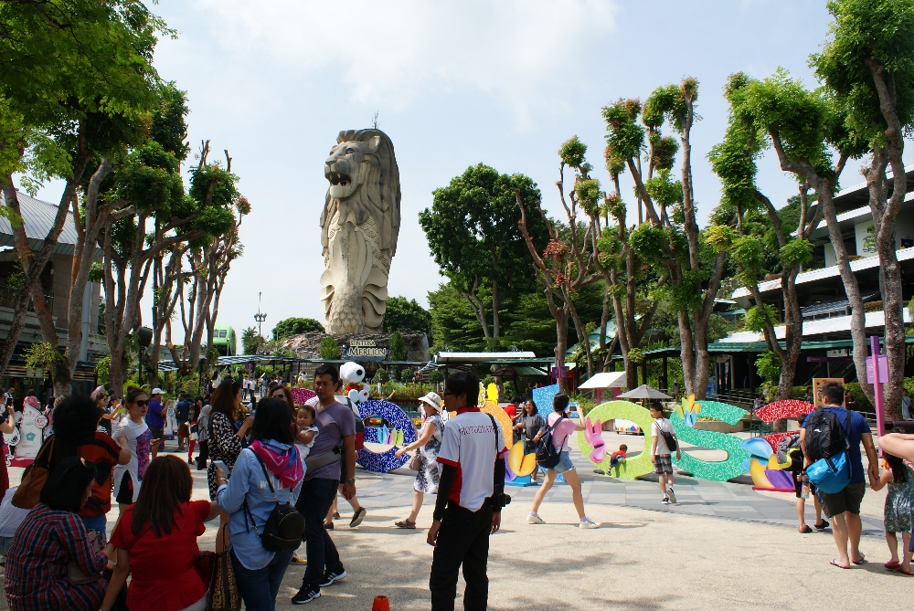
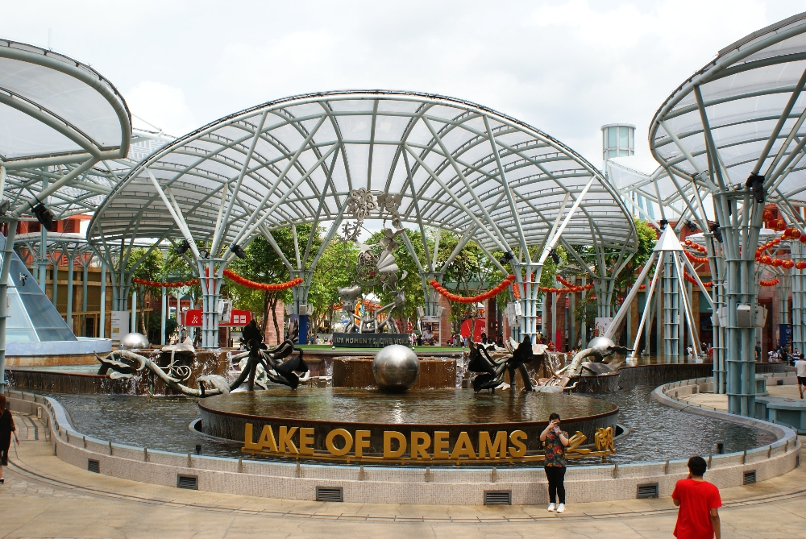
