Ons bezoek aan Krakau begon 's morgens met een begeleide wandeling, zodat we meteen een goede kennismaking kregen
met de stad en haar rijke geschiedenis. We sloten aan bij de <a href="https://freewalkingtour.com/krakow/">FREE walking TOUR</a>
door de oude stad van Krakau, die startte tussen de Sint-Florianspoort en de Barbakan en eindigde bij het kasteel van Wawel,
boven op de heuvel met dezelfde naam (een tocht van ongeveer 2,5 uur). Ondanks het echt prachtige, zonnige
weer voelden we na een uur al dat we midden in de Poolse winter zaten. De rondleiding was erg
leerrijk en zat vol interessante weetjes over het ontstaan van de stad, de periode van de Zweedse invallen en
de Duitse bezetting van Krakau tijdens de Tweede Wereldoorlog.

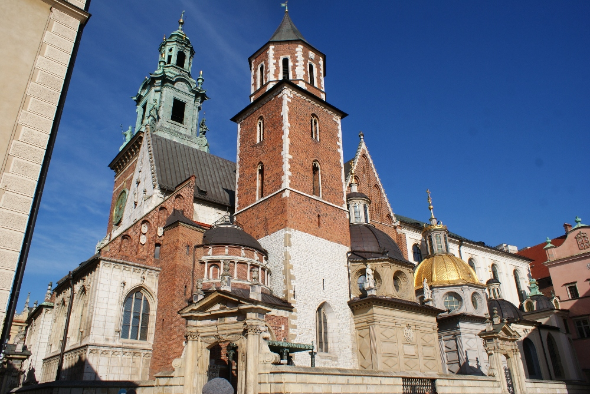
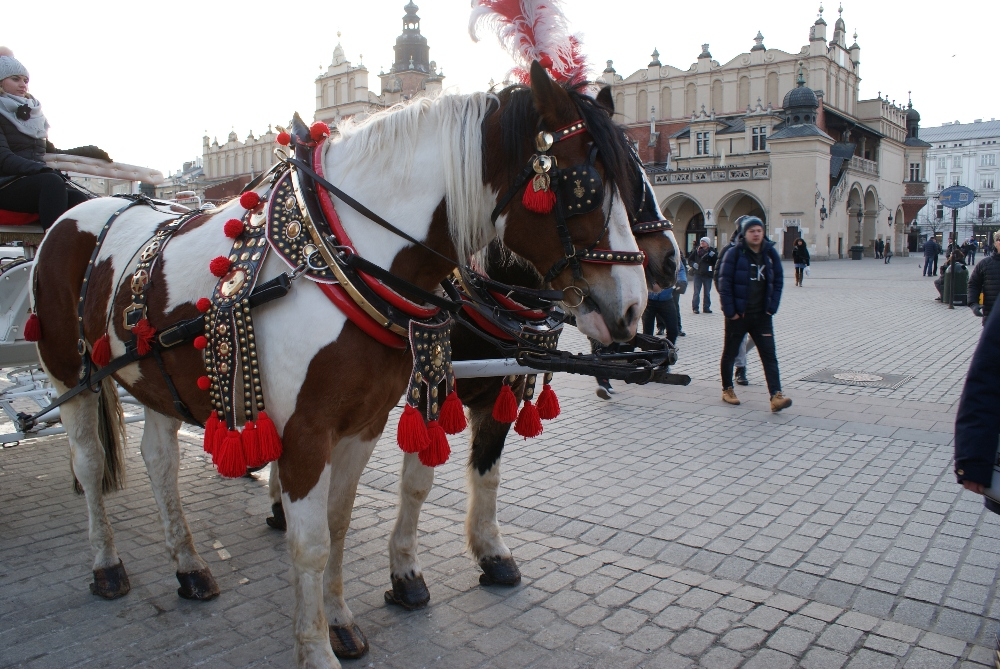

Na een behoorlijk lekker middagmaal in <a href="http://chimera.com.pl/en/bar-salatkowy/">saladebar Chimera</a> en een warme
pączek (een soort donut) trokken we vol energie naar de <a href="http://www.podziemiarynku.com/index.php?lang=eng">ondergrondse tentoonstelling Rynek Underground</a>
tussen de Sukiennice (Lakenhal) en de Mariacki-kerk (Onze-Lieve-Vrouwebasiliek). Tussen 2005 en 2010 werden hier
archeologische opgravingen gedaan, die ruïnes van Krakau van wel duizend jaar oud blootlegden. In het museum kan je
tussen de oude marktstraatjes wandelen, ateliers van smeden en goudsmeden bekijken en heel wat gedetailleerde informatie
opdoen over de handelsroutes die in de middeleeuwen door Krakau liepen en de stad met de rest van Europa verbonden.

  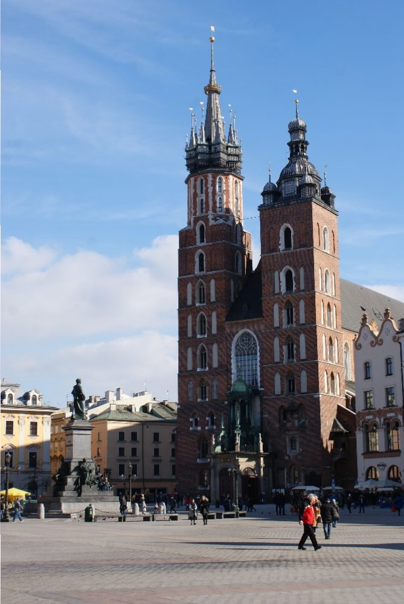
  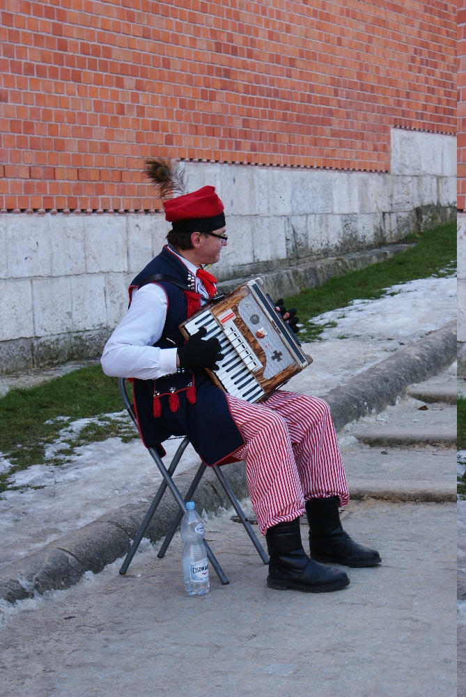

In de Sukiennice (Lakenhal) kan je lokale souvenirs kopen, meestal handgemaakt, zoals juwelen van barnsteen,
kantwerk, textielambacht en houtsnijwerk. Het viel ons op dat veel van die spullen hier zelfs goedkoper waren
dan in de souvenirwinkels in de Floriańska-straat (de grote winkelstraat). We proefden ook een erg populaire snack uit Krakau,
de obwarzanek: een soort zachte krakeling, meestal bestrooid met sesam of maanzaad.

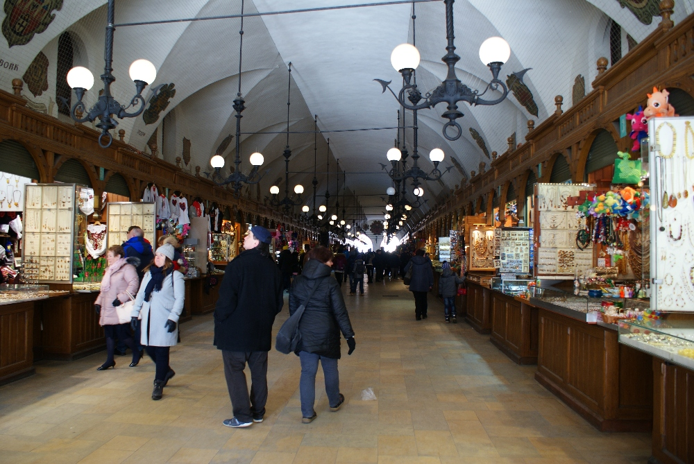
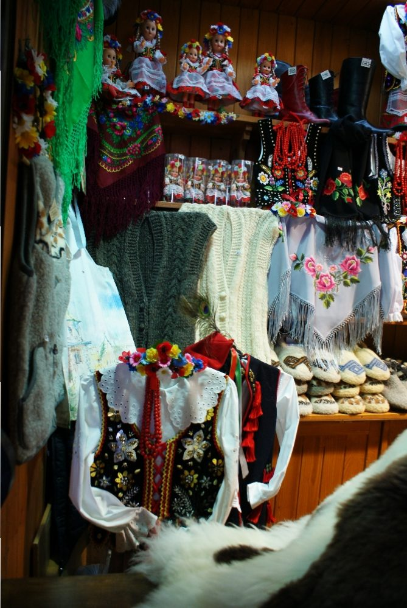

Omdat we in Krakau geen greintje sneeuw vonden, trokken we de dag nadien naar Zakopane, de winterhoofdstad van Polen. Je
geraakt er gemakkelijk met de bus (2 u. 10 min.), die vertrekt vanaf het grote busstation van Krakau.

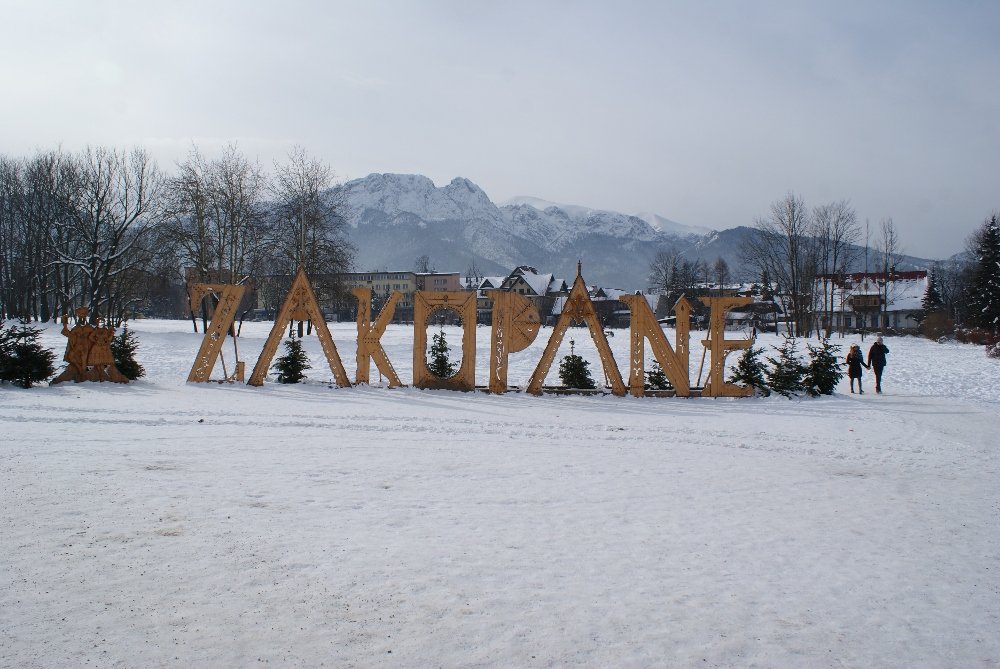

Na onze aankomst in Zakopane wandelden we eerst richting Gubałówka (1123 m), voorbij een enorme markt met lokale
souvenirs en gerookte kaas die oscypek heet (een streekspecialiteit). Je moet zeker eens gegrilde oscypek met
veenbessenconfituur proberen, te vinden bij veel straatkraampjes en echt heerlijk! Eerst wilden we te voet naar de top van Gubałówka
(ongeveer 45 min.), maar het pad was erg glad. Om vlak voor mijn reis naar de Himalaya geen enkel risico op blessures te lopen,
kozen we voor de veilige optie en namen we de kabelbaan naar boven. Zo konden we na een rit van 3,5 minuut
genieten van het panorama over de Tatra en Zakopane :D Ik ben het niet gewoon om een top met zo weinig
moeite te bereiken ;) Boven zijn er een paar restaurants, eet- en souvenirkraampjes, skipistes en een klein houten kerkje.

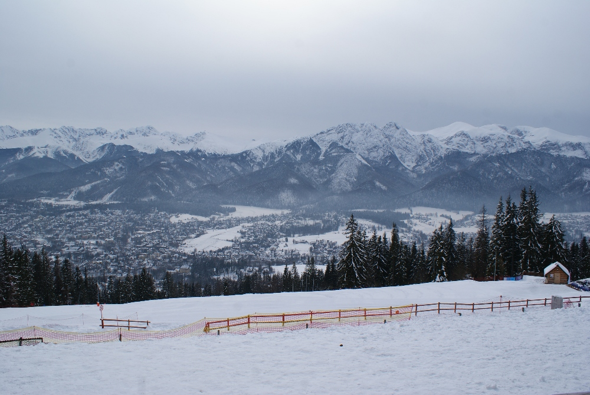
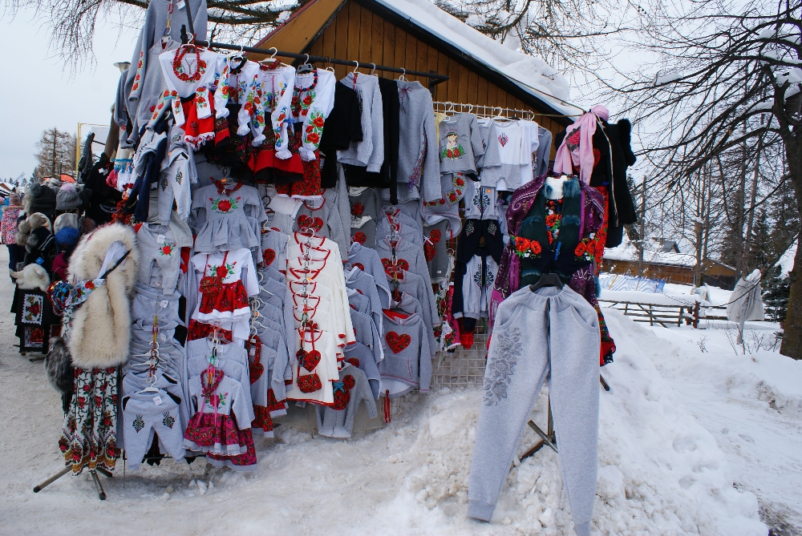
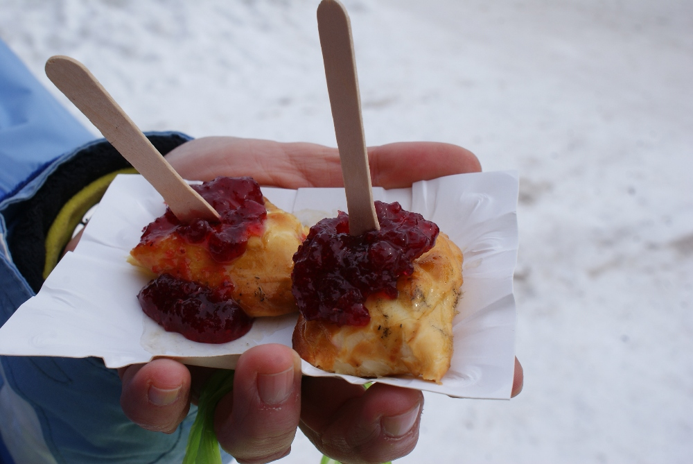
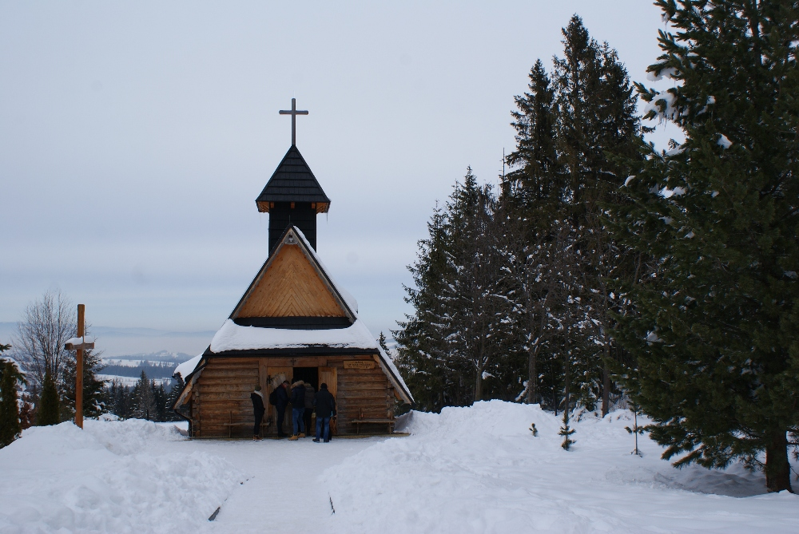

Daarna wandelden we door de Krupówki-straat, de belangrijkste straat van Zakopane, vol hotels, restaurants en souvenirwinkels.
Bij kleine houten kraampjes kan je ook lokale confituur, honing en siropen van allerlei soorten fruit kopen.
In "<a href="http://www.pozboju.pl/index.php/en/">Karcma po zbóju</a>" aten we pierogi (deegkussentjes)
met vlees, een van de bekendste Poolse gerechten. Na nog wat winkelen en een warme thee in een van de restaurants
keerden we terug naar Krakau.

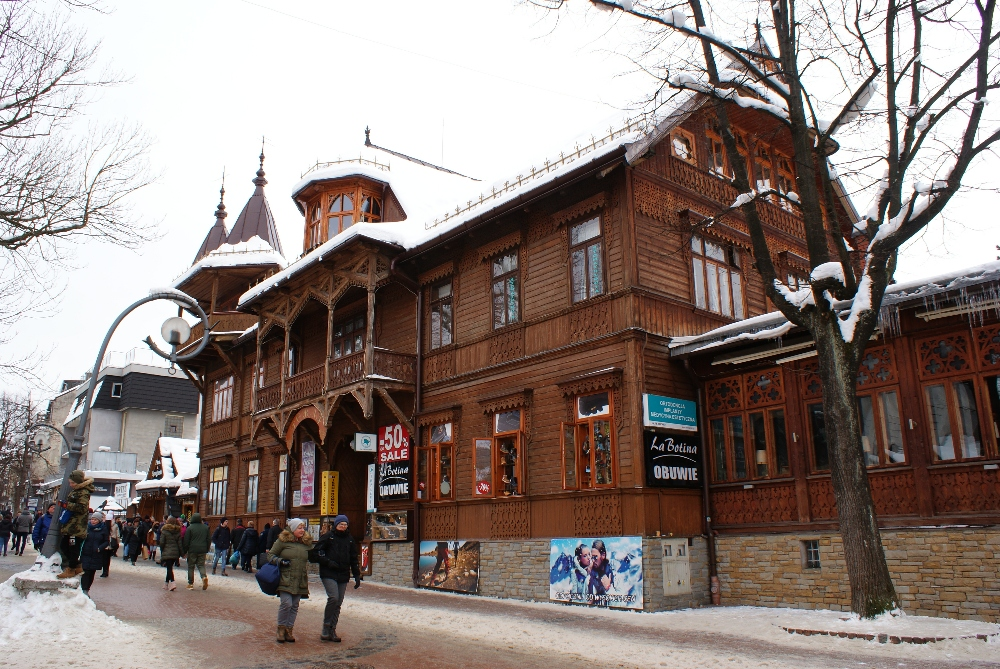
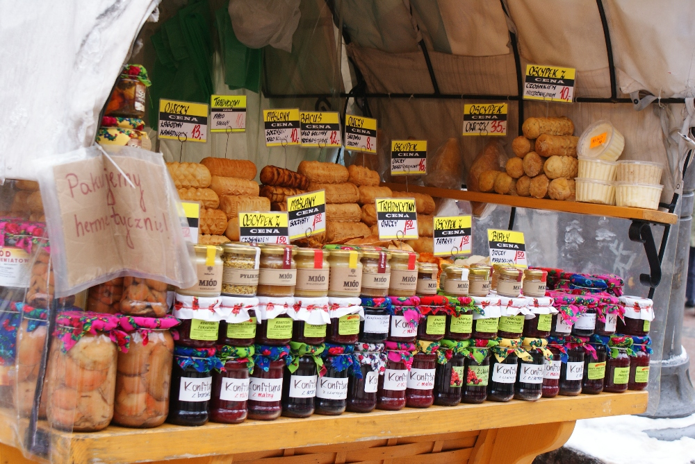

Op onze laatste dag bezochten we twee musea: <a href="http://www.mhk.pl/branches/eagle-pharmacy">de Apotheek onder de Adelaar</a>
(de apotheek van Tadeusz Pankiewicz) en <a href="http://www.mhk.pl/branches/oskar-schindlers-factory">de fabriek van Oskar
Schindler</a> in het getto van Krakau. In het eerste museum zie je alle vertrekken van de vroegere apotheek en waarvoor ze dienden. Het
zit vol verborgen details over hoe mensen het leven in het getto overleefden, welke medicijnen toen beschikbaar waren en
welke het meest gevraagd werden. Het boek dat de eigenaar van deze apotheek schreef, "De apotheek in het getto van Krakau", beschrijft de
tragische gebeurtenissen in het getto van Krakau en verscheen vlak na de oorlog.
Er zijn films te bekijken, foto's om aan te raken en documenten om te lezen: niemand verveelt zich hier!

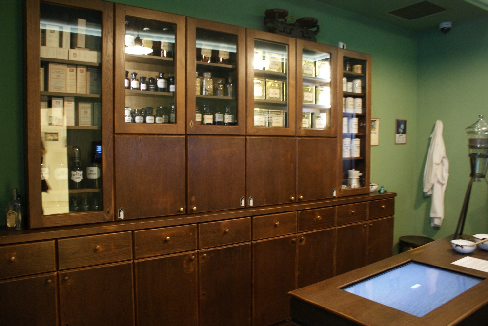
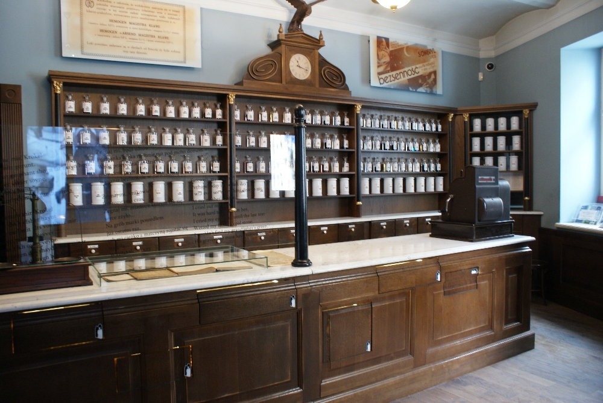

Het tweede museum gaat over Krakau onder de nazibezetting van 1939 tot 1945 en is ondergebracht in het vroegere administratieve
gebouw van Oskar Schindlers emailfabriek in de Lipowa-straat 4. Een erg interactieve tentoonstelling vol persoonlijke
drama's en verhalen uit het dagelijkse leven tijdens de Tweede Wereldoorlog. Het verhaal van Oskar Schindler, die
het leven van meer dan duizend mensen redde, werd verfilmd door Steven Spielberg in Schindler's List. Een erg aangrijpende tentoonstelling
die we van harte aanraden, al kan het er behoorlijk druk worden (je moet je ticket online reserveren). Wij
deden er bijna twee uur over, maar ik ben er vrij zeker van dat sommige mensen hier dubbel zoveel tijd doorbrengen,
al wandelend door 45 tentoonstellingszalen en lezend over de eindeloze feiten uit de geschiedenis van Krakau.

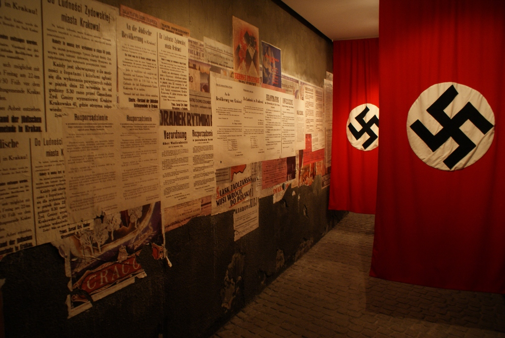
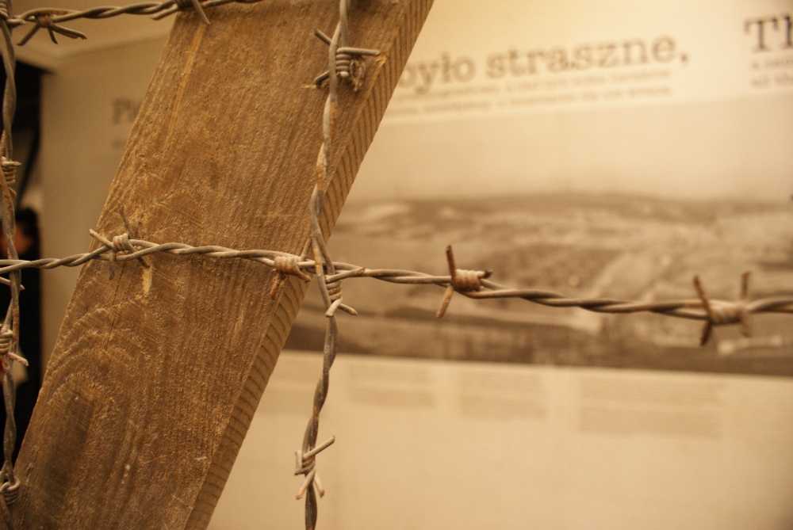

In de namiddag trokken we naar Kazimierz, de plek waar de Joodse cultuur meer dan 500 jaar lang bloeide, tot in 1941
de Joodse bevolking naar het getto werd verplaatst. Je kan er nog een paar synagogen bezoeken, waaronder
<a href="http://www.mhk.pl/branches/old-synagogue">de Oude Synagoge</a>, waar je meer te weten komt over
de belangrijkste feestdagen van de Joodse kalender en over de traditionele mannen- en vrouwenkledij. Vandaag zit Kazimierz
vol sfeervolle cafés en kunstgalerijen. Laat de kans niet liggen om Poolse gerechten te proeven: in het restaurant
"<a href="http://marchewkazgroszkiem.pl/">Marchewka z Groszkiem</a>" heb je keuze te over, bijna te veel :p
Lekker eten aan een prima prijs!

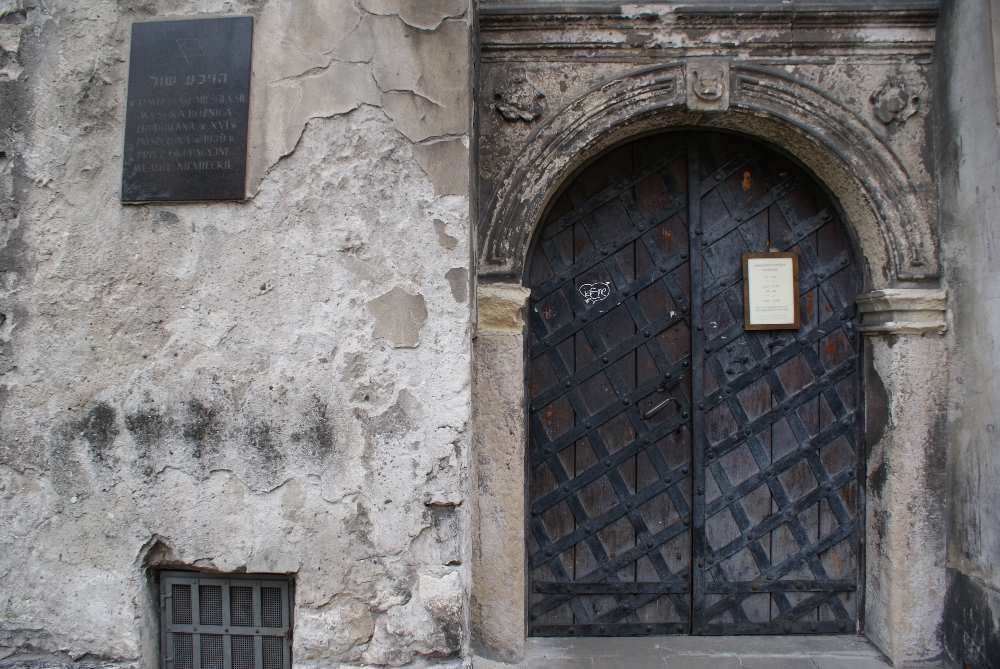
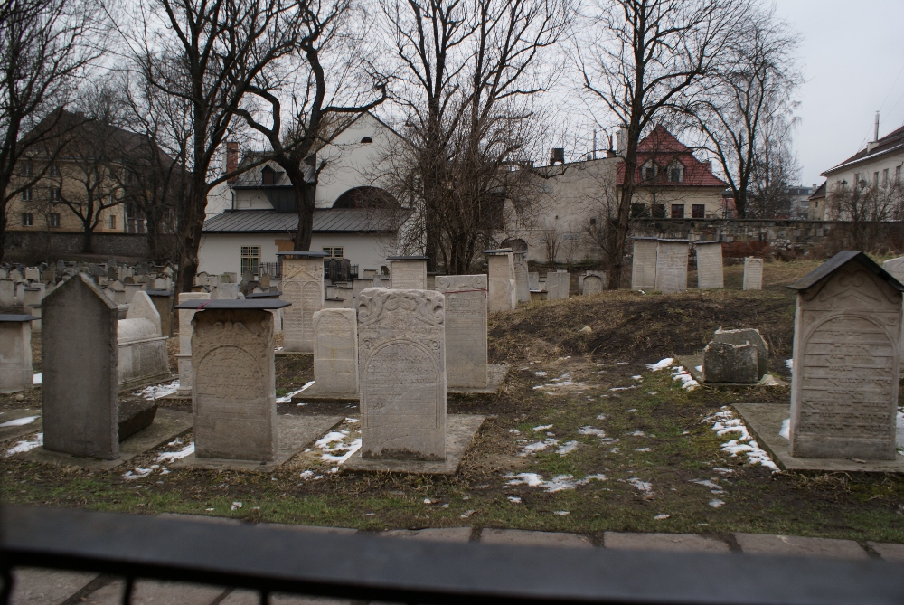
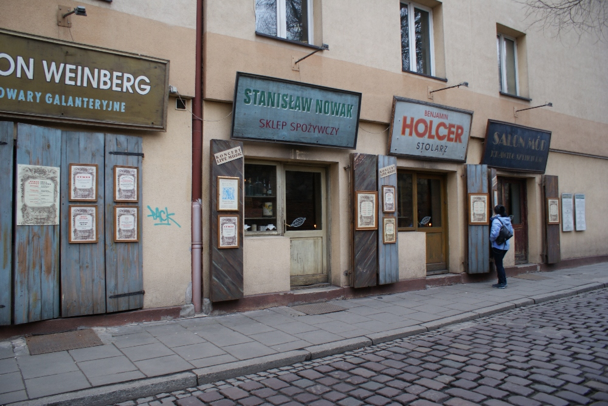

## Souvenirs om te kopen:
  * bont
  * juwelen van barnsteen
  * kantwerk
  * textielambacht
  * houtsnijwerk
  * accessoires met Poolse folkloremotieven (paraplu, brillenkoker, schort, kussensloop)
  * veel mensen zijn echt blij met ptasie mleczko (zie de rubriek hieronder) van Wawel of kabanosy (lange dunne droge worst, meestal van varkensvlees) als souvenir ;)

## Eten om te proeven:
  * Pierogi - deegkussentjes, hartig (vlees, kool met paddenstoelen, Russisch) of zoet (zoete plattekaas, appel, aardbei)
  * Golonka - varkensschenkel, meestal met biersaus
  * Zrazy - traditionele Poolse rundsrollade
  * Gołąbki - gevulde koolrolletjes
  * Bigos - stoofpot met zuurkool, vlees, worst en paddenstoelen
  * Barszcz - bietensoep, soms geserveerd met deegkussentjes
  * Rosół - kippenbouillon
  * Żurek - traditionele Poolse zure gefermenteerde soep met ei of witte worst
  * Placki ziemniaczane - aardappelpannenkoeken, heel vaak geserveerd met varkensstoofpot
  * Kompot - drank van gekookt fruit, wordt vaak bij het avondmaal gedronken

## Zoetigheden:
  * Pączek - Szewska-straat 25 (klein raampje met donuts en ander lekkers), 3,5 zl
  * Ptasie mleczko (van het merk Wedel) - zachte met chocolade omhulde snoepjes, in veel smaken
  * Krówki - Poolse fudge
  * Prince Polo - Poolse chocoladereep
  * Obwarzanek - 1,60-2 zl

## Praktische info:
  * Ondergrondse tentoonstelling Rynek Underground - 19 zl toegang
  * Bus naar Zakopane - 40 zl, heen en terug, verschillende busmaatschappijen maar allemaal dezelfde prijs, veel verbindingen overdag, koop je tickets beter een dag op voorhand aan het <a href="http://rozklady.mda.malopolska.pl/?lang=eng#krk">grote busstation</a> (Bosacka-straat 18)
  * Kabelbaan Gubałówka - 23 zl, heen en terug
  * Ticket voor het herinneringsparcours - 28 zl, combiticket voor de Apotheek onder de Adelaar, de fabriek van Oskar Schindler en het museum in de Pomorska-straat (dat we niet bezocht hebben)
  * De Oude Synagoge - 10 zl toegang
  * Trein van Kraków Główny naar de luchthaven Balice - 9 zl enkele rit
