We kwamen op 1 maart aan in Kathmandu, met een flinke jetlag en midden in het Holifeest,
de kleurrijkste feestdag van Nepal! Dat was puur toeval, dus in het begin stonden we compleet versteld en waren we niet klaar
voor wat er ging komen :) Nog voor we ons hotel bereikten, lag er al een dikke laag gekleurd poeder op ons gezicht en onze
schouders :p Diezelfde dag wandelden we ook naar de Nepal Tourism Board om onze vergunningen te halen
([meer info]()), onderweg passeerden we het ene feest na het andere, vol kleurrijke, dansende mensen. In de
hele stad hangt de sfeer van het festival, winkels zijn dicht, mensen zegenen elkaar met gekleurd
poeder en roepen: Happy Holi! Tegenwoordig gooien kinderen kleine ballonnetjes gevuld met water naar voorbijgangers, iets wat ik
een paar keer aan den lijve ondervond :p Gelukkig kregen we onze vergunningen ter plaatse meteen mee, kochten we onmiddellijk bustickets naar Pokhara
en vertrokken we de volgende ochtend.

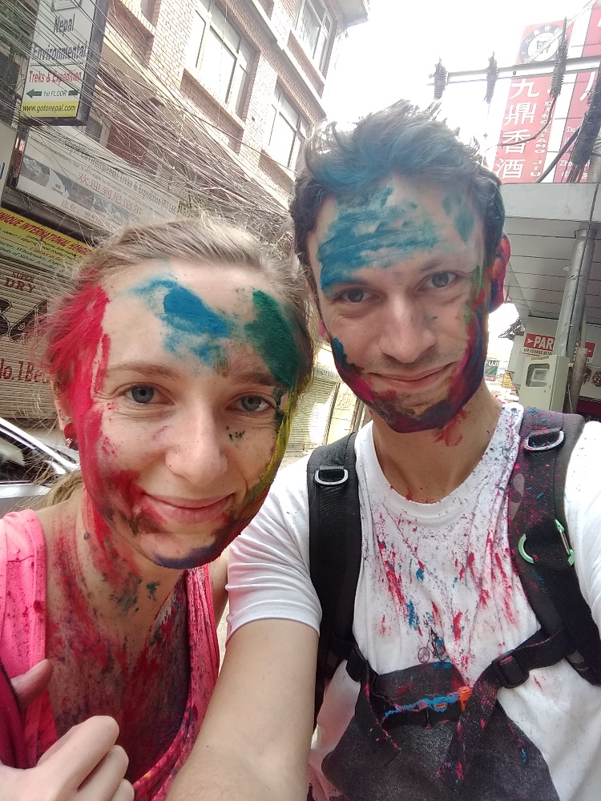

De kleuren van het Holifeest

De eerste busrit naar Pokhara liet ons meteen zien hoe busvervoer in Nepal er echt aan toegaat. Reken niet op
internet en zoek niet naar de bus die ze je op de foto in het ticketkantoor hebben getoond. Toon je
ticket het best aan willekeurige buschauffeurs, en uiteindelijk wijst iemand je een oude, gammele lokale bus aan waarin je
de volgende 7 uur moet zitten ... deze keer konden we tenminste zitten ;) De weg van Kathmandu naar Pokhara is in vrij
slechte staat, plaatselijk ontbreekt het asfalt, wat betekent dat het schokt en stoft. Neem dus beter een pilletje als je last hebt van
wagenziekte. Gelukkig hadden we pauzes voor het ontbijt en het middagmaal, dus we overleefden deze rit in
redelijk goede vorm. Na één nacht in Pokhara, wat kleine laatste inkopen en de volgende dag, vroeg in de ochtend,
vertrokken we naar Besishahar, waar onze tocht begon. We raakten niet zonder problemen de stad uit, onze bus was
overvol (ongeveer dubbel zoveel mensen als er zitplaatsen waren) en we moesten de hele rit van
4,5 uur rechtstaan, geplet in een smerige bus waarin Sebastian door zijn lengte (1,88 m / 6'2") niet eens rechtop kon staan :O
Toen we eindelijk in Besishahar aankwamen, was het echt tijd om te beginnen wandelen in een fijne,
propere omgeving, ver weg van de bussen. Het eerste stuk naar Bhulbhule was niet zwaar, het pad liep door
een paar dorpjes en over onze eerste hangbrug. Het terrein is eerder vlak, maar het was behoorlijk warm, waardoor we ons
op het einde van de dag toch uitgeput voelden. We vonden snel een houten guesthouse met zicht op de rivier,
maar de volgende dag ontdekten we dat het dorp zich eigenlijk nog een paar honderd meter verder uitstrekt, met mooiere
slaapopties verderop.

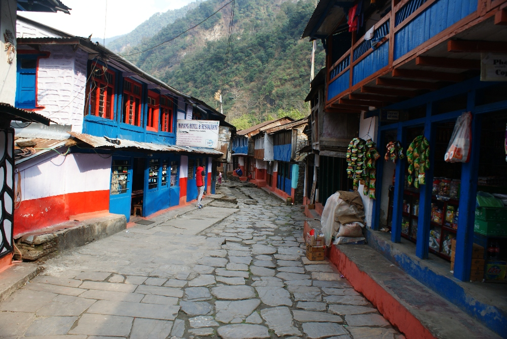

Het hoofdpad dwars door het dorp Bhulbhule

We kwamen onderweg niet veel wandelaars tegen omdat (zoals onze gastheer ons vertelde) de meeste mensen een jeep nemen tot
in Chame (2690 m) en zo de eerste 3 à 4 dagen van de trek overslaan. Ze winnen misschien tijd, maar ze verliezen zeker de kans
om de overgang in het landschap te zien, en door zo snel te stijgen krijgen velen van hen later last van
hoogteziekte (Manang is trouwens het verste dorp dat je met een jeep kunt bereiken). We volgden de rode
en witte tekens van het Annapurna Circuit, die ons weg van de stoffige weg leidden en dwars door de
kleine dorpjes (vaak met wat extra hoogtemeters in vergelijking met de weg). Op onze tweede dag naar
Jagat bewonderden we bloeiende bomen, rijstvelden en bananenbomen langs de weg.

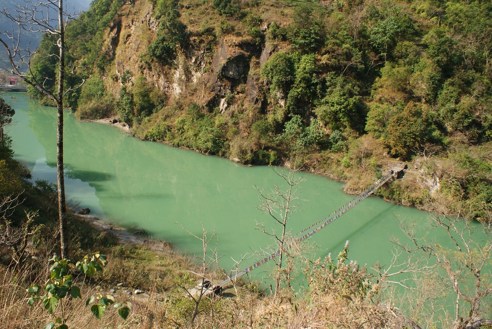
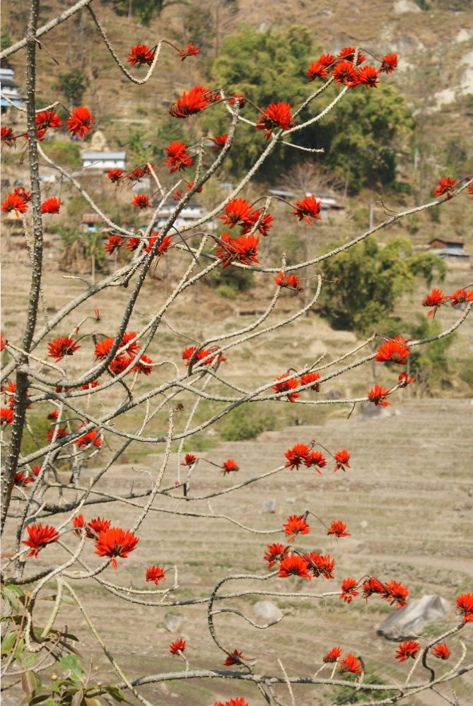

De eerste regendruppels vielen toen we het dorp Jagat bereikten, en de hele nacht kletterde de hevige regen
op het metalen dak, waardoor slapen zonder oordopjes bijna onmogelijk was :p Tot onze verbazing was de volgende ochtend
prachtig, geen wolken of enig spoor van de storm van die nacht. Deze dag was zwaar: eerst een steile afdaling, dan een lange
klim over een heel rotsachtig en steil pad en opnieuw een afdaling naar een van de mooiste dorpen van de trek, Tal. Vol
kleurrijke guesthouses, gelegen naast de zandige rivieroevers, kregen we zin om er te blijven overnachten, maar
we hielden ons aan ons plan en trokken verder naar Dharapani.

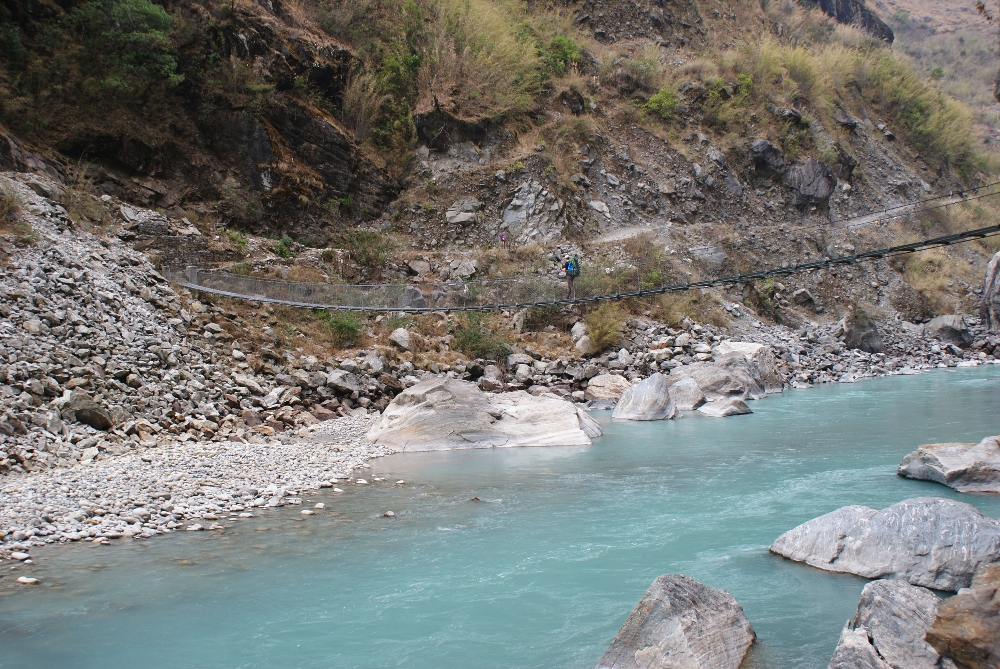

Onze inspanningen werden beloond met een heel fijne kamer en heerlijk eten (Heaven hotel, naast de hangbrug). Dit
was ook de laatste dag met internet en de laatste warme nacht tijdens deze tocht. Na weer een regenachtige nacht
motiveerde een prachtige ochtend ons om vroeg te vertrekken. Deze dag was erg aangenaam, voor het eerst konden we
majestueuze, besneeuwde toppen zien, waaronder de Manaslu (de achtste hoogste berg ter wereld).

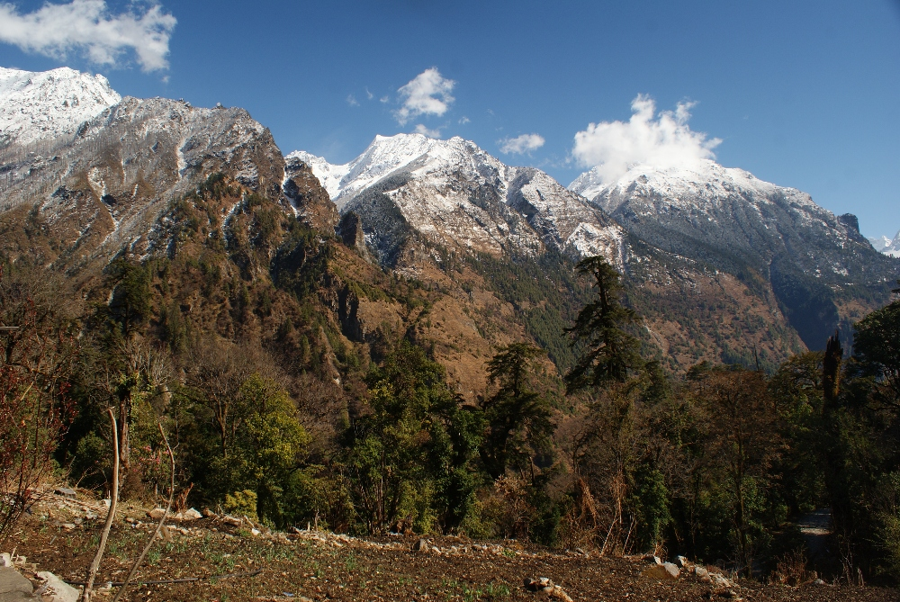
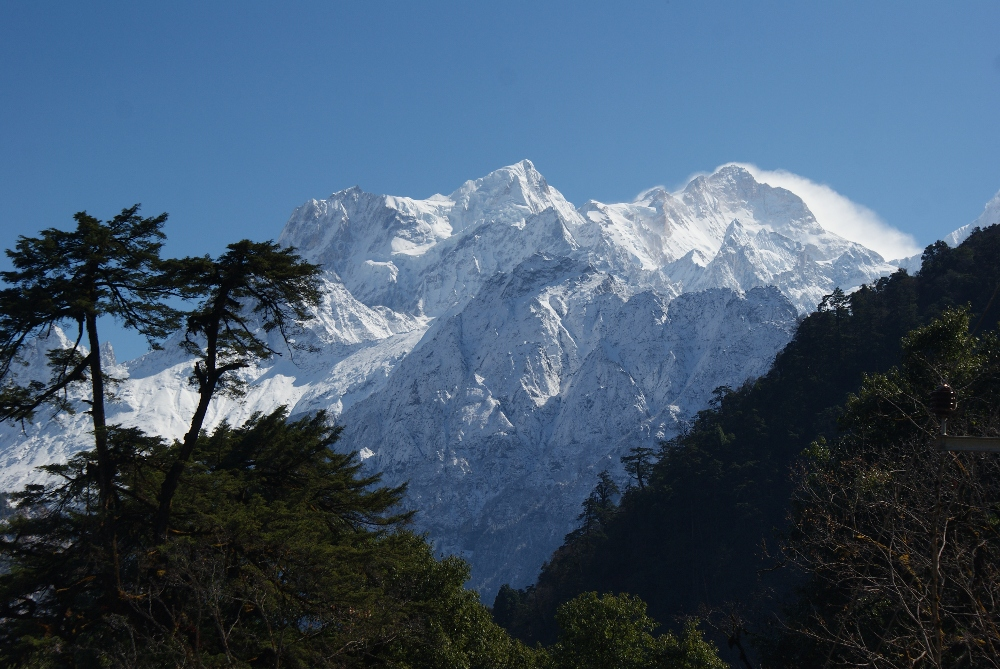

We klommen de hele dag traag hoger, met slechts een paar heel steile stukken in het bos. Langs kleine dorpjes
en stille naaldbossen wandelen was zo ontspannend! :D Nadat we een hotel hadden gevonden in Chame, maakten we een wandeling door het
dorp en zagen we stapels lege plastic flessen in de beek liggen. 's Avonds merkten we ook dat onze
gastheer plastic afval verbrandde in de kachel van onze eetruimte, waarbij hoogst giftige stoffen vrijkomen, en het was niet de
enige plek waar we dat zagen gebeuren. Het zou geweldig zijn als alle wandelaars hierin hun verantwoordelijkheid namen en
hun eigen plastic afval mee terugnamen naar Pokhara, zoals wij deden. Toeristen zouden zich bewust moeten zijn van dit probleem, want we kunnen
allemaal een rol spelen in het verminderen van plastic vervuiling.

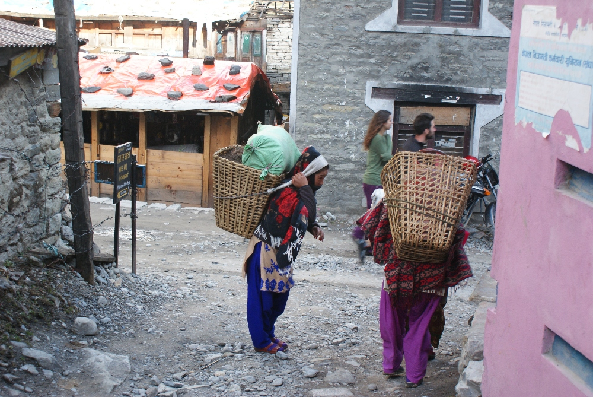

De traditionele manier om zware lasten te dragen, het volledige gewicht rust op de banden die over het voorhoofd lopen

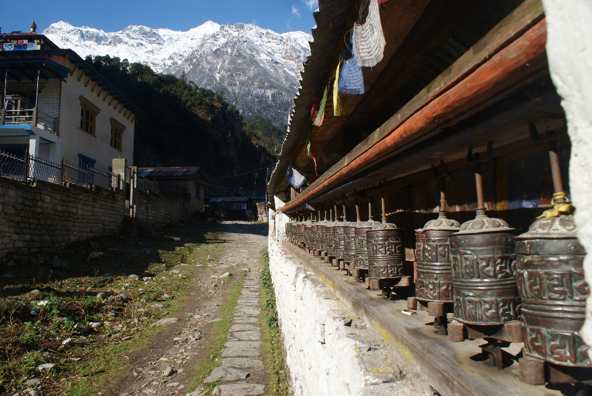

Elk dorp heeft zijn gebedsmolens, draai eraan voor wat geluk :)

De volgende dag, onderweg naar Upper Pisang, merkten we meer wandelaars op, want dit is het startpunt voor
de meeste toeristen die het Annapurna Circuit doen. Een wolkeloze, blauwe hemel boven ons en een kristalheldere beek beneden maakten dit
stuk echt aangenaam. De rotsachtige hellingen waren uitgehouwen om plaats te maken voor de weg, wat interessante overhangen
opleverde om onder door te wandelen. Op een bepaald punt kun je kiezen tussen een weg naar Lower Pisang en een pad naar Upper
Pisang; wij kozen het tweede. Tijdens dit deel konden we eindelijk het adembenemende Annapurnamassief bewonderen,
met de top Annapurna I, de eerste achtduizender die ooit beklommen werd (Frans team, 1950). De Poolse klimmers
Jerzy Kukuczka en Artur Hajzer maakten in 1987 de eerste winterbeklimming van de Annapurna I. We besloten te overnachten in een
houten huis met zicht op Lower Pisang en de Annapurna. De hele plek zag er vrij nieuw uit, maar door één laag
houten panelen zonder enige isolatie was onze nacht behoorlijk koud.

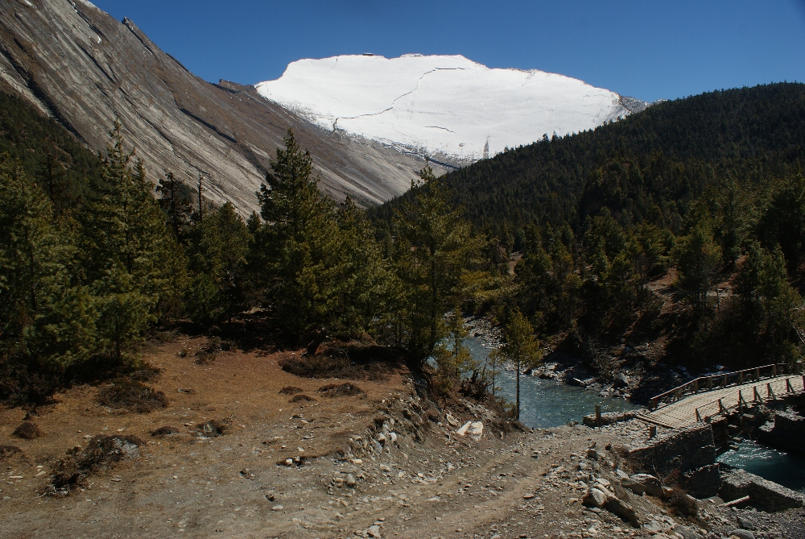

Het pad naar Upper Pisang

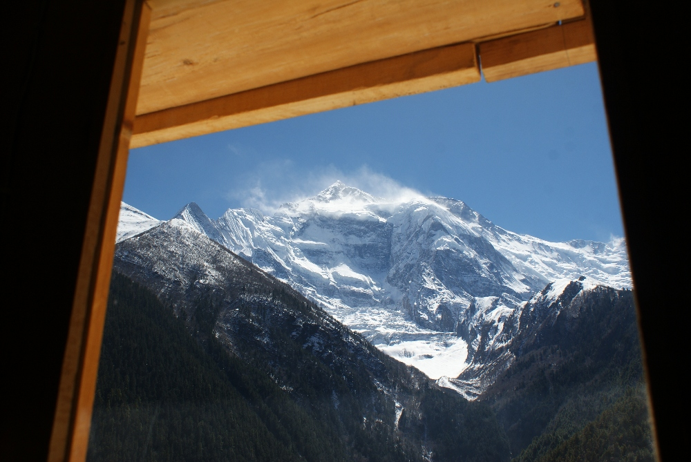

Uitzicht vanuit onze kamer in Upper Pisang, het adembenemende Annapurnamassief!

Er zijn twee manieren om vanuit Upper Pisang in Manang te geraken: de lagere route langs de weg en de hogere, die
veel zwaarder is maar je beloont met prachtige vergezichten vanuit het dorp Ghyaru (3730 m). Voor het eerst
raakte ik ver achterop bij Sebastian; met een zware rugzak steile paden op heeft hij een voordeel. En inderdaad, het
panorama was adembenemend, veel mensen besloten een pauze te nemen aan het uitkijkpunt en wij deden hetzelfde.

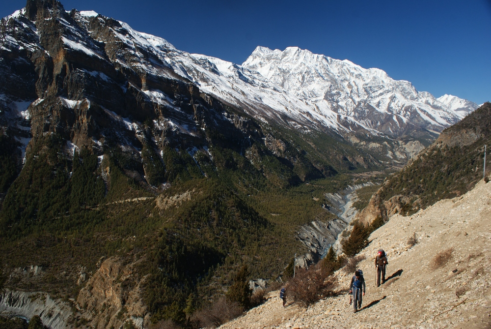

Het steile stuk naar het dorp Ghyaru

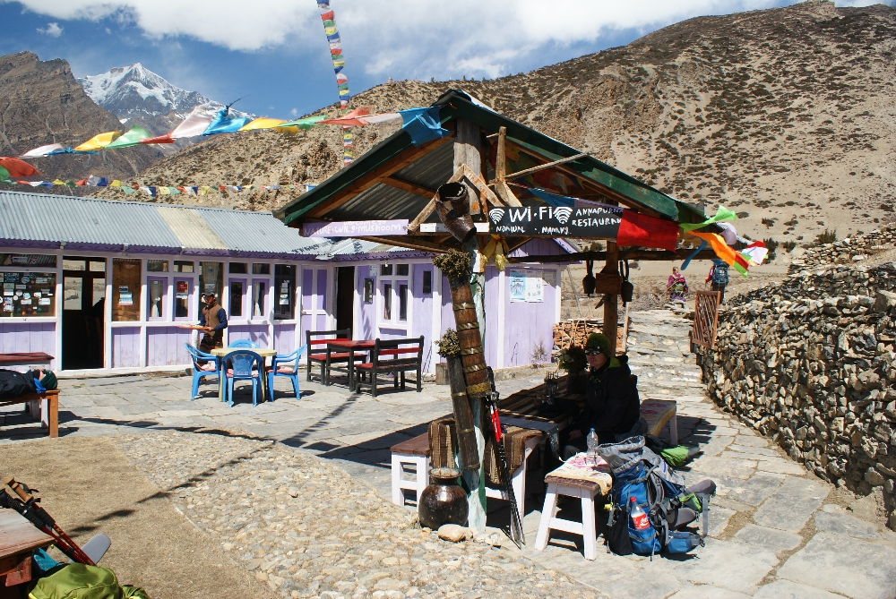

Middagpauze in een van de restaurantjes

Na het dorp Ghyaru was het niet meer zo moeilijk, op een bepaald moment begon het pad te dalen, werd het
stoffiger en zachter onder de voeten. Vlak bij onze bestemming voor die dag passeerden we nog een dorp,
Bhraka, waar het pad naar het Ice Lake begint en waar sommige mensen bleven overnachten. Wij trokken verder naar het grotere
dorp Manang, waar we besloten 3 nachten te blijven. We maakten een goede keuze qua verblijf (Royal Manang Hotel):
een zorgzame gastheer, lekker eten en een warme eetzaal, precies wat we nodig hadden. Om beter te acclimatiseren en
hoogteziekte te vermijden, maakten we een dagtocht naar het Ice Lake (4600 m), al raakten we maar tot aan het Tea House op 4200 m. Het was een
vergissing om geen wandelstokken mee te nemen, de kleine steentjes op die steile helling waren behoorlijk vervelend. Dit pad is
zeker de moeite waard, want de uitzichten zijn gewoon fantastisch! Op een bepaald moment schoten er twee wolven achter de bomen door, we
waren dolenthousiast maar ook een beetje bang :)

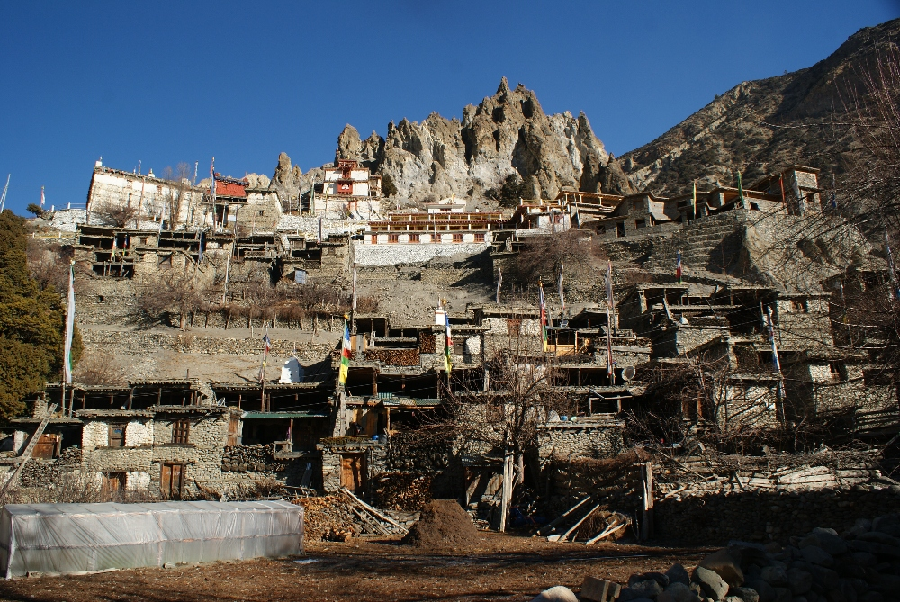

Het dorp Bhraka

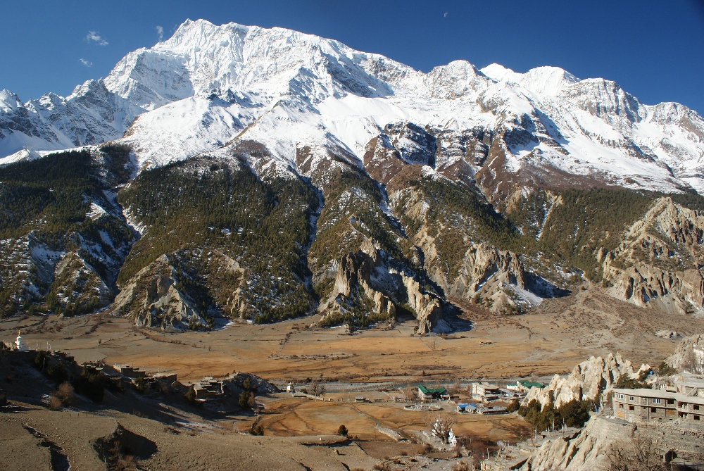

Onderweg naar het Ice Lake

De volgende dag was een rustdag om energie te verzamelen voor het laatste deel. Buiten in de zon zitten met onze boeken
en een korte wandeling naar het nabijgelegen meer waren onze enige bezigheden die dag. In Manang is er een checkpoint met de
weersvoorspelling, al is die niet erg nuttig omdat de voorspellingen een heel groot deel van de regio bestrijken en maar
één keer per week worden bijgewerkt :p Bovendien wisten de medewerkers niet wat de omstandigheden op de Thorong La Pass waren,
ze hebben totaal geen contact met het High Camp. Het lijkt erop dat een eenvoudige radio om te communiceren de
veiligheid flink zou kunnen verhogen als het weer omslaat. Tijdens ons verblijf was het 's nachts ongeveer -12 °C en overdag -2 °C. Er
zijn ook een paar winkels met wandeluitrusting en enkele bakkerijen met heerlijke, verse broodjes.

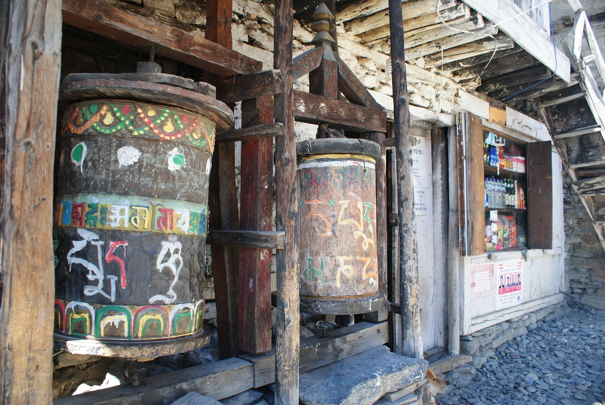

Enorme, houten gebedsmolens in Manang

De volgende ochtend vertrokken we naar Churi Ledar, waar we één erg koude nacht doorbrachten :p Dit stuk van de trek was niet
erg moeilijk en niet erg lang, dus we deden het rustig aan. We werden voorbijgestoken door heel wat ezels, muildieren en paarden die eten
naar de hoger gelegen onderkomens brachten.

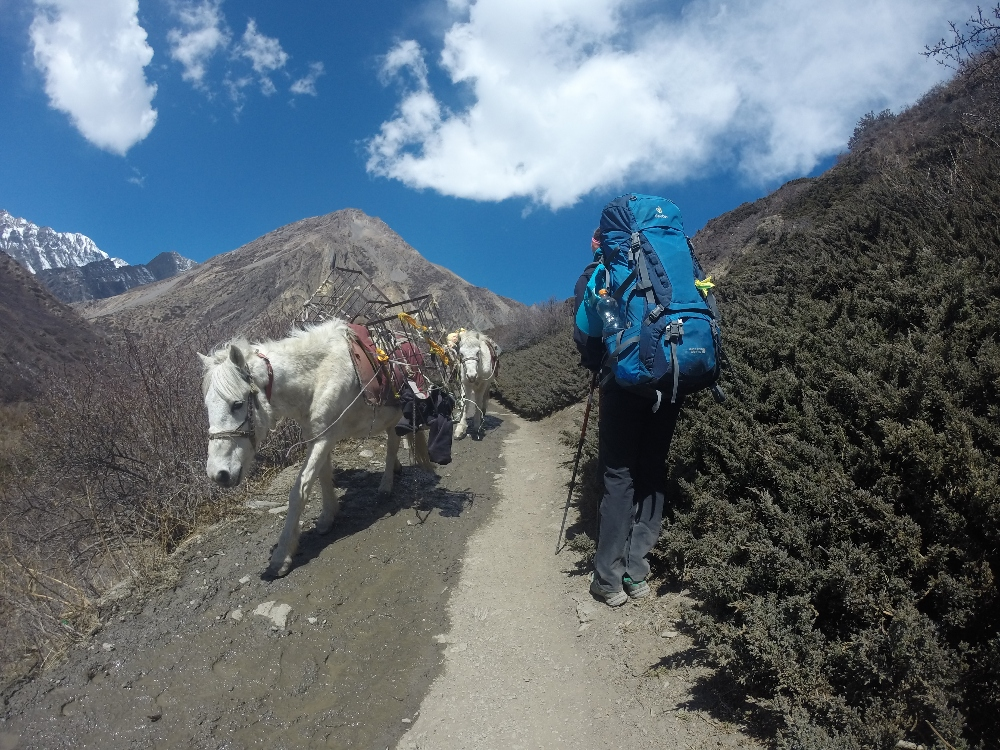
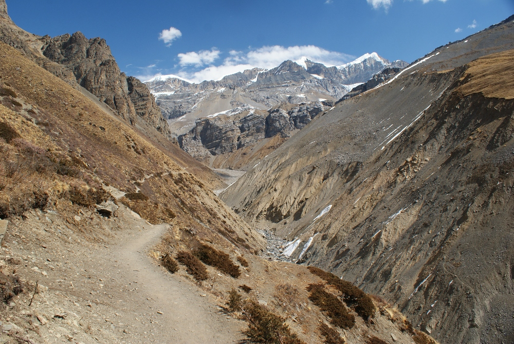

Omdat we geen enkel symptoom van hoogteziekte hadden, besloten we de volgende dag naar het High Camp te gaan en
te kijken hoe we ons voelden (600 m stijgen). We wilden gewoon geen extra nacht doorbrengen bij die lage temperaturen :p
Eerst ging het pad voortdurend op en af, dus we hadden ongeveer 2,5 uur nodig om 300 hoogtemeters te winnen. Daarna stopten we
voor het middagmaal in het dorp Thorong Phedi (het Low Camp), waar de meeste mensen een extra nacht blijven.

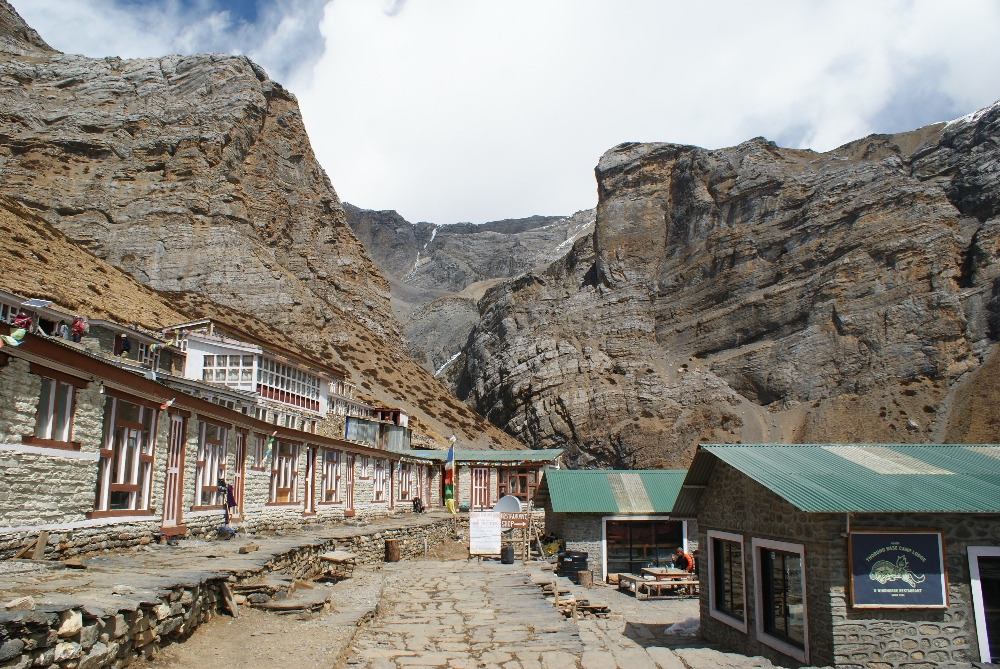

Het dorp Thorong Phedi, omringd door hoge rotswanden

We beseften dat er nog 300 hoogtemeters voor ons lagen over een heel kort stuk, wat een echt steile helling betekent. En inderdaad,
het zigzagpad sloopte me en ik kwam volledig uitgeput aan bij het onderkomen. Sebastian daarentegen had
een topdag (wat was dat frustrerend!). Die dag merkte ik echt dat we geen drager hadden, maar ik voel me
beter als ik mijn eigen spullen draag, de prestatie voelt dan completer. Het High Camp bestaat uit een paar gebouwen die
aan één eigenaar toebehoren en een grote eetzaal waar we de hele avond doorbrachten, in een poging om ons op te warmen bij de kachel.

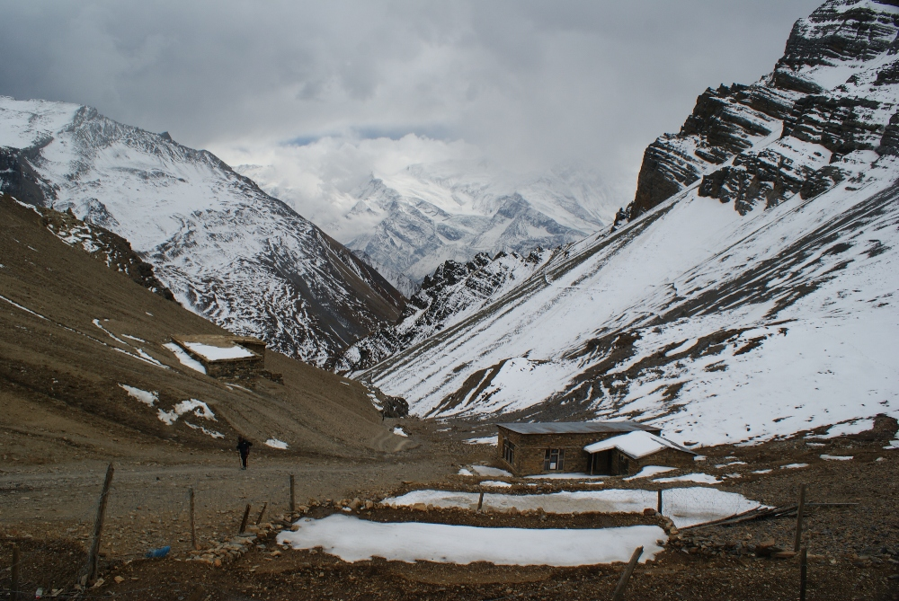

We bestelden het ontbijt zo vroeg mogelijk (6 uur) en besloten meteen daarna aan het belangrijkste deel van de tocht
te beginnen. 's Morgens lagen er rond het kamp veel ijzige plekken en de resterende sneeuw was hard, waardoor het pad
erg glad en gevaarlijk was. We moesten heel voorzichtig zijn bij het dwarsen van de hellingen en gebruikten onze wandelstokken
om ons evenwicht te bewaren. Het pad voor ons zag er niet erg steil uit, maar het was zwaar door de hoogte en onze
rugzakken. Uiteindelijk verscheen er een klein hutje aan de horizon en we wisten dat dat het piepkleine theewinkeltje op de Thorong La Pass was.
We hadden het gehaald, 5416 m, de hoogste pas waarop we ooit gestaan hebben! :D Op de een of andere manier voelde het niet als een grote
prestatie, er waren te veel mensen rondom ons ... wat altijd een stukje wegneemt van de schoonheid van alleen zijn in de
bergen. Over een pas trekken is niet zo spannend als een top bereiken ... dus ik heb de volgende keer een steviger doel nodig :D

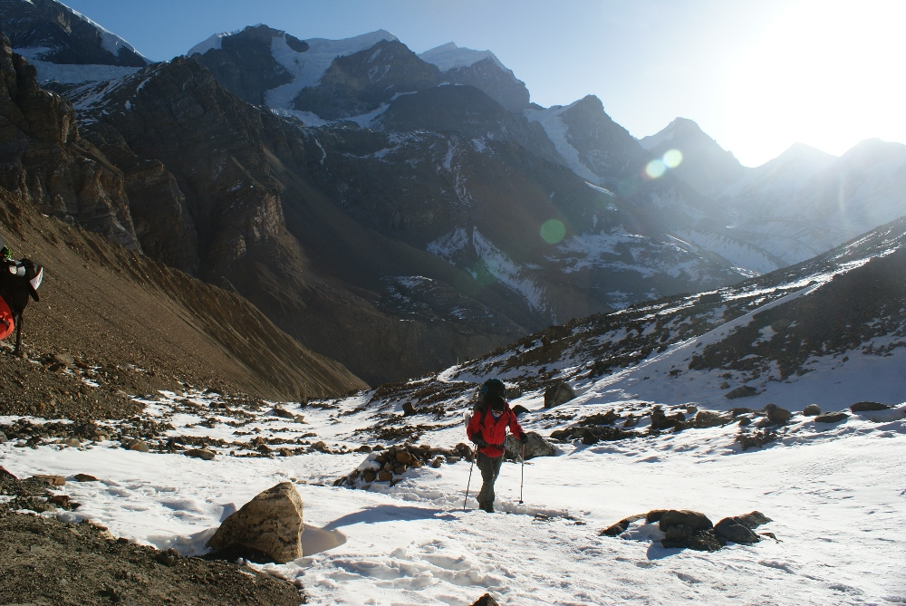
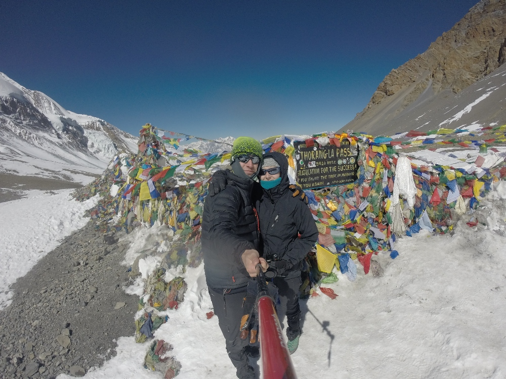

De weg naar beneden leek eindeloos, eerst gevaarlijke ijsplekken, daarna losse stenen die ons voortdurend gespannen hielden,
in een poging niet te vallen. Het landschap veranderde drastisch, rood en bruin als dominante kleuren, heel stoffig en geen
vegetatie in de omgeving.

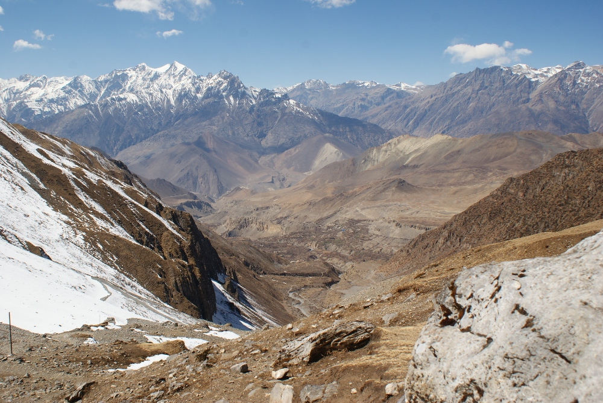

In Muktinath verbleven we in het guesthouse vlak bij de bushalte, waar we eindelijk een warme douche konden nemen
en het internet konden gebruiken om onze families op de hoogte te brengen. De volgende ochtend, na meer dan een uur wachten op een bus,
raakten we eindelijk op een bus naar Old Jamson, vanwaar we de laatste 6 km naar onze bestemming wandelden, het dorp Marpha.

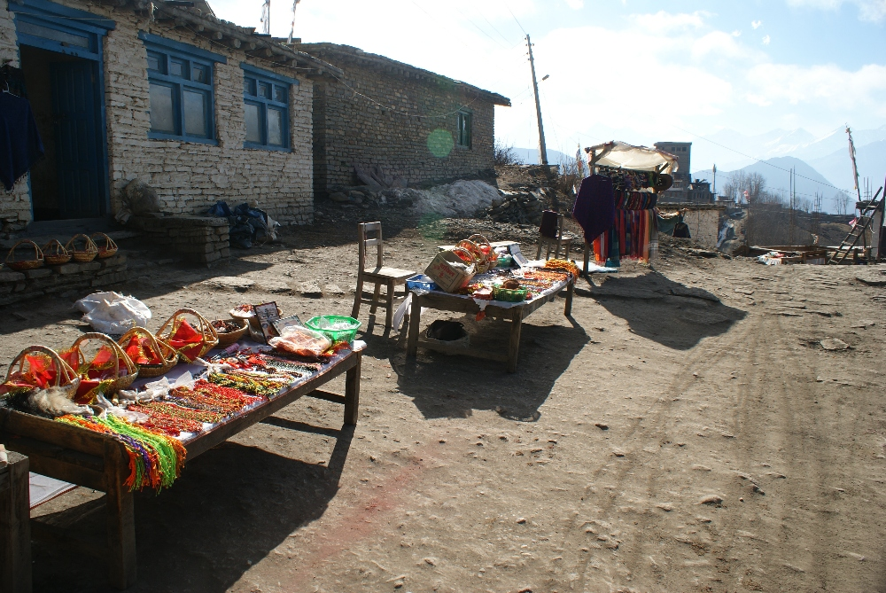

Kraampjes met lokale producten in Muktinath

Het pad lag onder een dikke laag stof en telkens als er een jeep passeerde, hulde een enorme stofwolk ons volledig in,
wat deze wandeling echt onaangenaam maakte. Het dorp Marpha was daarentegen erg ontspannend, met heel smalle straatjes
en een heiligdom op de heuvel. De jonge monniken openden de grote gebedszaal voor ons, die bedekt was met kleurrijke
lappen stof. We bewonderden het uitzicht op het dorp en merkten dat veel mensen hun platte daken als terras gebruiken.

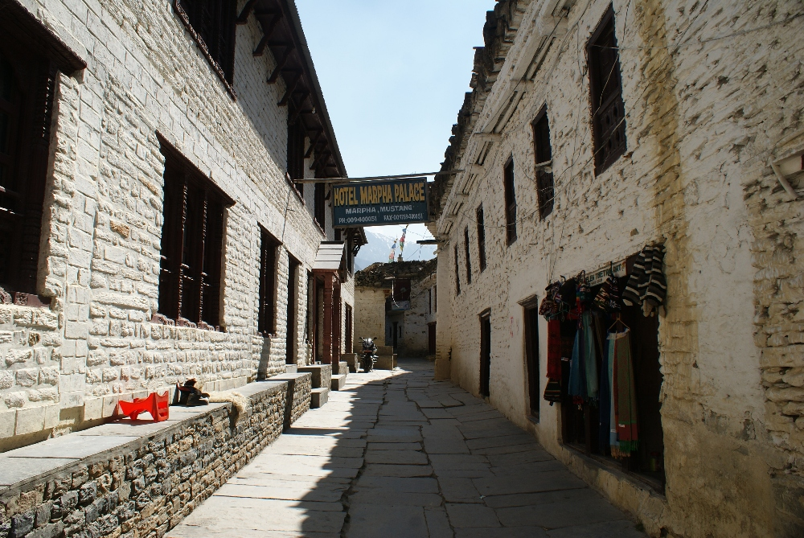
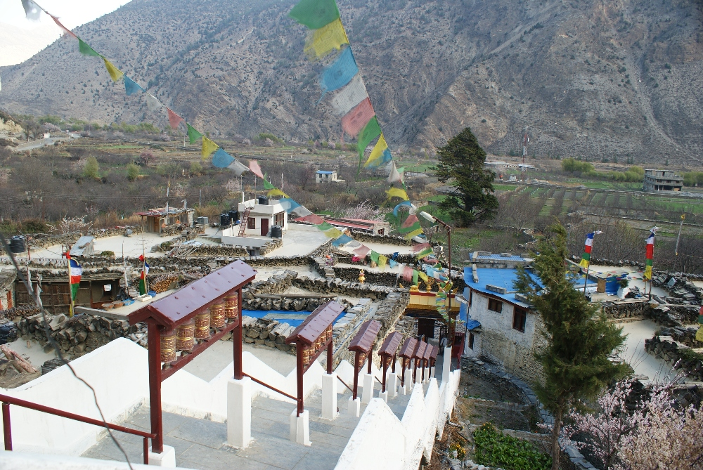
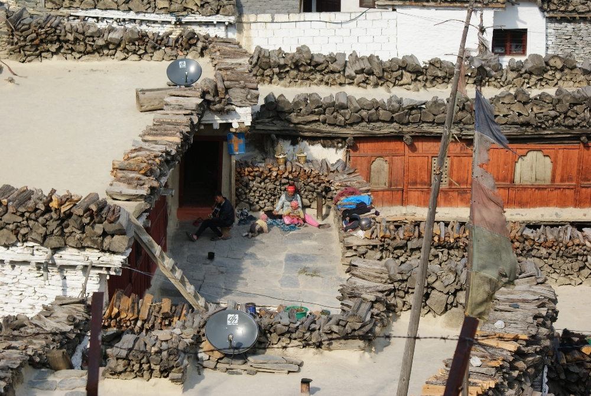

Deze streek staat bekend om zijn lokaal geproduceerde appel- en abrikozensap, maar biedt ook andere producten aan zoals cider,
confituur en gebak. Het was een fijne plek om uit te rusten.

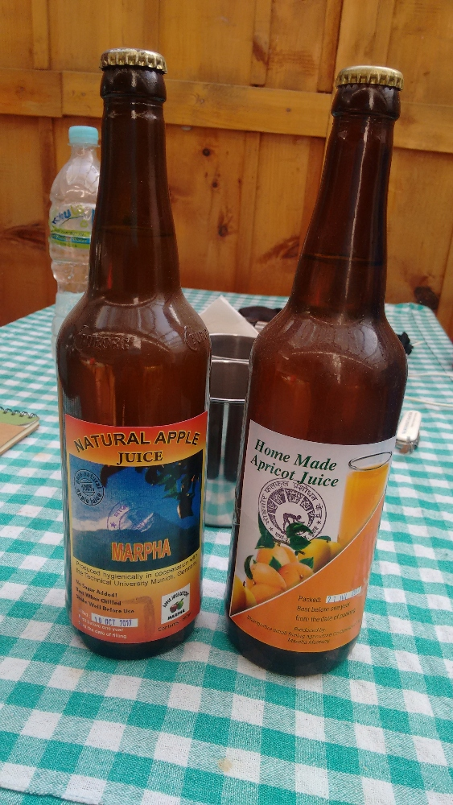

Het abrikozensap was gewoonweg subliem! :)

In plaats van de volgende dagen de vallei af te wandelen, besloten we de bus naar Tatopani te nemen (5 uur) en van daaruit aan de
erg populaire Poon Hill-trek te beginnen. Tatopani is omringd door sinaasappelbomen en heel veel bloemen, waardoor het er
echt mooi uitziet! In de buurt zijn er ook warmwaterbronnen, wat deze plek perfect maakt om te ontspannen, maar wij
aten er enkel iets en begonnen aan onze wandeling naar Shikha. Nadat we het dorp voorbij waren en de rivier hadden overgestoken, begon het
echte pad: eindeloze trappen gemaakt van enorme rotsblokken lagen voor ons, telkens weer kruisten we een stoffige weg voor
jeeps. Het was al laat in de namiddag en de eerste regendruppels bereikten ons. Een naderend onweer? We besloten
op veilig te spelen en te stoppen in Braha (een dorp 2 km voor Shikha), waar het aanbod aan overnachtingsmogelijkheden erg
beperkt is, dus we raden je niet aan daar te stoppen.

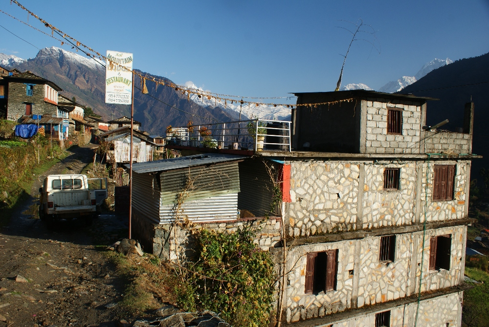

De volgende dag wandelden we helemaal omhoog naar Ghorepani, waar we een enorme variatie aan logies vonden, van grote
hotels tot piepkleine guesthouses. We verbleven in Annapurna Lodge View, met heel propere kamers en heerlijk
eten! De hele vallei rond Poon Hill stond vol bloeiende rododendrons; de donkerroze bloemen maakten de
hele omgeving schitterend.

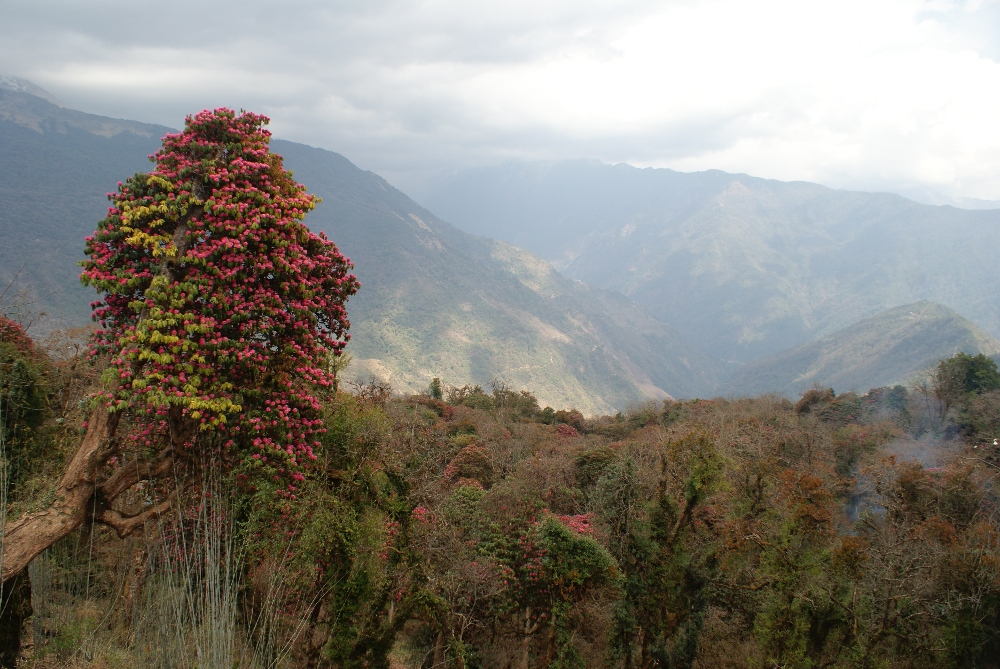

Het wandelen is hier heel anders dan wat we op het Annapurna Circuit hebben ervaren. Over trappen van
rotsblokken lopen werd na een tijdje behoorlijk saai, maar de rijstvelden en het dichte, groene bos maken dat ruimschoots goed. Onze laatste
wandeldag was erg intens: eerst bewonderden we de zonsopgang op Poon Hill (we vertrokken om 5 uur uit onze lodge), daarna
ontbeten we in ons guesthouse en ten slotte trokken we naar Ghandruk. Elke ochtend verzamelen 200 à 300 mensen
op Poon Hill om de eerste zonnestralen op de bergtoppen te zien vallen. Het werd daarboven echt koud, wat
een beetje plezier wegnam van deze vroege wandeling.

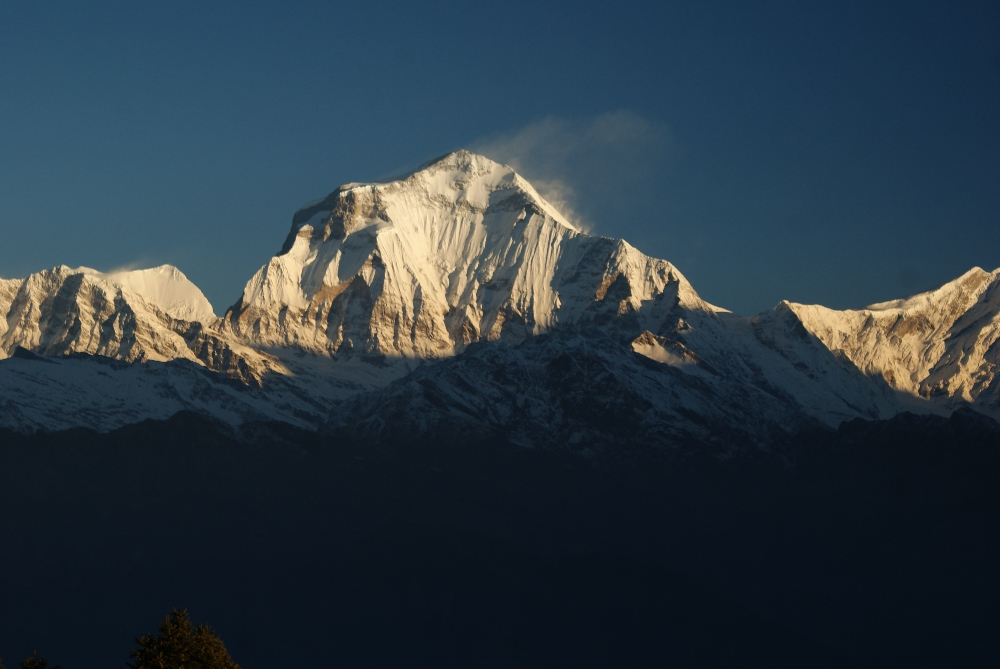

Het bord in Ghorepani zegt dat het 7 uur zou moeten zijn tot Ghandruk (meestal splitsen mensen dit deel op over 2 dagen). We waren
erg verbaasd dat het eerste uur bergop liep, langs het uitkijkpunt Deurali Pass, van waaruit we
Poon Hill van een afstand konden bewonderen. Uiteindelijk begon het pad te dalen, met heel hoge, rotsachtige treden. Tot onze verbazing
liep het pad de laatste 30 minuten voor Tadapani weer omhoog ... dat sloopte me echt, dus het was het perfecte moment om
te stoppen voor het middagmaal. Daarna wandelden we, vol energie, het laatste stuk naar Ghandruk. Het pad liep door
struikgewas en groene velden.

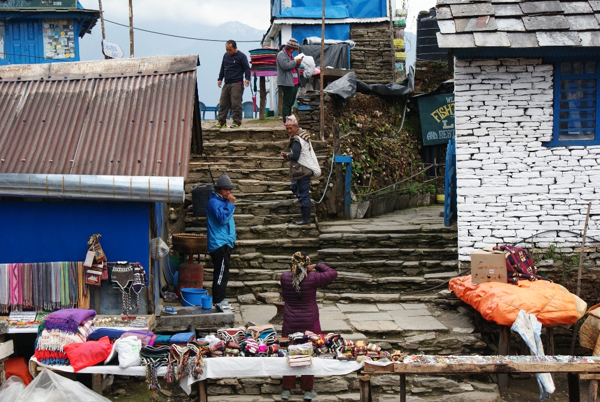

Mensen die lokale producten verkopen in het dorp Tadapani

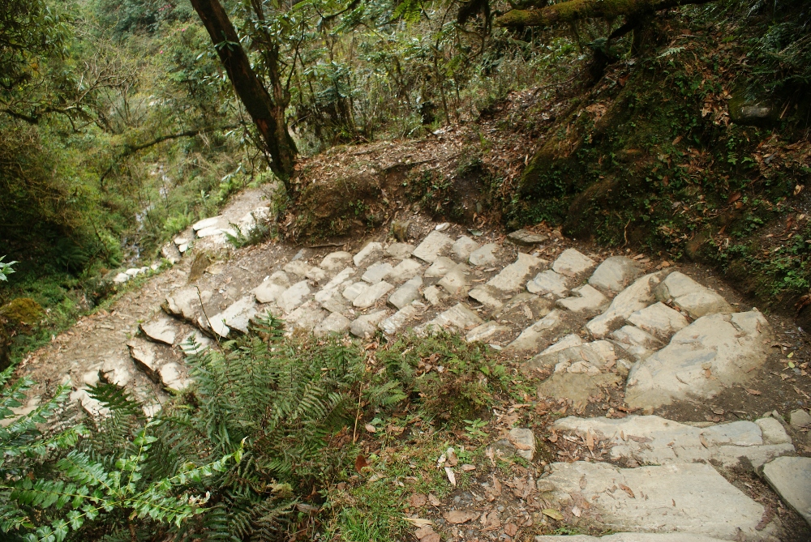

Geen trappen meer, alsjeblieft!

We waren heel blij dat we in Sakura Hotel terechtkwamen. De eigenaar had ook een kleine bakkerij, heel propere kamers en, tot onze verbazing,
waren wij er de enige gasten! De volgende dagen brachten we door in [Pokhara]() voor we naar Kathmandu vertrokken, van waaruit we onze
vlucht naar Bangkok hadden.

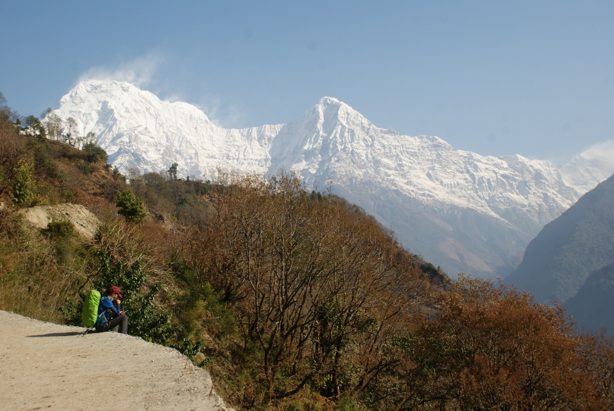

Wachten op de bus in Ghandruk

Hieronder zie je onze tocht dag per dag, met de afstanden en de tijd die nodig is voor elk deel. Tijdens deze 15 dagen
wandelen legden we ongeveer 197 km af :D Dit was de langste trektocht die we ooit in ons leven hebben gedaan. Het
was een geweldige ervaring en als je ook maar de kans krijgt, ga er dan naartoe en ontdek de lokale cultuur en de schoonheid van de natuur.
Meer praktische informatie vind je in de [volgende post]().

  * **Dag 1**: Pokhara - Besishahar met de bus + Besishahar (810 m) - Bhulbhule (830 m) - 9,4 km, 3 u
  * **Dag 2**: Bhulbhule (830 m) - Jagat (1330 m) - 19 km, bijna 7 u
  * **Dag 3**: Jagat (1330 m) - Dharapani (1890 m) - 17 km, bijna 7 u
  * **Dag 4**: Dharapani (1890 m) - Chame (2690 m) - 15 km, 6 u
  * **Dag 5**: Chame (2690 m) - Upper Pisang (3200 m) - 16,5 km, bijna 5 u
  * **Dag 6**: Upper Pisang (3200 m) - Manang (3540 m) - 21,5 km, 7 u via het dorp Ghyaru (3730 m)
  * **Dag 7**: Manang (3540 m) - acclimatisatiewandeling naar het Ice Lake (enkel tot aan het Tea House op 4250 m), 12,5 km, 6 u
  * **Dag 8**: Manang (3540 m) - rustdag, wandeling naar Gangapurna Tal (meer vlak bij het dorp), 2 km
  * **Dag 9**: Manang (3540 m) - Churi Ledar (4200 m) - 12,2 km, bijna 5 u
  * **Dag 10**: Churi Ledar (4200 m) - High Camp (4800 m) - 8,2 km, 4 u
  * **Dag 11**: High Camp (4800 m) - Thorong La Pass (5416 m) - Muktinath (3670 m) - 17 km, 8,5 u
  * **Dag 12**: Muktinath (3670 m) - Old Jamson met de bus + Old Jamson - Marpha (2680 m), 6 km, 1,5 u
  * **Dag 13**: Marpha - Tatopani (1110 m) met de bus + Tatopani (1110 m) - Ghara (1790 m), 6,5 km, 2,5 u
  * **Dag 14**: Ghara (1790 m) - Ghorepani (2860 m) - 9,5 km, 5 u
  * **Dag 15**: Ghorepani (2860 m) - zonsopgang op Poon Hill (3210 m) - 10 km, bijna 2 u + Ghorepani (2860 m) - Ghandruk (2030 m) - 14 km, 6,5 u
