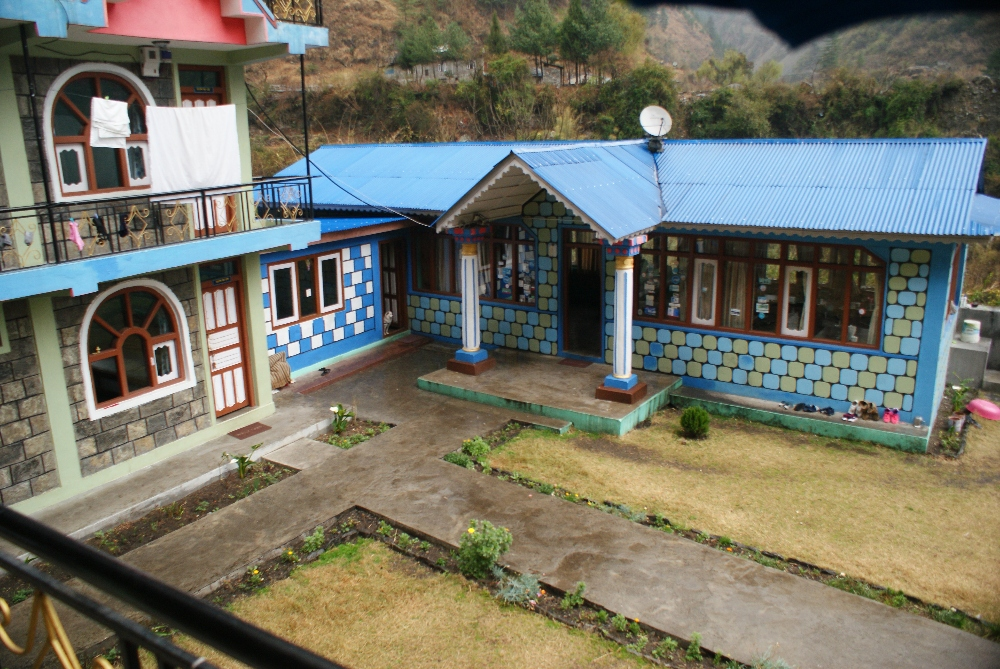
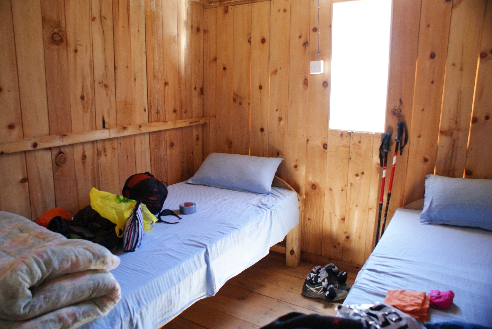
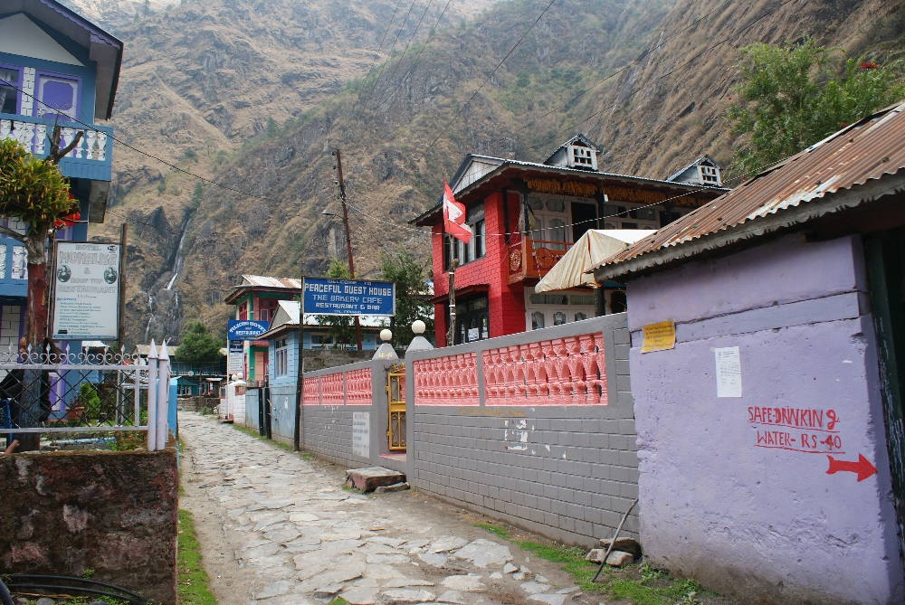
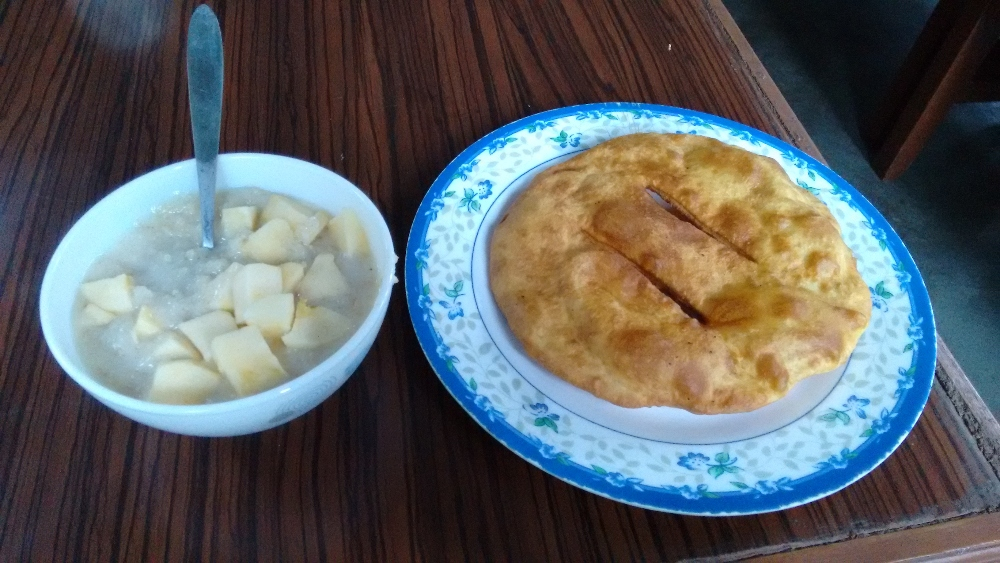
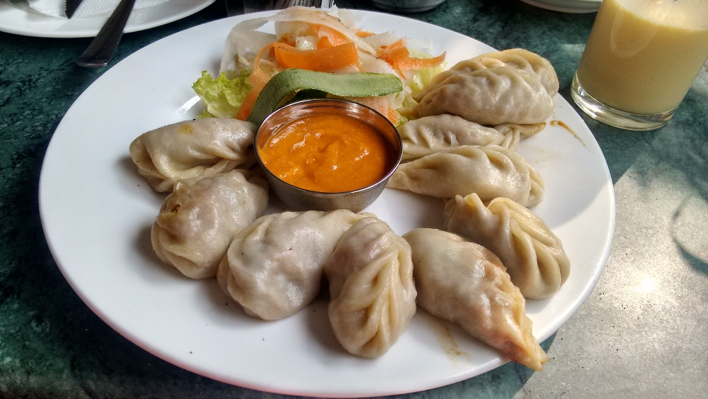
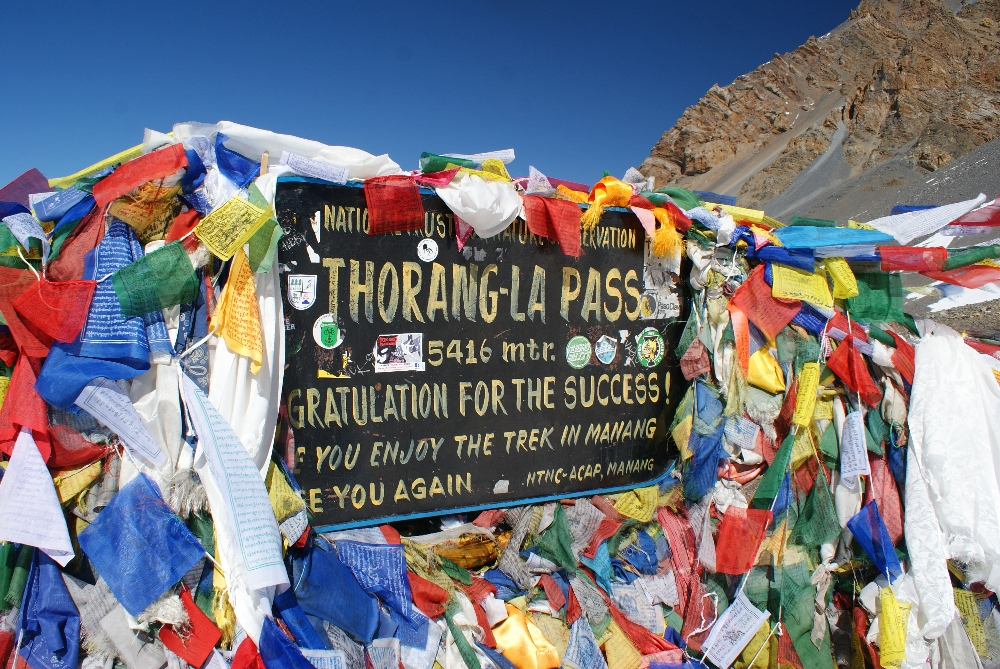
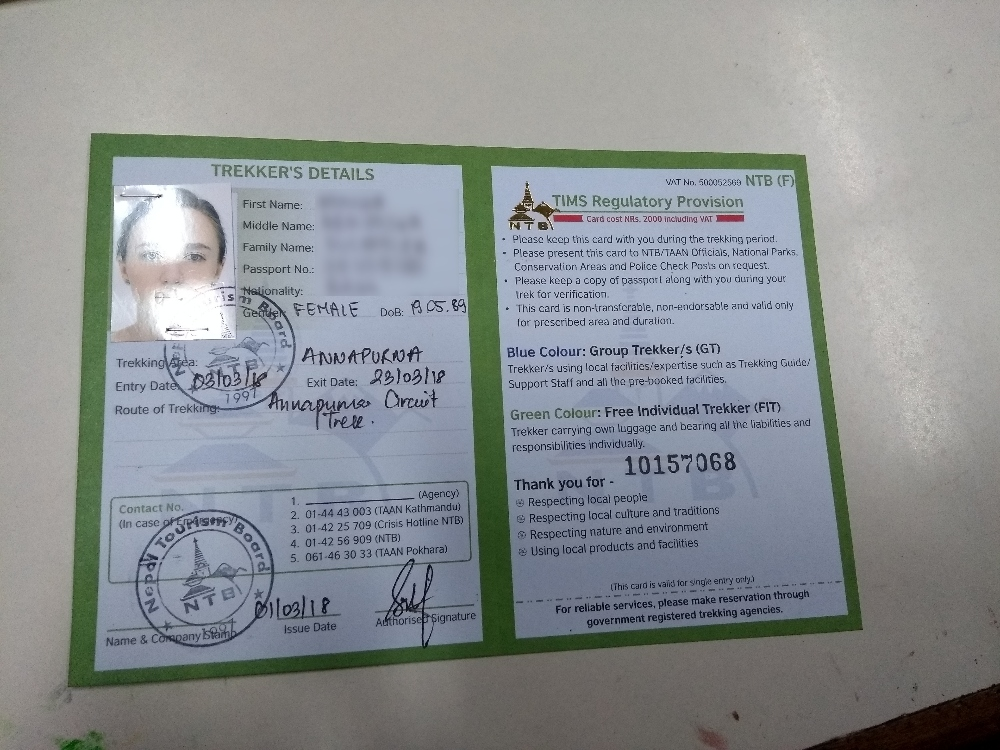
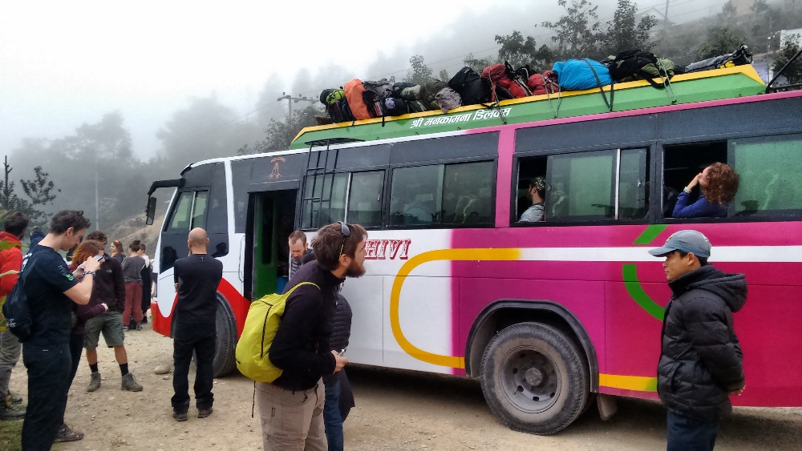

Zoals altijd voor een reis deed ik mijn huiswerk en zocht ik uit wat we allemaal moesten meenemen. Voor onze reis naar
Nepal was dat niet anders. Het internet staat vol informatie over het Annapurna Circuit, maar wat je precies meeneemt,
hangt echt af van de manier waarop je de tocht aanpakt. Wij besloten het Annapurna Circuit te doen zonder de hulp van
dragers of gidsen, met onze rugzakken op de rug en de app MAPS.ME om te navigeren. We hebben geen grote problemen gehad,
maar er zijn heel wat dingen die je tocht aangenamer en makkelijker maken, en daarom wil ik ze in deze post nog eens
op een rijtje zetten. We brachten de eerste 24 dagen van maart door in Nepal en we hadden erg zonnig maar koud weer boven
2800 m en wat regen in de namiddag in de lagere delen. Bij het oversteken van de Thorong La-pas lag er ook een harde
sneeuwlaag waarop het behoorlijk glad stappen was. Maart is ook een perfecte maand om de prachtige bloeiende
rododendrons rond Poon Hill te bewonderen, die de hele vallei in een schitterend, kleurrijk landschap veranderen!

## Overnachten

In elk dorp zijn er volop slaapmogelijkheden (hotels en guesthouses, van heel eenvoudige houten constructies
tot chiquere exemplaren), en ze doen allemaal ook dienst als restaurant. Meestal betaalden we niets voor een kamer of
kregen we een flinke korting als we beloofden om bij onze gastheer het avondmaal en het ontbijt te kopen (in het begin
betaalden we wel, omdat we dit systeem nog niet kenden :p). Je hoeft de uitbater gewoon te vragen of je gratis mag
blijven slapen als je er al je eten koopt (avondmaal en ontbijt de volgende ochtend).

De kamers hebben nooit verwarming, dus hou daar rekening mee bij het kiezen van een slaapzak: de comfortzone moet rond
nul liggen (boven 3600 m droegen we 's nachts een warme muts en donsjas). Een goede slaapzak is noodzakelijk, al lagen
er hogerop extra dekens of dekbedden in de kamer, die we altijd boven op de slaapzak legden. Dat hielp enorm om warm te
blijven. Chame was het eerste dorp waar we ons na zonsondergang, wanneer de temperatuur meteen zakt, konden opwarmen
naast de kachel in de eetzaal. Het is ook het uitgelezen moment om met een tas thee te gaan zitten en tijdens de lange
avonduren met andere wandelaars te praten.

## Uitrusting
We waren best tevreden over onze uitrusting, maar toch ontbraken er een paar dingen en waren andere niet erg nuttig.
Wasknijpers zijn zeker iets wat we aanraden om mee te nemen. Je kan je kleren gemakkelijk wassen in de guesthouses en
in de zon te drogen hangen, al was het lastig om te vermijden dat onze kleren van de waslijn wegwaaiden :p Anderzijds
gebruikten we onze katoenen slaapzaklakens niet in Nepal, maar ze kwamen tijdens het volgende deel van onze reis in
Zuidoost-Azië wel goed van pas. Vergeet ook geen oordopjes (heel dunne muren tussen de kamers!) en vitamine A-zalf
(perfect om lippen en handen te beschermen tegen de felle zon, de wind en de lage temperaturen!).

## Water

De meeste stations met veilig drinkwater waren gesloten (we gebruikten er maar één, in Tal, gewoon om de kwaliteit van
het water te controleren, en die was prima, 40 roepie per liter, al gaat die prijs omhoog naarmate je hoger de bergen
in trekt). We hadden een Care Plus-waterfilter en waterzuiveringstabletten bij. Vooral die eerste gebruikten we,
gekoppeld aan grote flessen Fanta van 1,5 l. Die flessen hebben we het hele circuit lang hergebruikt. Dat vonden we
erg belangrijk voor het milieu, want we merkten meermaals dat plastic afval werd verbrand of in de beken werd gedumpt.
Belangrijk om ze te kopen vóór je aan de trektocht begint, want onderweg waren er alleen flessen van 0,5 l te krijgen,
wat het grote plasticprobleem alleen maar erger maakt. In Manang en hoger is het goed om je flessen 's avonds te vullen,
want het overkwam ons dat het water in de leidingen 's morgens bevroren was en we moesten wachten tot de zon hoger aan
de horizon stond. Boven Manang kregen we ook geen kans meer op een warme douche... op dat punt kwamen babydoekjes goed
van pas :p Soms moesten we voor een warme douche betalen (tussen 100 en 150 roepie), dus vraag het beter meteen aan je
gastheer.

## Elektriciteit en internet

Gemiddeld konden we ongeveer om de twee dagen onze batterijen opladen, en dan meestal maar een paar uur per dag, want
er waren veel lange stroomonderbrekingen. Onze powerbank hielp ons om onze telefoons en GoPro opgeladen te houden. Hou
er rekening mee dat je veel avonden bij kaarslicht doorbrengt en denk eraan een hoofdlamp met extra batterijen mee te
nemen. Onze Europese stekkeradapter werkte, maar paste niet overal even goed in het stopcontact.

De laatste jaren is de toegang tot internet verbeterd en kan je er zowat langs de hele trektocht van genieten. Een paar
dagen voor we aan het Annapurna Circuit begonnen, was er echter een storing bij de internetprovider (dat was tenminste
altijd de uitleg die we kregen :p) en hadden we het grootste deel van de tijd geen internet. De laatste keer dat we
internet hadden, was in Dharapani, en daarna pas na 8 dagen in Mukintinah, toen we het eerste deel van de trektocht
afwerkten. Mijn kindle was in die dagen dan ook mijn beste vriend, want die moet niet vaak opgeladen worden. Wij hebben
nooit extra betaald voor internet of elektriciteit, maar we hebben elders wel gezien dat er soms extra kosten voor
internet worden gevraagd. Wat gsm-bereik betreft: hou er rekening mee dat je in veel gebieden geen signaal hebt.

## Eten

De kwaliteit van het eten en de grootte van de porties hangen af van het guesthouse waar je verblijft. Over het algemeen
smaakte het eten echt lekker, zeker als je bedenkt hoe weinig ingrediënten er voor onze maaltijden werden gebruikt.
Natuurlijk werden er hoe hoger we kwamen steeds minder groenten gebruikt om te koken. Verrassend genoeg was de prijs van
een ontbijt even hoog of zelfs hoger dan die van een middagmaal, al worden ontbijtformules vaak met korting verkocht
(havermoutpap, gebakken aardappelen, brood en koffie). Mijn favoriete ontbijt was havermoutpap met appel en Tibetaans
brood met confituur, en daar had ik lang genoeg aan. Je kan twee soorten brood kopen: chapati (plat brood uit het
Indiase subcontinent, vergelijkbaar met een tortilla) en Tibetaans brood (gefrituurd en met de smaak van een donut).

Typisch ontbijt: havermoutpap met appel en Tibetaans brood

De meeste menukaarten bestaan uit rijstgerechten, noedelsoepen, loempia's, pizza's uit de pan (soms verrassend lekker)
en een grote keuze aan warme dranken, waarvan hete citroen onze favoriet was. Je kan altijd een "big pot" bestellen,
in feite een thermos van 1 l thee die je 's avonds traag kan opdrinken om voortdurend warm te blijven. Tip om geld te
besparen: neem je eigen lievelingsthee mee of koop er een in een lokaal winkeltje en bestel gewoon warm water, wat altijd
mogelijk was. Relatief duur zijn snacks zoals repen, chocolade, chips of frisdrank, en ze zijn heel vaak over datum. Wij
namen onze favoriete proteïnerepen, met chocolade omhulde noten en ander snoep mee. Een van onze lievelingsgerechten
waren gestoomde of gebakken momo (dumplings) gevuld met groenten of met aardappel en kaas. Het was heel praktisch om
's avonds al het ontbijt te bestellen, zodat we 's morgens niet lang moesten wachten (ontbijt om 7 uur bestellen kon
altijd) en vroeg konden vertrekken voor een wandeldag.

Gestoomde momo, Nepalese dumplings

## Hoogteziekte

We startten onze trektocht in Bhulbhule (840 m) en gingen over de Thorong La-pas (5416 m), waarbij we vaak 500 tot 1000 m
per dag klommen. Omdat we elke dag hoger gingen, was hoogteziekte een reëel gevaar. Om het te vermijden besloten we in de
eerste plaats goed gehydrateerd te blijven (4 l water per dag voor elk van ons) en de vroege symptomen niet te negeren.
Zware hoofdpijn, slapeloosheid, duizeligheid, misselijkheid, braken, verlies van eetlust, veel hoesten enzovoort zijn de
volgende, ernstigere problemen die opduiken naarmate de ziekte vordert. Je mag zelfs een lichte hoofdpijn niet negeren en
moet dan een extra dag op dezelfde hoogte blijven (wij hadden lichte hoofdpijn in Manang, gemakkelijk op te lossen met
een pijnstiller uit de vrije verkoop (ibuprofen), maar we bleven er toch een extra dag om later erger te voorkomen) of
zelfs lager gaan als het niet overgaat. In Manang is er een dokter bij wie je elke dag tijdens bepaalde uren terechtkunt
voor advies. We hadden ook Diamox mee, al hadden we het niet nodig (we namen wel een halve tablet om te kijken of we
bijwerkingen zouden krijgen). We hadden ook geen enkel probleem om te slapen, zelfs niet op 4800 m, maar we weten van
andere mensen dat zij veel problemen hadden en enkele extra dagen in één dorp moesten blijven, dus het is goed om een
paar extra dagen te voorzien als je deze tocht plant. Onze reservedagen brachten we door in [Pokhara](),
lekker aan het luieren :D

Het hoogste punt van onze trektocht

## Permits

Toen we in Kathmandu aankwamen, was het Holi-festival aan de gang en hadden alle kantoren kortere openingsuren. Dat was
iets wat we niet hadden gecheckt vóór onze reis, en het zou niet de laatste keer zijn dat we plots meevierden met een
nationale feestdag. Gelukkig was het kantoor van de Nepal Tourism Board in Kathmandu (Pradarshani Marg, Kathmandu 44617,
Nepal), waar we onze permits haalden, in de namiddag nog open toen we er aankwamen (dagelijks open van 9 tot 15 uur, op
feestdagen van 9 tot 12 uur). Eerst heb je een TIMS-kaart (Trekkers' Information Management Systems) en een ACAP-permit
(Annapurna Conservation Area Project) nodig, waarmee we de gecombineerde tocht van het Annapurna Circuit en Poon Hill
mochten doen (voor elk document heb je 2 pasfoto's nodig). Denk eraan de namen van je start- en eindpunt van de tocht
bij te hebben, en de data waarop je die wilt doen. Je moet ook een polisnummer van je verzekering en een noodcontact
opgeven. Elk document kost 20 dollar en stelt hen in staat om wandelaars op te volgen en hun veiligheid te verbeteren.
Je moet deze permits bij elk checkpoint langs het circuit tonen en het logboek tekenen.

## Milieu

Jammer genoeg bezoeken elk jaar grote aantallen wandelaars de Himalaya, en dragen ze zo bij aan het afvalprobleem en de
vervuiling. We zagen enorme bergen plastic flessen achter de lodges, en daarom besloten we al het plastic afval dat we
zelf produceerden te verzamelen en mee terug te nemen naar Pokhara. Zo lieten we het tenminste niet achter in de bergen.
Hoe meer extra flessen je koopt, hoe meer plastic in de rivieren belandt of achter iemands guesthouse verbrand wordt.

## Geld

Zorg dat je genoeg cash bij hebt voor de hele tocht, plus wat dollars voor noodgevallen. Wij wisselden gewoon euro's om
naar roepie in Pokhara. Er zijn veel wisselkantoren met bijna dezelfde koersen. Kleine coupures zijn handiger, maar
meestal betaalden we op het einde van ons verblijf in elk guesthouse, dus een briefje van 1000 roepie was geen probleem
om mee te betalen. We gaven per dag ongeveer 3800 roepie uit voor ons tweeën (maximaal 5200 roepie in High Camp).

## Vervoer
Tijdens onze reis in Nepal namen we altijd lokale bussen. Door de kronkelende en beschadigde wegen deden we er altijd
een paar keer langer over dan in Europa voor dezelfde afstand (meestal moet je rekenen op een gemiddelde snelheid van
30 km/u). Vraag het best in het guesthouse waar je verblijft naar de busmogelijkheden. Bijna altijd kunnen ze je een
ticket verkopen of iemand bellen die in een bepaald dorp voor de bussen verantwoordelijk is. Meestal is het niet zo
duidelijk waar de bushalte precies is, je moet het gewoon aan de plaatselijke bevolking of aan de buschauffeur vragen
en uiteindelijk wijst iemand je de juiste richting. Binnenin kan het echt heel druk worden, met alle rugzakken en tassen
vol lokale producten die verkocht worden. Eén keer moesten we 4,5 uur rechtstaan op de bus naar Besisahar, omdat ze ongeveer
het dubbele aantal tickets hadden verkocht en beslisten om ons allemaal in één bus te proppen in plaats van een tweede
bus in te leggen. Voor bustickets betaalden we tussen 300 en 800 roepie, afhankelijk van de afstand. De bussen zijn oud
en echt stoffig, we zagen mensen wagenziek worden.

Overvolle bus naar Besisahar

## Enkele uitgaven:

  * Visum voor Nepal voor 30 dagen - 35 euro per persoon
  * Taxi van de luchthaven naar de wijk Thamel - 700 roepie (prepaid), 500 roepie toen we onderhandelden met de chauffeurs die buiten de luchthaven stonden te wachten (je moet voorbij de zone met prepaid taxi's stappen)
  * Permits - 40 dollar per persoon (TIMS + Annapurna Conservatory Area)
  * Bus Pokhara - Besishahar - 400 roepie per persoon (4,5 u.)
  * Bus Muktinath - Old Jamson - 300 roepie per persoon (1,5 u.)
  * Bus Marpha - Tatopani - 800 roepie per persoon (5 u.)
  * Bus Ghandruk - Pokhara - 400 roepie per persoon
  * Paragliden - 7000 roepie per persoon (Frontiers Paragliding)
  * Bus Pokhara - Kathmandu - 700 roepie per persoon
  * Swayambhunath-tempel - 200 roepie per persoon

## Lijst van onze uitrusting voor de trektocht op het Annapurna Circuit:

  * Wandelschoenen (Salewa Wildfire GTX - Monika en Salomon Speedcross 4 GTX - Sebastian)
  * Teenslippers
  * Beenkappen
  * Slaapzak
  * Slaapzaklaken
  * Wandelstokken
  * Thermisch ondergoed (legging plus t-shirt met lange mouwen)
  * Pyjama (t-shirt plus short of legging)
  * Waterdichte jas
  * Donsjas
  * Wandelbroek
  * 3 technische t-shirts
  * Softshell
  * Ondergoed (3x wandelkousen, 3x slipjes, 2x sportbeha)
  * Warme muts
  * Buff (warm en dun)
  * Handschoenen (warm en dun)
  * Pet
  * Sneldrogende handdoeken
  * Duct tape
  * Hoofdlamp + batterijen
  * Zakmes
  * Hangslot
  * Vuilzakken
  * Metalen bekers
  * Spork
  * Stuk paracord
  * Zeep
  * Shampoo
  * Tandpasta
  * Tandenborstel
  * Blistex
  * Zonnecrème factor 50
  * Haarborstel
  * Nagelvijl
  * Scheermes
  * Scheerschuim
  * Babydoekjes
  * Handgel
  * Wattenstaafjes
  * Oordopjes
  * Toiletpapier
  * Zonnebril
  * Waterzuiveringstabletten
  * Powerbank
  * Fototoestel
  * GoPro
  * Kindle
  * Paspoort
  * Pasfoto's voor permits en visum (5!)
  * Notitieboekje met pen
  * Kopie van het paspoort
  * Ziekteverzekering
  * Cash (25 euro per persoon per dag tijdens de tocht)
  * Geel boekje
  * Snacks: proteïnerepen, snickers, M&amp;M, noten, gedroogd fruit
  * 2 x fles van 1,5 l om elke dag bij te vullen
  * Isotoon poeder om op te lossen in water
  * Imodium
  * Fenistil
  * Compeed-pleisters
  * Diamox
  * Peroxygel
  * Ibum (ibuprofen)
  * Paracetamol
  * Vitamine A-zalf
  * Vitaminen
  * Probiotica
  * Melatonine
