Na twee weken wandelen hoopten we vurig op een paar rustige, ontspannen dagen in Pokhara, en we kwamen niet
bedrogen uit :) Het Phewameer, omringd door de stad met hoge bergtoppen op de achtergrond, is werkelijk
schitterend! Zeker bij zonsondergang, wanneer het water van blauw naar rozig verkleurt en de vissers met hun
kleine houten bootjes hun netten uitzetten. Dat maakte het plaatje helemaal af.

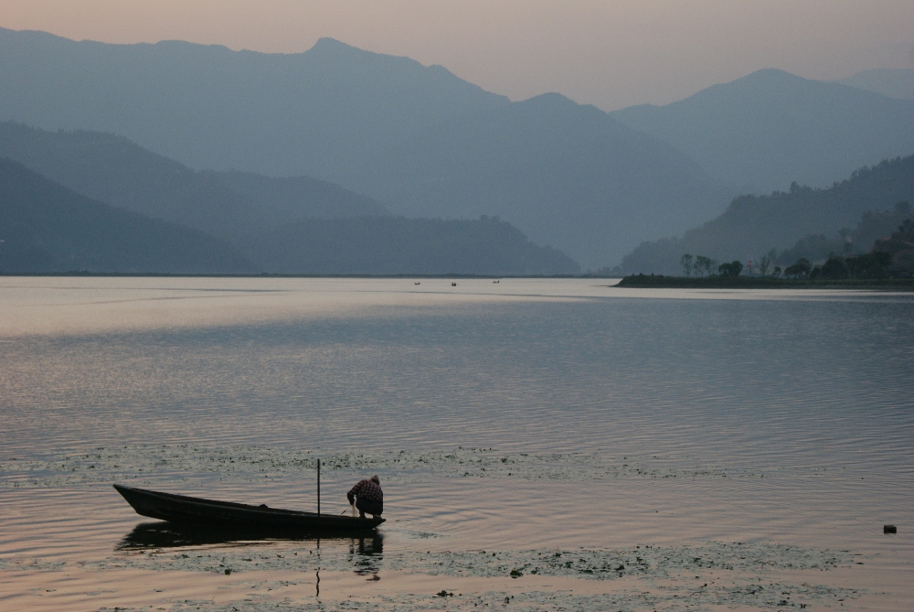
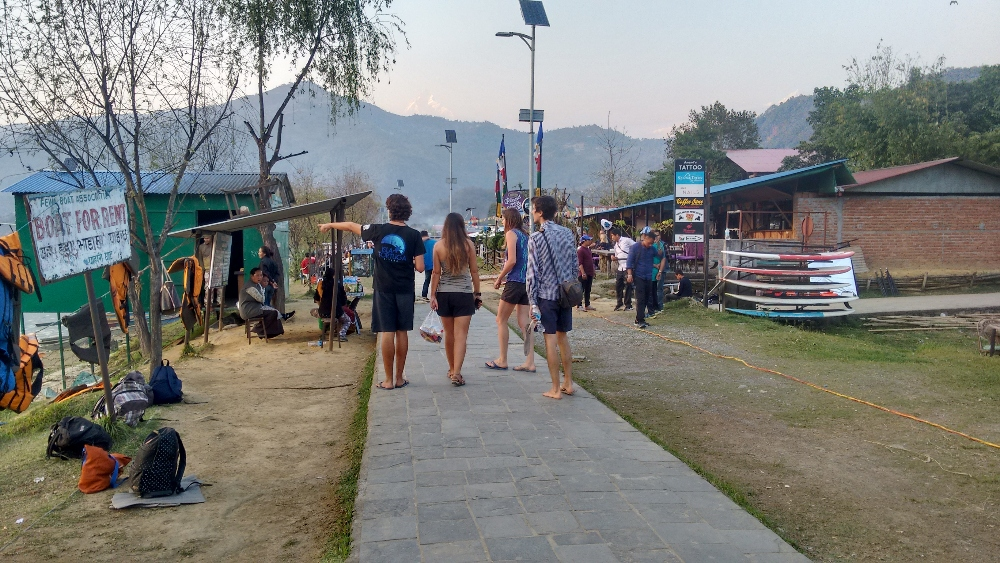

De promenade loopt langs de hele oever van het meer

De hoofdstraat aan het meer staat vol winkels met een enorm aanbod aan wandeluitrusting en kasjmierproducten,
en met restaurants waar ze heerlijke lokale gerechten serveren. Afdingen hoort er hier gewoon bij, het maakt
deel uit van de cultuur, en met wat oefening word je er alsmaar beter in :) De hele straat lijkt wel één grote
outlet van The North Face. De lage prijzen zijn erg verleidelijk, maar hou er rekening mee dat het vrijwel
zeker om namaak gaat. Controleer dus de ritsen en de stiksels; meer tips vind je <a href="https://www.himalayanwonders.com/blog/6-tips-buying-cheap-trekking-gear-kathmandu.html">hier</a>.
Het kleine rugzakje dat ik daar kocht, heeft nadien wel anderhalve maand Azië doorstaan terwijl ik het elke dag
gebruikte, en het is nog altijd in prima staat! :) Al op de eerste dag zagen we heel wat paragliders boven het
meer zweven en ik kon Sebastian overtuigen om het te proberen! We kozen voor "Frontiers Paragliding", de nummer
twee in de ranglijst van TripAdvisor (zelfs hier kan je afdingen en de prijs wat drukken, zeker als je met een
groepje vrienden bent). De dag erna zaten we al in een jeep, klaar om onze angsten onder ogen te zien en voor het
eerst van ons leven aan deze avontuurlijke sport te proeven. Ik was het meest enthousiast over het idee, maar
uiteindelijk bleek Sebastian er het meest van te genieten :p Ik zat vreselijk gestresseerd in de lucht omdat ik geen
enkele controle over de situatie had, en daarbovenop werd ik ook nog eens misselijk :( uhh... Ik ontdekte dat
dit niets voor mij is, maar Sebastian vond het geweldig, vooral de acrobatische manoeuvres op het einde, die ik
om de voor de hand liggende redenen heb overgeslagen. De vlucht duurde zo'n 20 à 30 minuten, met een prachtig
uitzicht op het meer en op heel de stad Pokhara. Jammer genoeg waren de besneeuwde toppen die dag niet zo goed
zichtbaar. Al bij al was het een onvergetelijke ervaring om de aarde eens vanuit een ander perspectief te zien :D

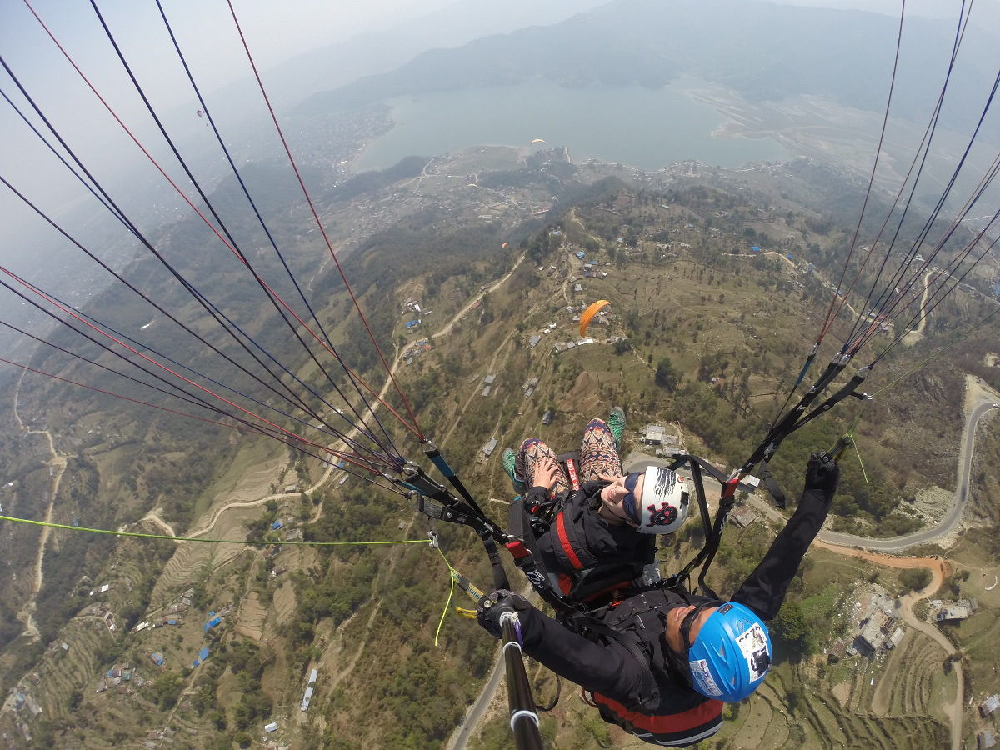

Om na die spannende voormiddag te ontspannen, besloten we de Tal Barahi-tempel te bezoeken, die op een piepklein
eiland ligt en makkelijk te bereiken is met een gedeelde boot. Deze plek maakte niet echt indruk op ons, maar het
is wel een belangrijke pagode voor hindoes, gewijd aan de verering van de godin Barahi.

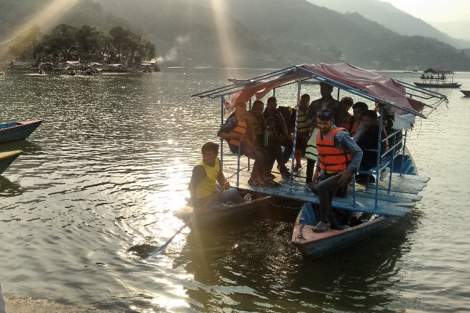
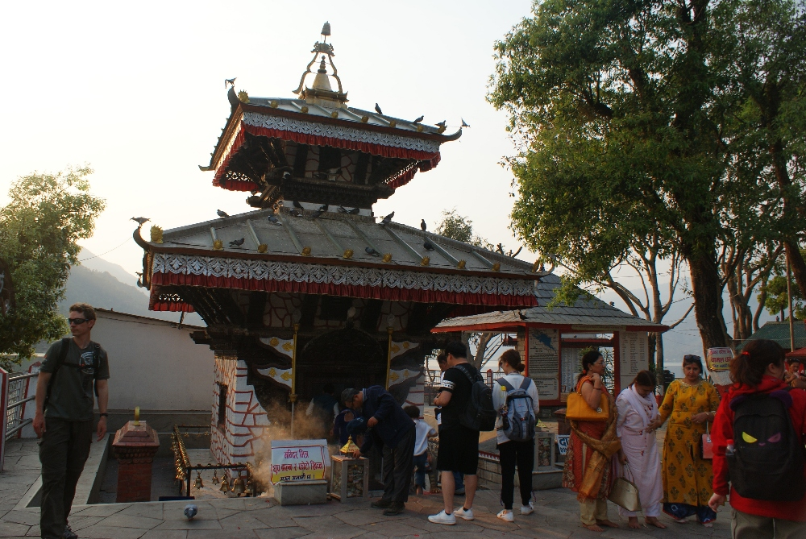

Gelovigen die wachten om hun offergaven aan de godin te brengen.

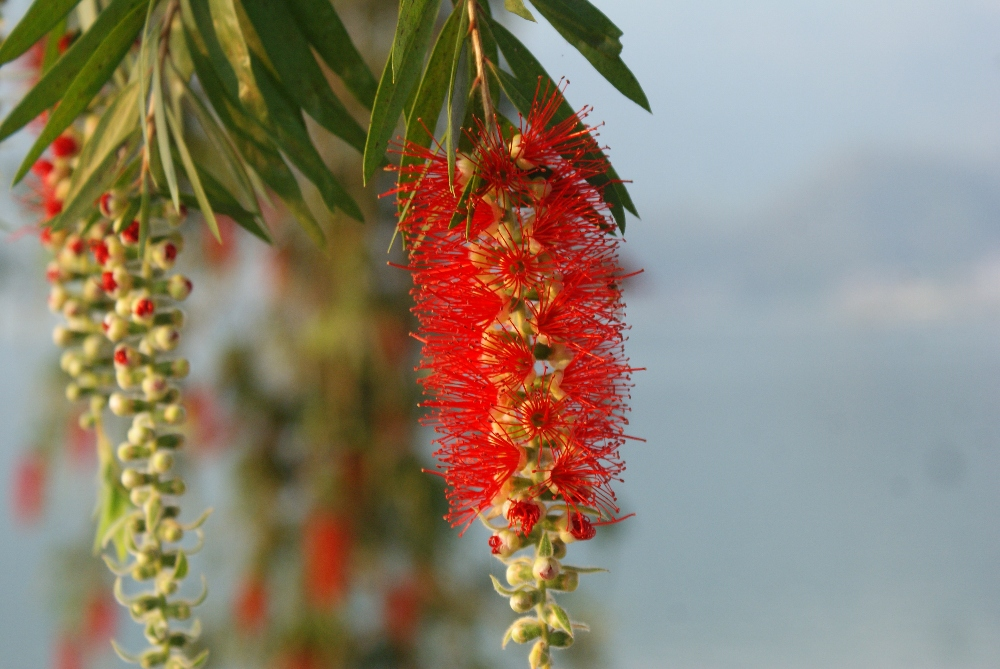

Op onze laatste dag in Pokhara huurden we twee kajaks om wat tijd op het meer door te brengen. We peddelden
rond het kleine eiland met de hindoetempel en verkenden de oever met zijn weelderige begroeiing. Op een bepaald
moment zagen we een blauwe vogel, een soort ijsvogel, maar het lukte niet om een foto van dat mooie beestje te
maken. Om de andere kant van het meer te verkennen, hadden we minstens een paar uur meer nodig gehad, en we
hadden voor na het middagmaal al iets anders in gedachten :)

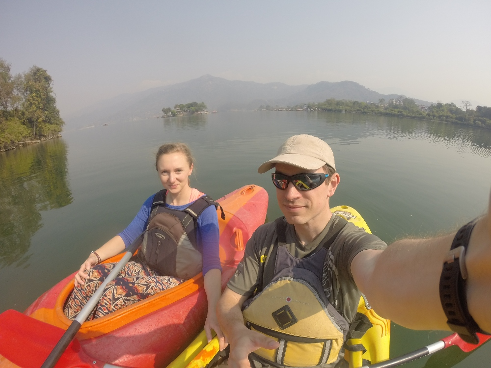

Onze laatste bestemming in Pokhara was de World Peace Pagoda, boven op een kleine heuvel naast het meer. Die
wandeling bleek nogal pittig te zijn: bijna 7 km, met op het einde een steil stuk door het bos (300 hoogtemeters).
We konden Pokhara van bovenaf bewonderen, maar het panorama over de Annapurna-keten bleef uit, want dat is alleen
bij goed weer zichtbaar. We besloten te wachten in een van de kleine cafeetjes in de buurt en de zonsondergang
vanaf de top van de heuvel te bekijken. De witte pagode zag er bij die zonsondergang prachtig uit. We wandelden
via de rand van de stad terug naar de hoofdweg, want de taxichauffeurs bij de tempel vroegen een absurd bedrag
voor een rit terug.

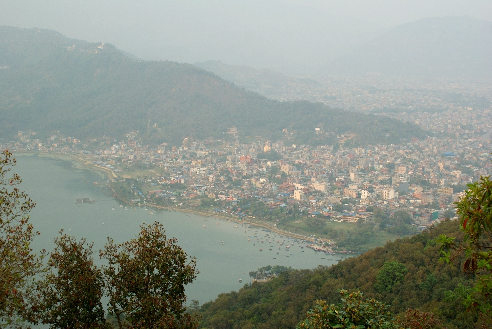
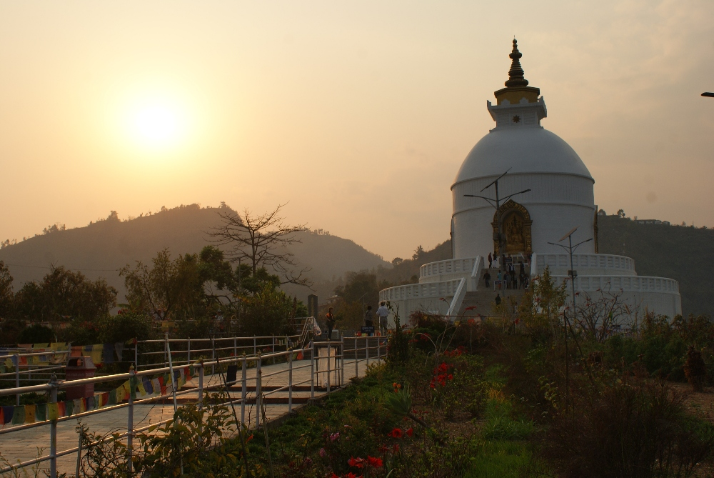

Oh, het was een triest moment toen we Pokhara moesten verlaten, met onze favoriete sapbar (Wendy Juice Shop) met
zijn fantastische sinaasappellassi en een broodjeszaak in dezelfde straat. Deze stad heeft een fijne sfeer en we
hadden er gerust nog langer kunnen blijven.

Na een hobbelige rit van acht uur bereikten we Kathmandu, een drukke, stoffige en chaotische stad. Voor onze
laatste twee nachten kozen we opnieuw voor de wijk Thamel. Dit deel van de stad is uitstekend om te winkelen en
er zijn heel wat opties voor een lekker avondmaal. De volgende dag wilden we met de taxi een paar bekende plekken
in de stad bezoeken (te voet rondlopen is behoorlijk lastig zonder aangereden te worden door een of andere auto
of motorfiets). Hou er rekening mee dat taxichauffeurs altijd hogere prijzen vragen, waar je gerust op kan afdingen. Je start
de onderhandelingen makkelijk door de helft te bieden van wat ze vragen, om elkaar dan ergens in het midden te
vinden. Er zijn veel meer taxichauffeurs dan klanten, dus de concurrentie is enorm.

De eerste plek die we bezochten was de Swayambhunath-tempel, ook wel de Apentempel genoemd, vanwege het grote
aantal van die dieren rond de site.
Laat je niet misleiden, ze zijn niet zo vriendelijk als je denkt :p De taxichauffeur zette ons af aan de
hoofdingang, waar een steile trap naar de top van de heuvel leidt. Langs de weg naar de tempel staan veel kleine
kraampjes met goedkope souvenirs en snacks.

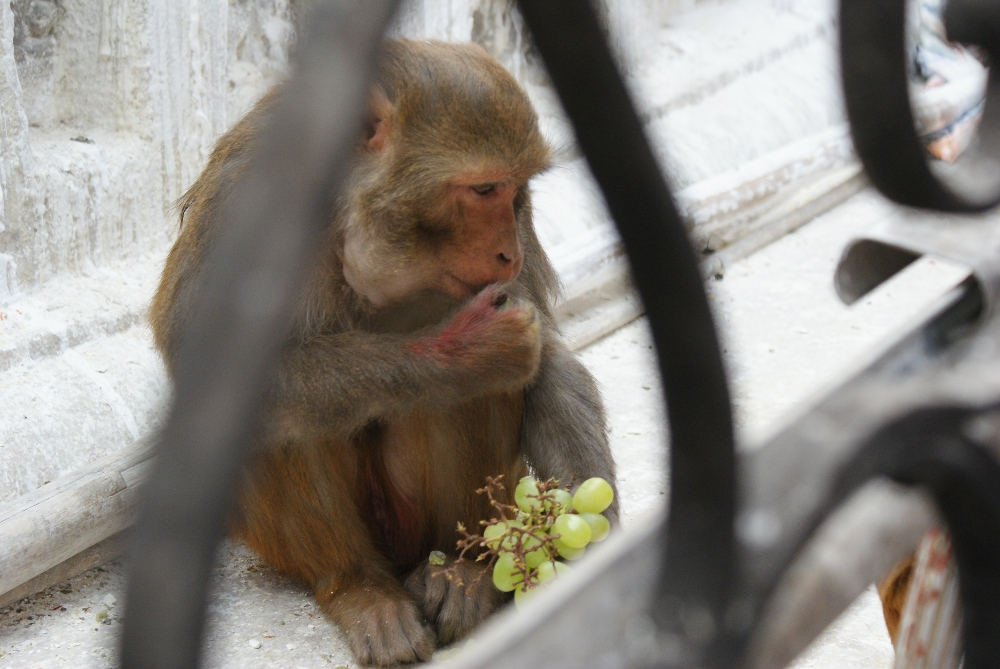
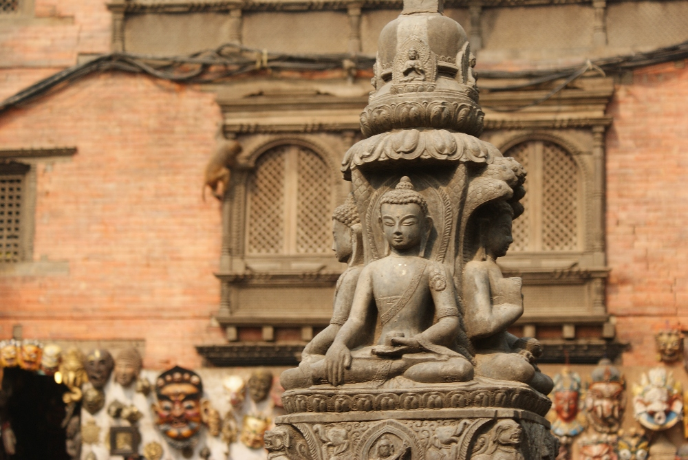

Boven op de heuvel staan naast de hoofdtempel nog veel kleinere tempeltjes en werkplaatsen waar handgemaakte
spullen worden verkocht. In een daarvan kochten we een steen met daarin de mantra Om Mani Padme Hum gegraveerd
(de zin die tijdens het mediteren herhaald wordt) en een mandala met de 8 symbolen van geluk. In het midden van
de steen staan de Boeddha-ogen (ook bekend als de ogen van de wijsheid), die verwijzen naar het vermogen van
Boeddha om alle mensen te zien.

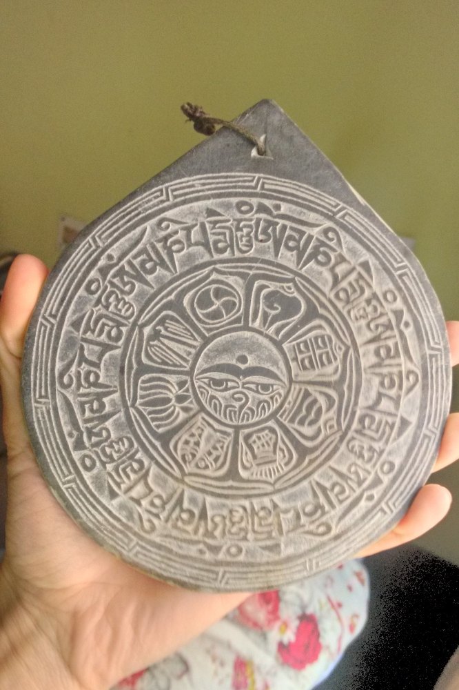
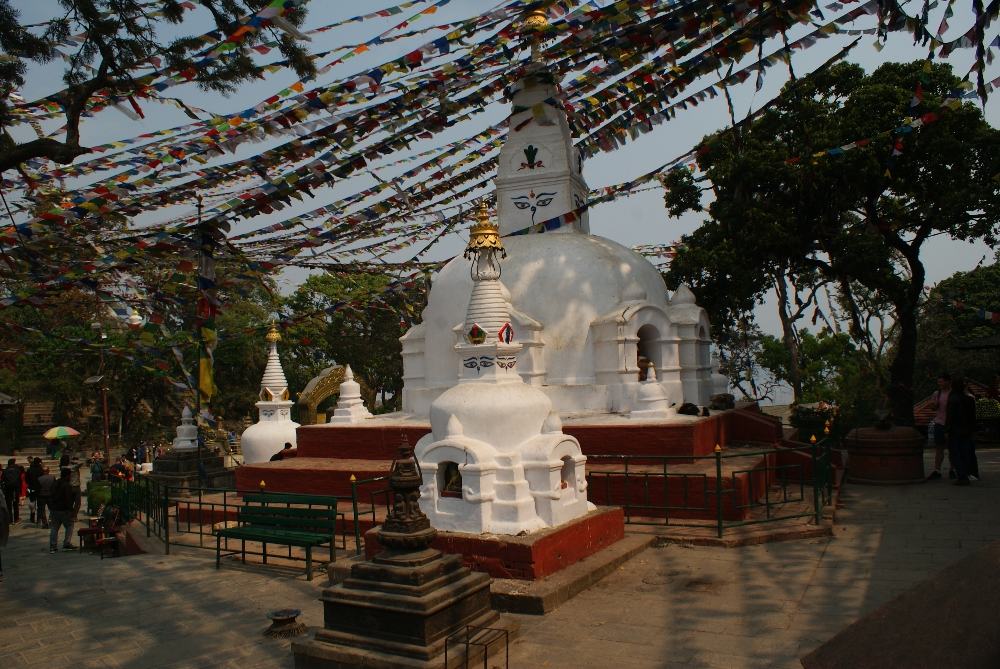
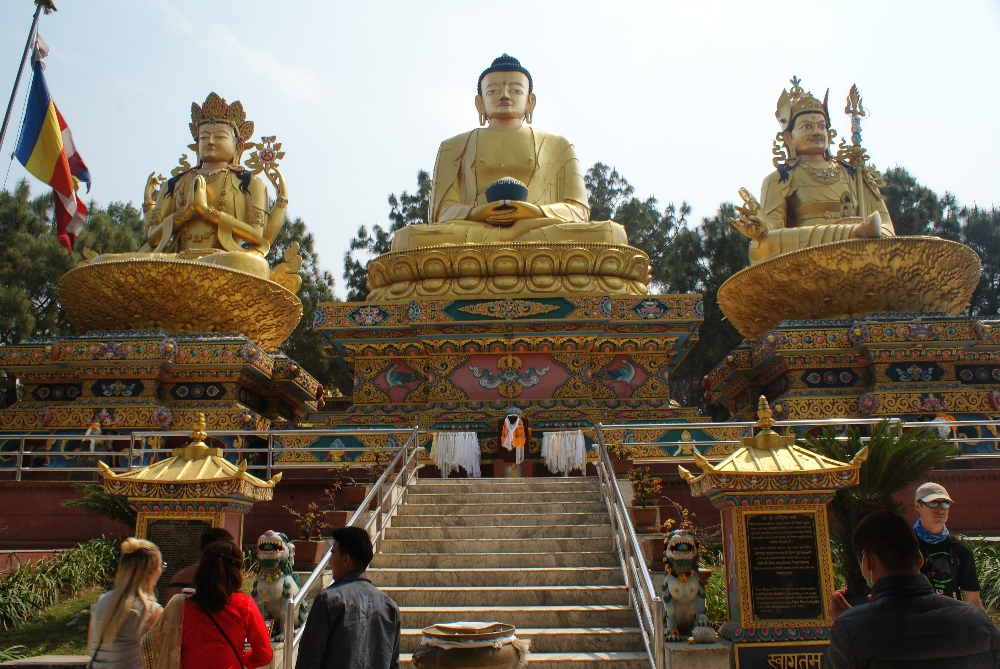

Tijd voor de volgende plek! Patan Durbar Square, het oudste deel van de stad uit de 17e eeuw, werd zwaar
verwoest door de aardbeving van 2015 (met een kracht van 7,8). Dit werelderfgoed in het district Lalitpur, waar
de meeste gebouwen nog in de stellingen staan, trekt nog steeds veel toeristen (de toegangsprijs bedraagt 10
dollar, wat veel is vergeleken met andere plekken waar je meestal 2 dollar betaalt). We dwaalden ook door de
heel smalle straatjes van Patan, vol kleine ateliers aan huis die boeddhistische beelden en sculpturen in metaal of brons
verkopen: een buitenkans voor kunstliefhebbers.

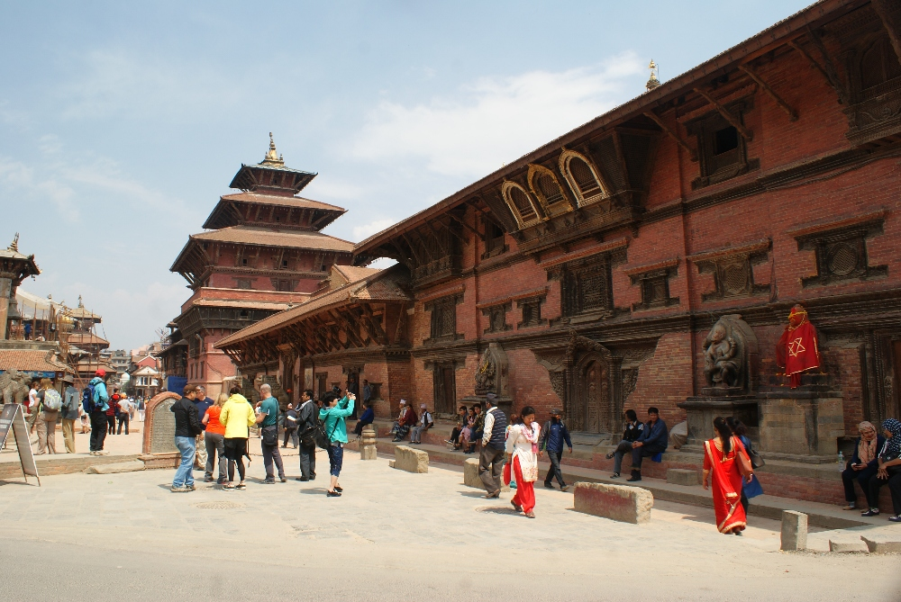

Het deel van het plein waarvoor je toegang moet betalen

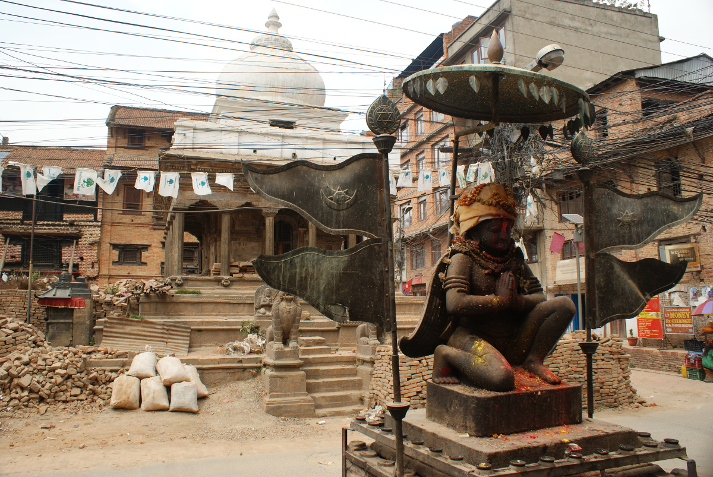
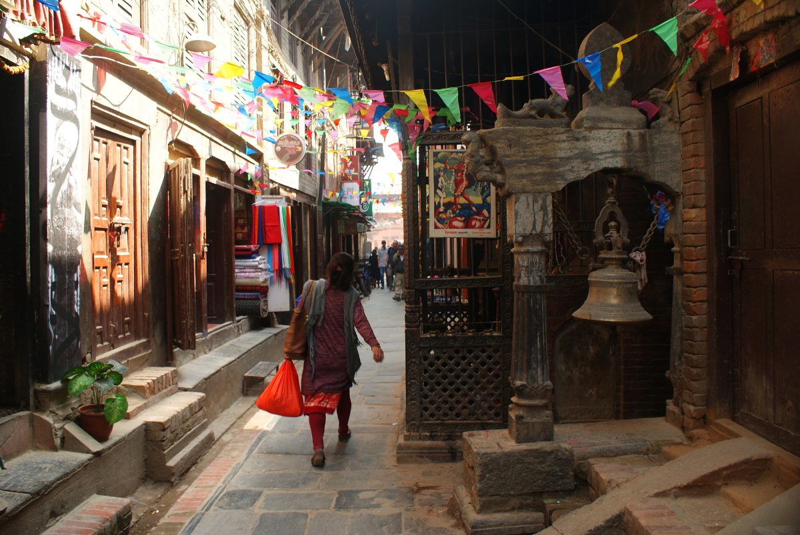

Onze taxichauffeur raadde ons *de enige rustige plek in de stad* aan om te ontspannen,
<a href="http://www.gardenofdreams.org.np/">Garden of Dreams</a> :p Haha, hij had helemaal gelijk! Deze vredige
oase is ideaal om uit te rusten van de drukte en het lawaai van de stad. Bloemen, een fontein en vriendelijke
eekhoorns maken deze plek echt uniek. Er is ook een Kaiser Café, waar ze eten en drinken serveren.

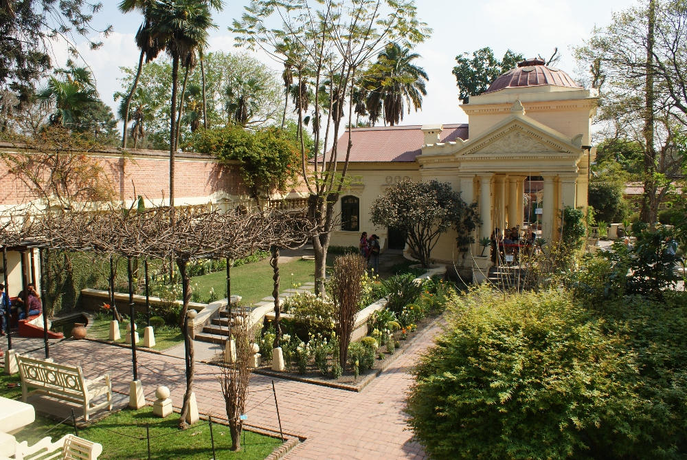

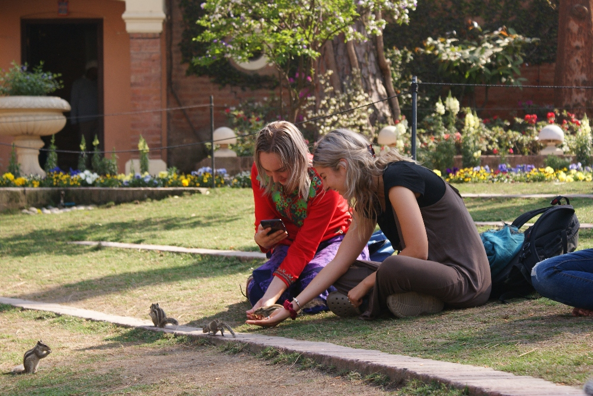
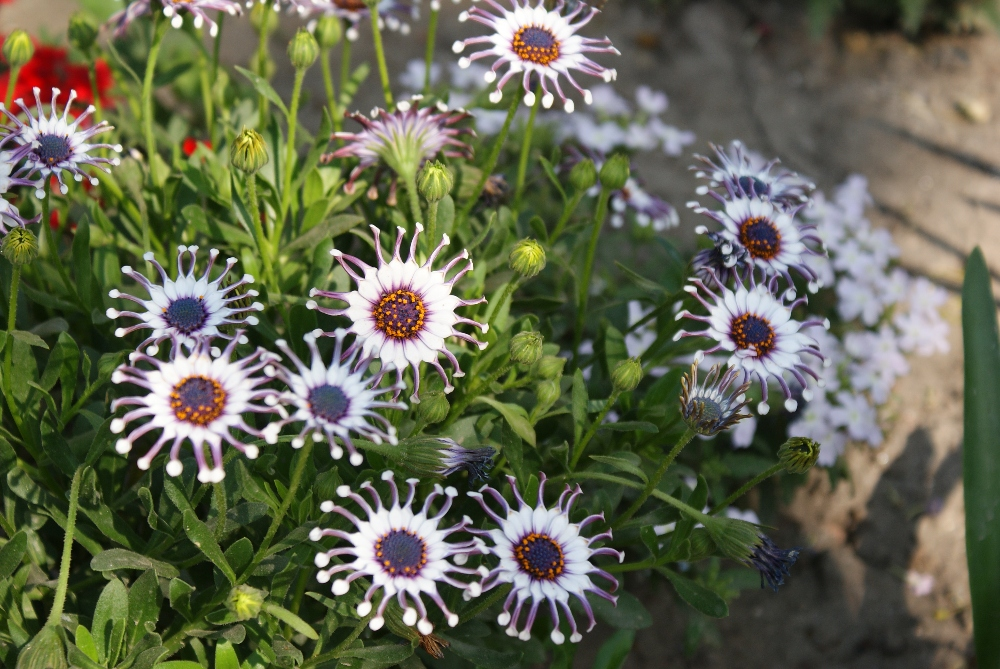

Ten slotte was het tijd om onze vlucht naar Bangkok te nemen. De luchthaven van Kathmandu was de plek van een
vliegtuigcrash terwijl wij het Annapurna Circuit aan het wandelen waren :( Het vliegtuig naderde de luchthaven
uit de verkeerde richting, stortte neer en vloog in brand, waarbij de meeste passagiers en bemanningsleden om het
leven kwamen. Ik kan me goed voorstellen dat meer mensen het hadden overleefd als de reddingsoperatie efficiënter
was verlopen. Deze luchthaven was chaotisch: het inchecken door 4 mensen duurde eindeloos, hun computer viel uit
en er was een probleem met het labelen van onze bagage (haha, dat hadden we nog nooit meegemaakt). Gelukkig
kwamen onze rugzakken heelhuids in Bangkok aan :D

## Praktische informatie:
  * Kajak huren - 300 roepies / 1 uur / 1 persoon
  * Boot naar de Tal Barahi-tempel - 50 roepies per persoon
  * Frontiers Paragliding - 7000 roepies per persoon (foto's en filmpjes inbegrepen)
  * Swayambhunath-tempel - 200 roepies per persoon
  * Patan Durbar Square - 1000 roepies per persoon om het plein te betreden
  * Garden of Dreams - 200 roepies per persoon
  * Taxi naar de luchthaven - 500 roepies
  * Kamer met badkamer in Pokhara - 900 roepies
  * Kamer met badkamer en ontbijt - 1700 roepies (plus 10% toeristenbelasting)
