Kort samengevat: na een paar weken wandelen in Nepal namen we het vliegtuig naar Bangkok voor het tweede deel van
onze reis, deze keer in heel andere weersomstandigheden :) Het plan was om een lus te maken door Cambodja,
Laos en dan terug naar Thailand, dwars door het land van noord naar zuid, om uiteindelijk weer in Bangkok uit te komen.
We hadden het geluk een paar dagen in een guesthouse te verblijven met een erg behulpzame gastheer, die ermee instemde onze zware
wandeluitrusting in zijn berging te bewaren tot we 7 weken later naar Bangkok zouden terugkeren. Onze rugzakken werden opeens heel
licht en het was tijd om richting Cambodja te vertrekken :D

Eerst namen we een Uber naar de Eastern Bus Terminal (Ekkamai) in Bangkok, waar we meteen op een bus naar
Trat konden stappen (230 THB per persoon). Na 7 uur kwamen we eindelijk aan op het busstation van Trat, waar we vlot
een minibus naar de grens vonden (120 THB, 1,5 uur rijden), de grensovergang Thailand - Cambodja bij Cham Yeam
(hier gebruikten we onze <a href="https://www.evisa.gov.kh/">e-visa's</a>). De enige extra kost die we moesten betalen was
20 THB voor een temperatuurcontrole (hilarische ervaring: ik had een lichaamstemperatuur van 34 graden, wat eigenlijk
de eerste stap richting onderkoeling is, maar toch kreeg ik een stempel dat ik gezond was :D) en na een paar minuten waren we al in
Cambodja. Na lang afdingen en een korte rit met een tuk-tuk (150 THB) kwamen we aan bij ons guesthouse in
Koh Kong (zonder reservatie, we hadden er gewoon eentje in de buurt met een degelijke score op Google Maps gevonden), waar we ook een
bus naar Sihanoukville boekten die de volgende ochtend vertrok (7 dollar per persoon).

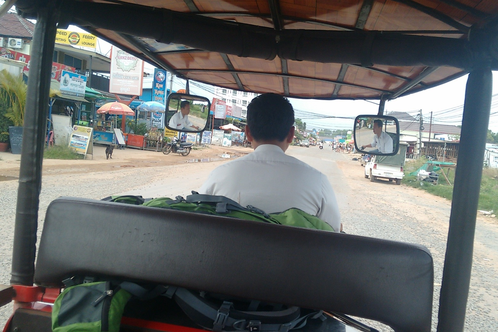

Het enige probleem dat we hadden, was om aan dollars te raken
bij een van de drie geldautomaten in de stad (onze kredietkaart had een nogal lage limiet voor geldopnames, controleer dat
voor je vertrekt!). De dollar wordt hier gebruikt als sterkere munt en enkel kleine dingen onder 1 dollar, zoals fruit of
groenten van de straatkraampjes, kan je met Cambodjaanse riel betalen. Vaak kregen we wisselgeld in Cambodjaanse riel,
dus je hoeft geen dollars te wisselen (1 dollar = 4.000 KHR).

De volgende dag pikte een tuk-tukchauffeur ons op aan het guesthouse en zette ons pal voor de bus naar Sihanoukville af,
wat eigenlijk erg handig was! De volgende 5 uur volgden we de weg door een ongelooflijk groene streek,
vol moerassen met buffels erin, dichte bossen en veel velden doorsneden door wegen die de intense
oranje kleur van de bodem blootlegden. Wat een prachtig contrast!

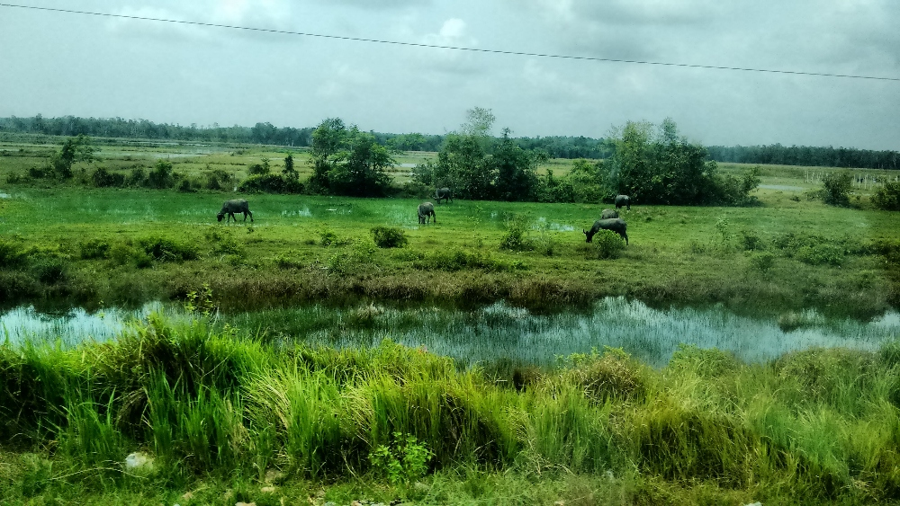

Prachtig uitzicht door het busraam

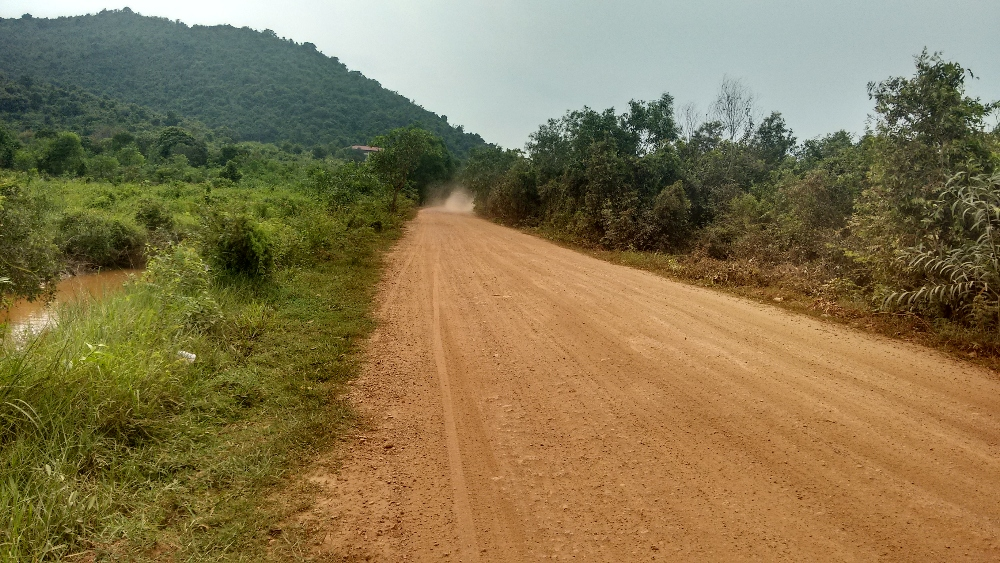

Geen zorgen! Er zijn asfaltwegen in Cambodja, deze leidt naar een van de dorpen

We besloten de volgende twee nachten in de buurt van Otres Beach te verblijven. Om daar te raken, moesten we een tuk-tuk nemen vanaf het
busstation in het centrum van de stad, waar onze bus zijn rit beëindigde (5 dollar). Maar eerst een gezond ontbijt! Kijk naar die kleur,
drakenfruit maakt het altijd zo mooi en lekker tegelijk. Ik hoef er niet bij te vertellen dat al het fruit zoveel anders en beter smaakte dan wat
we hier kennen.

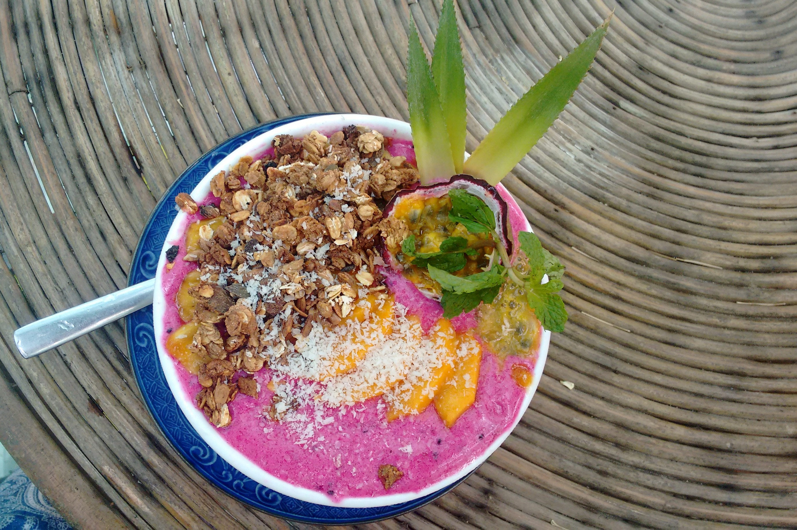

Er zijn maar een paar straten vol
bars en restaurants in Otres Beach, wat winkels, een kapper, een schoonheidssalon en heel wat mogelijkheden om te
overnachten. Deze plek heeft een erg ontspannen sfeer en een mooi, niet al te druk strand met veel bars.
We merkten wel enorme bouwwerven in de buurt op: daar komen nieuwe Chinese resorts die het karakter van deze plek
in de nabije toekomst wellicht zullen veranderen.

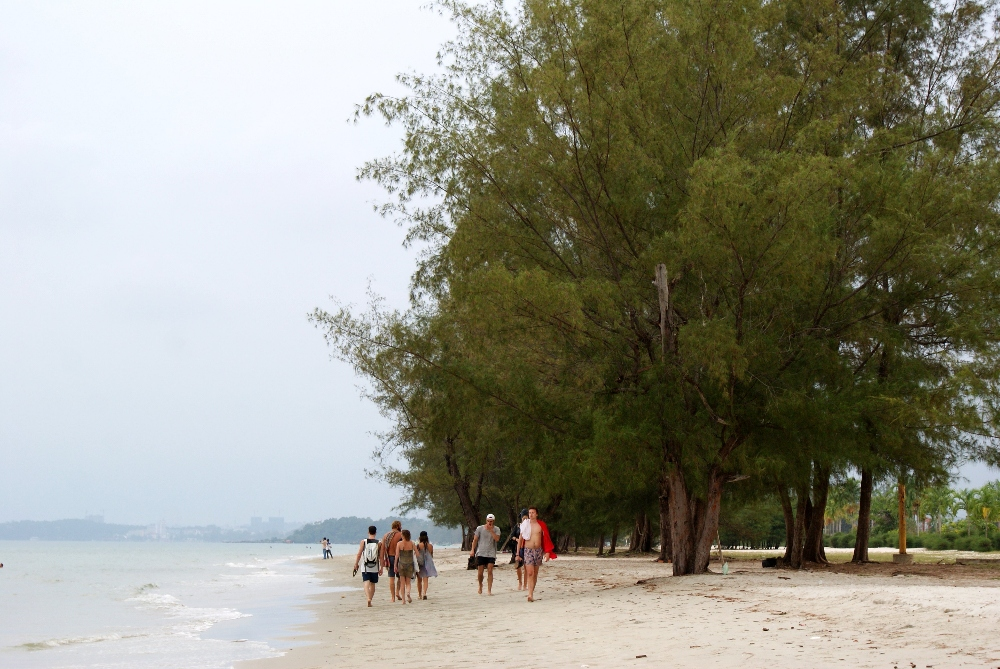

Otres Beach in de avond

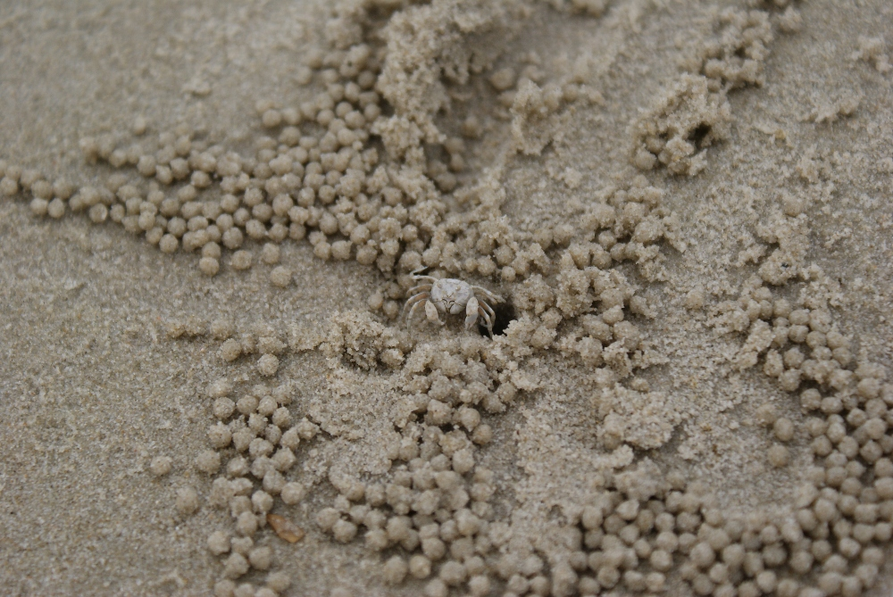

Spookkrabben graven kleine gaatjes in het zand aan de waterlijn en creëren zo verbazingwekkende patronen
op het strand :) De krabben halen voedingsstoffen uit de kleine zandbolletjes na elke vloed

Om de volgende dag te plannen, bekeken we verschillende boottochten en kozen we voor een eenvoudige, met een bezoek
aan drie eilanden, snorkelen en een middagpauze op het grootste eiland, Koh Ta Kiev (15 dollar per persoon, geboekt via ons
hotel). Eerst een klein ontbijt (inbegrepen), dan 15 minuten op de boot en snorkelen vlak bij een van de eilanden om
uiteindelijk Koh Ta Kiev te bereiken, waar we een paar uur de tijd hadden om te wandelen, te zwemmen en te zonnen :D Het water aan de Cambodjaanse
kust was ongelooflijk warm, zo'n 29-30 graden Celsius! 's Avonds voelden we dat de lucht iets
kouder was dan het water, wat de perfecte reden is om de hele avond in zee te blijven. Het hele jaar door zakt de
watertemperatuur trouwens niet onder de 28 graden Celsius, wat onvoorstelbaar is voor iemand die veel
zomervakanties doorbracht aan de koude Oostzee, waar het water een waanzinnige 18 graden Celsius kan halen! Haha, als kind had ik
lagere verwachtingen. De kapitein van onze boot maakte kip van de barbecue klaar met rijst en groenten;
middagmaal op een prachtig strand maakte deze ervaring onvergetelijk :)

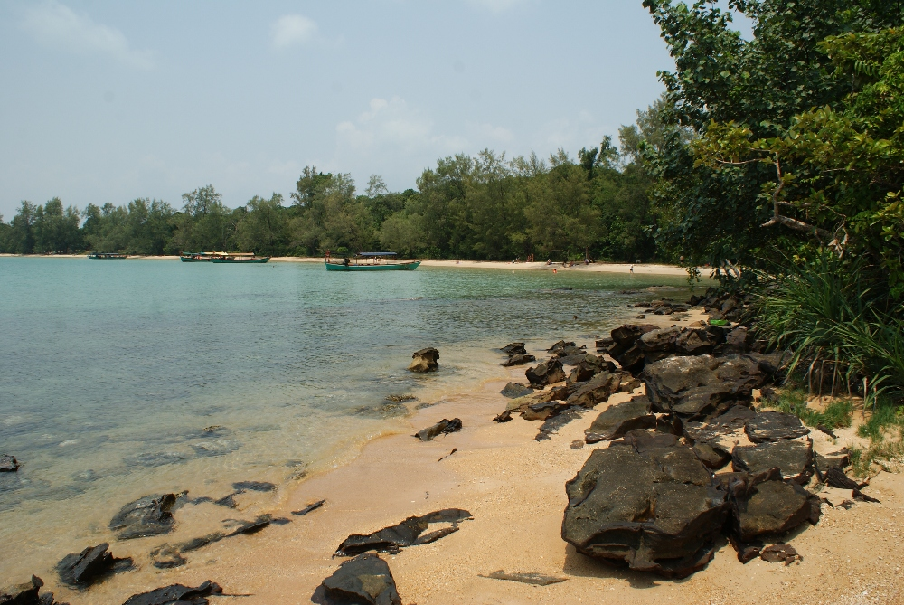

Kristalhelder water en ongelooflijk zacht zand zijn de troeven van dit eiland :)

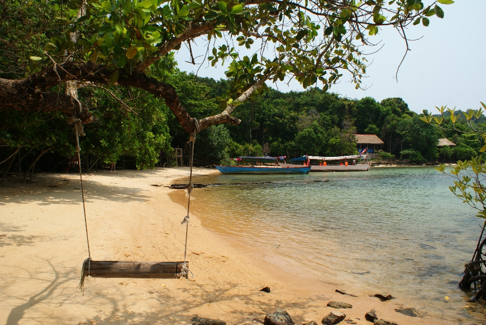

Mangroven en dennenbomen zorgen voor fijne schaduw op het zandstrand

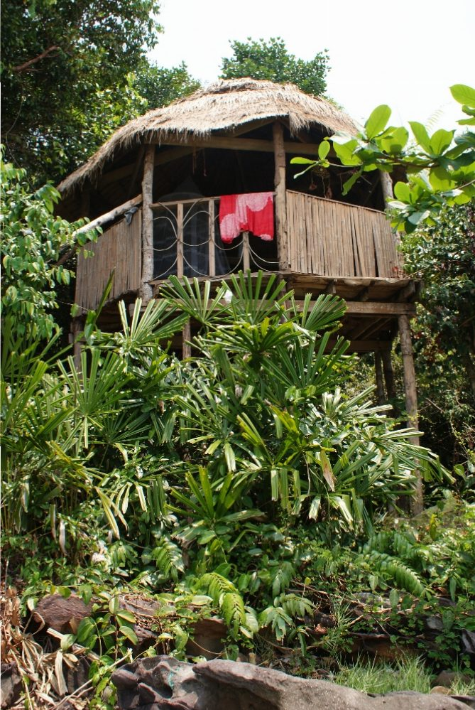

Op Koh Ta Kiev kan je overnachten in een hoge bungalow zoals deze, heel dicht
bij het strand en de natuur :)

In de namiddag, op de terugweg naar Otres Beach, hielden we halt voor nog een snorkelsessie. Hieronder zie je
een paar beelden van de onderwaterwereld, gemaakt met een GoPro Hero 3+. De uitrusting die de touroperator ons gaf,
was nogal slecht, waardoor snorkelen geen makkelijke opgave was. Ik besloot om gewoon rond de boot te zwemmen en achteraf van
Sebastians foto's te genieten :D

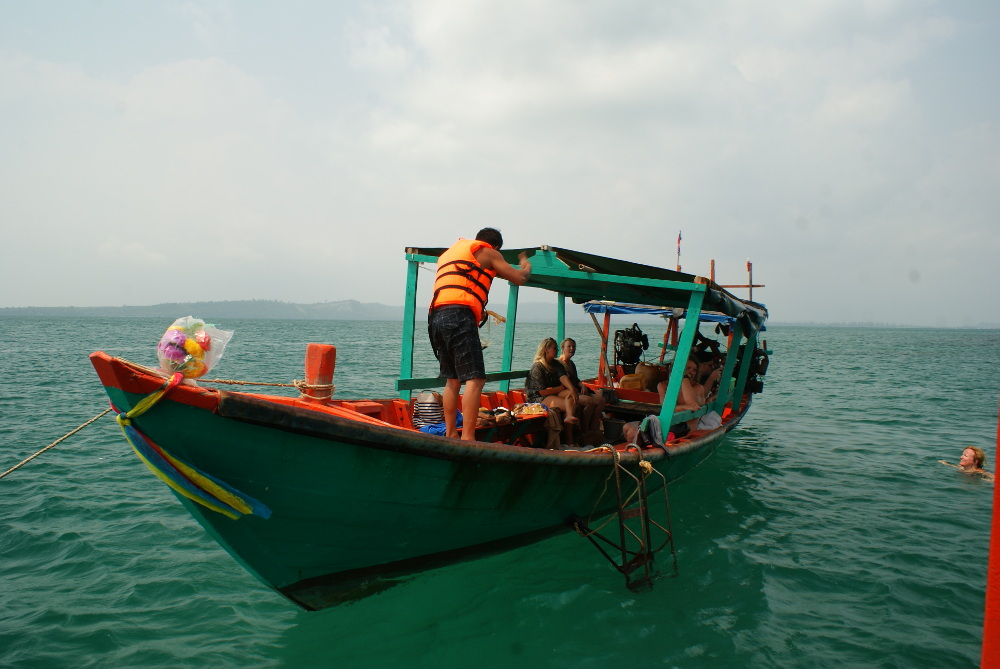
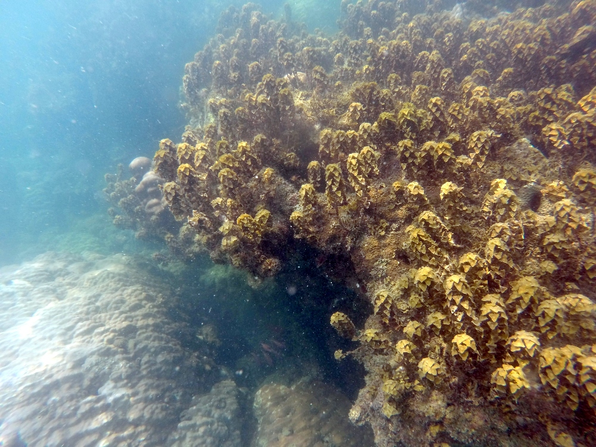
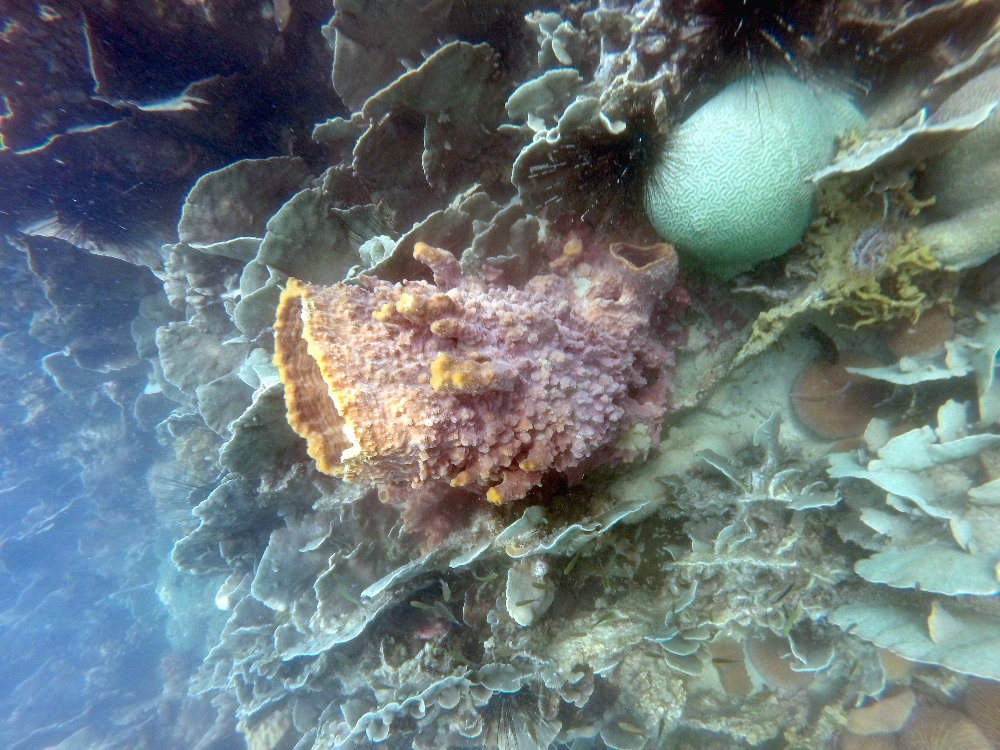

Voor de tweede nacht verhuisden we naar een bungalow met een klein zwembad. Deze keer kwamen we erachter
waarom de meeste mensen hier komen: goedkope drank en veel bars waar je sociale leven kan opbloeien! Gelukkig hadden we onze
oordopjes bij, want sommige mensen besloten voor hun bungalow feest te vieren. De volgende dag, nadat
we wakker werden met een 35 cm lange tokehgekko in onze kamer, kwam de minibus naar Kampot met (typisch voor dit land)
wat vertraging aan. We waren best tevreden met de minibus die ons oppikte, maar dat gevoel was van korte duur, want na
een paar kilometer moesten we overstappen op een andere, in slechtere staat en volgepropt met nog meer mensen :)
Een bus of minibus nemen in Cambodja (en ook in Laos!) is altijd een beetje gokken.
