Kampot ligt aan de oevers van de Kampotrivier, met veel restaurants en bars vlak bij het water. De architectuur
van de gebouwen en heel wat namen van restaurants en hotels verwijzen naar de tijd toen deze stad een Franse kolonie was.
Deze streek is vooral bekend om haar peper- en zoutproductie. Een peperplantage bezoeken stond dan ook "helemaal bovenaan"
op mijn lijstje in Kampot. Ik kon niet wachten om te ontdekken hoe een van de beste pepers ter wereld hier
geteeld wordt. Eerst moesten we uitzoeken hoe we bij <a href="http://kampotpepper.com/">La Plantation</a> raakten. We hebben geen
rijbewijs voor een scooter; er eentje huren zou waarschijnlijk sowieso geen probleem zijn, maar bij een ongeval
betaalt onze ziekteverzekering niets terug, aangezien we illegaal aan het rijden waren. Dat risico is het niet waard!
Daarom huren we meestal fietsen of nemen we een tuk-tuk. Deze keer huurden we na een korte onderhandeling een tuk-tukchauffeur
voor een halve dag (15 dollar, vraagprijs 25 dollar). We raakten er via een onverharde weg (rit van 18 km), langs veel dorpen en
Secret Lake, dat trouwens ook zichtbaar was vanaf de peperplantage. Met een tuk-tuk reizen geeft je een prachtige
kans om echt dicht bij de huizen en de mensen te komen die je passeert, en dat vond ik heel fijn. De weg was erg hobbelig en
stoffig, dus een zonnebril (die ik niet had) komt goed van pas om rode ogen te vermijden. Met een snelheid
van ongeveer 30 km/u en onder een dikke laag stof bereikten we onze bestemming. Je hoeft niet te
reserveren om deze plek te bezoeken, je wacht gewoon even tot er genoeg mensen samen zijn en dan kan de rondleiding
beginnen. Onze gids verwelkomde ons met de zin: "Ik laat je proeven en daarna laat ik je wenen, niet door
mij maar door de peper".

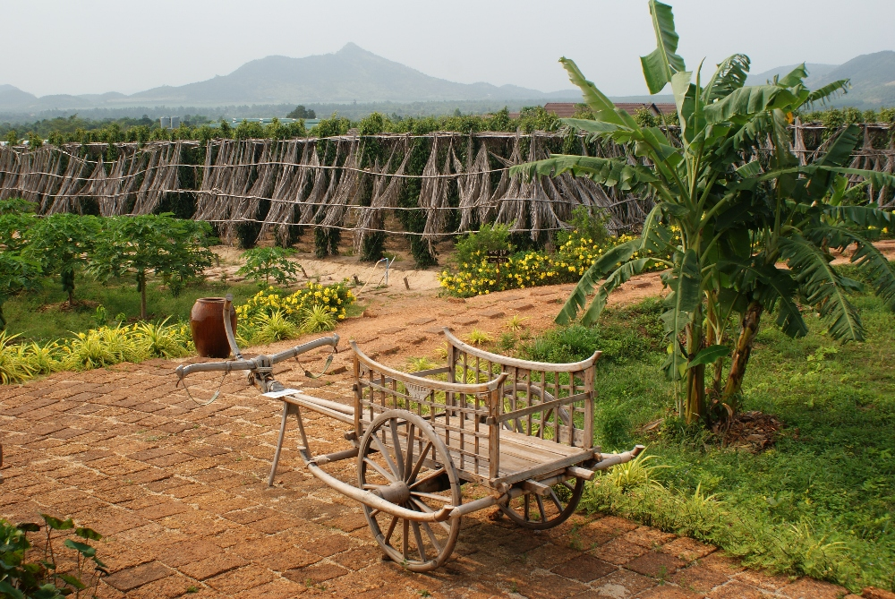

In het midden van de foto een houten kar getrokken door waterbuffels

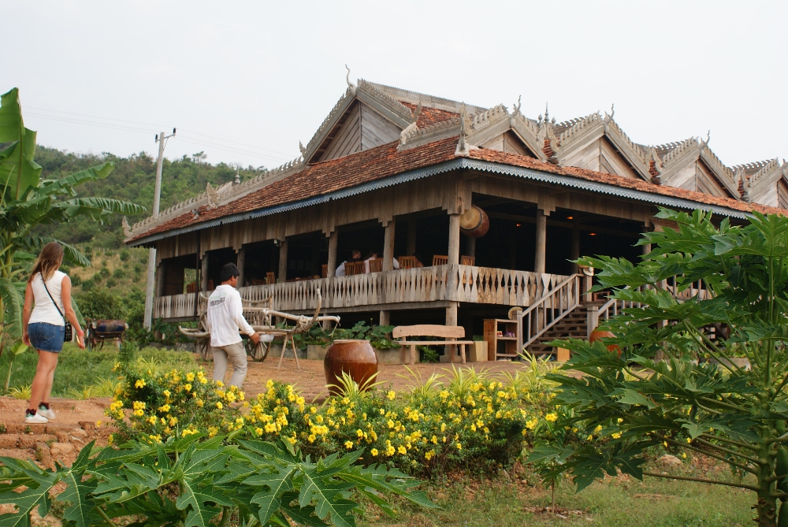

Traditionele Khmerhuizen, het hoofdgebouw met daarin de winkel en het restaurant

Aan het begin van de 20ste eeuw werd de peper uit de provincie Kampot vooral naar Frankrijk uitgevoerd.
Tijdens de burgeroorlog in de jaren 1970 werd de peperteelt stopgezet; de eigenaars van de gronden keerden terug en
begonnen rond 2000 opnieuw met telen. La Plantation wordt uitgebaat door Belgisch-Franse eigenaars die dit project
in 2013 opstartten nadat ze ontdekten dat de bodem hier van uitstekende kwaliteit is; zon en zeebries maken het klimaat
werkelijk uitzonderlijk. De peperproductie zou in 2018 80 ton moeten bereiken.

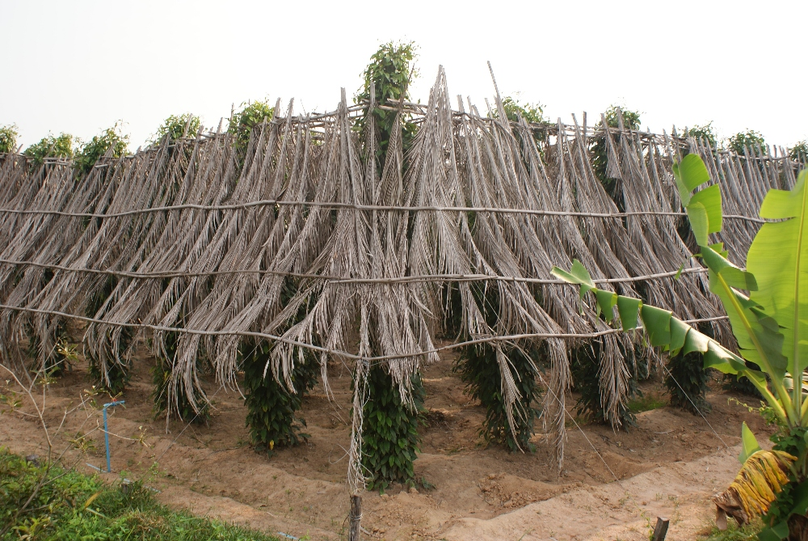

Een van de kostbaarste pepers ter wereld, beschermd tegen de felle zon

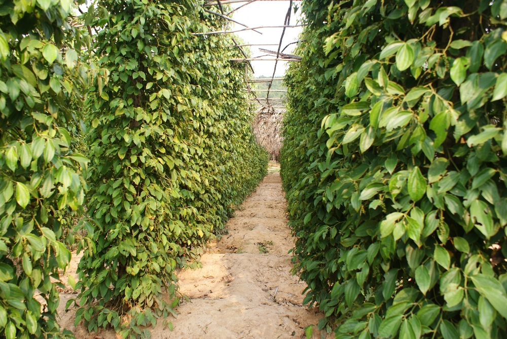

De planten worden vermeerderd door stekken en de stengel van een nieuwe plant wordt met reepjes boomschors aan de houten paal bevestigd

De basisstappen van de peperproductie zijn: oogsten, met de hand selecteren, wassen, koken en enkele dagen
in de zon drogen. Groene peperbessen worden geplukt en ongeveer 2 tot 3 dagen te drogen gelegd, waarna ze
zwarte peper worden. Wanneer de peperbessen rijpen, kleuren ze rood en na het droogproces
worden dat rode peperkorrels. Deze peper is minder pikant dan de zwarte en heeft een fruitig aroma. Als je het buitenste vliesje van
de rode peper verwijdert door de bessen één nacht in water te weken, krijg je nog een ander type peper: witte,
met een heel fijn aroma. De peperplant groeit langs hoge houten palen. Deze plek maakt een heel uniek
product, gezouten peper, het resultaat van een fermentatieproces met onrijpe groene bessen
(noot van Sebastian: die gezouten peper zou fantastisch zijn bij een biefstuk). Volgens onze gids mogen we
verschillende soorten peper niet door elkaar gebruiken, net zoals we rode en witte wijn niet mengen :p Je kookt peper ook beter niet
mee, maar voegt hem vers toe op je bord.

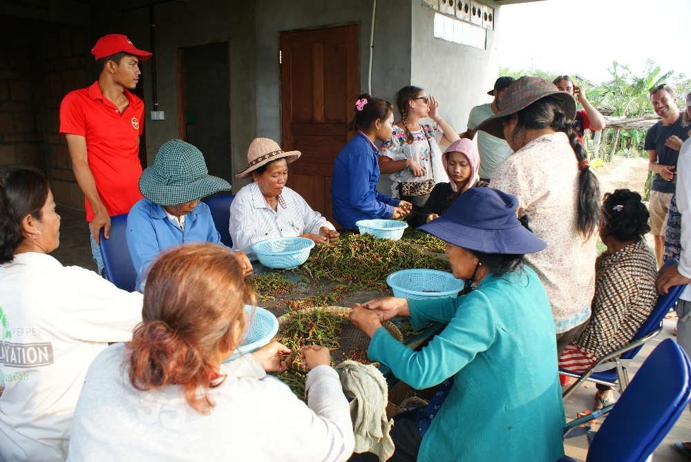

Al het werk op de plantage gebeurt met de hand, er komen geen machines of chemicaliën aan te pas (er worden ook alleen natuurlijke pesticiden en meststoffen gebruikt). We bezochten deze plek in de eerste helft van maart en toen was het tijd om de rode bessen te oogsten, korrel per korrel.

Vandaag werken er meer dan 100 Cambodjanen voltijds op La Plantation, wat bijdraagt aan de
ontwikkeling van de lokale gemeenschap. Ze steunen ook de plaatselijke lagere school met fietsen voor de kinderen en
schoolmateriaal, en de beste leerlingen krijgen een beurs voor een privéschool in het middelbaar onderwijs. Tijdens ons bezoek
viel ons de heel ontspannen sfeer onder de werknemers op, wat ons bezoek echt aangenaam maakte!

Na de rondleiding op de boerderij konden we in een klein winkeltje wat biologische peper kopen, en dat deden we :D Het landschap
rond de plantage is prachtig: je ziet Secret Lake in de verte en heel wat velden met peper en
fruitbomen. Op de plantage vangen ze water op tijdens het regenseizoen om ermee te irrigeren tijdens het
droge seizoen.

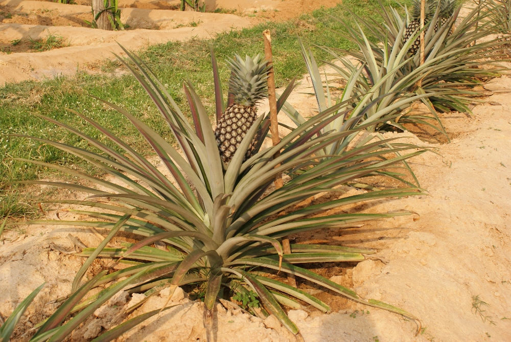

Ananassen groeien echt niet aan bomen, maar aan een bladerrijke plant. Die op de foto had ongeveer een jaar nodig om zo groot te worden

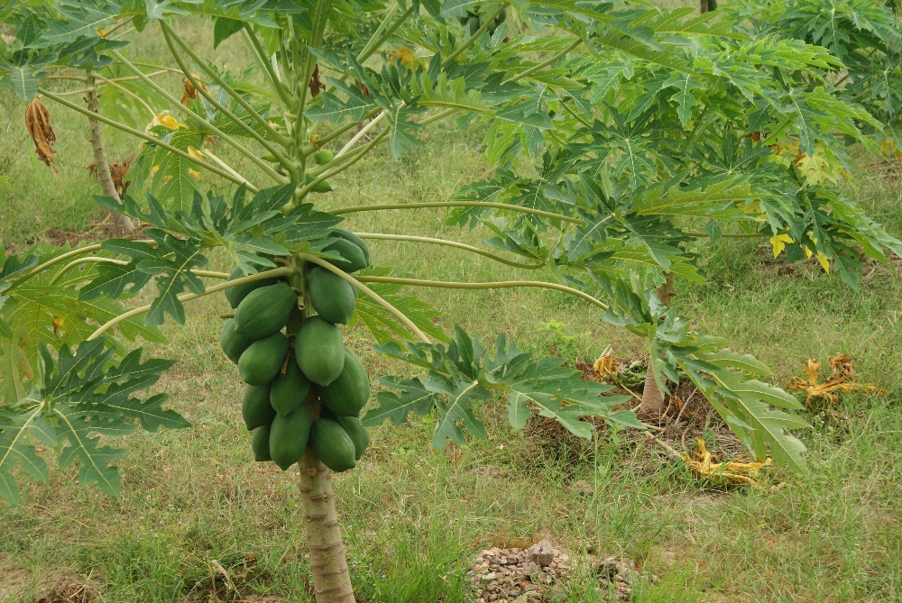

Papajaboom; als de vruchten rijp zijn, kleurt de schil geel tot oranje

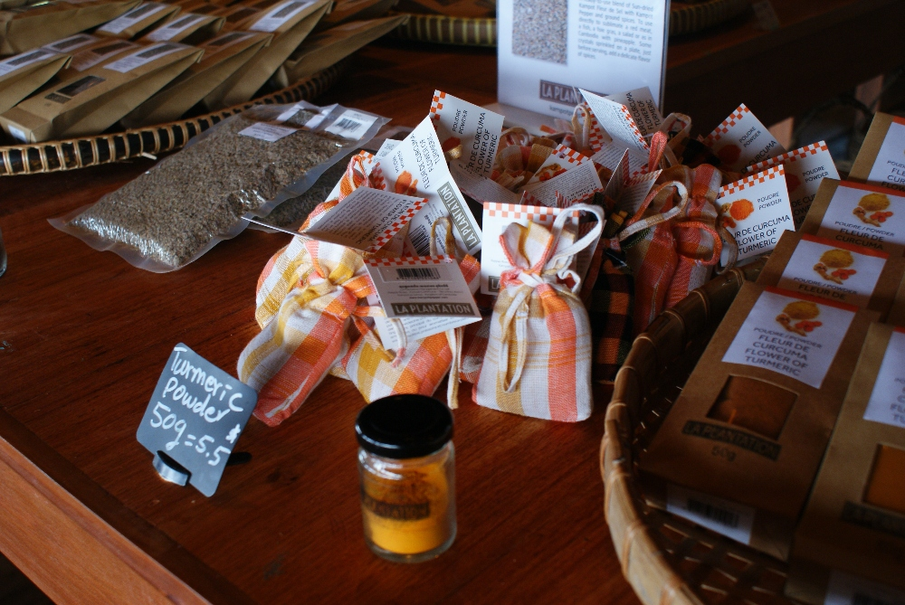

Kurkuma (uit de gemberfamilie) geeft sommige curry's hun felgele kleur

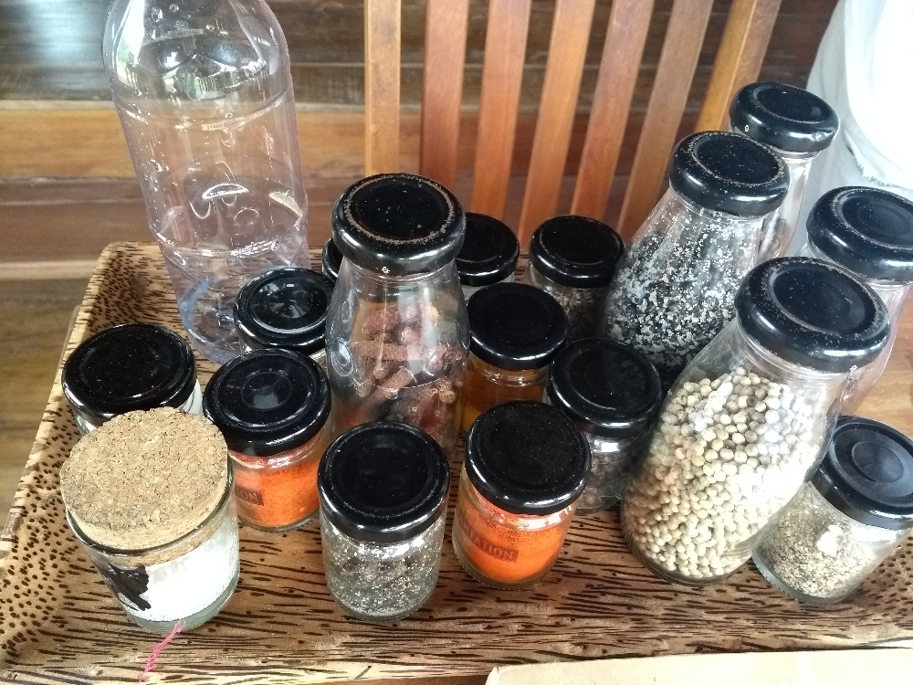

Na een korte inleiding over de geschiedenis van de plek, de bijzondere certificaten die de producten van de plantage hebben
en hoe het productieproces verloopt, begonnen we aan het praktische deel van de presentatie: proeven. Gelukkig dat
we in het begin wat frisdrank hadden besteld :) We waren echt verrast door het fruitige aroma van de peper.

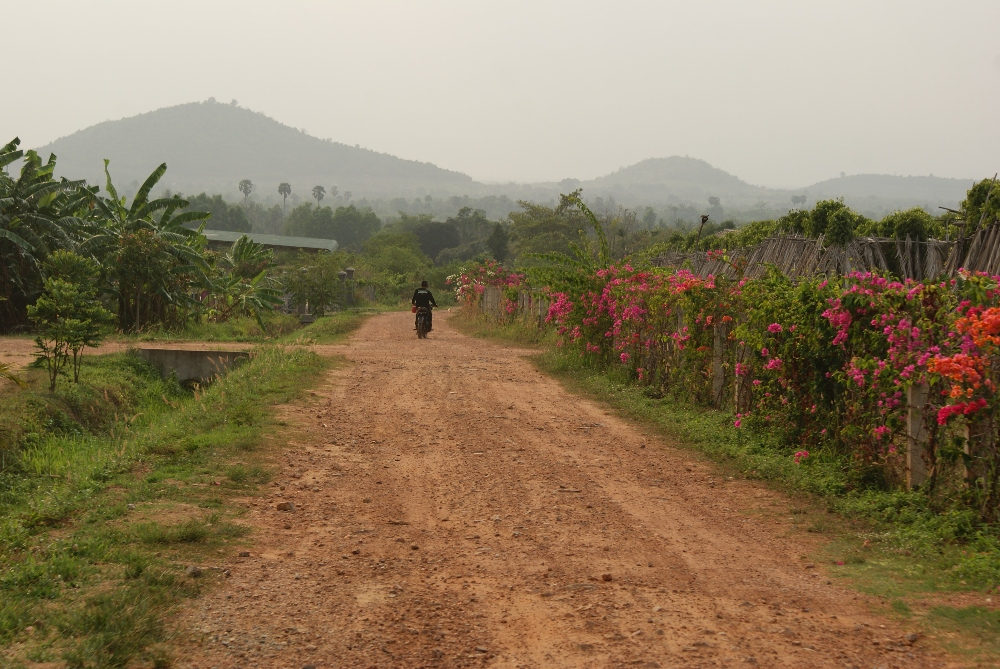

In de late namiddag, de warme kleuren van de plantage...

Op de terugweg naar de stad stopten we nog even bij de zoutvelden. Jammer genoeg was het regenseizoen dit jaar
vroeger begonnen en was de zoutoogst al afgelopen (normaal duurt het droge seizoen tot eind april en
wij waren er eind maart). Het water uit de Golf van Thailand wordt naar de velden geleid en
verdampt, waarna er zoutkristallen achterblijven. Er is ook een klein bezoekerscentrum waar je meer te weten komt
over het productieproces en wat zout kunt kopen, maar nu was het gesloten omdat de productie voorbij was. Het zout wordt
in loodsen bewaard en daarna naar de fabrieken gebracht, waar het gereinigd en gejodeerd wordt, verpakt en klaar om
te verdelen.

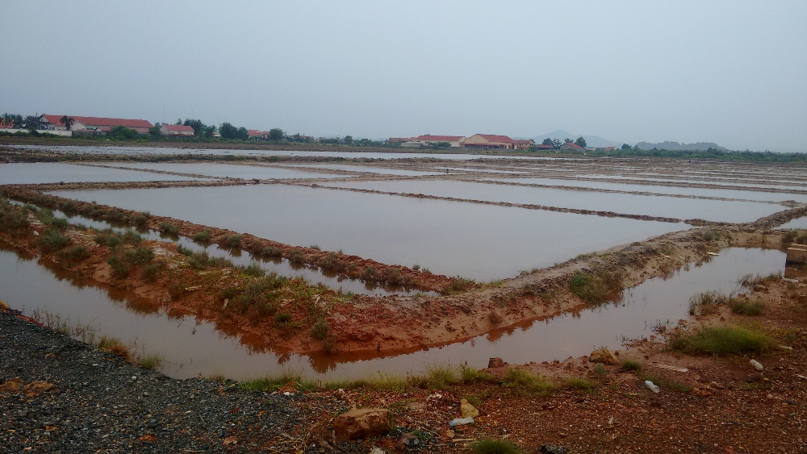

De volgende dag konden we dankzij een busrit van een halfuur Kep bezoeken, de krabbenstad. Het was een perfect toevluchtsoord voor
de Franse elite aan het begin van de 20ste eeuw. Vandaag is het een aangenaam stadje met fijne hotels en een rustig
strand (ideaal als je de feestscene in Sihanoukville wilt vermijden).
Net toen we aankwamen, dwong een felle regenbui ons om anderhalf uur te schuilen in een restaurant vlak bij het busstation in
Kep.

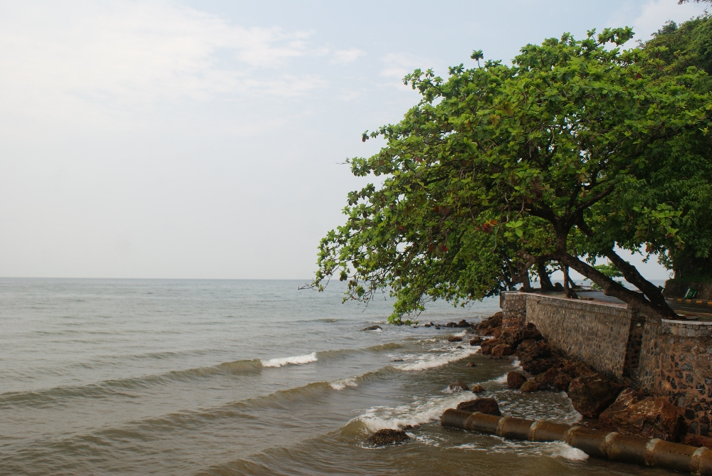

Mangroven en zwarte rotsen in plaats van wit zand zijn de belangrijkste elementen van de kustlijn van Kep

De temperatuur zakte een beetje en de zon kwam achter de wolken vandaan, en dat was het moment om
de krabbenmarkt te gaan bekijken (vlak bij het standbeeld van Sdech Korn). Je koopt hier niet alleen verse krab rechtstreeks van de boot, maar
ook andere soorten zeevruchten (waaronder enkele die kant-en-klaar van de barbecue komen). De restaurants in de buurt hebben een menu met een
groot aanbod aan zeevruchten, met als klassieker de gebakken blauwe krab, geserveerd in het gezelschap van de befaamde Kampotpeper.

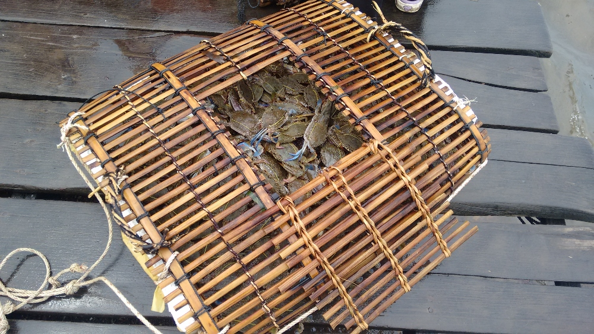

Blauwe krabben worden in manden in het water gehouden zodat ze vers blijven tot ze verkocht worden

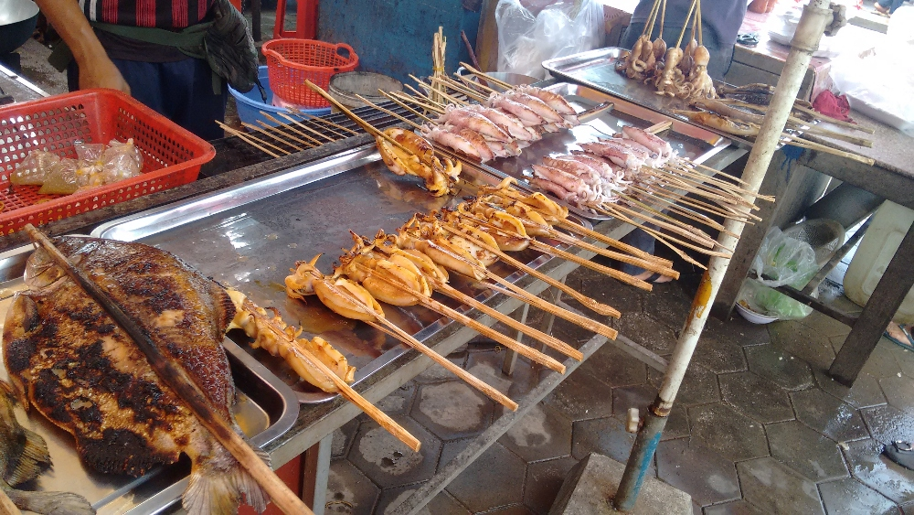

Enorme vissen, pijlinktvis, octopus, keuze genoeg voor liefhebbers van zeevruchten!

Omdat ik geen zeevruchten eet, besloten we wat exotisch fruit te proberen en onze keuze viel op ramboetan (3 dollar per kg).
Dit fruit is eerst groen en wordt dan rood, oranje of geel naarmate het rijpt. Open eerst de schil met een
mes of met je vingers (de stekels zijn zacht), knijp het binnenste eruit, verwijder de pit en geniet van het doorschijnende, witte
vruchtvlees. Het is echt zoet en sappig fruit!

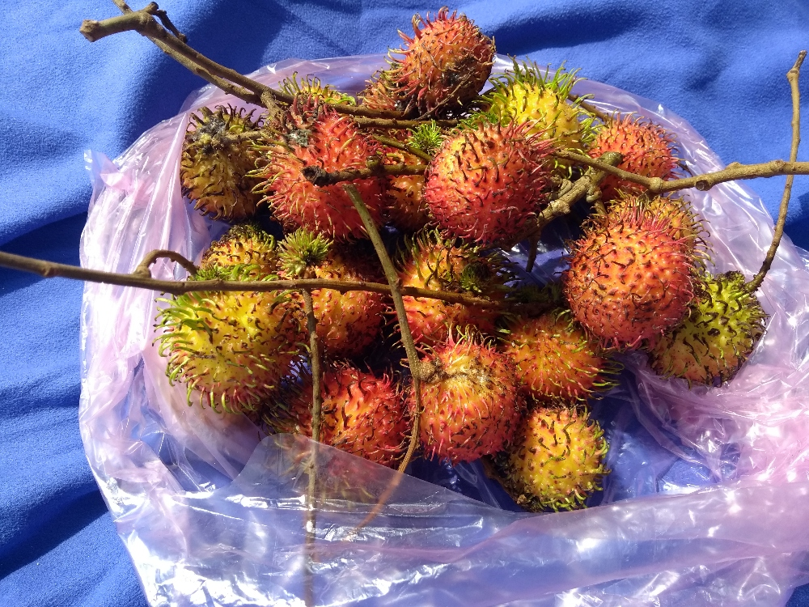

Vol goede moed dat het niet te modderig geworden was in het nationaal park van Kep (opgericht in 1993), begonnen we ernaartoe te wandelen,
langs veel mooie hotels met zwembaden. De toegang tot het park kostte 1 dollar, maar wij
betaalden 1,5 dollar voor ons tweeën en de man telde ons officieel als één persoon (zo verdiende hij er zelf een centje bij?).
We wandelden de 8 km lange route (ook toegankelijk met de motor) door een dicht tropisch bos vol exotische planten en
prachtige vlinders. Geen enkel snackbarretje dat we passeerden was open, dus we waren blij dat we genoeg water bij hadden, want
het was echt snikheet in het bos.

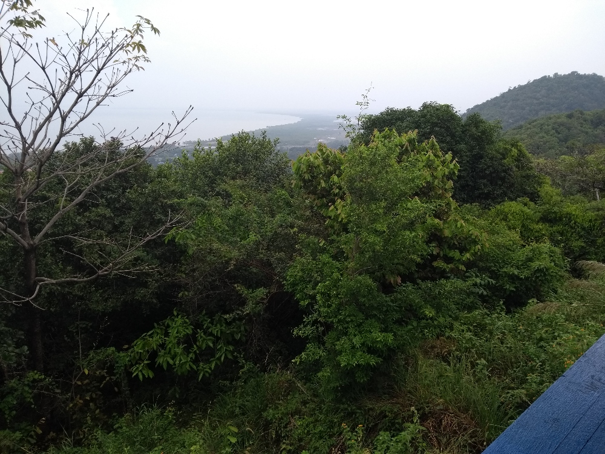

Uitzicht op het stadje Kep en de kust vanaf de heuvel in het nationaal park van Kep. De uitzichten waren niet spectaculair, want de jungle was over de meeste uitkijkpunten heen gegroeid.

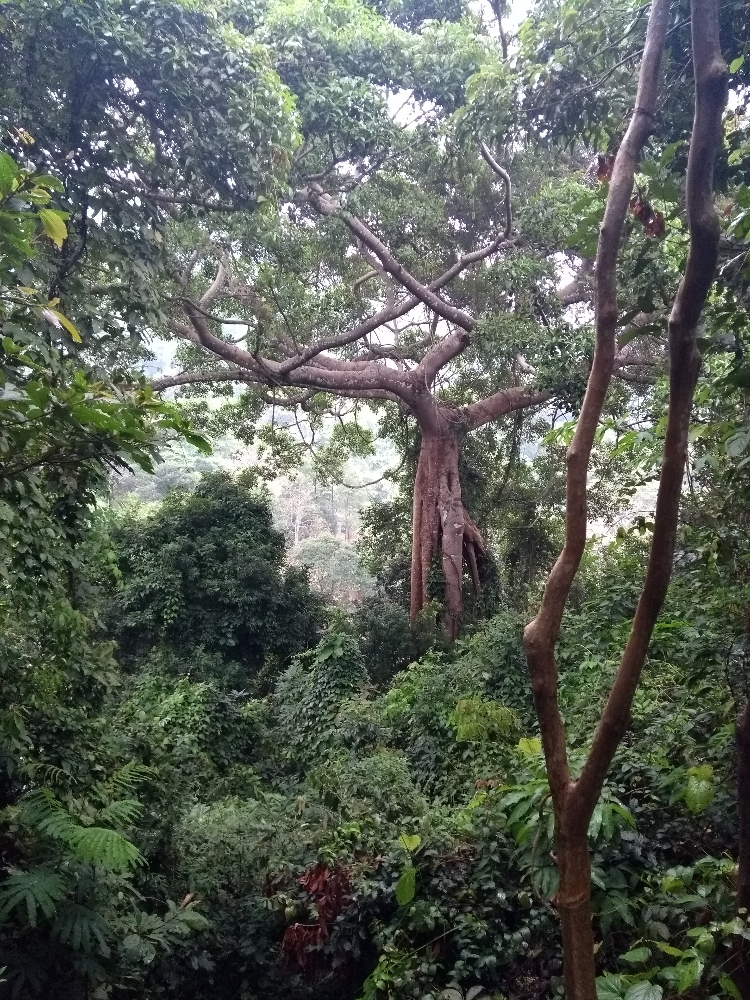

Fantastische jungle in het park :)

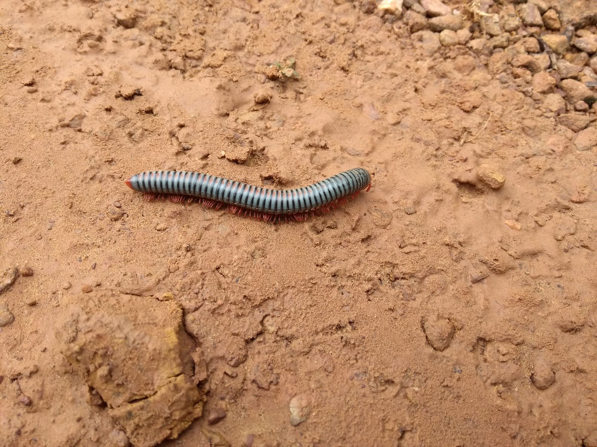

Oei, een reusachtige miljoenpoot! :O

We kwamen aan de andere kant van het nationaal park uit en trokken terug naar het strand, dat dicht bij de plek lag waar de
bussen vertrokken. Nu hadden we tijd om in het zand te liggen, te zwemmen en de Vietnamese eilanden in de verte te bewonderen
(het is over land maar 20 km tot de Vietnamese grens). Zoals verwacht kwam onze bus met meer dan een uur vertraging aan;
we moesten de realiteit van het vervoer in Azië echt leren aanvaarden.

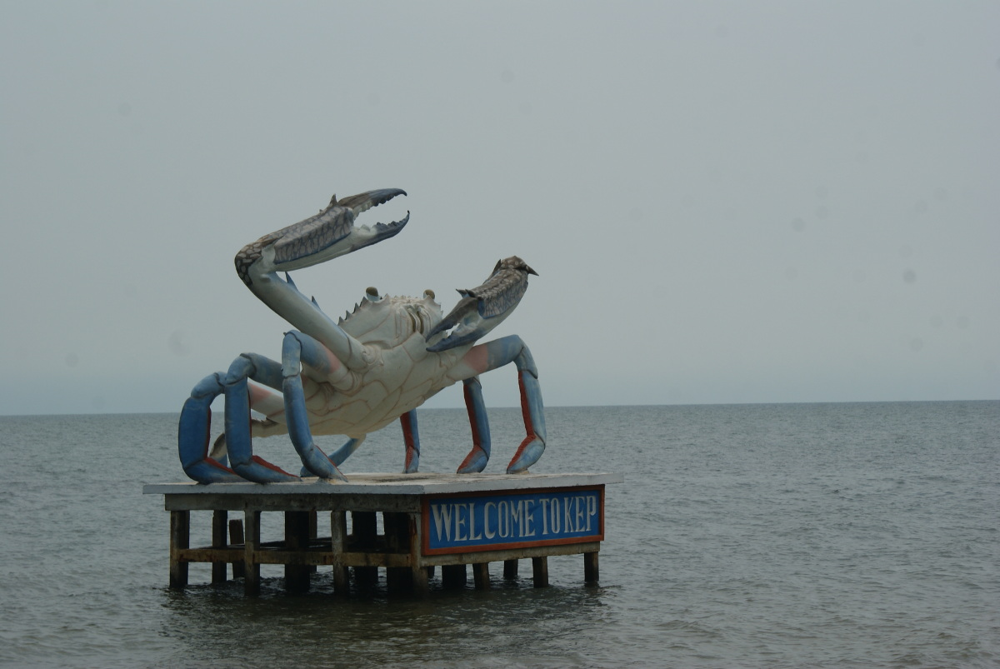
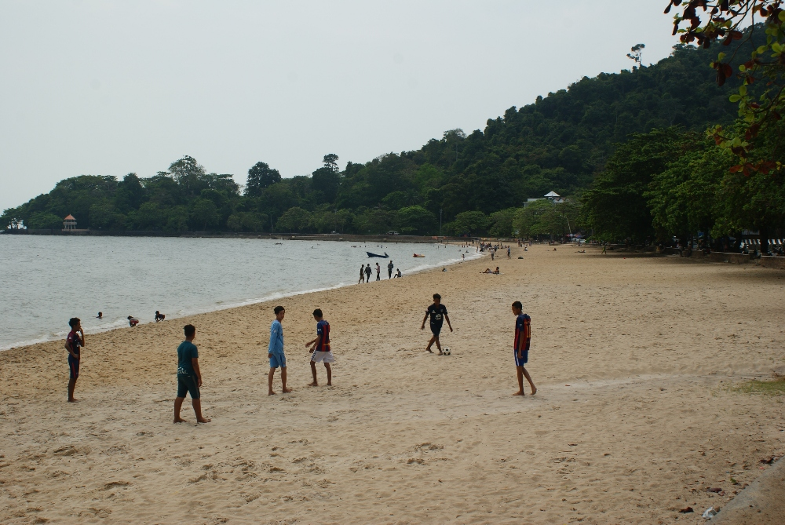
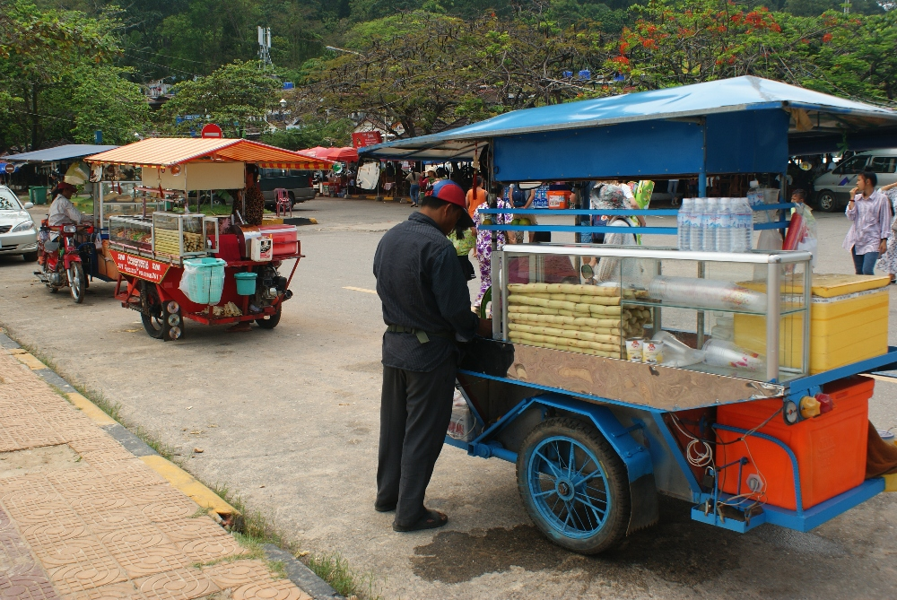

Eetkraampjes langs het strand, met versgeperst suikerrietsap en een soort
krokante pannenkoeken die opgerold als een buisje geserveerd worden

## Praktische informatie:
  * Busticket van Kampot naar Kep - 3 dollar per persoon
  * Toegang tot het nationaal park van Kep - 1 dollar per persoon
  * Ramboetans - 3 dollar per kg
