We kregen opnieuw problemen met de bus. Deze keer stopte hij in een heel ander deel van de stad dan ons beloofd was.
 Een paar tuk-tukchauffeurs stonden al klaar om ons dichter bij het stadscentrum te brengen, maar zoals verwacht vroegen ze opnieuw veel te veel. We merkten
  dat de maatschappij de rit naar Phnom Penh, de hoofdstad van Cambodja, eigenlijk aan een ander bedrijf had uitbesteed. Zoals altijd liepen we een eindje verder en vonden we
  een willekeurige tuk-tukchauffeur die ermee instemde ons voor 2 dollar naar ons hotel te brengen (ongeveer 2 km). Ons hotel lag handig vlak bij de Centrale Markt
   (Phsar Thmei). Op de markt of in de nabijgelegen supermarkt konden we gemakkelijk vers fruit en verse groenten kopen (in Sorya Center Point, de enige
    winkel met een Europese uitstraling die we tijdens onze hele reis tegenkwamen :p). Het marktgebouw zelf heeft een interessante kruisvormige structuur met een grote
    koepel in het midden. Je kunt er bloemen, fruit, kleding, schoenen, juwelen en nog veel meer kopen. Afdingen kan hier zeker, want de
     beginprijzen liggen hoger dan gemiddeld. Onze eerste namiddag brachten we door met een wandeling langs de promenade aan de Tonlé Sap, met uitzicht op de Mekong.
      Er zijn veel verkopers van eten en offergaven. Sommige mensen verkopen vogels in bamboekooien om ze vervolgens vrij te laten als symbool van
      voorspoed en geluk (we zagen spandoeken die toeristen probeerden te ontmoedigen om hieraan mee te doen). Anderzijds zagen we ook het erg
       trieste tafereel van heel wat zieke, bedelende mensen op straat.

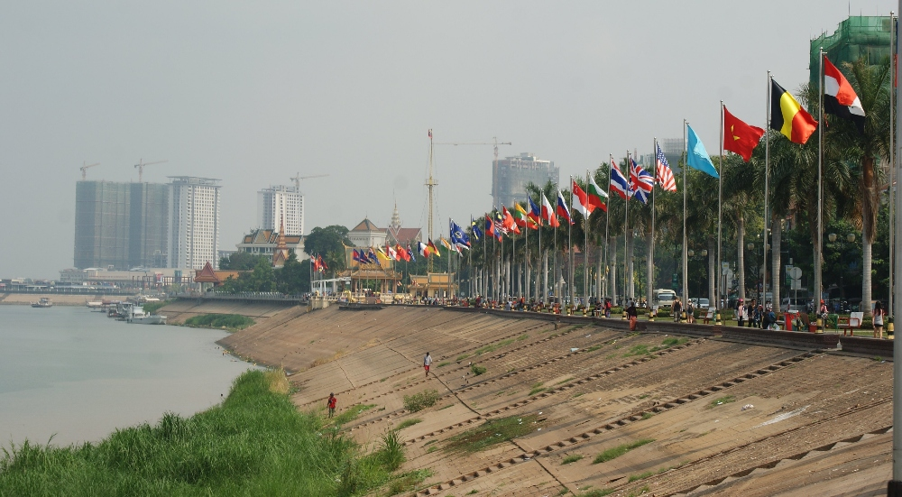

Langs de promenade wapperen heel wat vlaggen en in de verte rijzen wolkenkrabbers op

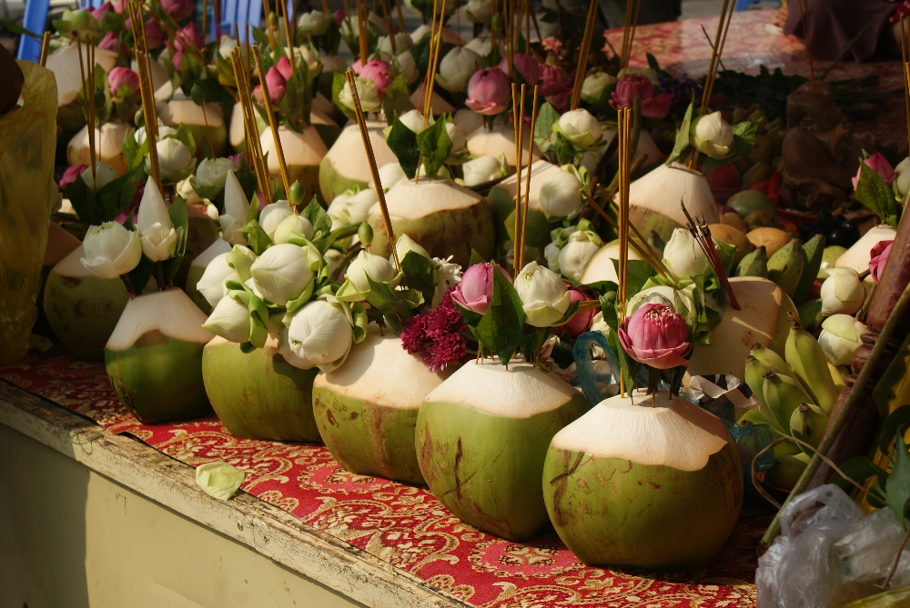

Een gebruikelijke offergave bestaat uit wierook en enkele bloemen (vaak een lotus) in een kokosnoot

Vlakbij kwamen we langs Wat Ounalan (gratis toegang). Binnen was een ceremonie met veel monniken en gelovigen aan de gang, dus gingen we niet naar binnen. We liepen ook
langs het Nationaal Museum en het Koninklijk Paleis, die we voor de volgende dag bewaarden.

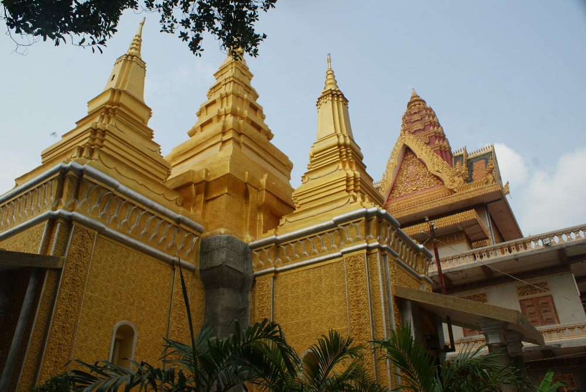

Wat Ounalan

Onderweg naar Wat Langka zagen we een erg indrukwekkend, goudkleurig en
glanzend gebouw: het NagaWorld Hotel &amp; Entertainment Complex. Vlak bij de tempel stond ook het (niet zo indrukwekkende) Onafhankelijkheidsmonument. Rond dit monument
 lag een enorm rondpunt waar werkelijk geen enkele regel leek te gelden. Verrassend genoeg botsten de auto's en motorfietsen er niet op elkaar, maar
  voegden ze in het midden gewoon vlot in :) We konden de tempel niet binnengaan. We hadden wel aan het avondgebed kunnen deelnemen, maar daarvoor waren we te
  moe, dus keerden we terug naar het hotel.

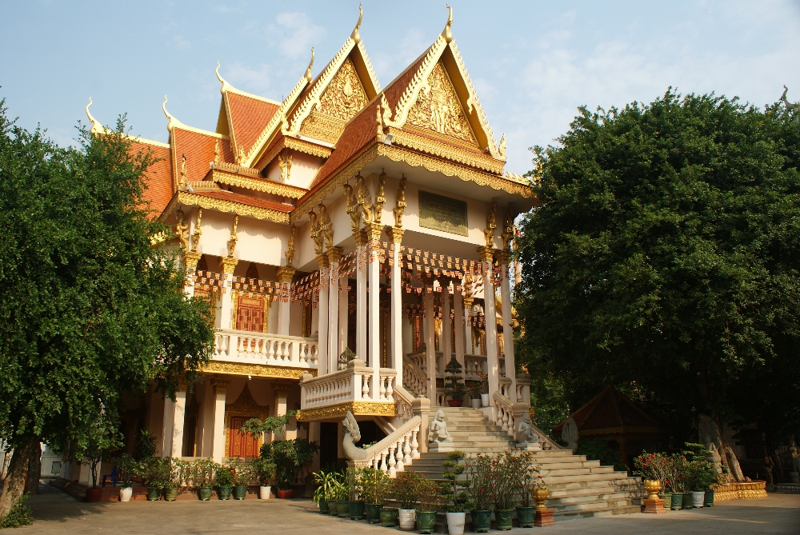

Wat Langka

De stad herrijst nog altijd uit de as na een van de ergste genocides uit de geschiedenis van de mensheid. Om meer te weten te komen over
 wat er precies in Cambodja is gebeurd, besloten we Tuol Sleng (ook bekend als S-21) te bezoeken, een centraal complex met bijna 200 gevangeniscellen waar
 mensen tussen 1975 en 1979 door de Rode Khmer werden opgesloten en gemarteld. Het geschatte aantal gevangenen ligt tussen de 12.000 en 20.000,
 van wie er slechts 12 overleefden. Veel gevangenen die niet in Tuol Sleng stierven, werden later naar de zogenaamde "killing fields" in Choeung
  Ek gebracht (17 km van het stadscentrum), waar ze op brutale en onmenselijke wijze werden geëxecuteerd. Maar waarom vermoordde de Rode Khmer onder leiding van Pol Pot
  eigenlijk 1,5 tot 3 miljoen mensen, ongeveer 25% van de Cambodjaanse bevolking? Toen de Vietnamoorlog voorbij was (Cambodja was neutraal in dit conflict),
   geloofden de mensen dat er betere tijden waren aangebroken. Niets was minder waar! Nadat Pol Pot de macht in het land had gegrepen, wilde hij
   een zuivere agrarische samenleving creëren waarin iedereen boer zou zijn. Alle steden werden onder dwang ontruimd en de inwoners werden naar het platteland gestuurd. Hij
    beschouwde de westerse cultuur als verderfelijk. Iedereen die met die cultuur verbonden was, zoals intellectuelen en zelfs mensen die een bril droegen, moest
     worden uitgeroeid. Hij wilde dat de Cambodjaanse boeren alles produceerden wat ze nodig hadden, maar dat bleek onmogelijk en veel mensen stierven van de honger.
      Hoewel beide wereldoorlogen tijdens de geschiedenislessen in het middelbaar onderwijs in Polen en België uitgebreid aan bod komen, wordt dit donkere hoofdstuk uit de moderne geschiedenis
       helemaal niet vermeld. Daarom heeft een bezoek aan deze plek me zo diep geschokt. Het was geen vrolijke paasochtend. Ik zou deze
        plek niet aanraden aan gevoelige mensen en kinderen: de tentoonstellingen zijn erg expliciet en ik kon de meeste ervan niet alleen bezoeken. Toch moeten we
         de herinnering aan wat hier is gebeurd absoluut levend houden. Het wrede regime van Pol Pot werd in 1979 door Vietnamese troepen omvergeworpen en de
         huidige monarchie werd pas in 1993 hersteld. De Cambodjanen zijn nog altijd aan het bekomen van wat dertig jaar geleden is gebeurd.

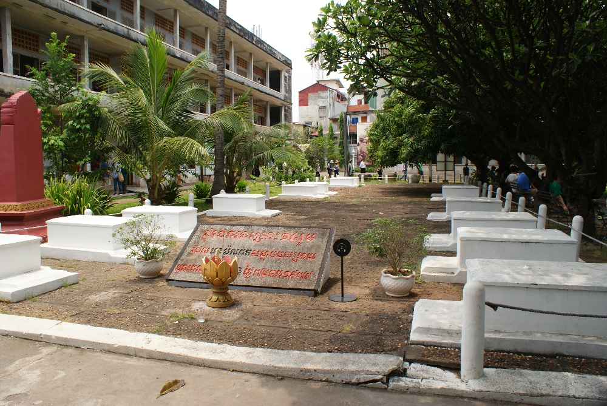

Graven van de laatste 12 slachtoffers die Vietnamese soldaten op 7 januari 1979 in de Tuol Sleng-gevangenis aantroffen

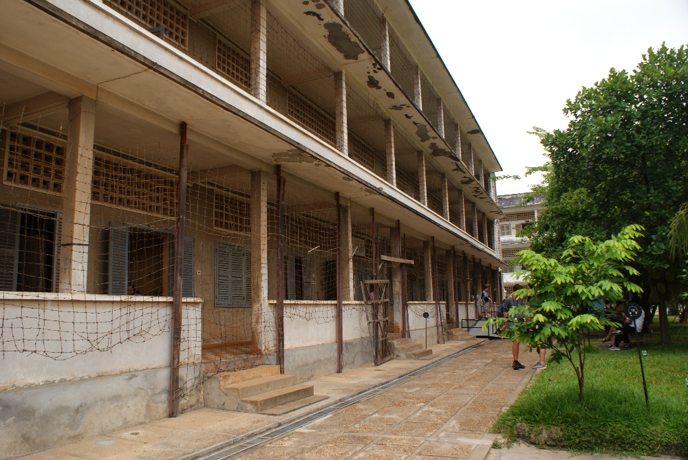

Een van de weinige schoolgebouwen die tot gevangenis werden omgebouwd

Voor de namiddag hadden we een aangenamere plek gepland: het Koninklijk Paleis en de Zilveren Pagode. Je mag deze plek niet bezoeken zonder gepaste kleding (bedek je armen en knieën; een sjaal om je armen volstaat niet!). De bewakers zijn erg streng op die regels (net als in Bangkok, waar mijn legging niet gepast was). We brachten er ongeveer anderhalf uur door en wandelden tussen de uitstekend onderhouden gebouwen. We bewonderden ook een prachtige tuin met veel bloemen (waaronder Plumeria alba, de nationale bloem van Laos) en bomen met interessante vormen.

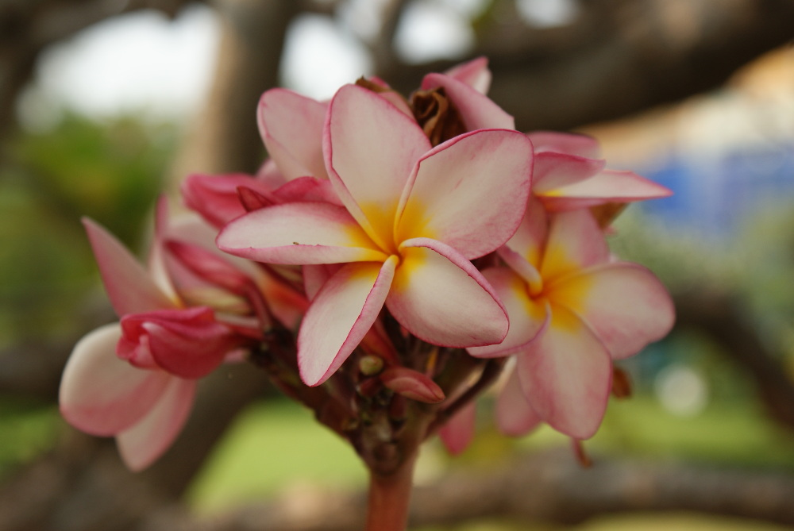
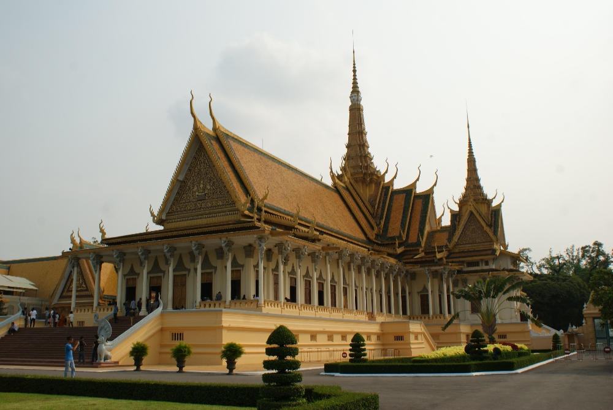

De Troonzaal in het Koninklijk Paleis wordt nog altijd gebruikt voor koninklijke plechtigheden (kroningen, koninklijke huwelijken en diplomatieke bijeenkomsten)

  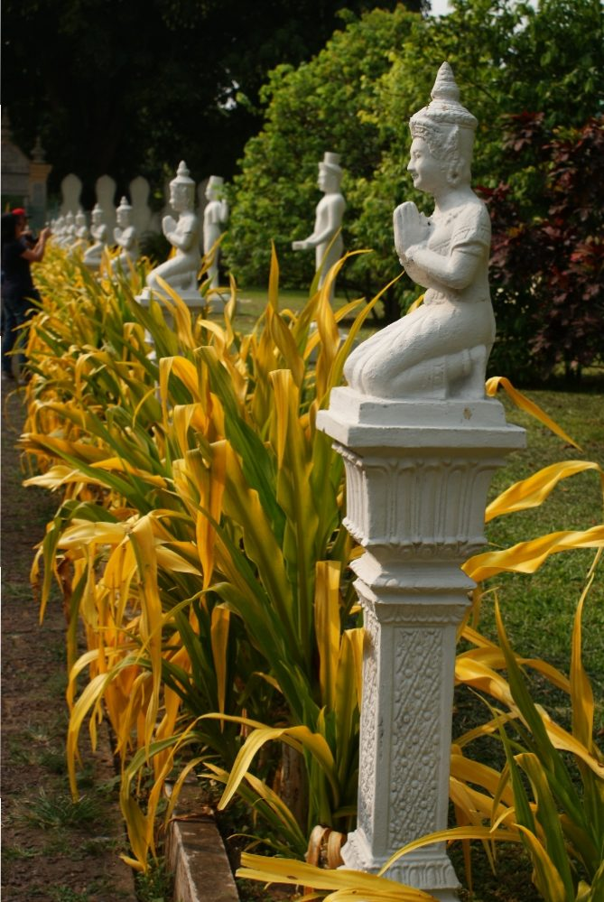
  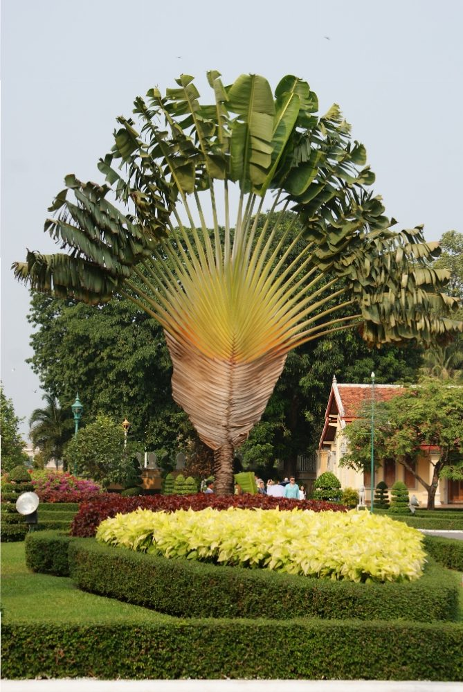

  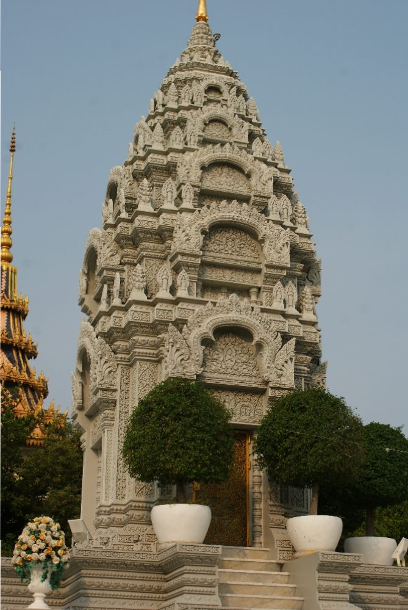
  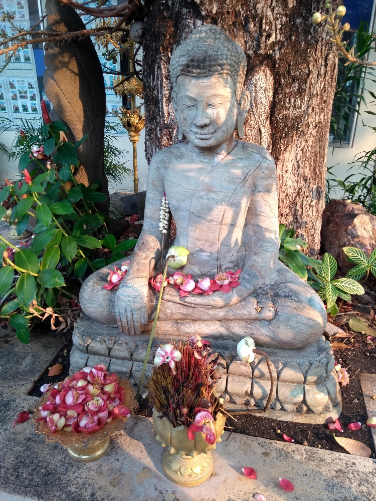

De vloer van de Zilveren Pagode is bedekt met meer dan 5.000 zilveren tegels (minstens 5 ton zilver!), al was daar weinig van te zien omdat er ter bescherming een enorm tapijt overheen ligt. Hier ontmoet de koning monniken. Binnen zagen we een groot gouden Boeddhabeeld van 90 kg, versierd met 2.086 diamanten. Er staat ook een verrassend kleine maar erg beroemde "Smaragden Boeddha" van Cambodja, die boven op een troon in het midden van de tempel zit. Zijn glanzende groene kristallen trekken meteen de aandacht van veel bezoekers. Ik vond ook de koninklijke stoepa's rond de Zilveren Pagode erg mooi. Daarin wordt de as van koningen bewaard.

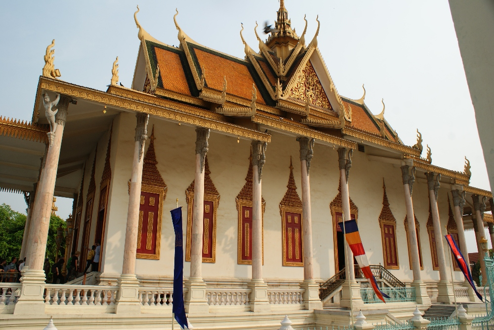

De Zilveren Pagode, bekend als de Pagode van de Smaragden Boeddha.

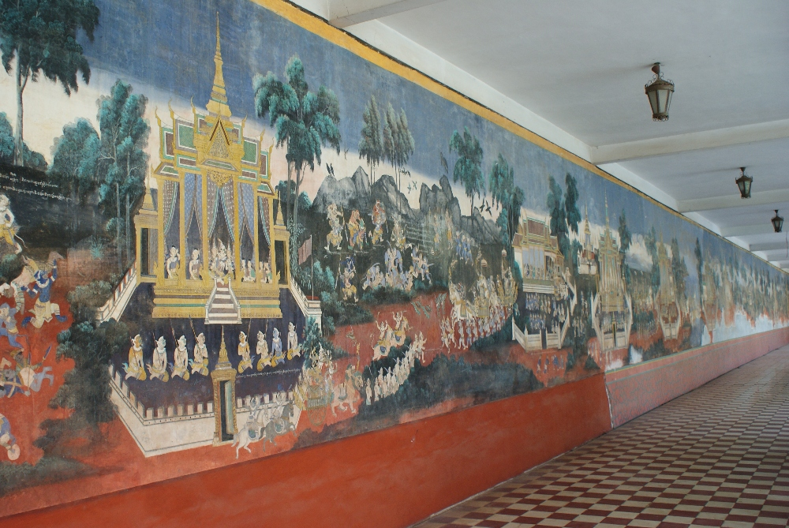

Galerij van de Reamker op de muren van het complex van de Zilveren Pagode. De schilderingen tonen de Khmer-versie van het klassieke Indiase epos de Ramayana. Slechts een klein deel is gerestaureerd, wat duidelijk te zien is op de foto

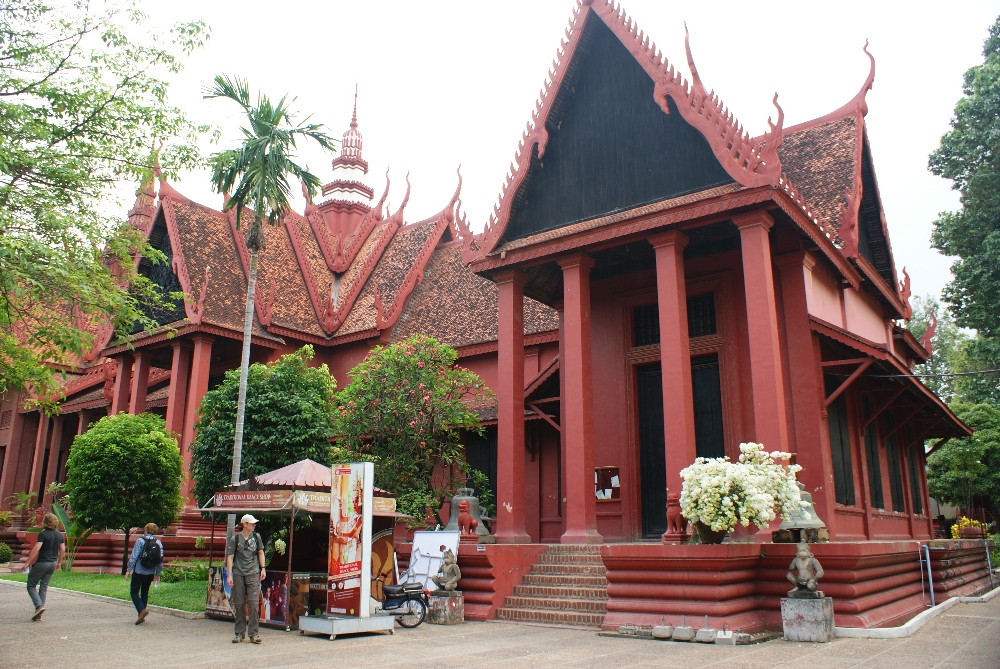

Het Nationaal Museum van Cambodja herbergt een collectie Khmerkunst (we hebben het niet bezocht) en valt op door zijn bordeauxrode muren

De volgende dag deden we het rustig aan. We gingen wat winkelen op een markt in de buurt (we hadden meer kleren nodig!) en bezochten Wat Phnom. De tempel ligt op een kleine heuvel waaraan de hoofdstad haar naam dankt. De tempel is niet indrukwekkend, maar rondom ligt een mooi park waar je aan de drukte van de stad kunt ontsnappen (1 dollar toegang). We kochten ook onze tickets naar Siem Reap en boekten er een kamer voor de volgende vijf dagen.

Een interessant weetje voor kattenliefhebbers: de katten in Phnom Penh hebben meestal geen staart of een korte, kromme staart. Waarschijnlijk is een genetische mutatie hiervoor verantwoordelijk, maar zonder genetisch onderzoek weet niemand zeker of het om dezelfde mutatie gaat als bij de Japanse bobtail of de manx, dan wel om een volledig nieuwe mutatie.
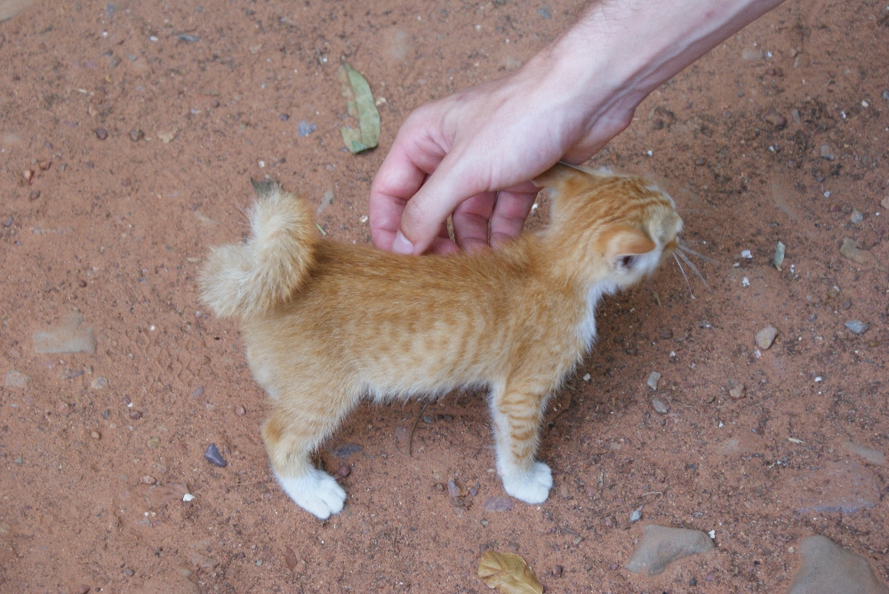

Je laat straatkatten waarschijnlijk het best met rust, maar Sebastian besloot deze lang genoeg af te leiden zodat ik een scherpe foto kon nemen :)

## Praktische informatie:
  * Bus naar Phnom Penh - 7 dollar per persoon

  * Toegang tot het Tuol Sleng Museum - 8 dollar per persoon, met audiogids
  * Toegang tot het Koninklijk Paleis - 10 dollar per persoon
  * Mango's, witte pitaja - 1,25 dollar per kg
  * Smoothies - 1-2 dollar (<a href="https://www.tripadvisor.com/Restaurant_Review-g293940-d8568725-Reviews-Davy_s_Shake_Shack-Phnom_Penh.html">Davy's Shake Shack</a>, de beste smoothies ooit!)
  * Avondmaal - ongeveer 5 dollar per persoon, inclusief frisdrank ( <a href="https://www.tripadvisor.com/Restaurant_Review-g293940-d2372913-Reviews-Kabbas_Restaurant-Phnom_Penh.html">Kabbas</a>, <a href="https://www.tripadvisor.com/Restaurant_Review-g293940-d10226831-Reviews-350_BBQ_Cafe-Phnom_Penh.html">350 BBQ Cafe</a> of <a href="https://www.tripadvisor.com/Restaurant_Review-g293940-d3454214-Reviews-David_s_Restaurant_Handmade_Noodles-Phnom_Penh.html">David's Restaurant</a>)
