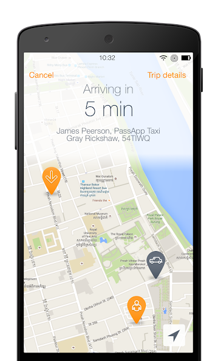
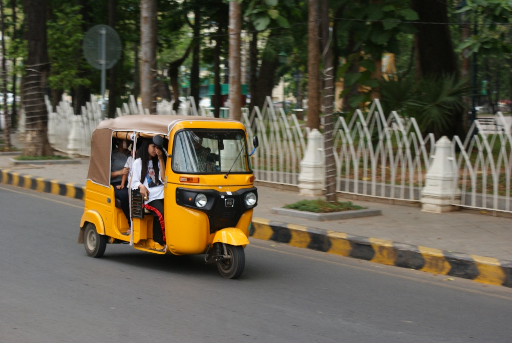

Als je net als wij niet graag afdingt, zullen onderhandelingen over de prijs van taxi- en tuktukritten waarschijnlijk het minst leuke deel van je reis door Cambodja zijn. Met <a href="https://play.google.com/store/apps/details?id=com.multibrains.taxi.passenger.passapptaxis">PassApp</a> is er gelukkig een alternatief, tenminste in Phnom Penh en Siem Reap!

De PassApp-interface, vrijwel hetzelfde als Uber of Lyft

Om zoveel mogelijk uit je tijd in Cambodja te halen, zul je waarschijnlijk meer dan eens een taxi of tuktuk moeten nemen. Normaal gezien kun je er gewoon eentje op straat tegenhouden en naar de prijs vragen, maar je zult ook chauffeurs tegenkomen die veel meer vragen dan redelijk is. Gelukkig is er een betere manier! ...tenminste in Phnom Penh en Siem Reap: <a href="https://play.google.com/store/apps/details?id=com.multibrains.taxi.passenger.passapptaxis">PassApp</a>!

Een moderne riksja: afhankelijk van het model is er plaats voor 2 tot 4 personen. Ze zijn wat kleiner, maar goedkoper dan tuktuks. Wij gebruikten ze om van de ene bezienswaardigheid naar de andere te rijden. Er is niet veel plaats voor rugzakken; als je die bij je hebt, kun je beter een tuktuk of taxi bestellen.

<a href="https://play.google.com/store/apps/details?id=com.multibrains.taxi.passenger.passapptaxis">PassApp</a> is eigenlijk de lokale versie van Uber of Lyft en werkt op precies dezelfde manier. Je geeft aan waar je opgehaald wilt worden en waar je naartoe gaat, je ziet de prijs en de app zoekt een chauffeur. Zodra een chauffeur de rit aanneemt, kun je zien waar die zich bevindt en wanneer hij of zij aankomt. Je betaalt contant of door een kredietkaart aan je PassApp-account te koppelen. Met de app is de prijs meteen duidelijk en die lag in onze ervaring veel lager dan de beste prijzen die we konden bedingen bij een willekeurige chauffeur op straat.

In beide steden zijn er heel wat PassApp-chauffeurs en hoefden we nooit lang te wachten op iemand die ons kon meenemen.

Het nadeel is dat de app, net als Uber en Lyft, een actieve internetverbinding nodig heeft om een rit te bestellen. De meeste restaurants bieden hun klanten gratis wifi aan, maar op andere locaties kan het moeilijker zijn om de app te gebruiken. Hoewel we altijd een oplossing vonden, kan een toeristensimkaart met wat mobiele data hier handig zijn en zichzelf terugverdienen.

Nog een tip: maak een schermafbeelding van de prijs die de app voorstelt als je aan het einde van de rit contant betaalt. De app heeft nogal wat problemen en is ooit aan de kant van de chauffeur gecrasht. Op dat moment kon geen van ons de afgesproken prijs nog terugvinden.

**Update november 2019:** PassApp is nu in nog enkele steden beschikbaar! Onder meer in Sihanoukville en Kampot.
