We hadden geen idee wat we van de Cambodjaanse keuken mochten verwachten. Zou ze echt verschillen van de Thaise of Laotiaanse keuken? Voor 
deze reis noemden we zowat alle gerechten uit dit werelddeel gewoon Aziatisch eten :p Nadat we enkele landen hadden bezocht, 
beseften we hoe enorm ze van elkaar verschillen, elk met hun eigen plaatselijke cultuur en keuken. Terwijl Thaise en 
Vietnamese restaurants heel gewoon zijn in Europa, bleef de Khmerkeuken een mysterie... we hadden nog nooit een restaurant gezien 
met Cambodjaanse gerechten op de kaart. Hoe komt dat? Ik vermoed dat er niet zo veel Cambodjanen in het buitenland wonen 
(de grootste groep woont in Frankrijk) die er de cultuur en keuken van hun thuisland kunnen uitdragen. Een ander 
probleem zijn de bijzonder hoge aanvraagkosten voor een Cambodjaans paspoort (100$ voor een paspoort dat 10 jaar geldig is, terwijl dat in Vietnam 
maar 15$ kost). Daardoor hebben maar weinig mensen er een en reizen maar weinig mensen naar het buitenland. Onze tuktukchauffeur vertelde ons dat iemand 
die in een hotel werkt, afhankelijk van de functie tussen 70 en 120$ per maand verdient. Ik kan me voorstellen hoe ontzettend moeilijk het is om 
een volledig maandloon alleen al aan een paspoort uit te geven, laat staan dat je ook nog vliegtickets, een visum, een hotel, ... 
kunt betalen zodra je in het buitenland bent.

We werden allebei HALSOVERKOP VERLIEFD op de Cambodjaanse keuken en op culinair vlak is Cambodja voor ons het beste land van Azië :D In dit 
artikel probeer ik jullie kennis te laten maken met enkele typische gerechten. Eerst iets over de belangrijkste maaltijd van de 
dag: het ontbijt. In Cambodja zijn baguettes erg populair omdat het land vroeger een Franse kolonie was. Ze vormden de basis van 
ons ontbijt, samen met een omelet of confituur en een kop sterke koffie, gezoet met gecondenseerde melk, of een 
fruitshake (mango, ananas, papaja: allemaal even lekker) :) Als hoofdmaaltijd kregen we meestal rijst met vlees en een ruime 
keuze aan roergebakken groenten of curry's. Een ander belangrijk ingrediënt is 
de beroemde Kampot-peper, die vaak in pepersaus wordt verwerkt. Overal was er vis en zeevruchten te krijgen, maar over die laatste kan ik 
niets vertellen, want ik eet geen zeevruchten :p Ik heb wel een paar keer vis gegeten en die was echt heerlijk. 
Kurkuma, laos, gember, citroengras en kaffirlimoenblaadjes zijn 
onmisbare smaakmakers in de Khmerkeuken. Als dessert at ik vaak een pannenkoek met mango of banaan en zoete 
gecondenseerde melk, mmm! Meestal moesten we vrij lang op ons eten wachten, maar we moeten niet vergeten dat 
alle maaltijden vers worden klaargemaakt. Ze zijn eenvoudig, maar bijzonder lekker! Het eten is ook minder pikant dan in 
Thailand (ook de rode en groene curry).

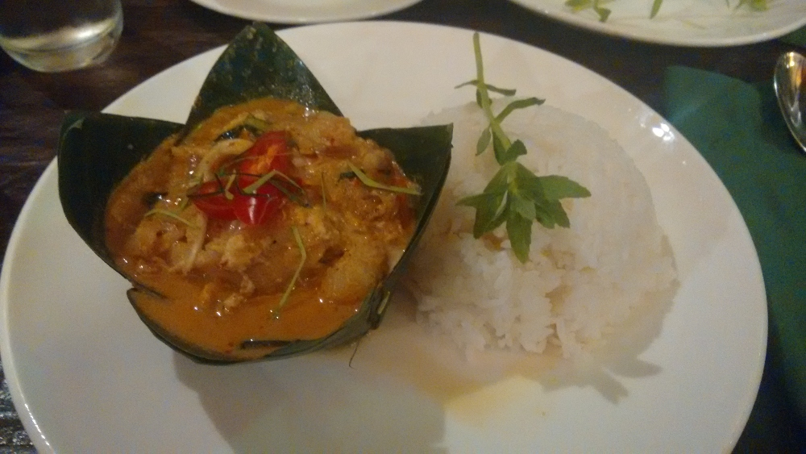

Amok is een dikke soep met stukjes vis (in de traditionele versie), kip of rundvlees, gestoomd in 
bananenbladeren

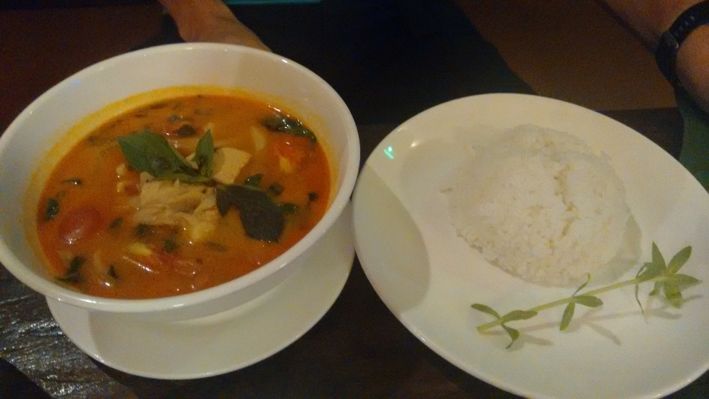

Rode Khmer-curry met gestoomde rijst

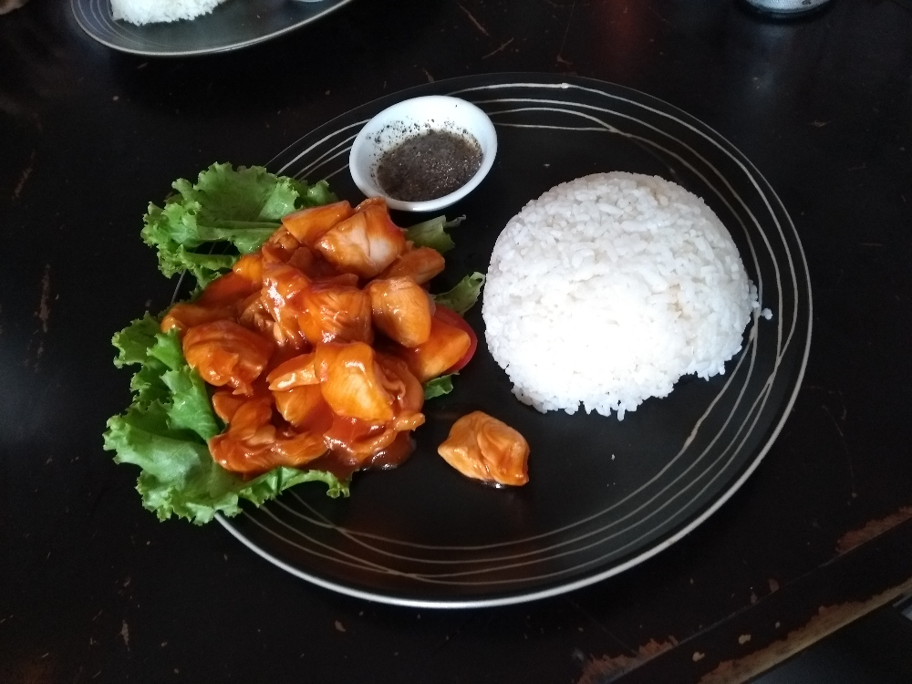

Lok lak: roergebakken reepjes rundvlees of kip met knoflook en oestersaus, geserveerd op 
sla met rijst en Kampot-pepersaus (een mengeling van limoensap en peper)

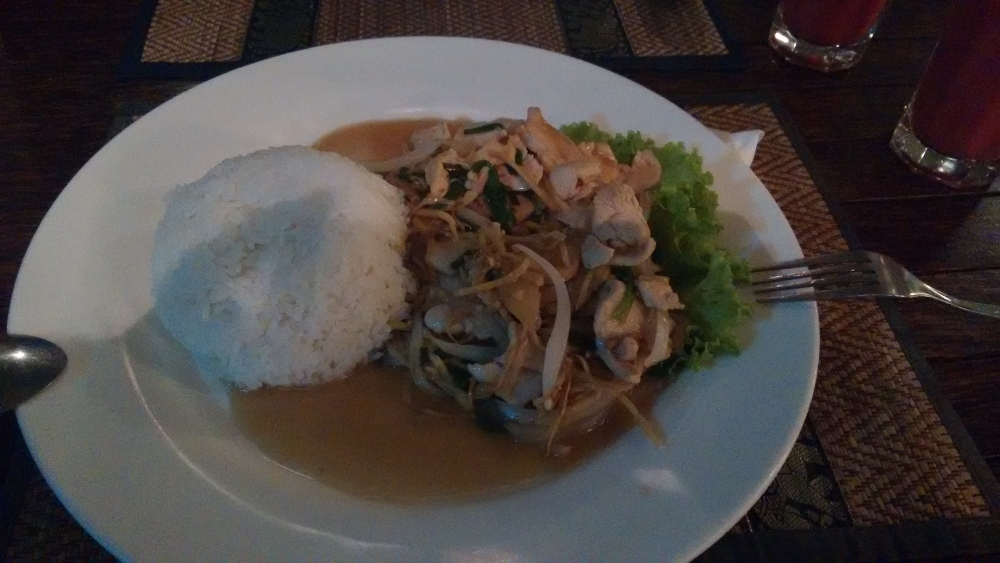

Kip met gember: roergebakken reepjes kip met fijngesneden gemarineerde gember en ui

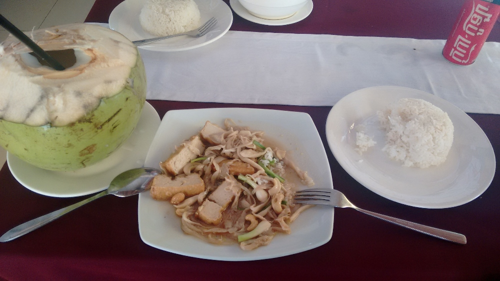

Roergebakken groenten met tofu en cashewnoten, met verfrissend kokoswater erbij

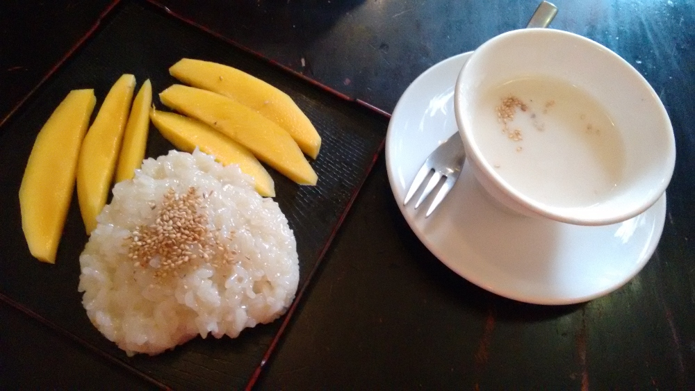

Mango sticky rice met kokossaus als onze speciale paasmaaltijd :)

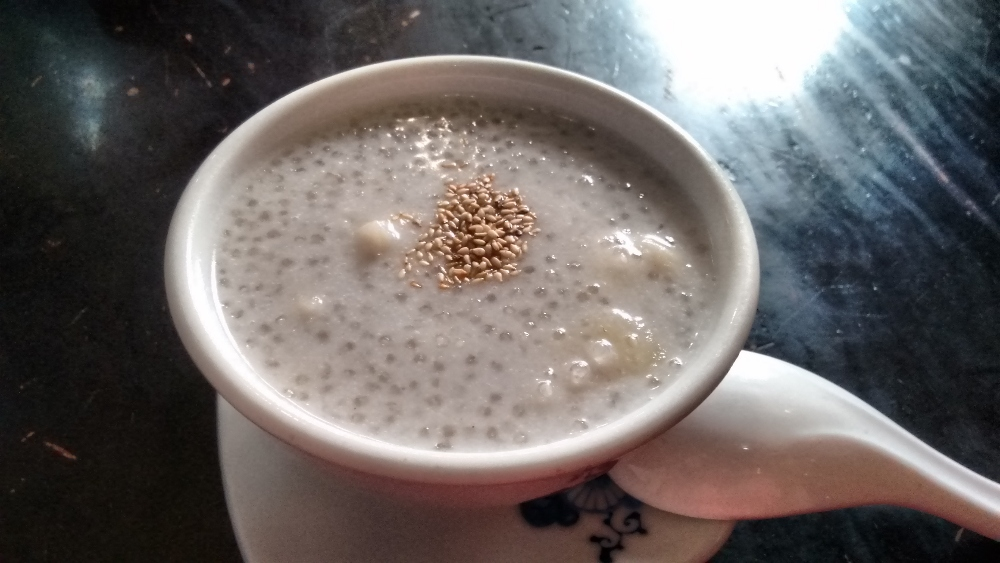

Tapiocapudding met banaan en sesam. De bananen die in Europa te koop zijn, 
zijn niet geschikt om zoiets mee te maken... daar ben ik al proefondervindelijk achtergekomen!

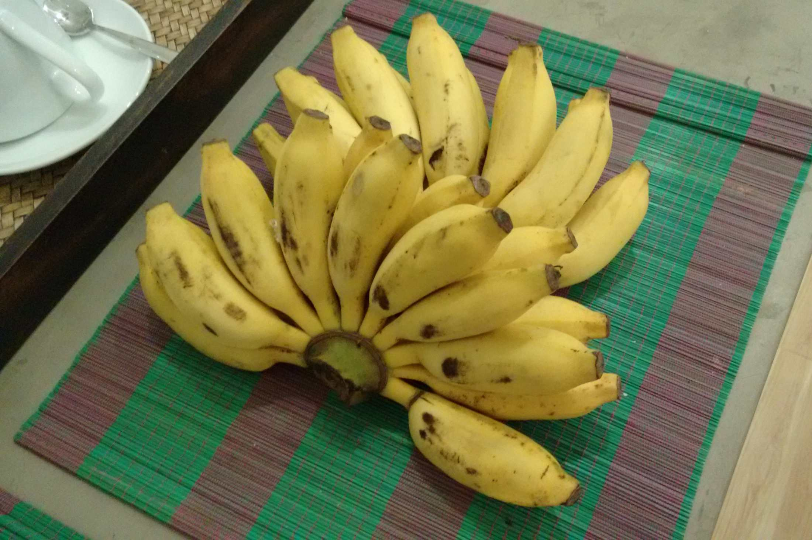

Omdat we uitsluitend met de bus reisden, is het ook het vermelden waard welke snacks je tijdens een halte kunt kopen. 
Gebakken bananenchips, gesneden fruit, allerlei soorten gebarbecued vlees, rijst in bananenbladeren, koude dranken en zoetigheden zoals 
chips en koekjes. Heel vaak kon je ook een warme maaltijd kopen: eenvoudige gerechten met rijst of noedels. Gebakken 
rijst met groenten en ei was bijvoorbeeld altijd een lekkere en veilige keuze :) Tijdens een busrit stapte een groep vrouwen op 
met kip, vis en vleesspiesjes, maar ook met balut. Andere passagiers die achter ons zaten, aten dat als 
snack. Balut is een gekookt ei met een ontwikkeld embryo van een eend (of kip), iets waarvan Europeanen en Amerikanen 
die dat niet gewend zijn waarschijnlijk zullen gruwen :O Toch geldt het voor sommigen als een delicatesse. Zozeer zelfs dat enkele 
dagen geleden<a href="https://www.straitstimes.com/singapore/courts-crime/63-year-old-woman-fined-7000-for-attempting-to-smuggle-490-balut-duck-eggs"> een 63-jarige vrouw 490 baluteieren door de douane van de luchthaven van Singapore probeerde te krijgen</a>. 
Natuurlijk werd ze betrapt en moest ze een boete van 7000S$ betalen.

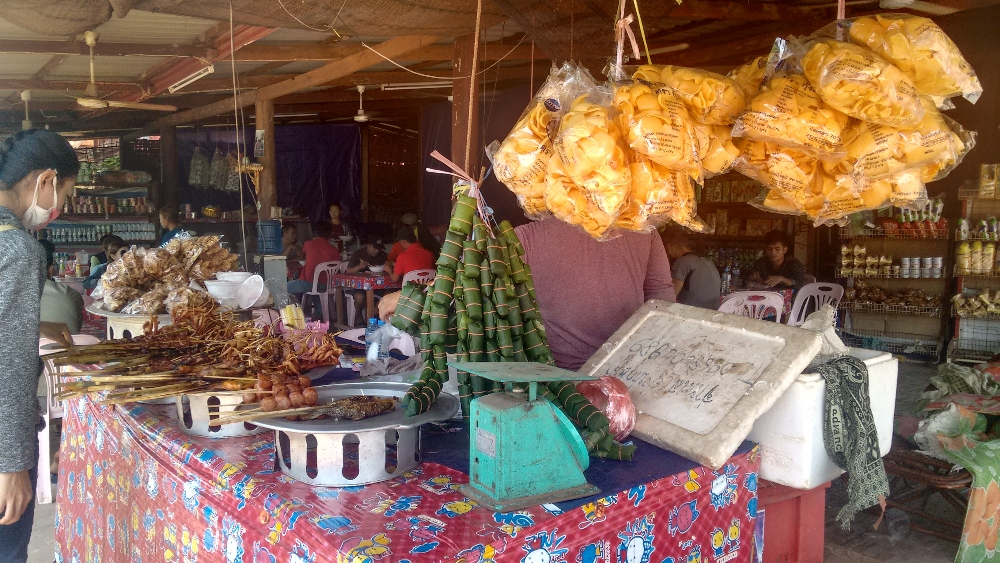
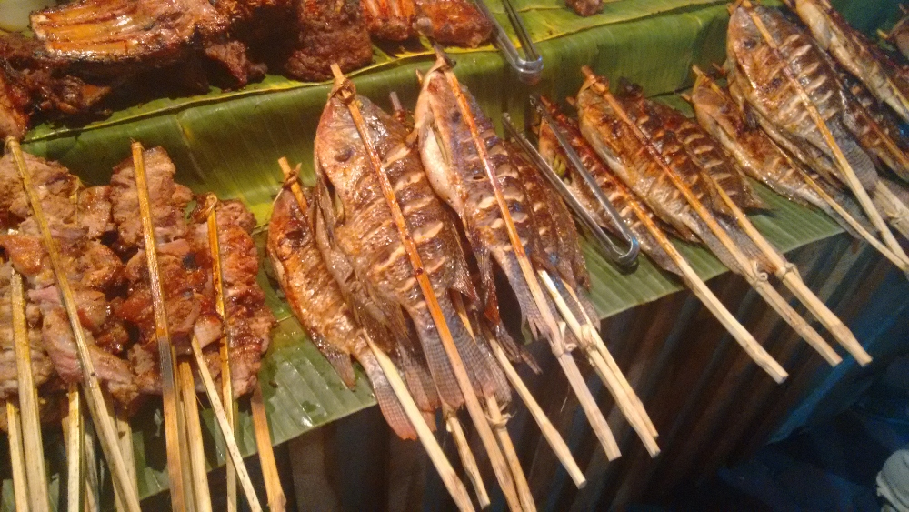

Barbecuegerechten die je op elke markt vindt (vis, zeevruchten en vlees) of zelfs tijdens een 
rit met een lokale bus kunt kopen

Ik kan alle soorten heerlijke fruitshakes absoluut aanraden! Ik weet dat vers fruit in een shake niet helemaal zonder risico is, 
maar ik kon de smaak en de ongelooflijke aanblik van al dat fruit in de straatkraampjes niet weerstaan! :) 
Het is altijd een goed idee om even rond te wandelen en bij elk kraampje te kijken hoe ze de shakes maken: of ze handschoenen dragen om 
het fruit te snijden, flessenwater gebruiken... dan zit het normaal wel goed. Ananas, mango en papaja smaken er allemaal anders dan 
in Europa. Kijk naar de tweede rij van boven (op de foto rechts): reusachtige mango's! Ze wegen stuk voor stuk minstens 
0,5 kg :O Ik raakte er behoorlijk aan verslaafd en at er bijna elke dag eentje :)

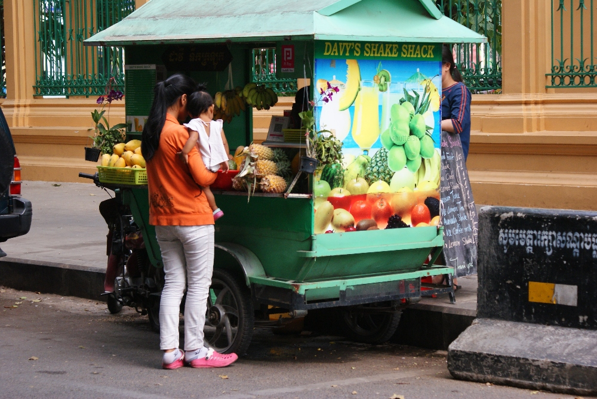

  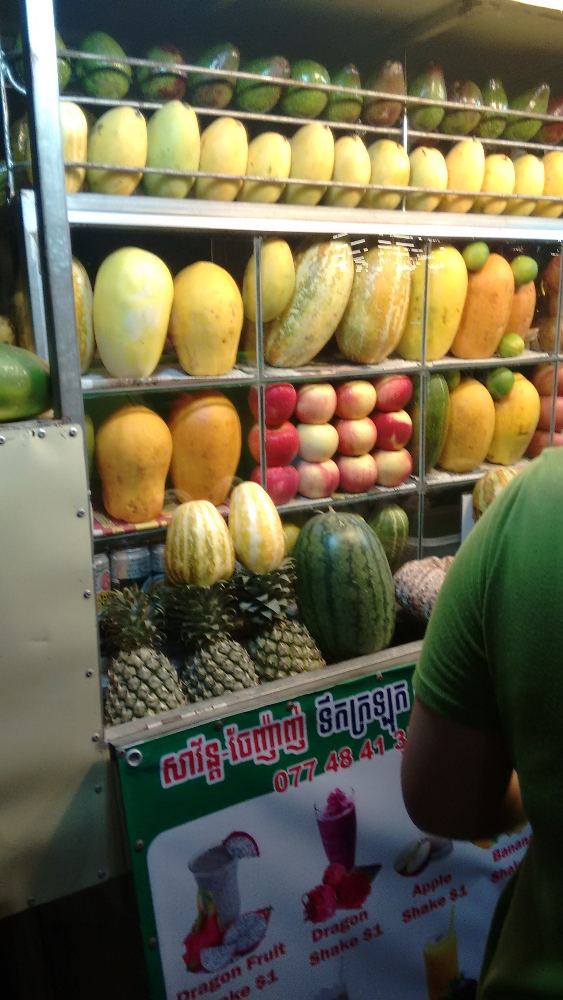
  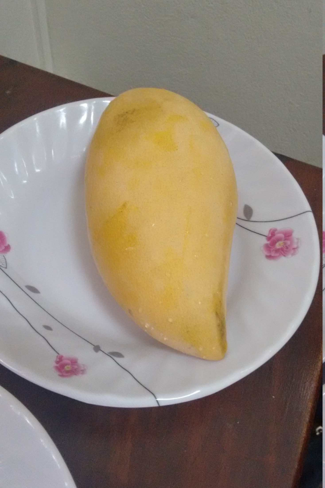

## Aanbevolen restaurants in Cambodja:
  * <a href="https://www.tripadvisor.com/Restaurant_Review-g293940-d2372913-Reviews-Kabbas_Restaurant-Phnom_Penh.html">Kabbas</a> , <a href="https://www.tripadvisor.com/Restaurant_Review-g293940-d10226831-Reviews-350_BBQ_Cafe-Phnom_Penh.html">350 BBQ Cafe</a> of <a href="https://www.tripadvisor.com/Restaurant_Review-g293940-d3454214-Reviews-David_s_Restaurant_Handmade_Noodles-Phnom_Penh.html">David's Restaurant </a>in Phnom Penh
  * <a href="https://www.tripadvisor.com/Restaurant_Review-g293940-d8568725-Reviews-Davy_s_Shake_Shack-Phnom_Penh.html">Davy's shake shack</a> in Phnom Penh
  * <a href="https://www.tripadvisor.com/Restaurant_Review-g297390-d10069292-Reviews-Try_Me-Siem_Reap_Siem_Reap_Province.html">Try me, </a><a href="https://www.tripadvisor.com/Restaurant_Review-g297390-d11880648-Reviews-The_Christa_Restaurant_Bar-Siem_Reap_Siem_Reap_Province.html">The Christa restaurant, </a><a href="https://www.tripadvisor.com/Restaurant_Review-g297390-d10128349-Reviews-Atmosphere_Siem_Reap-Siem_Reap_Siem_Reap_Province.html">Atmosphere</a> in Siem Reap
  * Shakes - 1-2$
  * Baguette met omelet - 1,5$
  * Hoofdgerecht - 3-5$
  * Dessert - 1-3$
  * Frisdrank - tot 1$
