---

Eerst iets over hoe we hier geraakt zijn. Kort samengevat: na een korte boottocht van Don Det naar Nakasong 
namen we een bus naar Pakse, waar we normaal gezien een lunchpauze zouden houden. In plaats daarvan stopte de bus 
langs de kant van de weg en moesten we overstappen op een andere bus. Zo belandden we met zijn zessen in een lokale bus 
waarin niemand Engels sprak. De volgende 7 uur zaten we zonder enige pauze vast in de bus. Tijdens de 
rit stapte er een paar keer een groep vrouwen op die kip-, vis- en vleesspiesjes als snack verkochten. 
We kwamen laat op de avond aan in Thathek en besloten meteen iets te eten te halen, want we hadden 
echt honger nadat we de hele dag bijna niets hadden gegeten (we durfden niets in de bus te kopen). 
Rond het busstation lagen veel hostels, maar het was al donker, dus wilden we gewoon iets 
vlakbij vinden en gaan slapen. Gelukkig vonden we, nadat we enkele opties hadden bekeken, een guesthouse met een propere kamer tegen een 
goede prijs :) 's Ochtends namen we om 9.15 uur een vipbus die echt comfortabel was! Deze keer hadden we een paar 
pauzes om naar het toilet te gaan en eten te kopen. Na 6,5 uur kwamen we aan bij het zuidelijke busstation van Vientiane, 
12 km van het stadscentrum. We moesten opnieuw een tuktuk nemen. De chauffeurs in het busstation vroegen 
60 000 kip voor de rit, maar door te onderhandelen met de chauffeurs die net buiten het busstation stonden, kregen we de prijs omlaag tot 30 000 kip. 
We besloten de volgende 3 dagen in Vientiane te blijven om het Laotiaanse Nieuwjaar te vieren in de hoofdstad 
van het land :)

Vientiane heeft een grote verscheidenheid aan boeddhistische tempels en we brachten de eerste dag al wandelend door in het centrum, 
op zoek naar onze favoriet. Voor de meeste hoef je geen toegang te betalen, met uitzondering van Phra Keo 
en Wat Sisaket. Het interieur van de eerste tempel is nu een klein museum met Laotiaanse religieuze kunst.

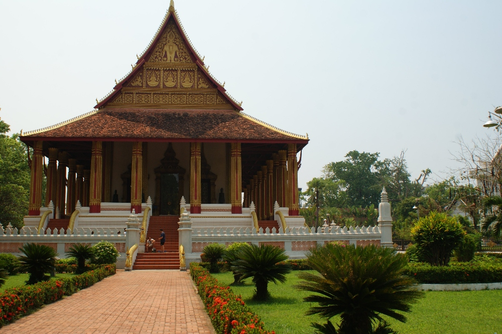
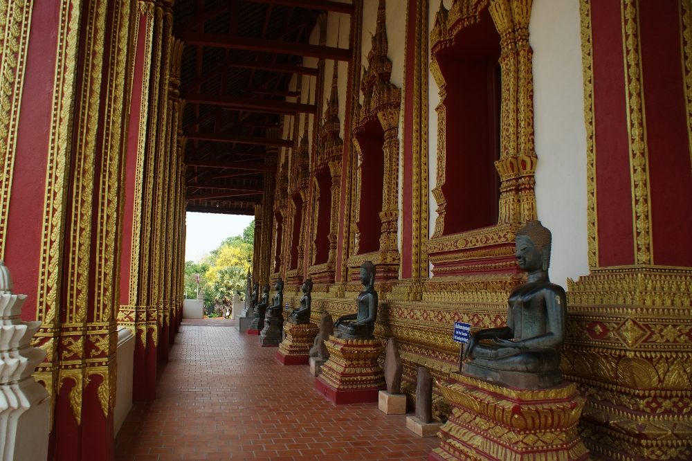

Phra Keo

De tweede was daarentegen vrij uniek, met muren vol piepkleine Boeddhabeeldjes (duizenden 
stuks!). Langs de muur rond de hoofdtempel stond ook een lange rij grote, zittende Boeddhabeelden.

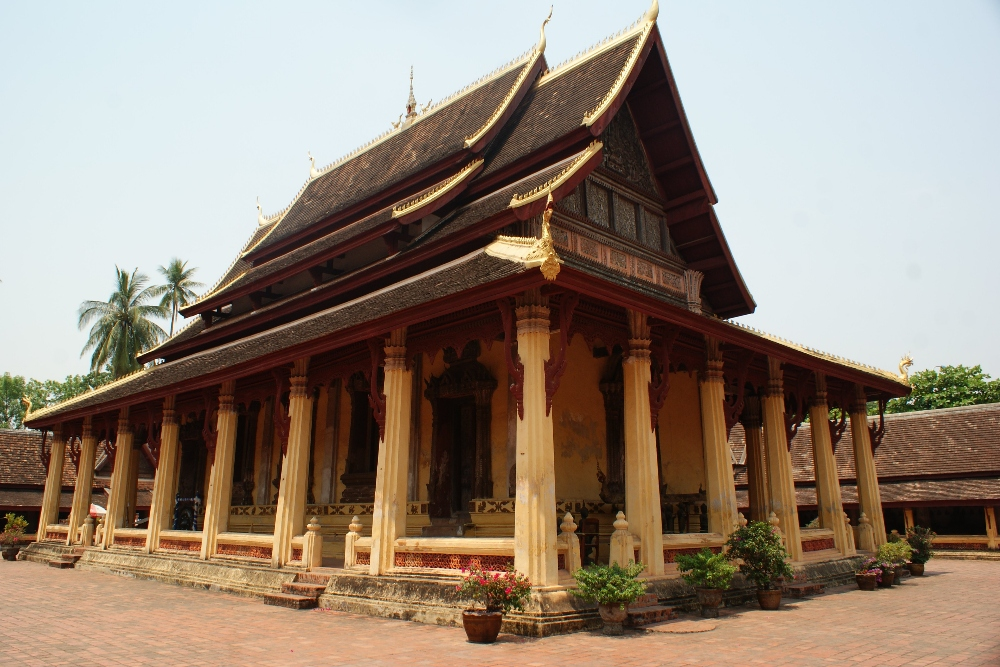

Wat Sisaket

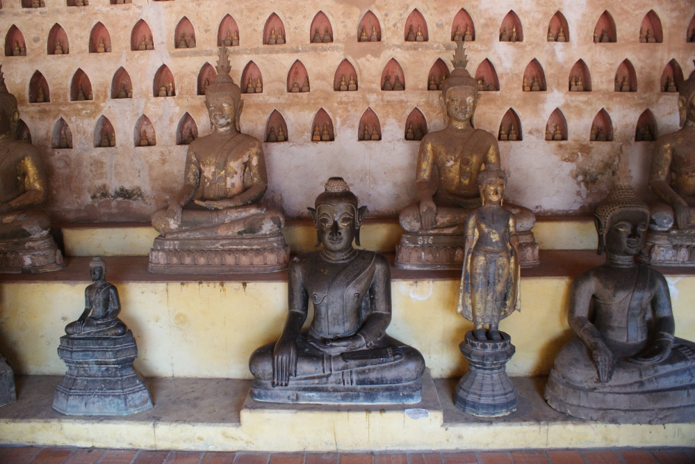

Boeddhagalerij

We merkten dat bijna alle tempels versierd waren met slangachtige wezens die naga's heten. Men gelooft 
dat ze de stad beschermen en in de Mekong wonen. Alle tempels waren heel schoon en versierd met kleurrijke linten en 
vlaggen voor de komende [nieuwjaarsvieringen]().

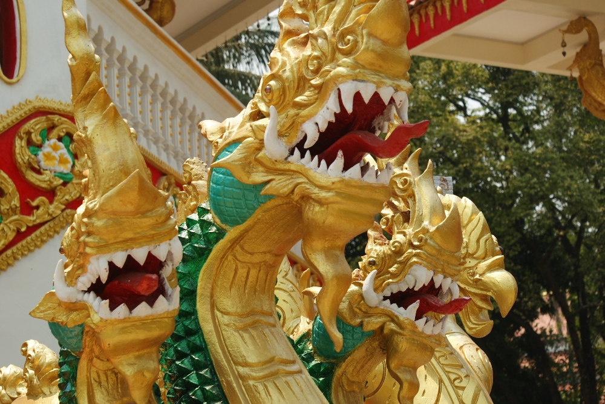

Een naga bewaakt de ingang van de tempel

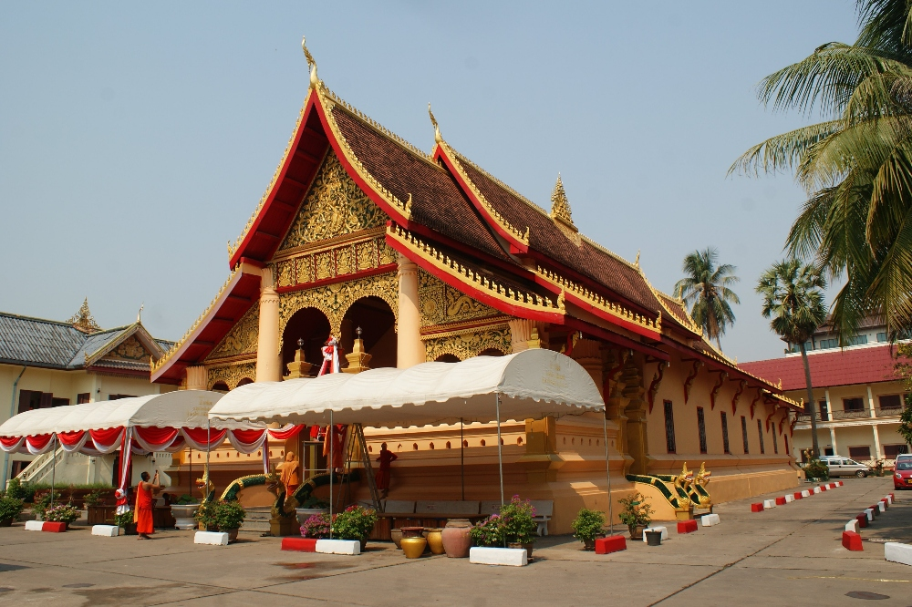
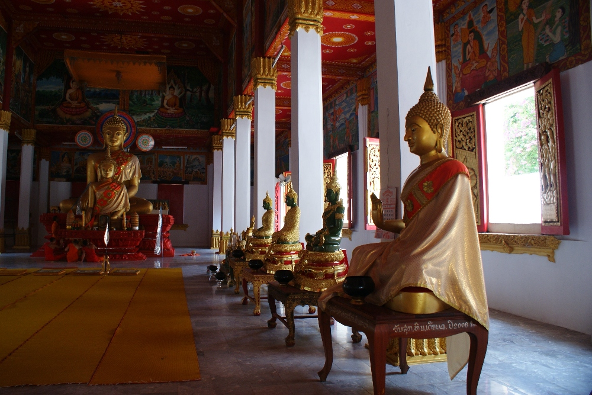

Binnen in een van de tempels. Je mag meestal binnenkomen en rondkijken, al moet je wel je schoenen 
uitdoen.

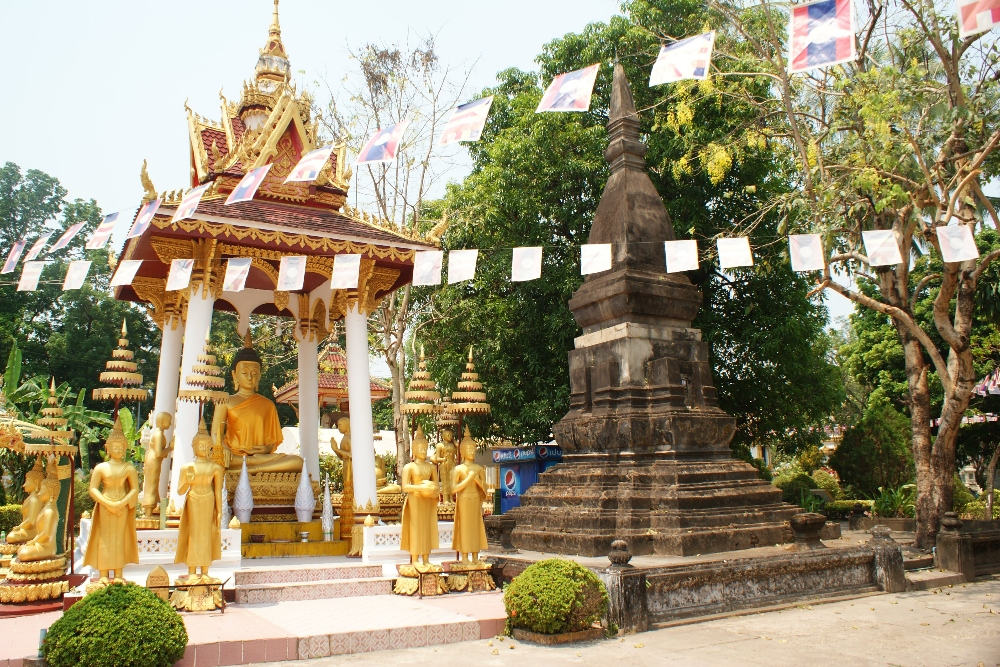

Nog meer gouden Boeddhabeelden naast de tempel

Na een late lunch en een pauze om wat af te koelen trokken we naar het <a href="http://copelaos.org/">COPE-centrum</a>. Net als 
Cambodja kent Laos een donkere periode in zijn geschiedenis die het leven van de bevolking nog altijd beïnvloedt. Tijdens 
de negen jaar durende Vietnamoorlog (1964 - 73) werden over het hele land meer dan 270 miljoen clusterbommen afgeworpen (meer dan
alle bommen die tijdens de Tweede Wereldoorlog samen werden afgeworpen). Tot 30% daarvan ontplofte niet en veel dorpen worden nog altijd bedreigd 
door niet-ontplofte bommen. Ondanks de 
inspanningen voor het&nbsp;ruimen van bommen sterven er elk jaar veel mensen (ongeveer 100) en bijna de helft van de slachtoffers zijn kinderen. 
De bommen ontploffen meestal&nbsp;wanneer mensen op het land werken of op open vuur koken, of wanneer kinderen die zich niet bewust zijn van het gevaar 
met kleine bommetjes spelen (die ongeveer zo groot zijn als een tennisbal) :( COPE biedt revalidatie en voorziet 
slachtoffers van kunstledematen, loophulpmiddelen en rolstoelen. Belangrijker nog: het geeft hen hoop op een normaal 
leven.

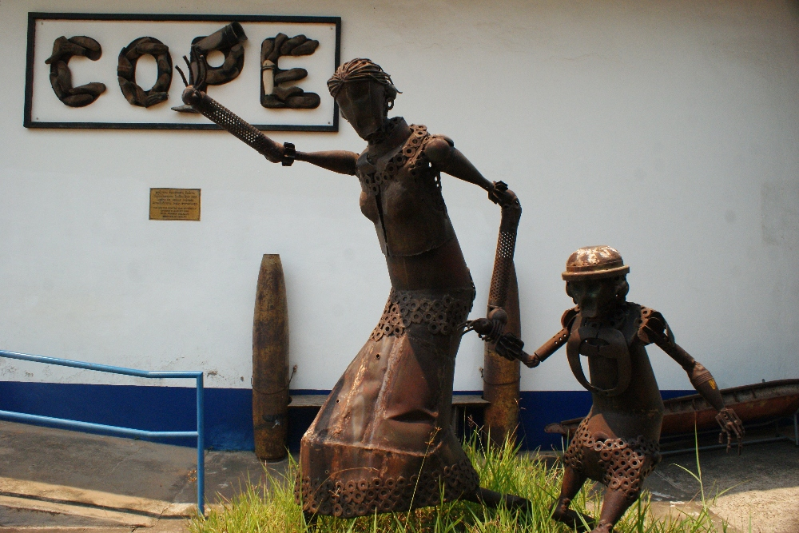

Een sculptuur gemaakt van omhulsels van clusterbommen voor het informatiecentrum van COPE

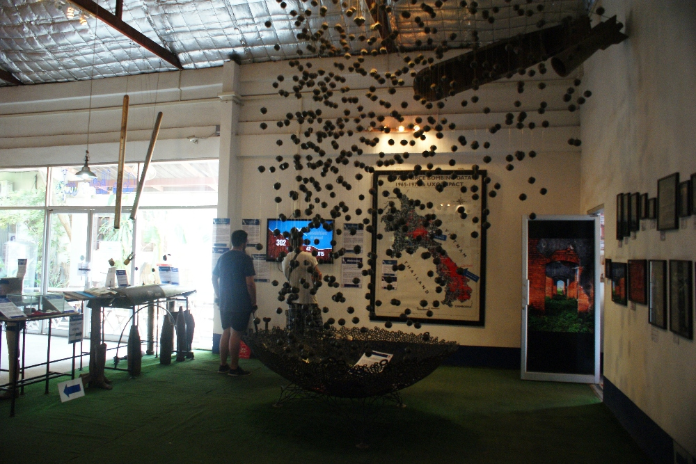

Elke clusterbom bevat ongeveer 600 tot 700 kleine bommetjes...

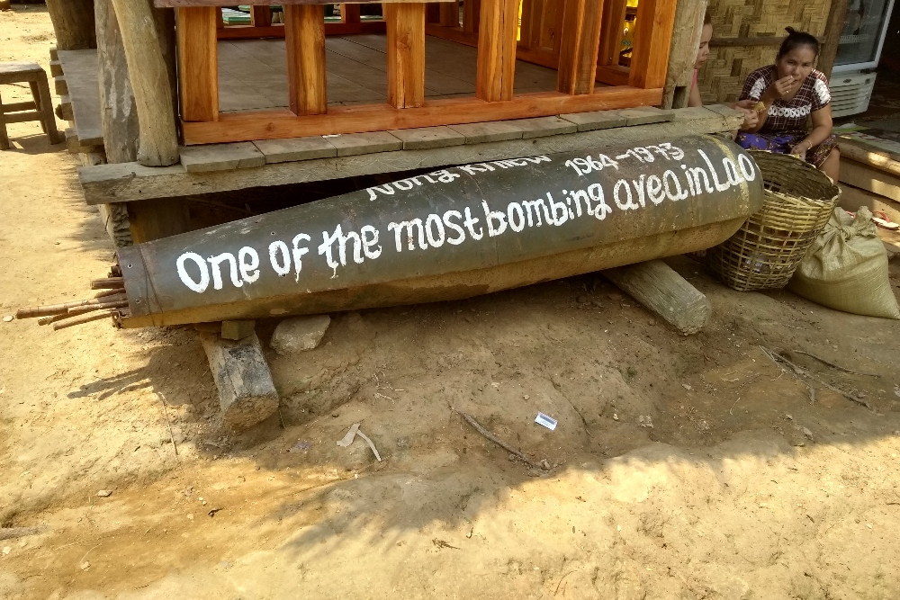

De regio Nong Khiaw in het noorden van Laos loopt nog altijd groot gevaar

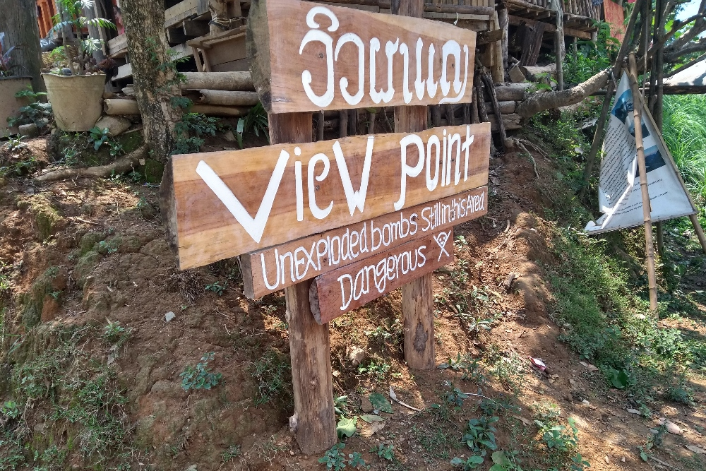

Het wordt afgeraden om van het pad af te wijken

Daarna verkenden we de omgeving van de promenade langs de Mekong. We zagen een heel mooie plek voor een avondmarkt (blijkbaar 
geopend in 2018) met nieuwe, houten kraampjes. De helft ervan was echter leeg en de meeste verkopers verkochten hun waren nog altijd 
op straat. De avondmarkt strekte zich uit van het uitkijkpunt voor de zonsondergang tot het standbeeld van Chao Anouvong. Dit deel van de 
stad was 's avonds heel druk.

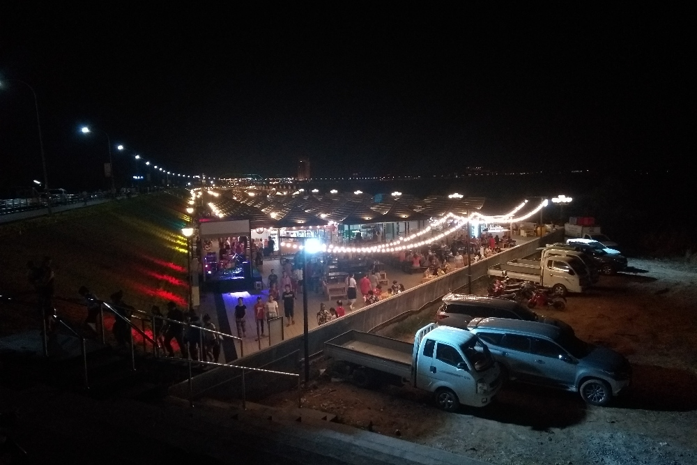

De avondmarkt licht op in de verte...

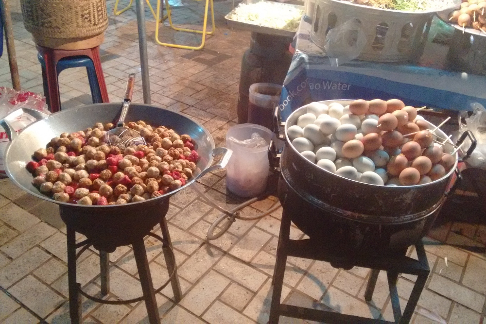

Omdat het eten op de markt geen Engelse beschrijvingen had, speelden we op veilig en gingen we 
naar een lokaal restaurant.

## Praktische informatie:

  * Busticket naar Thakhet (vanuit Don Det) - 110 000 kip / per persoon
  * Busticket naar Vientiane (vanuit Thakhet) - 80 000&nbsp;kip / per persoon
  * Tuktuk van het zuidelijke busstation naar het centrum van Vientiane - 30 000 kip
  * Toegang tot Wat Sisaket, Phrat Keo - 10 000 kip per persoon
