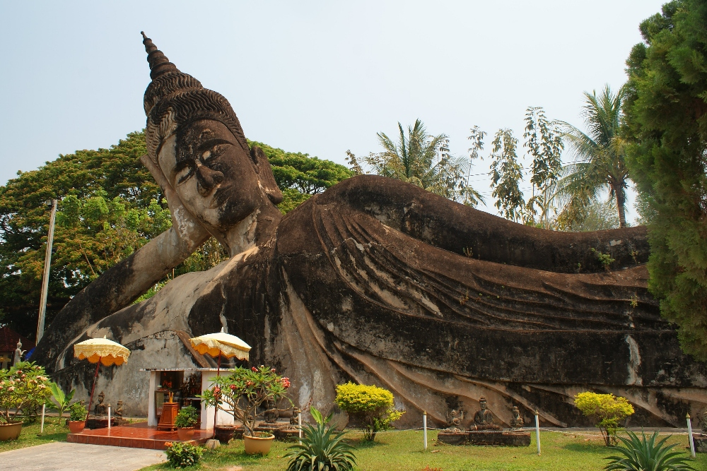
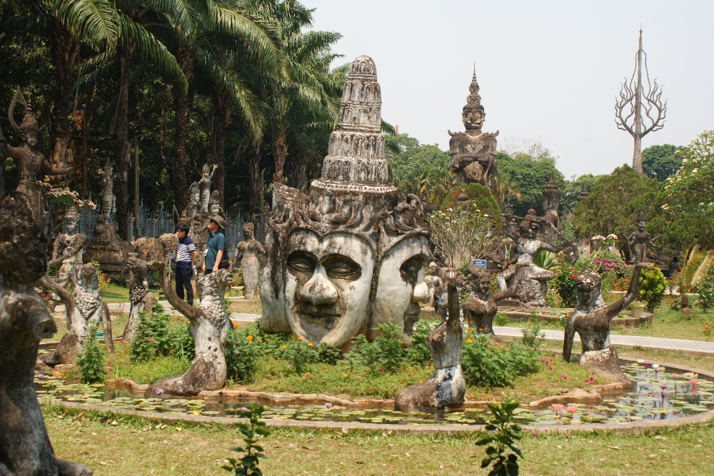
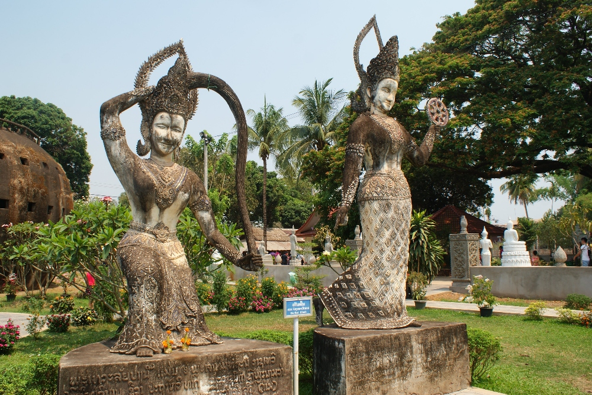
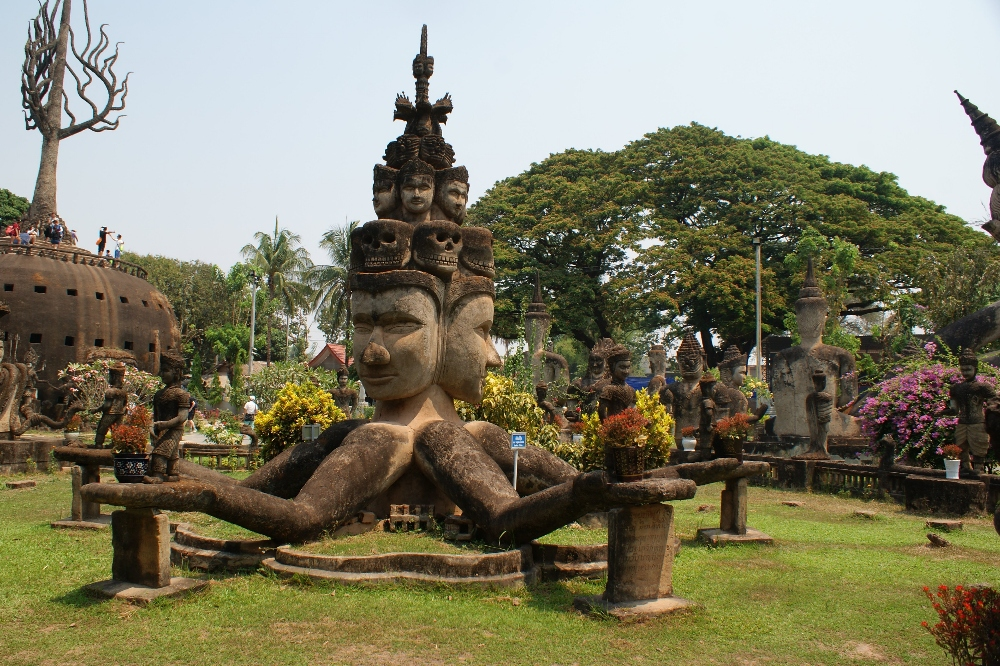
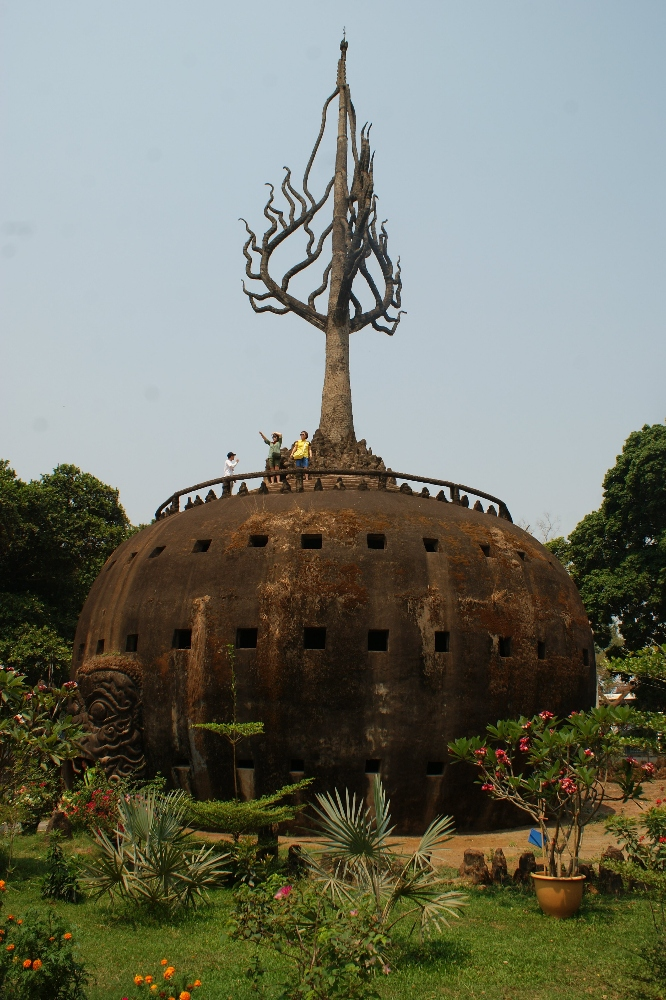
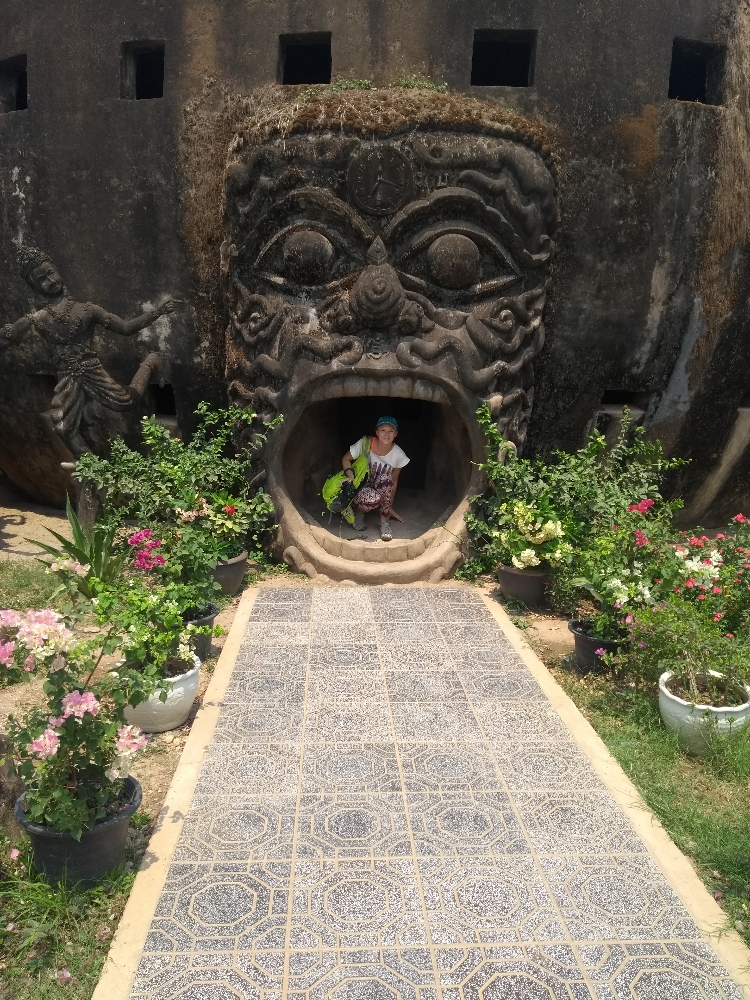
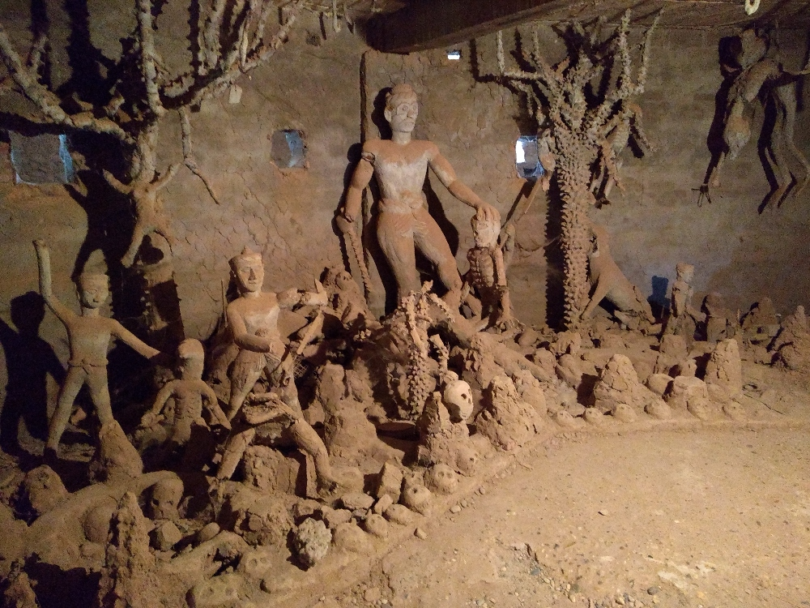
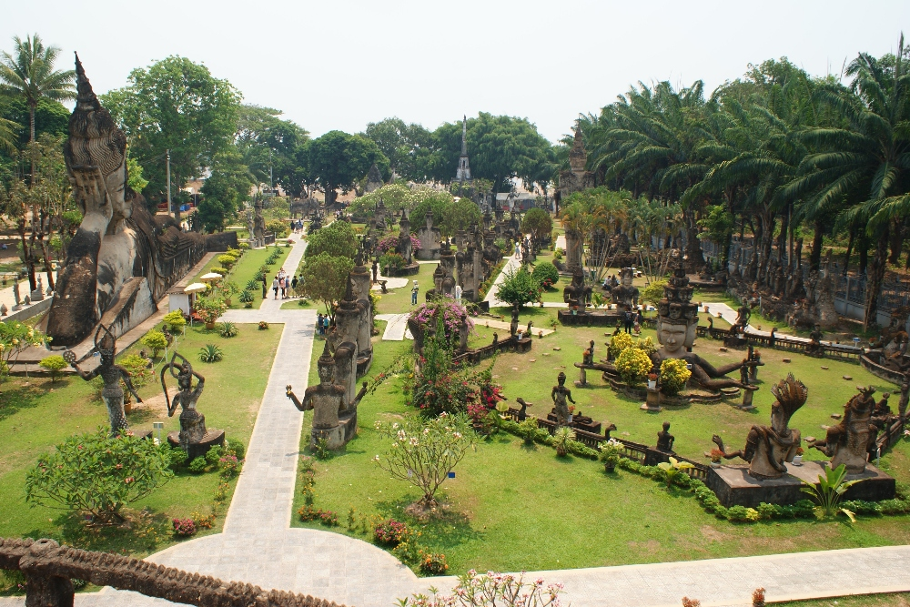
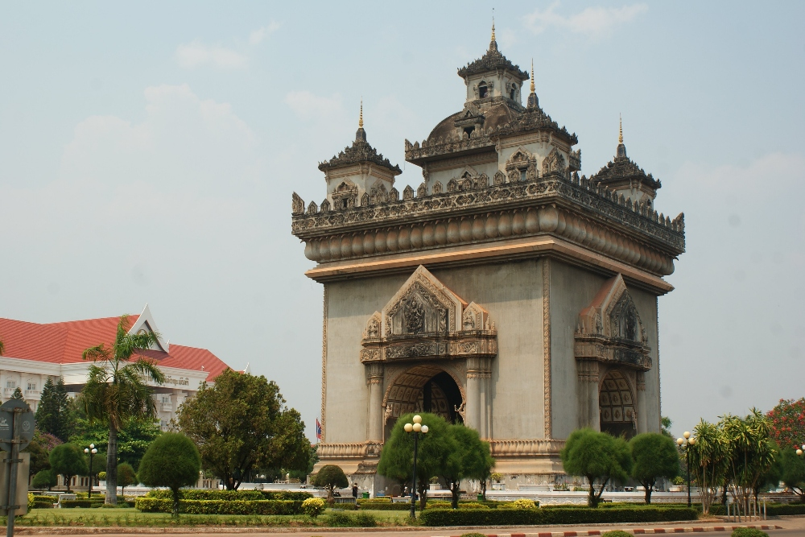
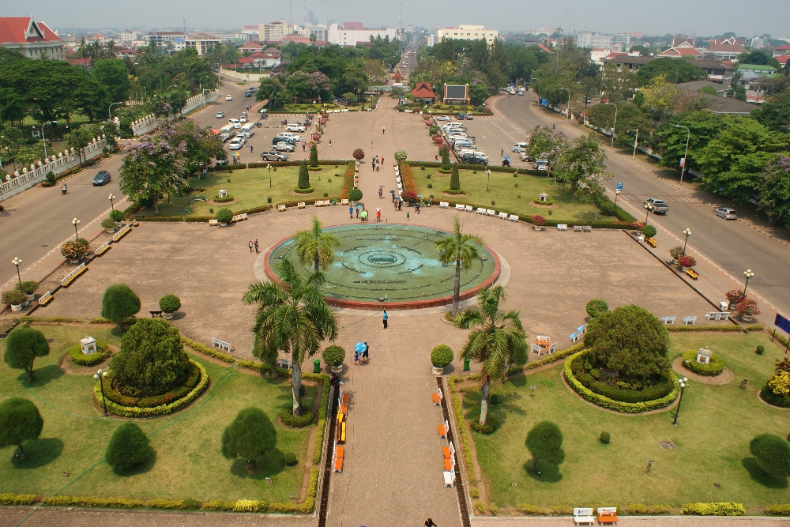

Buddha Park, op 26 km van het stadscentrum, was die dag onze voornaamste bestemming. We besloten het 
openbaar vervoer te nemen en dat bleek een eenvoudige en goedkope oplossing. Eerst moet je naar het 
centrale busstation, dat in twee delen is opgesplitst: CBS1 en CBS2. Je vindt er gemakkelijk 
informatieborden met busroutes en prijzen, ook in het Engels. We moesten bus nummer 14 nemen vanaf het 
CBS2-gedeelte van het busstation en na ongeveer 40 minuten bereikten we Buddha Park. Alle toeristen in de 
bus waren ernaartoe op weg, en de vrouwen die de kaartjes verkochten riepen de naam van de halte luidkeels 
af en zorgden ervoor dat alle toeristen uitstapten :D De bus rijdt ook langs het immigratiekantoor bij de 
Vriendschapsbrug aan de grens met Thailand. Ons bezoek aan Buddha Park duurde ongeveer 1,5 uur. Voor de 
terugrit namen we de bus aan de overkant van de straat, tegenover de plek waar we waren uitgestapt.

Buddha Park is een beeldenpark met meer dan 200 religieuze beelden van beton. Een enorm koepelvormig 
beeld bestaat uit drie niveaus: het onderste beeldt de hel uit, het middelste de aarde en het bovenste de 
hemel, met een mooi uitzicht over het hele park. De enorme muil van een demon vormt de ingang van deze 
griezelige plek. Binnen is het erg smal en waarschijnlijk altijd heel druk. Ik vond het een bizarre plek, 
zeker nadat ik de hel had bezocht :) Het park werd aangelegd door een monnik die zowel het boeddhisme als 
het hindoeïsme had bestudeerd. Daarom staat deze plek vol boeddhabeelden, hindoegoden, demonen en dieren die 
in beide geloofstradities voorkomen. Je kunt er gemakkelijk een snack kopen of ontspannen in een café vlak 
bij de Mekong.

De enorme liggende Boeddha (40 meter lang) is een van de grootste trekpleisters van het park

  
  

De weg naar het uitkijkterras liep door een donkere hel :O

Panoramisch uitzicht over Buddha Park

Na een lekkere lunch in het stadscentrum wandelden we naar Patuxai, een oorlogsmonument en overwinningspoort
omringd door een mooi groen park met een fontein. Je kunt naar de top van het monument wandelen en daar 
het uitzicht over de stad bewonderen. Dat is precies wat wij deden :) Onderweg naar boven kun je souvenirs 
en kleding kopen bij lokale verkopers. De binnenkant van het monument wordt niet goed onderhouden: veel 
vogelnesten hebben de plafondschilderingen vernield.
 

## Praktische informatie:
  * Busticket naar Buddha Park - 6 000 Kip per persoon, enkele reis
  * Toegangsticket voor Buddha Park - 15 000 Kip per persoon
  * Toegang tot Patuxai - 3 000 Kip per persoon
