Pi Mai Lao, de viering van het Laotiaanse Nieuwjaar tijdens de heetste periode van het jaar, was een 
onverwacht feest waaraan we maar al te graag deelnamen :D Officieel duurt het drie dagen, maar in sommige steden, 
zoals Vientiane en Luang Prabang, kan het meer dan een week aanhouden. Tijdens de nieuwjaarsvieringen is de toegang 
tot alle tempels gratis.

Die dag besloten we Pha That Luang te bezoeken, een grote, met goud bedekte stoepa, een nationaal monument en het 
symbool van Vientiane. Ook dit deel van de stad bereikten we met het openbaar vervoer (bus nummer 
10 vanaf het kruispunt bij het centrale busstation; aan de hand van de kaart met informatie in het centrale 
busstation vonden we de juiste halte).

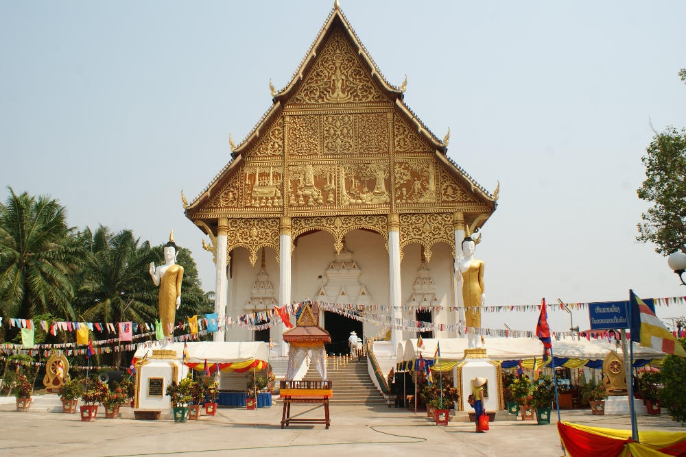

Boeddhistische tempel bij de stoepa

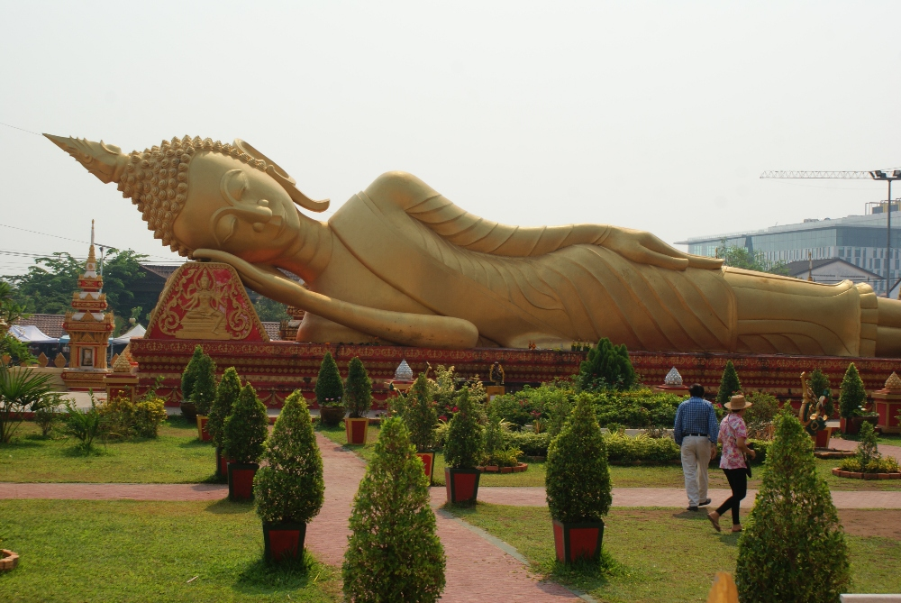

Enorm beeld van de liggende Boeddha

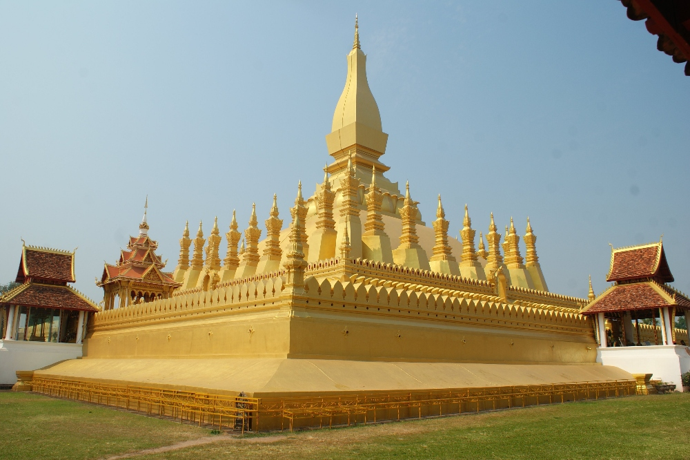

Grote, met goud bedekte stoepa, het symbool van Vientiane

Voor elke tempel worden Boeddhabeelden op goed bereikbare plaatsen gezet, zodat gelovigen er 
geparfumeerd water met bloemblaadjes over kunnen gieten. Daarmee spoelen ze symbolisch de zonden van het voorbije jaar weg, want 
de eerste feestdag is de laatste dag van het oude jaar. Iedereen wil zonder zonden aan het nieuwe jaar 
beginnen. Daarna vangen ze het water op dat over de Boeddha is gestroomd en nemen ze het mee naar huis om het als 
zegening over andere familieleden te gieten.

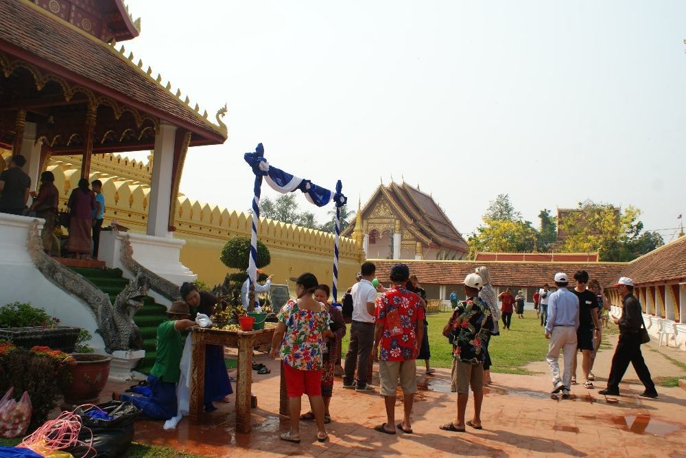

Voor de hoofdingang staat voor de gelovigen een tafel met tal van kleine Boeddhabeelden klaar

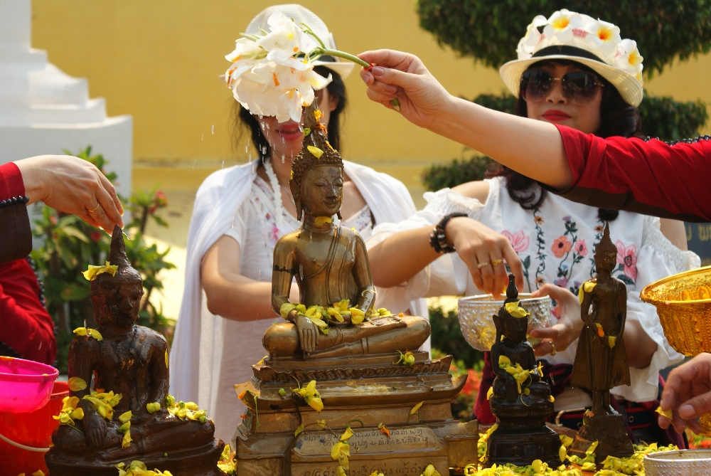

Iedereen was heel bijzonder gekleed: de mannen droegen hemden met bloemenmotief en de vrouwen prachtige lange jurken

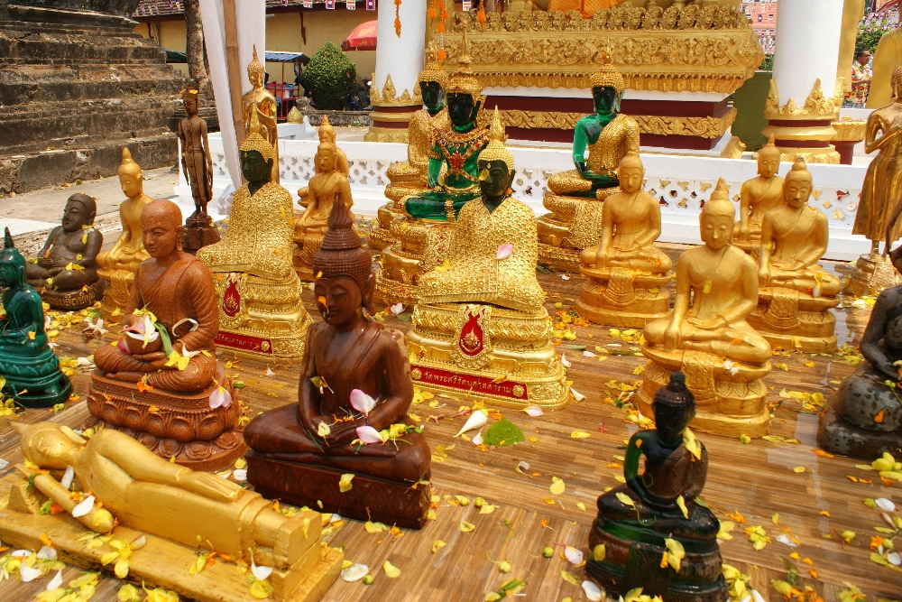

Zoals je kunt zien, dragen de jade Boeddhabeelden verschillende gewaden voor de verschillende seizoenen van het jaar (die het beeld telkens tot een andere hoogte bedekken)

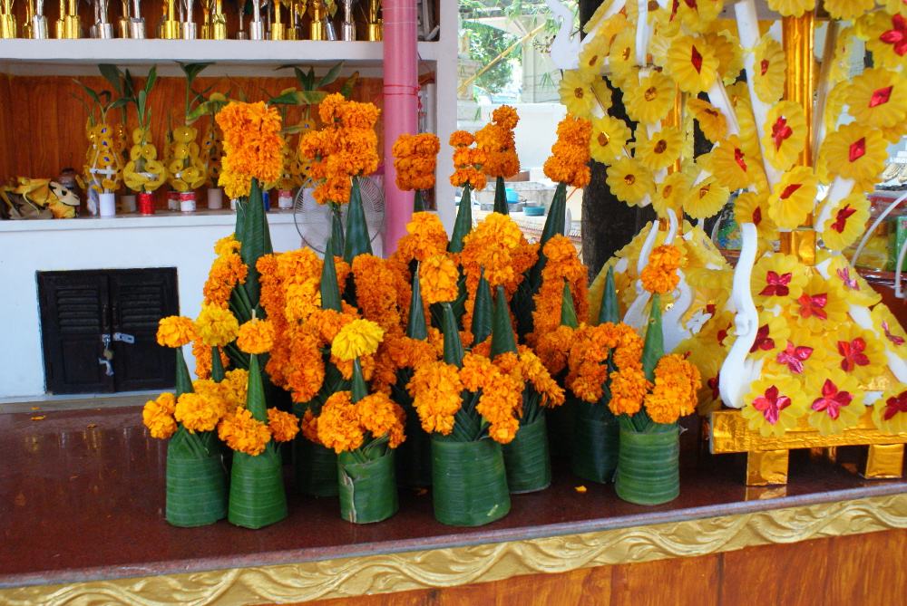

In elke straat kon je offergaven voor deze bijzondere dagen kopen, samengesteld uit bananenbladeren en bloemen

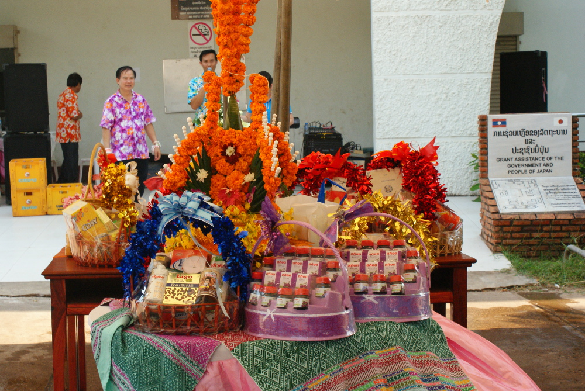

Volgens de traditie kopen mensen geschenkmanden met eten of cosmetica voor de oudere leden van hun familie

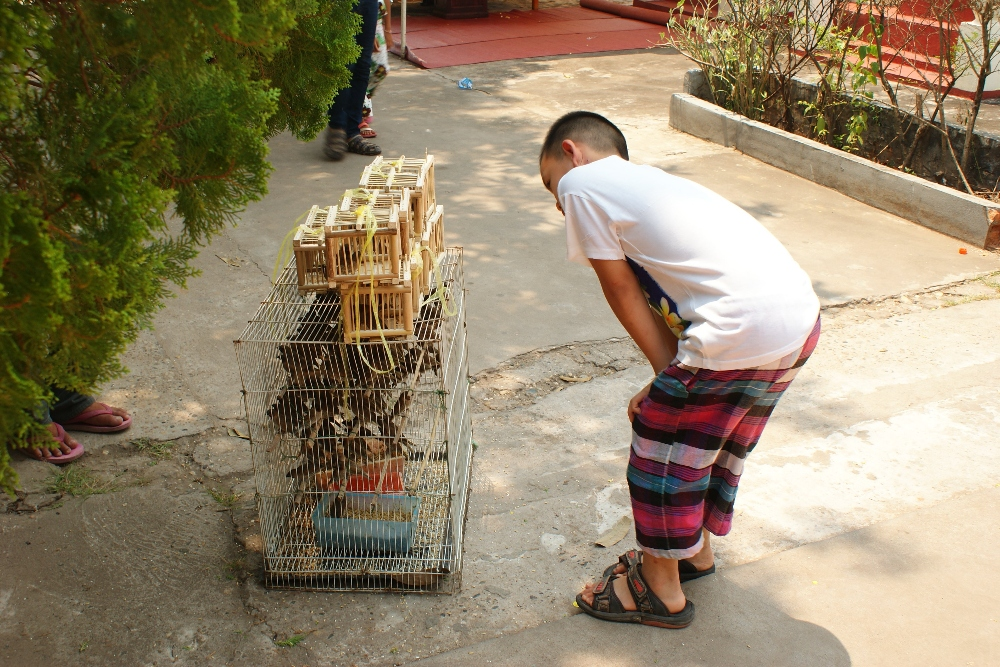

Sommige mensen verkopen vogels in bamboekooien, met de bedoeling ze vrij te laten als symbool van voorspoed en geluk (we zagen spandoeken die toeristen probeerden te ontmoedigen hieraan deel te nemen).

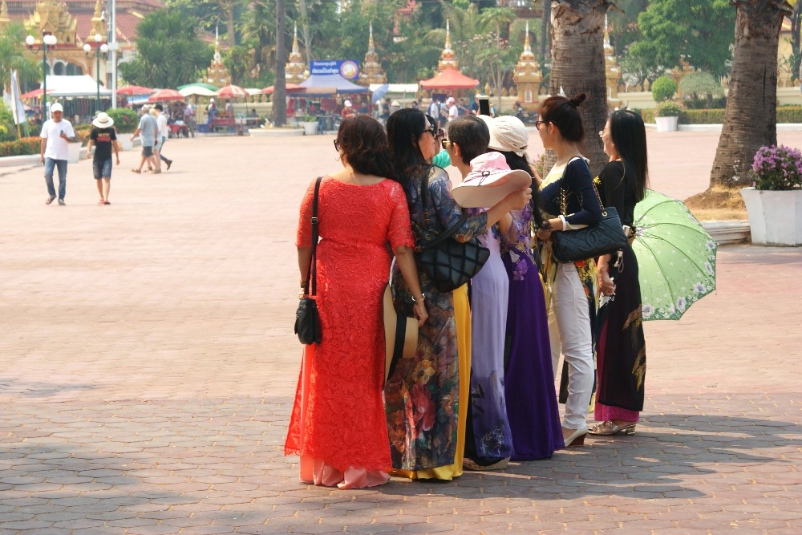

Prachtige lange jurken zijn een heel belangrijk onderdeel van de vieringen :)

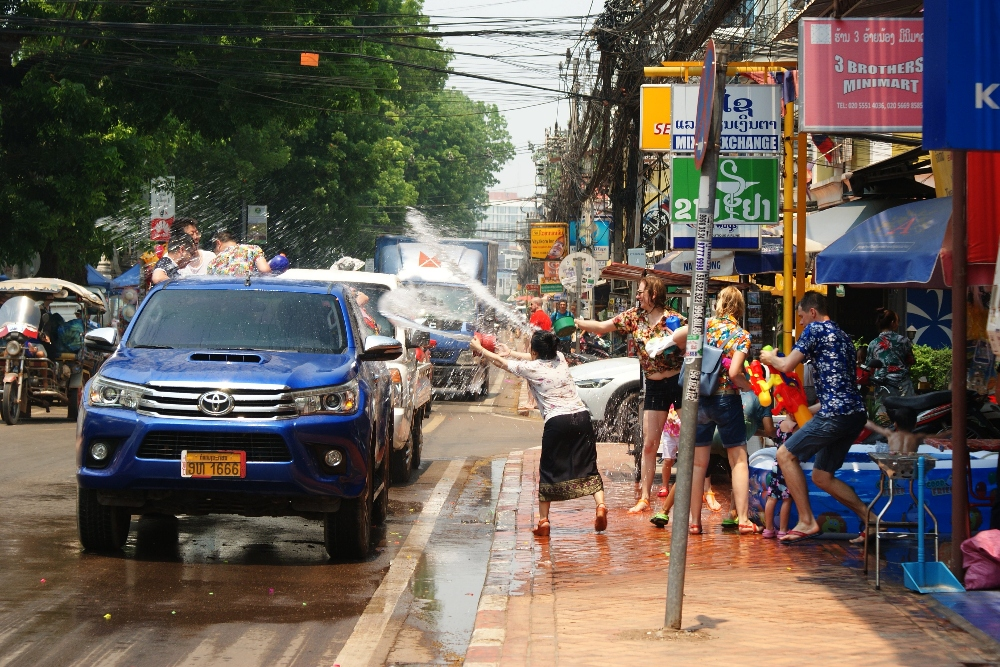

Omdat het de heetste periode van het jaar was, goten mensen hele emmers water over elkaar uit: de perfecte manier om af te koelen!

Al rond de middag begonnen mensen water over elkaar te gieten en enkele uren later waren alle straten 
in één groot slagveld veranderd. Pick-ups vol mensen en emmers water doken steeds 
vaker op in het straatbeeld, dus was het tijd om onze gewone camera in te ruilen voor de waterdichte GoPro :) 
Voor de meeste huizen zagen we opblaasbare zwembaden om af te koelen, terwijl de bewoners met tuinslangen, 
waterpistolen en emmers klaarstonden om voorbijgangers nat te spuiten. Niemand kon die dag droog blijven :D

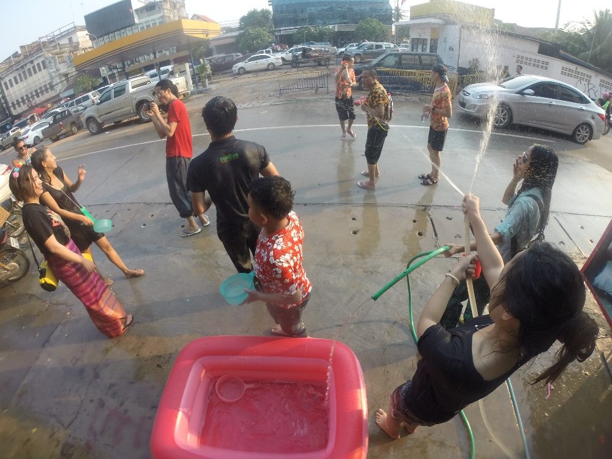

De eigenaars van ons guesthouse zorgden voor heerlijk eten, bier, lao-lao (Laotiaanse rijstwhisky), luide muziek en heel veel water, zodat niemand die voorbijkwam droog bleef :D

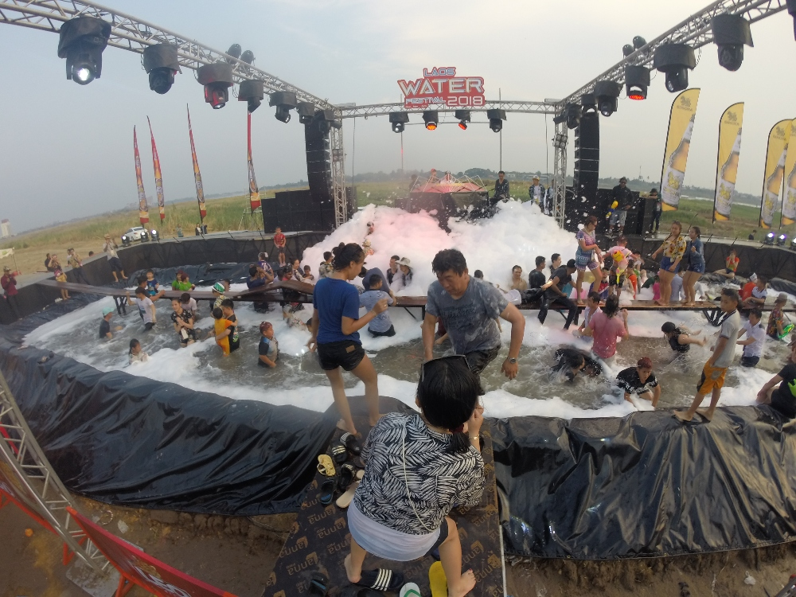

Langs de promenade stonden enkele podia waar we naar Laotiaanse muziek konden luisteren en in het schuim of onder de sproeiers konden dansen.

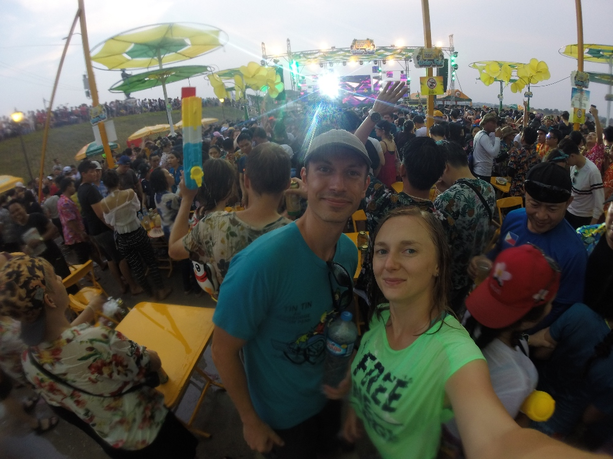

Een Laotiaans technofeest dat even later in een Laotiaans popconcert veranderde. Het was waarschijnlijk een bekende groep, want iedereen zong met de band mee :)

De tweede feestdag is een dag om uit te rusten, tussen de laatste dag van het oude jaar 
en de eerste dag van het nieuwe jaar (de derde feestdag). We merkten dat de eigenaars van het 
guesthouse waar we verbleven die ochtend "heel moe" waren :D We namen de bus naar Vang Vieng. Dat was niet 
eenvoudig, want tijdens de feestdagen reed er maar één maatschappij (en de prijs lag ook iets hoger dan normaal).
Ook de dagen daarna was het moeilijk om droog te blijven: langs de weg stonden altijd heel wat kinderen klaar 
om voorbijgangers nat te gooien. Zorg dus voor een goede waterdichte tas* voor al je documenten, elektronica en geld! 
Je kunt er werkelijk op elke straathoek een kopen. De wandeling van het busstation naar ons 
guesthouse, ongeveer een kilometer, was een hele uitdaging omdat we niet nat wilden worden. We moesten 
eigenlijk om elke straathoek gluren om te controleren of de kust veilig was. Ook in een tuktuk 
zat je niet veilig, want zodra een tuktuk met toeristen stopte, kwamen kinderen met water 
erop afgestormd om iedereen binnenin kletsnat te maken :O

Kortom: wil je de viering van het Laotiaanse Nieuwjaar overleven, neem dan een waterdichte tas mee, voel je weer even 
kind en geniet ervan om anderen nat te gooien! :D

## Praktische informatie:

  * Busticket naar Pha That Luang (bus nummer 10) - 4k per persoon, enkele reis
  * Busticket naar Vang Vieng (minibus) - 60k kip per persoon
  * Neem een waterdichte tas mee! Die zal vaak van pas komen als je er tijdens het regenseizoen bent.

