Tijdens de busrit zagen we het landschap enorm veranderen. We reisden verder naar het noorden van het land, naar het bergachtige deel van Laos, en dat was duidelijk te merken. Vang Vieng, een stadje dat 
bekendstaat als de perfecte bestemming voor mensen die graag stevig feesten (niet echt ons ding), verraste ons met prachtige natuur! De dichtbegroeide heuvels vlakbij, die
abrupt uit de omliggende vlakke velden oprijzen, trokken meteen onze aandacht :) Er zijn ook enkele beroemde blauwe lagunes, grotten en zelfs uitkijkplatformen boven op sommige heuvels.
Wie op zoek is naar een adrenalinekick, kan kiezen uit tal van activiteiten: in een binnenband de rivier afdrijven, aan een touw een blauwe lagune in slingeren en ziplinen. Helaas is dit ook de plek waar veel 
ongevallen zijn gebeurd (gelukkig gaat het beter sinds het tragische jaar 2011, waarin 27 dodelijke ongevallen plaatsvonden). Het is goed om te onthouden dat de toegang tot medische zorg in Laos erg beperkt is.
Het stadje is niet erg groot: enkele hoofdstraten met plekken om te slapen, te eten en iets te drinken, enkele tempels, ... Dankzij het busstation vlak bij het stadscentrum is het makkelijk bereikbaar en kun je de prachtige omgeving vlot verkennen.

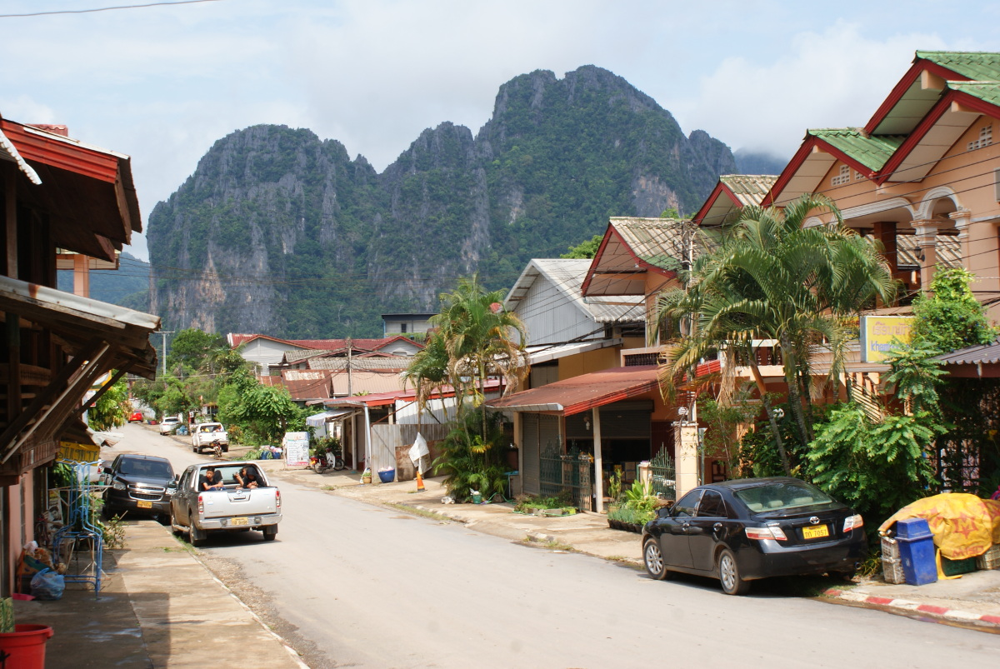

Nu heb ik er spijt van dat we maar één dag in Vang Vieng konden doorbrengen, want we hadden al enkele nachten geboekt in een hostel op onze volgende bestemming, Luang Prabang. Als je echt 
spontaan wilt reizen, moet je natuurlijk rekening houden met de tijd die je nodig hebt om een kamer te zoeken, en als je pech hebt, kan dat even duren. Toch hadden sommige plekken zo'n bijzondere charme dat we
er langer bleven dan gepland, zoals Don Det :)
  
Nadat we fietsen hadden gehuurd, moesten we eerst de Nam Song oversteken via een wankele houten loopbrug
die alleen door voetgangers, fietsers en motorrijders werd gebruikt. Vlakbij ligt een echte brug voor auto's, maar daar moet je betalen om over te steken.

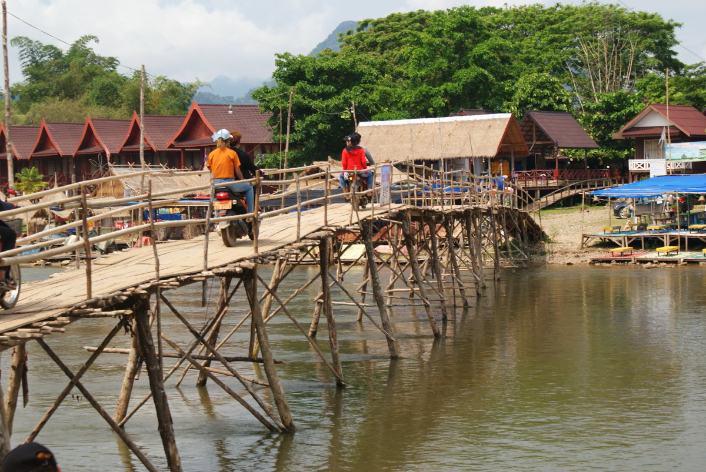
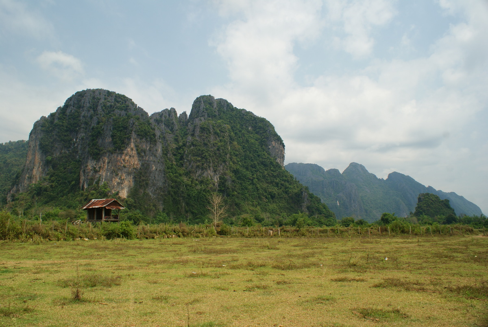

Na ongeveer 6 kilometer over een goede betonweg te hebben gefietst, sloegen we bij een splitsing rechtsaf en stopten we om de Blue Lagoon en de grot Tham Phu Kham te bezoeken. Eerst kwamen we
langs de Blue Lagoon, waar het krioelde van kinderen en tieners die vanaf de mooie horizontale takken van een nabijgelegen boom in het water sprongen. De kleur van het water was inderdaad
heel intens.

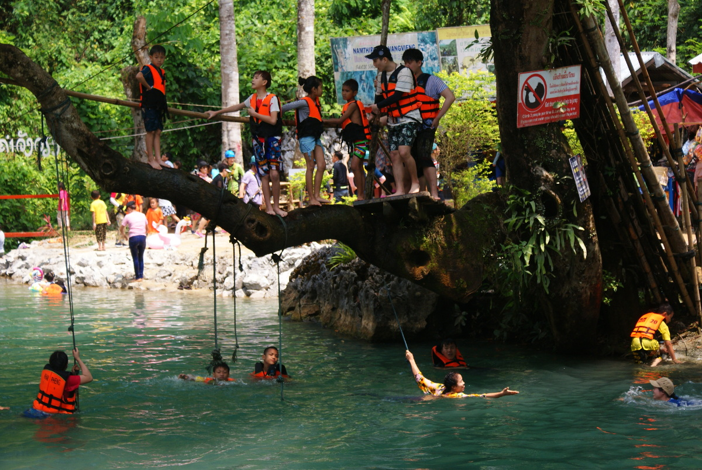

Een steil en glibberig pad leidde naar de ingang van de grot. Om de grot binnen te gaan, heb je echt een hoofdlamp nodig (je kunt er een huren bij de ingang van de grot) 
en natuurlijk goede schoenen: minstens wandelsandalen, maar nog beter zijn trekkingschoenen, want binnen is het erg glibberig. Er stond behoorlijk veel water in de grot, dus je wordt er 
zeker modderig en nat. Twee kleine jongens zonder licht volgden ons en probeerden ons dieper de grot in te leiden. Later merkten we dat ze
alleen maar teenslippers droegen :) In de grot bevindt zich een klein heiligdom dat mooi wordt verlicht door het invallende licht en waar mensen samenkomen om te bidden.

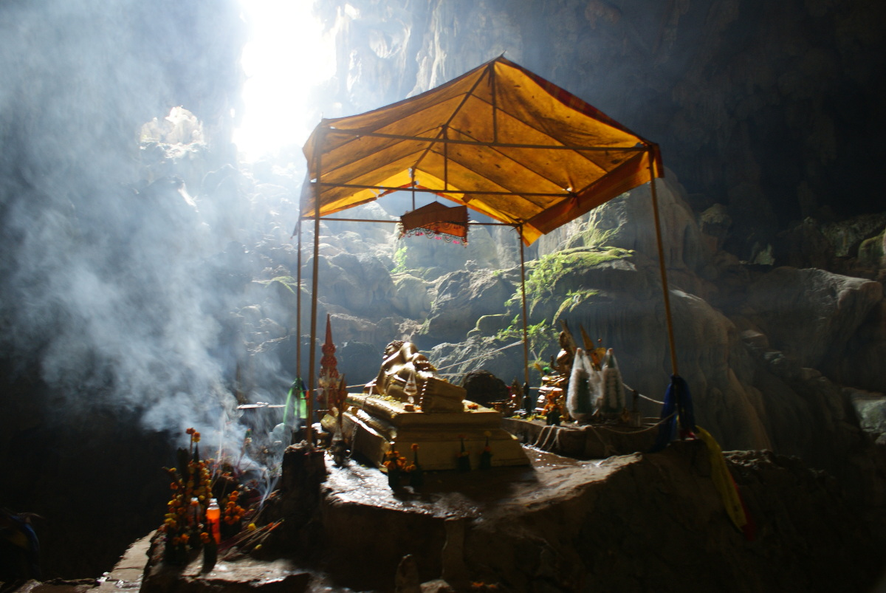

We zagen veel stalagmieten die vanaf de bodem van de grot omhooggroeiden en enkele stalactieten (die aan het plafond hangen), maar die waren moeilijker te zien omdat we geen 
krachtige lampen hadden en de grot behoorlijk groot was. Het leek alsof we almaar dieper de grot in konden gaan en de jongetjes probeerden ons te overtuigen om hen te volgen, maar eerlijk 
gezegd voel ik me niet helemaal op mijn gemak in zulke donkere, onbekende grotten. Mijn vriend voelde zich er nog minder op zijn gemak: hij heeft een lichte fobie voor donkere, glibberige plekken en
mijdt dit soort activiteiten ;) (Hij noemt deze grot nog altijd "De Grot van de Zekere Dood", wat wellicht licht overdreven is).

  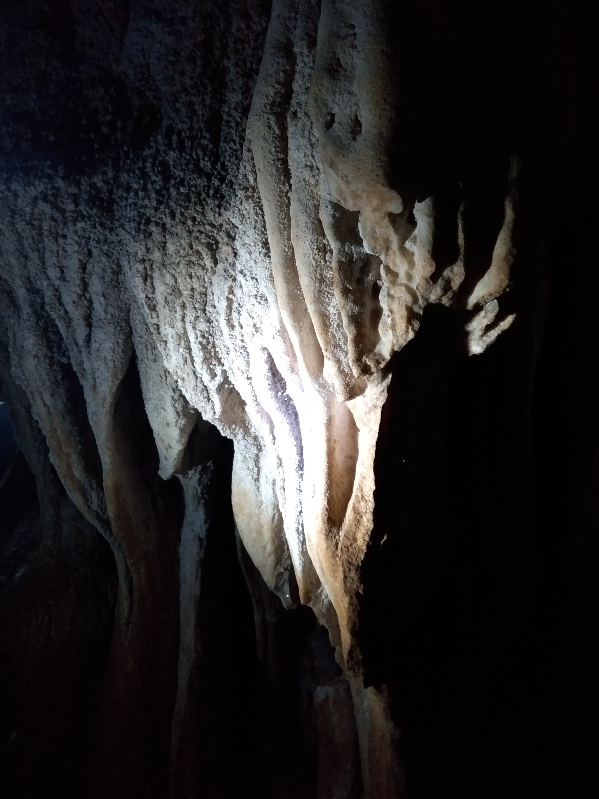
  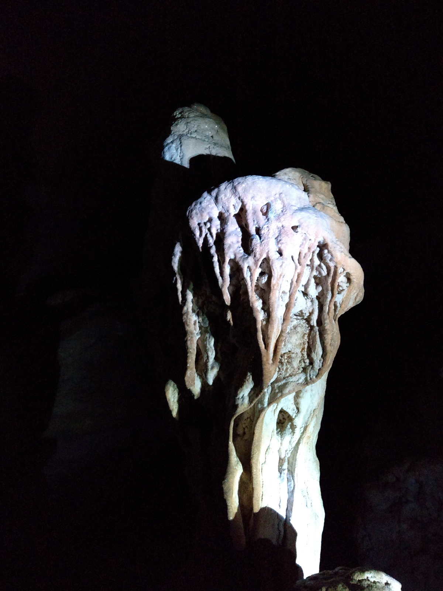

Ons volgende idee was om nog enkele kilometers verder naar het zuiden te fietsen (zie de kaart hieronder), het platteland rond Vang Vieng te verkennen en te proberen het meer op de kaart te bereiken. Eerst stopten we 
bij een piepklein winkeltje om wat koude frisdrank te kopen, want het werd ontzettend heet en broeierig. Zoals je uit de vorige post weet, vierde men nog altijd Laotiaans Nieuwjaar
en ook vandaag werd Sebastian tijdens het fietsen weer gezegend met een emmer water :D Ik ben benieuwd hoelang kinderen dat excuus gebruikten om willekeurige voorbijgangers met water te overgieten. Eerst misten we het 
smalle pad dat door het bos naar het meer liep. Aan het einde van het pad stond een klein houten hek, dus lieten we onze fietsen achter en liepen we de laatste meters om het meer beter te bekijken.
Aan de overkant van dit kleine meer zagen we enkele huizen en veel waterbuffels die langzaam langs de oever liepen.

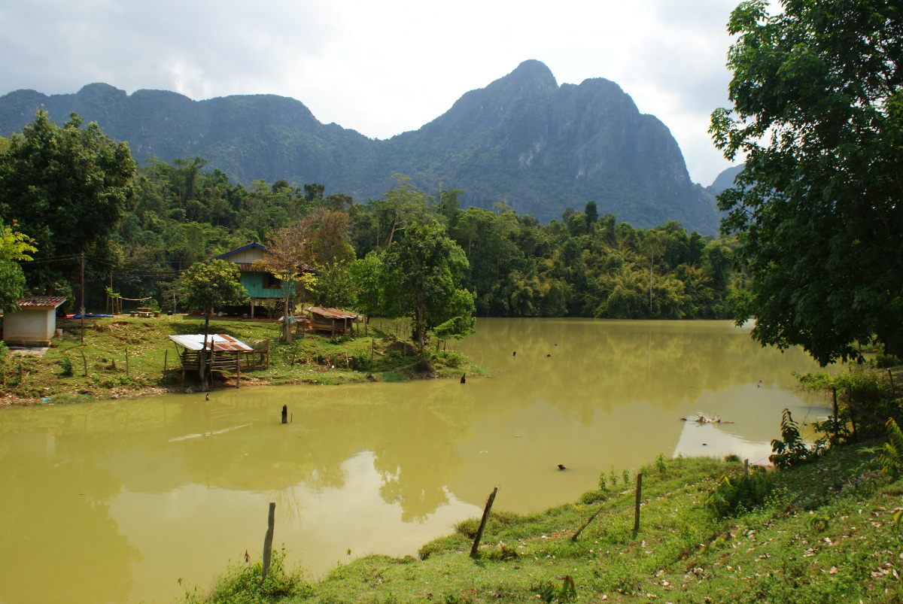
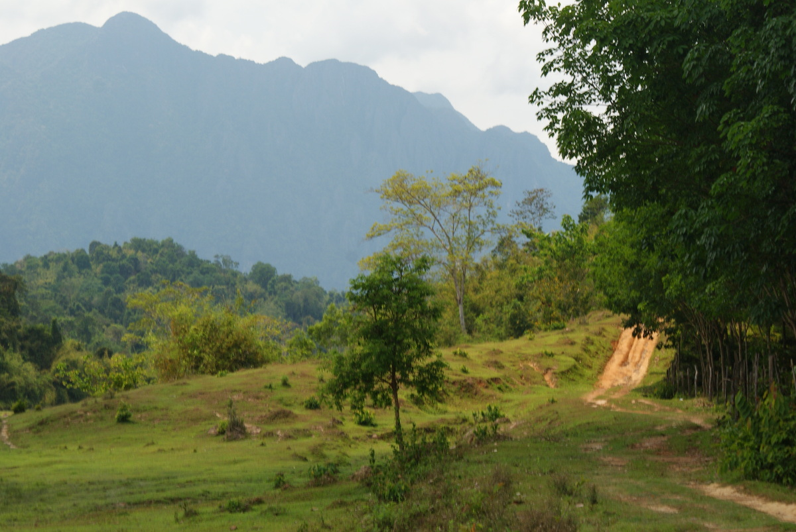

Onderweg naar het restaurant (Lao Valhalla) zagen we houten bordjes die naar een uitkijkplatform op een van de heuvels vlakbij wezen, en we besloten het na de lunch te bezoeken.
Het weer gooide echter roet in het eten! De ochtend was warm, rustig en zonnig, ideaal om te fietsen en de omgeving te verkennen, maar in de namiddag veranderde het weer heel 
snel! Minder dan 15 minuten nadat we het restaurant hadden verlaten, begon het hevig te regenen en hard te waaien! De vrouw die het restaurant uitbaat, zegende ons bij ons vertrek en waarschuwde ons voor een naderende storm, en ze had gelijk!
We vonden beschutting onder een van de huizen, samen met koeien uit een veld vlakbij (de dieren renden sneller dan ik kon fietsen om een schuilplaats te vinden!). Veel mensen die op de rivier aan het kajakken waren, sloegen om, maar
gelukkig was het op dit stuk erg ondiep en wisten ze uit het water te komen. Het duurde maar 30 minuten, maar alle straten werden meteen erg modderig. Toen we met onze fietsen bij de fietsverhuur aankwamen, 
bood de eigenaar ons een tuinslang aan om de modder van onze benen en armen af te spoelen :D Geweldig, ik zag er alweer uit als een echte dame op vakantie! Omdat dit nog maar het begin van het
regenseizoen was, kochten we meteen enkele waterdichte zakjes voor onze telefoons en camera.

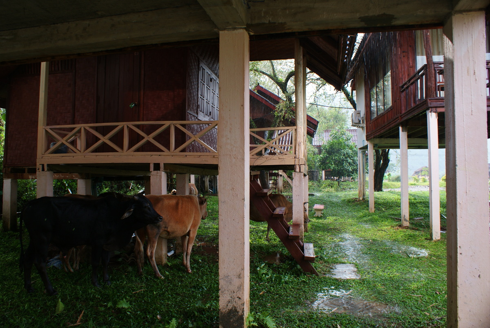
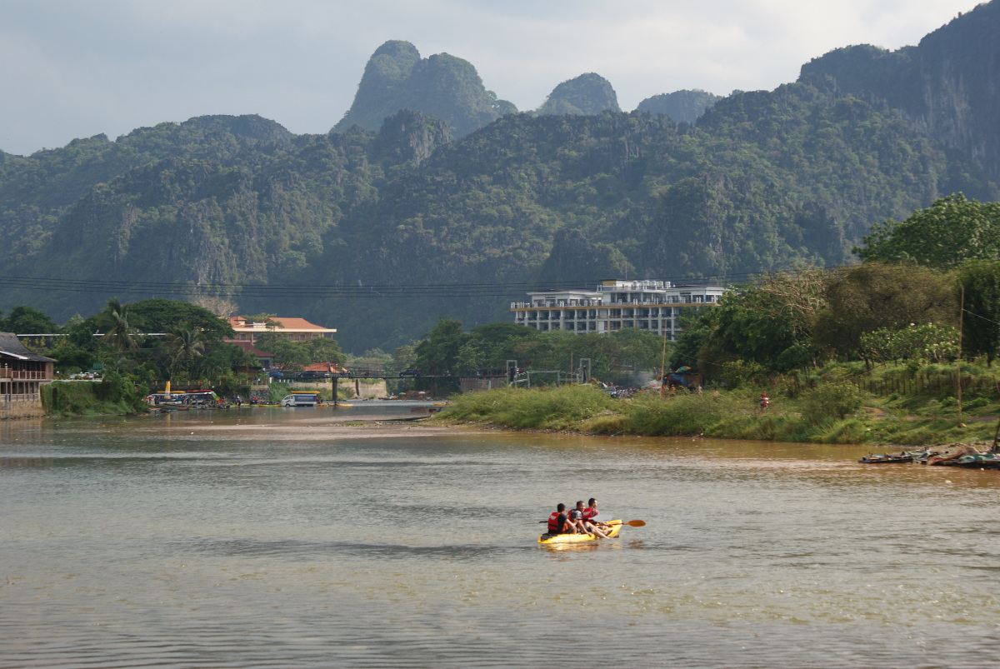
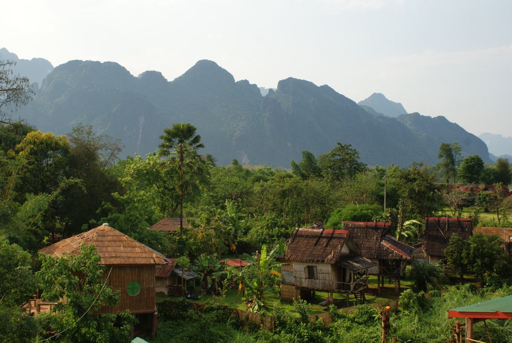

Zoals je op de kaart kunt zien, fietsten we ongeveer 24 km. Aan het uiteinde van de bovenste vertakking liggen de grot en de lagune; de onderste vertakking geeft de ligging van het meer aan.

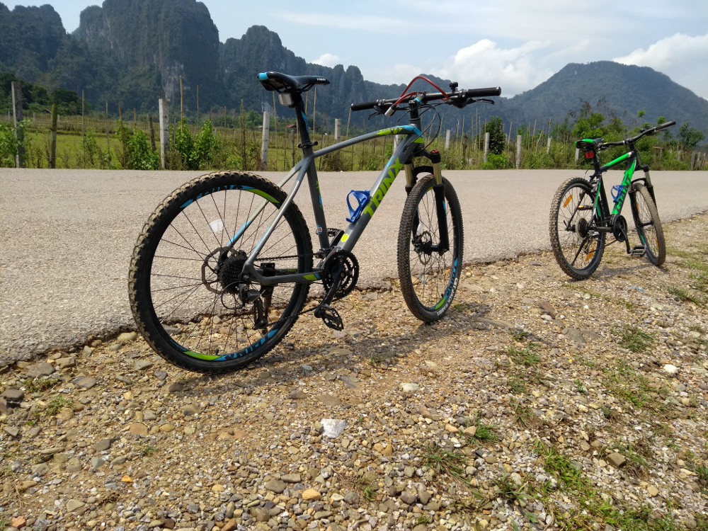

In Laos zagen we in bars en restaurants vrij vaak grote bokalen staan die gevuld waren met een sterke alcoholische drank en waarin dieren zaten (in deze zit een varaan, maar ook slangen, duizendpoten en schorpioenen komen vaak voor). 
Die drankjes zien er voor mij niet erg verleidelijk uit, maar blijkbaar zorgt dat voor een heel aparte smaak.

  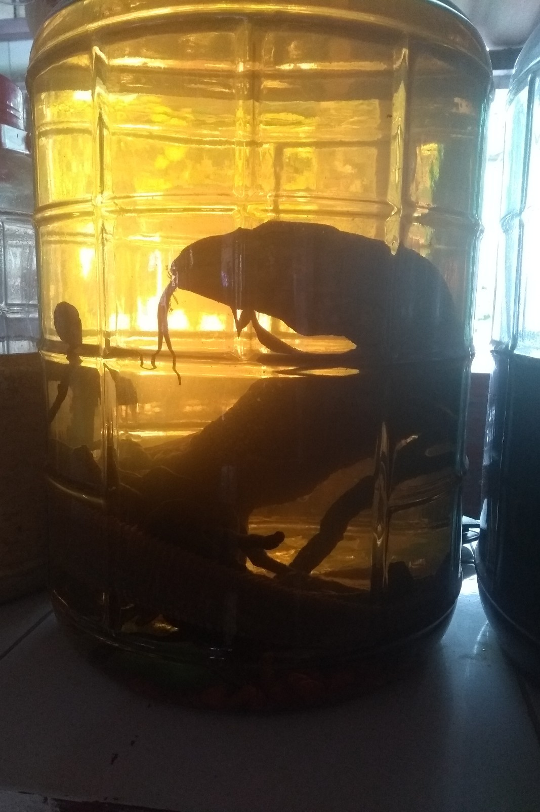
  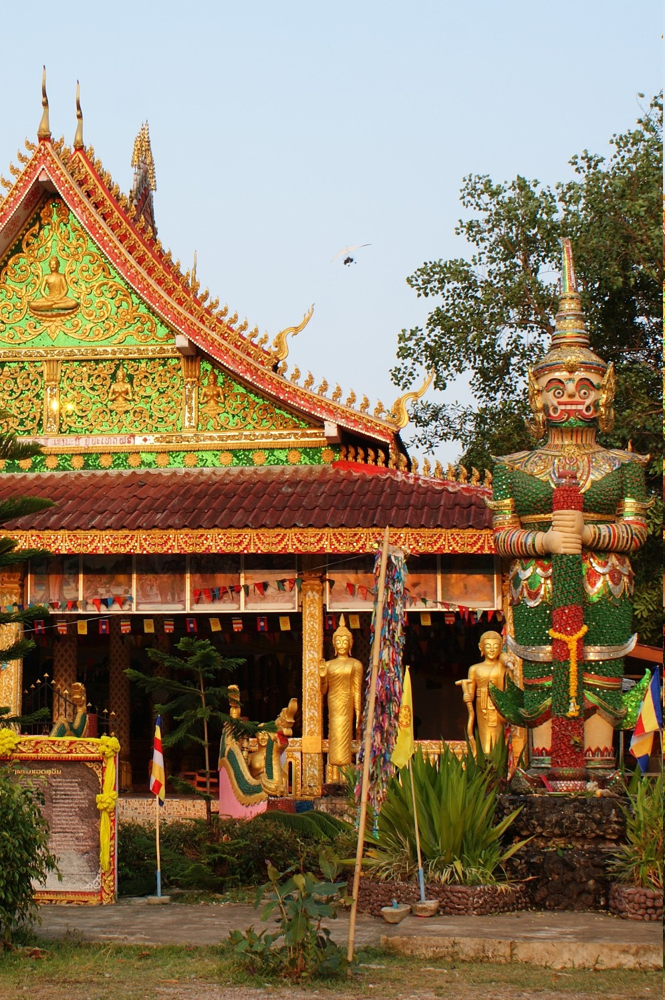

## Praktische info:

Hoe we in Vang Vieng zijn geraakt, beschreven we in een vorige post. 
  * een mountainbike huren - 30k KIP per persoon; zoals altijd liet de staat van de fietsen veel te wensen over (deze keer ontplofte mijn band tenminste niet!)
  * toegang tot de grot - 10k KIP per persoon 
  * waterdicht zakje - 60k KIP; ja, het Laotiaanse Nieuwjaar werd nog altijd uitbundig gevierd en dagenlang bleef men iedereen met water overgieten :D
  * jurk gekocht op de avondmarkt - 40k KIP 
  * lunch/avondeten - 60k KIP voor ons beiden bij <a href="https://www.tripadvisor.com/Restaurant_Review-g612363-d2490847-Reviews-A_M_D_Restaurant-Vang_Vieng_Vientiane_Province.html">A.M.D Restaurant</a> of <a href="https://www.tripadvisor.com/Restaurant_Review-g612363-d9794459-Reviews-Lao_Valhalla_Restaurant-Vang_Vieng_Vientiane_Province.html">Lao Valhalla Restaurant</a> 
  * minibus naar Luang Prabang - 110k KIP per persoon
