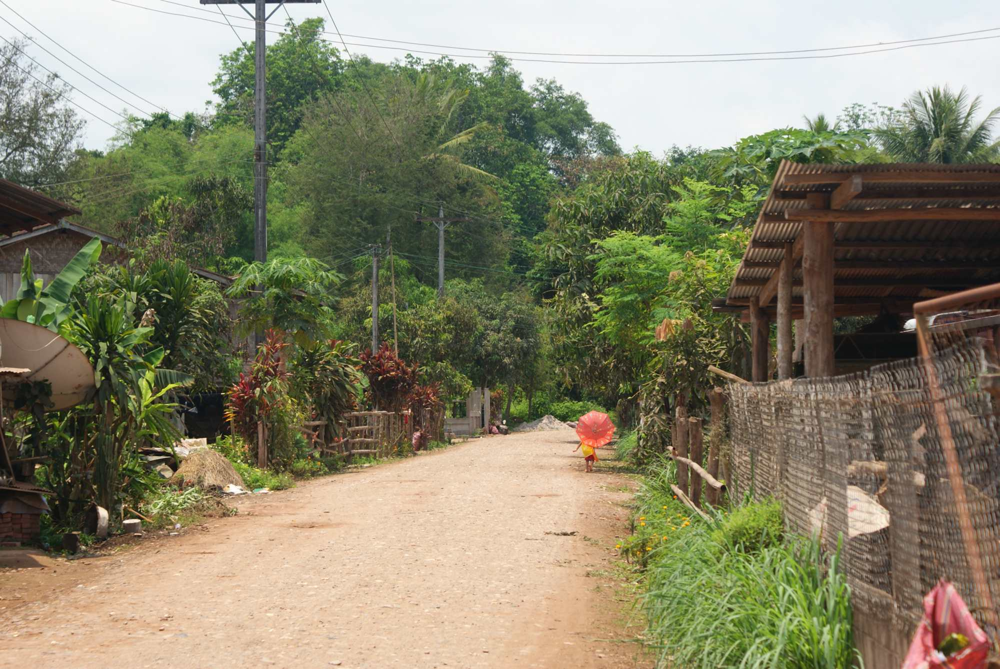
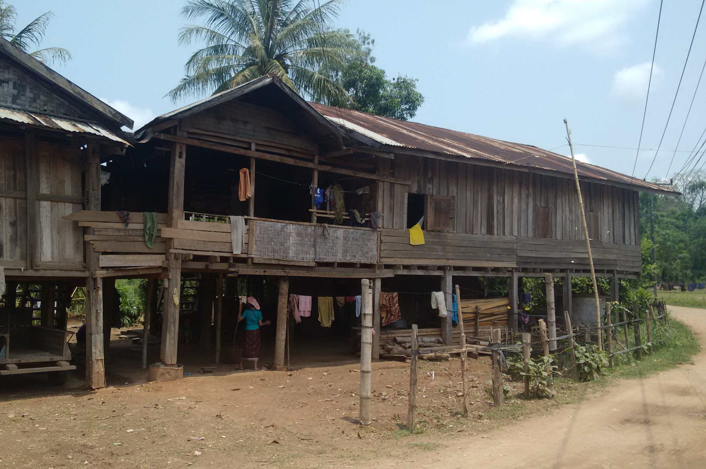
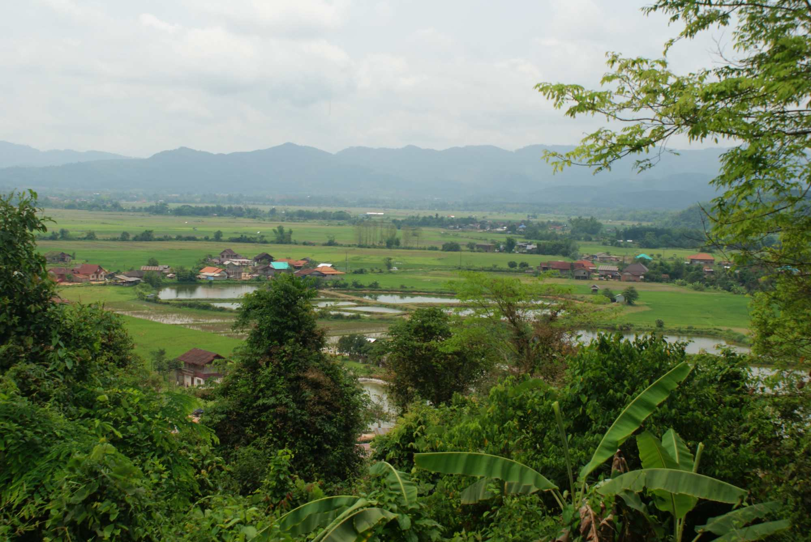
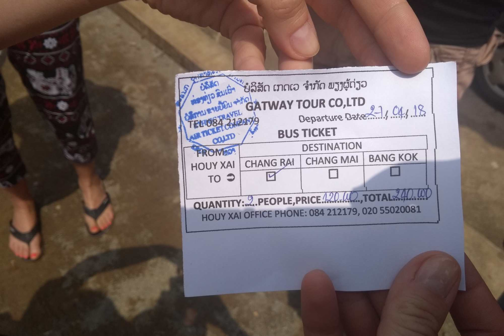
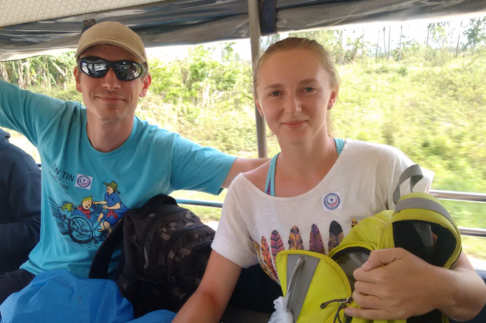
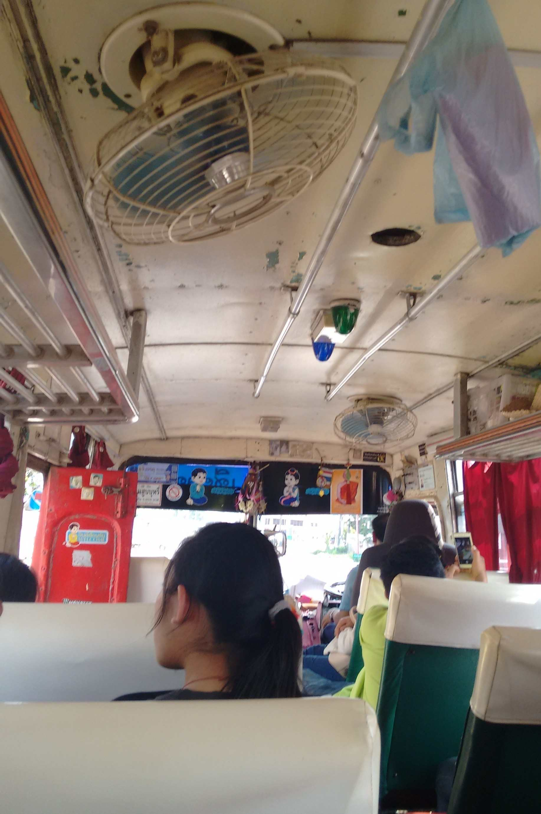
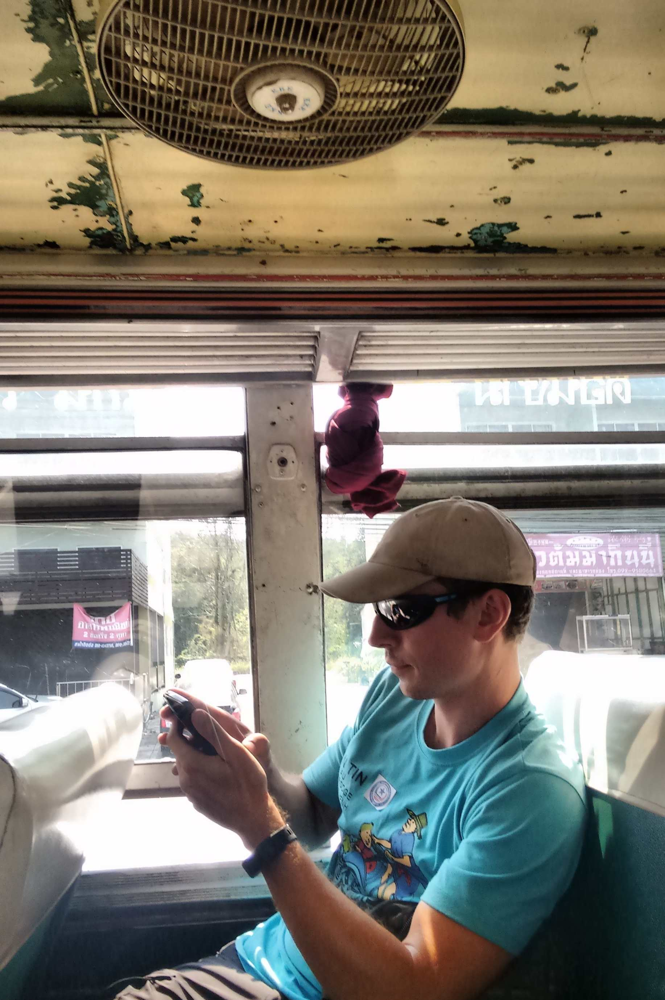

Eindelijk was het tijd om de grens met Thailand over te steken en ons avontuur te beginnen in het laatste land op ons lijstje voor deze
reis. We wisten dat we de 400 kilometer van Nong Khiaw naar de Thaise grens niet in één keer met de bus konden afleggen.
Daarom namen we een minibusje naar Luang Namtha. Van daaruit staken we met de hulp van een reisbureau in één dag de grens over
en kwamen we uiteindelijk aan in Chiang Rai, in het noorden van Thailand. Verderop in deze post lees je alle details.

Luang Namtha zag er niet bepaald uit als een boeiende stad, maar we besloten er toch één dag te blijven en ons niet te haasten
naar onze volgende bestemming. We hadden niets vooraf geboekt en na een uur rondwandelen belandden we in een guesthouse vlak voor
de ingang van de avondmarkt (een heel eenvoudige markt). De volgende dag huurden we mountainbikes en fietsten we naar de omliggende dorpen.
We maakten een lus van 27 kilometer rond de stad, zoals je op de kaart hieronder kunt zien. We zagen een lokale tempel, de Samakkhixay-stoepa, mensen die op de velden werkten, een school
vol kinderen en overal loslopende dieren. Het was er heel rustig. We observeerden het dagelijkse leven van de lokale gemeenschap en gingen daarna lekker
eten bij Lai's Place. Het is altijd fijn als kinderen ons overal luid begroeten en met een brede glimlach achter
onze fietsen aan rennen :)

Er waren twee manieren om de grens met Thailand over te steken: op eigen houtje of met de hulp van een reisbureau.
Voor de eerste optie neem je een bus naar Huay Xai, vervolgens een tuktuk naar de Vriendschapsbrug en steek je de brug over met een andere bus.
Daarna neem je nog een tuktuk naar Chiang Khong, overnacht je er waarschijnlijk en reis je met een lokale bus verder naar Chiang Rai. We konden
de dienstregeling van Chiang Khong naar Chiang Rai niet vinden en wilden eigenlijk zo snel mogelijk in Chiang Rai geraken. Daarom besloten we
een combinatieticket bij een van de reisbureaus te kopen. Al bij al verliep de reis heel vlot: de tuktukchauffeurs stonden ons op te wachten,
alles was goed georganiseerd en bij het overstappen tussen de verschillende vervoersmiddelen hoefden we nooit lang te wachten.
Ook de grensovergang zelf verliep heel vlot: geen corruptie, geen extra kosten. Zalig! :D 

Net na 17 uur kwamen we aan op het busstation van Chiang Rai. We waren heel blij toen we ontdekten
dat zowel het hostel dat we geboekt hadden als een avondmarkt vlakbij lagen. Die markt bleek trouwens een heel fijne plek voor een avondwandeling!

Als je alles zelf regelt, betaal je natuurlijk waarschijnlijk maar de helft voor de tickets. Met wat geluk lukt het misschien ook
om de hele reis in één dag af te leggen. Je moet dan de vroege bus van 8.30 uur naar Huay Xai nemen. Na ongeveer
4,5 uur rijden kom je daar aan. We noteerden de prijzen van enkele tickets. Zo kostte de lokale bus van Chiang Khong naar
Chiang Rai 120 THB ($4), een tuktuk naar de brug 40 THB en de bus over de brug nog eens 40 THB. Toen we op de
lokale bus naar Chiang Rai stapten, zagen we de dienstregeling en merkten we dat er ook 's namiddags bussen rijden.

  
  

## Praktische informatie:

  * minibusje van Nong Khiaw naar Luang Namtha: 6,5 uur, 70.000 KIP per persoon
  * de grens met Thailand oversteken met de hulp van een reisbureau (Gat Way Tour): 200.000 KIP per persoon
  * tuktuk van het busstation naar het centrum van Nong Khiaw: 15.000 KIP per persoon (8 km)
  * een mountainbike huren: 20.000 KIP per persoon
  * lunch/avondeten: 50.000-70.000 KIP voor ons beiden; we raden <a href="https://www.tripadvisor.com/Restaurant_Review-g424933-d3935763-Reviews-Lai_s_Place-Luang_Namtha_Luang_Namtha_Province.html">Lai's Place Restaurant</a> aan
  * guesthouse: 60.000 KIP per nacht
  
  

