Een bezoek aan Berdorf in Luxemburg? Waarom niet! We konden de kans niet laten liggen om eindelijk een van de opties voor een weekenduitstap 
vanuit België uit te proberen. Het oorspronkelijke plan was om de hele route 2 van de Mullerthal Trail te wandelen, ongeveer 37 km. Maar het leven 
is onvoorspelbaar en we moesten onze plannen een beetje aanpassen. Omdat we zaterdagochtend uit Leuven vertrokken en pas om 10.30 uur in Berdorf 
(het vertrekpunt van de tocht) aankwamen, was er niet genoeg tijd om de volledige route af te leggen. Onderweg besloten we daarom één lus over te slaan 
en via een kortere weg naar het volgende dorp te gaan. Het eerste deel (ongeveer 6 km), van Berdorf naar Mullerthal, liep langs grote rotswanden. Hoe verder 
we van de parking kwamen, hoe rustiger het werd en hoe minder wandelaars we onderweg tegenkwamen. De grote, hoge rotsen
 die dicht bij elkaar stonden, vormden smalle doorgangen waar het donkerder en kouder was.

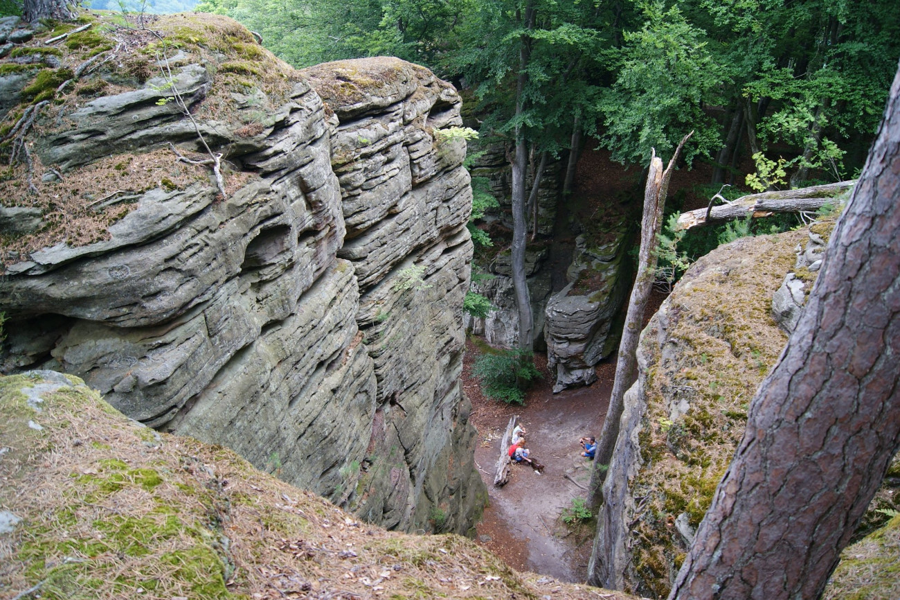

  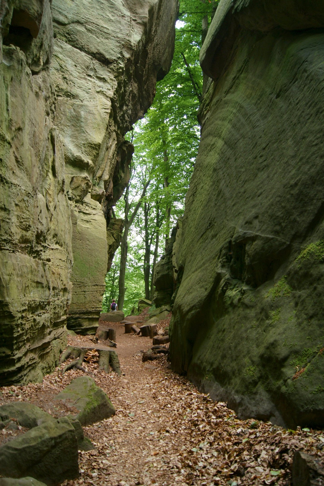
  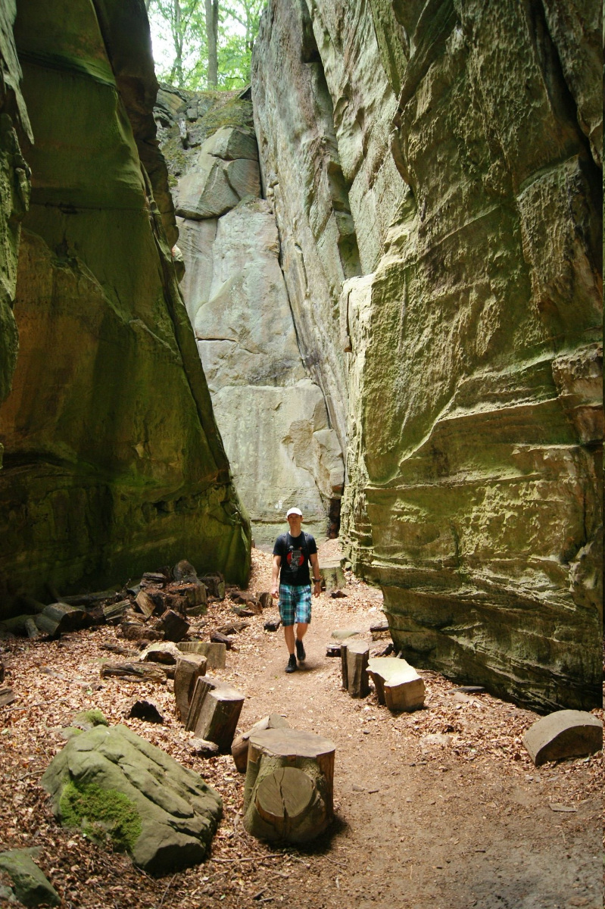

Het dorp Mullerthal heeft een camping en enkele plekken waar je drank en fastfood kunt kopen. We trokken vrij snel door het dorp en bleven de hele tijd de houten paaltjes volgen waarop de naam van de route (en de afstand tot het volgende dorp) stond. Na een tijdje zagen we de Schiessentümpel, de bekende watervallen die veel toeristen aantrekken. Maar ik moet toegeven: nadat ik watervallen in IJsland en Laos had gezien, vond ik deze nogal klein ;) De vorm en stijl van de houten brug erboven maakten meer indruk op mij.

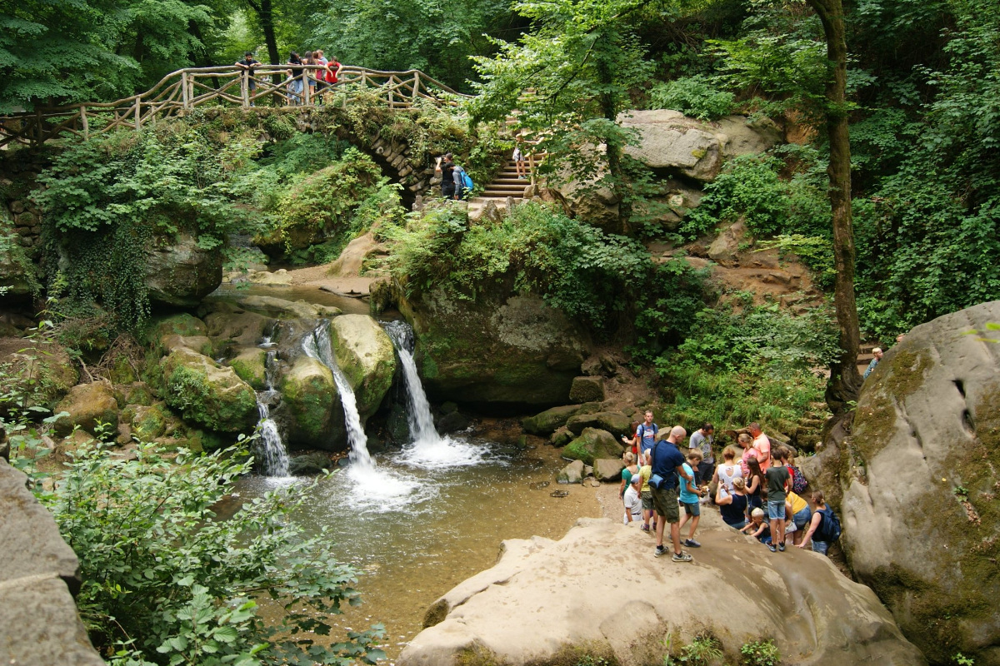

Iets verderop, vlak bij het uitzichtpunt Burgkapp, konden we onze wandeling inkorten en rechtdoor naar het dorp Consdorf gaan. Zo sloegen we de lus naar het zuiden over en sneden we enkele kilometers af. We wandelden voorbij Burgkapp, camping La Pineda en Consdorf (er is een bakkerij vlak bij de kerk), om uiteindelijk Scheidgen te bereiken, waar we route 2 van de Mullerthal Trail weer oppikten. Het traject van daar naar Echternach was wat saai. Een prachtig oud bos, maar met minder rotsgroepen om te verkennen.

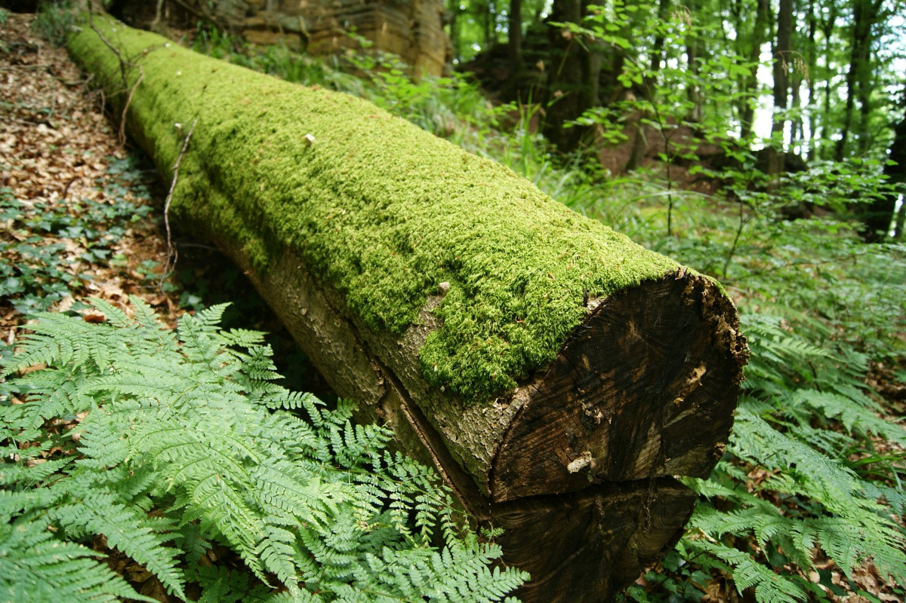
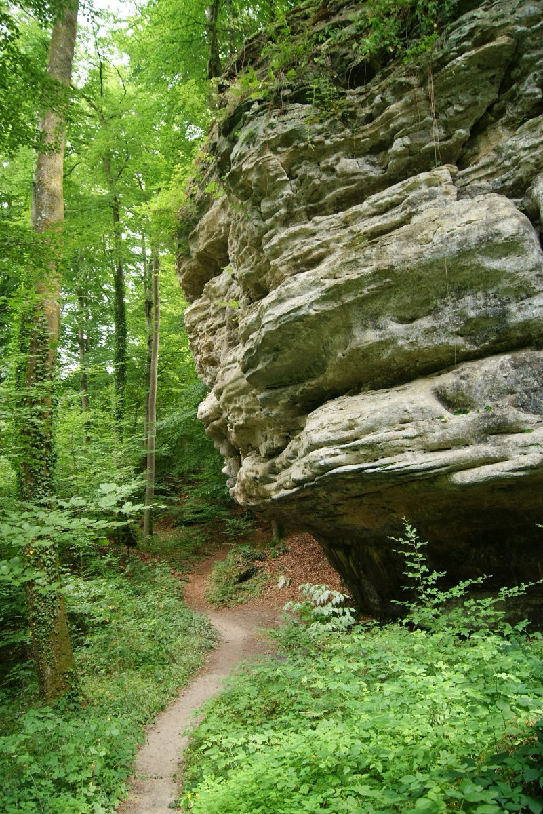

Het uitzicht op het dorp Echternach, waar we gingen eten en een ijsje haalden :) Om deze toeristische plek te bezoeken, moesten we langs een steil pad naar het dorp afdalen en via dezelfde weg terugkeren, dus ook enkele steile stukken bergop lopen. Maar het was de moeite waard. Op de foto hieronder zie je duidelijk de Sint-Willibrordusbasiliek, die het landschap domineert.

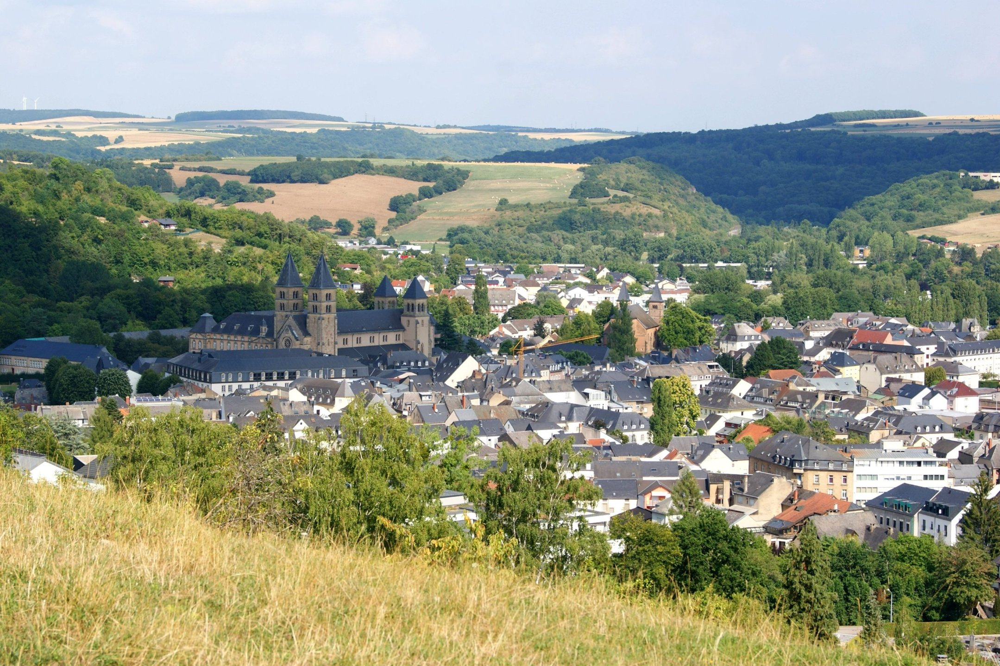

De volgende dag verkenden we de omgeving van onze camping in Berdorf. De fantastische uitzichtpunten, vanwaar je de heuvels rondom kunt bewonderen, zijn voor veel toeristen heerlijke plekken om te ontspannen. De vele smalle doorgangen tussen de rotsen lokken kinderen met hoofdlampen, die ze zonder enige angst verkennen. We raakten echt verdwaald tussen de smalle gangen; het voelt alsof je in een labyrint bent! Stevige schoenen zijn ten zeerste aangeraden, want de rotsen en treden kunnen behoorlijk glad zijn.

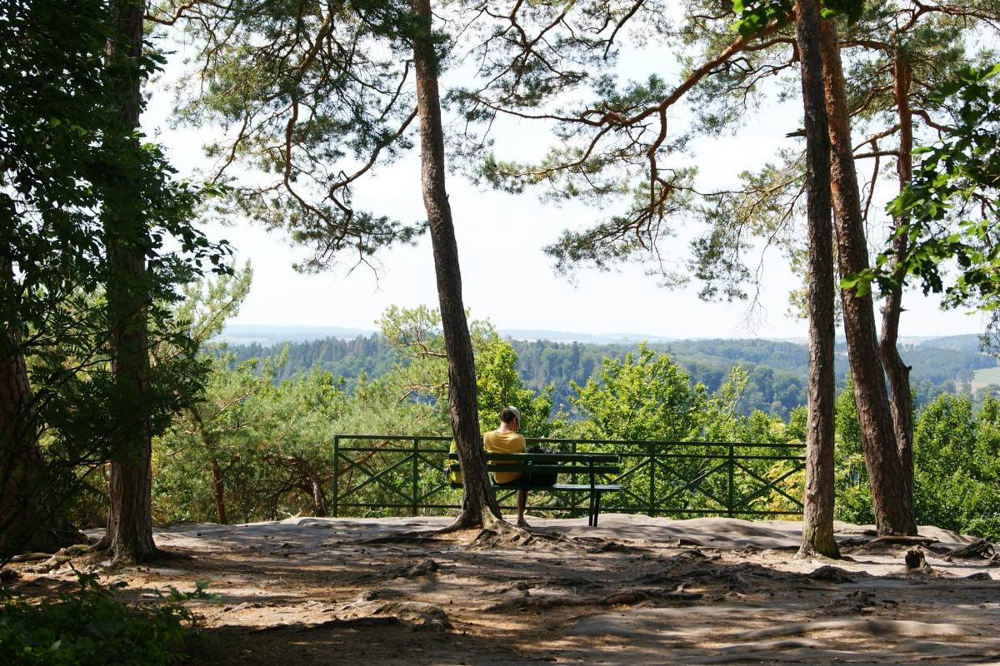
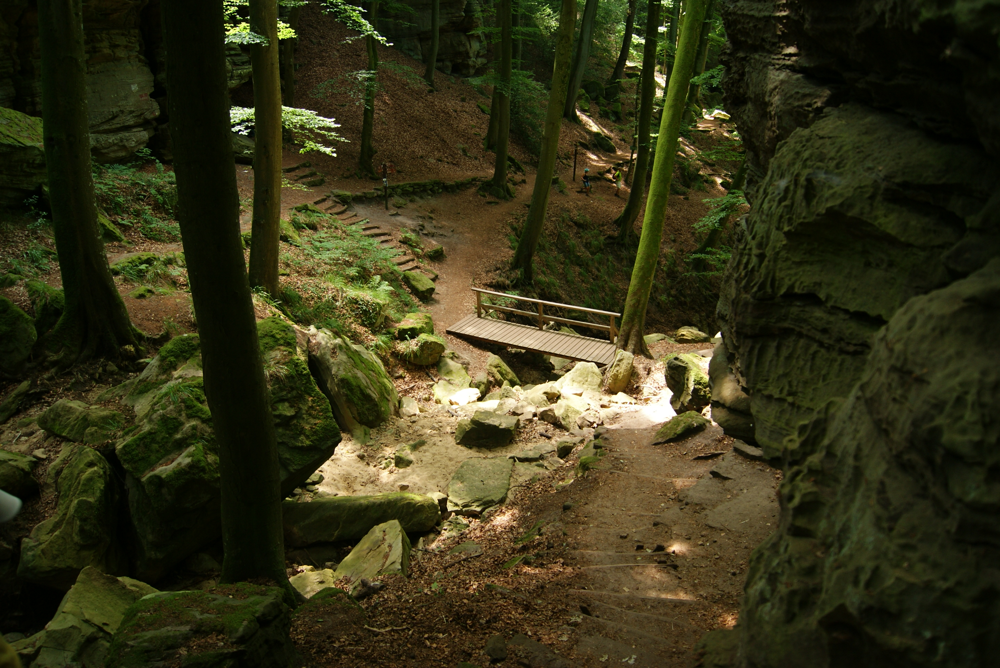

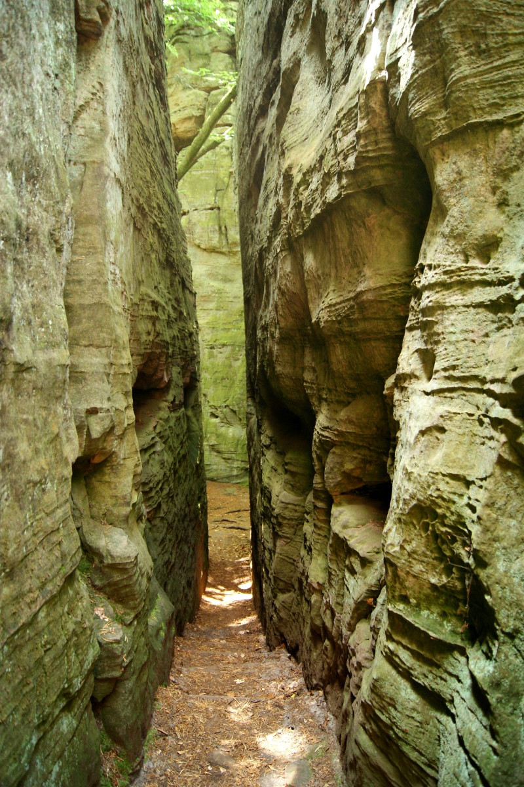

De streek heeft niet alleen wandelaars, lopers en fietsers heel wat te bieden, maar ook sportklimmers! Op ongeveer 1 km van camping Martbusch vind je dit kleine maar zeer interessante klimgebied met zandsteenrotsen. De meeste klimroutes hebben een moeilijkheidsgraad tussen 5 en 6. Het prachtige bos rond deze plek maakt het er koeler, iets wat elke klimmer tijdens de hete zomer weet te waarderen :)

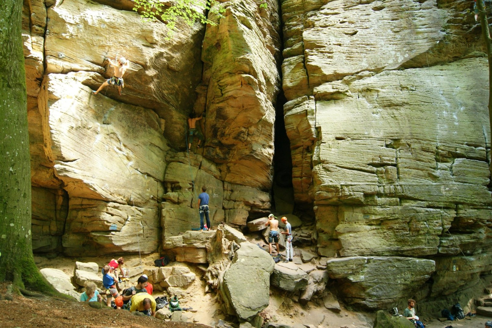

## Praktische info:

Route 2 van de Mullerthal Trail - 31 km. We sloegen een stuk van ongeveer 7 km in het zuiden over en namen vanaf de parking Consdorfer Millen een kortere weg naar Scheidgen, waar we route 2 van de Mullerthal Trail opnieuw volgden tot Berdorf. Zie de kaart hieronder voor meer details 

We verbleven op Camping Belle-Vue 2000 (ongeveer 8 euro per persoon, stalen vuurschaal en een portie hout - 12 euro) in Berdorf. In de omgeving van route 2 van de Mullerthal Trail liggen veel campings, dus je kunt het hele traject zeker in enkele etappes opdelen en de streek wat uitgebreider verkennen. Er zijn echt heel wat plekken om te bekijken: prachtige rotsformaties, uitzichtpunten en grotten die moeilijk grondig te verkennen zijn als je, zoals wij, de hele tocht in één dag aflegt.

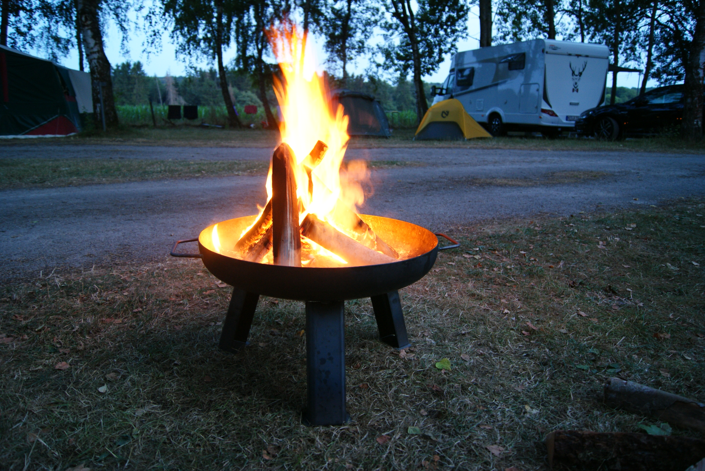

[Camping Belle-Vue in Berdorf](https://www.campingbelle-vue2000.com/)

