Lecco, een kleine stad aan de zuidpunt van het Comomeer, bleek een fantastische uitvalsbasis voor wandelliefhebbers. 
Eigenlijk hadden we hier langer kunnen blijven, want we hadden nog heel wat ideeën voor dagwandelingen of gewoon om 
bezienswaardigheden te bezoeken. Meer over de stad zelf in de volgende post :) Onze gastvrouw in Lecco wist veel over de bergen in de omgeving 
en stelde ons twee van de zwaarste wandelingen voor. Enthousiast gingen we op haar voorstellen 
in :D De weersvoorspellingen waren erg goed, dus besloten we niet lang te wachten en de volgende dag de zwaarste wandeling naar 
Monte Resegone (1875 m) te maken. Niet de afstand maakte deze wandeling zo zwaar, maar wel de ongeveer 
1500 hoogtemeters. We vertrokken aan ons verblijf in Lecco (in de wijk Acquate) en gingen omhoog 
naar wandelpad nummer 1, dat we volgden tot aan rifugio Luigi Azzoni bij de top van Monte Resegone. Dit 
pad begint onderaan de kabelbaan in Versasio en loopt eerst door het bos over een mooi, breed, rotsachtig 
pad. Daarna passeert het een kleine groep huizen (Frazione Costa) en de berghut Rifugio Antonio Stoppani. Van daaruit 
konden we al genieten van het prachtige uitzicht op het Comomeer en de stad Lecco. Het pad was duidelijk gemarkeerd met rood-wit-gele strepen met het cijfer één in het midden. De markeringen stonden op rotsen of bomen, dus we hoefden niet bang te zijn om te verdwalen (natuurlijk moet je wel opletten bij kruisingen met andere paden, bijvoorbeeld mountainbikeroutes of paden naar via ferrata's). 

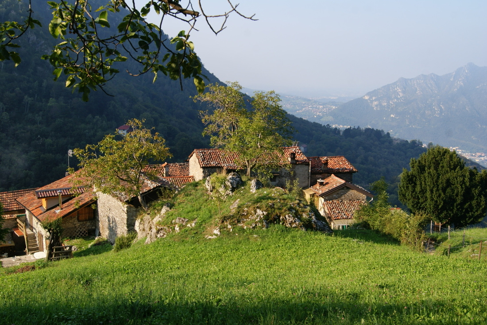

Ik stond te popelen om de hogere delen van het pad boven de boomgrens te bereiken en van de indrukwekkende rotsformaties 
te genieten. Toen ik de eerste kettingen zag, werd ik dolenthousiast: dat betekende dat het pad
 interessanter zou worden! :D Op veel plaatsen moesten we onze handen gebruiken. Het leek meer op klauteren dan op een gewone 
 wandeling, maar ik vond die stukken echt geweldig. Niet iedereen zou daar zo enthousiast van worden (mijn vriend inbegrepen), maar ik heb 
 zeven jaar geklommen, dus ik zal altijd blijven houden van rotsen onder mijn handen en van open, geëxponeerd 
 terrein. Wij hadden prachtig weer, maar besef goed dat dit pad moeilijk is en dat er veel ongevallen gebeuren
  als het pad beijzeld is of wanneer het regent. 

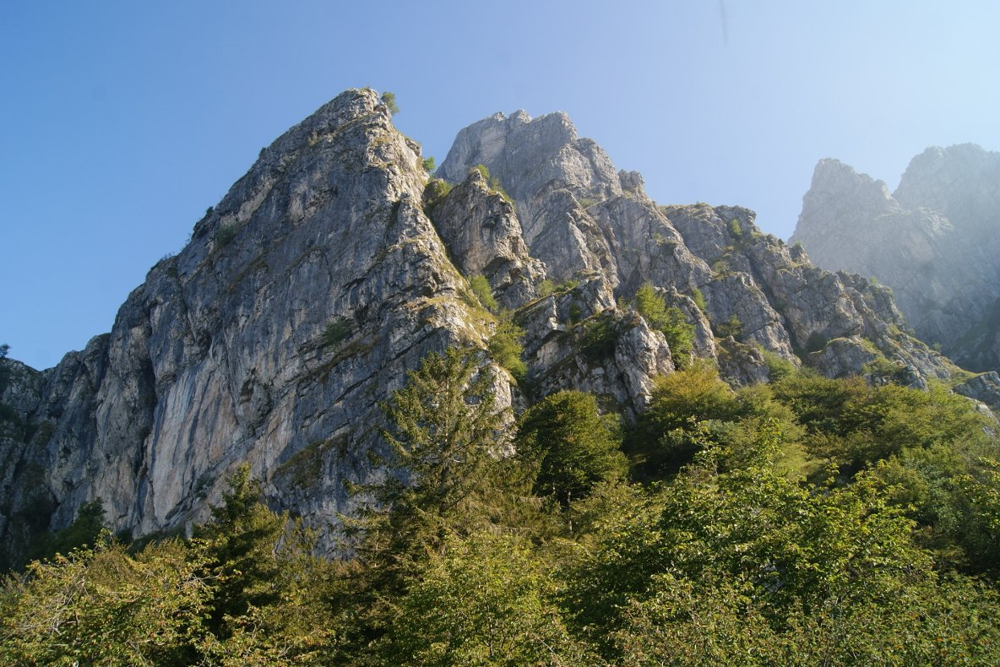

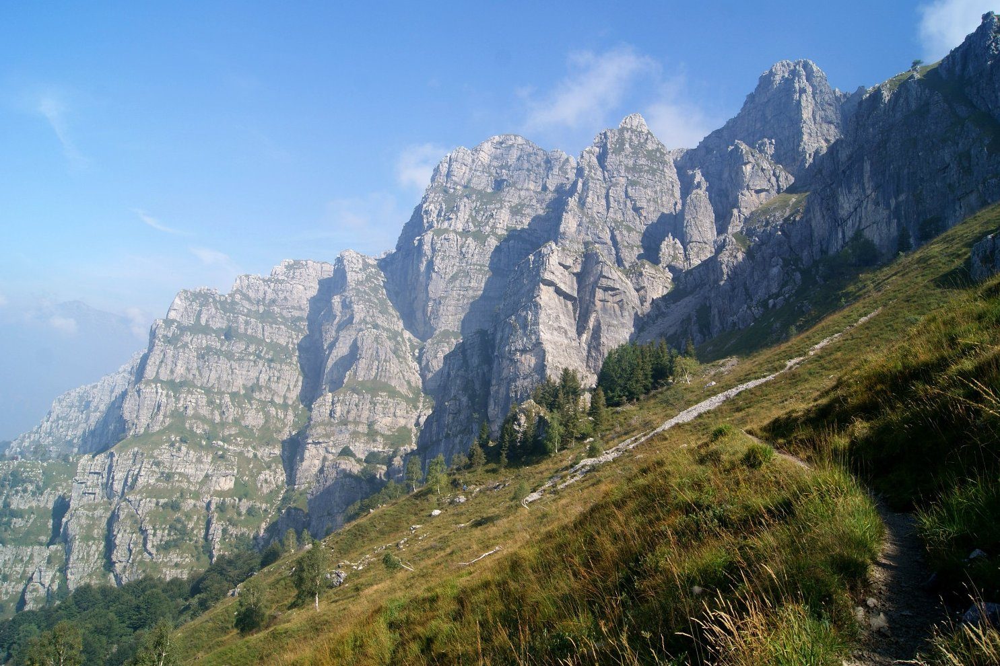

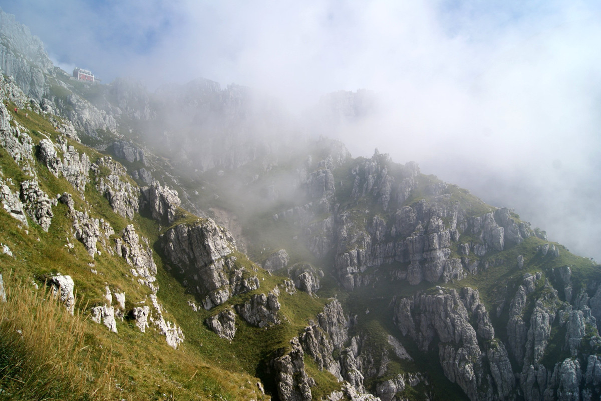

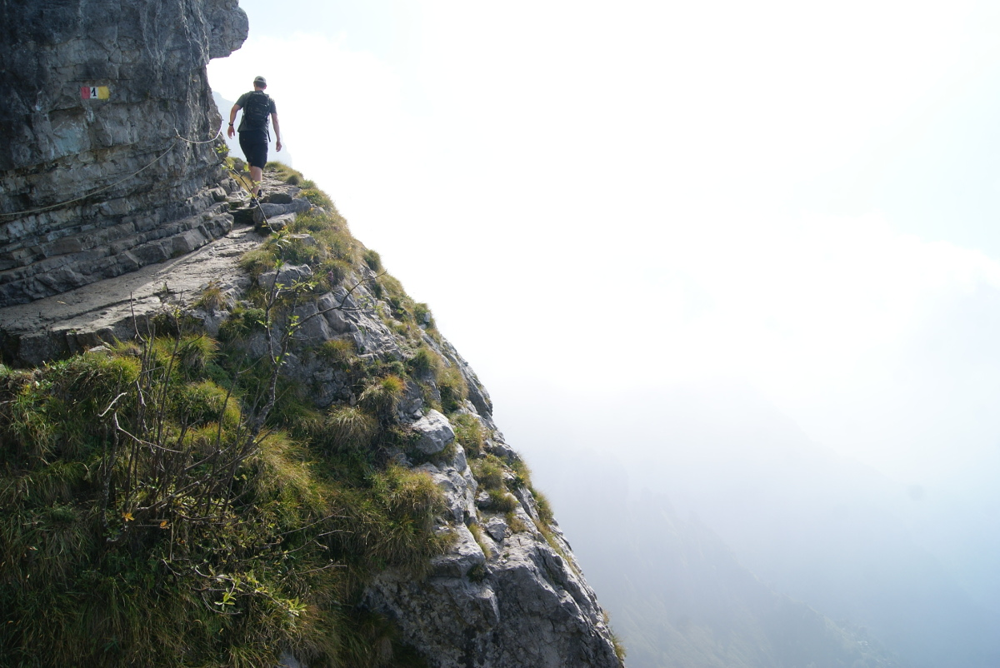

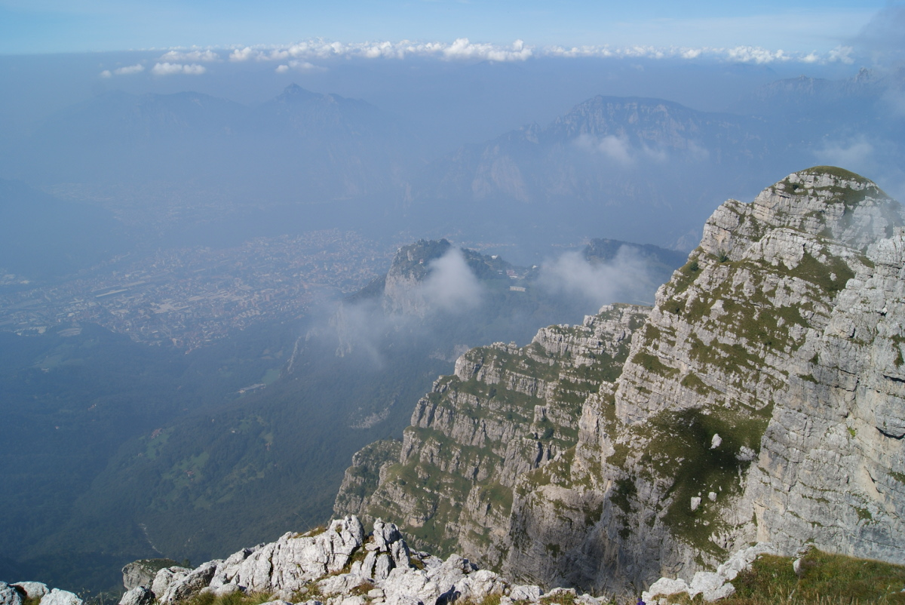

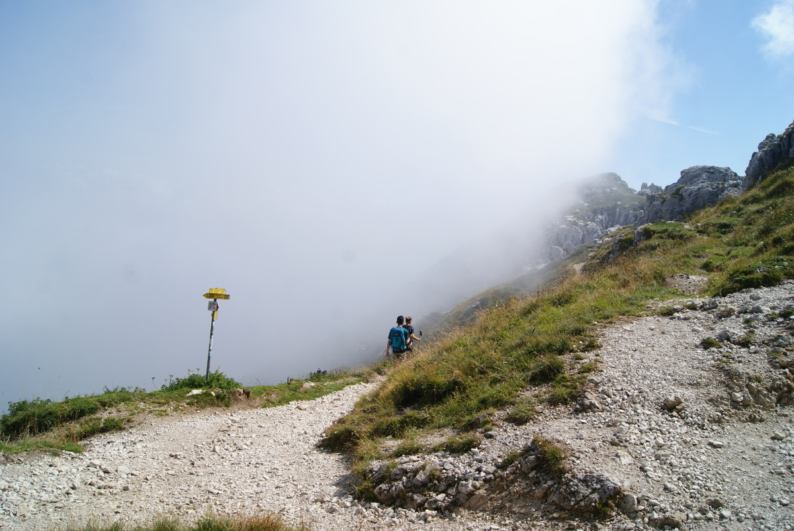

Het uitzicht vanaf de top was echt prachtig: overal om ons heen bergen, en wanneer de wolken opzij schoven, konden we
 verre bergtoppen zien en natuurlijk het Comomeer. Alles samen was het een spectaculaire belevenis! We bleven 
 er een tijdje staan om de bergtoppen te bewonderen. Met meer dan 30 toppen aan de horizon vond ik het erg handig
  om de metalen plaat te bekijken waarop ze allemaal aangeduid stonden, samen met hun naam en hoogte. Naast de 
  top staat een berghut waar je snacks, een broodje of zelfs een eenvoudige warme maaltijd kunt krijgen.

We besloten een ander wandelpad uit te proberen en via pad nummer 10 terug te keren naar Piani d'Erna (langs enkele
 toppen: Punta Stoppani, Manzoni en Dente). Dat pad is minder populair en bevatte helaas veel meer losse stenen,
  waardoor afdalen behoorlijk moeilijk was omdat de kans om te vallen groot was.
   Onze spieren stonden voortdurend gespannen en waren na het eerste moeilijke stuk met enkele kettingen 
   en vallende stenen erg moe. Bovendien werd het erg mistig en was het zicht heel beperkt, zoals je op de foto's hieronder kunt zien. 
   Als je echt niet graag twee keer hetzelfde pad volgt, raad ik aan om via 
   route nummer 10 naar de top te gaan en via nummer 1 af te dalen. Dat pad is nog altijd moeilijk, maar heeft minder losse stenen, die 
   vooral tijdens het afdalen vervelend zijn.

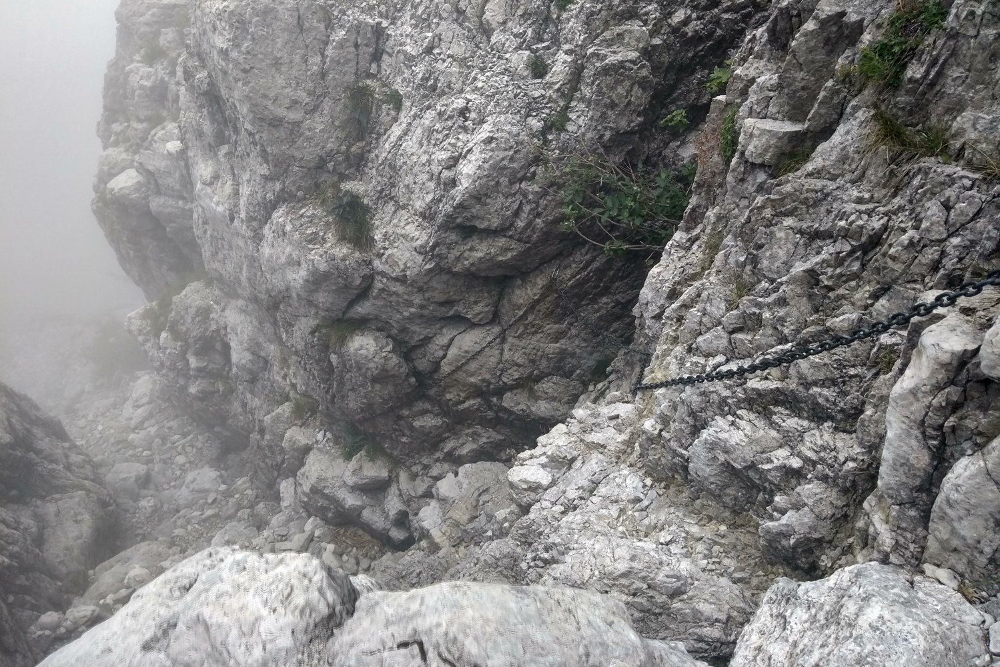

  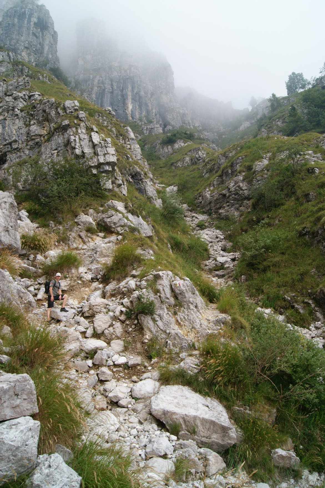
  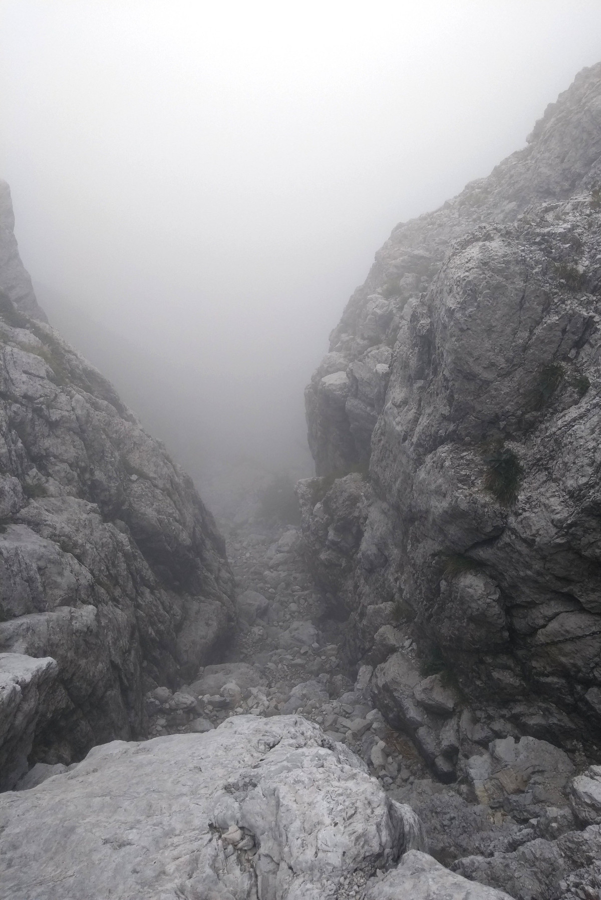

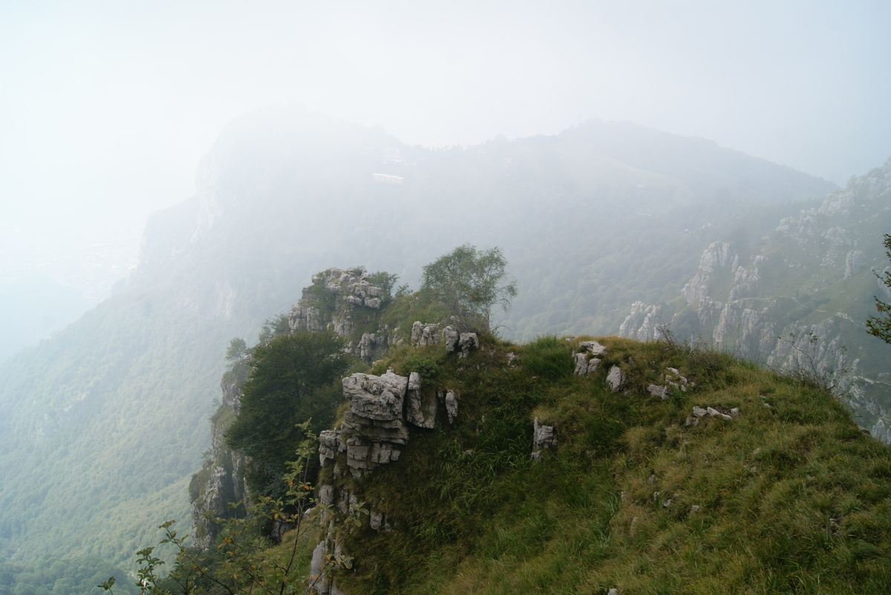

## Praktische informatie:

Als je vreest dat dit te zwaar voor je wordt, maar toch van de spectaculaire uitzichten wilt genieten, is de kabelbaan naar Piani d'Erna een goed idee. Zo wordt de wandeling een stuk korter en hoef je daarna "maar" ongeveer 550 hoogtemeters tot Monte Resegone te overbruggen. Op de kaart hieronder zie je onze wandeling en de afstand. We deden er bijna 4 uur over om er te komen en bijna even lang (pauzes inbegrepen) om terug te keren. We haastten ons niet en genoten gewoon van de dag. Zoals altijd kwam de navigatie-app MAPS.ME goed van pas om onze positie te controleren en een kortere weg naar onze kamer in Lecco te vinden. Je kunt eenvoudig kaarten downloaden van de streek waar je verblijft en ze offline gebruiken (kaarten van meer dan 100 landen ter wereld staan klaar om te downloaden!). De app werkte zelfs in Marokko, toen we een tiendaagse wandeltocht door het Atlasgebergte maakten, waar de paden niet echt gemarkeerd en moeilijk te vinden waren. We raden deze app ten zeerste aan, zowel voor wandelingen als voor het bezoeken van bezienswaardigheden. [MAPS.ME-app](https://apps.apple.com/us/app/maps-me-offline-map-nav/id510623322)

Het pad was duidelijk gemarkeerd met rood-wit-gele kleuren en het cijfer één in het midden. Je hoeft niet bang te zijn om te verdwalen: kijk gewoon goed uit naar de markeringen op de rotsen of bomen. Het is een populaire bestemming bij Italianen en we kwamen er dan ook veel tegen op het wandelpad (of misschien was het druk omdat het zaterdag was). Wij deden de wandeling op onze trailrunningschoenen (Salomon Speedcross 4 en Salomon SENSE RIDE), maar hoge wandelschoenen zijn hier zeker aan te raden. Wij zijn gewend om met lichtere schoenen te wandelen en voor ons werkt dat prima. Gebruik materiaal waar je je goed bij voelt; dit is niet de plek om te experimenteren ;-)

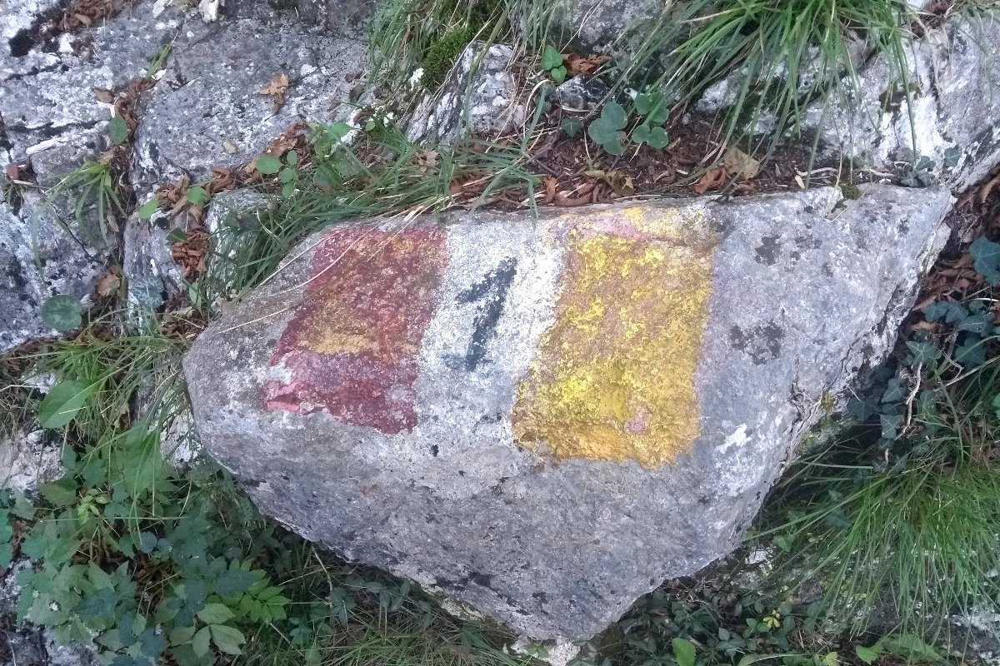

Dat weekend waren er veel activiteiten in Lecco. Naast de bijeenkomst over klimaatverandering was er op de dag dat wij naar Monte Resegone gingen ook een obstakelloop. Op de terugweg zagen we hoe de deelnemers moeite hadden om over een grote muur te raken en een hindernis met veel touwen te beklimmen. We hebben zelf een paar keer deelgenomen aan obstakellopen in Duitsland en België en kunnen zo'n activiteit van harte aanbevelen: het is een geweldig avontuur :) Neem een kijkje op [Scigamatt in Lecco](http://www.scigamatt.com/site/index.php/) als je tijdens je volgende vakantie iets ongewoons wilt proberen.

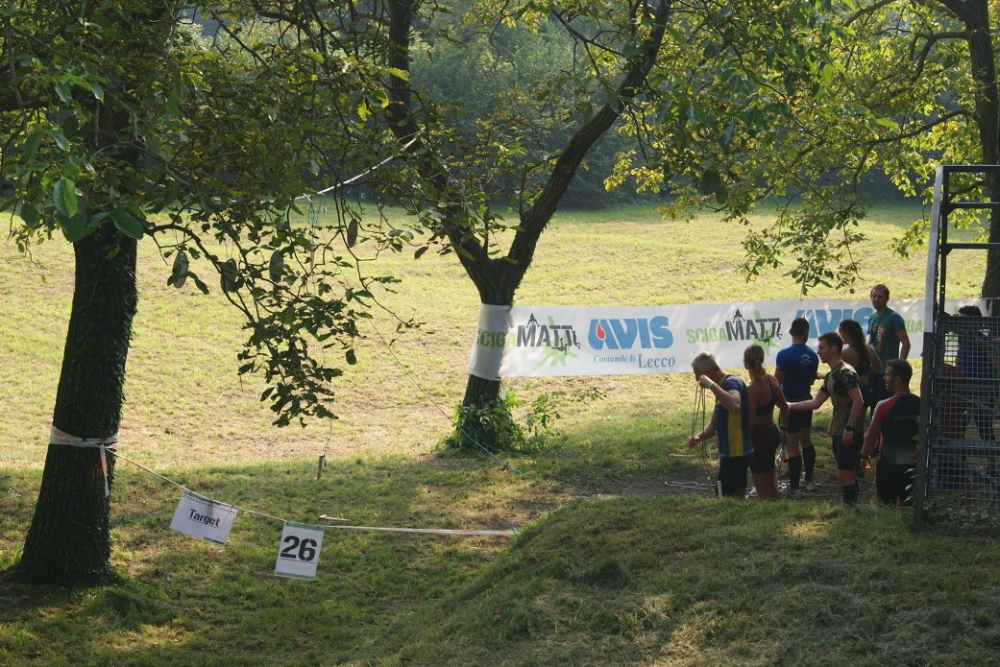

