Na onze wandeling naar de [Monte Resegone]() en een daguitstap met de 
veerboot rond het Comomeer, was het eindelijk tijd voor een nieuwe wandeling, deze keer naar de Monte Coltignone. Het zou een 
zware tocht worden, en dat was het zeker. Drie kilometer en 1000 hoogtemeters, dat kan niet goedkomen :) 
Eerst namen we de bus naar Laorca (meer daarover bij de praktische info), waar we aan de wandeling begonnen. 
Je kunt de top via twee wandelroutes bereiken: één langs Medale en een gemakkelijkere maar langere route, die ook 
het populairst is. We wandelen niet graag via dezelfde weg naar boven en weer naar beneden, en uiteraard wilde ik 
nog wat meer klauteren. Dat was gegarandeerd als we voor de eerste optie kozen: het Santiero G.E.R.-pad (nummer 59). 

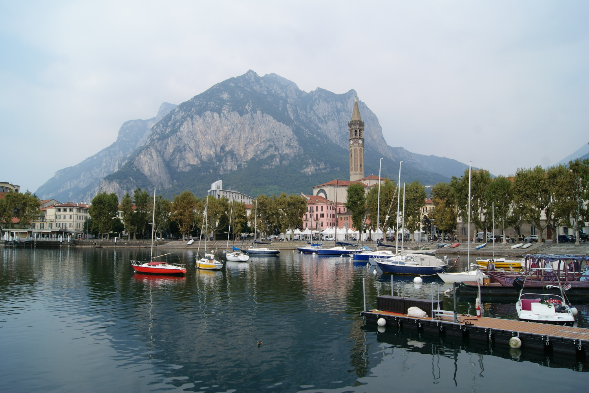

Lecco, de stad zelf vond ik niet bijzonder, maar de omringende bergen maakten deze plek een stuk 
mooier. Como heeft zijn prachtige kathedraal, Varenna zijn kasteel met een spectaculair uitzicht, 
Bellagio zijn dure winkels en Lecco zijn spectaculaire bergen. Je moet er wel wat meer moeite voor doen (en 
meer zweten :p) om ervan te genieten.

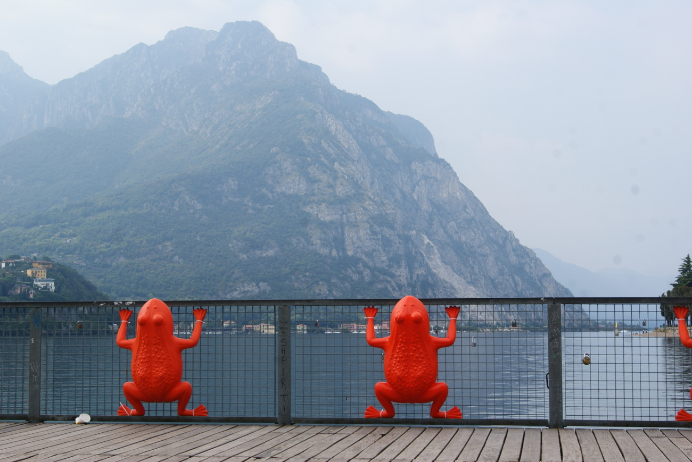

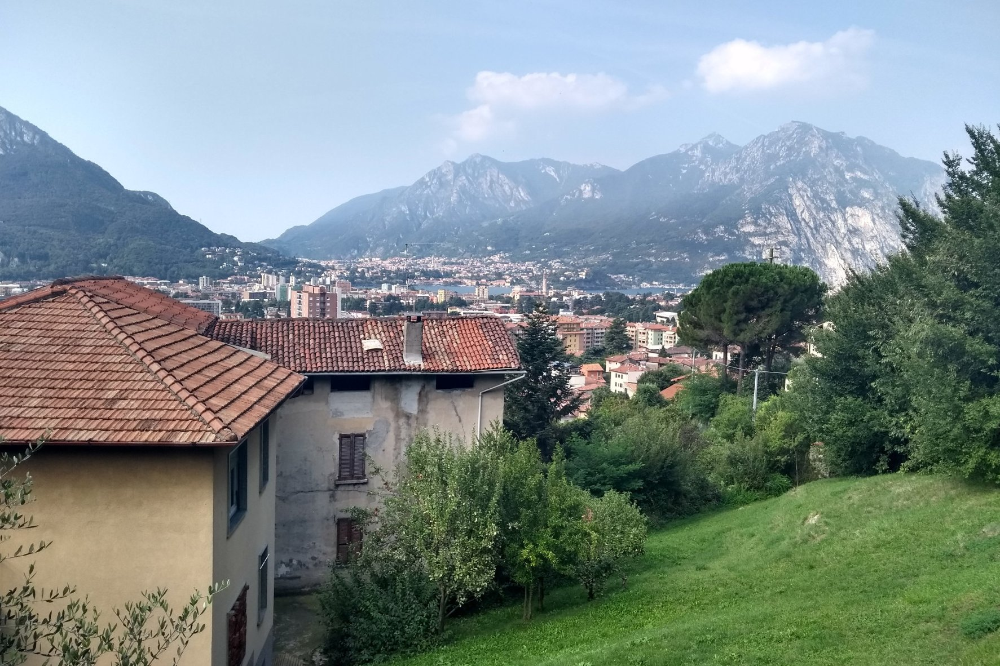

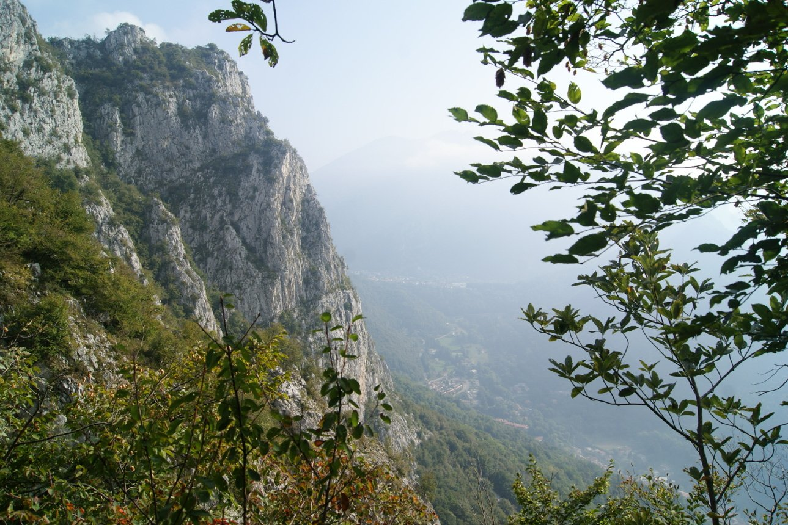

De hele weg omhoog was echt steil! Alleen de eerste paar honderd meter niet, toen we enkele huizen passeerden voordat we het bos in gingen. 
Terwijl we de berg beklommen, werd het pad geen moment vlakker en onze kuiten deden nog flink pijn van de vorige 
wandeling. We liepen dus langzaam maar gestaag verder, tot we uiteindelijk bij het houten bord kwamen dat route nummer 57 naar de Monte San Martino en route nr. 59 
naar de Monte Coltignone (Santiero G.E.R.) aangaf. Daar namen we even pauze en keken we naar de top van de Corno Medale, die heel dicht bij ons lag (we denken 
dat er geen toeristisch wandelpad naar deze top loopt). Nu liepen we over een meer blootgesteld terrein, met rotsen om over te klauteren en kettingen om ons aan vast te houden. Op een bepaald moment passeerden we 
een piepklein grotje met een Mariabeeld, vlak voor het moeilijkste deel van de wandeling :)

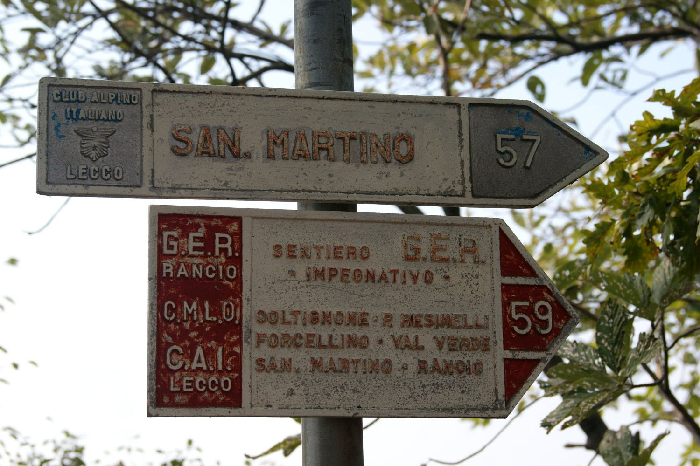

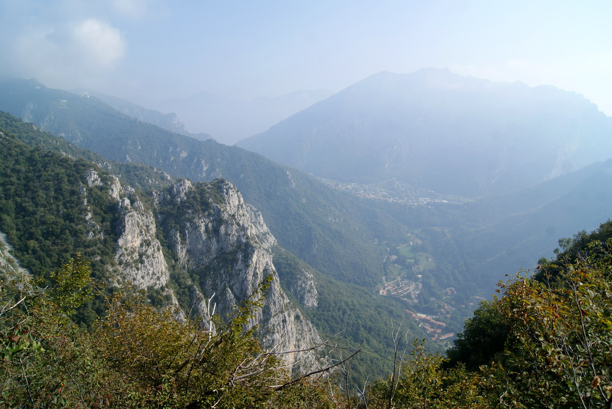

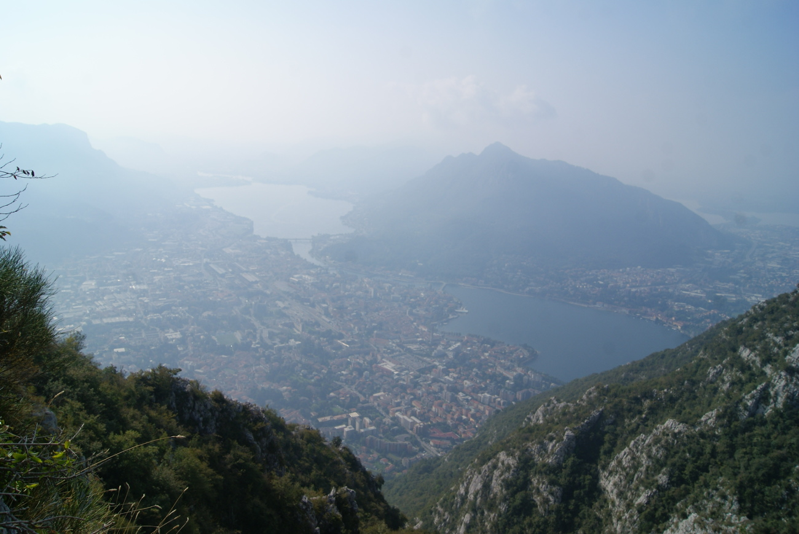

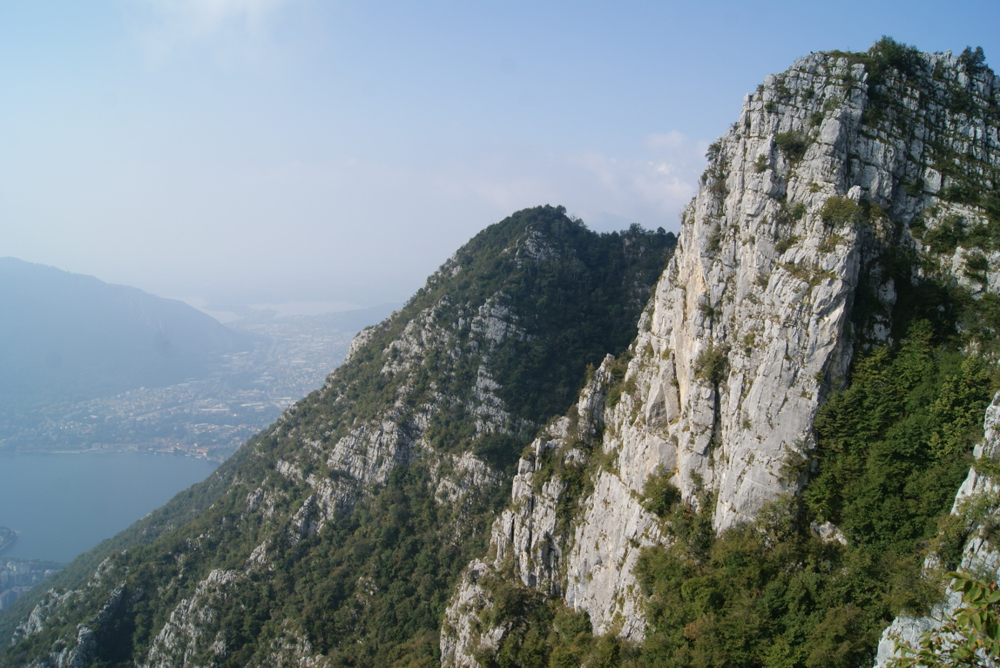

Hoewel het een heel mooie, zonnige dag was, was het zicht niet geweldig. We konden het meer en de verre bergtoppen niet duidelijk zien.
 Toen we de top van de berg bereikten, waren we nogal verbaasd dat er aan de andere kant een groot bos lag, na het hele steile 
 stuk dat we net hadden afgelegd. Je hebt er dus een mooi uitzicht, maar slechts aan één kant van de berg: de kant die wij hadden gekozen om de top te bereiken.

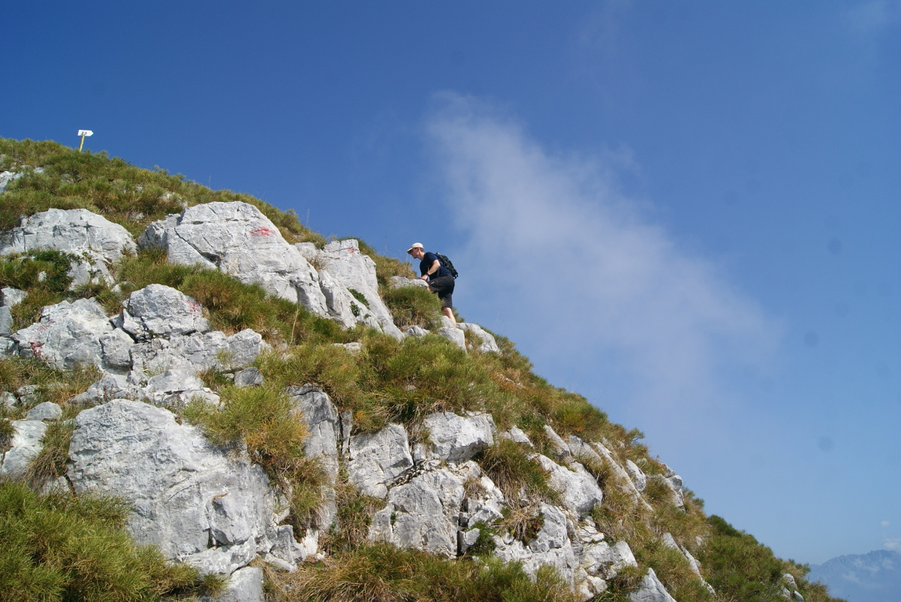

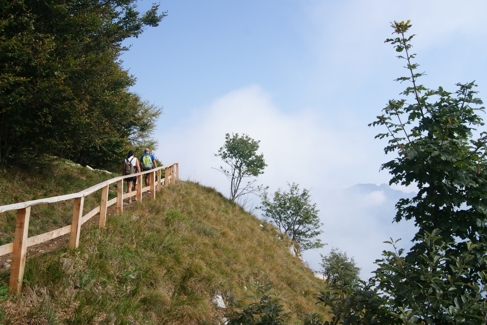

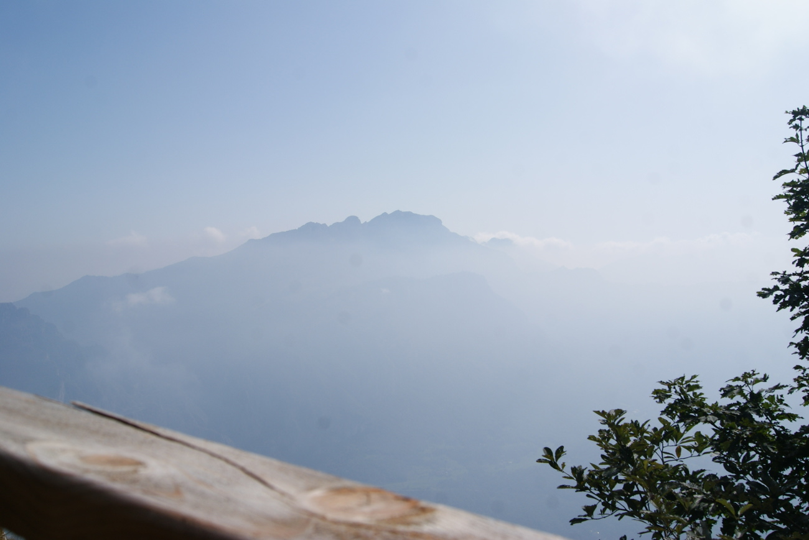

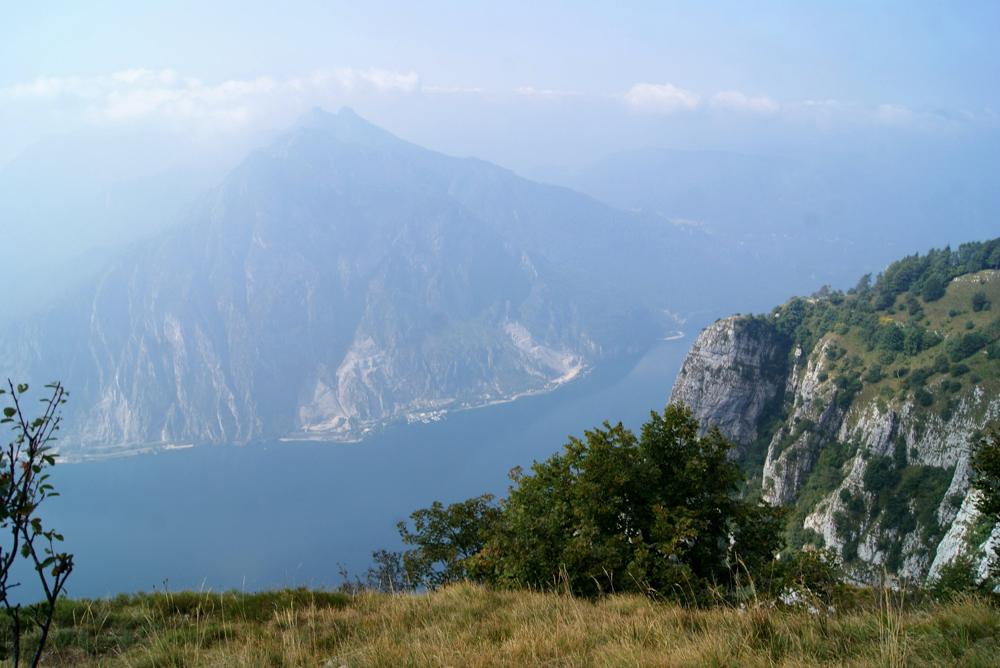

De Monte Coltignone ziet er vanaf de andere kant totaal anders uit. Die kant is via een breed, gemakkelijk pad te bereiken vanaf de berghut S.E.L. Rocca-Locatelli in 
Piani Resinelli (je kunt er je auto parkeren). Tussen de top en de berghut konden we in de verte de indrukwekkende toppen van het Grignamassief
 bewonderen (de eerste foto hieronder). Op de terugweg passeerden we het Casa Museo di Villa Gerosa en de berghut S.E.L. Rocca-Locatelli in Piani Resinelli, die
  helaas gesloten was. Daarna volgden we de beek Torrente Calolden, waar het pad steiler en erg rotsachtig werd, tot we uiteindelijk
   het dorp Laorca weer bereikten. Het pad dat we namen om van de Monte Coltignone af te dalen, was veel gemakkelijker. Het was natuurlijk steil en vermoeiend, maar niet gevaarlijk 
   (geen blootgesteld terrein of kettingen). 

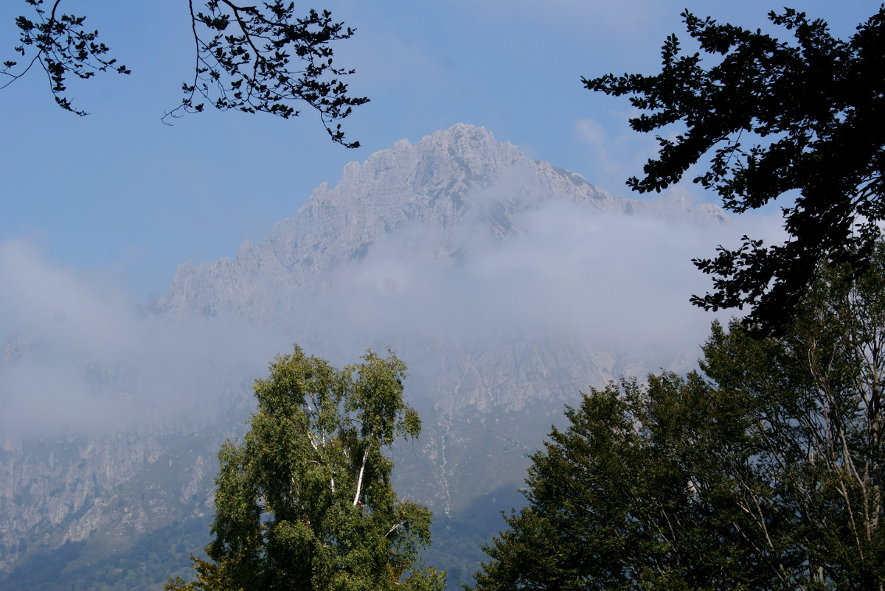

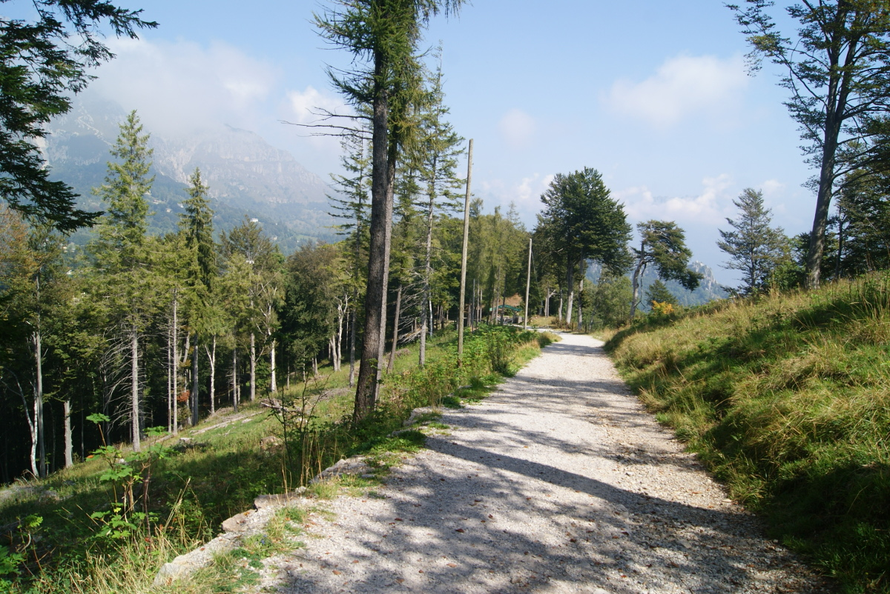

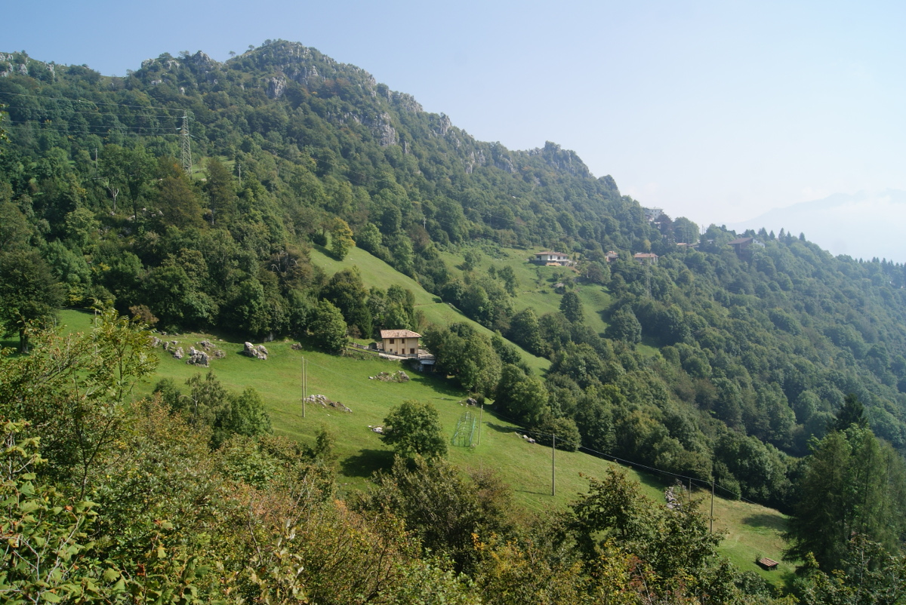

Nog een laatste sprintje om de volgende bus te halen, en we waren weer op weg naar Lecco.

## Praktische info:

We reisden met de trein van Como S. Giovanni naar Lecco (4,80 euro per persoon). De trein was ons voornaamste vervoermiddel tussen de steden in Italië. De dienstregeling vind je gemakkelijk online. Meestal kochten we ons ticket aan een automaat, aan het loket in het treinstation (Trenitalia) of in een krantenwinkel (Trenord). Winkels die ze verkopen, hebben een sticker van Trenord in de etalage. Je kunt ze niet kopen aan de automaten van Trenitalia. Bekijk beide websites: [Trenord](http://m.trenord.it/site-lite/index.html) en [Trenitalia](https://www.trenitalia.com/en.html). In Lecco kun je voor 13 euro een buskaart met 12 ritten kopen (een enkele rit kost 2 euro). Je kunt die met meerdere personen tegelijk gebruiken (je hoeft ze alleen meerdere keren te valideren). Het ticket is 90 minuten geldig en binnen die tijd mag je overstappen, dus het is een behoorlijk voordelige optie. De dienstregeling van de bussen vind je hier: [Bussen in Lecco](http://www.lineelecco.it/tpl/orari-invernali/)

We begonnen de wandeling in Laorca, waar we met bus 7 naartoe reden (bus 1 rijdt er ook naartoe; die namen we op de terugweg. De bussen rijden helaas erg weinig, dus je kunt de dienstregeling beter vooraf bekijken). De bushalte heette Laorca Asilo op [MAPS.ME](https://maps.me/). We besloten onze positie te volgen, zodat we op het juiste moment op de STOP-knop in de bus konden drukken. Dat werkte heel goed. Nadat we waren uitgestapt, volgden we eerst de Via Giuseppe Baruffaldi (op de hoek van deze straat lag een bushalte in de tegenovergestelde richting) tot aan de kerk. Daarna volgden we de Via alla Grigna tot aan de parking, waar we een informatiebord vonden dat de weg wees naar het begin van het pad naar de Monte Coltignone. Bekijk de volledige wandeling op de kaart hieronder.

Er is ook een heel mooie en gemakkelijke wandeling naar de Monte Barro. Op een avond ging ik lopen op de flanken van de berg. Het uitzicht op het meer en de stad was erg mooi en vanaf de top moet het nog mooier zijn. Nadat je de brug Ponte Azzone Visconti bent overgestoken, ga je gewoon naar de overkant van de straat. Iets naar links ligt een smal straatje, de Via San Michele, met een bord dat aangeeft hoelang je erover doet om de top te bereiken (ongeveer 2 uur). Het is er heel aangenaam lopen: de stenen liggen er goed vast, waardoor ik me vrij comfortabel voelde. Langs het meer loopt ook een pad om te lopen en te fietsen, dat ik op de terugweg uitprobeerde (zie de kaart hieronder).

