Dit was onze eerste kans om er een dagje op uit te trekken nadat de coronamaatregelen waren opgeheven. En omdat onze vriend uit Berlijn op bezoek was,
wilden we het mooie weer absoluut benutten en naar het strand gaan :D Omdat we de drukte nog altijd wilden vermijden en gewoon van de ongerepte natuur
wilden genieten, kozen we voor het kleine natuurgebied Oranjezon in Zeeland, een deel van Nederland dat uit verschillende eilanden en schiereilanden bestaat.
Het was een zonnige dag, maar door de lichte (en soms minder lichte) bries hadden we het af en toe behoorlijk koud en waren warme jassen onmisbaar! Al bij al
waren de omstandigheden perfect voor een lange wandeling en verrassend genoeg waren er maar weinig mensen in het natuurgebied. Bijna alle toeristen bleven
op het strand (slimme mensen met hun windschermen! :p), dat nog altijd breed genoeg was om voldoende afstand tussen de gezinnen te bewaren en ons veilig te
voelen. Laten we samen aan onze wandeling beginnen!
 

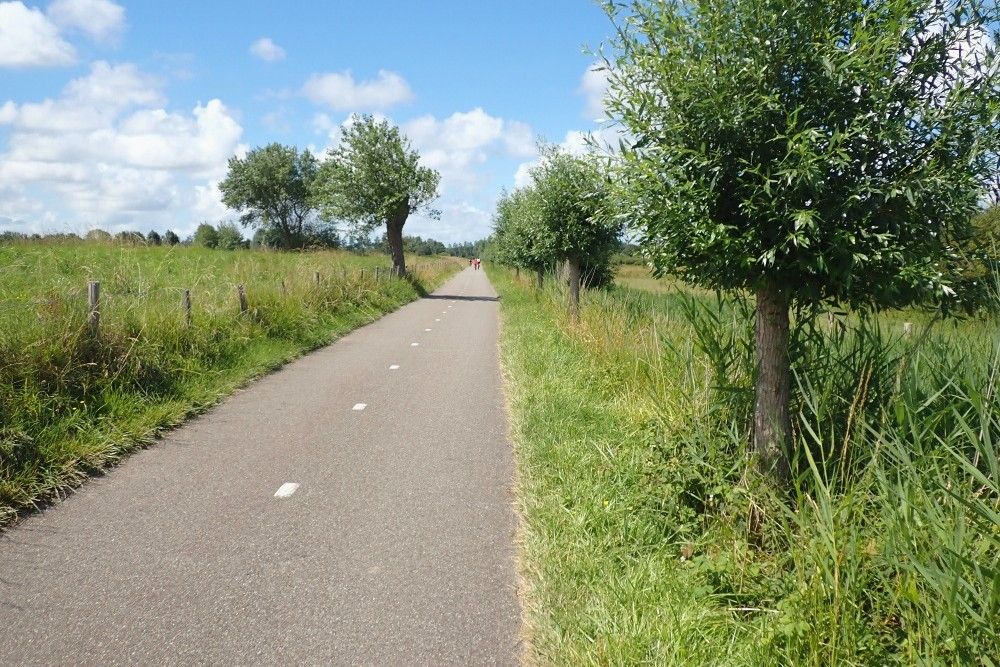

 Fietspad tussen de campings dat we volgden tot aan de ingang van natuurgebied Oranjezon
 

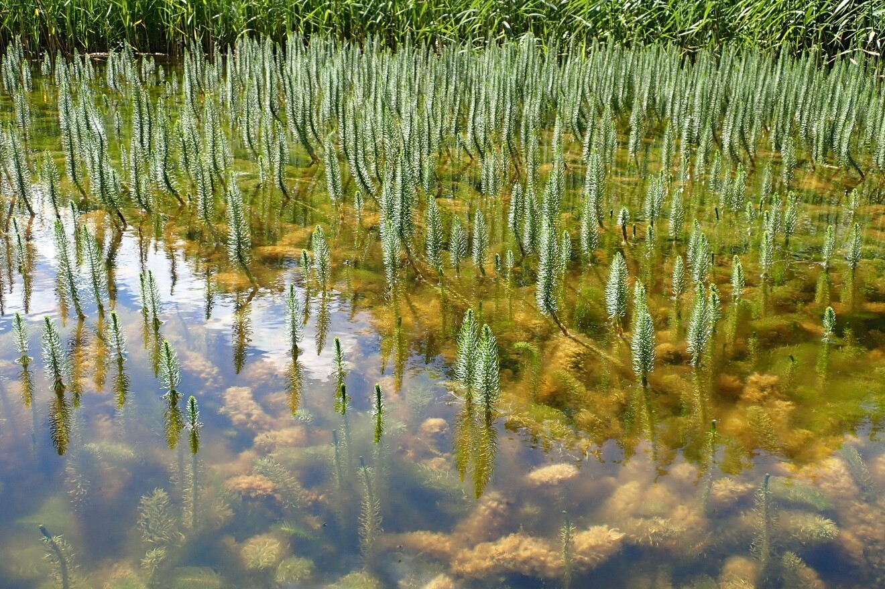

 De prachtige natuur trok meteen onze aandacht toen we het natuurgebied binnenkwamen
 

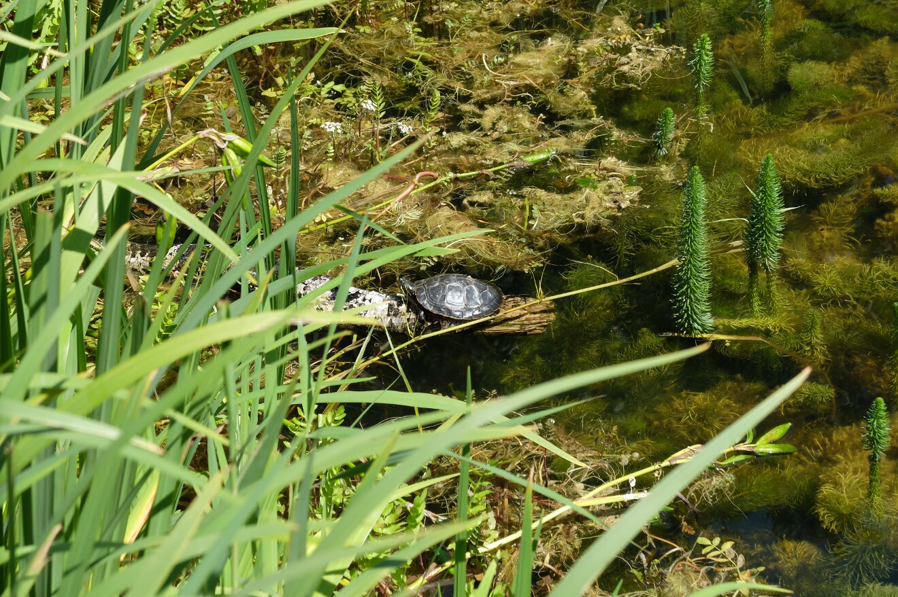

 De kleine vijver was niet alleen een perfecte plek voor allerlei bijzondere planten, maar ook de thuisbasis van dit kleine schildpadje,
 dat heerlijk in de zon lag te zonnen
 

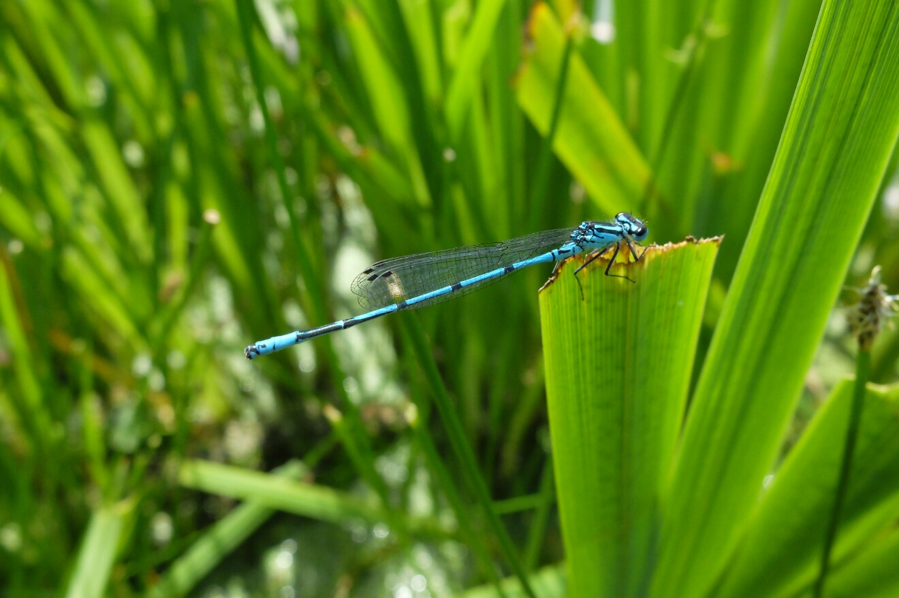

 Onze vriend merkte deze prachtige libel op en slaagde er heel stilletjes in om er deze schitterende foto van te maken! 
Helaas jaag je ze zo gemakkelijk weg, dus moet je geluk hebben of heel geduldig zijn
 

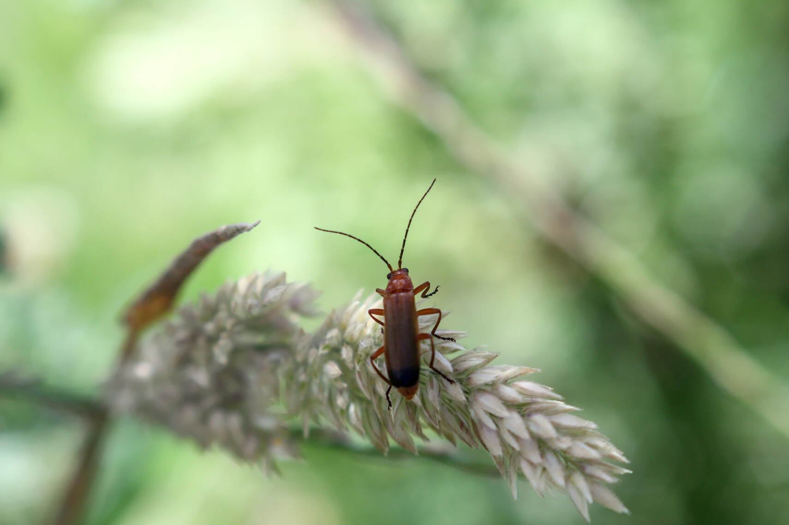

 Deze plek krioelde van de insecten: een uitgelezen kans voor liefhebbers van macrofotografie zoals wij!
 

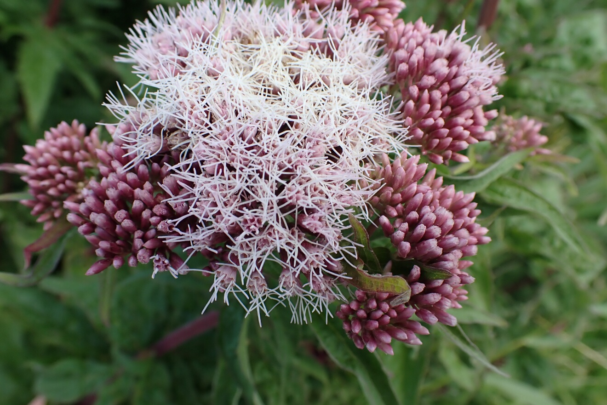

 Eupatorium cannabinum, algemeen bekend als koninginnenkruid (volgens Wikipedia), trok mijn aandacht met
zijn prachtige roze kleur
 

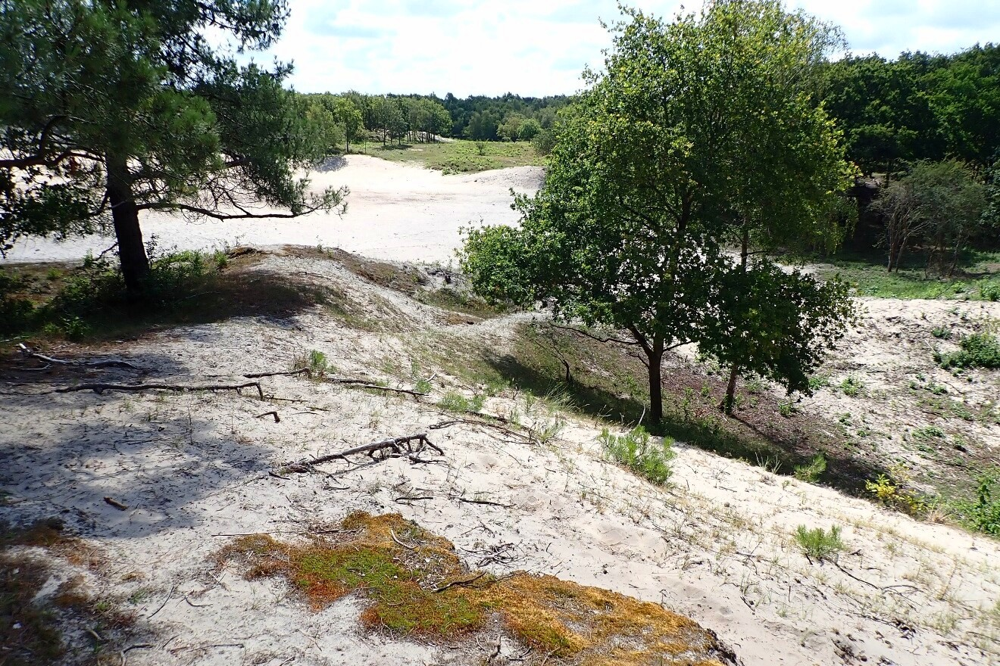

 Het rustige naaldbos deed me denken aan de Poolse kust. Op de zanderige bosgrond lagen veel dennenappels
en het zachte geruis van de wind bracht ons allemaal in een heel ontspannen stemming
 

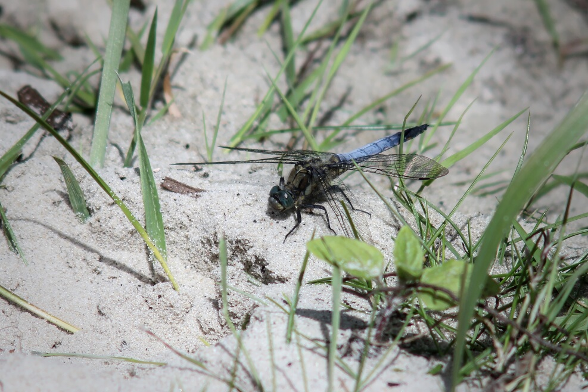

 Nog een libel! :D 

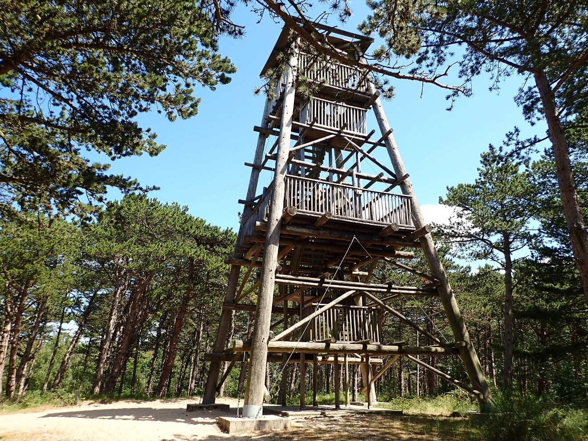

 Ik was echt teleurgesteld dat de uitkijktoren gesloten was! Volgens het informatiebord werd hij
gerenoveerd, maar in mijn ogen zag hij er nog altijd in perfecte staat uit. Later zagen we hem opnieuw in de verte, waar hij een beetje boven de
bomen uitstak. Het uitzicht van daarboven moet dus prachtig zijn. 
 
 
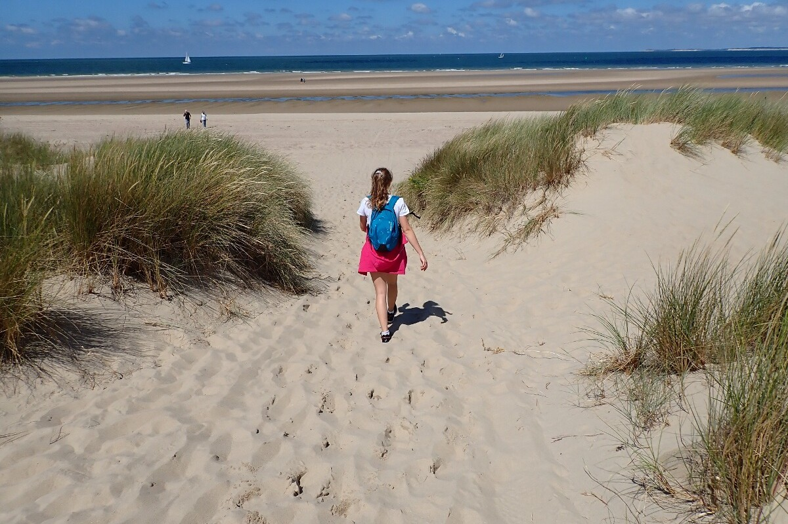

 Het plan was om langs de kust terug naar de auto te wandelen en daarna op het strand te picknicken voor we
weer naar België vertrokken
 

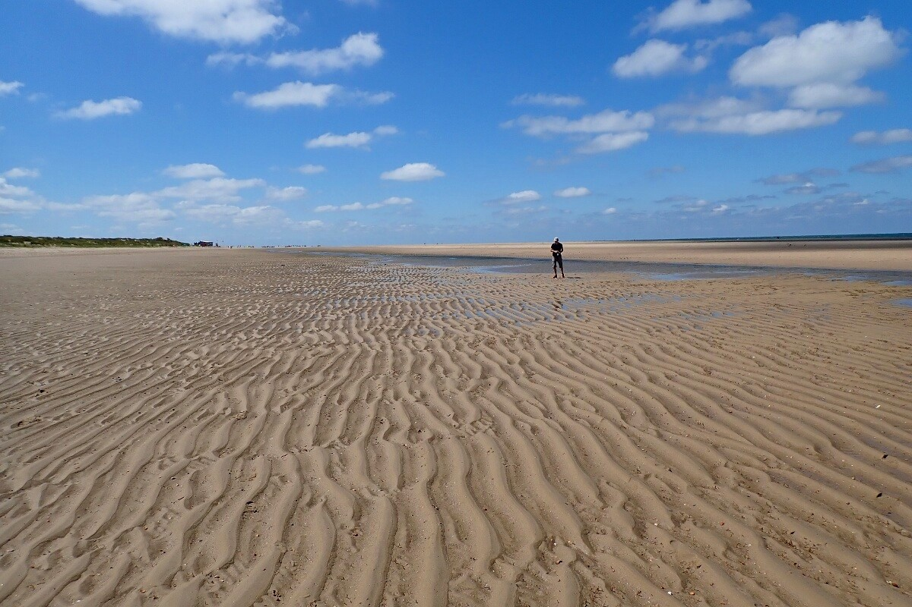

 Bij eb hadden we enorm veel ruimte om te wandelen en ontstond er een interessant patroon in het zand. Elke maansdag is het
twee keer eb en twee keer vloed, en de precieze tijdstippen kun je online opzoeken 
 

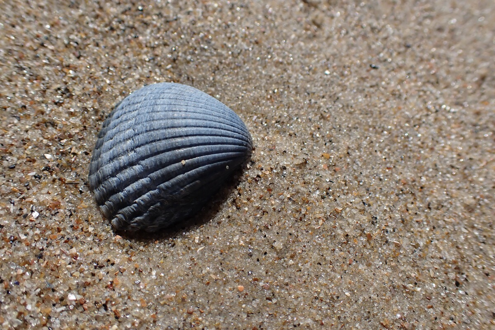

 Bij eb lagen er ontzettend veel schelpen op het zand, waaronder enkele met heel bijzondere kleuren
 

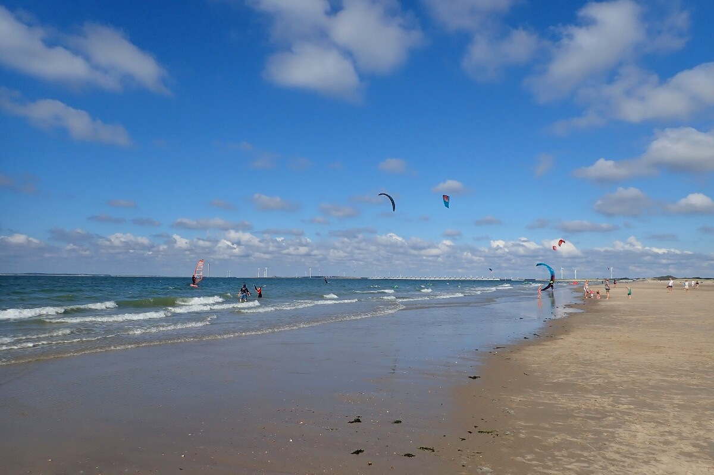

 Omdat het die dag winderig was, maakten veel mensen gebruik van de omstandigheden om te vliegeren
of te windsurfen
 

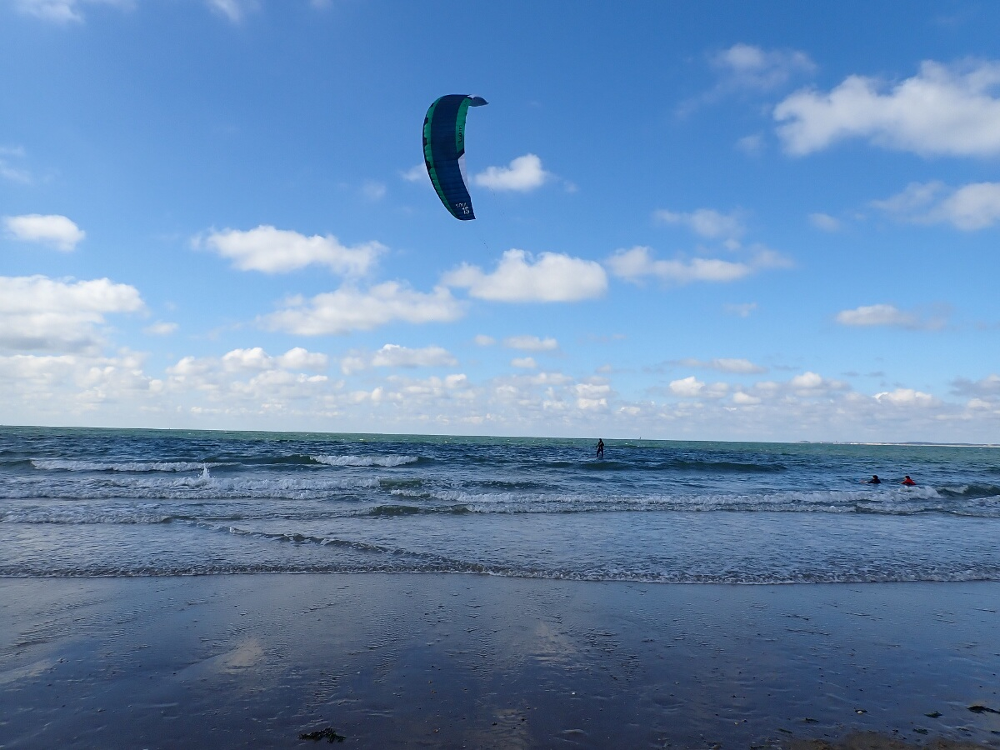

Kitesurfen is hier echt populair!
 

## Praktische info:

  * Toegang tot natuurgebied Oranjezon: 1 euro per persoon. Tickets koop je aan de automaat bij de ingang
  van dit natuurgebied, naast camping Oranjezon

  * Parkeren: 8,0 euro per dag (1,7 euro/u), bij het strand van Vrouwenpolder

  * Onze wandeling was in totaal 12,5 km lang. We vertrokken van de parkeerplaats en volgden eerst het fietspad tot aan de
  ingang van het natuurgebied. De lus die we in het natuurgebied wandelden, is op de kaart hieronder in het groen aangeduid, maar er zijn
  nog enkele andere opties met verschillende afstanden (3 tot 7 km). Je kunt het gebied vlak bij het strand binnenkomen of verlaten, maar de enige plek
  waar je een ticket kunt kopen, ligt bij de hoofdingang. Binnenkomen langs het strand is dus waarschijnlijk niet zo handig. We zijn trouwens
  niemand tegengekomen die onze tickets controleerde. We besloten om via het strand terug naar onze auto te wandelen en dat was een uitstekende keuze!
  Het was heel aangenaam om die paar kilometer langs het water over het stevige zand te wandelen.
  
  
  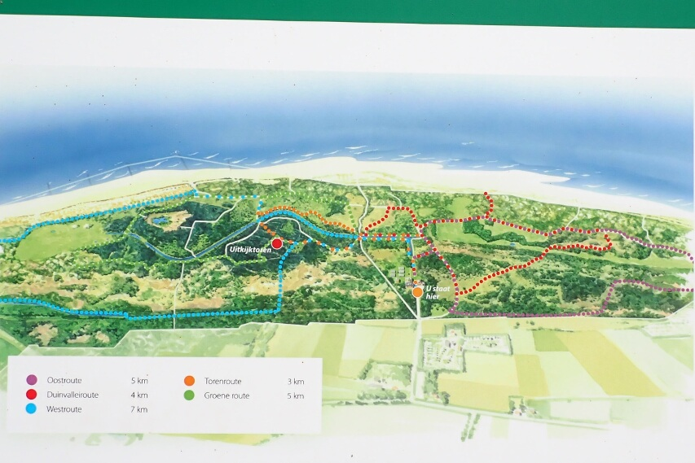
 

