Het weer was opnieuw fantastisch. De lucht voelde wat fris aan, maar er werd geen regen voorspeld en dat was het belangrijkste. Ons plan voor vandaag was om 
Cadzand-Bad, vlak bij de Belgische grens, te bezoeken... te voet! Eerst moesten we rechtdoor 
naar het strand, waar we vlak voor natuurgebied de Zwarte Polder uitkwamen. We waren omringd door groene velden waarin tal van schapen 
rustig in de zon rondliepen. Het was een geweldige plek om meeuwen te spotten: ze vlogen rakelings over onze hoofden. Pas nadat ik mijn telelens had bovengehaald, 
kon ik een paar goede, scherpe foto's van ze maken. Het is een heel rustig gebied met hoog gras en verscholen poeltjes waarin veel 
vogelsoorten nestelen.
 
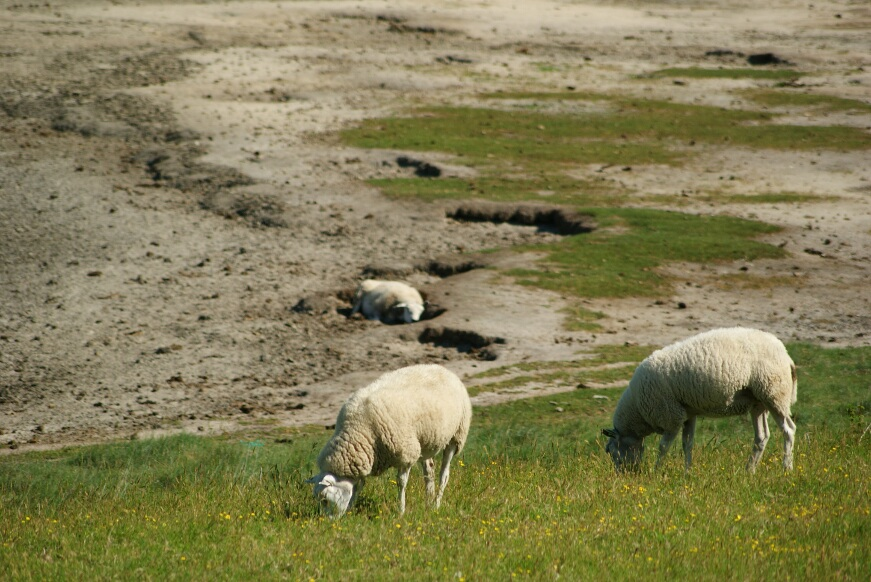
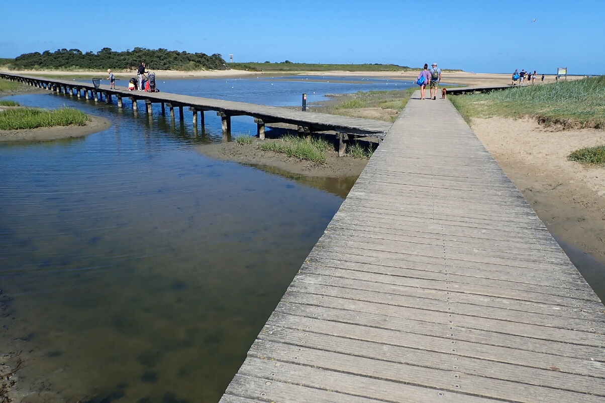
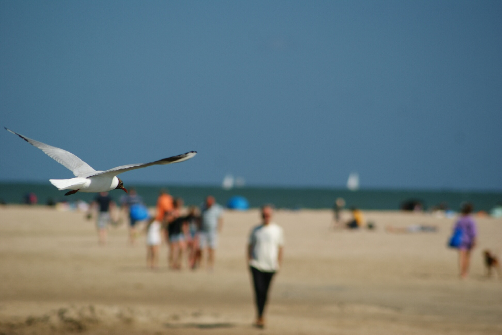
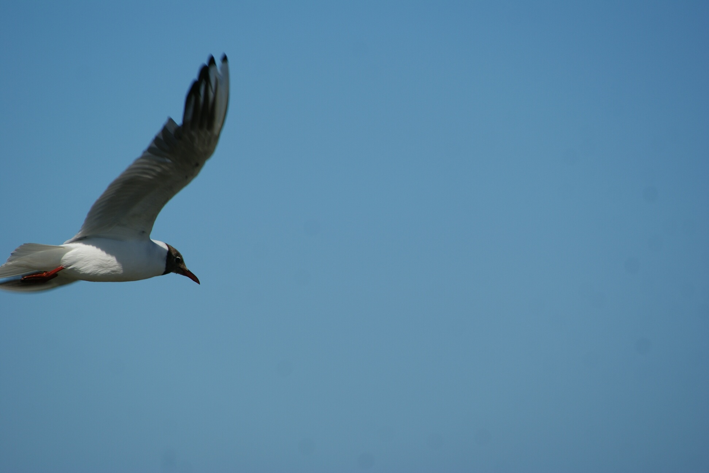
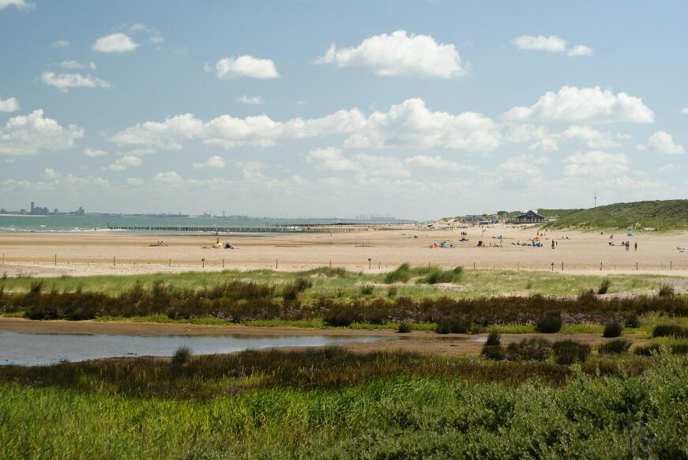
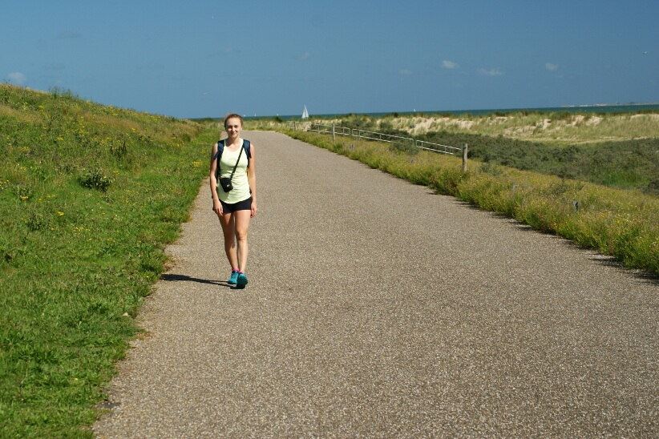
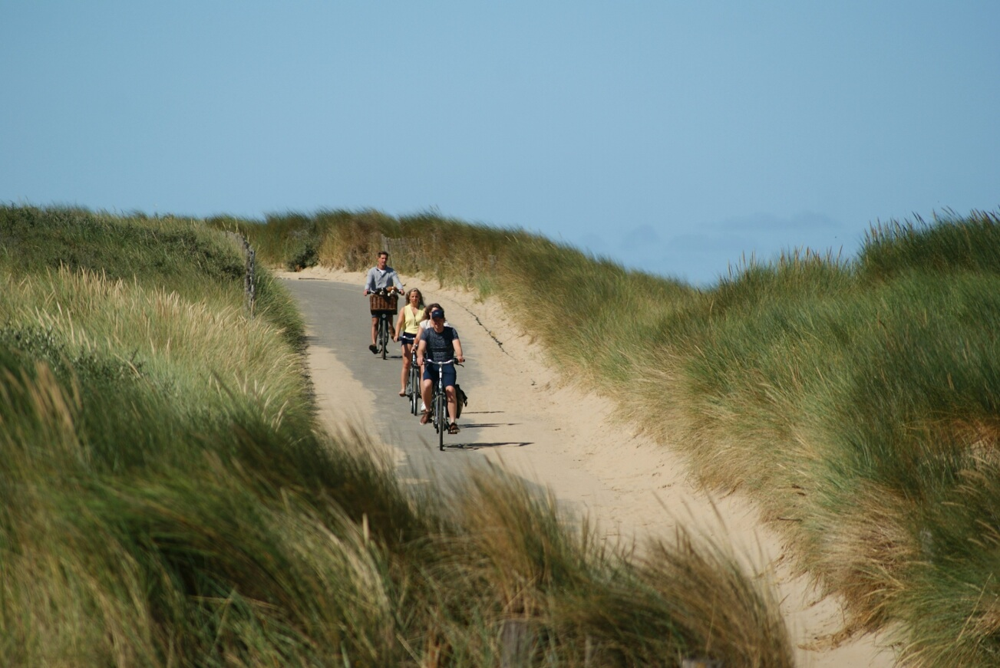

Langs het water wandelen ging heel gemakkelijk, want het zand was er nog nat en vrij stevig. Toen we Cadzand-Bad naderden, 
verschenen er grote hotels en appartementsgebouwen aan de horizon. In Nederland zie je dat zelden, maar de Belgische 
kustlijn staat vol met zulke gebouwen. Ik herinner me Oostende, een Belgische stad met nog hogere hotels. Zulke bebouwing trekt 
heel wat bezoekers aan en ook hier merkten we inderdaad dat het zowel op het strand als in de stad drukker werd. 
Omdat de hotels pal aan het strand stonden, was het niet langer zo rustgevend om op het zand te liggen. Ik geef toe dat het uitzicht vanaf de hogere 
verdiepingen bij zonsondergang prachtig moet zijn, maar het karakter van het strand en de duinen... dat is toch niet meer hetzelfde met die
hoge gebouwen vlak bij de kust.

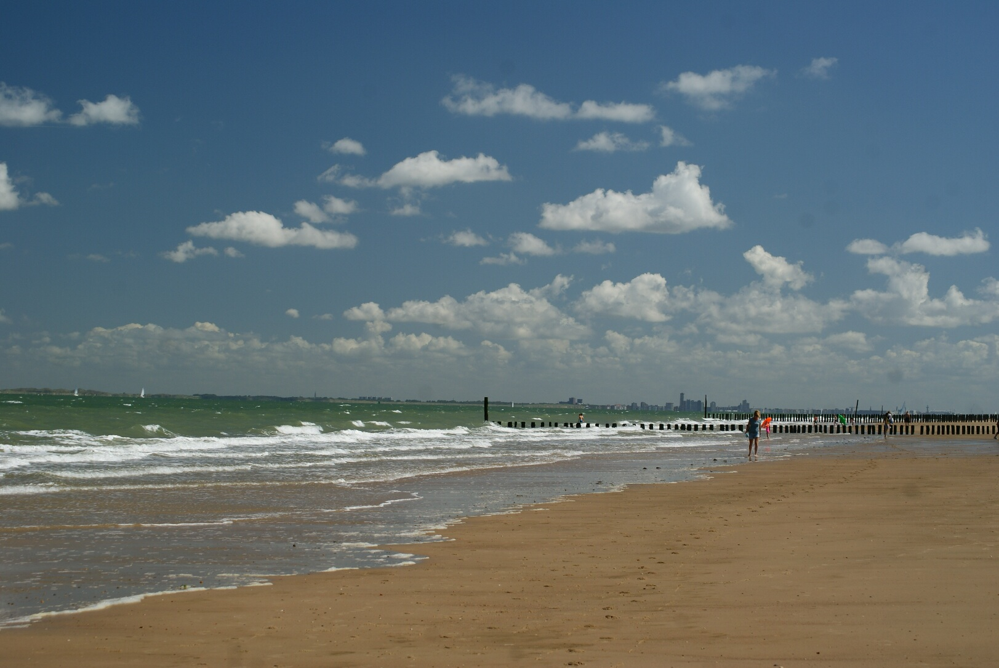
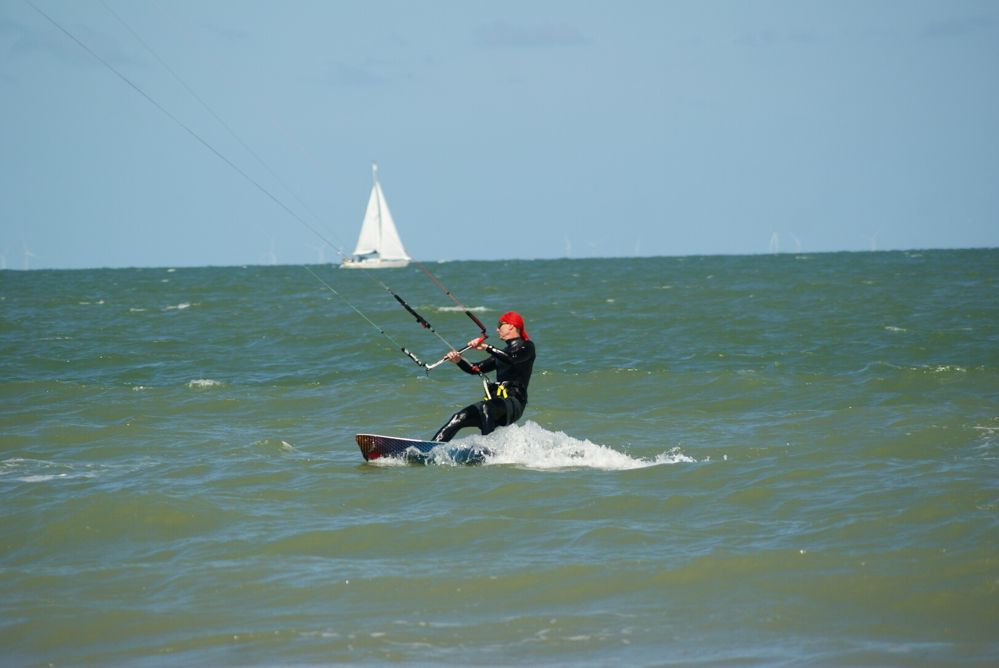
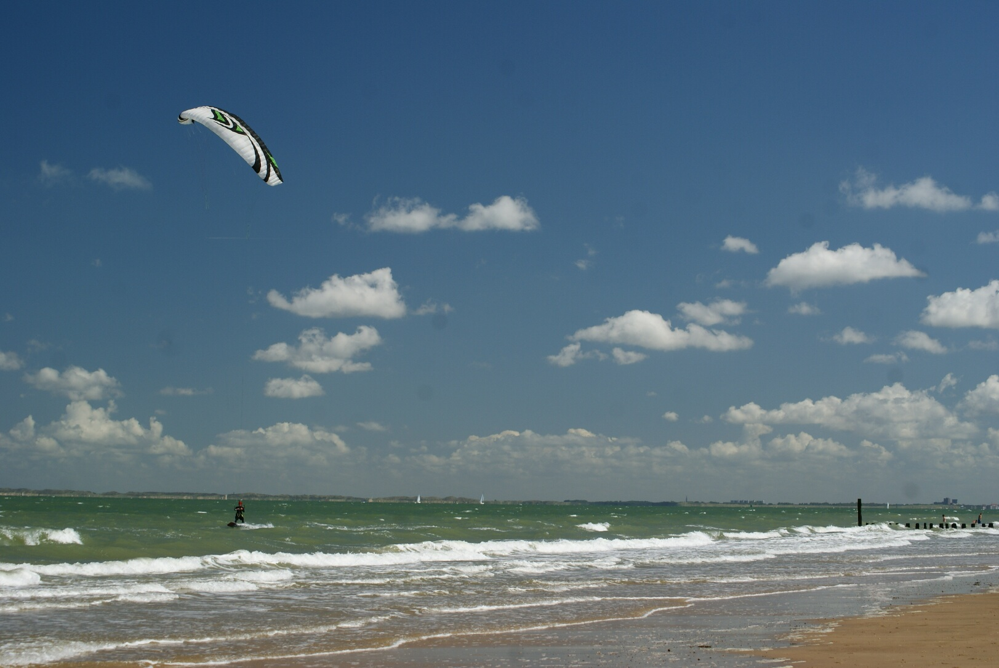

We passeerden een kleine jachthaven en volgden het fietspad richting natuurpark Het Zwin. Uiteindelijk bereikten we een uitkijkpunt vanwaar we 
in de verte een leefgebied van vele vogelsoorten konden zien. Je moet een ticket reserveren om dit park te bezoeken, maar de ingang ligt 
aan de andere kant van de omheining dan waar wij vandaan kwamen, en eigenlijk al in België. De grens tussen beide landen 
loopt dwars door het natuurgebied. Bij het uitkijkpunt dat we bereikten, stond zelfs een klein betonnen paaltje dat de grens met België aanduidde.
We besloten uit te rusten op het strand bij het uitkijkpunt, omdat het er minder druk leek dan bij het stadscentrum, zoals je op de foto hieronder kunt zien.

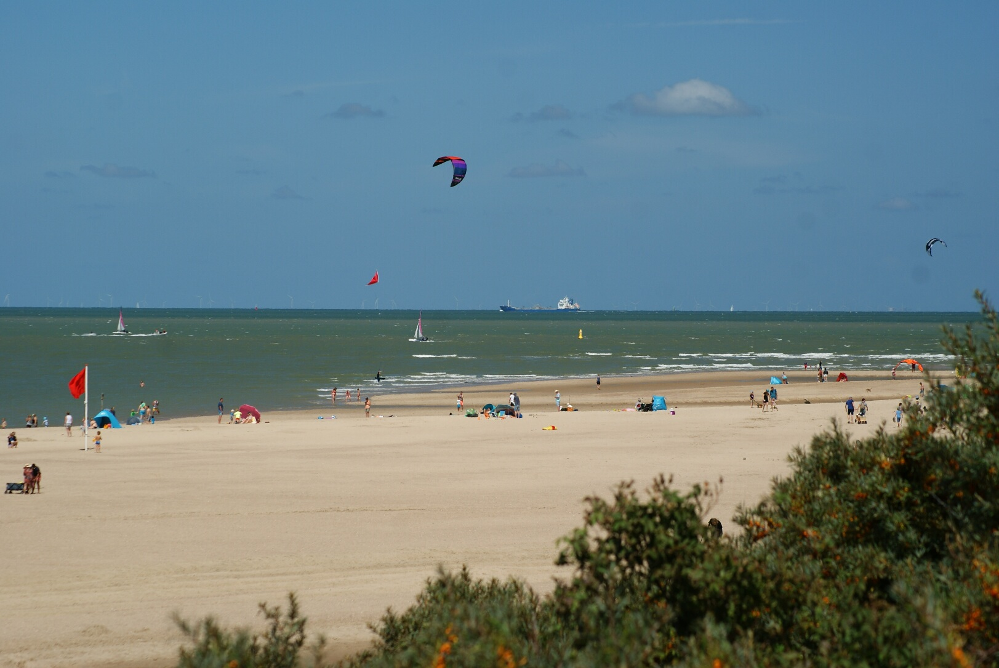

Het was onze laatste avond op de camping en onze laatste kans om de zonsondergang te zien. Ondanks de vele kilometers die we die dag al hadden afgelegd,
moesten we gewoon nog eens naar het strand. Die avond was de hemel bijna helemaal helder. Omdat de meeste mensen hun spullen al hadden ingepakt en naar huis waren vertrokken, 
kwamen we op het strand maar weinig mensen tegen. De plaatselijke manege nam haar paarden mee naar het strand, en dat zag er schitterend uit met de zonsondergang op de achtergrond! :D

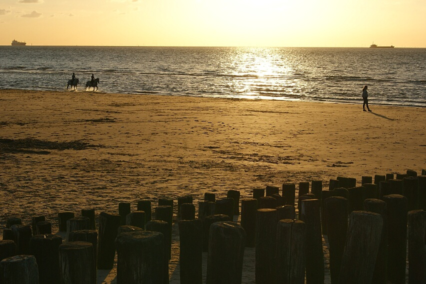
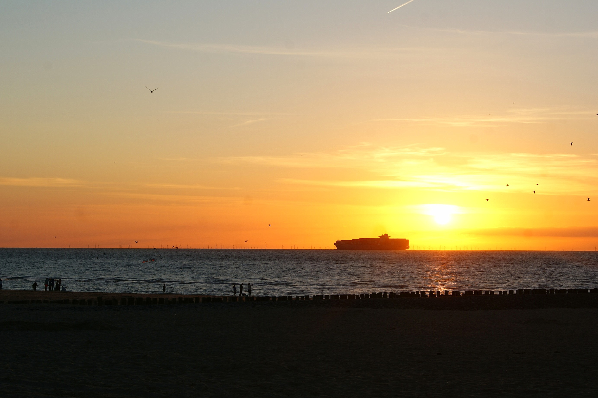

De volgende dag wilden we gewoon op het strand uitrusten en nog wat zon meepikken voordat we weer naar huis reden. Tijdens het joggen op onze eerste avond
had ik vlak voor natuurgebied Waterdunen een grote parking en een mooi strand gezien. We besloten dat het een goede plek was om te verkennen.
Je kunt je mijn verbazing voorstellen toen we midden op een naturistenstrand bleken te staan! Tijdens onze vorige reis overkwam ons precies hetzelfde en sindsdien let ik 
op stranden die als "nudistenstrand" aangegeven staan... maar blijkbaar bestaat er nog een ander woord dat ik niet kende: "naaktstrand". Tja, 
ik heb nog een lange weg te gaan voor ik deze taal echt beheers :D

We wandelden richting het natuurgebied, waar het strand ophoudt. Het natuurgebied bestaat uit draslanden die in verbinding staan met de zee, waardoor je er niet
langs de kust kunt wandelen en eromheen moet. Na een paar uur op het strand besloten we te vertrekken. Net toen we naar de auto wilden terugkeren, zagen we een klein groepje
mensen aan de waterkant dat foto's maakte van iets in het water. Toen ik met mijn camera dichterbij kwam, stak een zeehond haar kop boven water
en speelde ze vrolijk in het water. Dat was een heel leuke en onverwachte ontmoeting!

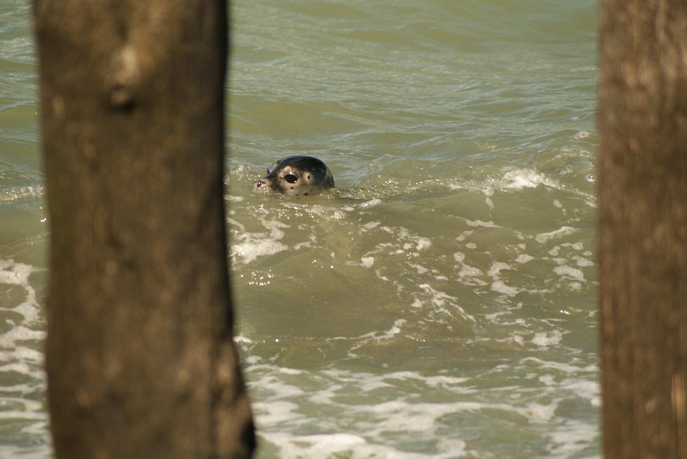
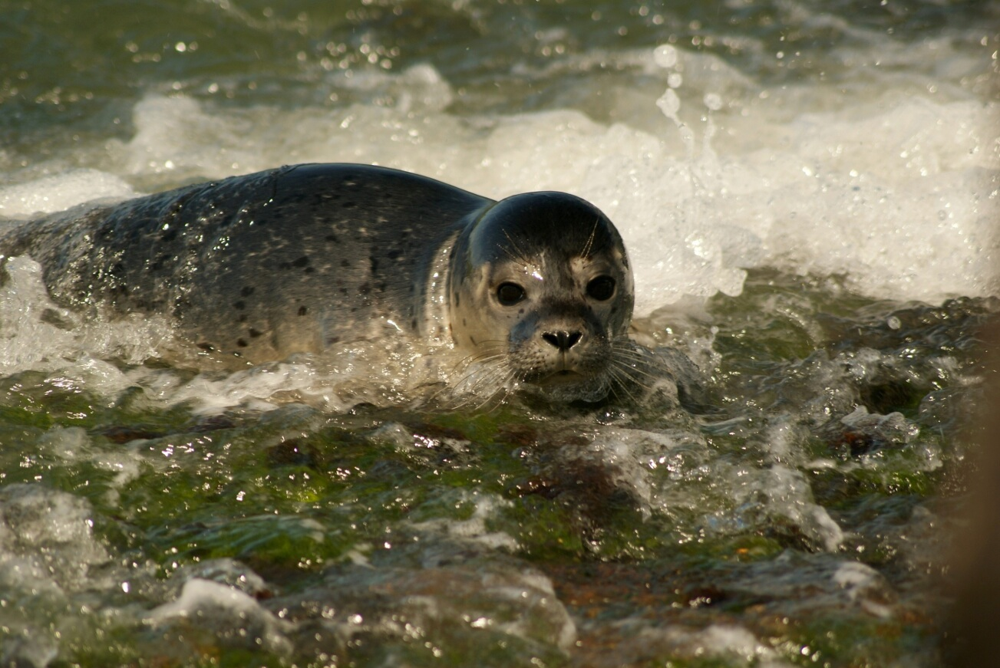
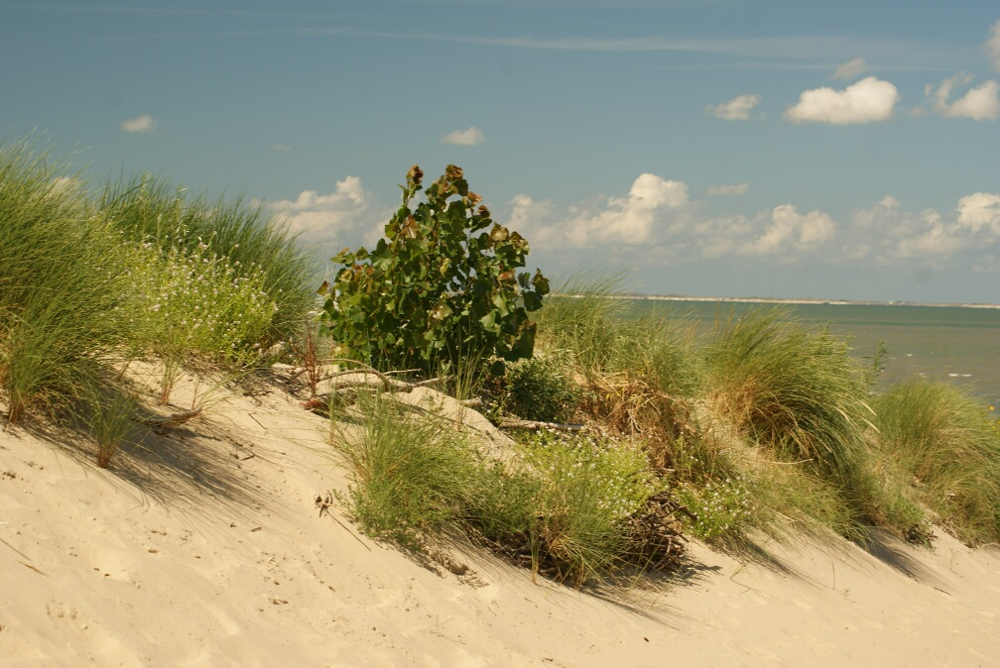

## Praktische info:

  * We verbleven op camping [De Catshoek](https://minicampingdecatshoek.nl/)

  * Onze wandeling naar Cadzand was in totaal 24,5 km lang (de kaart geeft minder aan, maar ik heb de route pas achteraf uitgetekend en daardoor houdt ze geen
  rekening met enkele extra stukken die we in Cadzand wandelden). 
  
  
 
 * Parking: 4,0 euro per dag (1 euro per uur), Parkeerplaats Walendijk. De ingang leidt naar strandbar "Van Houten" en
  naturistenstrand "naaktstrand" — een belangrijk woord om te onthouden als je zo'n strand liever vermijdt :p Dit deel van het strand rond
  strandbar Van Houten is met een bord aangeduid, maar na ongeveer 200 meter wandelen ben je alweer uit de zone. Dat hebben wij dus ook gedaan.
