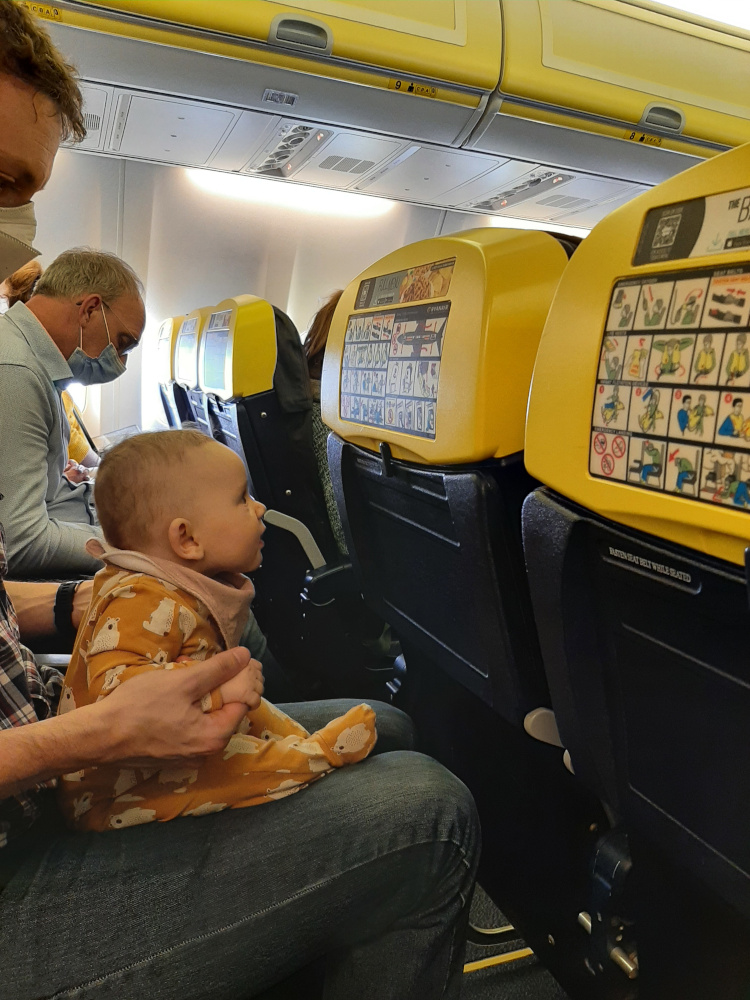
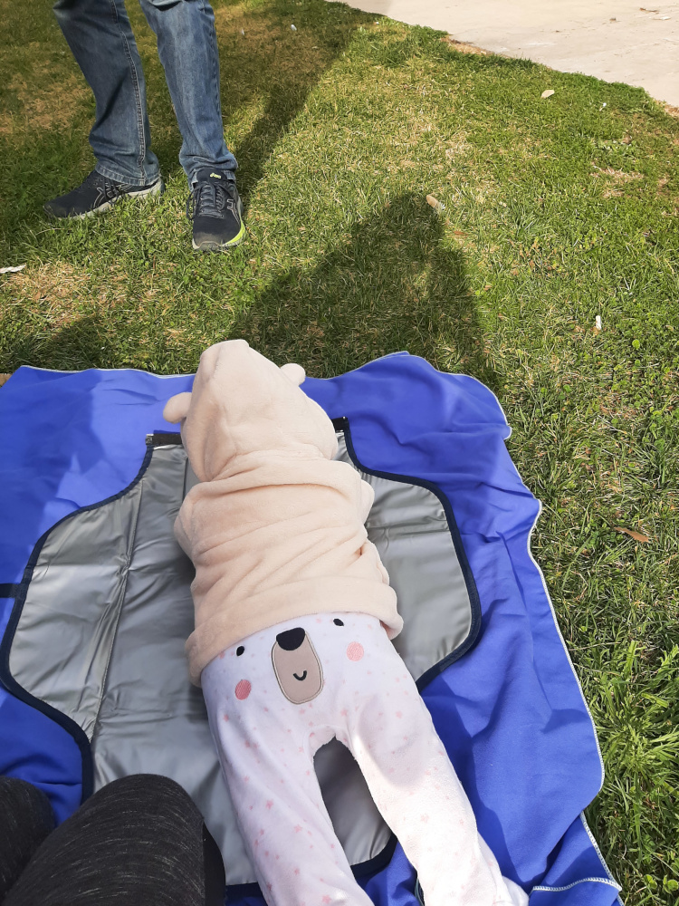

We moesten onze manier van reizen aanpassen aan de behoeften van onze kleine meid. Mensen zeggen altijd dat je kunt blijven reizen
nadat je vader of moeder bent geworden. Ja, dat klopt, het kan ... maar het zal niet hetzelfde zijn! Onze vakanties zijn nu minder intensief en we bezoeken
kindvriendelijke plekken waar we een realistische kans hebben om te ontspannen en even tot rust te komen. Een verveelde, vermoeide of gefrustreerde peuter zal je
dat niet gunnen! We reizen regelmatig van België naar Polen om mijn familie te bezoeken. De eerste keer gingen we
naar Polen toen onze dochter 3 maanden oud was. We zijn ook twee keer op vakantie geweest in Europa: naar Lissabon (toen ze 6 maanden
oud was) en Málaga (toen ze 14 maanden oud was). Beide reizen waren heel verschillend door de leeftijd van onze baby, maar ook omdat we
tijdens de eerste reis veel hebben geleerd.

## Wat zijn onze tips voor de vlucht zelf?

Houd rekening met het tijdstip van de vlucht en of dat in de dagelijkse routine van je baby past. Wij boeken bijvoorbeeld geen vluchten
die voor 10 uur 's ochtends of na 16 uur vertrekken (wat onze opties aanzienlijk beperkt!). 

We reizen altijd met de kinderwagen en de draagzak (bij het instappen schakelen we over op de draagzak). Let erop dat je
de kinderwagen wel tot aan het vliegtuig mag meenemen, maar dat je er vóór de veiligheidscontrole een label voor moet halen
aan de incheckbalie. In theorie mag je één kleine tas meenemen als je een ticket voor een baby koopt (jonger dan 2 jaar),
maar wij hadden altijd nog een kleine katoenen tas met al het eten en drinken van onze kleine bij ons en daar heeft nooit iemand iets van gezegd
(mocht er toch een probleem zijn, dan zou alles gemakkelijk in onze bagage passen). Over het algemeen geldt: hoe minder bagage, hoe beter. Voor
een reis van een week hebben we gewone handbagage bij ons (één kleine rugzak per persoon) en dat is echt genoeg! Zodra je op je bestemming aankomt, is het tijd om
je kinderwagen te zoeken. Op elke luchthaven staat die op een andere plek, meestal bij de buitenmaatse bagage, maar nooit vlak
bij het vliegtuig. Daarom kan een draagzak bijzonder handig zijn, want soms is het een heel eind stappen van het vliegtuig
naar de bagageband.
Het is ook nuttig om een dekentje bij je te hebben om je baby warm te houden tijdens het instappen. Soms waait het
erg hard en je weet nooit hoelang je buiten zult moeten aanschuiven voor je het vliegtuig in kunt.

Neem genoeg water en tussendoortjes voor je baby mee. Volgens de TSA (Transportation Security Administration) gelden er geen
beperkingen voor vloeistoffen wanneer je reist met
een kind jonger dan 12 jaar. Water is toegestaan in redelijke hoeveelheden. Wij hebben meestal een fles water van 1 liter, een extra tuitbeker
die al met water gevuld is, sojamelk in een kartonnen brikje (250 ml) en 2 à 3 potjes babyvoeding bij ons. Daarnaast nemen we enkele boterhammen, fruit en
groenten mee. Dat lijkt misschien veel, maar het is goed om wat extra bij je te hebben voor noodgevallen (onverwachte vertragingen of
een geannuleerde vlucht). Het is handig om het water en eten in een aparte katoenen tas te bewaren, want bij de veiligheidscontrole moet je alle vloeistoffen voor je baby
tonen. Als je baby nog borst- of flesvoeding krijgt, kun je die het best tijdens het opstijgen en landen geven.
Blijkbaar kunnen baby's hun oren niet bewust klaren, maar we kunnen hen helpen door hen aan te moedigen om te slikken.
Op verzoek zal een steward of stewardess warm water brengen om de flesvoeding klaar te maken. Als je borstvoeding geeft, bieden een grote sjaal
en een speciale beha wat meer privacy.

Een nieuw speeltje voor je baby helpt ook: zo is je baby beter gezind en is die hopelijk een hele tijd bezig met
het nieuwe cadeautje :)

Dit zijn enkele specifieke tips over de luchthavens die we tot nu toe hebben gebruikt:

  * Zaventem, België - fantastische speelruimte voor kinderen naast de eetgelegenheden (ingang naast de Starbucks). Er zijn
een microgolfoven, kinderstoelen, verzorgingstafels en een grote tafel waaraan de ouders kunnen zitten: de perfecte plek om op de vlucht te wachten! Met
de baby verliep de veiligheidscontrole vlot. Al het eten en water voor de baby werd gecontroleerd, dus bewaar het beter in een aparte tas, zodat je er gemakkelijk
bij kunt.

  * Pyrzowice, Polen - we vonden er geen speelruimte voor peuters, maar er zijn wel verzorgingsruimtes. De veiligheidscontrole is hier
inefficiënt en duurt onnodig lang. Dit is bijvoorbeeld een van de weinige luchthavens waar je je schoenen moet uittrekken en laten scannen.
Verwacht lange wachtrijen zonder voorrang voor gezinnen met kinderen.

  * Lissabon, Portugal - er is één aparte rij voor de veiligheidscontrole voor ouderen, mensen in een rolstoel en ouders met
baby's, maar houd er rekening mee dat het daar zelfs langer kan duren dan in de gewone rij, omdat alle "tragere mensen"
in de speciale wachtrij staan! Ze raden de gewone rij af omdat je een paar treden moet afdalen om bij de normale veiligheidscontrole te komen,
maar dat zou geen probleem mogen zijn als je met een kinderwagen reist.

  * Eindhoven, Nederland - wat de veiligheidscontroles betreft, is dit de beste luchthaven voor ouders met baby's.
Het personeel zorgt ervoor dat ouders met kinderen vlot door de veiligheidscontrole kunnen en dankzij de moderne scanners mag je
de meeste spullen in je rugzak of koffer laten zitten. Daarna controleren ze alleen al het eten en water voor de baby in een speciaal toestel.
Voor ons is het altijd een heel aangename ervaring.

  * Málaga (AGP), Spanje - op de luchthaven was er genoeg ruimte om comfortabel te zitten, maar de speelruimte die we vonden, was
heel klein en om onbekende redenen afgesloten. De veiligheidscontrole verliep aangenaam.

## Wat zijn belangrijke criteria bij het zoeken naar een verblijf?

Airbnb is ons favoriete platform wanneer we reizen. Toen we voor onze eerste reis naar Lissabon gingen, dachten we dat een
appartement in het stadscentrum ons flexibiliteit zou bieden.
We konden naar het appartement terugkeren en het zou dicht bij winkels en restaurants liggen. MAAR we hadden niet voorzien dat huizen in
het oude deel van de stad flinterdunne muren hebben. Er was zoveel lawaai dat we niet konden slapen en onze baby had nog meer moeite met
slapen. Het gebeurde ook een paar keer rond middernacht en 's ochtends vroeg dat mensen buiten glazen flessen weggooiden, waardoor
iedereen in de buurt wakker werd. De volgende keer lazen we de beoordelingen van de appartementen zorgvuldig en zochten we naar aanwijzingen over
het geluidsniveau. Ons appartement in Benalmádena was veel beter! Het had een grotere slaapkamer die zelfs met een extra reisbedje nog genoeg ruimte bood
om er comfortabel gebruik van te maken. Deze keer verbleven we ook in een rustige buurt naast het park (met dieren en een speeltuin), het strand en
bushaltes (ook deze keer waren we aangewezen op het openbaar vervoer). Donkere gordijnen om het appartement te verduisteren voor het dutje van onze baby
waren nog een nuttige troef van het appartement. Een keukentje om ontbijt en tussendoortjes klaar te maken is voor ons altijd onmisbaar.
Een grotere douche hielp ons enorm bij het avondbadje, vooral nadat we op het strand hadden gespeeld.

## Op je bestemming aangekomen? Wat nu?

Het is altijd verstandig om vooraf speeltuinen op te zoeken in de buurten die je gaat bezoeken. Soms zijn ze
echt leuk en ideaal voor een pauze met een peuter. Zodra baby's beginnen te stappen, is het onmogelijk om ze lang
in hun kinderwagen te houden: ze moeten rondrennen en op ontdekking gaan :D Een klein dekentje of een sporthanddoek voor een pauze in het park
komt goed van pas. Zelfs als je baby nog heel klein is, is het goed om hem of haar even op de buik te leggen of met speeltjes te laten spelen.

Omdat openbare toiletten met verzorgingstafels zeldzaam zijn, is een verzorgingsmatje onmisbaar. De waterdichte laag kan
ook van pas komen als extra onderlaag wanneer je op het gras zit. Houd er rekening mee dat de toiletten zelfs in sommige restaurants
heel klein kunnen zijn en geen verzorgingstafel hebben. In dat geval zul je ook blij zijn dat je je eigen matje bij je hebt.

In Lissabon hadden alle toeristische bezienswaardigheden een aparte rij voor gezinnen, waardoor we bijna nergens moesten wachten. Ook in de winkels lieten mensen
ons voorgaan, zelfs als we daar niet om vroegen, en dat was echt fijn.

  
  

We reizen zowel met een kinderwagen als met een draagzak. Zo hebben we de nodige flexibiliteit om verschillende soorten plekken te bezoeken.
Het zou bijvoorbeeld niet mogelijk zijn om met de kinderwagen het stadscentrum van Lissabon, het Castelo dos Mouros in Portugal of de berg Calamorro
in Spanje te bezoeken. Een kinderwagen komt dan weer goed van pas tijdens lange wandelingen langs de zee of wanneer je bezienswaardigheden zoals het
Mosteiro dos Jerónimos in Lissabon bezoekt (dat perfect geschikt is voor een kinderwagen). De gemakkelijkste manier om te beslissen
"kinderwagen of draagzak?" is om de beoordelingen op Tripadvisor of Google te bekijken en te zoeken naar beoordelingen die beschrijven hoe kindvriendelijk een bepaalde toeristische bezienswaardigheid is.
  * [Kinderwagen](https://www.dreambaby.be/e/fr/db/dreambee-essentials-poussette-canne-grey-melange-214187?utm_source=google&utm_medium=shopping&s_kwcid=AL!6321!3!!!!x!!&gclid=CjwKCAiAheacBhB8EiwAItVO2yQ7N_C6VWkn4sxHW_TIX8rNzywIH3wWZIyx8EqOYPPCespcWfD0HxoCK10QAvD_BwE)
  * [BabyBjörn-draagzak](https://www.amazon.com.be/-/en/BABYBJ%C3%96RN-Carrier-Black-Cotton-White/dp/B07KPSS456/ref=sr_1_1?crid=2Q7TKLKF68UZ8&keywords=BabyBj%C3%B6rn+carrier+one&qid=1671045227&sprefix=babybj%C3%B6rn+carrier+one%2Caps%2C60&sr=8-1)
  * [Nanabeebi-rugzak](https://www.nanabeebi.com/en/products/luiertas-rugzak)

  
