Het kleine park met archeologische resten naast het geschiedenismuseum van Marseille is de plek waar het verhaal van
Marseille begon. Hier, precies op deze plaats, bliezen de eerste Griekse kolonisten uit Phocaea de stad rond 600 v.Chr.
leven in en legden ze de wortels van wat de bruisende haven van Marseille zou worden. Je ziet er nog altijd de boot op
ware grootte waarmee de Grieken de ruwe Middellandse Zee overstaken om deze van nature rustige baai te bereiken, die
uitstekende bescherming tegen de wind bood en de nieuwkomers onderdak gaf.

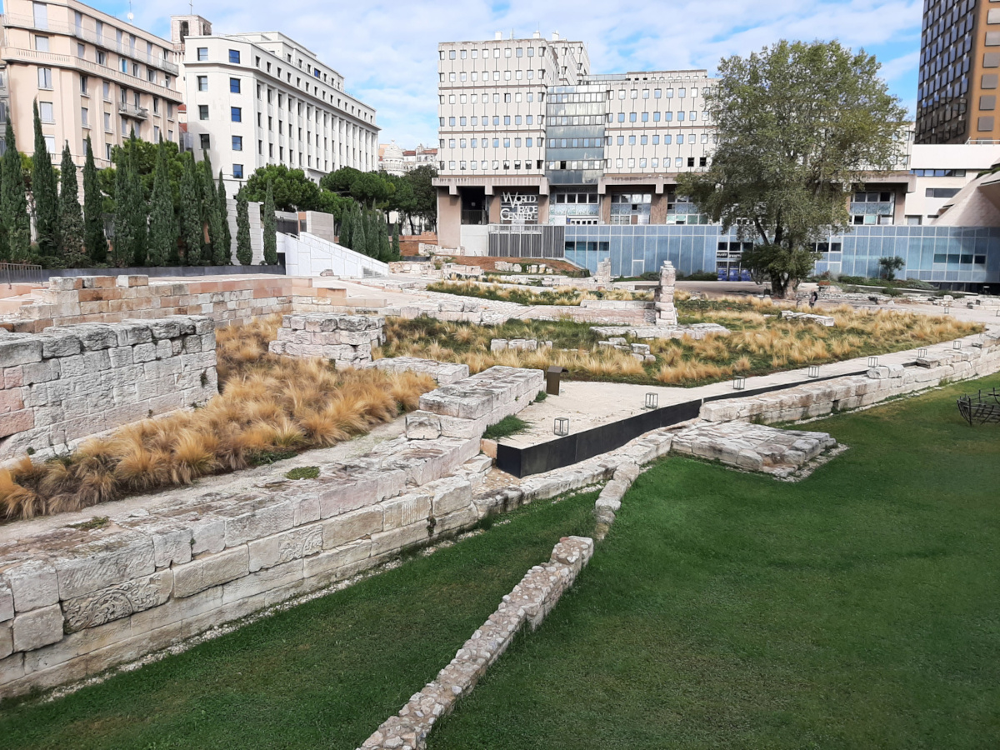

Een steenworp verderop gonst de moderne haven van bedrijvigheid, goed zichtbaar vanaf het uitkijkpunt "Mirador de
Saint-Jean" bij de stadsvestingen, dat de schepen naar de haveningang leidt.
Aan het einde van de haven komt de Quai des Belges elke ochtend tot leven wanneer de vissers er hun verse vangst
aanprijzen. Hier staat ook een gedenkteken voor die eerste avontuurlijke Griekse kolonisten, ter herinnering aan hun
stichtende rol in de geschiedenis van de stad.

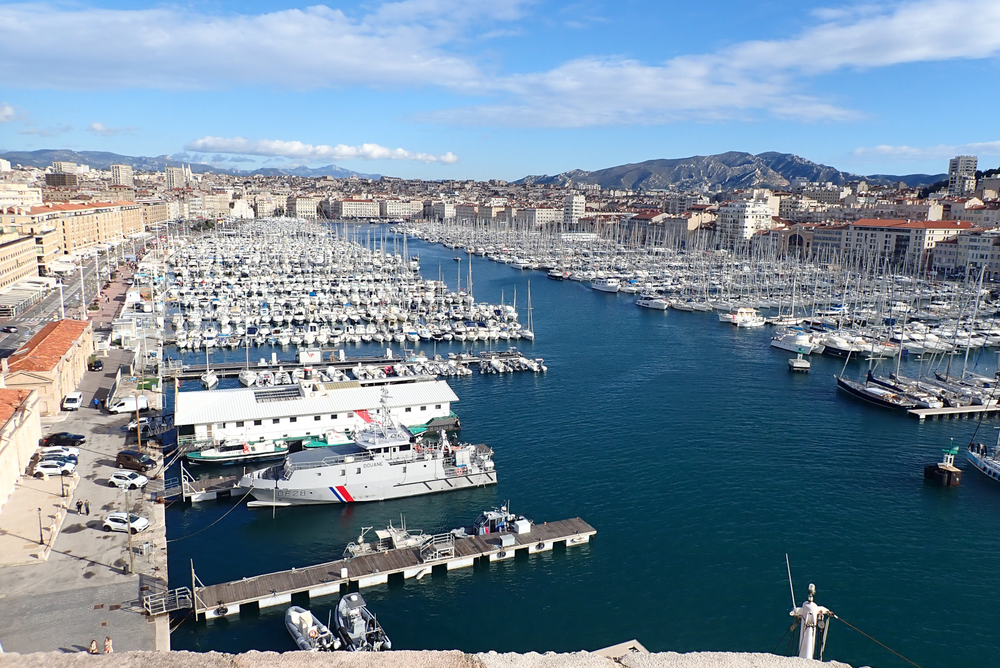
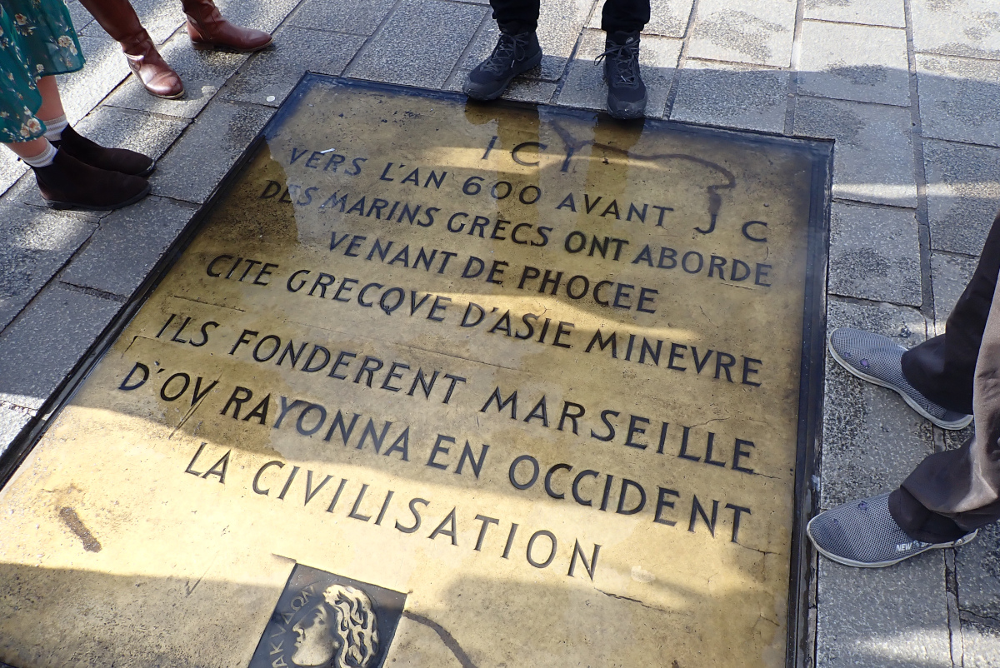
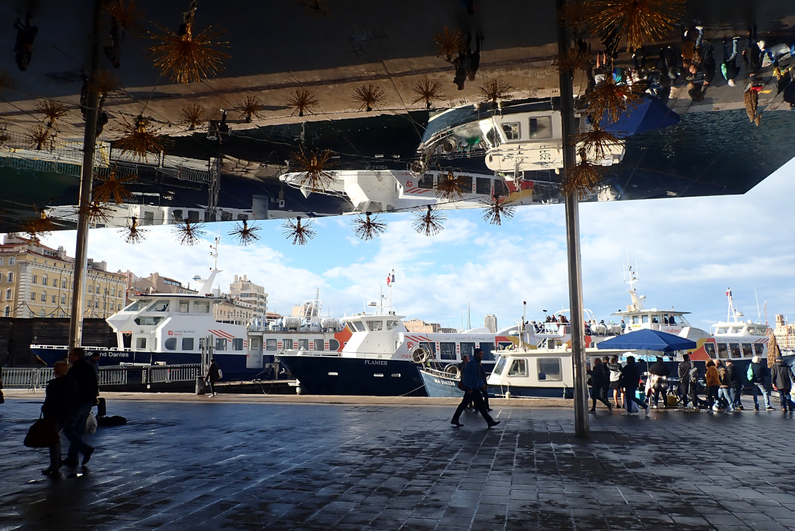
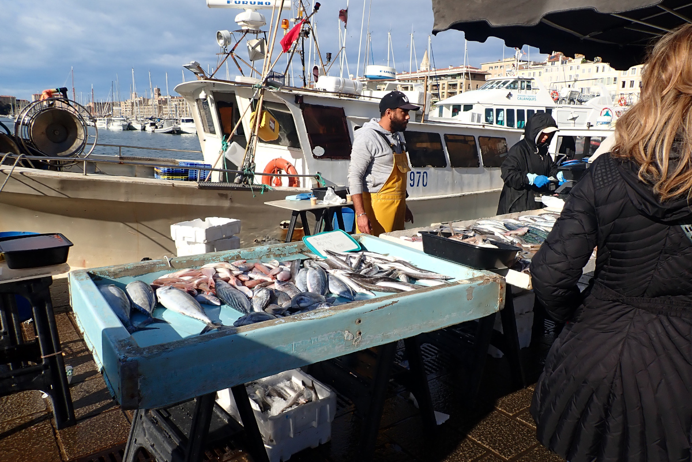

De wijk 'Le Panier' lag pal naast ons appartement, dus we dwaalden er een paar keer doorheen, telkens verdwaald in de
smalle straatjes, terwijl we nieuwe graffiti, kleurrijke steegjes en charmante winkeltjes met Marseillezeep ontdekten.
Eigenlijk ziet de originele Marseillezeep er heel saai uit: gewoon een grote kubus (300 g) groenige zeep met een subtiele
geur. Maar dat is net wat je huid nodig heeft: 72% olijfolie verzorgt je huid grondig en is een waar wondermiddel. Laat je
niet verleiden door al die mooie zeepjes vol kleurstoffen, parfum of synthetische toevoegingen. Naast schattige
winkeltjes vind je hier ook kleine galerieën en interessante koffiebars.

  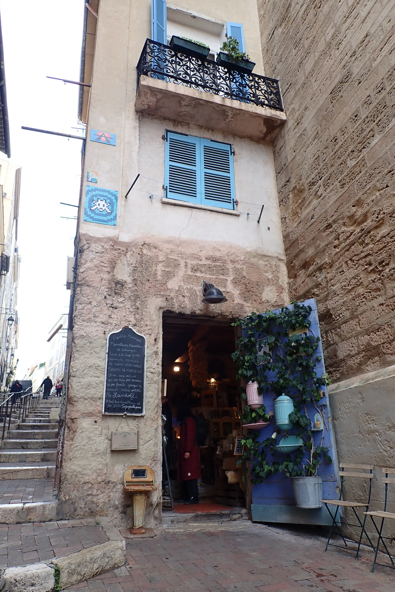
  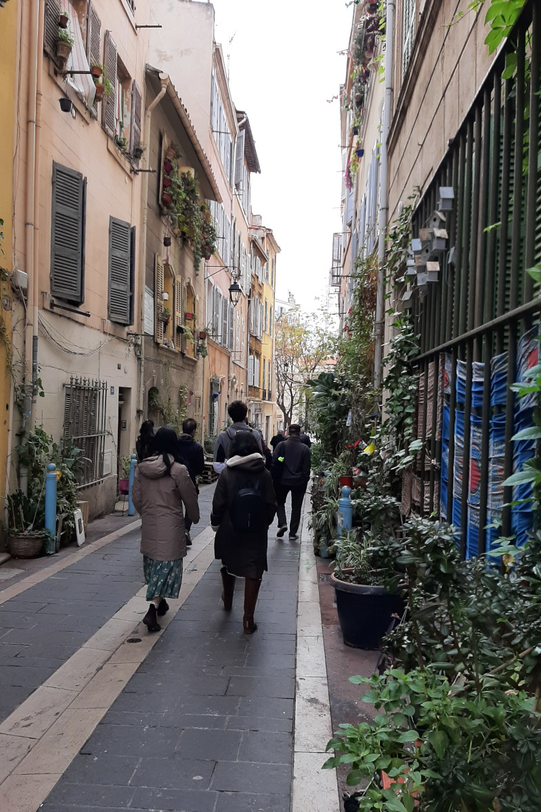

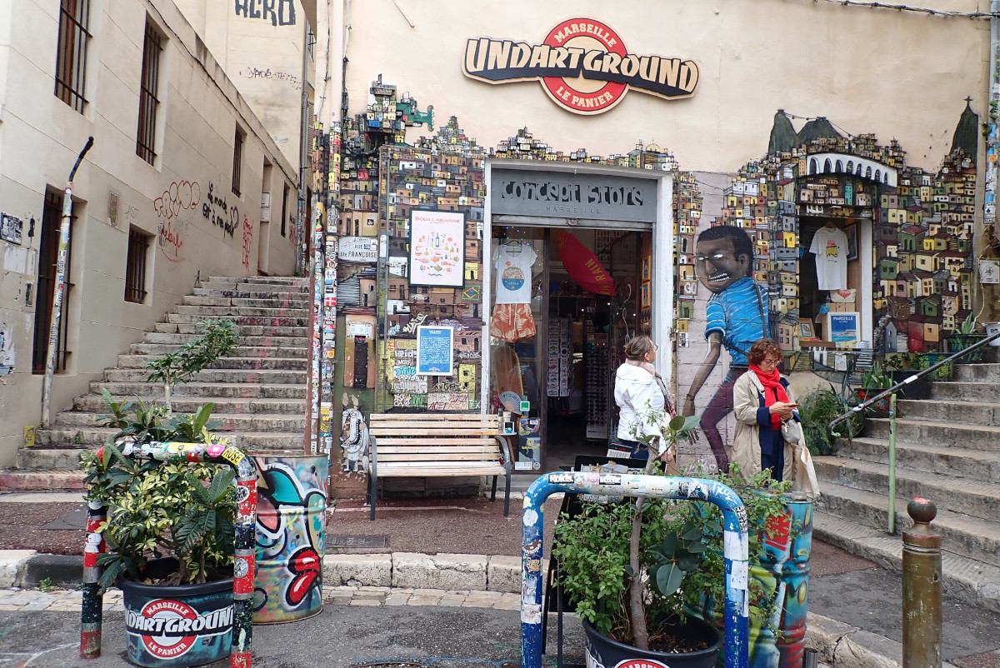
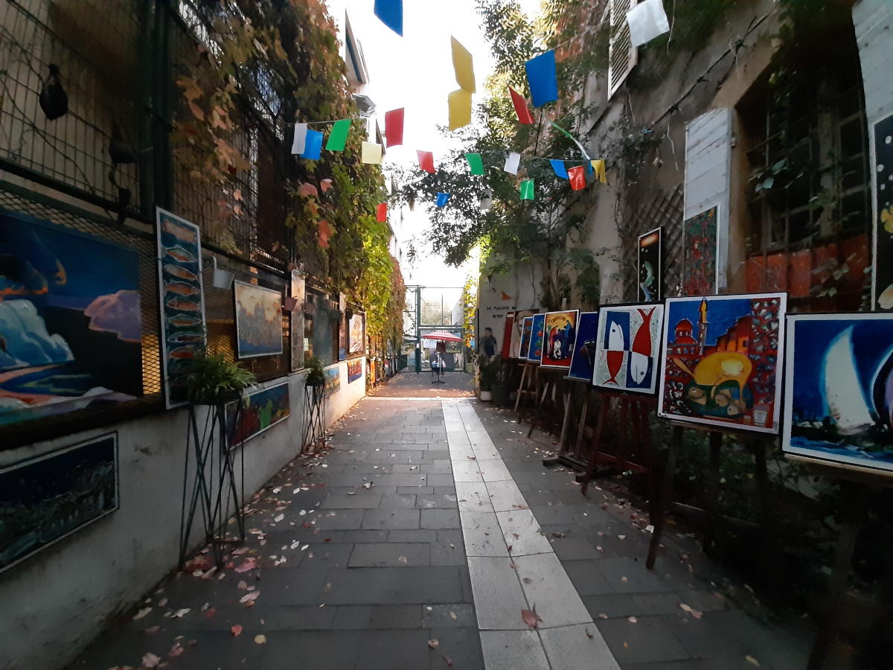

Het voorplein van het Vieille Charité, verlaten in de novemberkou, zou volgens onze gids in het hoogseizoen amper
begaanbaar zijn, wanneer alle restaurants en cafés er hun tafeltjes buiten zetten. In de late herfst loopt deze plek,
net als de rest van de wijk Le Panier, leeg: winkels sluiten en de buurt valt stil, in afwachting van de levendigheid van
de lente en de drukke maanden die volgen. Een paar jaar geleden was het nog mogelijk om hier te wonen met een
langlopend huurcontract, maar intussen staat het merendeel van de woningen op Airbnb. Kortetermijnverhuur, zelfs voor
maar een paar maanden, blijkt veel winstgevender dan verhuren aan vaste stadsbewoners. We zagen vaak "Airbnb dehors" op
de muren gespoten, wat zoveel betekent als "Airbnb ga weg". Een duidelijk statement van bewoners die hier graag wonen,
maar het zich steeds minder kunnen veroorloven.

Deze schitterende basiliek, de kathedraal La Major, werd in de 19e eeuw gebouwd nabij de fundamenten van de
oorspronkelijke haven van Marseille. De kleuren van de muren waren verbluffend, zeker wanneer het licht van de
ondergaande zon de verschillende gebruikte steensoorten deed uitkomen. De bouw duurde meer dan 40 jaar.
Ons appartement lag maar een paar honderd meter van deze basiliek, dus we raakten nooit verdwaald: de 60 meter hoge toren
was heel makkelijk te spotten. De omgeving is een heerlijke plek voor een avondwandeling bij zonsondergang, met een mooi
zicht op de haven, het [MUCEM] en Cosquer Méditerranée er vlak naast. De vloer van de basiliek is versierd met prachtige
mozaïeken.

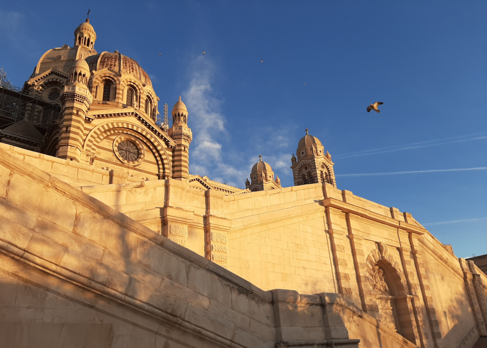

  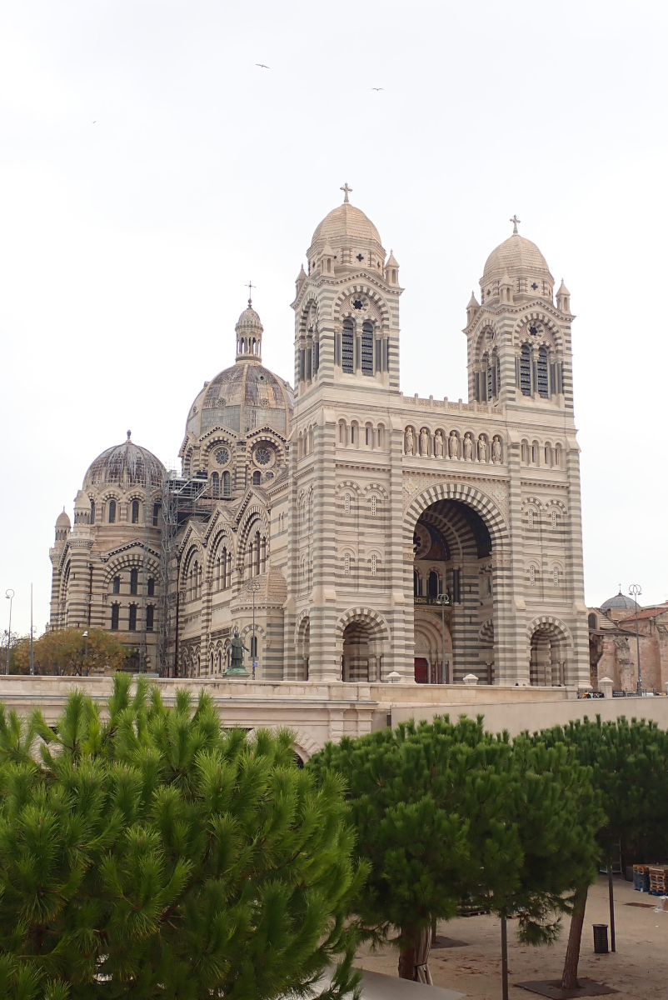
  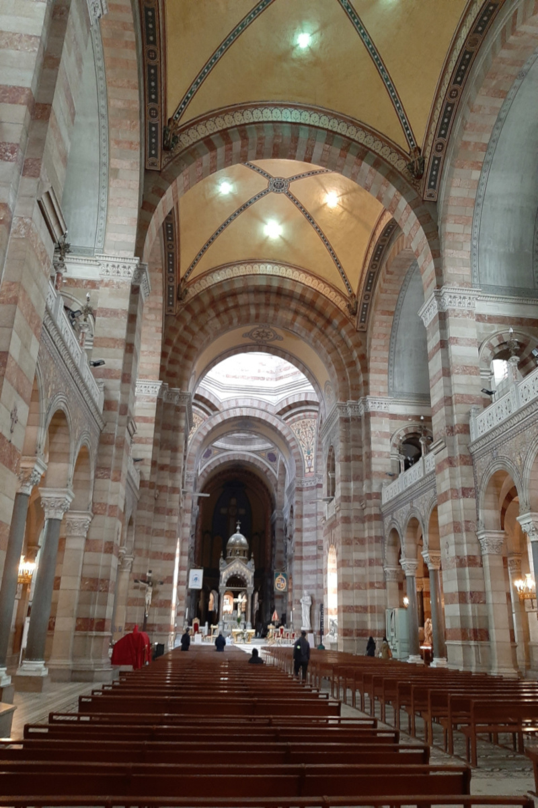

We raden een bezoek aan het dakterras van het Museum van de Beschavingen van Europa en de Middellandse Zee ([MUCEM]) van
harte aan. Je raakt er via een loopbrug vanaf Fort Saint-Jean of door het museum zelf. Dit museum heeft een fascinerende
architectuur en lijkt van een afstand op een gigantische spons of op diepwaterkoraal. Eenmaal op het dak, dat gratis
toegankelijk is, neem je door de fijne metalen buitenwanden de weidse uitzichten over de stad, de haven en het fort in je
op. De perfecte plek voor een pauze met uitzicht! Het contrast tussen de oude gebouwen van het fort en het moderne museum
vult elkaar prachtig aan. Daarna verkenden we de smalle paadjes en tuinen, waar we rust en de warmte van de zon vonden in
beschutte hoekjes waar de wind niet bij kon. Vanaf meerdere uitkijkpunten konden we zowel de basiliek Notre-Dame de la
Garde als de kathedraal La Major bewonderen. Onze verkenning zat vol verrassingen, van verscholen pleintjes met fonteinen
tot muurschilderingen van vrouwen en een overvloed aan planten die deze plek echt uniek maken. Een must als je aan de
drukte van de stad wil ontsnappen.

  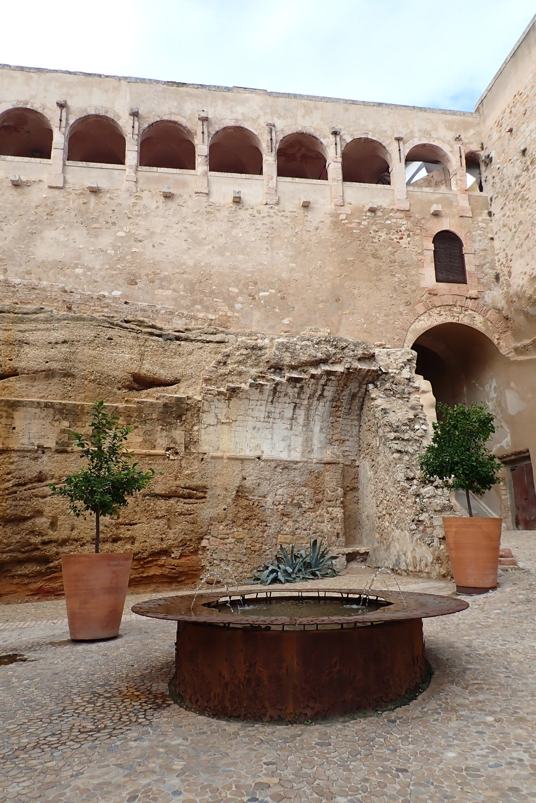
  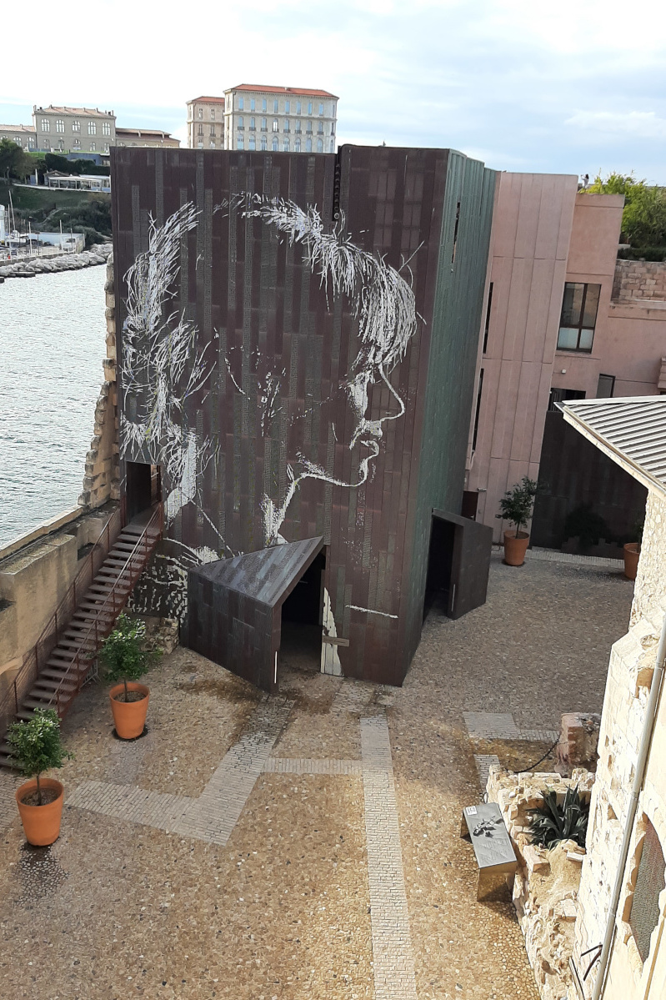

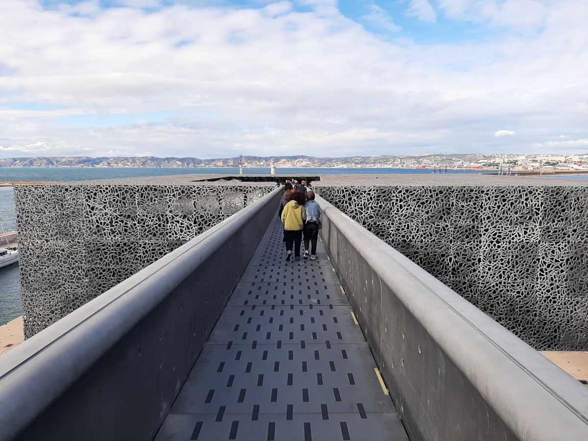

De basiliek Notre-Dame de la Garde, met een uitzicht van 360 graden over de stad, is zonder twijfel een must. Al brachten
we niet veel tijd binnen door, toch vielen de fascinerende decoraties ons op, waaronder scheepjes die aan het plafond
hangen en die de diepe band van de stad met de zee benadrukken. Kijk zeker omhoog, het plafond is adembenemend! Vanaf het
buitenterras neem je het weidse panorama over Marseille in je op, met daarbij de nieuwe cruisehaven in een industriëler
deel van de stad, die te ver ligt om te voet te bereiken vanaf het oude historische centrum.

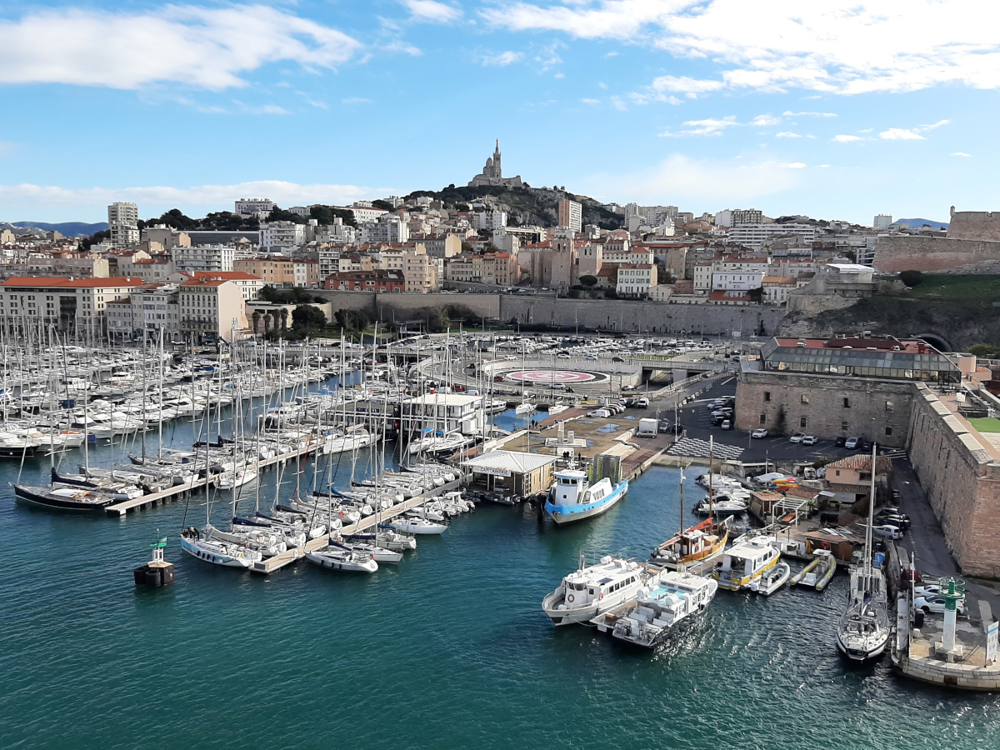

  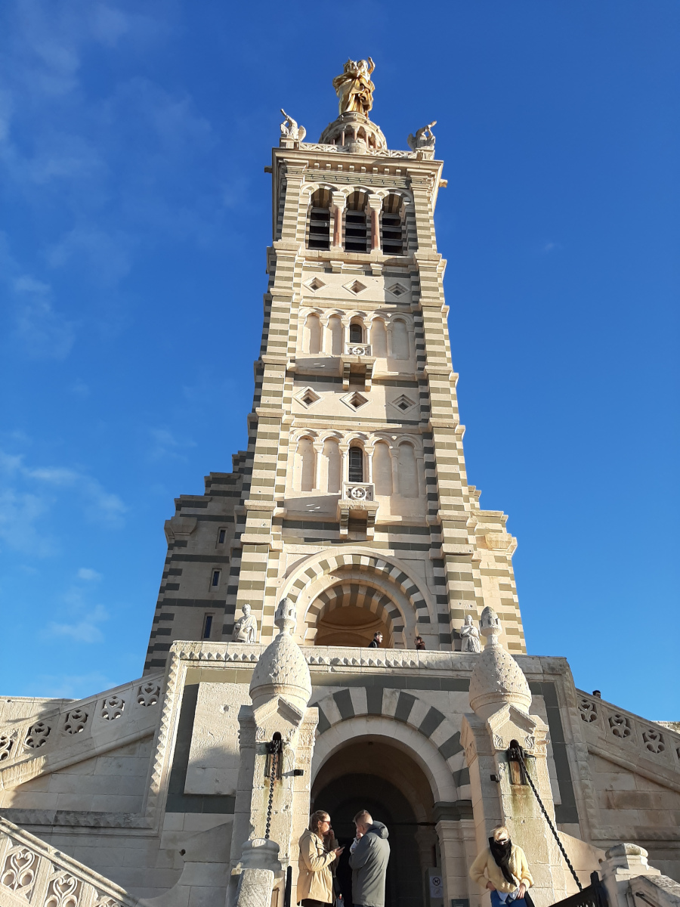
  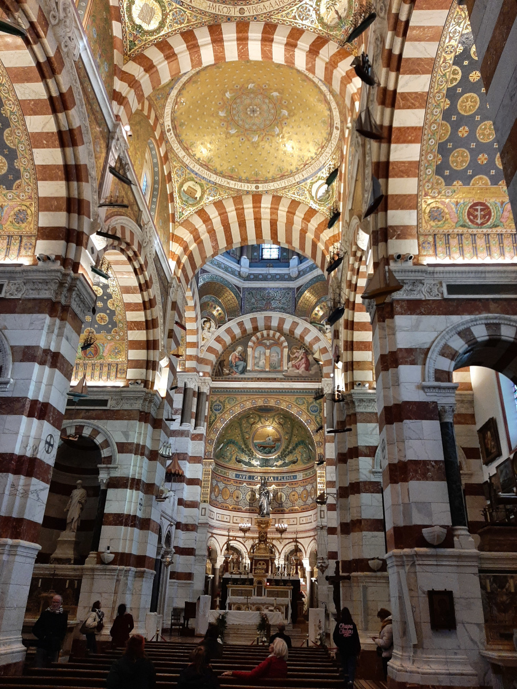

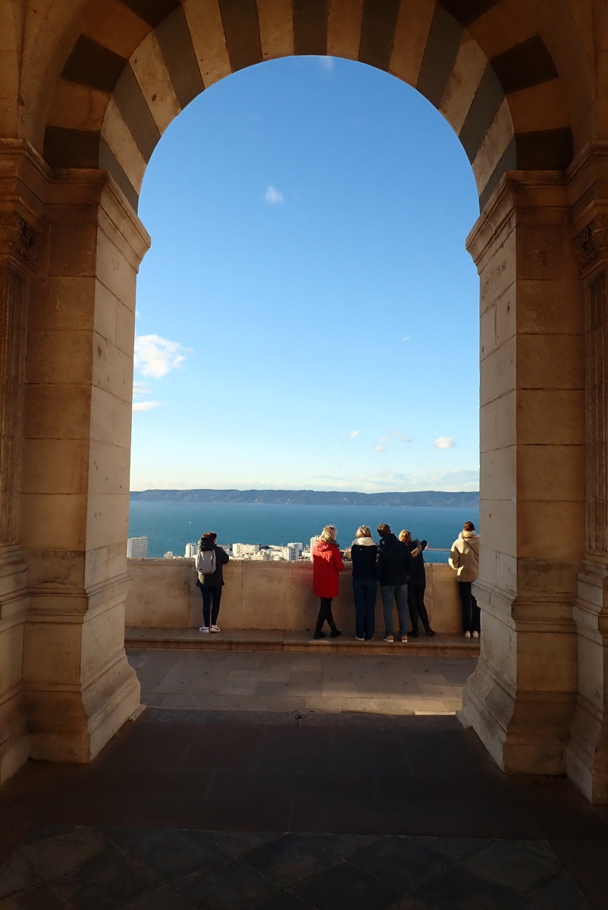

Aan de achterkant van de kerk opent het zicht zich naar Endoume, de meest prestigieuze wijk van de stad, waar de huizen
dicht tegen elkaar aan liggen, omringd door zee en bergen.

Het Orange Velodrome-stadion en grote appartementsblokken sprongen duidelijk in het oog tussen de gebouwen aan deze kant
van de stad, met op de achtergrond het schitterende Nationaal Park Calanques, onze bestemming voor de volgende dag.

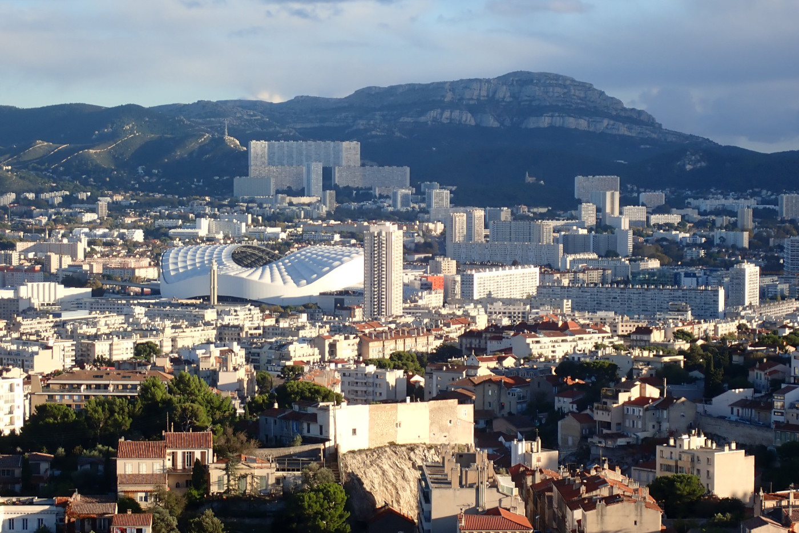

We houden van natuur en wandelen, dus we proberen korte stadstrips altijd te combineren met minstens één dag in de
natuur. Het [Nationaal Park Calanques](https://www.calanques-parcnational.fr/en), tussen Marseille en Cassis, was na een
blik op de kaart van de omgeving de voor de hand liggende keuze. Wandelen, klimmen, zwemmen en kajakken zijn de
belangrijkste activiteiten in dit nationaal park. De scherpe, witte kliffen en het heldere water aan hun voet vormen een
schitterend zicht waarvan je onderweg volop geniet. Een 'calanque' is een uniek soort geologische formatie van kalksteen
die je langs de Middellandse Zeekust vindt. De eerste foto hieronder toont het belangrijkste uitkijkpunt, Sugiton, dat
het makkelijkst bereikbaar is, op zo'n 2,5 km van de bushalte. Van hieruit kan je ook naar het strand afdalen (nog eens
ongeveer 1 km) of je wandeling met enkele kilometers verlengen richting Cassis, via het GR-hoofdpad. Dat was onze keuze,
en we hebben er geen moment spijt van gehad! Het pad was erg rotsachtig en veeleisend, met veel steile en smalle stukken,
maar de fabelachtige uitzichten waren de moeite meer dan waard. Jammer genoeg moesten we op onze stappen terugkeren omdat
we niet zeker wisten waar de andere paden naartoe leidden; Google Maps hielp deze keer niet echt, en enkel op de
markeringen op de rotsen vertrouwen volstond niet om te navigeren.

  
  

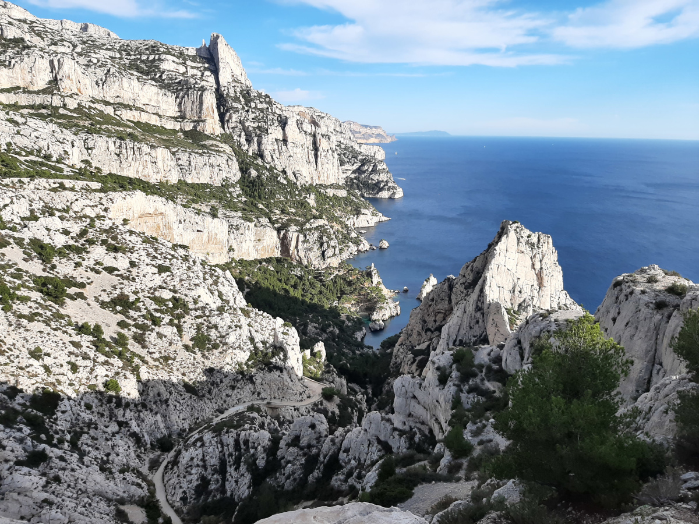

Onze tweede avond brachten we door in het museum met de replica van de Cosquergrot, op een paar honderd meter van ons
appartement. In 1985 werd de grot ontdekt door Henri Cosquer, een gepassioneerd duiker, die de ingang naar een immense
ondergelopen galerij vond. Deze bijna 175 meter lange gang onthulde een echte schat van 30.000 jaar oud, met meer dan 480
stuks, waaronder schilderingen en gravures van pinguïns, herten, steenbokken en bizons, maar ook handafdrukken en sporen
van een haardvuur. In die tijd lag de zeespiegel zo'n 120 meter lager dan vandaag en lag de kustlijn enkele kilometers
verderop. Door de stijgende zeespiegel dreigt deze prehistorische site echter te verdwijnen, en sommige kunstwerken staan
al gedeeltelijk onder water. Het is dringend geworden om deze weergaloze ontdekking te bewaren en met de wereld te delen.
De grot is momenteel niet toegankelijk voor het publiek en de ingang is ter bescherming afgesloten.

__Praktische info:__

  * We huurden een appartement via Airbnb in de wijk La Joliette, op een paar gebouwen van de kathedraal van Marseille,
op de 6e verdieping zonder lift. Er waren veel gelijkaardige aanbiedingen. Dit is misschien niet de beste oplossing voor
wie veel bagage of kinderen bij heeft. Toen het scheepvaartverkeer de capaciteit van de oude haven oversteeg, werd er een
nieuwe aangelegd, en ons appartement lag pal aan de ingang van die enorme haven. Het station 'Saint-Charles' ligt op 15 à
20 minuten wandelen, dus we hebben zelfs niet aan het openbaar vervoer gedacht.

  * Rondleiding [Marseille Free Walking Tour](https://marseillefreewalkingtour.com/) van ongeveer 2,5 uur
  * Heerlijke patisserie La Pâtisserie des Marseillais [Pascal Guglielmi](https://www.lapatisseriedesmarseillais.fr/)
  * Bus 60, van de halte Capitainerie tot de basiliek Notre-Dame de la Garde, is een rit van bijna 20 minuten. De kerk is
gratis toegankelijk. We bleven maar zo'n 15 minuten in de omgeving van de kerk door de harde wind en het koude weer, en
we keerden terug met hetzelfde ticket, dat 1 uur geldig was.
Toen we opnieuw opstapten, scanden we ons ticket, maar er werd niets aangerekend en we konden het de dag erna nog voor de
metro gebruiken. Elk ticket dat we kochten was geldig voor 2 ritten, maar de automaat biedt meerdere opties bij het
kiezen van het aantal ritten. Wie kinderen bij heeft, neemt het best het treintje vanaf de oude haven (recht tegenover
het stadhuis van Marseille), een prima optie!

  * Neem metrolijn 2 van Joliette naar Castellane en dan bus B1 voor een rit van 30 à 40 minuten richting Campus de
Luminy, met afstappen aan de halte Luminy – PN des Calanques. Onze wandeling in het Nationaal Park Calanques was ongeveer
16 km lang (5 à 6 uur, pauzes inbegrepen). Op de kaart hieronder, waarop onze route staat aangeduid, zie je een kleine
zijtak naar het uitkijkpunt Belvédère de Sugiton, een populaire bestemming voor veel bezoekers. Het is vrij toegankelijk;
we zagen mensen met een buggy, maar stevige wielen zijn wel een must. Het gebied is erg rotsachtig, dus goede trailrun-
of wandelschoenen zijn cruciaal voor je veiligheid. Let goed op de wegmarkeringen, want we begonnen een paar keer per
ongeluk rotsen te beklimmen die niet bij het pad hoorden (de markeringen zijn niet altijd duidelijk en veel ervan zijn
beschadigd). We hadden het geluk van fantastisch weer, een prachtige zonnige dag in november met aangename temperaturen.
We moesten wel rekening houden met de vroege zonsondergang in deze periode van het jaar om problemen te vermijden, want
we hadden geen hoofdlampen bij.

  
  

  * De replica van [de Cosquergrot](https://www.grotte-cosquer.com/en/homepage/) in de Villa Méditerranée biedt een
boeiende audiogids in het Engels tijdens een boottocht van 35 minuten, waarbij bezoekers meer dan 400 werken op de
grotwanden kunnen ontdekken. Daarna volgt in een amfitheater een documentaire over de ontdekking van de grot door Henri
Cosquer. Jammer genoeg is de film in het Frans, en de Engelse ondertitels verschijnen op kleine schermen naast het grote
doek, waardoor het lastig is om tegelijk de film te volgen en de tekst op de andere schermen te lezen. In de volgende
zaal wachtte ons nog een teleurstelling: daar tonen korte films stap voor stap hoe de replica van de grot gemaakt werd,
opnieuw zonder Engelse ondertitels. Daarnaast legde een presentator de technieken uit die gebruikt werden om de originele
grot na te maken, maar ook dat gebeurde alleen in het Frans. Hetzelfde gold voor de rest van de tekst op de wanden van de
tentoonstelling. We hadden dan ook het gevoel dat we niet ten volle konden meemaken wat het museum te bieden heeft.

[MUCEM]:https://www.mucem.org/
