In Nederland is april de beste maand om de prachtige Hollandse tulpen te zien. We propten een bezoek aan de Keukenhof,
een fietstocht door de tulpenvelden en de festiviteiten van Koningsdag in één lang weekend. Lees verder en ontdek wat we
allemaal over deze iconische bloemen leerden!

Tulpen komen oorspronkelijk uit het gebied ten noorden van de Himalaya, in Centraal-Azië, en werden al in de 10e eeuw in
het oude Perzië gekweekt als symbool van gratie en schoonheid. Van daaruit verspreidden tulpen zich westwaarts, tot ze
Istanbul bereikten, wat de deur naar Europa opende. In de tweede helft van de 16e eeuw brachten reizigers bollen en
bloemen naar verschillende landen, en vooral in Nederland vonden ze een bijzonder enthousiast publiek. Dat was het begin
van de Nederlandse tulpenteelt, met enkele decennia later al belangrijke variëteiten die de geschiedenis van deze
prachtige bloem voorgoed zouden bepalen.
We begonnen ons weekendje weg met als voornaamste doel de tulpenteelt beter te begrijpen en de schitterende variëteiten
te bewonderen die op de velden rond Lisse groeien. Op ons programma stonden een bezoek aan een tulpenkwekerij, een
fietstocht langs de tulpenvelden en de befaamde Keukenhof.

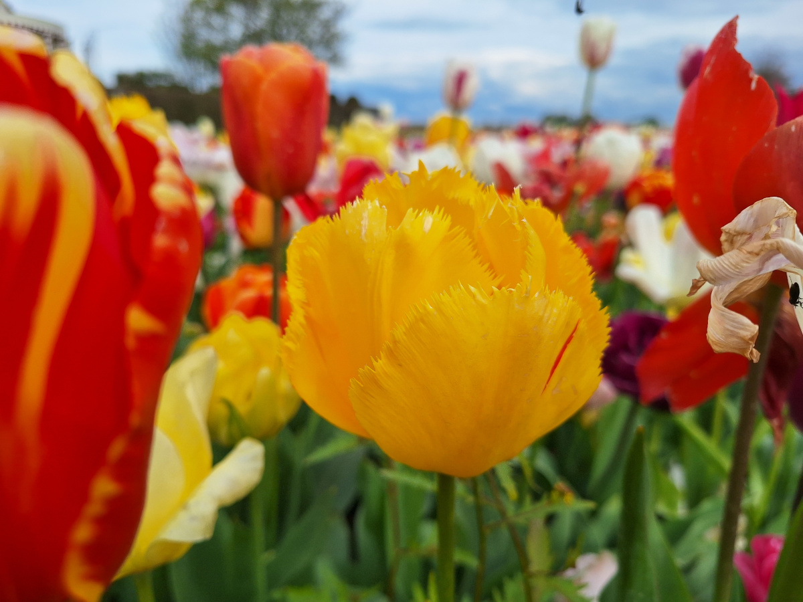

We begonnen ons avontuur met een fietstocht door de tulpenvelden, in een lus van Leiden naar Sassenheim, Hillegom, Lisse,
Voorhout en terug naar Leiden, goed voor bijna 50 km op de eerste dag (gedetailleerde kaart bij de praktische info). Met
telefoonhouders op onze fietsen en een goed uitgestippelde route op Google Maps was navigeren een fluitje van een cent.
De Nederlandse fietspaden zijn ongelooflijk intuïtief en we zijn geen enkele keer verdwaald. Ons uitstapje viel samen met
Koningsdag, het nationale feest op 26 april, waarbij elk stadje verandert in één groot straatfeest met mensen in
feloranje kledij die de verjaardag van de koning vieren. Tot onze verbazing waren de meeste tulpenvelden al gekopt, wat
dit jaar naar we later hoorden twee weken vroeger dan gewoonlijk gebeurde. Toch hebben we enorm genoten van onze tocht en
konden we ons alleen maar inbeelden hoe adembenemend die velden in volle bloei moeten zijn.

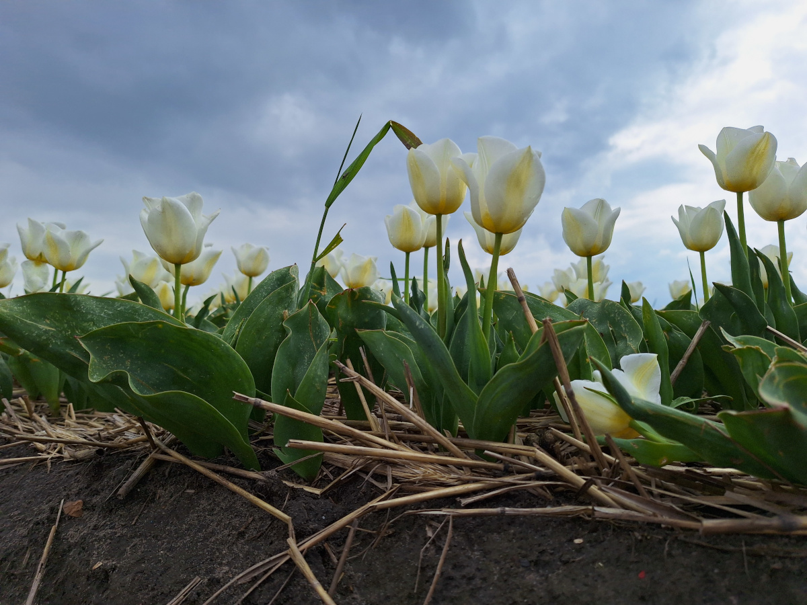
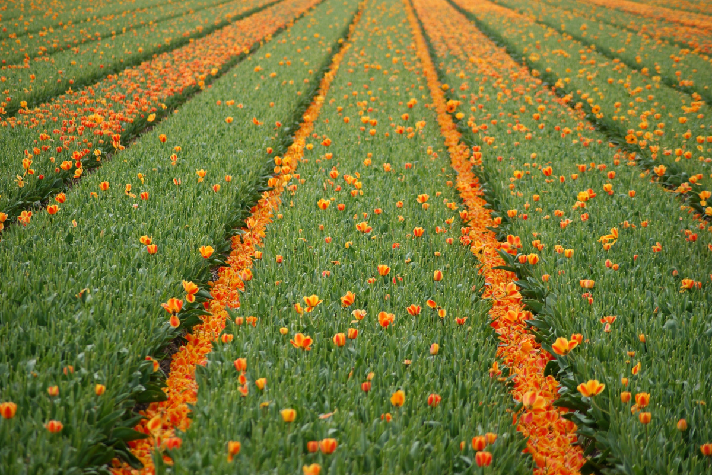
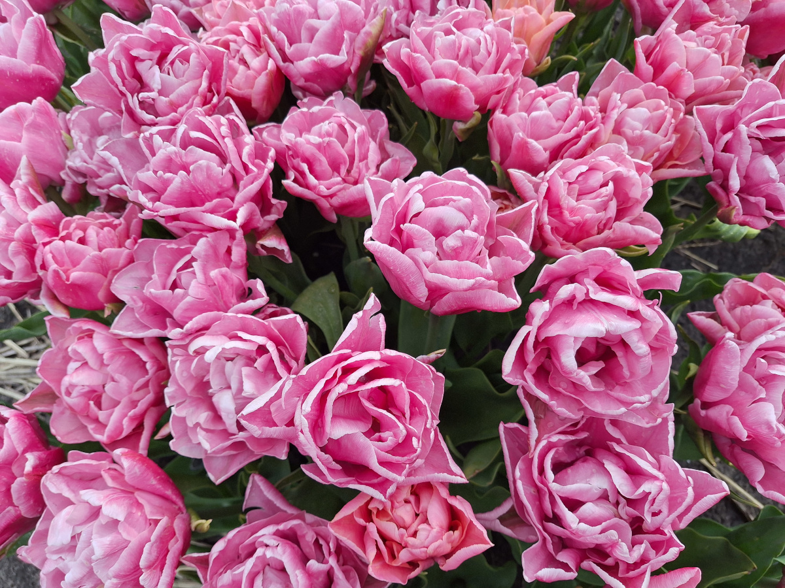

  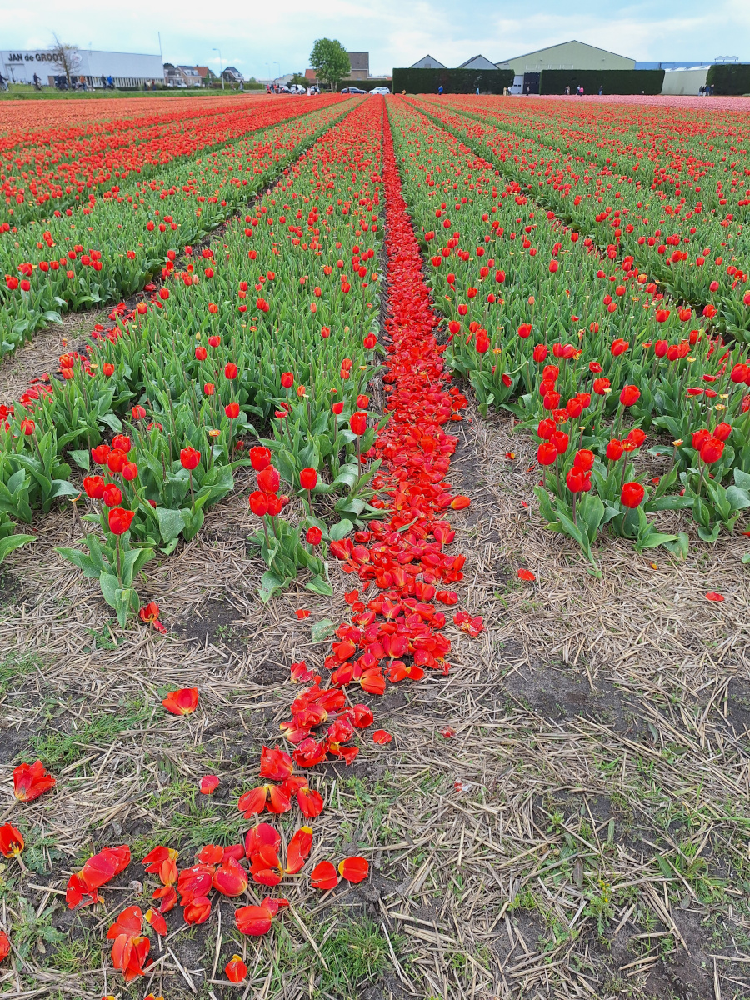
  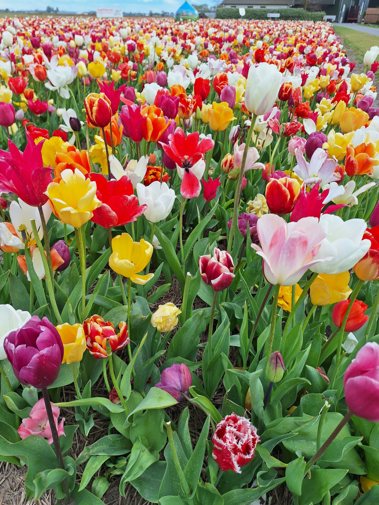

We kwamen langs een paar tulpenkwekerijen met kleine showtuinen waarin veel soorten tulpen stonden, elk met hun naam en
nummer, zodat je ze heel makkelijk online kan bestellen. Een prima gelegenheid om de verschillende soorten te zien en die
uit te kiezen die het best bij je tuin past!

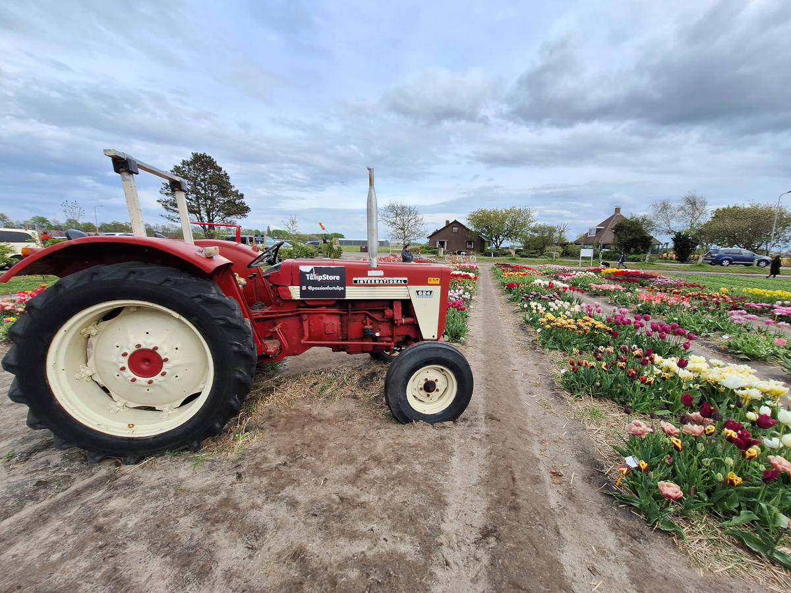
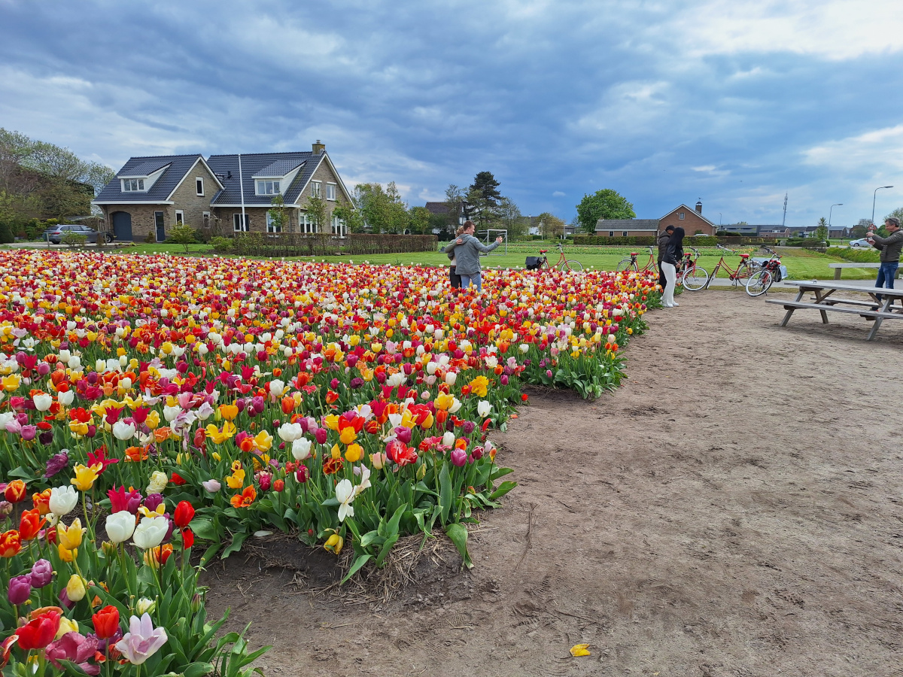
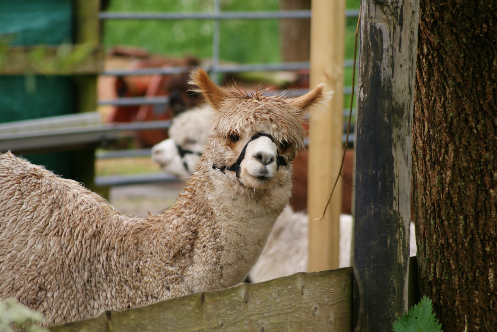
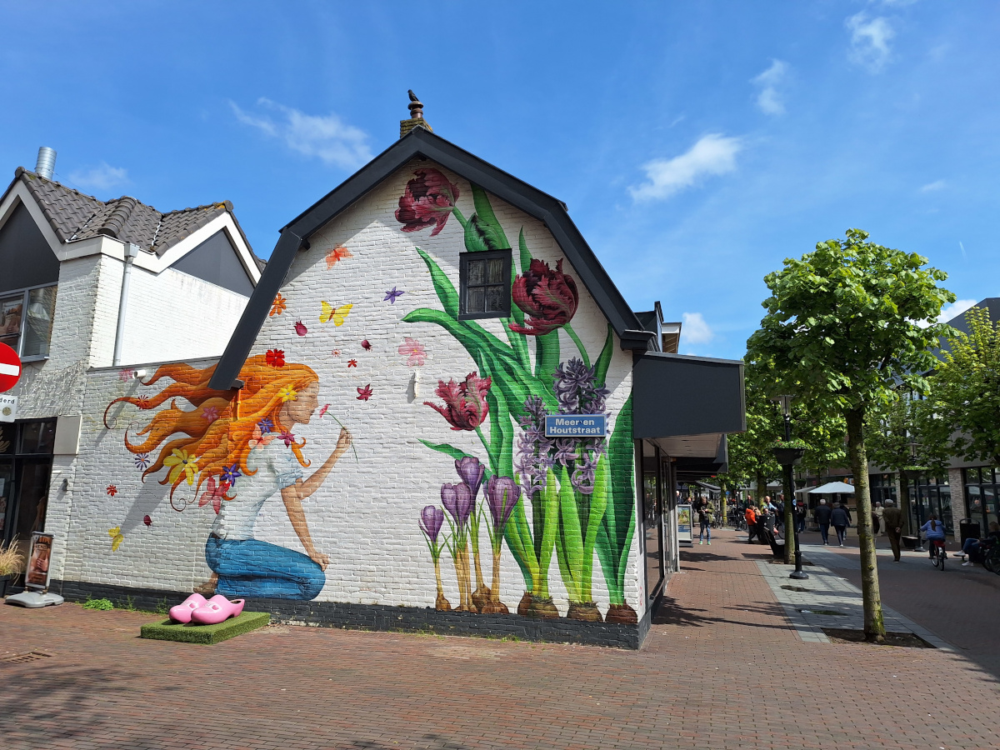

Tulpenkwekerij De Tulperij is een charmant familiebedrijf dat in 1927 van start ging. De zoon van de eigenaar besloot de
kwekerij over te nemen en begint binnenkort aan de 4e generatie. Bezoekers worden persoonlijk verwelkomd door de
eigenaars, de kweker en zijn vrouw. De kwekerij ligt vlak bij de Keukenhof en is tijdens dezelfde periode open als de
tuinen.

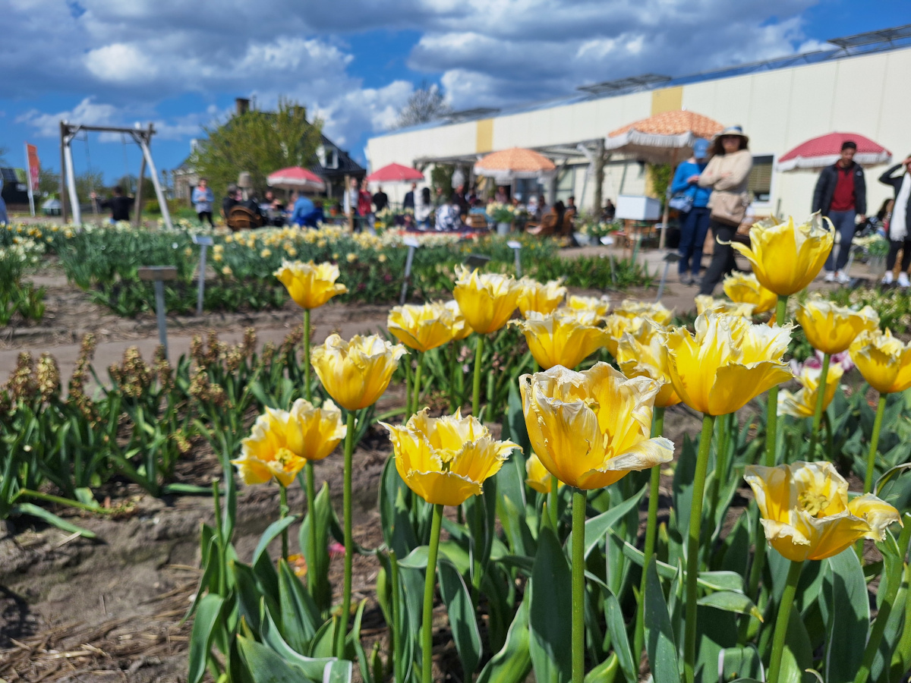

  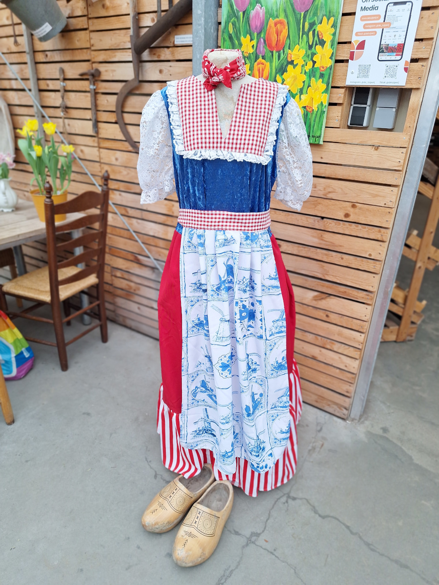
  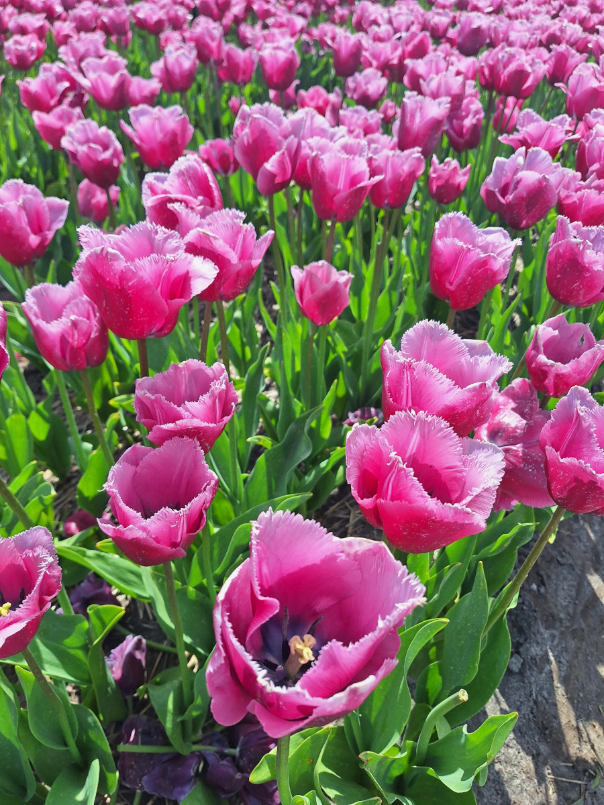

Omdat we een rondleiding meepikten, deelde de eigenaar gul zijn onmisbare tips om tulpen beter te kweken in onze eigen
tuin. Een belangrijke les was om tulpen in zandgrond met een hoge grondwaterstand te planten. Op hun kwekerij zit het
grondwater maar 65 cm onder het oppervlak, waardoor extra water geven overbodig is en het teveel gewoon naar
irrigatiesystemen wordt afgevoerd. We leerden ook hoe belangrijk het is om de tulpenbollen elk jaar op een andere plek te
zetten, om bacteriële en virale ziekten rond de bollen te voorkomen.

We kregen ook stap voor stap uitgelegd hoe de tulpenteelt verloopt. De Tulperij is een bollenkwekerij, anders dan
bloemenkwekerijen, wat betekent dat ze niet het hele jaar door tulpen kweken. Andere bedrijven telen tulpen wel continu
in serres. Opvallend: 80% van de tulpen die in Nederland geproduceerd worden, blijft in het land, en slechts 20% gaat de
export in.

De tulpencyclus bij De Tulperij begint tussen oktober en december, wanneer de bollen geplant en met stro afgedekt worden.
Ze hebben een paar maanden lagere temperaturen nodig om in de lente te bloeien, idealiter rond 9 °C. Wanneer de lente
aanbreekt en de tulpen beginnen op te komen, controleert de kweker nauwgezet op virussen en verwijdert hij elke plant die
er anders uitziet, bijvoorbeeld zonder bladeren of met een mozaïekpatroon.

We leerden dat het koppen van de bloemen, dat normaal in de eerste twee weken van mei gebeurt, dit jaar 2 weken vroeger
plaatsvond. Het koppen vermindert de insectenactiviteit rond de tulpen en zorgt ervoor dat de energie naar de ontwikkeling
van de bol gaat in plaats van naar de zaadvorming. Na het koppen blijven de bollen nog 6 à 8 weken in de grond zitten,
tot de bladeren geel worden. Daarna worden de bollen gerooid, met de hand schoongemaakt (dat heet "pellen"), gedroogd en
op een donkere, geventileerde plek bewaard tot het volgende plantseizoen. Uit één moederbol kunnen tot vijf kleine bollen
groeien.

Een klein deel van de bollen wordt nog altijd op veilingen verkocht. Grote bollen die voor de internationale markt bestemd
zijn, worden gewassen om bacteriën of schimmels te verwijderen. De kleinere bollen worden bewaard en in de herfst opnieuw
geplant; klisters doen er twee tot drie jaar over om groot genoeg te worden om te verkopen.

De Tulperij heeft sinds 2001 een nieuwe tulpenkleur, oranje, die erg zeldzaam is en 30% meer kost dan rode tulpen. Rode,
gele en paarse tulpen komen het meest voor, en het duurt gemiddeld 20 jaar om een nieuwe variëteit op de markt te brengen.
Zulke nieuwe variëteiten kunnen toevallig ontstaan door een willekeurige mutatie, zoals bij de oranje tulp, of door
doelbewuste kruising.
De oranje tulp bij De Tulperij was een gelukkige vondst, ontstaan uit een toevallige mutatie. De kwekers isoleerden de
bol zorgvuldig, en toen die het jaar erna in dezelfde felle kleur bloeide, wisten ze dat ze iets bijzonders in handen
hadden. Die blijvende mutatie was het begin van hun inspanningen om deze unieke oranje bollen te kweken en te
vermeerderen.

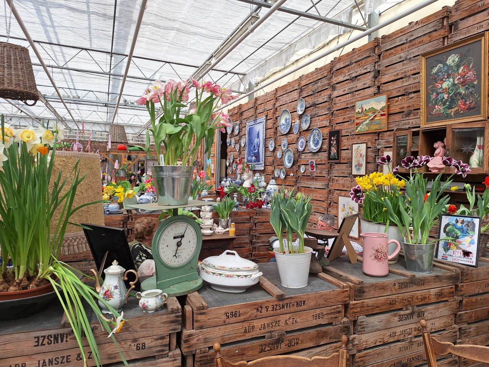
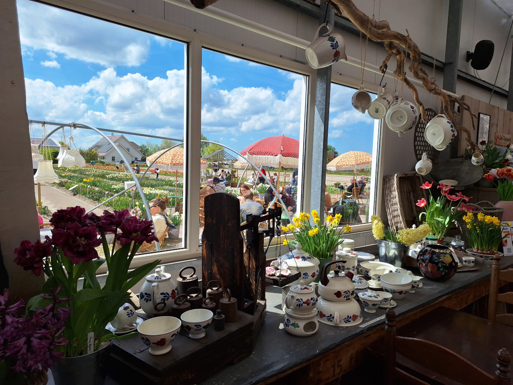

Vlak naast De Tulperij zit een buur met een indrukwekkende collectie van 7.000 verschillende tulpensoorten, waaronder
virusresistente variëteiten. Elke nieuwe tulpenvariëteit krijgt een certificaat van de genenbank, als bewijs van haar
uniciteit en identiteit. Van bij het begin werden tulpen naar beroemde persoonlijkheden of kwekers genoemd. De bekendste
is de "Semper Augustus", vernoemd naar de Romeinse keizer Augustus, in de 16e eeuw.
Een leuk weetje dat we van de kweker bij De Tulperij opstaken, ging over de bijzondere manier waarop hyacinten gekweekt
worden. Anders dan bij tulpen gaat het bij hyacinten om een doelbewuste techniek waarbij kwekers de onderkant van de
bollen met de hand beschadigen. Die verrassende methode zorgt ervoor dat de bollen zich razendsnel vermenigvuldigen, met
20 tot 30 nieuwe bollen in amper 2 à 3 maanden. Daarna wordt elke nieuwe bol met de hand afgescheiden en moet die nog
drie jaar groeien voor hij groot genoeg is om te bloeien.

De laatste dag stond in het teken van de beroemde Keukenhof, die in 1949 werd opgericht (precies 75 jaar geleden!). Op de
foto hieronder zie je de vroegere ingang van het park, die nog altijd een van de blikvangers is. De tuin ging
oorspronkelijk open om de beste bloembollen te tonen die de Nederlandse sierteelt te bieden had, en is sindsdien
uitgegroeid tot een van de grootste en bekendste bloementuinen ter wereld.

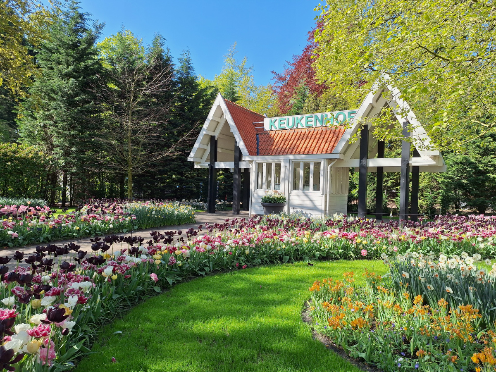
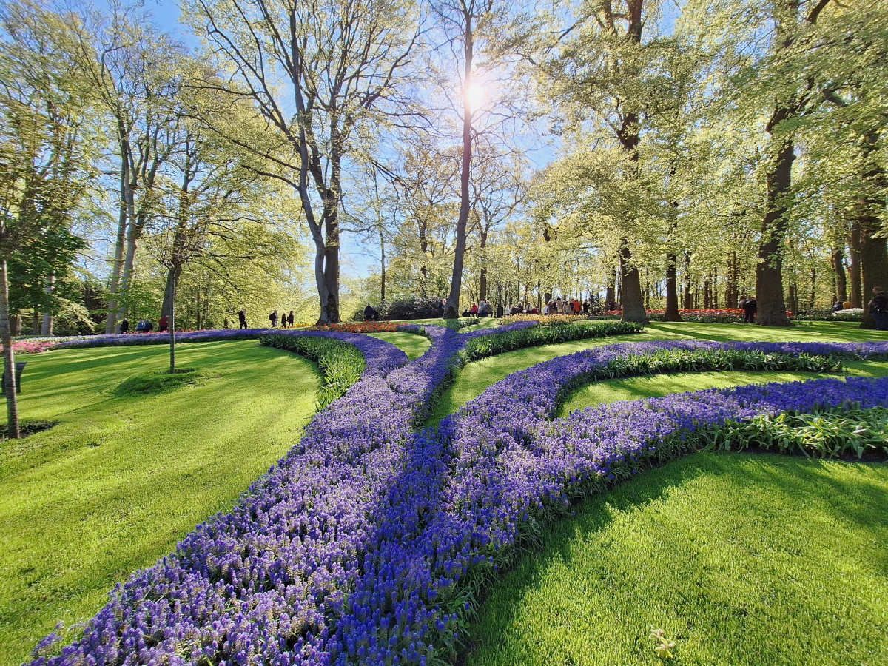

  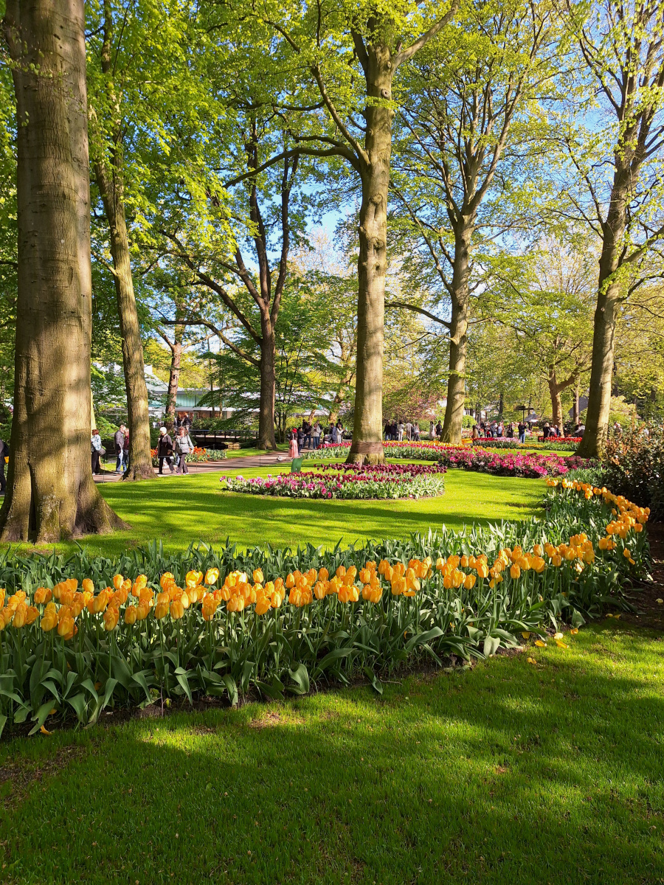
  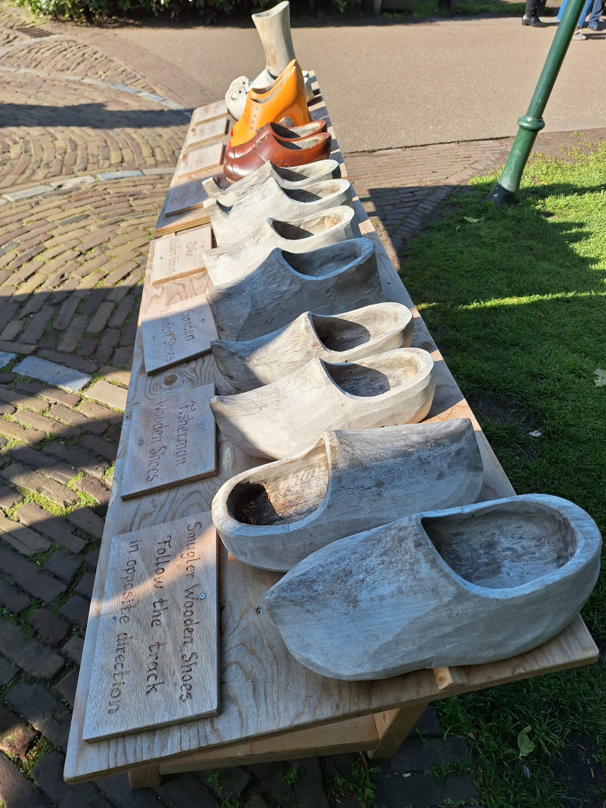

Een van de blikvangers van de Keukenhof is de charmante molen, oorspronkelijk in 1892 in Groningen gebouwd en geschonken
door een cruisemaatschappij. Vanaf het platform bovenaan de molen heb je normaal een adembenemend uitzicht over de
kleurrijke tulpenvelden op het hoogtepunt van het seizoen. Tijdens ons bezoek waren de omliggende velden echter al gekopt.

De Keukenhof draait vooral rond de 7 miljoen voorjaarsbloeiende bollen, een levende catalogus voor de 100 deelnemende
bedrijven. Meer dan 500 kwekers tonen een indrukwekkende verscheidenheid aan snijbloemen en potplanten op meer dan 20
bloemenshows. Vroeg in het seizoen geniet je van krokussen, narcissen, hyacinten en vroege tulpen in volle bloei.
Naarmate het seizoen vordert, verandert de tuin en verschijnen grotere tulpen en andere bloemen. De Keukenhof is een
must voor elke bloemenliefhebber en biedt een spectaculair schouwspel van natuurpracht. Het is wel belangrijk om te weten
dat het park behoorlijk druk kan worden, zelfs op een maandagochtend. De ervaring is ongetwijfeld magisch, maar door de
enorme toeloop is het niets wat ik elk jaar zou overdoen. Toch blijft de Keukenhof een bloemenparadijs dat je minstens
één keer moet meemaken.

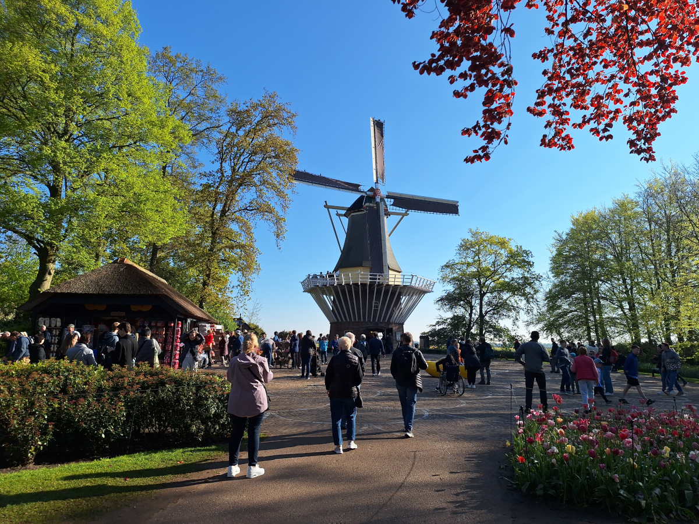

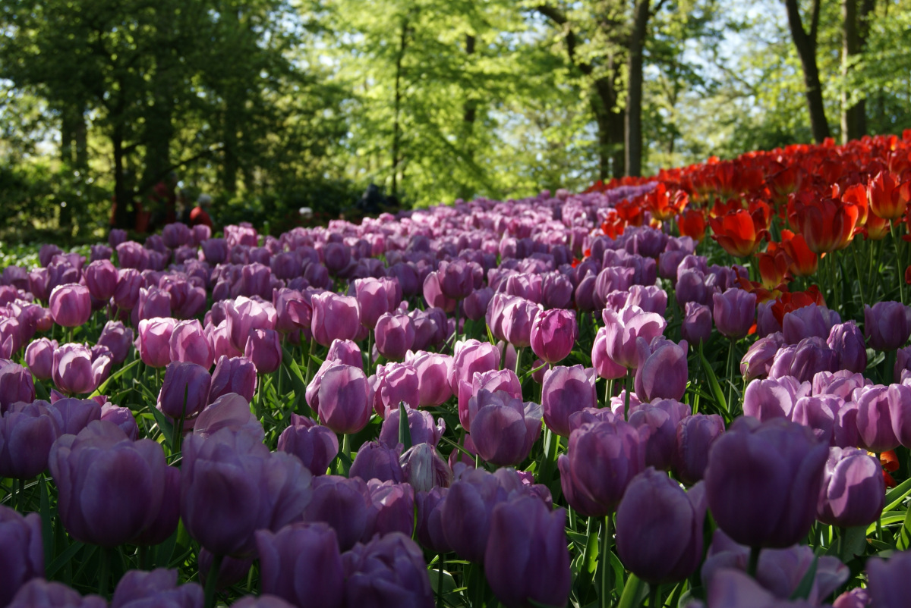

  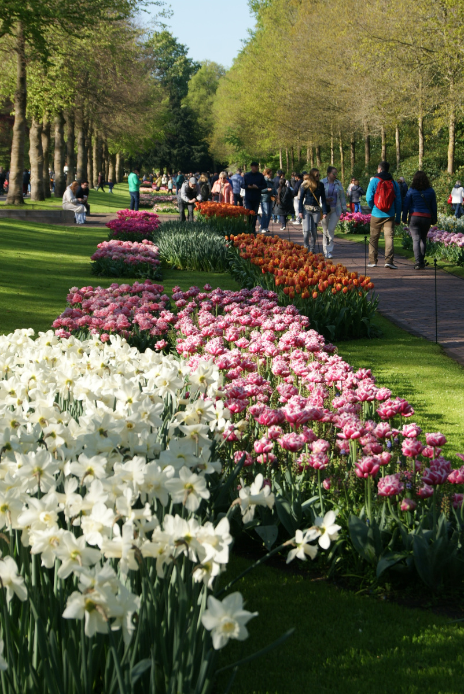
  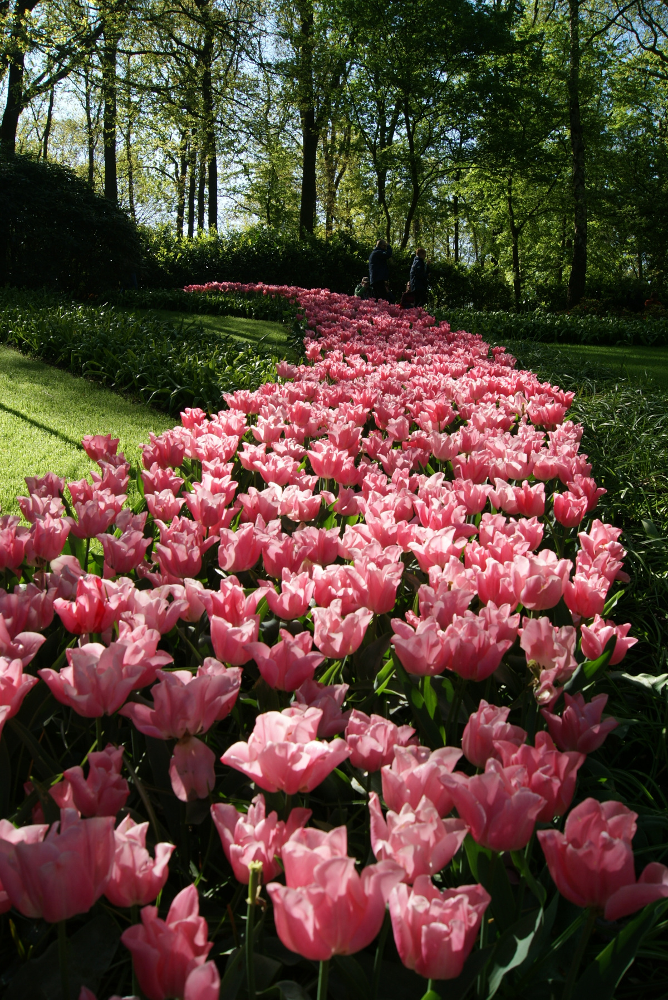

__Praktische info:__
 * [Easy Fiets in Leiden](https://www.easyfiets.nl/en/) Heel vriendelijk personeel, en we konden de fietsen zelfs na
sluitingstijd terugbrengen, maar ze waren wel vrij klein en 50 km fietsen met zo'n fiets was niet niks.

  * [Tulip Store Showgarden](https://www.tulipstore.eu/nl/service/tulip-store-showtuin/) is een tulpenshowtuin met grote
tulpenvelden die je gratis mag betreden. Nog een plek met prachtige velden lag naast Vernooij VOF, geen tulpenkwekerij
maar wel mooie, makkelijk toegankelijke velden.
  * Tijdens onze fietstocht volgden we grotendeels de route van [Flowermap.nl](https://goo.gl/maps/cxvXKUircv5tzJJw6?g_st=aw)
Je kan die openen en wordt meteen doorgestuurd naar Google Maps, wat het heel gebruiksvriendelijk maakt. Daarna volg je
gewoon de markeringen op de kaart. We sloegen één lus richting de zee over omdat het weer onstabiel was en we nog naar
Leiden terug moesten. Onze collega's deden dat stuk wel, en zij bevestigden dat het landschap er drastisch verandert, met
duinen die er zelfs bij winderig en stormachtig weer schitterend uitzien.
* Tulpenkwekerij [De Tulperij](https://detulperij.nl/) in Voorhout - je kan er een rondleiding door de tulpenvelden
volgen (3 rondleidingen per dag, Engels en Nederlands). Er is ook een prachtig versierde bloemenkas met koffie, thee en
een Hollandse wafel. Je kan er ook heel wat souvenirs rond tulpen en Delfts blauw kopen. Tijdens ons bezoek konden we
geen bollen kopen, maar die kan je online bestellen en later naar je thuisadres laten sturen. Het is ongelooflijk om te
zien hoeveel toewijding en tijd er in het kweken van bollen kruipt. Kom je ooit in de buurt van de Keukenhof, dan is een
bezoek aan De Tulperij een must voor elke bloemenliefhebber! Het bezoek duurde bijna een uur en omvatte een film van 20
minuten en vrije tijd om foto's te maken op de velden, die normaal niet voor elke bezoeker open zijn. Op deze kwekerij
kan je ook dahlia's zien, van begin augustus tot begin oktober, wanneer de kwekerij opnieuw open is voor bezoekers. Let
op: iedereen mag de tulpenshowtuin bekijken, maar om foto's op de velden te nemen moet je een rondleiding boeken.
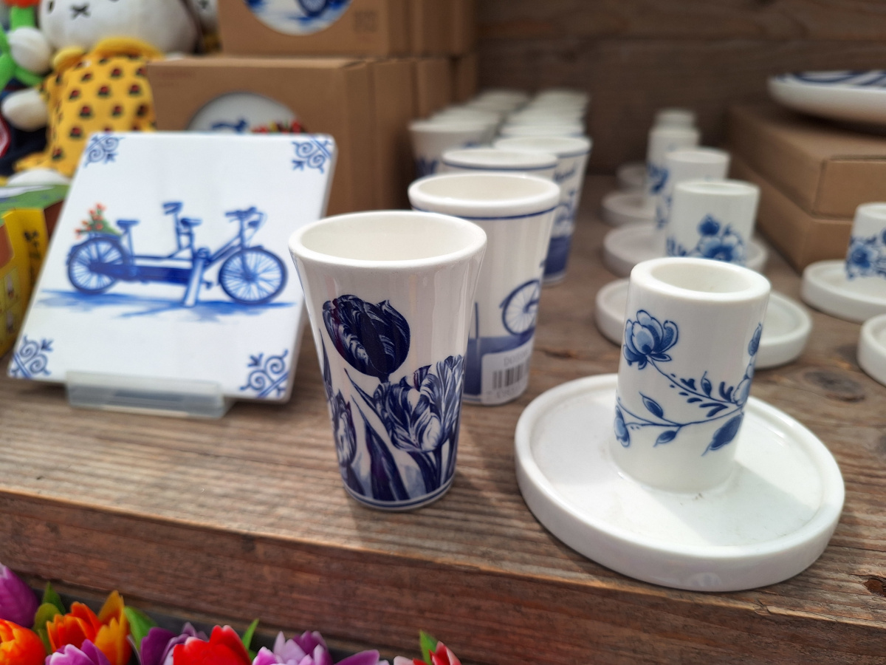
  * De [Keukenhof](https://keukenhof.nl/nl/) is waarschijnlijk de meest bezochte plek van Nederland tijdens de paar weken
dat hij open is. Het aantal grote toeristenbussen op de parkings die we op zaterdag tijdens het fietsen passeerden was
verbluffend, om nog te zwijgen van het aantal auto's op de verschillende parkings rond de befaamde tuinen. We waren blij
dat we ons ticket voor maandagochtend om 8.30 uur geboekt hadden. Het enige probleem waar we tegenaan liepen, was dat de
parkings 's ochtends zo leeg waren dat we niet goed wisten waar we naartoe moesten. We reden uiteindelijk naar twee
verschillende parkings voor iemand ons eindelijk naar de juiste doorverwees, waardoor we bijna 20 minuten verloren.
Blijkbaar wisselt de aangewezen parking in de loop van de dag, dus kom je 's ochtends, rijd dan zeker naar de
hoofdparking (coördinaten: 52.268923, 4.551555). Dat is ook dezelfde parking waar je een fiets kan huren.
Wij naderden de Keukenhof uit een andere richting, dus let op de tijdelijke borden aan de rotonde die aangeven waar je
moet afslaan. Op het bord stond enkel "Keukenhof", wat verwarrend was. Het zou handiger zijn als er ook het woord "open"
en een parkeerpictogram op stond.

Tot 11 uur was het aantal bezoekers in het park redelijk. Daarna werd het echt druk. We zagen steeds meer grote groepen,
waardoor het lastig werd om je op sommige plekken een weg te banen. Omdat we kwamen nadat de tulpenvelden al gekopt
waren, was het niet de moeite om eerst naar de molen te haasten, want zonder de kleurrijke velden was het uitzicht niet
spectaculair. In de plaats daarvan raden we aan om naar de Historische Tuin te gaan, ideaal voor selfies en, zoals we
later merkten, een populaire plek in het park. Na het park wandelden we naar het centrum van Lisse om te lunchen (minder
dan 20 minuten stappen) en daarna keerden we terug naar de parking.

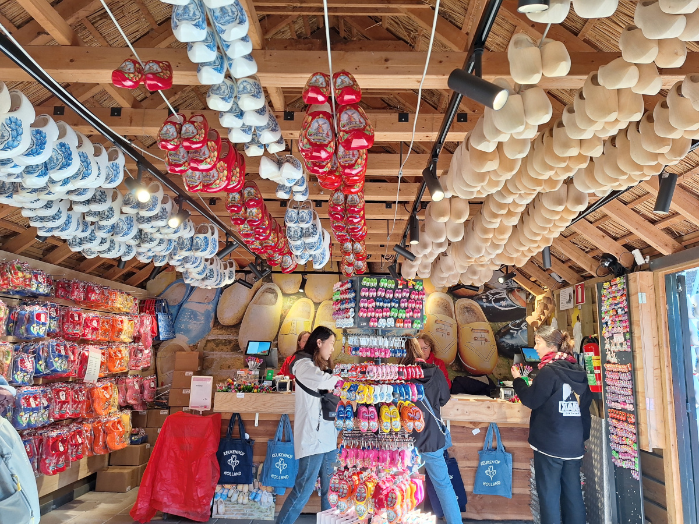
