Platja de Gandia is een gezinsvriendelijke badplaats aan de oostkust van Spanje, perfect voor een ontspannen vakantie
met kinderen. In deze post vertellen we over de stranden en daguitstappen naar Cullera en Valencia, en geven we praktische vervoerstips.

Wil je een strandvakantie combineren met enkele stadsbezoeken, dan is een verblijf in Platja de Gandia samen met een uitstap naar
Valencia een perfecte keuze. Vanuit het centrum van Valencia is het maar een treinrit van 1 uur en 15 minuten naar het
charmante kuststadje Platja de Gandia. Tijdens onze reis trokken we ook naar Cullera, nog zo'n kustpareltje, en bezochten
we het fascinerende Oceanogràfic, gelegen in de schitterende Turiatuinen in Valencia.

Platja de Gandia verraste ons echt! Met zijn 3 kilometer lange promenade was dit strand veel meer dan we verwacht hadden.
Ons appartement lag handig één straat verderop, pal naast een gezellige fruitwinkel, een kleine plaatselijke bakkerij
en een zaakje met koffie, warme chocolademelk en versgemaakte churros (churrería). Het strand zelf is uitgestrekt, met
zacht, fijn zand en houten vlonderpaden die de toegang tot aan het water makkelijk maken, zeker voor gezinnen met een
buggy of voor wie minder mobiel is. Het strand is goed uitgerust met gratis toiletten, veel plaats om te zonnen en, niet
onbelangrijk, het was er nooit overdreven druk.

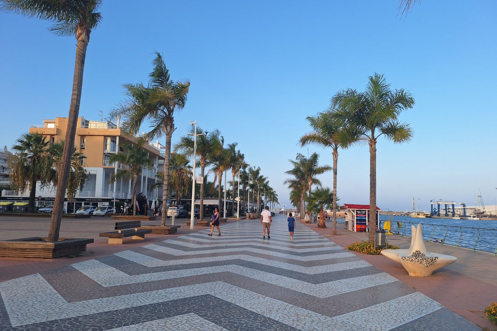

Een van de blikvangers van Platja de Gandia is de levendige promenade, die 's avonds tot leven komt. Langs de promenade liggen winkels,
restaurants en cafés, waardoor dit de perfecte plek is voor een avondwandeling. Straatverkopers dragen bij aan de bruisende
sfeer met handgemaakte juwelen, zonnebrillen, voetbaltruitjes en heel wat souvenirprullaria. Je vindt er zelfs mensen die
hennatatoeages zetten of kleurrijke vlechtjes maken voor kinderen. De promenade is breed, met genoeg ruimte voor
voetgangers, fietsers en steps, al is schaduw wat moeilijker te vinden. Eén ding om te weten: de gemeente heeft honden op
het strand verboden, dus reis je met huisdieren, dan moet je een andere oplossing zoeken.

Platja de Gandia is bij internationale toeristen relatief onbekend. De meeste bezoekers zijn Spanjaarden, waardoor Engels
minder gangbaar is dan je zou denken, en we liepen dan ook tegen een paar problemen aan in de restaurants toen we een
tafel zochten of wilden reserveren. Al helpen een paar basiswoorden Spaans je een heel eind vooruit!

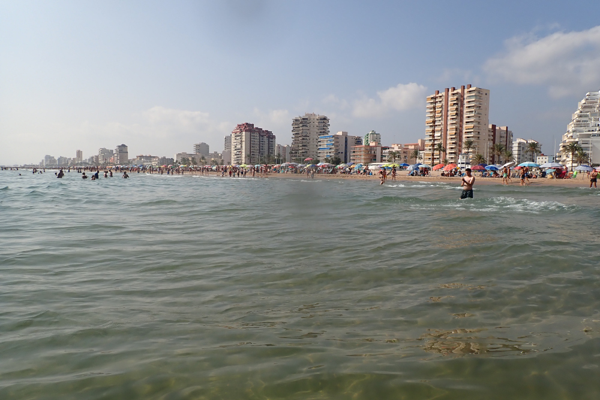
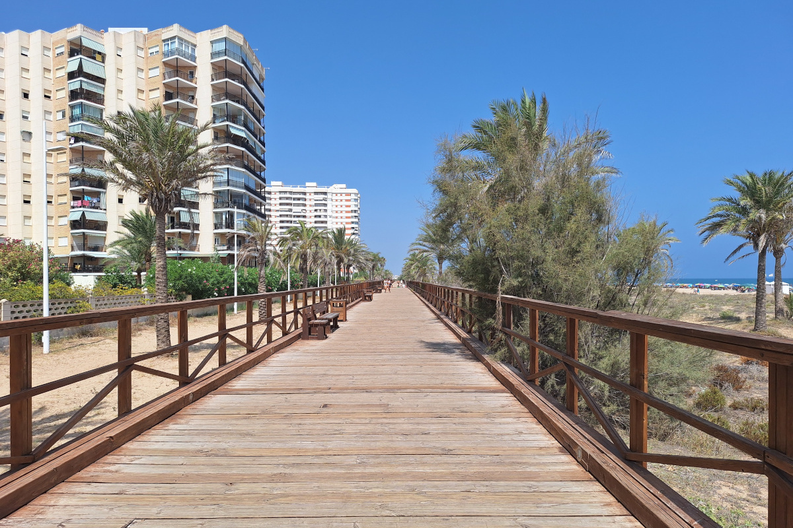

  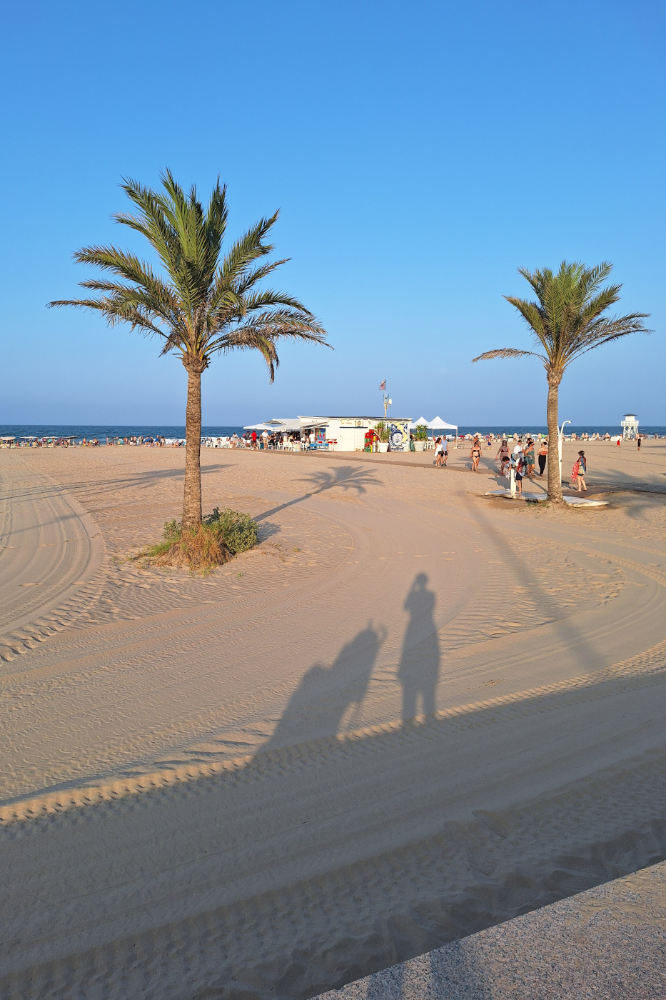
  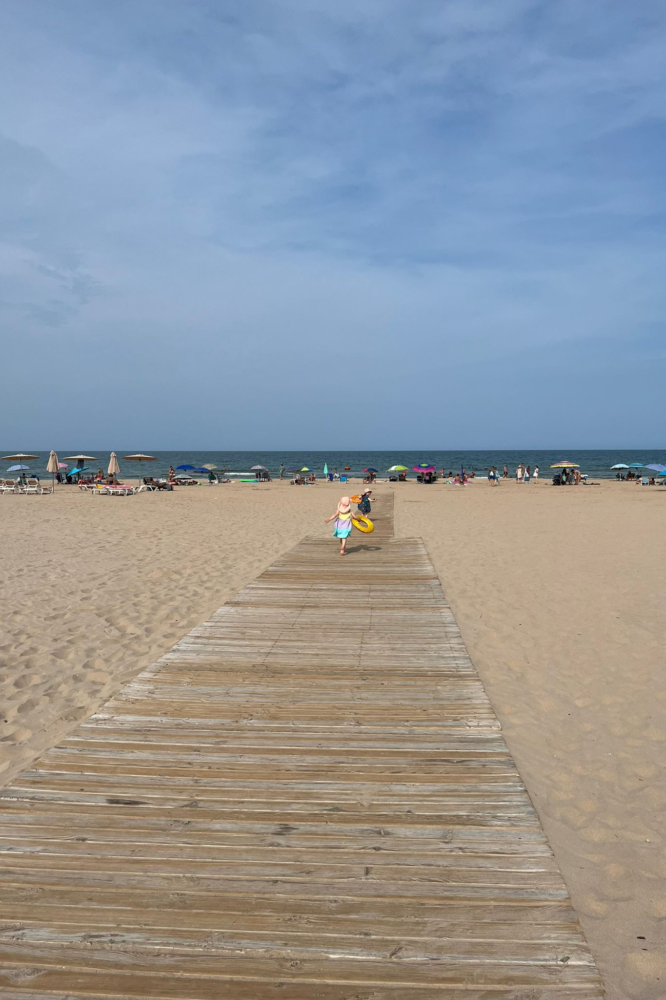

Een van de hoogtepunten van onze tijd op het strand van Gandia was de aparte zone om vliegers op te laten. Elke namiddag
rond 17 uur kwam de plaatselijke vliegerclub samen om een reeks kleurrijke vliegers op te laten, pal op het strand en
zowat recht voor onze favoriete ijssalon, Cognigni. Deze groep, bekend als "Cometas Gandia", brengt met hun vliegers een
speelse, levendige sfeer naar het strand. Heel wat vliegers hebben de vorm van leuke figuurtjes zoals Tom en Jerry, een
absolute hit bij de kinderen! Je kan ze zelfs op Instagram volgen voor updates over hun vliegershows.

  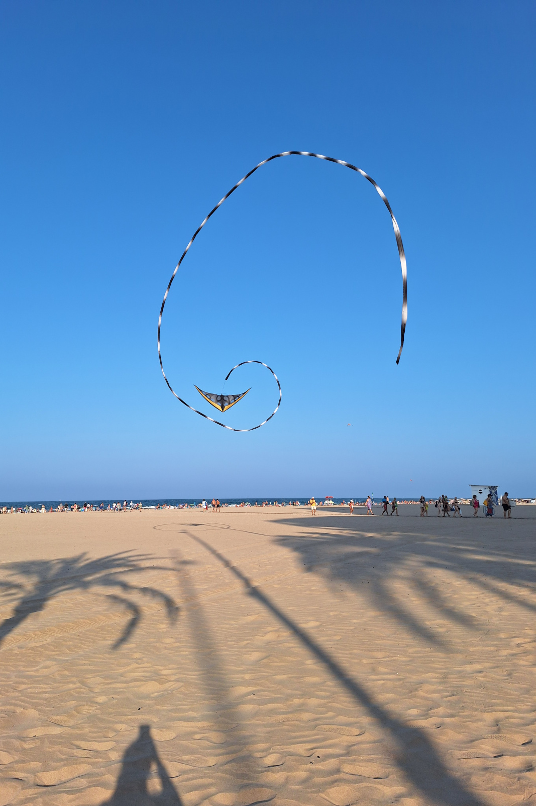
  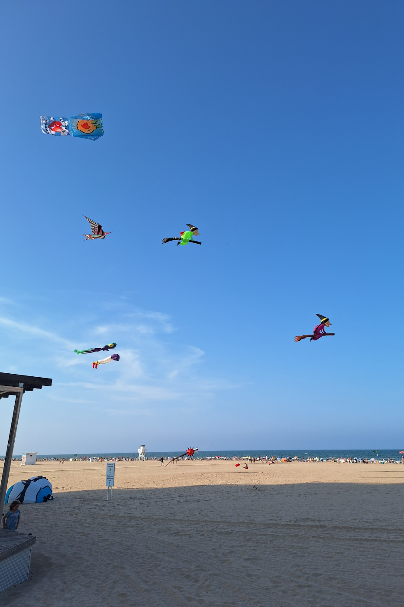

Als welkome afwisseling van het strand maakten we met de trein een daguitstap naar Cullera om het indrukwekkende
kasteel van Cullera te bezoeken. Het kasteel, gebouwd in de 10e eeuw, staat bovenop een heuvel en biedt een schitterend
panorama over de stad, de Middellandse Zee en de omliggende kuststreek.

De goed bewaarde vesting is een mooie mengeling van Moorse, gotische en romaanse bouwstijlen, waarin je haar evolutie door de
eeuwen heen herkent. Oorspronkelijk had het kasteel verschillende torens en muren, waarvan er veel gerestaureerd zijn,
zodat bezoekers de grandeur ervan kunnen ervaren.

Het meest opvallende onderdeel is de Torre del Racó de Sant Antoni, een toren die je beloont met een adembenemend
uitzicht over het landschap. Aan het kasteel grenst het heiligdom van de Virgen del Castillo, een sfeervol kapelletje in
gotische stijl uit de 19e eeuw. Binnen in het kasteel is er ook een klein museum met stukken die de geschiedenis van de
vesting en de streek belichten. Je ontdekt er oude voorwerpen, waaronder wapens, aardewerk en middeleeuws gereedschap, wat
je een boeiende blik geeft op het leven toen het kasteel nog in gebruik was.

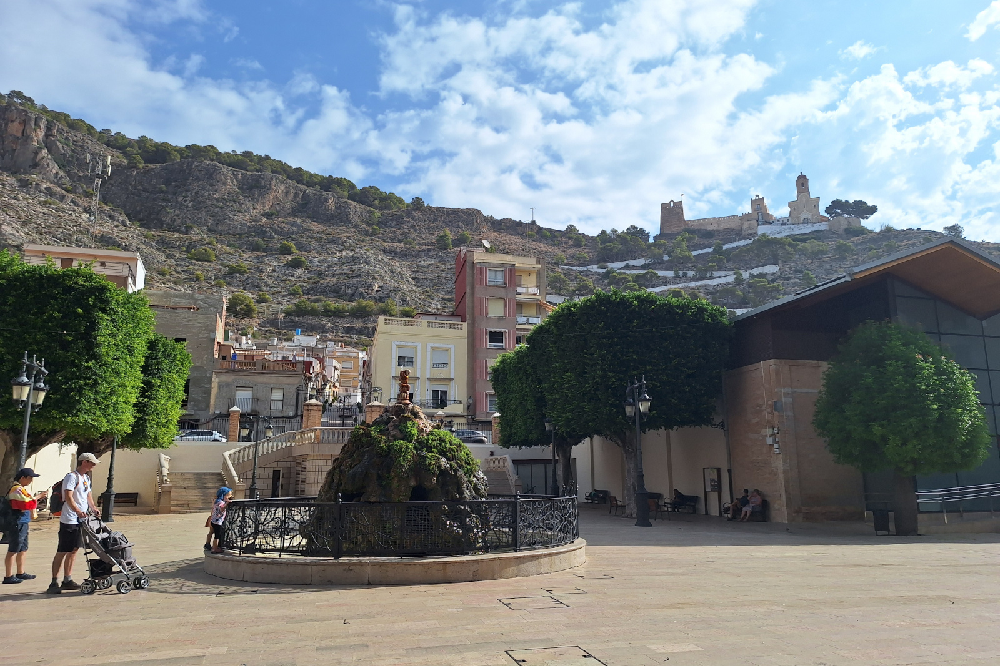

  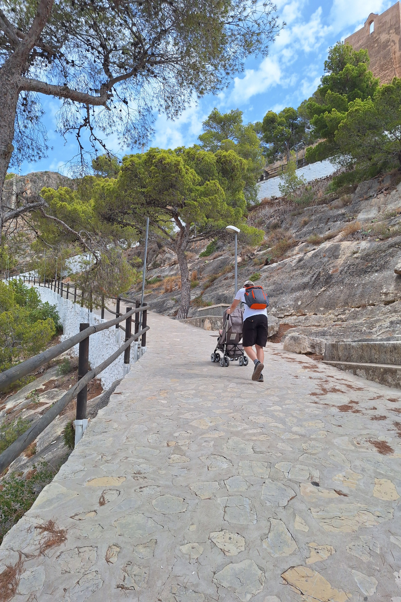
  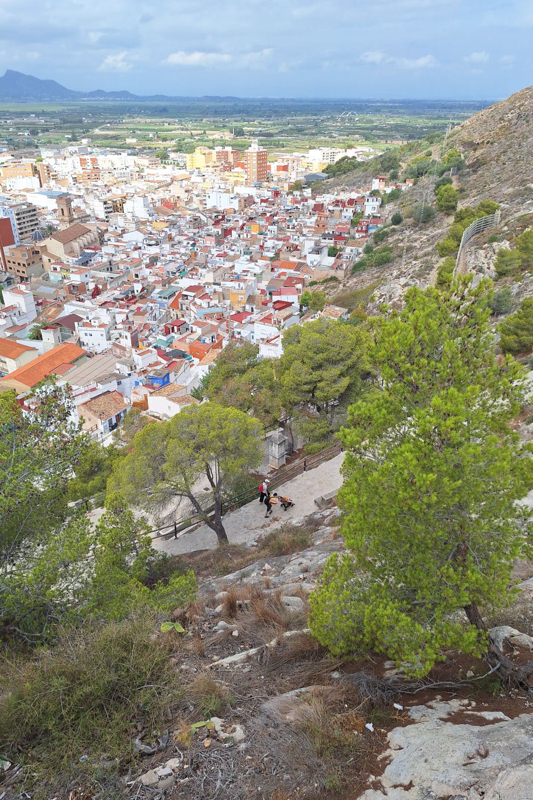

  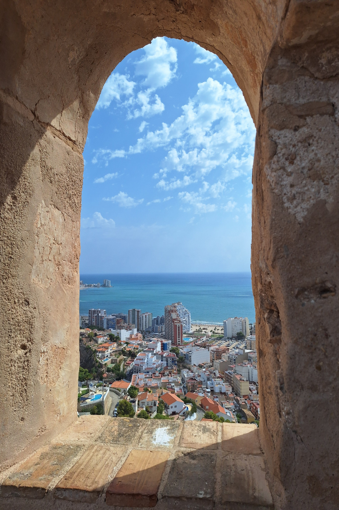
  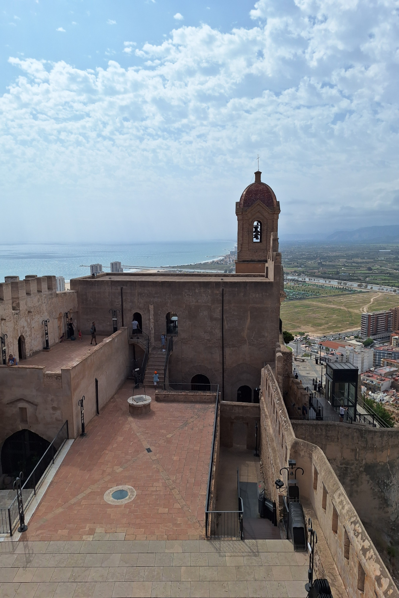

Na het kasteelbezoek wandelden we terug naar beneden, naar de stad, en aten we heerlijk in
[Aroma de Grecia](https://maps.app.goo.gl/HaTVLGfD6GLiKt8J7). Er was ook een fijne [bakkerij La Delicia](https://maps.app.goo.gl/ZhDGhQPShJEZgABs9)
met de lekkerste hartige spinaziepasteitjes, absoluut een aanrader! We hadden geen tijd meer om de kustlijn te volgen en
de rest van de stad te bekijken, en hielden gewoon halt op de [speeltuin](https://maps.app.goo.gl/9amFPqWC5wau2kJp9) bij
het strand.

Kortom, het stadje is een verborgen pareltje, perfect voor een ontspannen gezinsvakantie. Een ideale plek om tot
rust te komen, van de zon te genieten en de lokale sfeer op te snuiven! Voor een leuke daguitstap neem je de trein
naar het nabijgelegen Cullera of Valencia, of neem je vanuit Gandia de bus naar Alicante (de bussen vertrekken aan het
busstation van Gandia, aan de achterkant van het treinstation). Wat ons betreft is dit een prachtig alternatief voor
overvolle toeristische badplaatsen, perfect voor gezinnen die willen ontspannen en iets nieuws willen ontdekken.

## Praktische info:
* Kom je aan op de luchthaven van Valencia (Aeroport), dan raak je makkelijk in het stadscentrum. Metrolijnen 3 en 5
brengen je van Aeroport naar station Valencia Nord (Xàtiva) in amper 21 minuten, in zone AB+. Het tarief is €5,80 per persoon.

* Vanaf station Valencia Nord neem je de C1-trein naar Gandia. De treinen rijden om de 30 à 60 minuten en de rit
duurt ongeveer 1 uur en 15 minuten. Een enkel ticket kost €6,30, maar je bespaart €0,50 per rit door je ticket op te
laden, waardoor de prijs op €5,80 komt. De meeste treinen stoppen in Gandia, maar slechts enkele rijden door tot Platja
de Gandia. Eindigt jouw trein in Gandia, dan neem je bus L2 naar het strand. Die rijdt om de 20 minuten en kost €1,60 (of
€1,70 op zondag). Tickets koop je rechtstreeks bij de chauffeur.
Het station van Platja de Gandia is vrij eenvoudig, met maar één perron en een ticketautomaat. De vertalingen op die
automaat kunnen wel verwarrend zijn voor wie geen Spaans spreekt, want niet alle opties zijn volledig vertaald. Vergeet
na aankoop niet je ticket te ontwaarden bij de aparte scanner op het perron voor je opstapt.
* Het strand bij Platja de Gandia is goed uitgerust, met om de paar meter openbare toiletten, strandbars en
recyclagebakken om de boel proper te houden. Er zijn ook mogelijkheden om te sporten, zoals voetbal en volleybal, plus
fitnesstoestellen langs de promenade. Het strand is brandschoon, met openbare douches, toiletten en een EHBO-post, waardoor
het erg geschikt is voor gezinnen. Redders en politie op quads houden het strand in de gaten, wat voor een veilig gevoel zorgt.
Een handig detail: naast elk houten vlonderpad naar het strand staat een informatiebord met een kaart waarop alle
voorzieningen in de buurt duidelijk aangeduid staan.
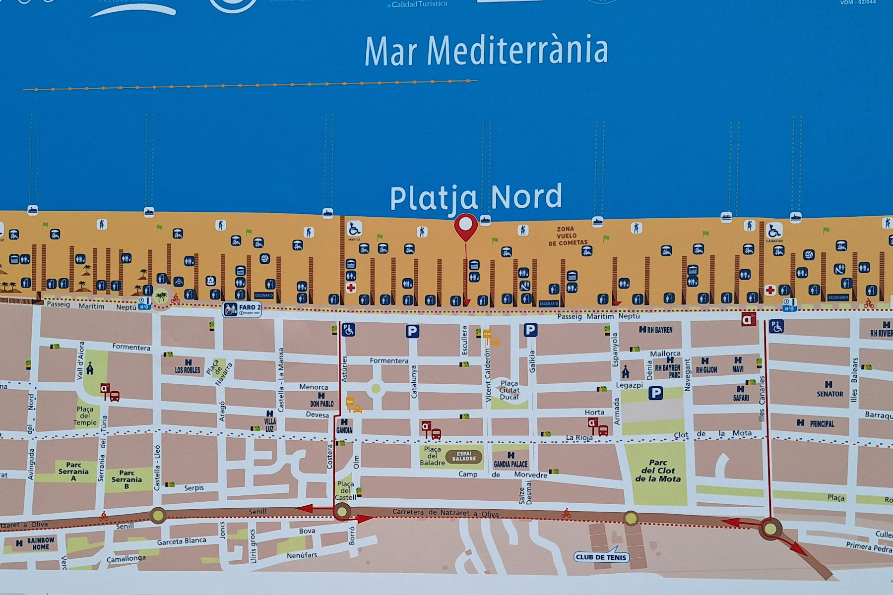
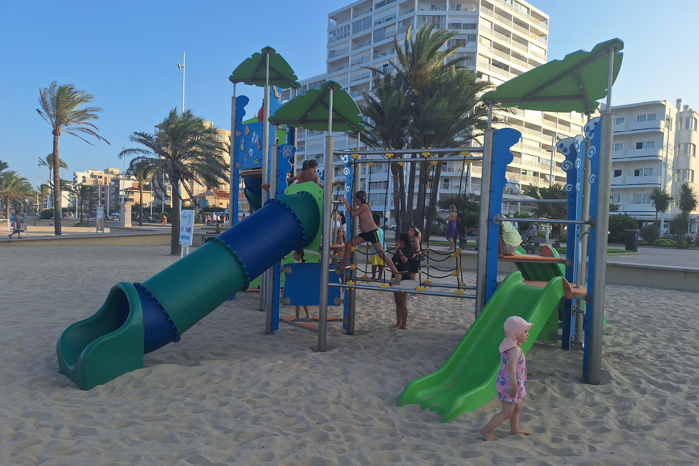
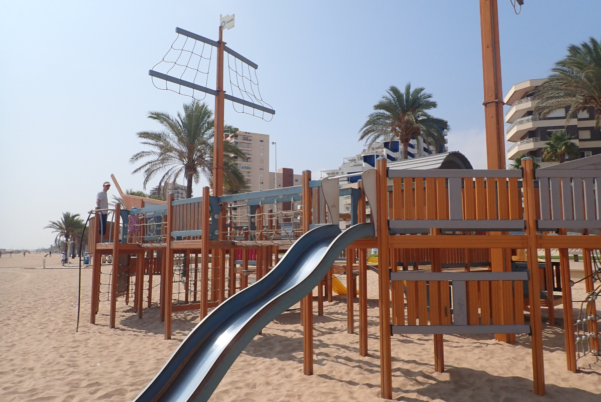

  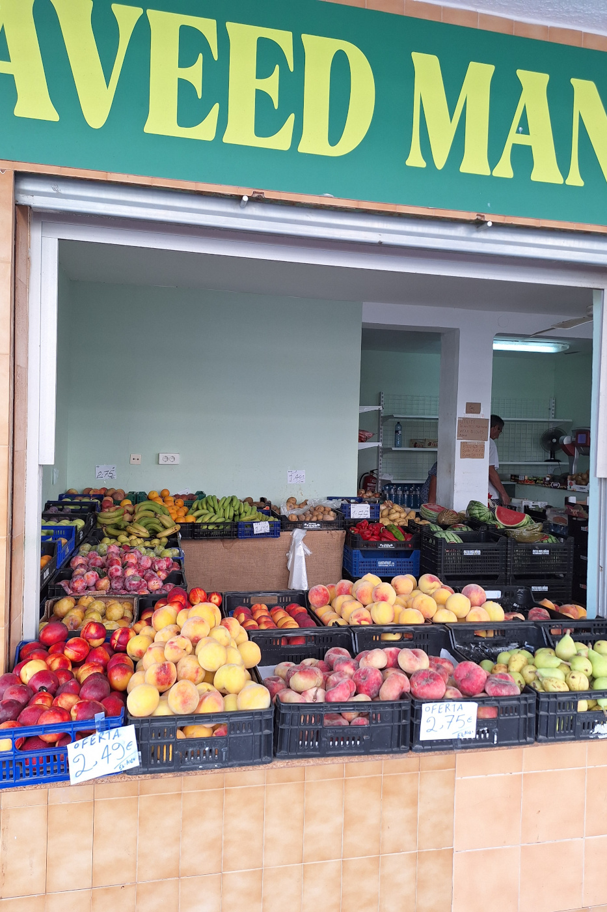
  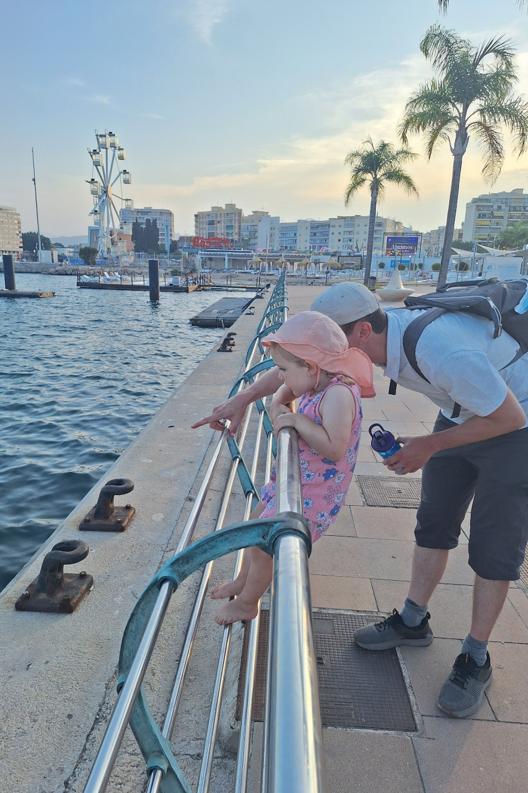

* Onze favoriete eetadresjes staan hieronder, samen met de fantastische ijssalon waar we elke namiddag te vinden waren!
Let op: de meeste restaurants sluiten in de vroege namiddag en gaan rond 20 uur weer open, wanneer de hele stad tot leven
komt.

  * [Cognigni](https://maps.app.goo.gl/2zBJ8acASm4TmJSK8): fantastisch Argentijns ijs
  * [INDIAN RASOI](https://maps.app.goo.gl/MqcaPoHHPfbn2Lqd7): Indiaas eten - probeer zeker de Goan Chicken!
  * [Restaurante Boga](https://maps.app.goo.gl/ixtKCKtX8iJ115bXA): lokaal project dat werk biedt aan mensen met een verstandelijke beperking en sociale integratie bevordert, het menu wisselt dagelijks
  * [Restaurante Casa José](https://maps.app.goo.gl/sesQQSkJVCbdM6NeA): een ruime keuze aan zeevruchten en lokale gerechten

  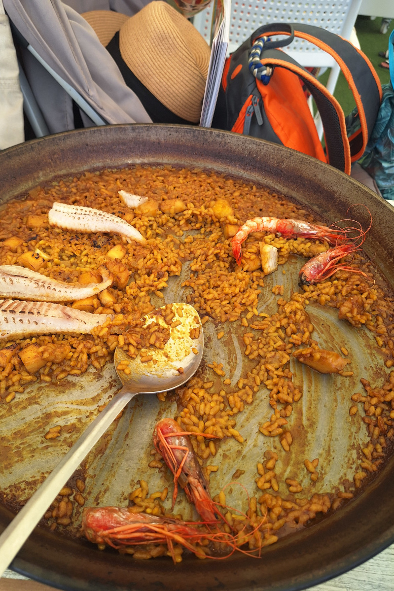
  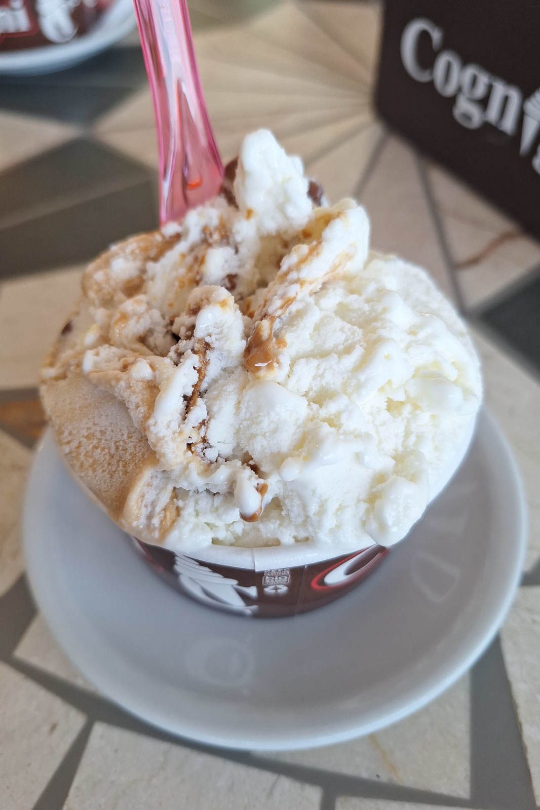

* Het [kasteel](https://visit-cullera.es/guia/castillo-de-cullera/) van Cullera is een prima plek voor een gezinsuitstap,
met toegangstickets aan amper €3 voor volwassenen; kinderen lijken gratis binnen te mogen (ons werd althans niet gevraagd
om voor onze kleuters te betalen). Geen enkele toren of muurgedeelte rond het kasteel was tijdens ons bezoek open, maar
de ervaring was toch de moeite waard door de uitzichten.
Je kan tot bij het kasteel rijden en daar parkeren, of te voet vertrekken vanaf de Mercat de Cullera (waar ook openbare
toiletten zijn). In de recensies bestaat er wat verwarring over een lift naar het kasteel. Even verduidelijken: de lift
brengt je enkel van de parking tot de kasteelingang, wat maar een paar meter hoger ligt. Na de ticketbalie brengt een
tweede lift je tot aan de hoofdingang.
Omdat wij met de trein aankwamen en onze buggy's bij hadden, besloten we de klim te voet vanaf de markt te beginnen.
Ben je met een buggy, dan raden we de Carrer del Calvari aan om trappen te vermijden. Onze wandeling door de
schilderachtige wijk Barri del Pou viel best mee, met hier en daar maar een paar treden. Het was het absoluut waard: de
charmante witte trappartijen, stenen muurtjes en weelderige planten langs de smalle, propere straatjes maakten de
wandeling magisch.

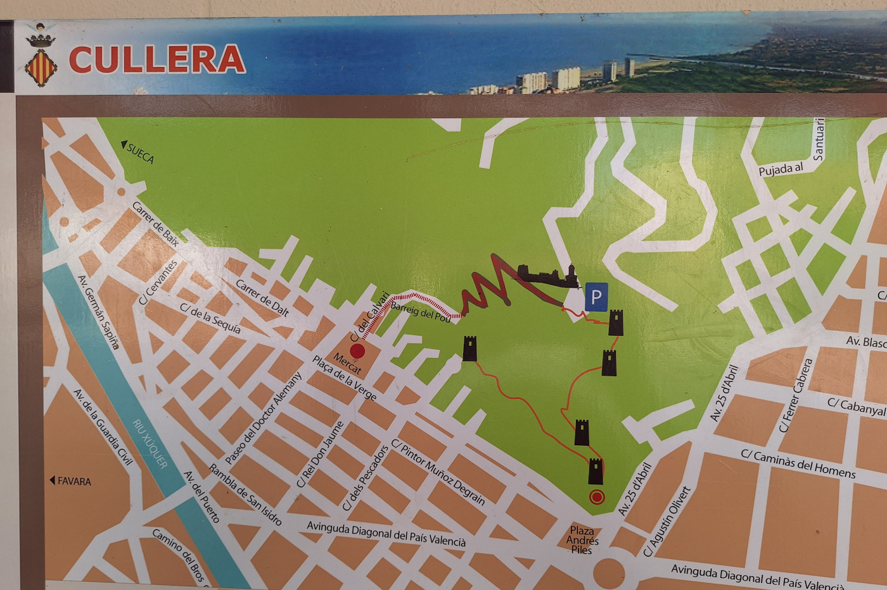
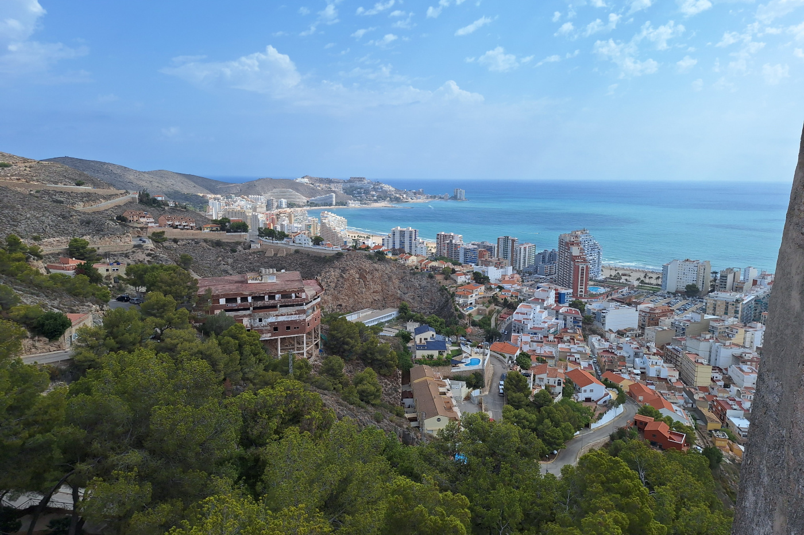
