We combineerden ons verblijf in Platja de Gandia met een daguitstap naar het Oceanogràfic, een oceanarium in de
schitterende Turiatuinen in het hart van Valencia. Meer details over hoe we er geraakten, vind je in het praktische
gedeelte onderaan deze post.

Ben je op zoek naar een onvergetelijke ervaring met zeedieren, dan hoort het Oceanogràfic in Valencia bovenaan je lijstje
te staan. Als het grootste aquarium van Europa is het een plek waar je makkelijk een hele dag doorbrengt. Van dolfijnen
en witte dolfijnen tot haaien, pinguïns, schildpadden en een ongelooflijke verscheidenheid aan vissen: deze bestemming
boeit bezoekers van alle leeftijden en zet tegelijk in op duurzaamheid en milieubewustzijn.

Er valt zoveel te ontdekken dat je best minstens 4 à 5 uur (of meer) uittrekt om echt van alles te genieten. Het park is
slim opgedeeld in zones, elk met een ander zeemilieu van ergens ter wereld. Een van de blikvangers zijn de
onderwatertunnels, waar je omringd wordt door adembenemende beelden van haaien en roggen die sierlijk boven je hoofd
voorbijglijden. Die tunnels zijn pure magie, maar het kan er druk worden omdat ze maar in één richting begaanbaar zijn.

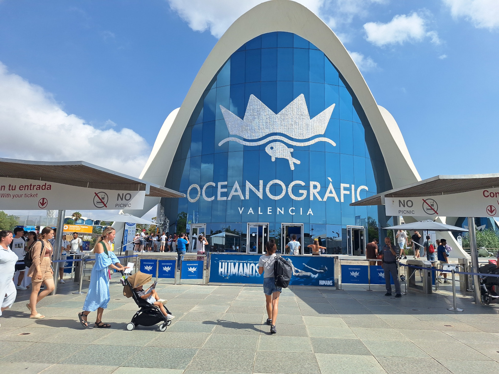
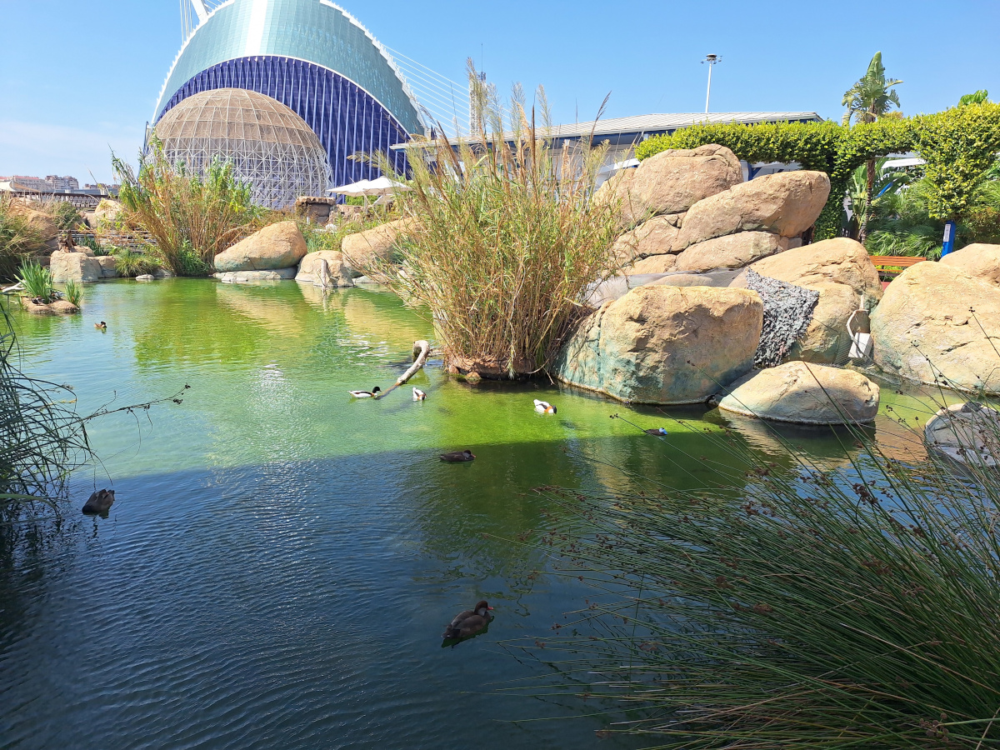

Persoonlijk hoogtepunt? De witte dolfijnen. Die charmante dieren zijn zo schattig als je je maar kan inbeelden en een
absolute must. Het Oceanogràfic redde in juni van dit jaar twee witte dolfijnen uit de verschrikkingen van de oorlog in
Oekraïne. Het is de enige instelling op het continent die witte dolfijnen huisvest en kon helpen bij die erg moeilijke
reddingsoperatie. De nieuwe dieren herstellen en wennen momenteel in aparte ruimtes die niet toegankelijk of zichtbaar
zijn voor het publiek.

De kwallenbakken hypnotiseerden de bezoekers zowat met hun sierlijke, harmonieuze bewegingen. Aan fascinerende dieren is
er geen gebrek, maar wees niet verbaasd als sommige delen wat tegenvallen, zoals de krokodillen: wij kregen er tijdens
ons bezoek maar één te zien.

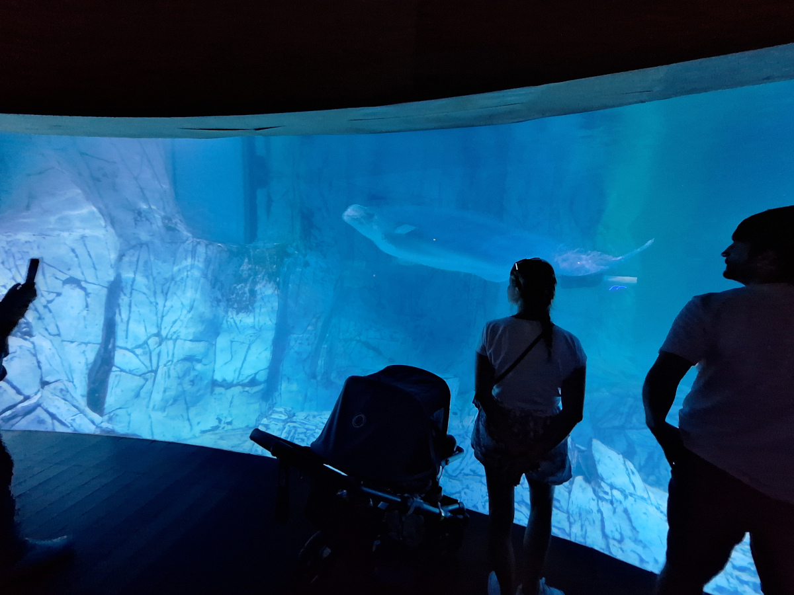

  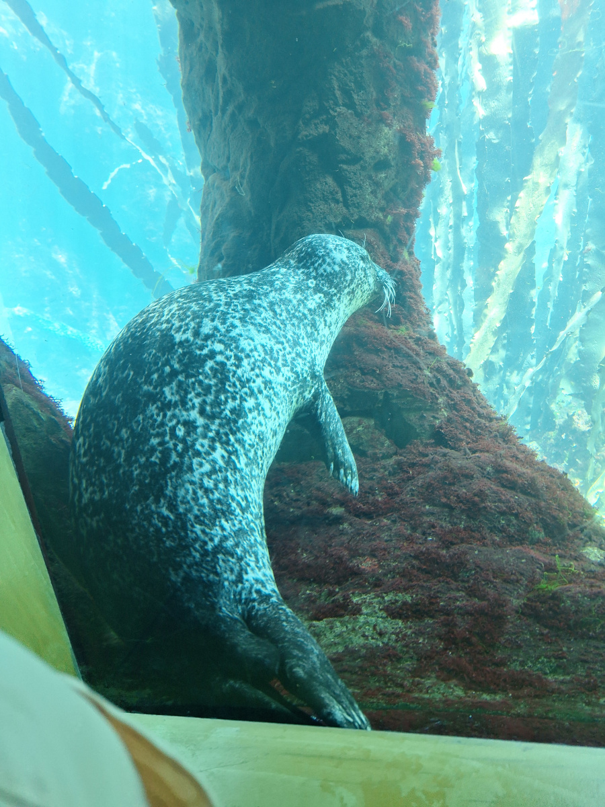
  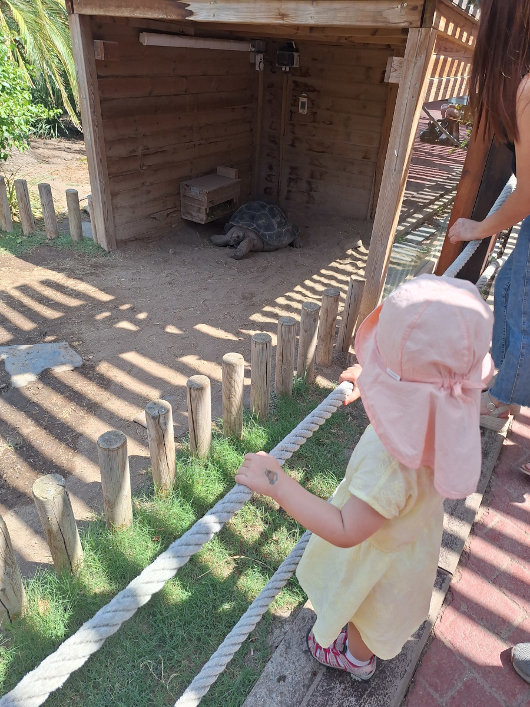

Voor gezinnen met kinderen is de dolfijnenshow dé topattractie. Er zijn doorgaans drie shows per dag, en we raden aan om
minstens 20 à 25 minuten op voorhand te komen voor een goede plaats. Voor ons volstond dat, al vermelden sommige
recensies dat de shows zelfs met zoveel voorsprong al vol kunnen zitten. De show zelf duurt minder dan 20 minuten en is
zowel leuk als leerrijk, met Engelse ondertitels op een groot scherm voor wie geen Spaans spreekt. De trainers met deze
intelligente dieren zien omgaan was een plezier, en dat de nadruk op milieuthema's lag in plaats van op ingewikkelde
kunstjes maakte het des te zinvoller.

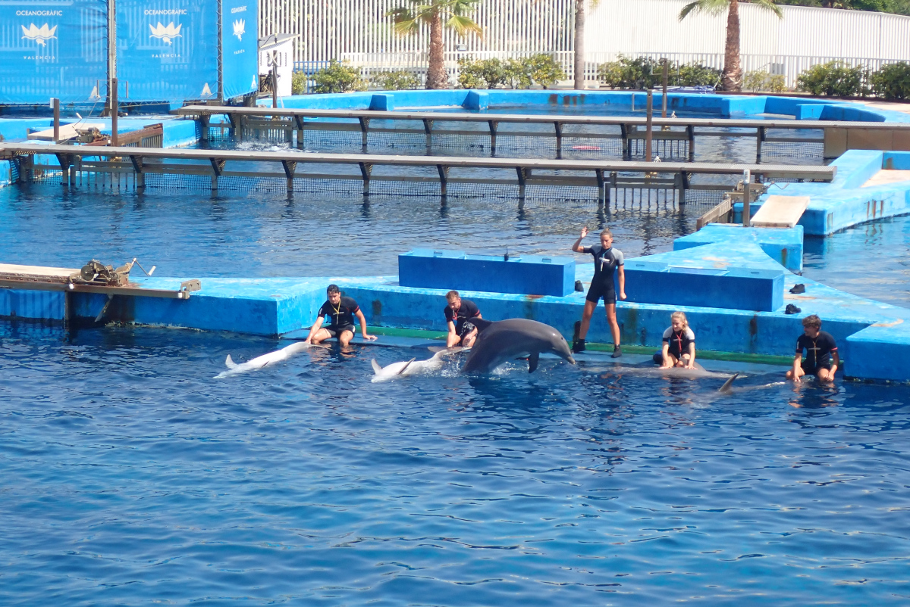

  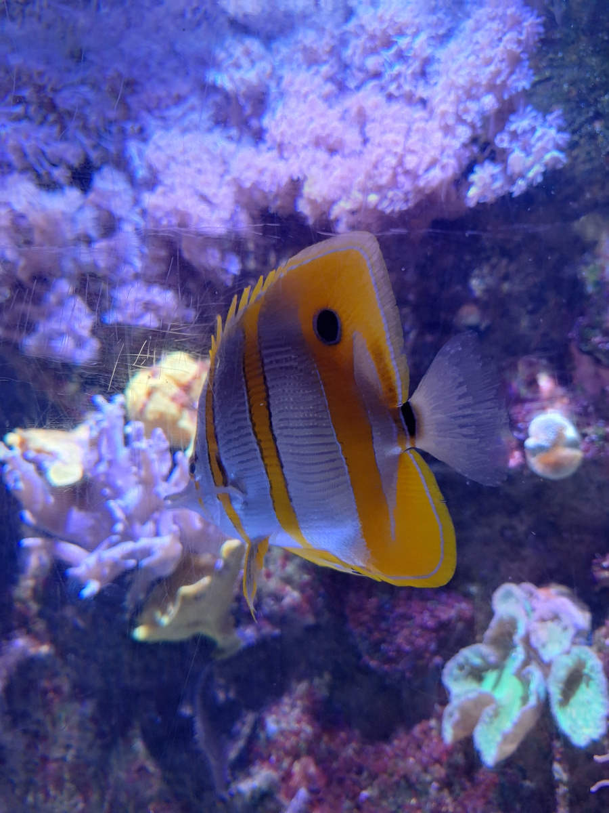
  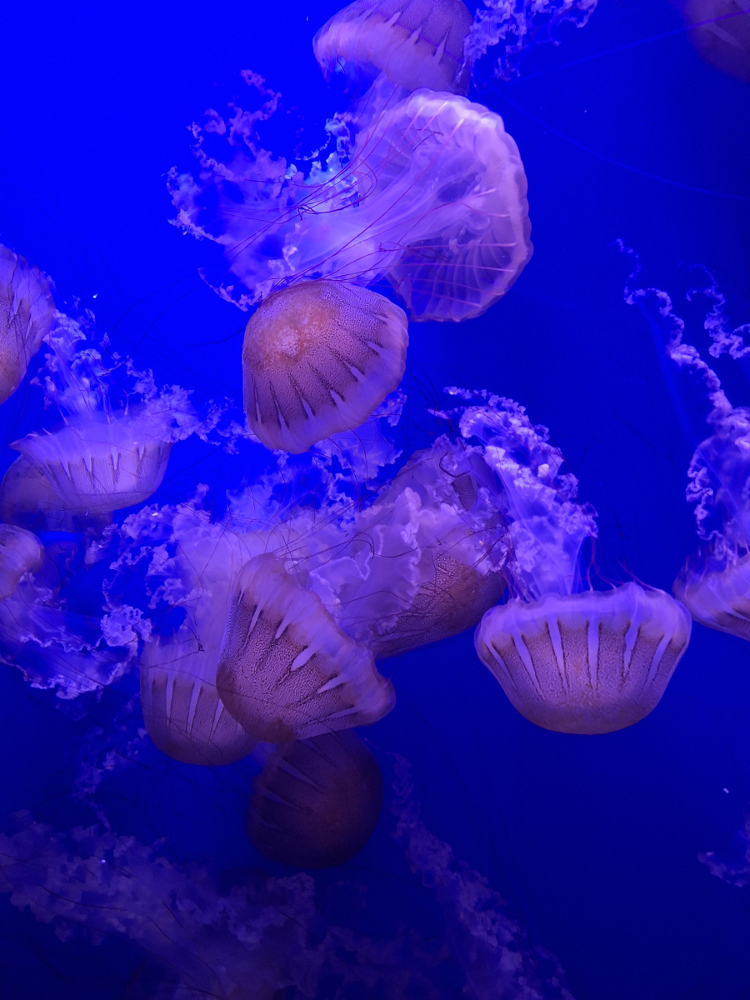

Neem een plattegrond mee aan de balie bij de ingang, dat bespaart je tijd en maakt het verkennen makkelijker. De indeling
is intuïtief, maar er valt veel te zien, en met een kaart mis je geen enkel hoogtepunt. Daarbij komt dat je de
ondergrondse aquaria op de ene plek binnengaat en in een compleet ander deel van het park weer buitenkomt, wat ons soms
wat in de war bracht. Gebruikt je kleuter een buggy, dan moet je voor elke ondergrondse zone de liften zoeken en de buggy
tijdens de dolfijnenshow in een kleine aangeduide bergruimte achterlaten.

Het Oceanogràfic heeft verschillende eetstandjes en restaurants (de meeste met slechte recensies), maar hou rekening met
hogere prijzen dan gemiddeld. Het verbod op eigen eten lijkt streng, maar veel bezoekers slaagden er wel in wat snacks
binnen te smokkelen. Een alternatief is boterhammen meenemen en die opeten voor je het park binnengaat, dat was onze
aanpak en die werkte perfect (al hadden we binnen toch nog kleine snacks bij, dus helemaal volgens de regels was het
niet). Eenmaal binnen zijn de drankautomaten handig om snel iets te drinken. Zoek je iets bijzonders, dan biedt het
onderzeeërrestaurant een unieke eetervaring, maar reserveer zeker op voorhand, want het zit snel vol.

Na ons lange bezoek aan het Oceanogràfic raakten we enkel nog te voet terug tot het station, onderweg genietend van de
mooie Turiatuinen, die intussen meer dan 8 km lang zijn en aangelegd werden in de drooggelegde bedding van de rivier de
Turia. De rij bijzonder ontworpen gebouwen, waaronder het wetenschapsmuseum, het kunstencentrum en de IMAX-bioscoop, is
schitterend!

Het wetenschapsmuseum is bijzonder bekend, maar we hadden er een extra dag voor nodig gehad, en het is misschien niet de
beste keuze voor onze bijna driejarige kleuter. Het kunstenpaleis van koningin Sofía is het koninklijke operahuis van
Valencia en ook een zaal voor muziek-, ballet- en theatervoorstellingen. Je kan het met een rondleiding bezoeken.

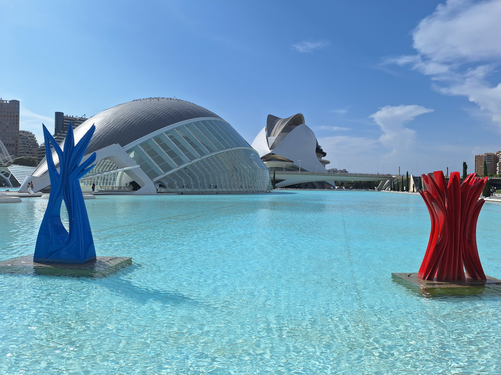
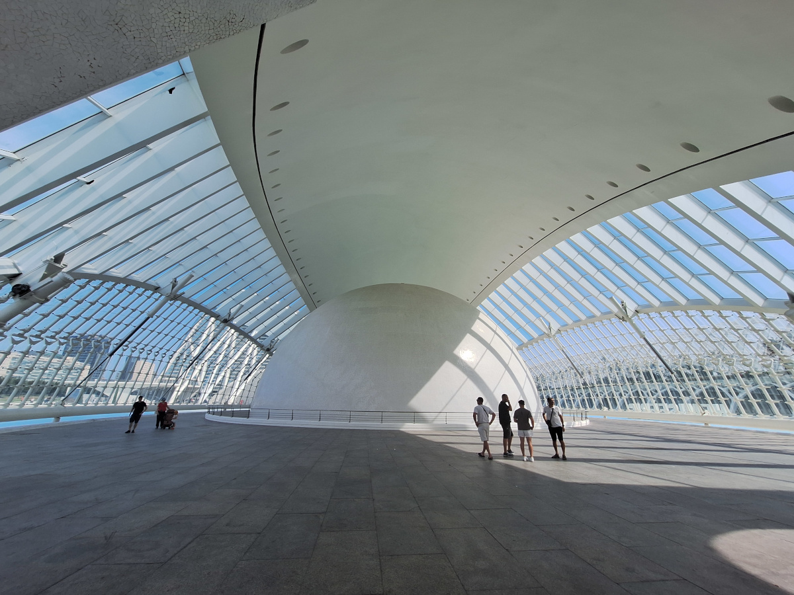

De rest van de stad bewaarden we voor de laatste dag, voor onze terugvlucht naar België. We boekten één nacht in het
stadscentrum, dicht bij metrostation Turia, zodat we de ochtend erna makkelijk de luchthaven konden bereiken. Nadat we
onze bagage in het appartement hadden afgezet, trokken we meteen naar het centrum.

Onze eerste halte was de spectaculaire voedingsmarkt, **Mercat Central de València**. Deze prachtige markt biedt een
gevarieerd aanbod aan eten: vlees, zeevruchten, gebak, kruiden en kaas, maar ook kant-en-klare gerechten en drankjes, die
je meteen ter plaatse kan opeten. De markt opende in 1928 en heeft een unieke mix van ijzer, glas en keramiek, met een
centrale koepel van bijna 30 meter hoog! Zeker een bezoek waard.

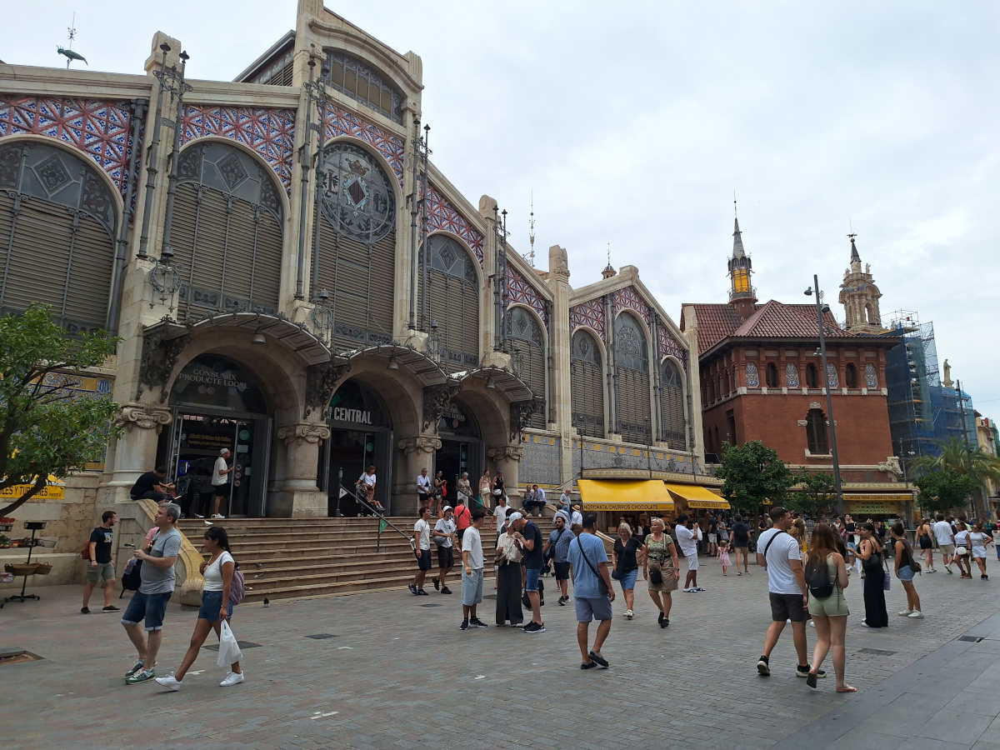
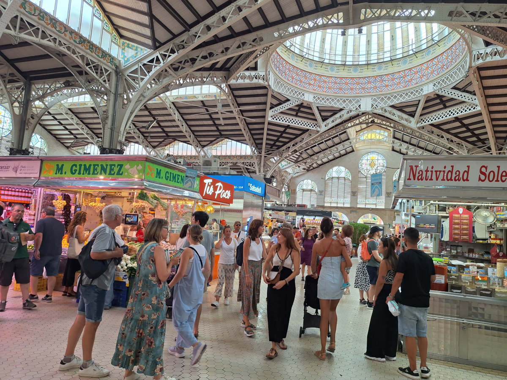

  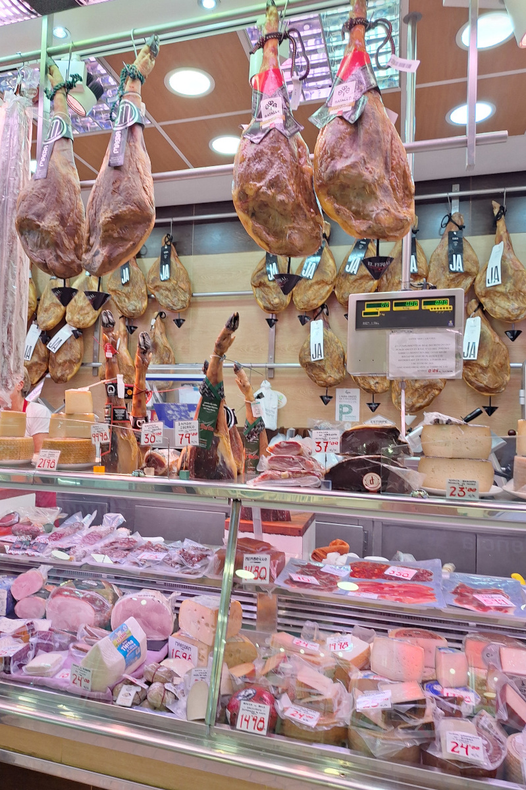
  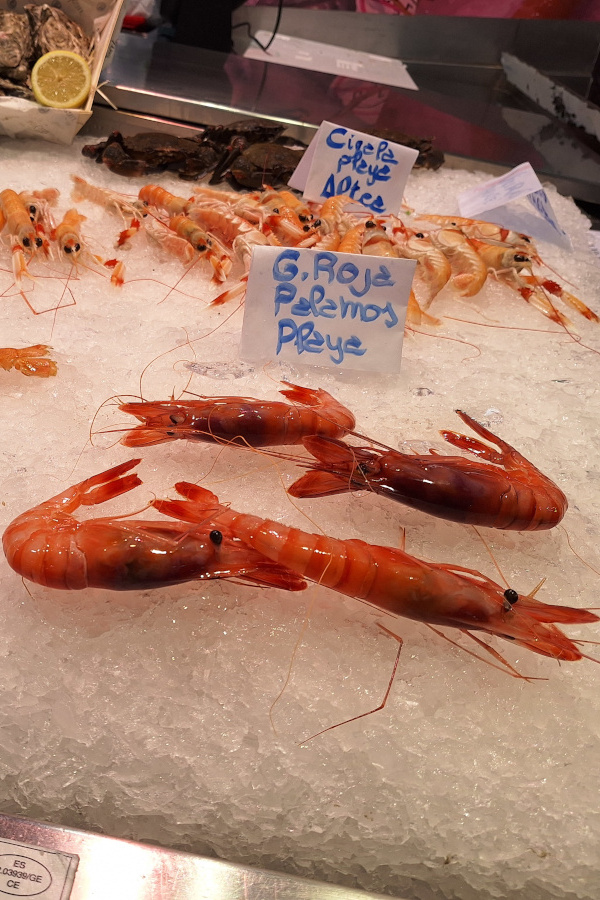

Recht tegenover de markt vind je de zijdebeurs (La Lonja de la Seda), de historische handelsplaats die ooit floreerde
tijdens de bloeiende zijdehandel van Valencia. Ze staat op de UNESCO-werelderfgoedlijst en pronkt met schitterende
laatgotische architectuur. Wij bezochten ze niet zelf, maar onze vrienden raadden ze warm aan en noemden vooral het mooie
plafond en de gedraaide zuilen in de grote zaal. Er is ook een charmante binnenkoer met in het midden een tuintje met
sinaasappelbomen.

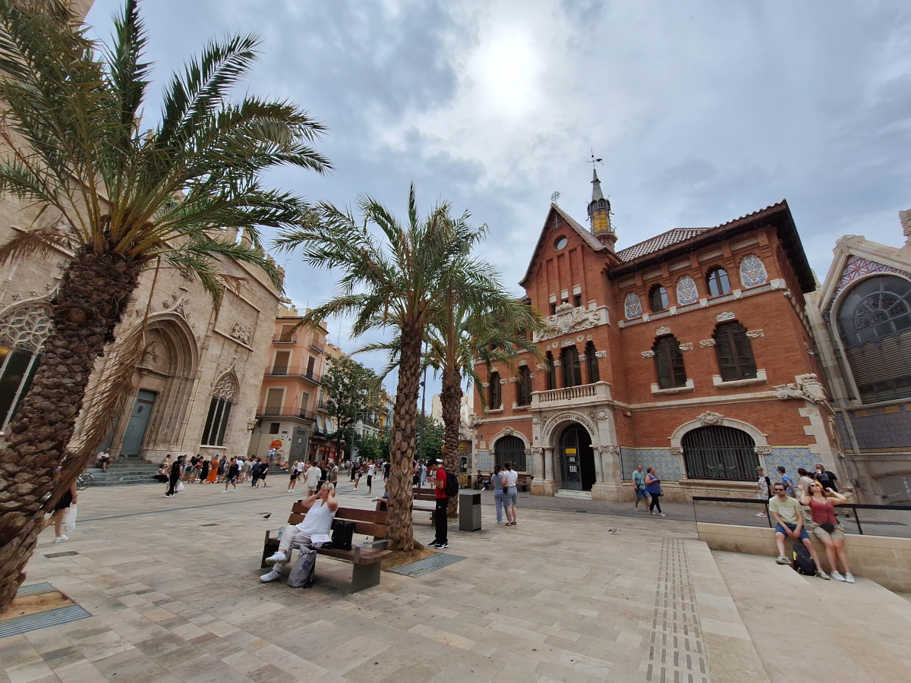

Onze volgende halte was het Plaça de l'Ajuntament, met het stadhuis van Valencia, het hoofdpostkantoor en verschillende
historische, prachtige bankgebouwen. Dit plein is een populaire ontmoetingsplek voor zowel inwoners als toeristen, want
het is een knooppunt voor veel buslijnen. Bloemenstalletjes en een fontein geven deze grote, levendige ruimte extra
charme.

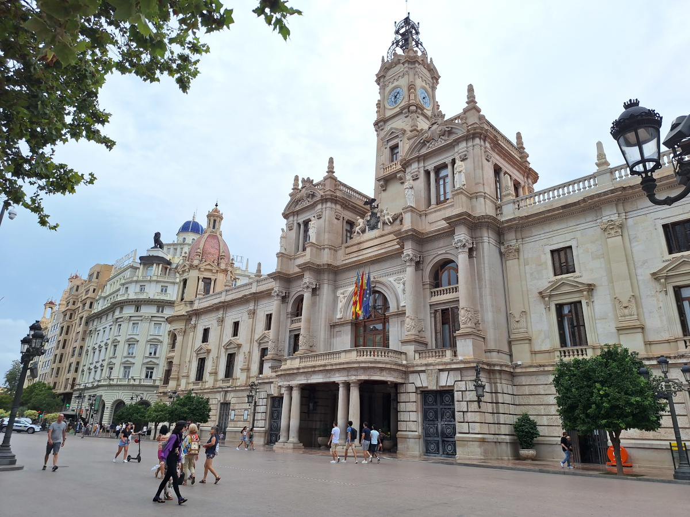

Op weg naar de hoofdkathedraal passeerden we een intrigerend gebouw dat het **Museu Nacional de Ceràmica i de les Arts
Sumptuàries González Martí** bleek te zijn, met een enorme collectie keramiek en kunstwerken. De schitterende barokke
gevel trok meteen onze aandacht. We hadden geen tijd om binnen te gaan kijken, maar het lijkt budgetvriendelijk, met
gratis toegang in het weekend en kortingen voor bepaalde bezoekers. Met uitstekende recensies lijkt het een bezoek meer
dan waard.

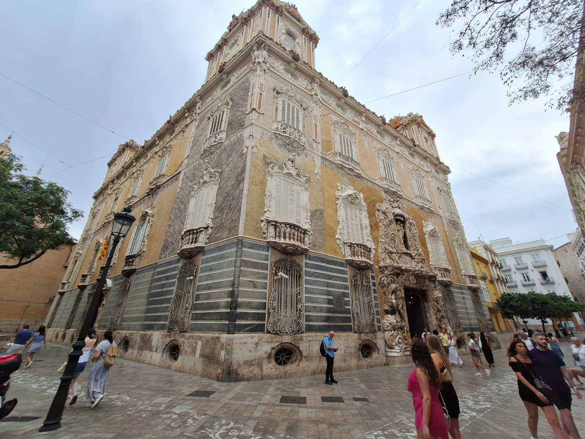

Toen we op het Plaça de la Reina aankwamen, waren we aangenaam verrast door de vernevelaars die op warme dagen voor een
verfrissende verkoeling zorgen. Het plein ligt pal naast de iconische kathedraal van Valencia, werd onlangs gerenoveerd
en wordt omringd door cafés, restaurants en winkels, wat het een perfecte plek maakt om iets te eten of te drinken.

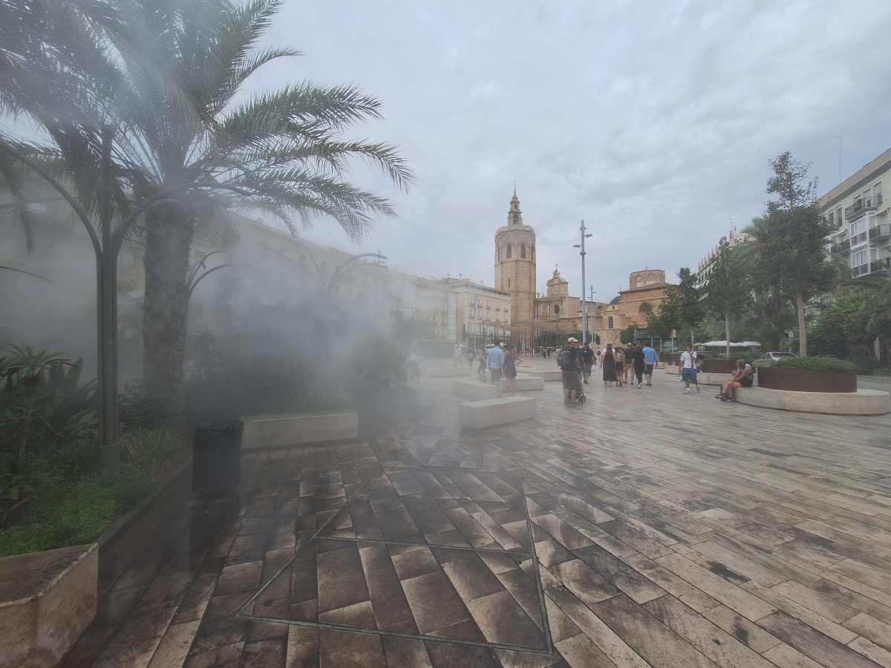

De kathedraal van Valencia, ook bekend als de kathedraal van de Heilige Graal, is een van de meest iconische
bezienswaardigheden van de stad. De meeste bezoekers komen voor de beker waarvan men aanneemt dat Jezus hem tijdens het
Laatste Avondmaal gebruikte en die in een aparte kapel bewaard wordt. Je herkent er verschillende bouwstijlen, het gevolg
van een lange geschiedenis van verbouwingen sinds de bouw in de 13e eeuw begon.

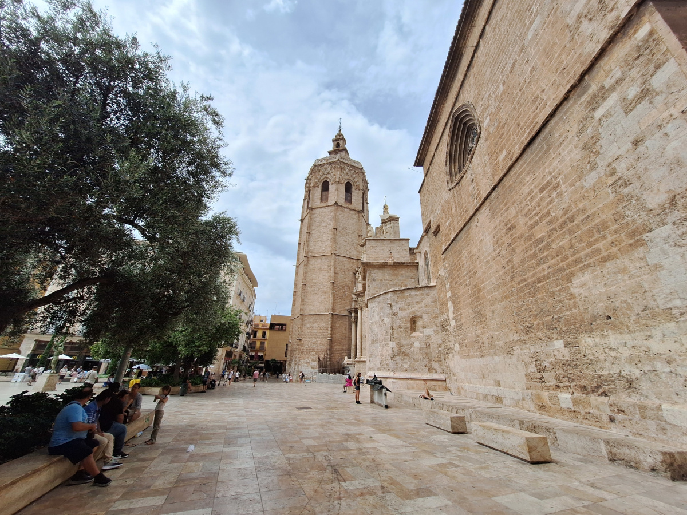
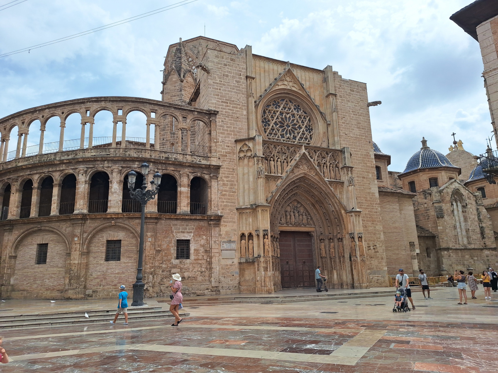

De Túriafontein op het Plaza de la Virgen, pal voor de Basílica de la Mare de Déu, is een duidelijke verbeelding van de
rivier de Túria. De fontein telt acht vrouwenbeelden, symbool voor de acht belangrijkste irrigatiekanalen (acequias) die
het water van de Túria over de omliggende velden verdelen. Het plein zelf is schitterend, omringd door historische
gebouwen, waaronder de basiliek en de nabijgelegen kathedraal van Valencia. De bruisende sfeer en de rijke geschiedenis
maken het een must in het hart van de stad.

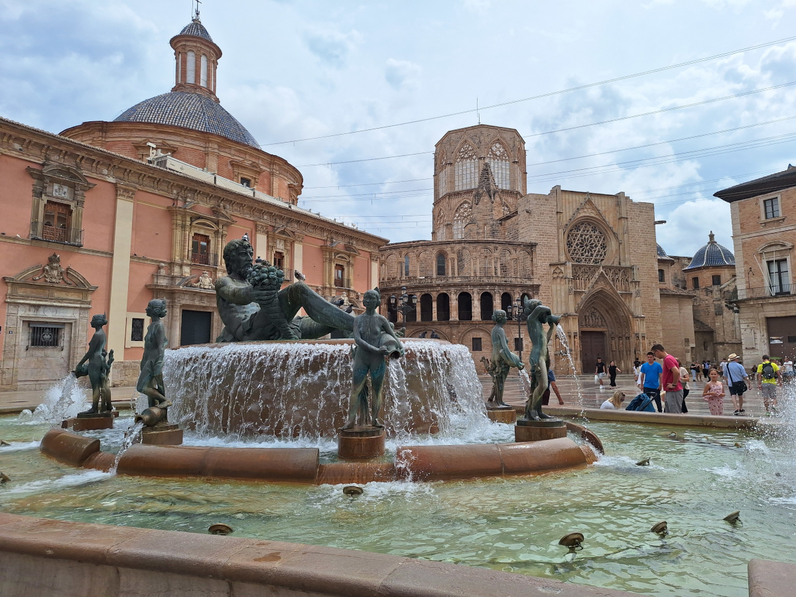

Zoek je een rustige ontsnapping aan het drukke centrum van Valencia en de gloeiende namiddagzon, dan is de botanische
tuin (Jardí Botànic) de perfecte oase. Hij ligt verscholen als een verborgen pareltje, maar toch op wandelafstand, en
deze rustige tuin biedt een verfrissende verandering van decor en de kans om midden in de stad weer even met de natuur
verbonden te zijn.

Tijdens ons bezoek eind augustus stond de tuin niet in volle bloei, maar toch pronkte hij met een ongelooflijke
verscheidenheid aan planten, van torenhoge bomen tot fijne vetplanten. Het oude arboretum is nog zo'n blikvanger: de hoge
bomen, decennia geleden geplant, zijn tot enorme afmetingen uitgegroeid en sommige steken zelfs door de daken van
nabijgelegen bouwsels. Door dit stuk wandelen voelt als een magisch bos binnenstappen. Deze plek is perfect om aan de
zomerhitte van Valencia te ontsnappen. Met volop schaduwrijke zitplekken onder weidse boomkruinen kan je er achterover
leunen, ontspannen en van de rust genieten.

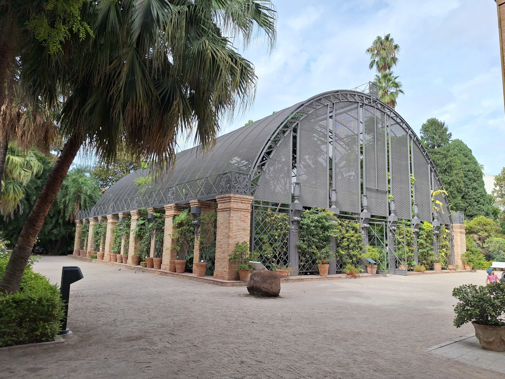

  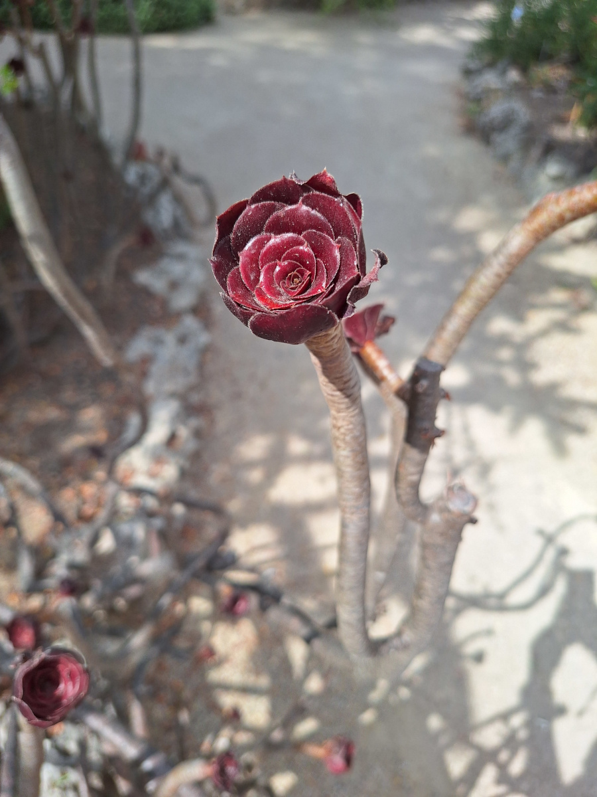
  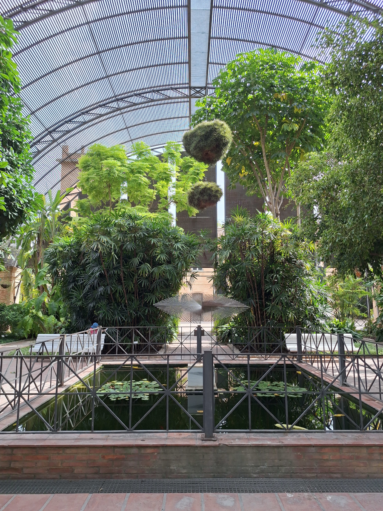

  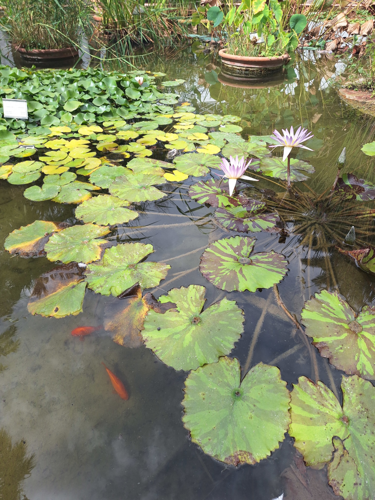
  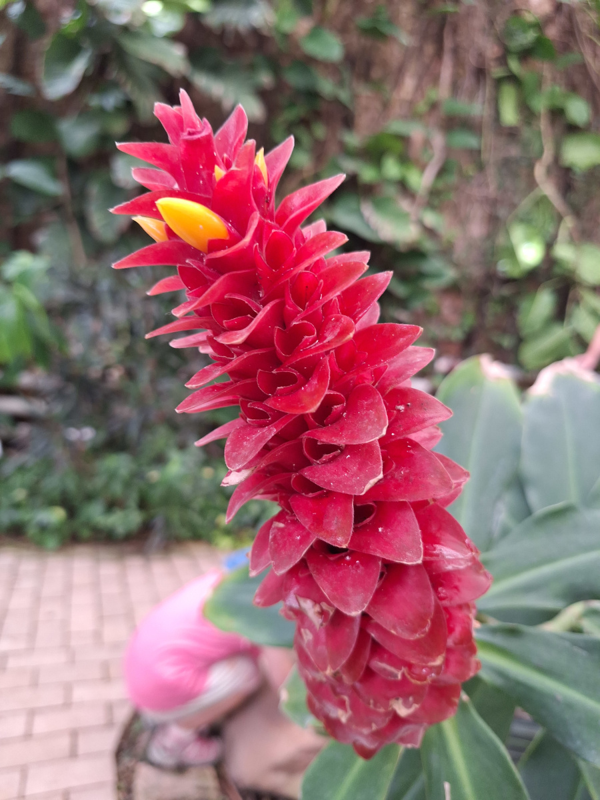

Ik schrijf deze blogpost na de catastrofale overstromingen die eind oktober de Oost-Spaanse regio Valencia troffen. Het is
werkelijk hartverscheurend om foto's en video's te zien van mensen die vastzaten in voertuigen, gebouwen en ondergrondse
parkeergarages, compleet overvallen toen de straten zich in enkele ogenblikken in rivieren veranderden. De oorzaak van
deze verwoestende gebeurtenis was recordneerslag: een jaar regen die in amper acht uur naar beneden kwam. Toen ik Valencia
een paar maanden eerder bezocht, kwam de gedachte aan zo'n ramp niet eens in me op. De stad leek zo bruisend, zonnig en
veerkrachtig. Toch had de natuur andere plannen, en ik besef nu hoe onvoorspelbaar de dingen kunnen zijn. Deze tragedie
onderstreept de groeiende impact van de klimaatverandering, met extreme weersomstandigheden die alarmerend vaker en
heviger voorkomen. Je kan alleen maar hopen dat de overheid dit als een oproep tot actie opvat en de
waarschuwingssystemen verbetert om zulk verlies aan mensenlevens in de toekomst te voorkomen. De verwoesting ging verder
dan het menselijke leed: infrastructuur, bruggen en openbare gebouwen raakten zwaar beschadigd en lieten littekens na die
jaren zullen kosten om te herstellen.

__Praktische info:__

* Kom je aan op de luchthaven van Valencia (Aeroport), dan raak je makkelijk in het stadscentrum. Metrolijnen 3 en 5
brengen je van Aeroport naar het noordstation (Xàtiva) in amper 21 minuten, in zone AB+. Het tarief is €5,80 per persoon.

* Hoe je van Valencia naar Platja de Gandia raakt, beschreven we al eerder; de details vind je in een
[vorige post]().
Vanaf het noordstation (bij metrohalte Xàtiva) namen we de metro tot Ayora en wandelden we daarna zo'n 2 km. Het was niet
de snelste manier om bij het oceanarium te raken, maar we genoten toch van de wandeling. Handiger is de tram, die pal
voor het oceanarium stopt en er ongeveer 15 minuten over doet naar het stadscentrum. Voor wie liever sneller reist, is
dat wellicht een beter alternatief.

* Kinderen onder de 10 reizen gratis in gezelschap van een volwassene met een geldig vervoerbewijs. [SUMA 10 voor 10 ritten](https://www.metrovalencia.es/en/fares/) zone A - €9, momenteel €4 door een korting (enkel ticket €1,50 in zone A). Je kan er tot 15 gelijktijdige ritten mee maken voor mensen die samen reizen.
  Let op: de tijdelijke gedeeltelijke korting van 40% geldt voor SUMA 10, SUMA Maandelijks, SUMA Maandelijks Jove,
TuiN-tickets en tijdelijke Metrovalencia-abonnementen tot 30 juni 2026. Wij kochten een SUMA 10-kaart en gebruikten die
voor ons vieren, wat aanzienlijk goedkoper was dan losse metrotickets kopen.

* [Oceanogràfic](https://oceanografic.experticket.com/en) - €34,70 per volwassene, een paar dagen op voorhand online
geboekt voor een specifiek tijdslot. Dat betekent dat je het Oceanogràfic pas kan binnengaan vanaf het gekozen tijdstip,
en dat je tot sluitingstijd in het aquarium mag blijven. Wij kochten tickets met een tijdslot om 10 uur en gingen voor 11
uur binnen, maar naast ons stonden mensen die met een ticket voor het tijdslot van 12 uur niet binnen mochten, dus kies
je tijdstip verstandig. De prijzen verschillen naargelang de dag, de vakantieweek enzovoort.
  **Tip:** bezoek je tijdens de zomerpiek (juli/augustus), zorg dan dat je er bent zodra het park om 10 uur opengaat. De
eerste dolfijnenshow rond 11 uur is minder druk, dus die pik je best vroeg op de dag mee.

* La Lonja de la Seda de Valencia - €2 toegang, een kort bezoek (een paar zalen en de grote hal, kleine binnenkoer).

* [Botanische tuin](https://www.jardibotanic.org/), toegang €3, gratis voor baby's en peuters. Ben je snel, dan ben je er
in 30 minuten door, maar neem je je tijd, dan zou ik 2 uur inplannen. Het is een relatief kleine tuin in vergelijking met
andere in de wereld, maar zeker een must aan een heel lage prijs! Het was niet druk tijdens ons bezoek op vrijdagnamiddag.
Er zijn propere toiletten.

* [Speeltuin](https://maps.app.goo.gl/TK9xKZkfQzu5MYXt7) in het stadscentrum, dicht bij de botanische tuin en de oude
stadspoort. Ernaast lag een [bakkerij](https://maps.app.goo.gl/F5aDzJvatJ5U9HsN7) waar we een sappige cake proefden die
Coca de Llanda de Naranja bleek te zijn.
