Mijn reis begon met een ochtendvlucht naar Porto. Omdat mijn trein naar Braga pas 's avonds vertrok, had ik de perfecte
gelegenheid om de dag door te brengen in het historische hart van Porto. Na een korte metrorit van 30 minuten kwam ik aan
in het station Bolhão. Buiten werd ik begroet door lichte motregen, dus mijn eerste opdracht werd een zoektocht naar een
paraplu. Gelukkig bood ALE-HOP, de favoriete winkel van mijn dochter, redding met een vrolijke
keuze aan paraplu's.
Mijn volgende halte was de nabijgelegen Mercado do Bolhão, want mijn maag begon te knorren en deze plek heeft een dak,
wat bij zulk onaangenaam weer bijzonder goed uitkwam. Deze markt begon als een openluchtmarkt, maar in 1914 opende het
huidige neoclassicistische gebouw. Na een grondige renovatie ging de markt in 2022 weer open, en het resultaat is duidelijk:
ze is modern, goed georganiseerd en proper. Een glazen dak laat volop daglicht binnen bij de standhouders, die verse
bloemen, groenten, fruit, vlees, kaas, olijven en zeevruchten verkopen. Kraampjes met traditioneel
handwerk geven de markt extra charme.

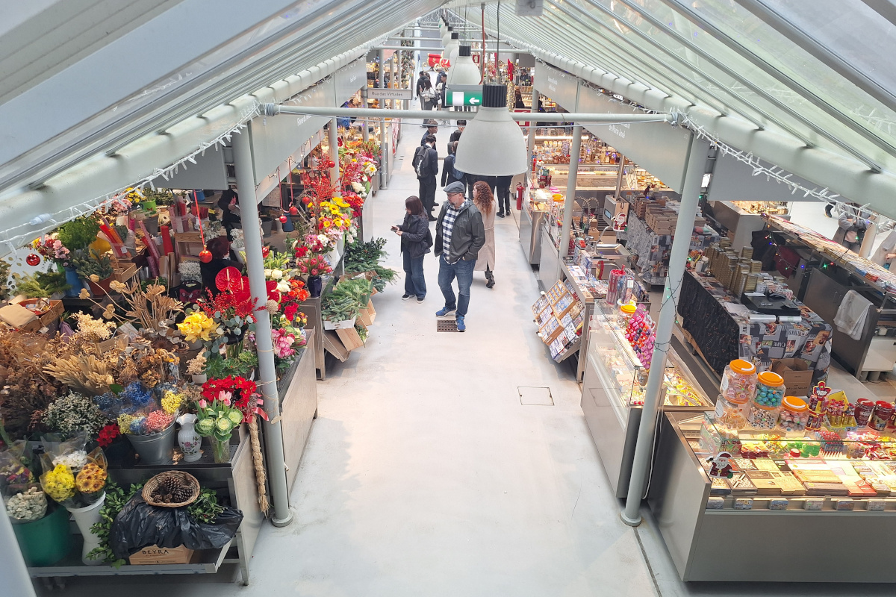
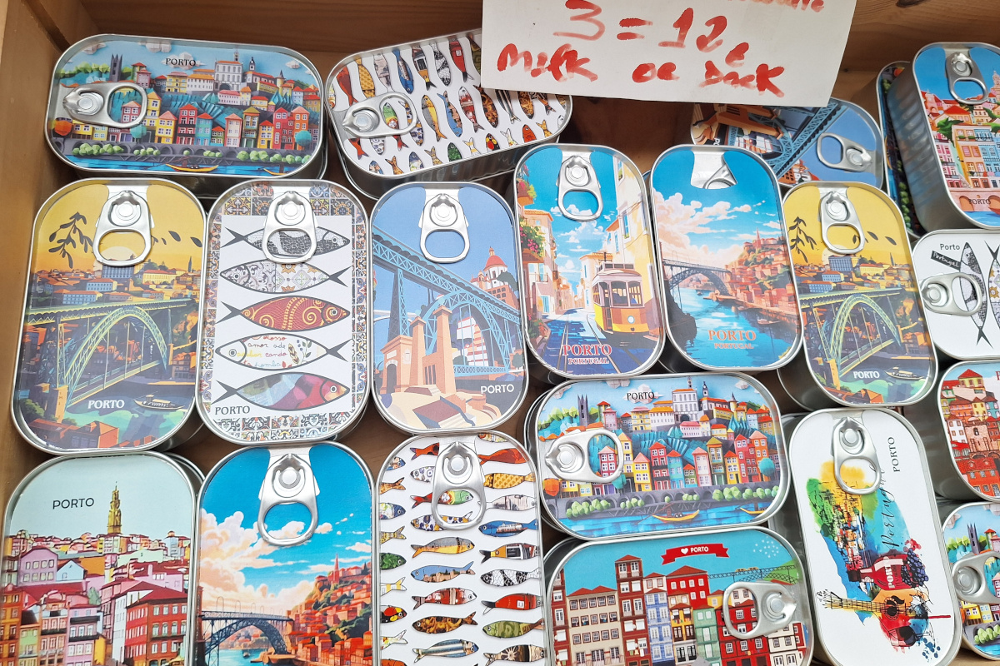

Op de markt vind je ook authentieke Portugese gerechten, van francesinha (een broodje uit Porto) tot vers gebak zoals
pastéis de nata. Deze iconische Portugese gebakjes ontstonden begin 19e eeuw in het Mosteiro dos Jerónimos in Belém,
Lissabon, waar katholieke monniken het eerste recept ontwikkelden. Ik had het genoegen het klooster en de Fábrica de
Pastéis de Belém, de bakermat van deze gebakjes, te bezoeken [tijdens onze eerste reis naar Lissabon]().
Dit zijn zonder twijfel mijn favoriete gebakjes in Portugal, en ik zou ze nooit beu worden.
Het is heel interessant om te weten waarom monniken dit gebak met veel eierdooiers bedachten. Monniken en nonnen
gebruikten grote hoeveelheden eiwit om kleding te stijven, zoals hun habijten. De overgebleven dooiers kregen creatief
een tweede leven in desserts. Briljant, toch?
De korst hoort echt krokant te zijn: je moet hem duidelijk horen kraken wanneer je een stuk afbijt. De rijke, romige
vulling zorgt voor het perfecte contrast in texturen en smaken. Ze zijn op hun best warm en vers. Ik proefde er een in de
beroemde bakkerij Manteigaria, naast de markt, en die stelde niet teleur.

  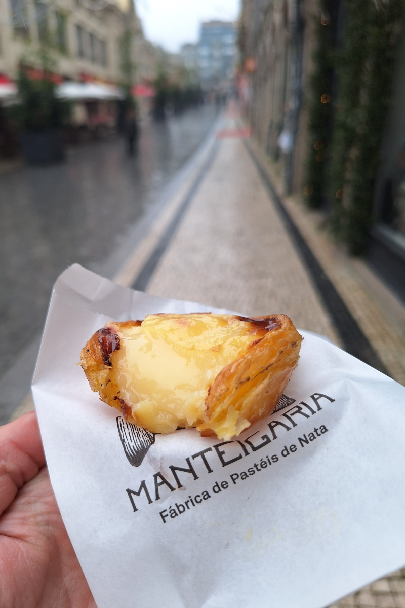
  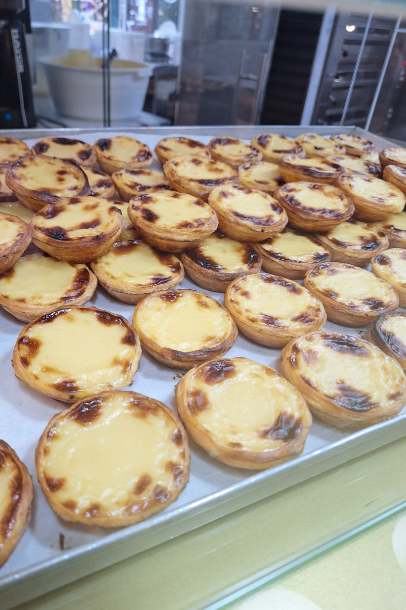

Vlakbij is de Capela das Almas (Zielenkapel) zeker een korte stop waard. De unieke buitenkant, volledig bedekt met blauwe
en witte azulejo-tegels, is van ver te zien. Die schitterende keramische tegels beelden scènes uit het leven van heiligen
uit en werden in 1929 aan de kapel toegevoegd. De kapel staat in de belangrijkste winkelstraat van Porto, de Rua de Santa
Catarina, en de blauwe azulejos bedekken een indrukwekkende oppervlakte van zo'n 360 vierkante meter. Deze kapel is een
prachtig voorbeeld van unieke architectuur en mag je niet overslaan wanneer je de bruisende Bolhão-buurt verkent.

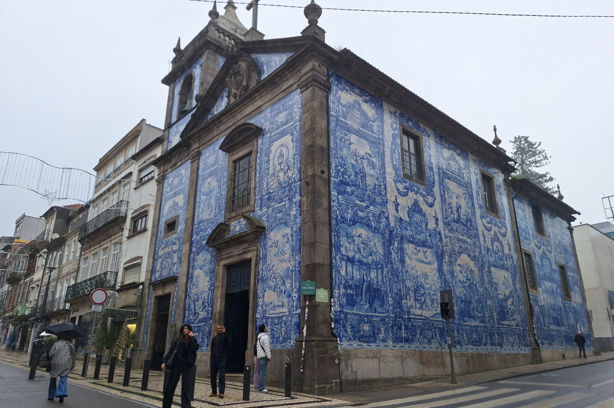

  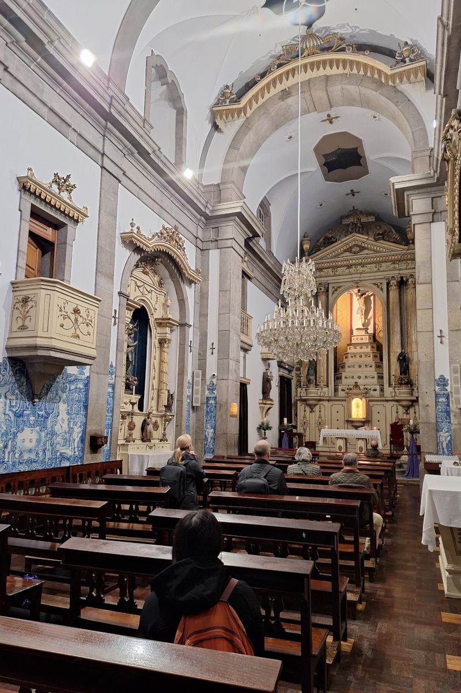
  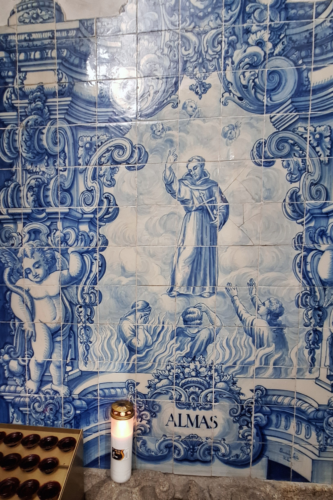

Ik wandelde verder richting Gaia en de iconische Luís I-brug. Dit opmerkelijke bouwwerk heeft twee niveaus, elk met een
eigen functie: het bovendek voor trams en voetgangers, en het onderdek voor voertuigen en voetgangers. De brug werd
ontworpen door Théophile Seyrig, een leerling van Gustave Eiffel, en in 1886 voltooid. Ze weerspiegelt de snelle
industrialisering en stadsontwikkeling van Porto in die tijd.
Over het bovendek wandelen levert een adembenemend panorama op over de Douro, de historische Ribeira-wijk van Porto en de
wijnkelders van Vila Nova de Gaia. Het unieke ontwerp met twee niveaus is zowel functioneel als visueel schitterend,
waardoor het een van de meest gefotografeerde bezienswaardigheden van Portugal is. Ik genoot vooral van het mistige weer,
dat de zichten op de rivier en de omliggende groene heuvels een magische toets gaf.

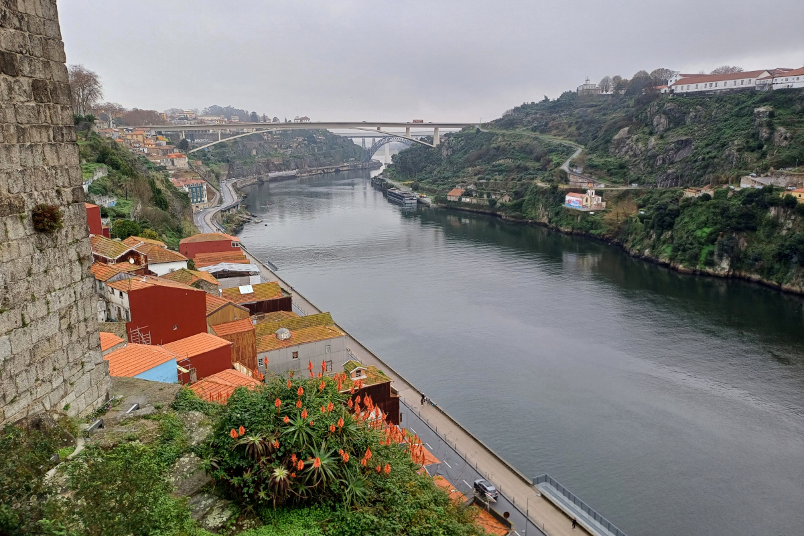
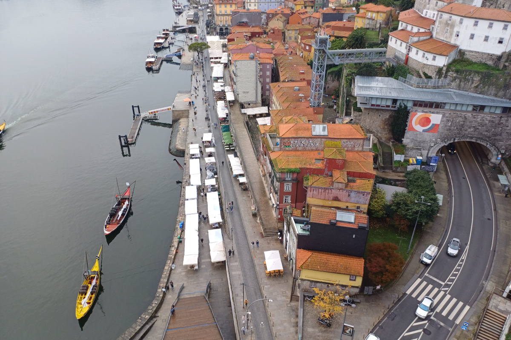
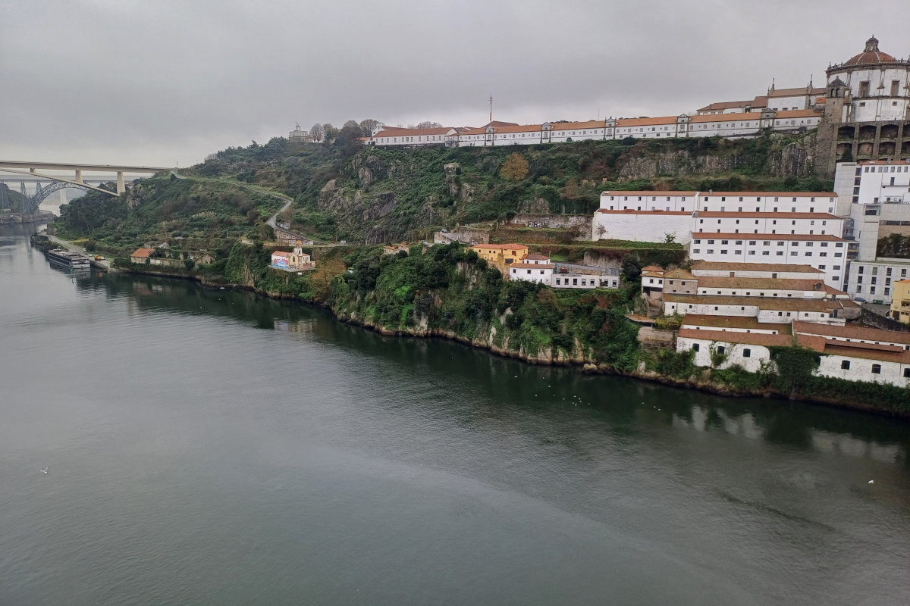

  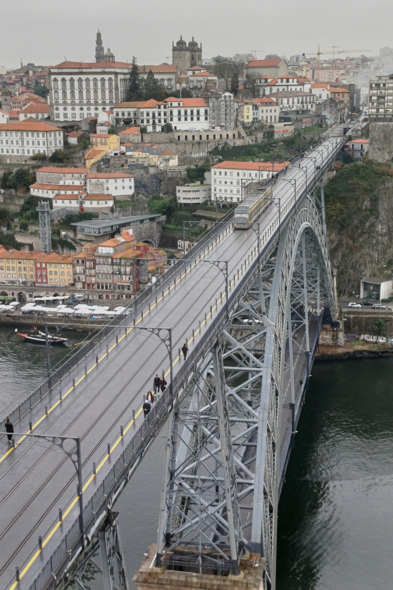
  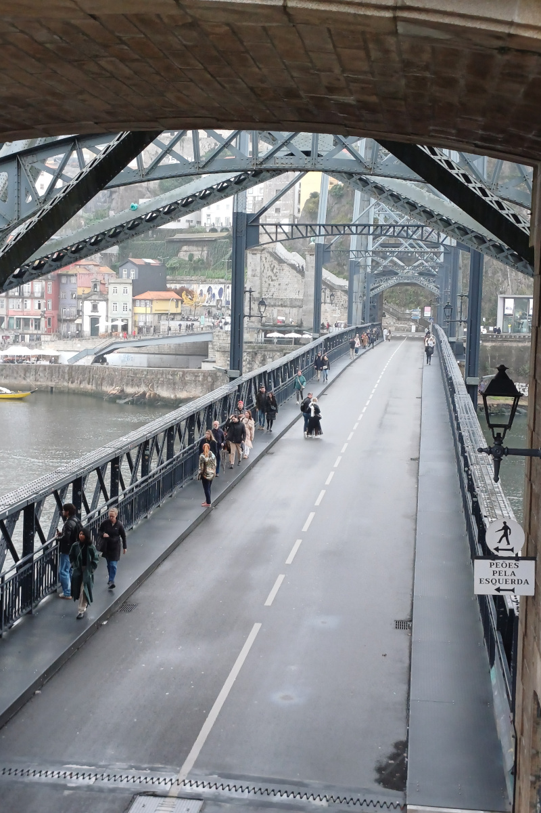

Het Mosteiro da Serra do Pilar, een 16e-eeuws klooster en UNESCO-werelderfgoed, biedt een van de mooiste panoramische
uitkijkpunten over Porto en de Douro. Na mijn bezoek aan het uitkijkpunt bij het klooster zette ik mijn tocht voort in de wijk Gaia, via
de Jardim do Morro. Gaia staat bekend om zijn portwijnhuizen, waar bezoekers meer leren over de productie van deze
iconische wijn en kunnen proeven. Een kabelbaan verbindt de oever met het hoger gelegen deel van Gaia en biedt mooie
uitzichten over de stad en de rivier beneden. Ik koos ervoor om de smalle straatjes onder de kabelbaan af te dalen en de
promenade langs het water te volgen. Deze bruisende buurt staat vol restaurants, koffiebars en winkels, allemaal met een
schitterend zicht op Porto en de Luís I-brug.

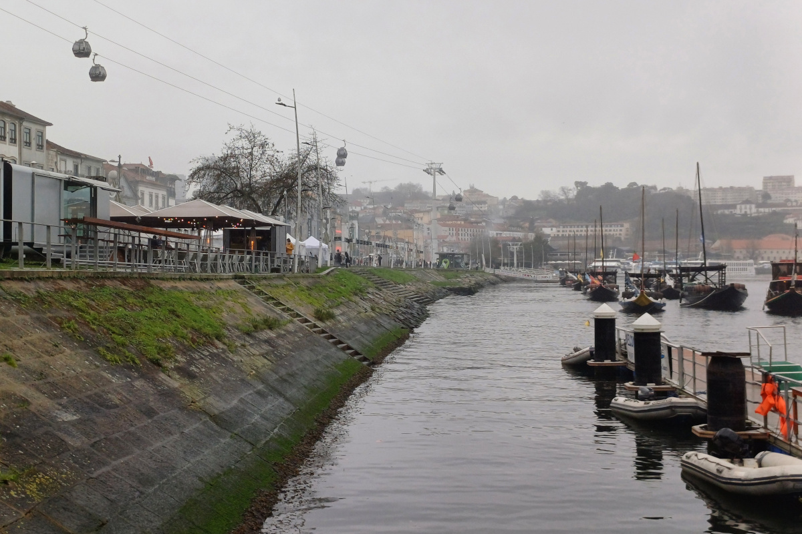
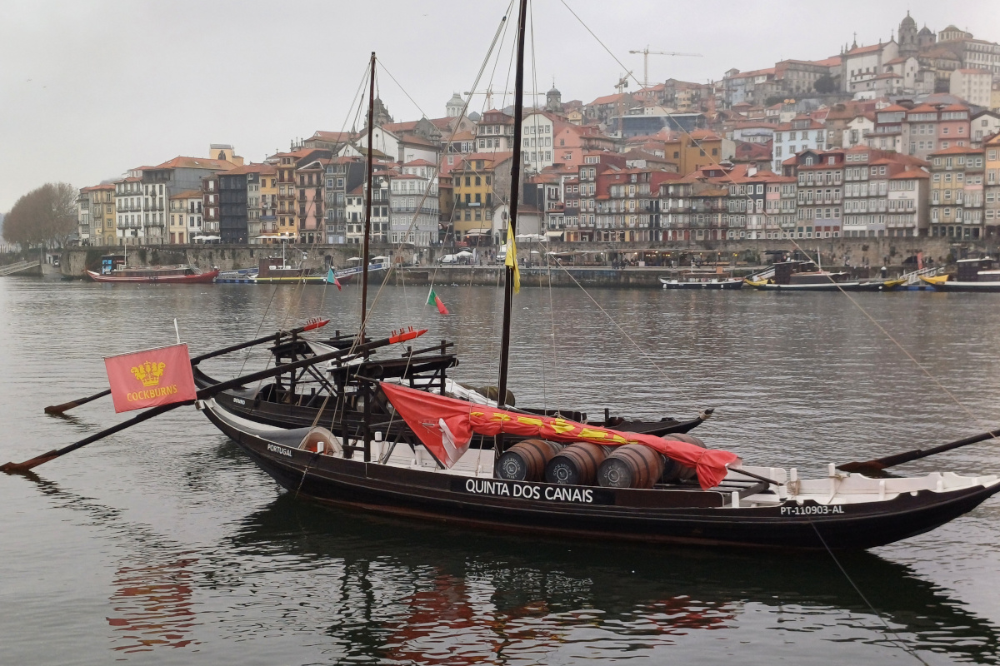

Zoals veel stedelijke gebieden in Portugal kampte Gaia in de 20e eeuw met economische moeilijkheden, wat tot periodes van
verwaarlozing leidde. Naarmate de industrie achteruitging en mensen naar moderne woonwijken trokken, kwamen veel gebouwen
leeg te staan. Zulke historische panden restaureren kan duur zijn, en eigenaars hebben vaak niet de middelen om te
renoveren, zeker wanneer er ingewikkelde eigendomsverhoudingen of juridische geschillen bij komen kijken. Dat probleem
speelt ook in Funchal, op Madeira.

Gelukkig heeft de opkomst van het toerisme de belangstelling voor de heropleving van Gaia aangewakkerd. Projecten zoals
de WOW-wijk (World of Wine) hebben verlaten ruimtes omgetoverd tot bruisende culturele en recreatieve bestemmingen. Zoals
je op de foto hieronder ziet, zijn sommige daken nog ingestort, maar er wordt volop gewerkt om de buurt te herstellen en
haar historische charme terug te brengen.

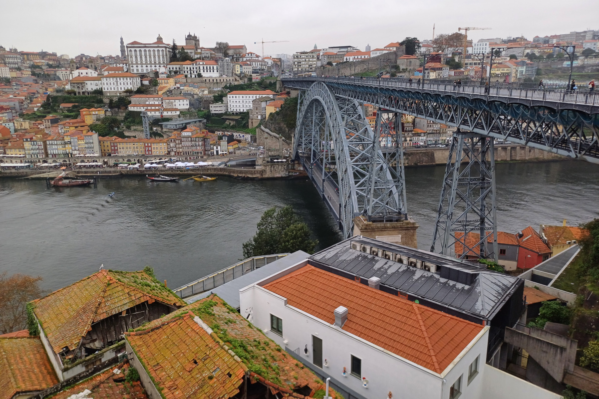

In station Porto São Bento kan je nog meer schitterend azulejo-tegelwerk bewonderen: ruim 20.000 azulejo-tegels!
Het is niet alleen een vervoersknooppunt, maar ook een cultureel en architecturaal pareltje dat talloze bezoekers trekt.
Het ligt heel handig, pal in het hart van Porto. Op de muren herken je taferelen uit de geschiedenis van Portugal en uit
het traditionele plattelandsleven, met feesten, markten en gebruiken. De naam van het station gaat terug op een vroeger
benedictijnenklooster. Ondanks zijn historische charme is São Bento nog altijd volop in gebruik, met regionale en
intercitytreinen, waaronder de trein naar Braga.

  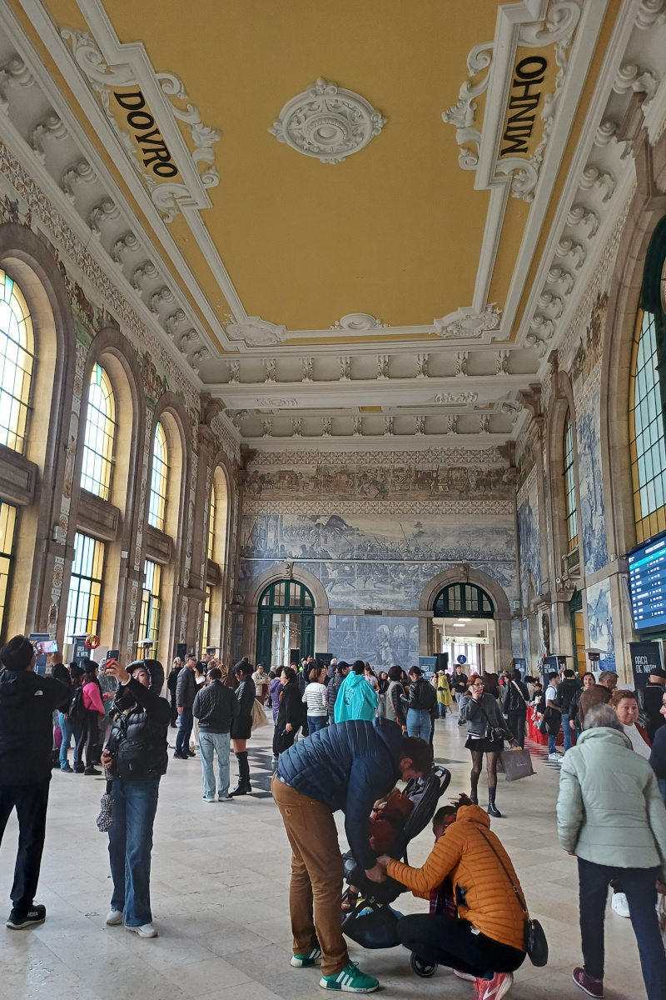
  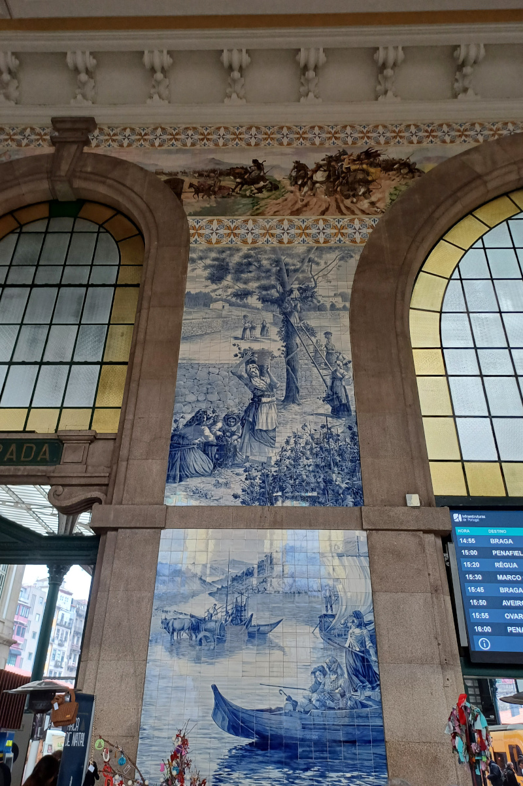

De Jardins do Palácio de Cristal vormen een goed onderhouden park met fonteinen en beelden, en waren de perfecte bestemming voor
een ontspannen wandeling. Toch zou ik deze plek niet aanraden als je maar 6 uur hebt om de stad te bezoeken en het weer
niet meezit :) In het hart van de tuinen staat het Pavilhão Rosa Mota, ook bekend als de Super Bock Arena. Deze
polyvalente zaal doet dienst als locatie voor concerten, sportevenementen en tentoonstellingen. Ik zag er een paar pauwen, maar die zaten
allemaal onder het dak van het paviljoen te schuilen. De tuinen werden oorspronkelijk aangelegd rond het Kristallen
Paleis, dat in 1951 werd afgebroken, maar het park behield dezelfde naam.

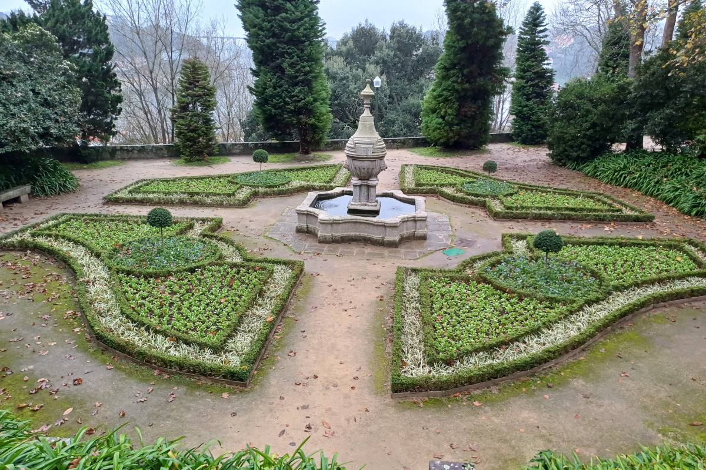

Op weg naar het park zag ik de oude tramstellen, symbool van de geschiedenis en de charme van de stad. Deze historische
trams worden uitgebaat door de STCP (Sociedade de Transportes Colectivos do Porto) en bieden een sfeervolle manier om de
straten te verkennen. Er rijden nog maar 3 lijnen door de schilderachtigste buurten van Porto. De trams zijn prachtig
gerestaureerd en hebben hun originele houten onderdelen en klassieke vormgeving behouden. Ben je geïnteresseerd in de
geschiedenis van het tramnet van Porto, bezoek dan het Museu do Carro Eléctrico (trammuseum) met zijn collectie oude
tramstellen.

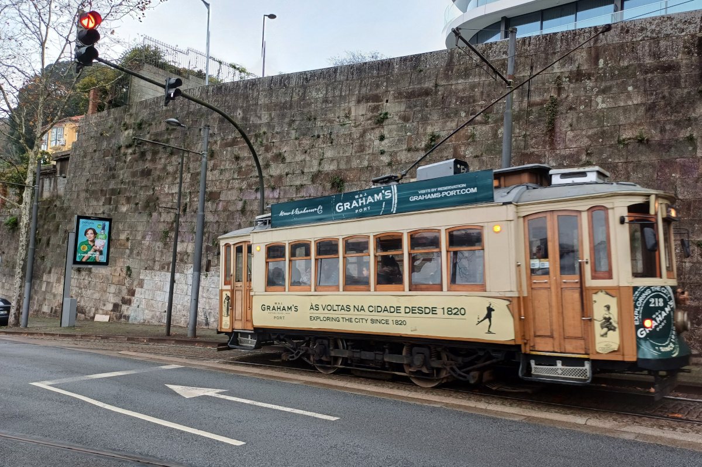

Het begon al donker te worden toen ik de kerstmarkt in de Jardim da Cordoaria passeerde. Hoewel hij klein was, was het
een aangename plek om rond te lopen. In de straatjes ernaast hing de rokerige geur van geroosterde kastanjes, verkocht door heel wat
kraampjes met traditionele karretjes met kleine kolenovens. De rook uit die karretjes zorgde voor een gezellige,
feestelijke sfeer terwijl de mensen voorbijliepen. Geroosterde kastanjes worden meestal op straat verkocht in de herfst-
en wintermaanden, van oktober tot januari, en zijn dan een geliefde snack. Ik proefde deze gezonde lekkernij een paar
weken eerder voor het eerst op Madeira en vond ze erg lekker! Ze zijn behoorlijk vullend en worden geserveerd in kleine papieren
puntzakjes, ideaal om onderweg op te eten. Het torenhoge bouwwerk bij de kerstmarkt bleek de Clérigos-kerk te zijn, een
iconisch monument in Porto. Jammer genoeg kon ik er niet zonder ticket binnen omdat de Spiritus-lichtshow op dat moment
bezig was. Overal in de straten ging de kerstverlichting aan, en ondanks het regenweer hing er een vrolijke
sfeer in de stad. De Igreja do Carmo was nog zo'n kerk in de buurt van de kerstmarkt die mijn aandacht trok, te zien op
de bovenste foto hieronder.

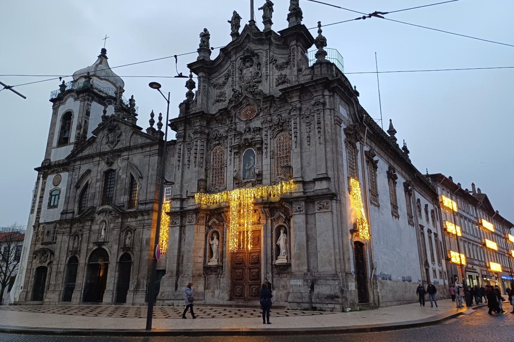
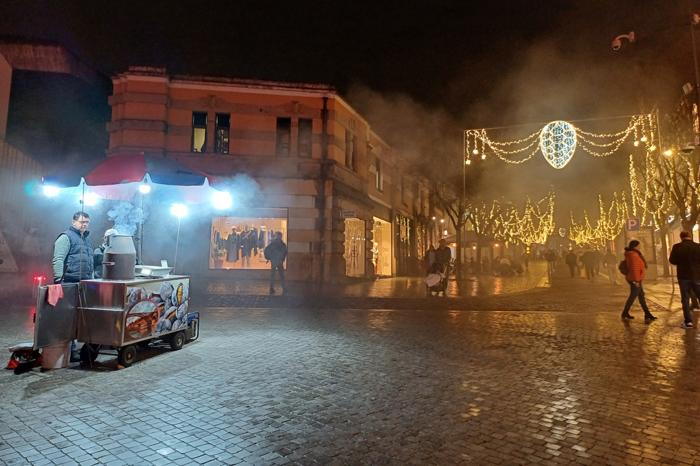
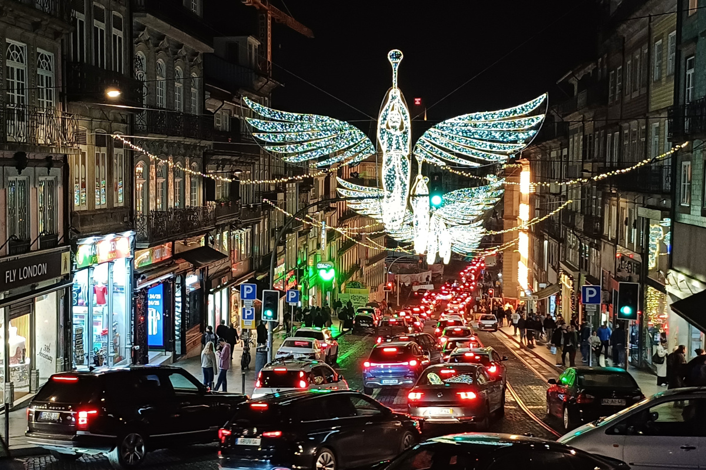

Op weg naar het station om mijn trein naar Braga te halen, besefte ik dat ik de kathedraal van Porto niet had bezocht!
Met nog een uur voor mijn trein vertrok, haastte ik me naar de wijk Batalha, waar de kathedraal staat.

Vanaf de Avenida Dom Afonso Henriques viel het vestingachtige uiterlijk van de kathedraal me meteen op. Langs dit stuk
straat stonden ook kerstkraampjes, wat bijdroeg aan de feestelijke sfeer in de stad. Ik verkende de zo goed als
uitgestorven omgeving rond de kathedraal en wandelde een stuk bergaf, dwalend door smalle straatjes.
Tegen dan was het al donker, dus jammer genoeg was er vanaf het kathedraalplein geen zicht op de Douro of de Luís I-brug.
De kathedraal is een belangrijke halte op de pelgrimsroute naar Santiago de Compostela, en het is niet ongewoon om hier
pelgrims aan hun tocht te zien beginnen. Mijn bezoek was kort, maar het was toch fascinerend om dit historische en
iconische monument zelf te bezoeken.

  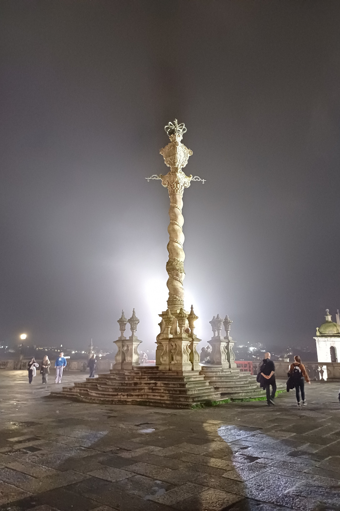
  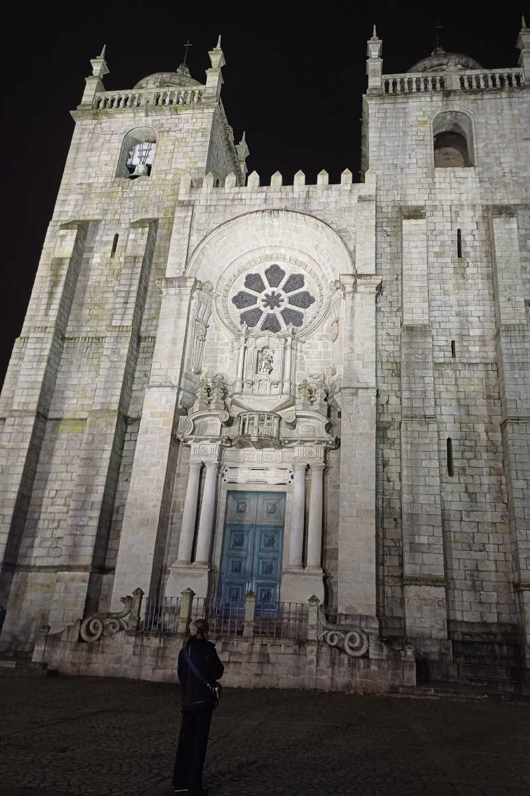

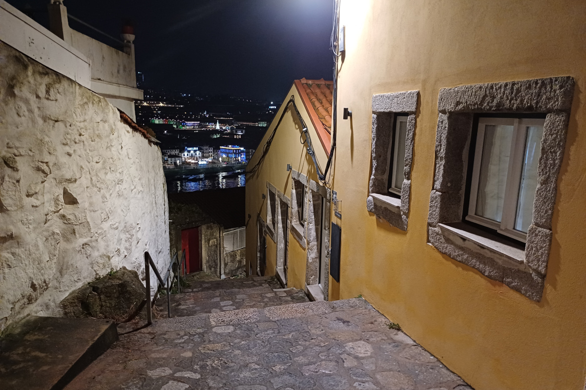

Toen mijn dag in Porto ten einde liep, kon ik alleen maar glimlachen om hoeveel ik in amper een paar uur had kunnen zien
en beleven. Van de levendige Mercado do Bolhão tot de schitterende azulejo-tegels in station São Bento: de stad wist me om
elke hoek te verrassen. De kerstlichtjes die in de motregen brandden en de rokerige geur van geroosterde kastanjes
maakten de straten zo gezellig, zelfs in de regen.
Toen ik op de trein naar Braga stapte, wist ik één ding zeker: ik kom ooit terug om nog veel meer te ontdekken!

## Praktische info:

* Een metroticket kostte 2,85 euro (2,25 euro voor zone Z4 + 0,60 euro voor de Andante-kaart). De Andante-kaart is
herlaadbaar. Op de ticketautomaat hing een sticker met alle metrostations en daarnaast de zone die geldt wanneer je er
vanaf de luchthaven naartoe reist. Ik ging naar metrostation Bolhão, dus dat was Z4. Je kan ook [meer details](https://en.metrodoporto.pt/pages/391)
bekijken, al gaf de site bij de verbinding Aeroporto – Bolhão een prijs van 2 euro voor een enkel ticket, dus het juiste
tarief staat er niet op (de zone klopte wel).

* Restaurant PAPO CHEIO - A Tasca de Cedofeita in Porto: de zaak heeft binnen weinig ruimte en tafeltjes buiten, en
serveert heerlijke lokale gerechten. Uitstekende prijs-kwaliteitverhouding en heel vriendelijke bediening.
Adres: R. de Cedofeita 95, 4050-166 Porto, Portugal

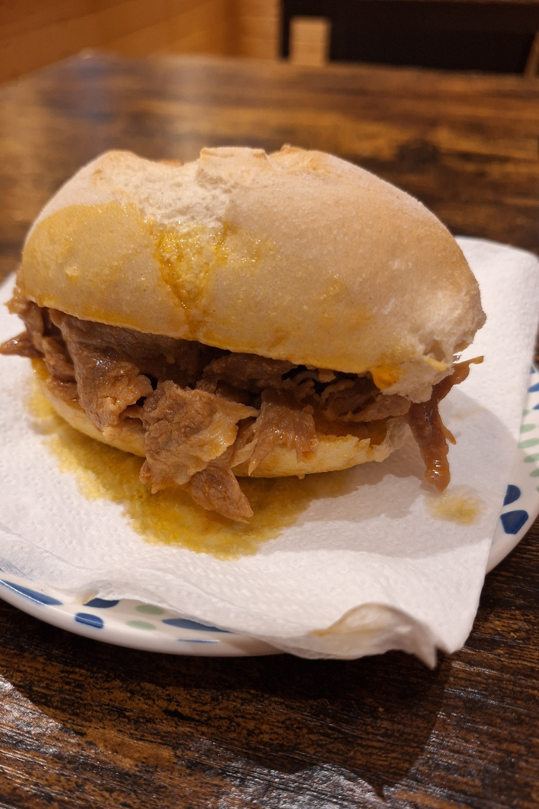

* Manteigaria – [Fábrica de Pastéis de Nata](https://manteigaria.com/) verkoopt verse en warme pastéis de nata met een
lekkere, heel zachte vulling. Het gebak wordt ter plaatse gemaakt en gebakken (€1,30 per stuk).

* De trein van Porto naar Braga kostte 3,95 euro (3,45 euro ticket + 0,50 euro SIGA-kaart). Die kaart is herbruikbaar en
werkt contactloos; er passen tot 31 enkele ritten op, die je in beide richtingen kan gebruiken. De ticketautomaat
gebruiken was wat lastig, want zelfs in het Engels klopte de vertaling niet. Het kostte een paar pogingen en wat
uitproberen voor ik het juiste ticket kon kopen.
