Het biosfeerreservaat Gerês-Xurés (**Reserva de la Biosfera Transfronteriza Gerês-Xurés**) strekt
zich uit over Galicië in Spanje en de Portugese regio Norte. In het hart van het gebergte Serra Gerês-Xurés liggen de
hoogste toppen, de Nevosa (1.646 m) en de Fontefría. In 2009 erkende UNESCO het gebied als biosfeerreservaat. Een
zeldzaam maar iconisch roofdier in dit gebied is de Iberische wolf. Vaker kom je Garrano-paarden tegen, halfwilde paarden
die van oorsprong uit Noord-Portugal komen. Ze lopen vrij rond in het reservaat en symboliseren het culturele en
natuurlijke erfgoed van de streek. De Pyrenese eik domineert de bossen van het reservaat en biedt dieren een essentieel
leefgebied. We zagen ook veel eucalyptusbomen, al verschilt dat naargelang het deel van dit uitgestrekte reservaat dat je
verkent. Zelf was ik vooral onder de indruk van de rotsformaties in de hogere delen van het gebergte.

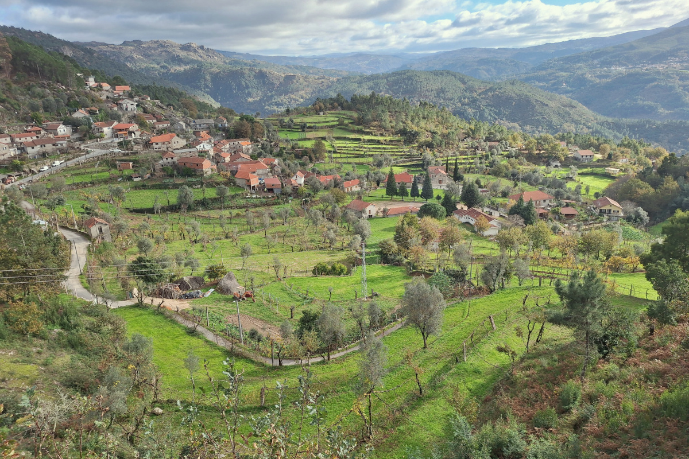

Onze wandeling begon bij de **Miradouro da Ermida** in het dorpje Ermida, waar we de auto achterlieten. We maakten een
korte lus van 6,5 km (Miradouro da Ermida – Miradouro Fraga do Justo – Cascata da Rajada – Miradouro Silhas –
Miradouro da Vela – Miradouro da Ermida). We navigeerden met Organic Maps en volgden gedeeltelijk de routeaanduidingen
van de lus "PR14 Alternativo".

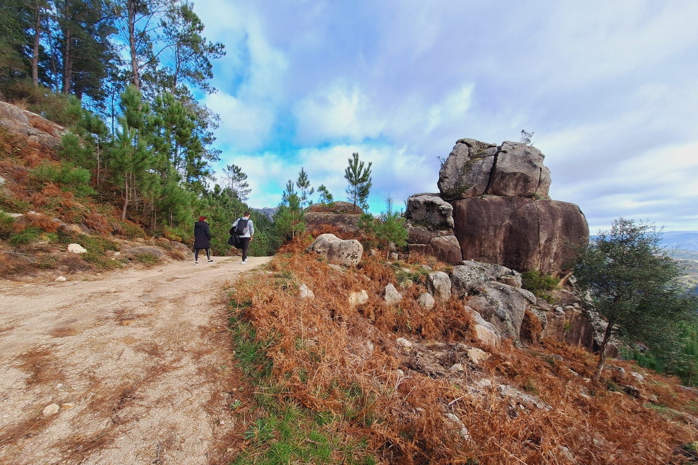

  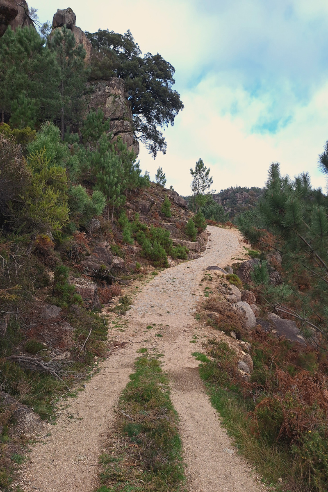
  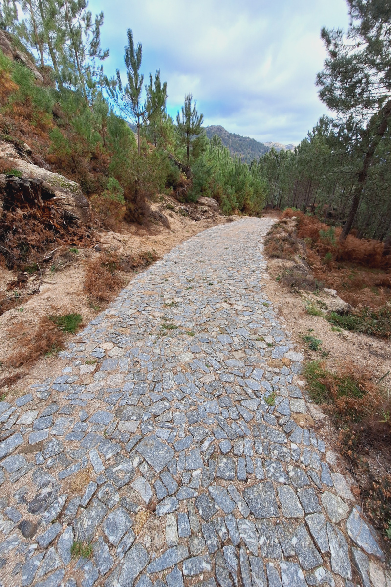

Eerst volgden we de borden richting **Miradouro Fraga do Justo**. Vanaf dat uitkijkpunt zie je de hele vallei rond de
Arado. Het snelstromende water baant zich tussen de rotsen een weg en stort lager als de Rajada-waterval naar beneden.
**Cascata da Rajada** was ons voornaamste doel: een schilderachtige waterval aan het einde van een aangename
wandeling met volop schaduw. Het pad wordt op het einde wat rotsachtig, maar echt technisch is het niet. Volgens de
recensies op Google staat er in augustus minder water, maar begin december voerde de beek volop water. Sommige
bezoekers klauteren op het einde over de rotsen om tot aan de voet van de waterval te raken. Wees voorzichtig, want de
rotsen kunnen erg glad worden. Je vindt er ook een grotere, diepere poel waarin je 's zomers kunt zwemmen. De omgeving van de
Cascata da Rajada is een aangename plek om even te pauzeren.

  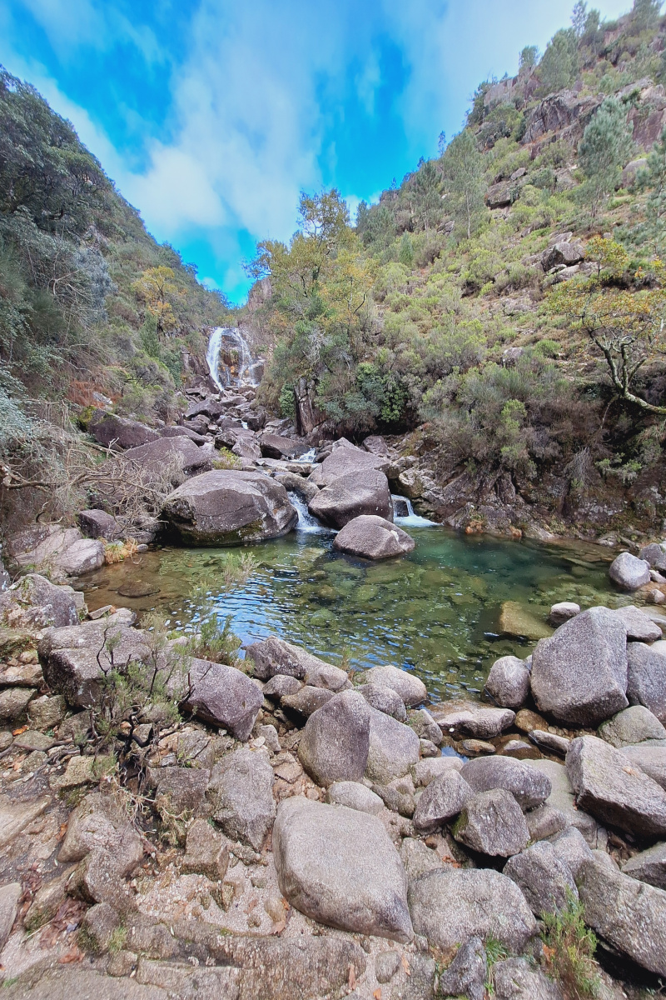
  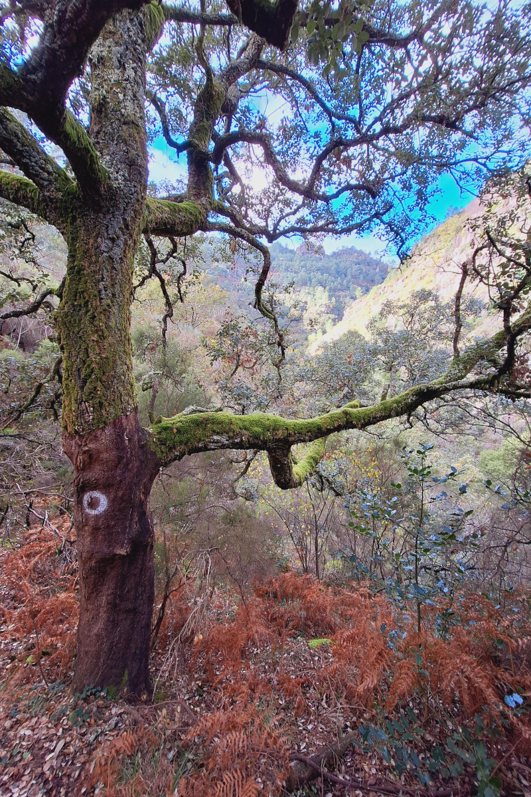

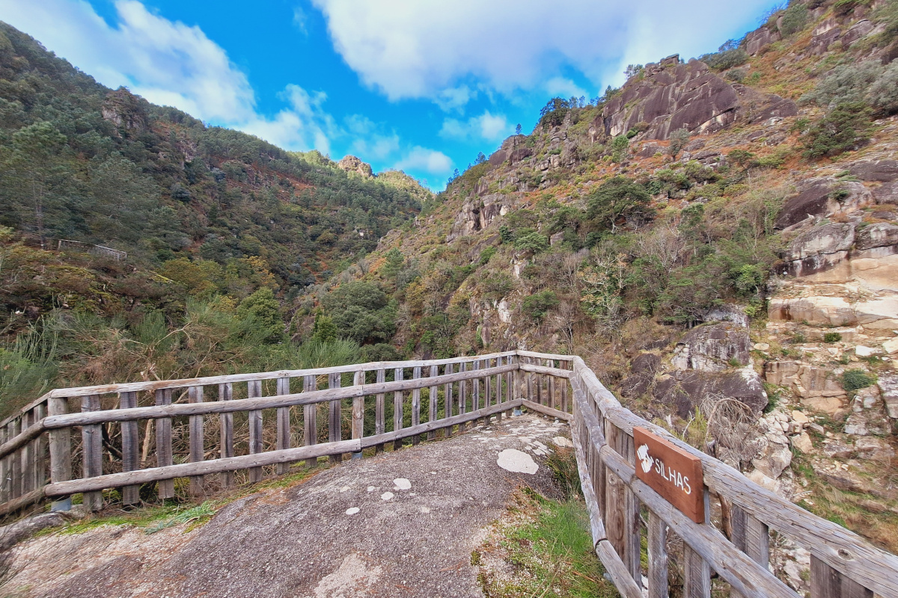

Vlak bij de waterval vind je nog uitkijkpunten op natuurlijke rotsformaties, zoals de **Miradouro Silhas**. Het uitzicht
vanaf beide delen van dat uitkijkpunt is schitterend. Het loont de moeite om de paadjes naar beide delen te zoeken, al zijn ze niet
altijd even duidelijk en moet je tussen bomen en struiken door stappen. Daarna liepen we terug richting het dorpje
Ermida, met een stop bij nog een uitkijkpunt, de **Miradouro da Vela**. Dat uitkijkpunt is heel toegankelijk, met een
duidelijk pad ernaartoe.

Vlakbij zagen we een stuk bos dat onlangs was afgebrand. Grote delen van centraal en noordelijk Portugal zijn bedekt
met eucalyptus, een bijzonder brandbare boom. Eucalyptus gedijt en herstelt zich na bosbranden, wat de boom in Portugal
omstreden maakt. Hij werd in de jaren 1850 ingevoerd en is nu de meest voorkomende boom van het land. Voor de
papierpulpindustrie is hij waardevol door zijn snelle groei en hoge opbrengst, maar hij put de bodem en het water uit en
verspreidt zich ongebreideld op onbeheerde gronden. Zijn brandbare bladeren en schors verhogen het risico op bosbranden
nog. De foto's hieronder tonen duidelijk hoe snel eucalyptus opnieuw uitloopt na branden op het einde van de zomer.

  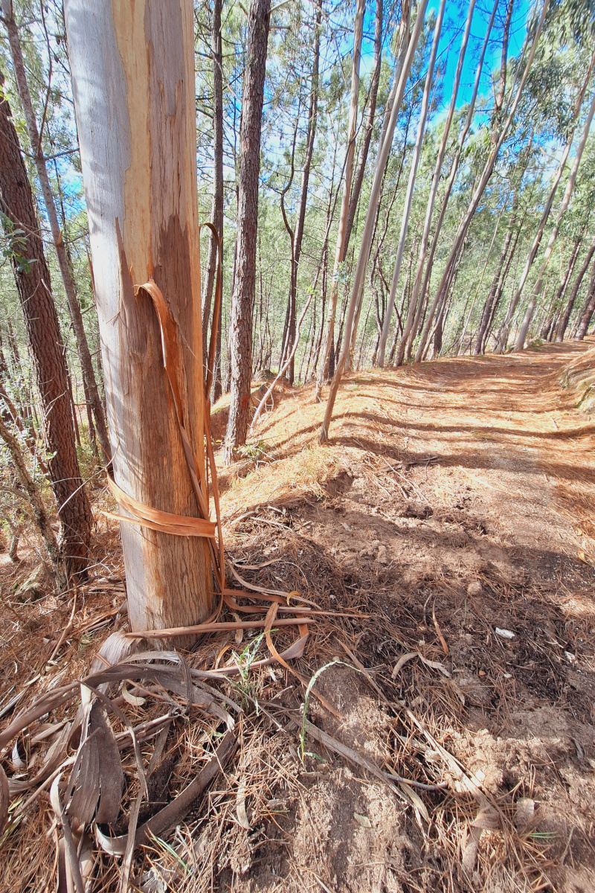
  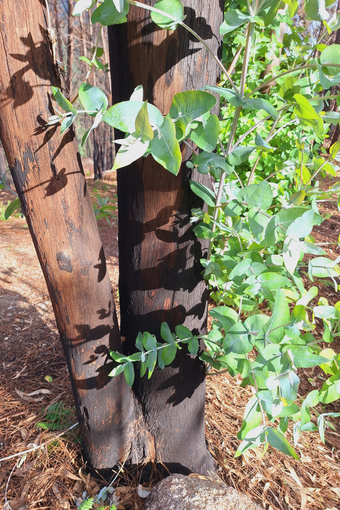

  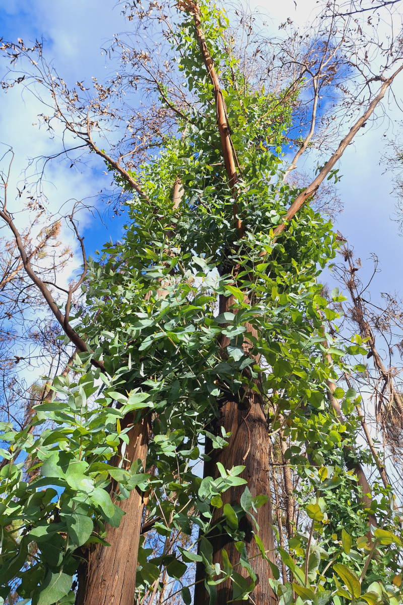
  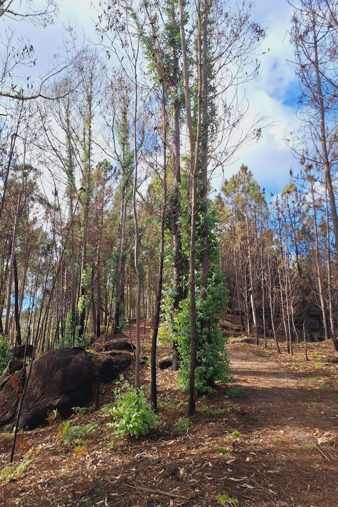

Na dit uitkijkpunt zetten we onze ontspannen wandeling voort door het dorp en het omliggende platteland. Een
opvallend kenmerk van de streek is de aanwezigheid van hórreos, traditionele graanschuren die je bij zowat elk huis vindt. Deze
bouwsels, opgetrokken uit hout of steen en verhoogd op pilaren die eindigen in platte stenen, houden knaagdieren weg van
het opgeslagen graan. Ze zijn doorgaans vierkant of rechthoekig, met spleten in de wanden voor de verluchting.

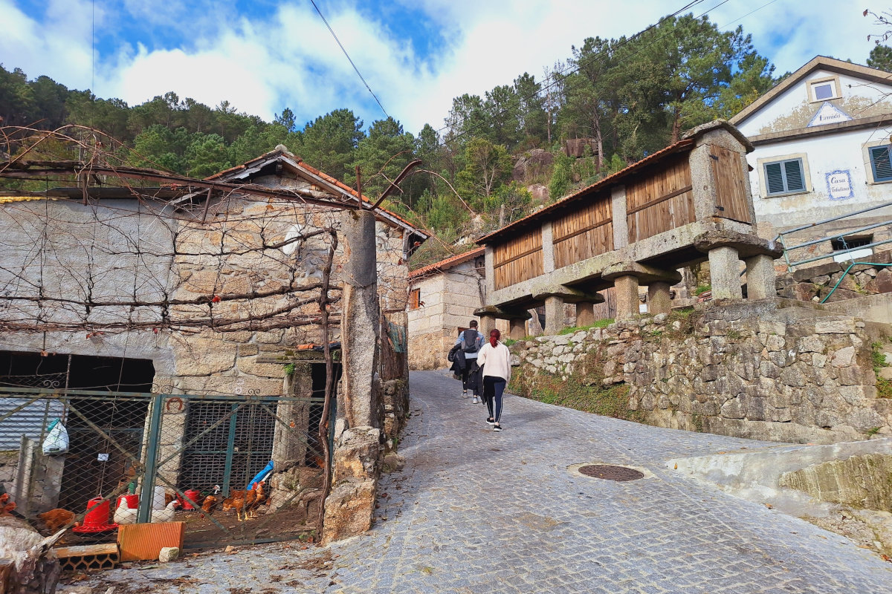

Later bezochten we de nabijgelegen **Cascata do Arado**. We parkeerden bij de rotonde waar de verharde weg eindigt
(coördinaten: 41.715924, -8.132380) en wandelden 15 minuten over de onverharde weg (ongeveer 850 m), wat ook met kinderen goed
te doen is. Je kan ook dichterbij rijden, want de onverharde weg ligt er goed bij en er is voldoende parkeergelegenheid. De
Cascata do Arado is een mooie, kleine waterval die makkelijk bereikbaar is. In de zomer zwemmen bezoekers vaak in de
poelen. Om aan de voet van de waterval te raken, moet je een onbewegwijzerd paadje volgen en door de rivier waden, want het
officiële pad leidt enkel naar het uitkijkpunt bovenaan. Wees voorzichtig: er staan borden die waarschuwen voor ongevallen.

  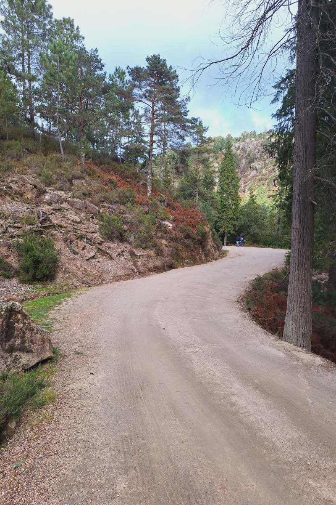
  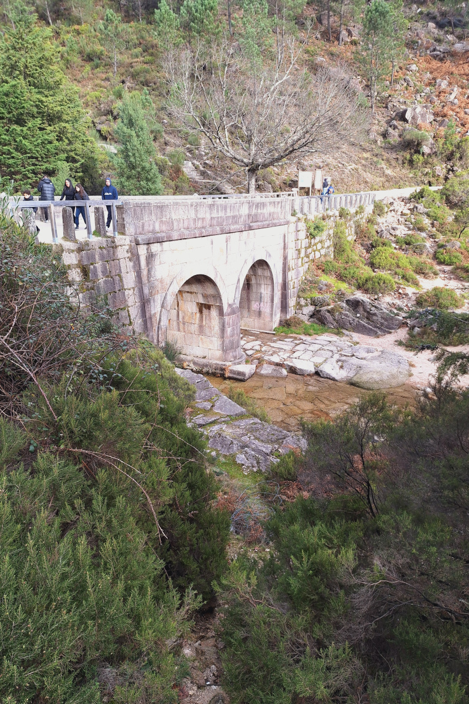

  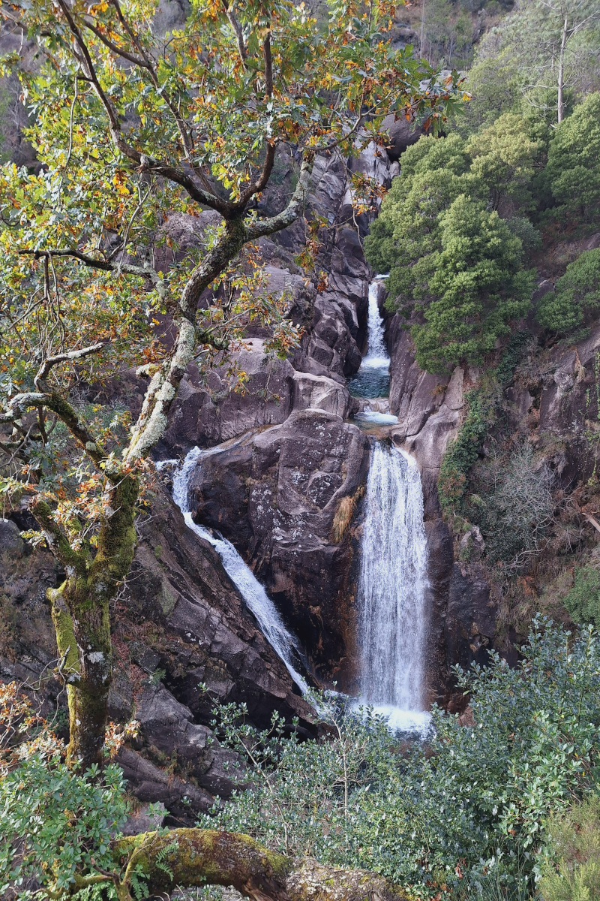
  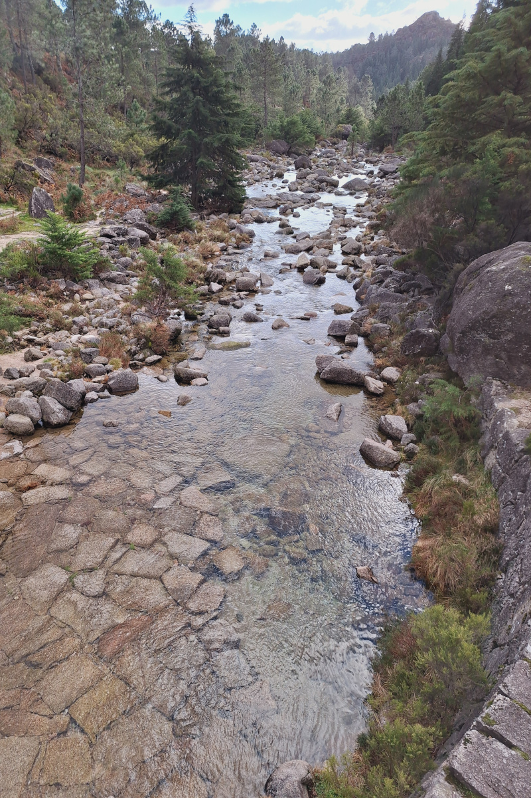

Tot slot klom ik naar een uitkijkpunt (**Viewpoint Rocas**) bij de parking. De klim is steil en onbewegwijzerd en duurt
zo'n vijf minuten. Er is geen duidelijk pad en je klautert over rotsen; op het laatste stuk zijn treden aangelegd. De
klim is lastig en vraagt wat zoekwerk, maar was interessanter dan het panorama bovenaan. Dat is mooi, maar niet een van
de beste uitzichten die we al zagen.

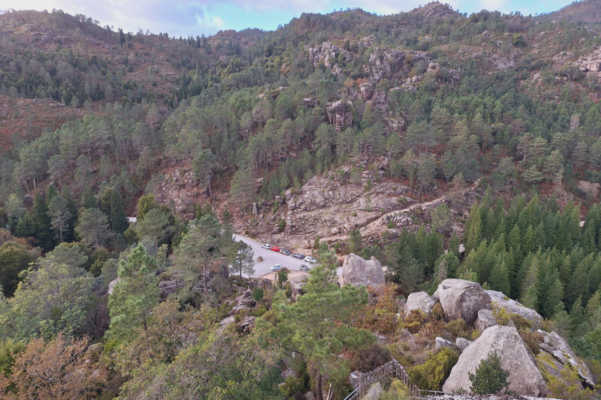

Het Gerês-Xurés-reservaat is een bijzondere bestemming voor natuurliefhebbers. Je kunt er wandelen, dieren observeren
en cultuur ontdekken. Eén dag in dit park volstond om me ervan te overtuigen dat we moeten terugkeren voor een langer
avontuur, liefst wanneer de dagen langer zijn en er meer daglicht is voor langere tochten.

## Praktische info:

* De website van [het biosfeerreservaat Gerês-Xurés](https://turismo.cm-terrasdebouro.pt/aventura/)
beschrijft de wandelingen in deze regio: PR1 tot en met PR15 en de langere GR34 (een lus van 34 km) en GR50 (een lineaire
route van 187,5 km). Je kunt er een PDF met alle details van elke wandeling downloaden. Om je route te vinden is die niet
erg handig, maar als algemeen overzicht is hij wel nuttig. Wij navigeerden met de Organic Maps-app, waarin alle paden
aangeduid stonden, en vonden zonder problemen de weg.

  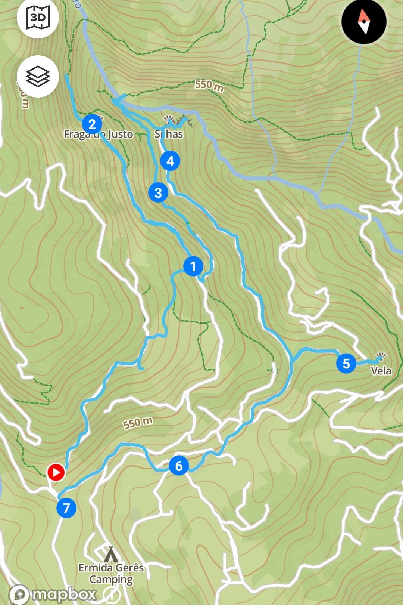
  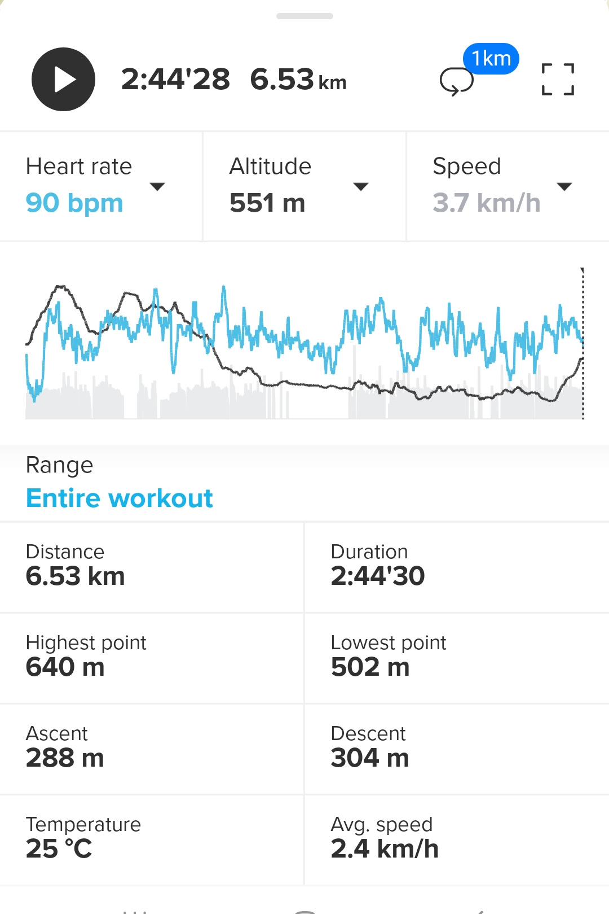

* [Details over de PR14](https://turismo.cm-terrasdebouro.pt/listings/pr14-trilho-do-sobreiral-da-ermida/#en-pr14) vind je
op de officiële website. Het pad is aangeduid met gele en rode horizontale strepen. Waar de route van richting verandert,
is de rode streep L-vormig en geeft ze aan welke kant je op moet (het voorbeeld hieronder betekent dat we links moesten
afslaan). Een uitgebreidere uitleg staat in de PDF onder bovenstaande link.

  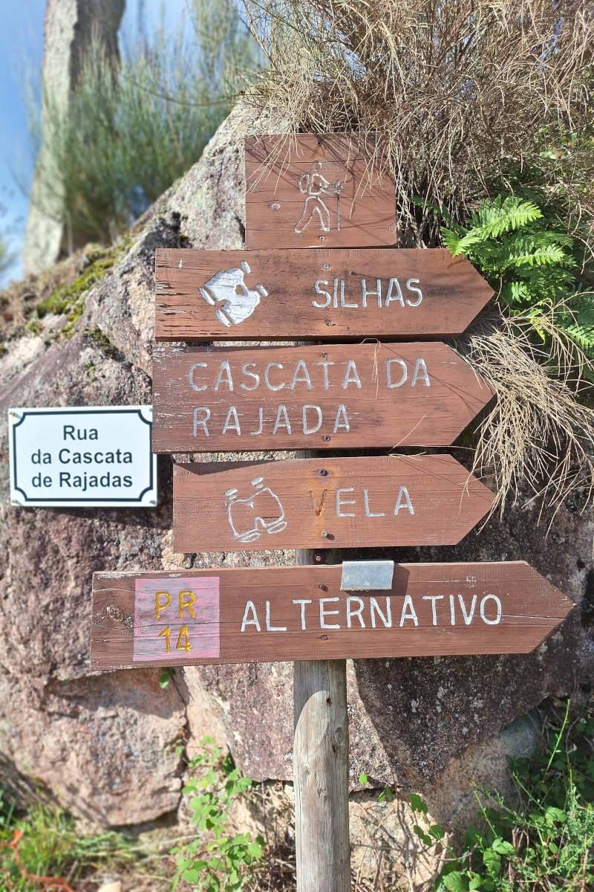
  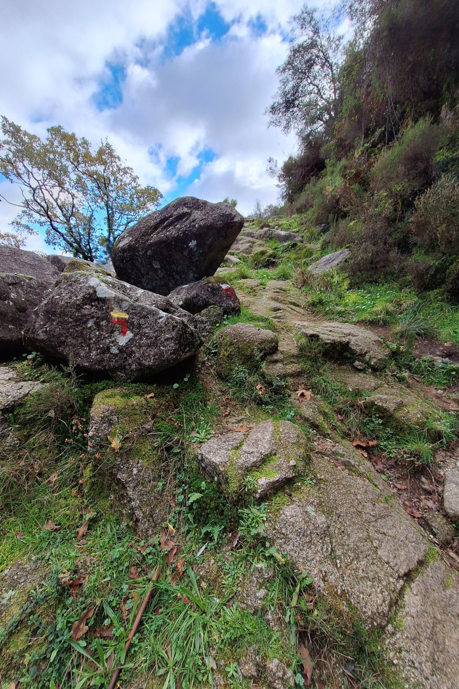

* Bij elk uitkijkpunt stonden borden (hieronder bij de Miradouro Silhas) met **"Se vir Incendo, ligue 117"**, wat je kan
vertalen als **"Bel bij brand 117"**.
 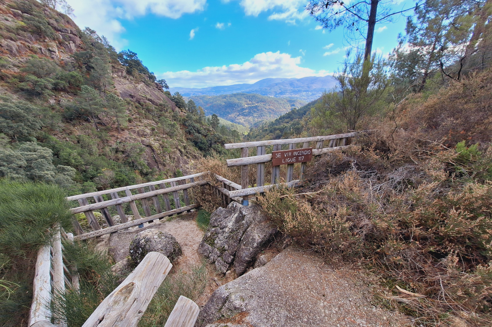
