[De eerste dag]() was al intens, maar voor de tweede planden we nog meer: twee compleet
verschillende wandelingen, de ruige, kale landschappen van de Drakenstaart en de weelderige schoonheid langs de Vereda do
Larano. De eerste gaf ons het gevoel dat we op een andere planeet liepen, zeker met de opkomende zon die de kleuren van
het landschap werkelijk spectaculair maakte.

Ons werd aangeraden Funchal voor 8 uur te verlaten om het verkeer voor te zijn. Goede raad, want ouders zetten hun
kinderen af bij de scholen in het centrum van Funchal, en samen met de mensen die naar hun werk rijden wordt het daar
echt druk. We kwamen rond 8.10 uur aan op een lege parking bij São Lourenço, maar tegen dat we de wandeling om 11 uur
afrondden, stonden er auto's tot op 1,5 km van het startpunt geparkeerd, tot bij een andere grote parking vlak bij het
hotel Resort Spa & Marina. We maakten er altijd een punt van om de bekendste wandelingen 's ochtends vroeg te doen, om
drukte en parkeerproblemen te vermijden. Die dag was niet alleen parkeren veel makkelijker, maar het aantal mensen dat we
op de terugweg tegenkwamen lag ook drastisch hoger. Het was surrealistisch om de wandeling te beginnen met zowat niemand
in de buurt en te eindigen met een lange rij mensen die de andere kant op ging. Toen we vertrokken, kwamen er al een paar
mensen terug; die waren ongetwijfeld voor de zonsopgang gegaan. Wij beklommen ooit [Poon Hill]()
in het donker en op een lege maag om de zonsopgang te zien, maar we leerden dat dat niets voor ons is.

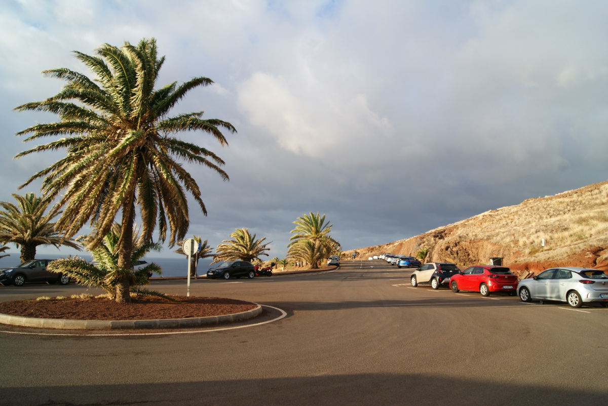

Het schiereiland Ponta de São Lourenço wordt de Drakenstaart genoemd vanwege zijn vorm, zeker van bovenaf gezien. De
ochtendzon was fantastisch: de kleuren waren warm en de plek was ongelooflijk stil. Die dag was er zowat geen wind en zag
de oceaan er heel kalm uit. We vonden vooral het roodgekleurde, ijzerrijke vulkanische gesteente, basalt genoemd, mooi,
en het kale landschap zonder begroeiing, waardoor deze plek er surrealistisch uitzag. Het contrast tussen de rode, zwarte
en gelige rotsen en de blauwe oceaan maakt het landschap hier nog unieker. Tijdens de wandeling zagen we ook boten die de
nabijgelegen baaien binnenvoeren en visnetten van lokale vissers. Dit gebied staat bekend om zijn rijke mariene
biodiversiteit.

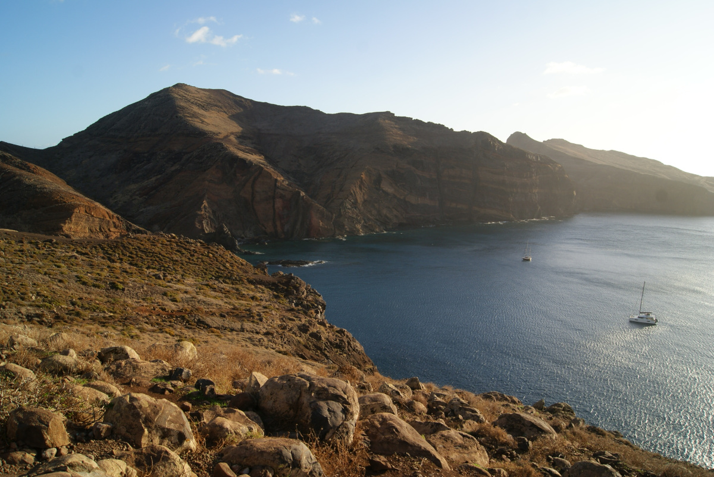
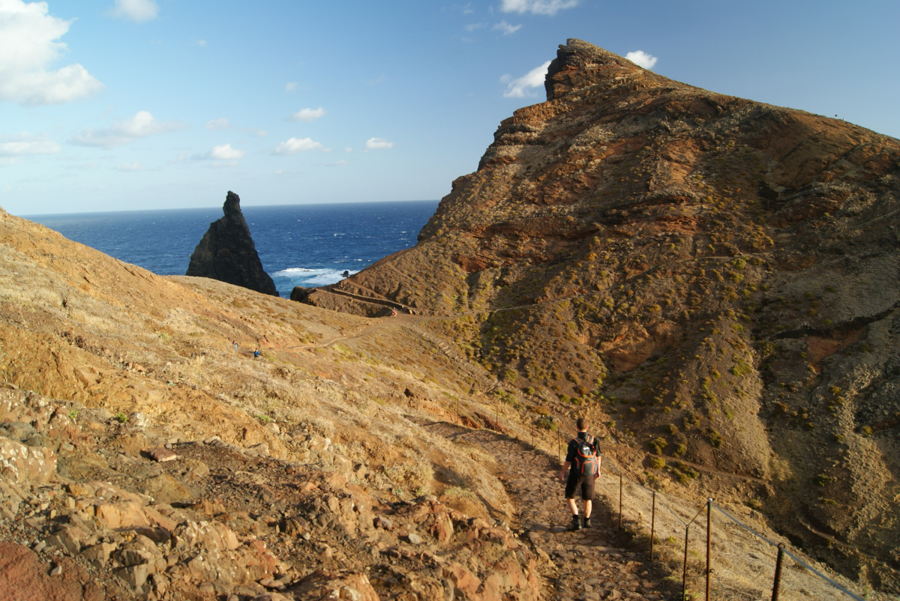
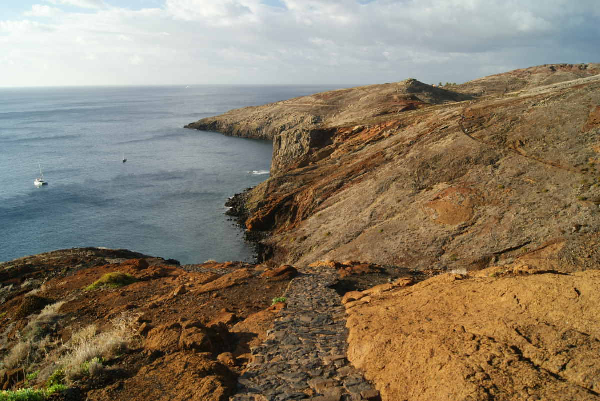
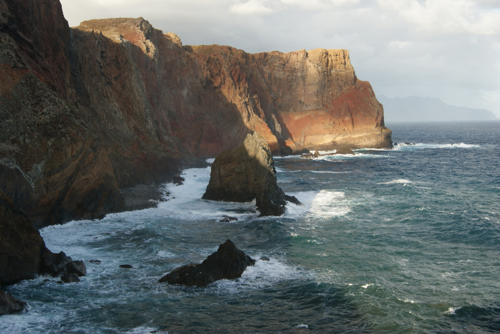

Goede schoenen zijn zeker een must, want het pad is rotsachtig, vooral tegen het einde, waar het veeleisender wordt.
Voorbij het café klimt het laatste stuk steil omhoog, met kabels om je aan vast te houden. Veel van die kabels waren
echter roestig en dus gevaarlijk, en grote stukken van het pad waren stuk en in slechte staat. Daarbij was de kabel die
bij het klimmen moet helpen op veel plekken gebroken of afwezig, met stukken die naar beneden hingen of gerafeld waren,
waardoor er scherpe uiteinden uitstaken die makkelijk je handen kunnen opensnijden. Door die lastige omstandigheden op
het pad wordt het café dat je tegenkomt nog aantrekkelijker: het staat er als een klein groen oasetje omringd door
palmbomen. Een fijne stop voor iedereen die een koffiepauze nodig heeft of iets zoets wil.

  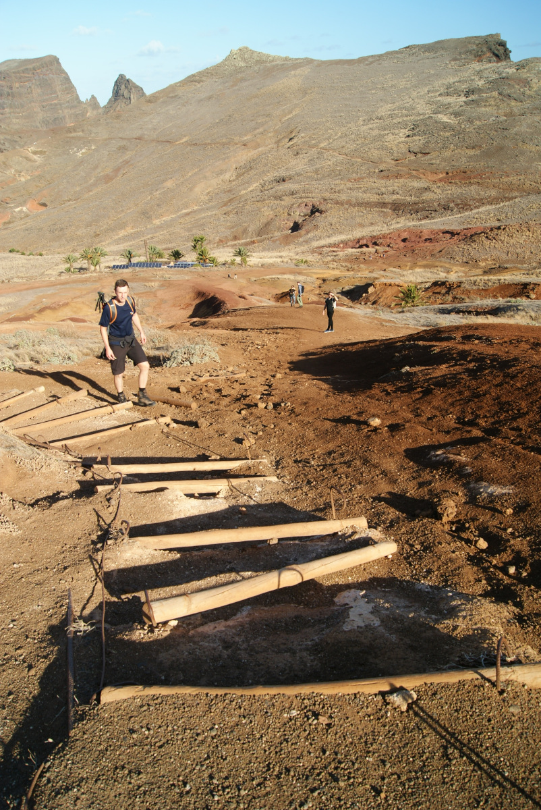
  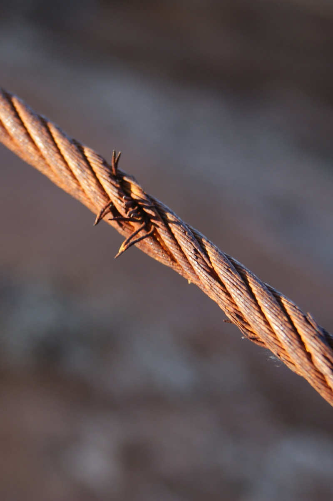

Helemaal op het einde van het pad is er een uitkijkpunt waar het beschermende hek beschadigd was. We zagen verschillende
mensen voorbij het hek stappen tot helemaal aan de rand om betere foto's te nemen, wat ons behoorlijk onverantwoord leek gezien
de steile afgrond. Eén nadeel van zo vroeg wandelen in deze periode van het jaar was dat de punt van het schiereiland, de
"Drakenstaart", vanaf dit uitkijkpunt amper zichtbaar was door het felle zonlicht dat recht in onze ogen scheen.

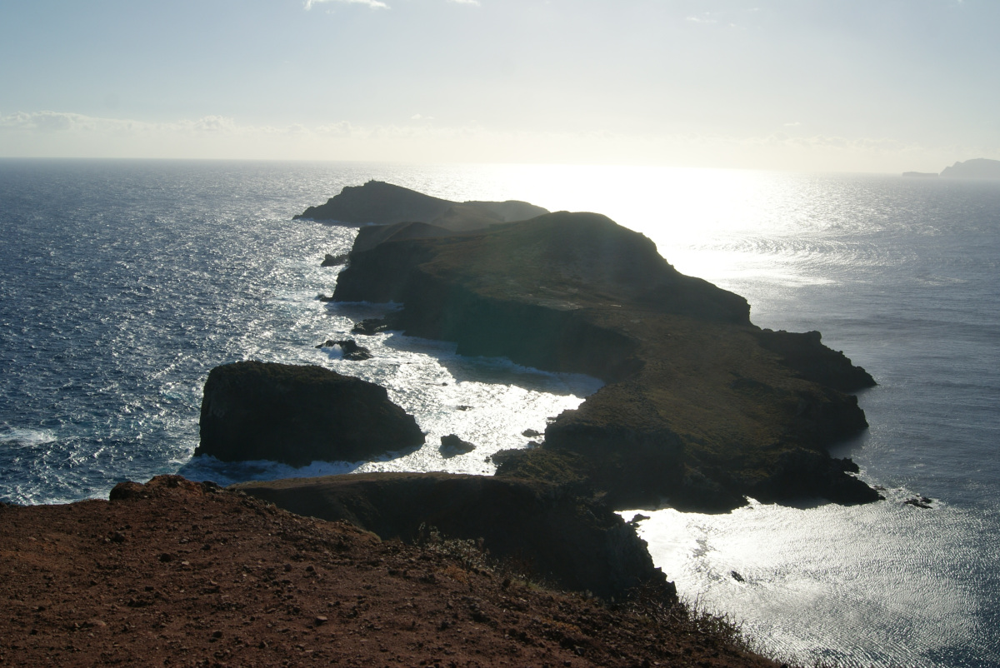
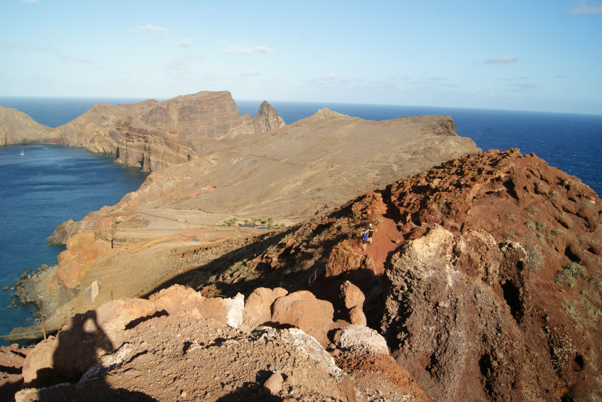
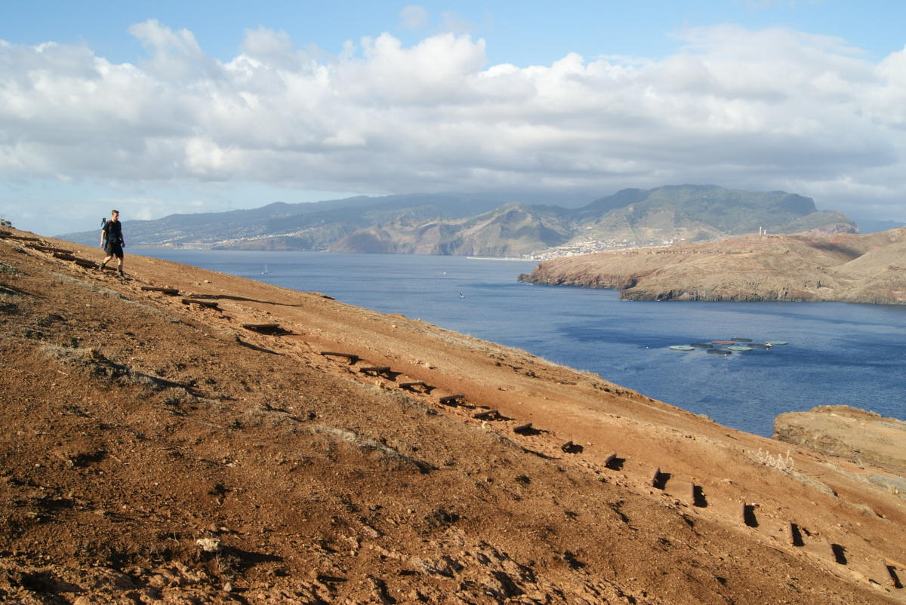

We kwamen op Madeira aan in dezelfde week waarin de overheid begon met het aanrekenen van een vergoeding (28 oktober
2024) voor de mooiste wandelpaden, waaronder dit. We kochten onze tickets online, maar toen we kort na 8 uur aankwamen,
stond er een oudere man met papieren tickets zich klaar te maken voor de dag. Na onze wandeling had zich een kleine rij
gevormd van mensen die met cash tickets wilden kopen, en twee extra jongere parkwachters controleerden de tickets. Ik hoop dat
dit geld gebruikt wordt om de paden te renoveren en veiliger te maken, want dit pad verkeerde in slechte staat, met op
verschillende plekken gebroken houten planken. Volgens een verklaring van de overheid gaat alle opbrengst van de nieuwe
toeristenbijdrage naar onderhoud, schoonmaak en behoud van de paden. Nu het toerisme op Madeira toeneemt, was die
verandering echt nodig. Het aantal mensen dat we op de terugweg naar de auto passeerden was opmerkelijk: nergens tijdens
ons hele verblijf kwamen we er zoveel tegen.

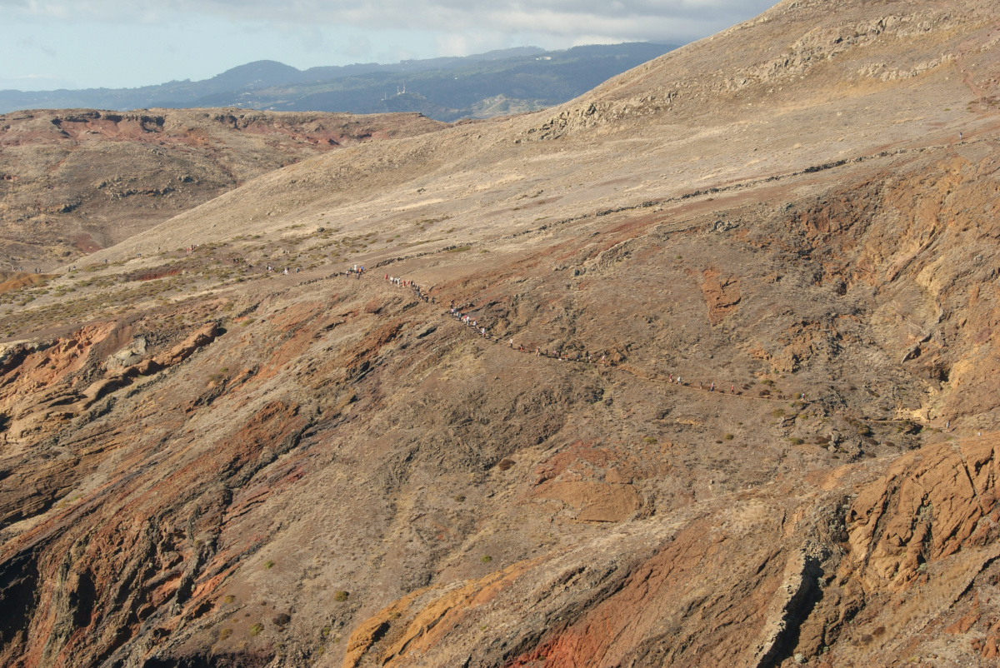
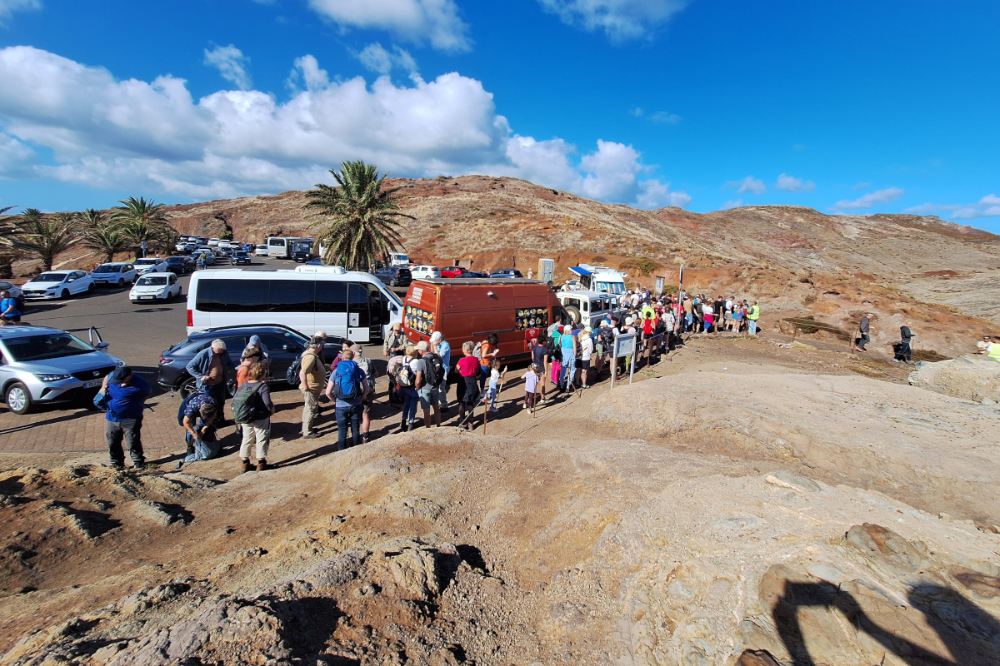

De Miradouro da Ponta do Rosto was onze volgende halte, want die ligt maar een paar honderd meter van de weg wanneer je
de PR8-wandeling verlaat. Van daaruit kregen we vanuit een andere hoek een prima overzicht van het stuk dat we net gewandeld hadden.
We zagen er indrukwekkende kliffen met kleurrijke vulkanische rotsformaties. Ponta de São Lourenço is een van de
wandelingen op Madeira die je gedaan moet hebben en biedt een compleet andere ervaring dan de weelderige levadapaden van
het eiland. Ik genoot enorm van deze wandeling, met werkelijk verbluffende landschappen! Dit oostelijkste punt van het
eiland Madeira is gewoon onwerkelijk en een must voor iedereen die er komt. Ik was erg blij dat we niet te laat waren en
snel door konden naar ons volgende doel van de dag: een langere kustwandeling naar Porto da Cruz.

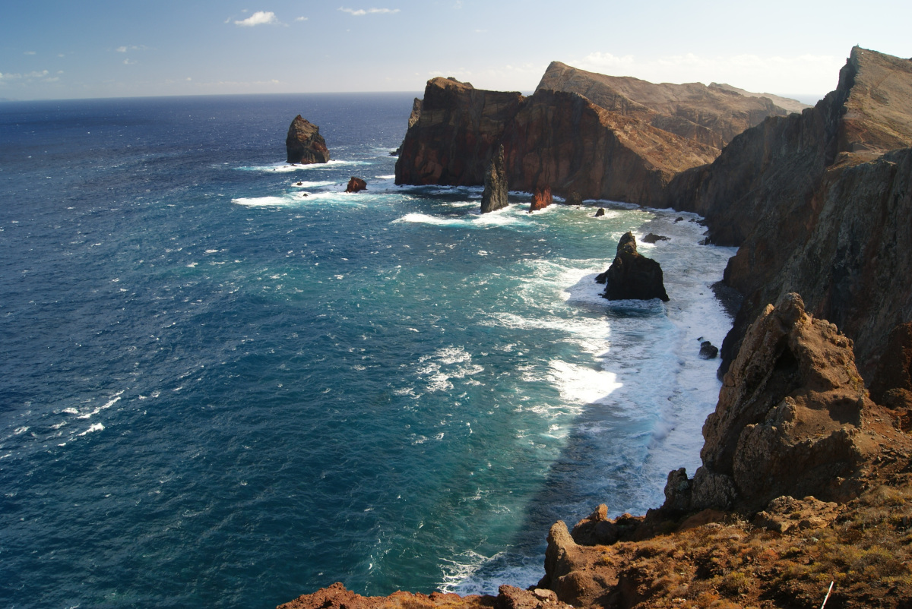

Na een korte autorit, toen we Caniçal voorbij waren, parkeerden we aan de weg ER109 bij de oude tunnel, waar we startten met de Levada
do Caniçal. We volgden Organic Maps, want we hadden langs de weg geen enkele wegwijzer gezien. Eerst liep het pad langs
veel huizen, en we bewonderden granaatappelbomen en hortensia's die nog mooie kleuren hadden waar ze in de schaduw
stonden. Van bij het begin volgden we een kleine levada. Zodra we de lokale weg bereikten, moesten we uitkijken naar een
scherpe bocht naar links, die gelukkig aangeduid stond op een steen die naar de Vereda da Boca do Risco wees. De eerste
paar kilometer liepen langs velden waar de lokale bevolking gewassen en groenten teelt. Daarna ging het pad het bos
in, waar we geiten zagen rondlopen.

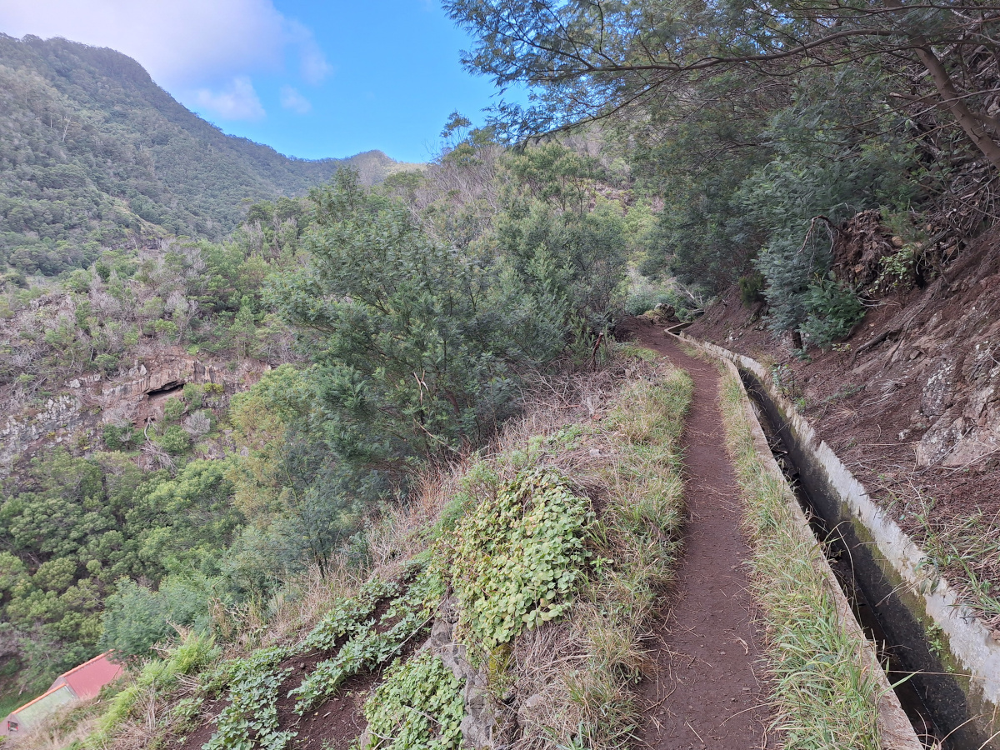

  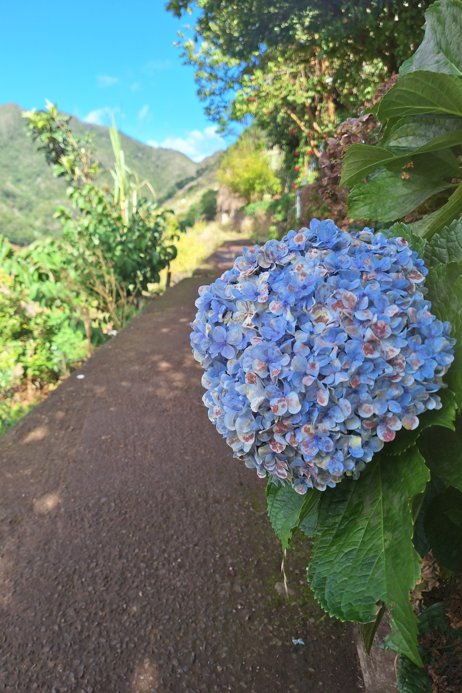
  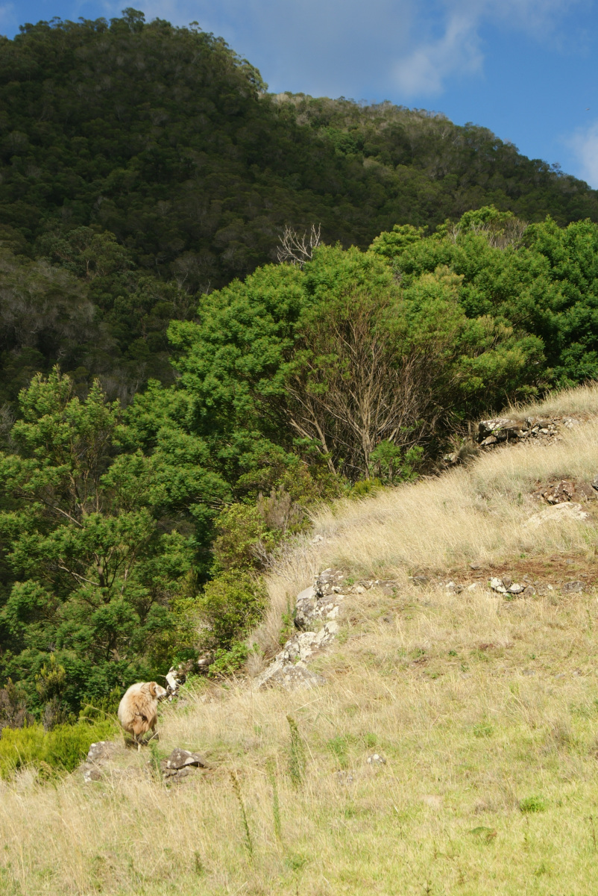

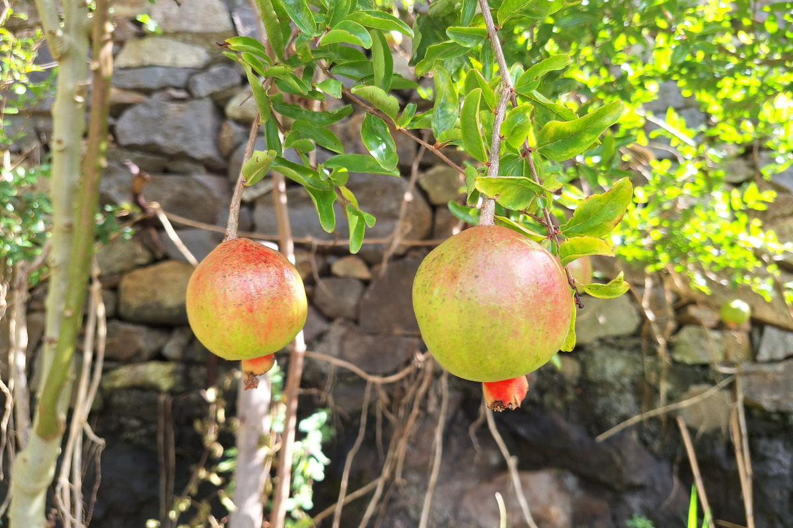

Het bos werd dichter en het pad steiler en rotsachtiger. We kwamen maar een paar mensen en een trailloper tegen voor we de
top bereikten. Toen het uitzicht op zee zich ontvouwde en we de Vereda do Larano bereikten, veranderde het landschap drastisch. We
liepen nu langs een steile helling, maar gelukkig gaven de kleine boompjes die er groeien een gevoel van bescherming. Dit
deel van de wandeling was zeker drukker, maar niet zo druk dat het onze ervaring negatief beïnvloedde.

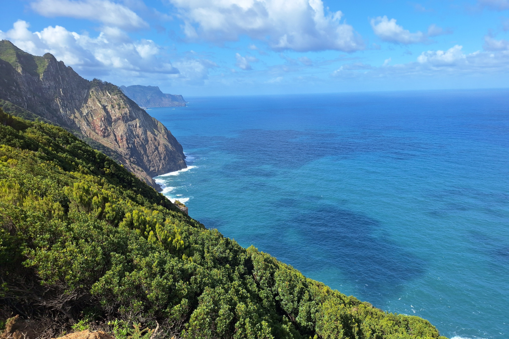
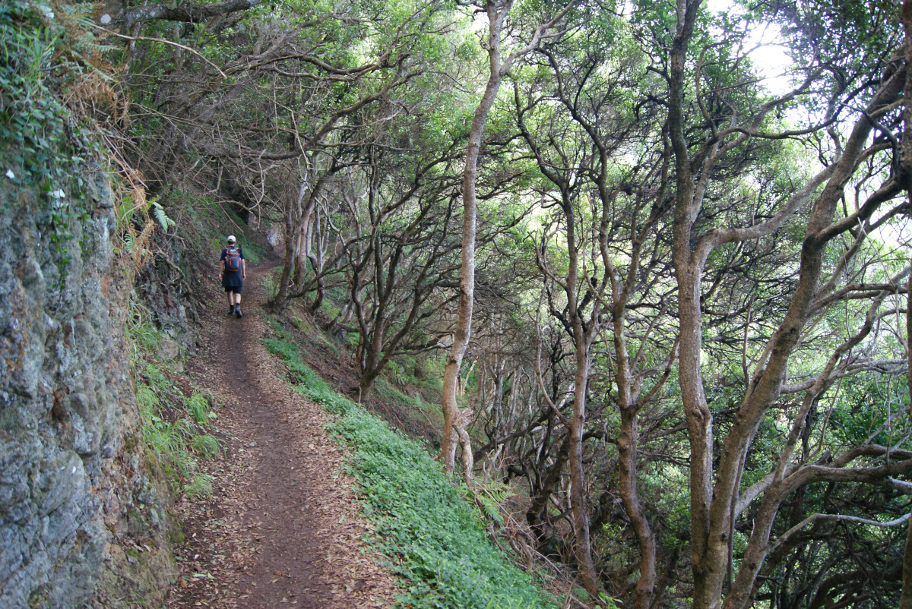
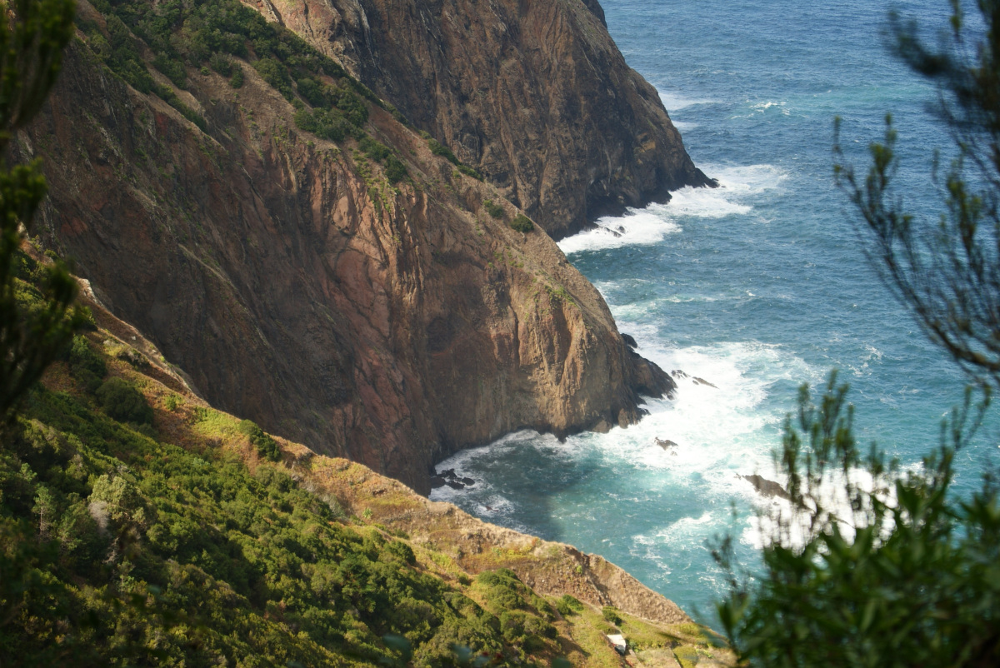

Op de meest onbeschutte stukken stond een draadomheining. Het werd behoorlijk winderig, maar we konden het grootste
deel van de wandeling schitterende kliffen bewonderen, dus dit gebied verkennen was het zeker waard. De rotsen naast het
pad zaten ook vol vetplanten. Wij kennen die vooral uit tuincentra, dus ze hier zien gedijen op de ruige, bijna verticale
rotsen naast ons was onverwacht en vormde een mooie herinnering aan de veerkracht van de natuur. Op een bepaald punt zagen we
zelfs het majestueuze schiereiland Ponta de São Lourenço in de verte.

  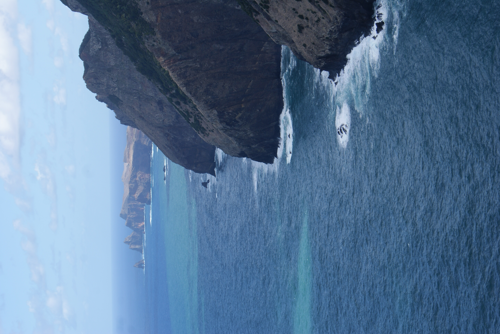
  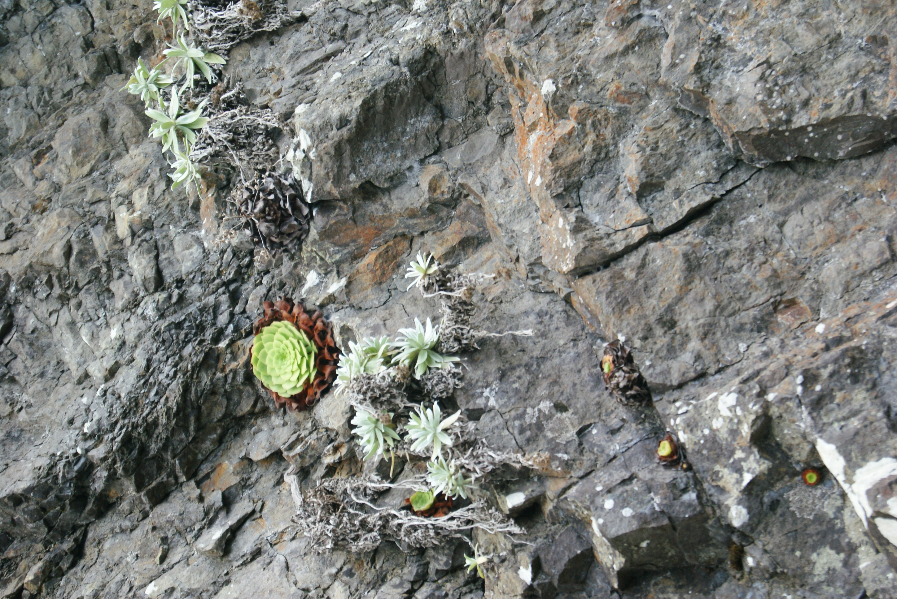

Voorbij de roestig ogende kabelbaan bij Porto da Cruz volgden we even de weg, waar veel auto's geparkeerd stonden omdat
de meeste mensen hier aan hun wandeling beginnen en naar dezelfde plek terugkeren (de heen-en-terugvariant van de
wandeling). Daarna sloegen we een pad in dat door velden en over een nabijgelegen heuvel liep, om van het uitzicht op het
stadje (in de Organic Maps-app aangeduid als de enige stippellijn bij de kust). Je kan ook gewoon langs de weg wandelen,
maar dat is langer en minder veilig. Uiteindelijk bereikten we het strand van zwart zand en kiezels en volgden we de
kustlijn tot het centrum. Op de foto hieronder zie je de Penha de Águia boven het stadje uittorenen. Deze vulkanische
rotsformatie domineert duidelijk het landschap, met een hoogte van bijna 600 m! Het was een erg gevarieerde wandeling,
beginnend met aardepaden en bosstukken, om te eindigen met een spectaculaire tocht langs de kliffen. De wandeling was relatief
makkelijk, maar met enkele smalle en onbeschutte stukken; niets voor wie echt hoogtevrees heeft!

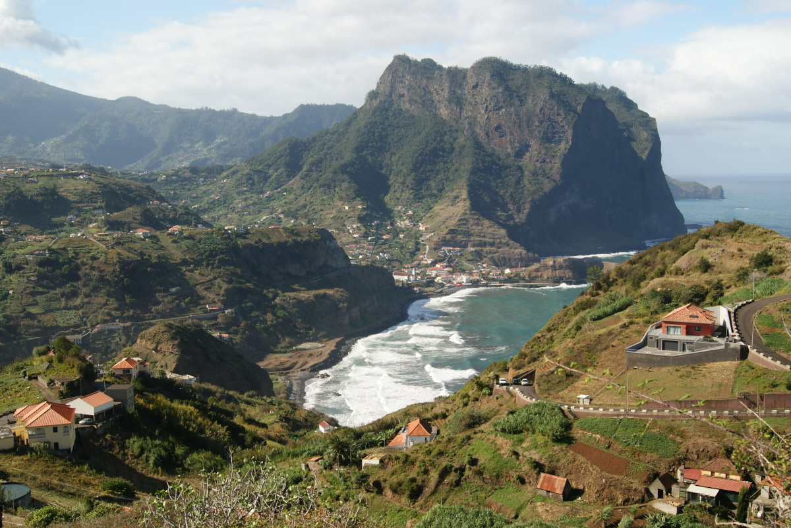
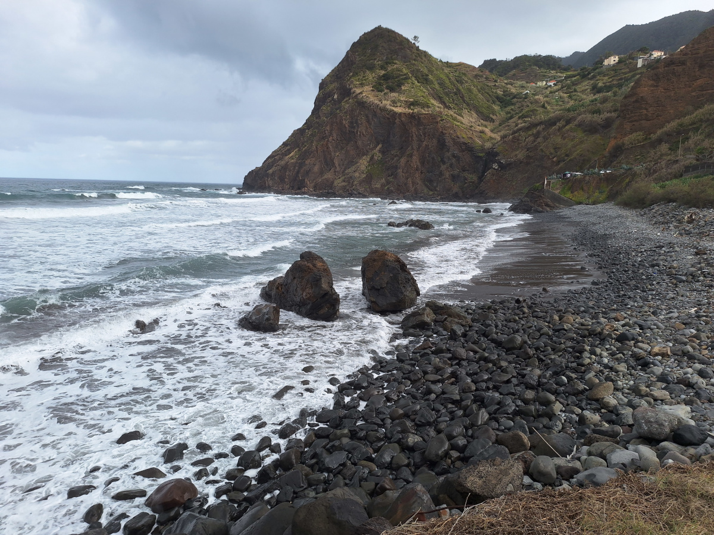

Nu was het tijd voor een degelijke maaltijd na deze uitputtende dag. Omdat er maar één Bolt-chauffeur beschikbaar was,
was een gewone taxi terug naar onze auto nu de goedkopere optie. We waren blij met die beslissing ondanks de extra kosten,
want zo konden we een langere wandeling doen zonder ook maar één stuk te herhalen.

Omdat we nog wat tijd hadden, besloten we de dag af te sluiten bij de Miradouro do Pico do Facho, net iets meer dan 1 km
van onze auto, met zicht op de internationale luchthaven Cristiano Ronaldo. Ik was 's ochtends geschrokken toen ik
besefte dat we op een bepaald moment ónder de startbaan van de luchthaven doorreden! De luchthaven van Madeira heeft een
unieke verhoogde uitbreiding van de startbaan, gedragen door grote betonnen pijlers, waardoor voertuigen eronder door
kunnen. Die uitbreiding werd gebouwd om plaats te bieden aan grotere vliegtuigen en de veiligheid te verbeteren, want de
oorspronkelijke baan was vrij kort en lastig om op te landen. De weg die eronder loopt, maakt deel uit van de VR1-snelweg,
wat het voor bestuurders een heel bijzondere ervaring maakt. De Miradouro do Pico do Facho was een rustige plek om even te
zitten en te ontspannen, omringd door grote cactussen. Er waren ook toiletten en een kleine snackbar, al ging die dicht
toen we er na 17 uur aankwamen.

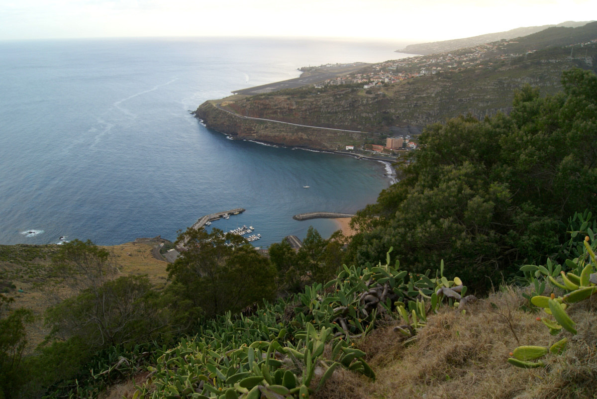
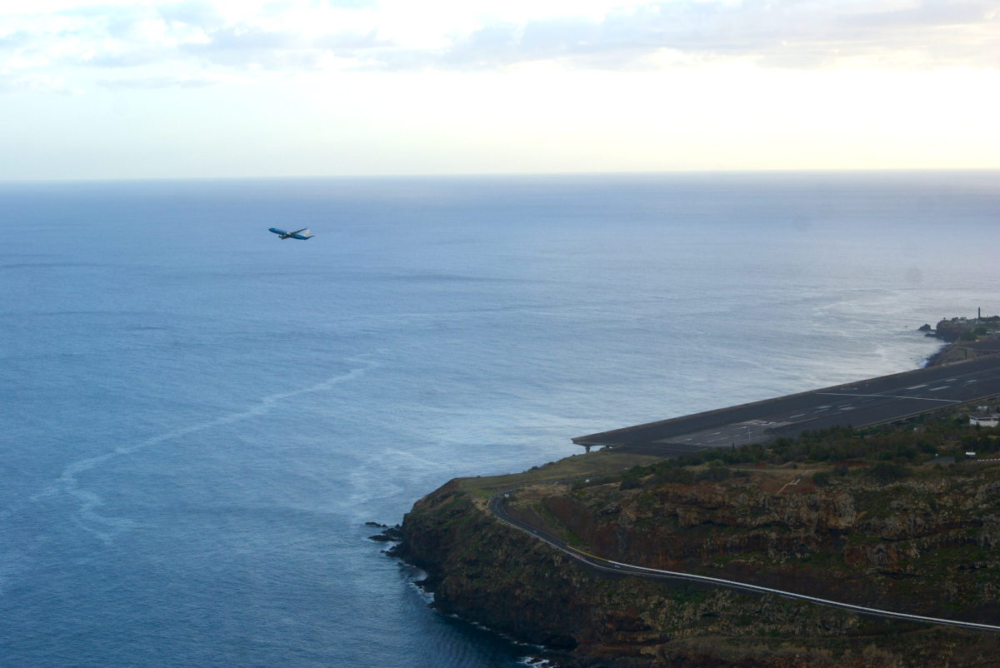

Hierna verkennen we de westkust van Madeira en de natuurlijke zwembaden in Porto Moniz, dus lees zeker verder!

## Praktische info:

* [Officiële website](https://ifcn.madeira.gov.pt/pt/atividades-de-natureza/percursos-pedestres-recomendados/percursos-pedestres-recomendados.html)
om na te gaan of de wandelpaden open zijn na de bosbranden van afgelopen zomer.

* Tickets voor wandelpaden waarvoor je moet betalen koop je online [op deze website.](https://simplifica.madeira.gov.pt/services/78-82-259)
Vanaf 1 januari 2025 moeten niet-inwoners betalen om op meer dan 30 routes te wandelen die beheerd worden door het
Instituut voor Bossen en Natuurbehoud (ICNF) op Madeira. Dat zijn in principe alle wandelingen die als PR aangeduid staan.
* Ponta de São Lourenço 'de Drakenstaart' – 7,5 km, 2 u 30. Voor deze wandeling gold al een toegangsprijs van 1 euro vóór
de recentste veranderingen. Wanneer ik nu naar onze wandeling en de officiële kaart kijk, vraag ik me af of het laatste
stuk voorbij de bar wel een officieel pad is; misschien is het daarom niet goed onderhouden. Er stond echter geen bord of
informatie die aangaf dat we niet verder mochten, of we hebben het toch niet gezien. We volgden gewoon een duidelijk
zichtbaar pad tot het einde en sloegen het restaurant bewust over, want we hadden geen tijd voor een extra pauze.
[PR8](https://visitmadeira.com/en/what-to-do/nature-seekers/activities/hiking/pr-8-vereda-da-ponta-de-sao-lourenco/) en
[een gedetailleerde samenvatting van de wandeling](https://visitmadeira.com/media/bnpngpg0/pr8-vereda-da-ponta-de-sao-lourenc-o.jpg)
vind je op de officiële websites.

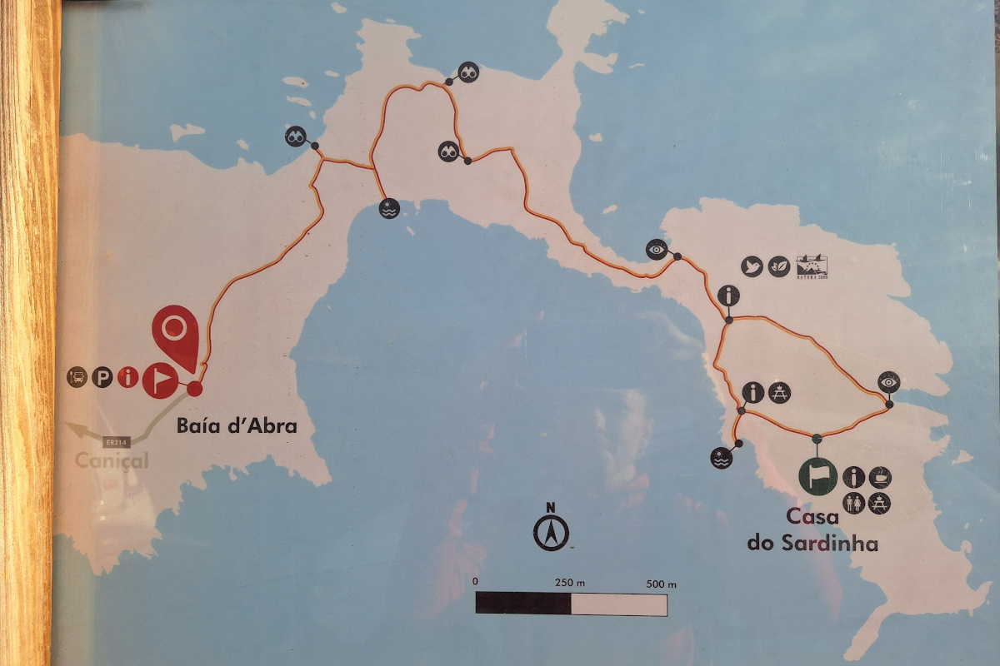

Je kan hier ook raken met bus 113 vanuit Funchal, zie de dienstregeling hieronder (foto van de bushalte aan de parking
van São Lourenço).
Al met al is het pad goed onderhouden op het hoofdgedeelte, maar niet aan het begin, waar veel houten planken ontbreken
of stuk zijn, en niet voorbij het café (nog altijd twijfelachtig of dat deel uitmaakt van de officiële wandeling).

  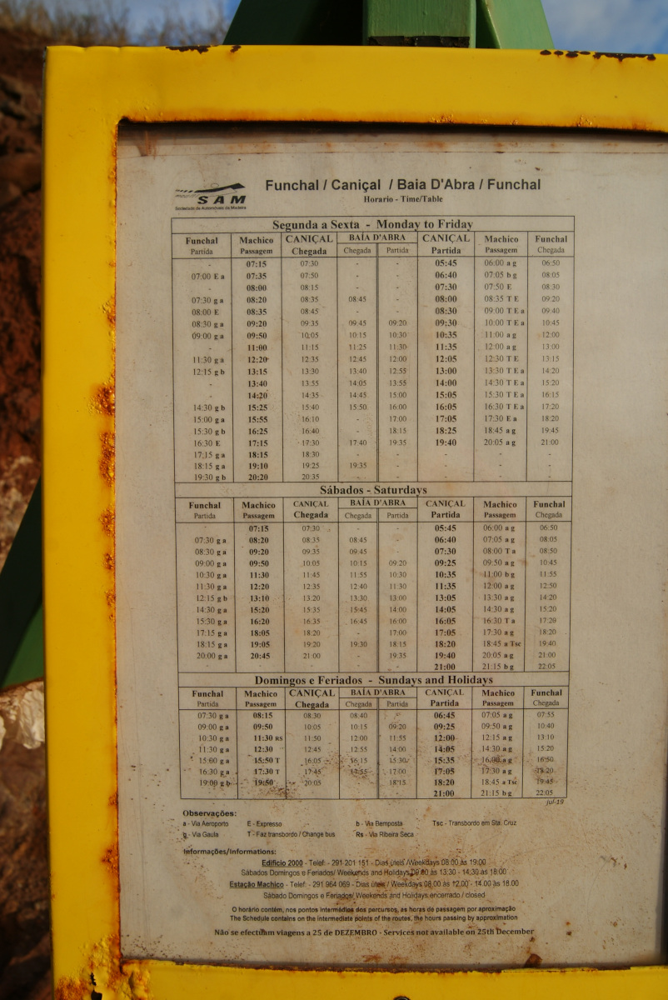
  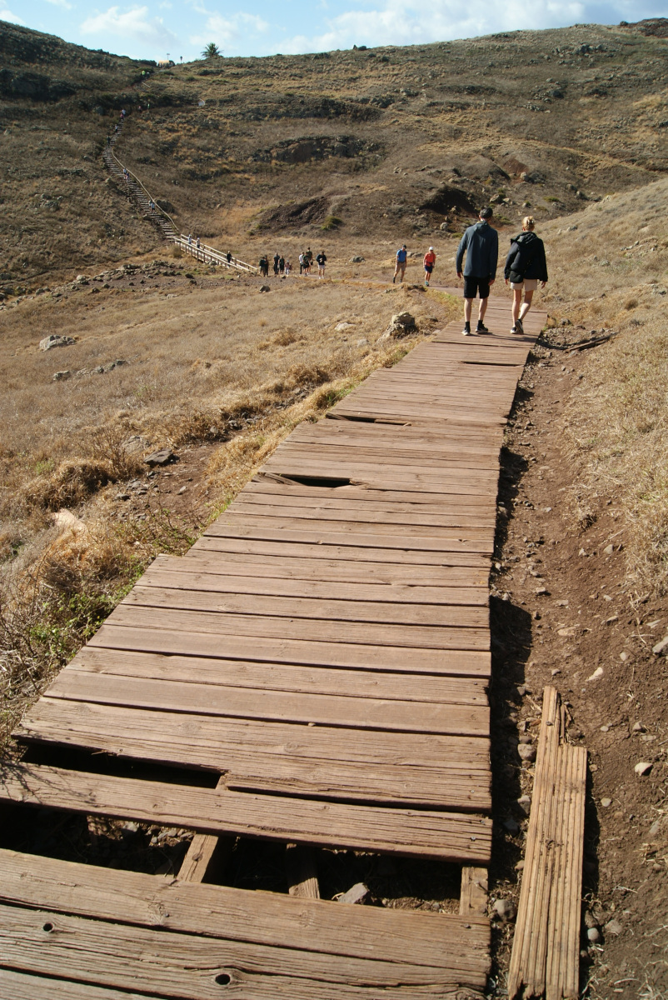

* Miradouro da Ponta do Rosto - kleine parking, maar mensen komen en gaan snel, dus een plaatsje vinden voor een korte
stop van 10 minuten is meestal geen probleem.

* Levada do Caniçal - Vereda da Boca do Risco - Vereda do Larano - Porto da Cruz – 13,44 km, 3 u 30
Taxi terug naar de auto: 18 euro voor een rit van 11 km (op de [Bolt-app](https://bolt.eu/en/support/articles/115003024753/) was
maar één wagen beschikbaar, maar die was duurder: 24 euro). We lieten de auto achter op: P6MP+44 Machico, Portugal

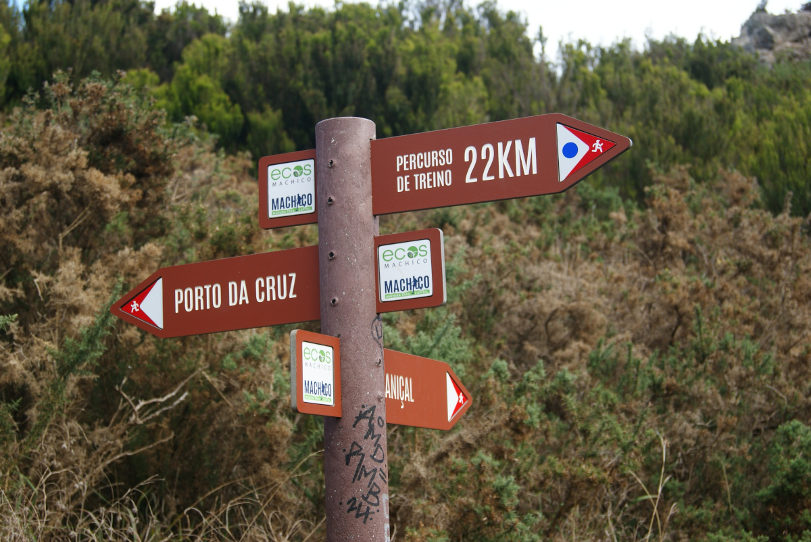

* Tijdens onze reizen gebruiken we altijd [Organic Maps: Offline Hike, Bike, Trails, and Navigation](https://organicmaps.app/).
Die app was op Madeira erg accuraat; we zijn geen enkele keer verdwaald. Tijdens de eerste wandeling van de dag hadden we de
app zelfs niet nodig, maar de kustwandeling was ingewikkelder omdat we stukken van verschillende paden combineerden. We
zagen maar één degelijke houten paal, bij de kruising tussen de Vereda da Boca do Risco en de Vereda do Larano (het
eerste uitkijkpunt met zeezicht).

* Restaurant A Pipa - restaurant en bar met grote porties, een propere zaak en lekker eten. Ongeveer 20 euro per persoon, drankjes
inbegrepen.
Adres: Casas proximas, 9225-050 Porto da Cruz, Portugal

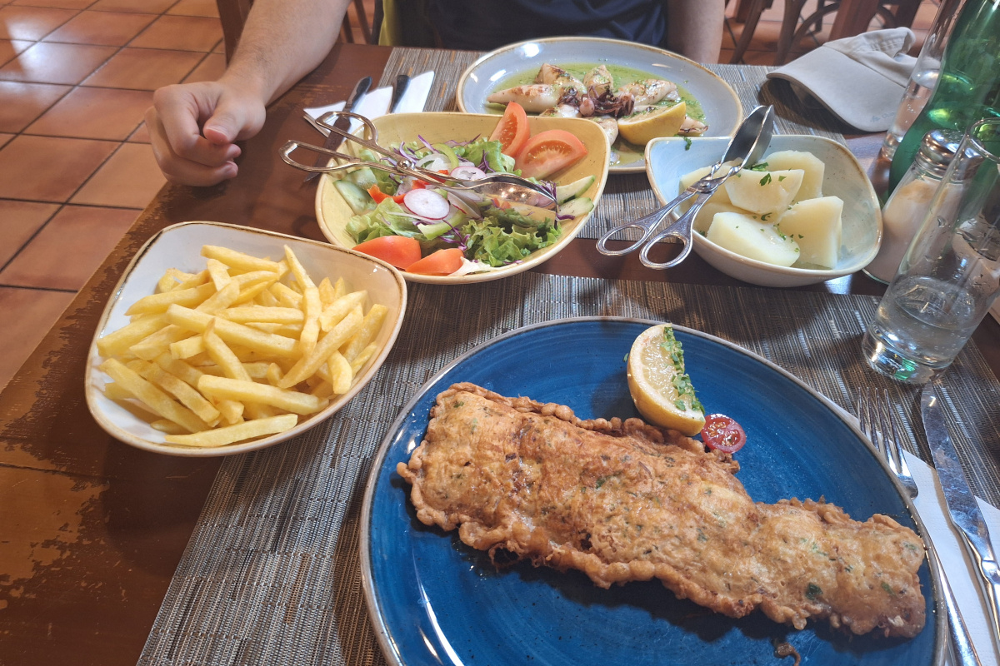
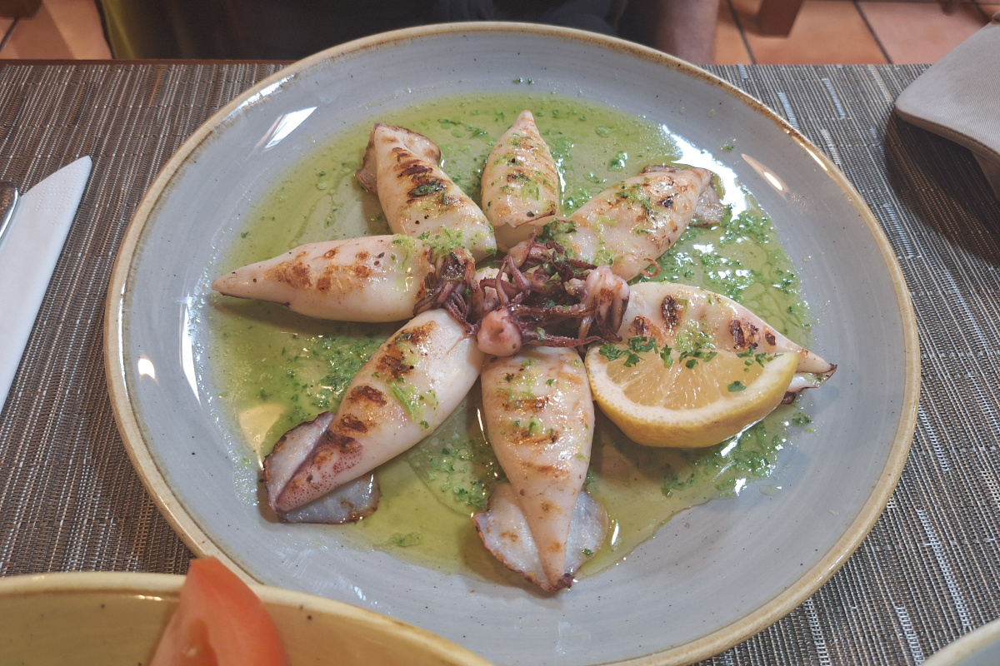
