Elke avond maakten we plannen voor de volgende dag, op basis van het weer en hoe moe we ons die dag voelden. Het idee was
om de zwaarste wandeldagen niet meteen na elkaar te laten vallen. Het weer zag er de dag erna stabieler uit, dus we
besloten de Pico Grande later te beklimmen. Vandaag zou een minder veeleisende dag worden, met een wandeling van 9 km en
een langere rit langs de westkust, met onderweg heel wat uitkijkpunten. Onze laatste halte was Porto Moniz, waar de
beroemde natuurlijke zwembaden liggen. Alles duurde langer dan gepland, dus ik moest na zonsondergang naar Funchal
terugrijden. De weg door het binnenland (VE4) is echter erg goed, er was weinig verkeer en de rit was heel aangenaam.

We begonnen onze wandeling met de **Levada do Moinho**, die heel makkelijk en goed onderhouden was. Nadat we de rivier
bekeken hadden en er even gepauzeerd hadden, klommen we de trappen op naar de **Levada Nova**, die de hele tijd boven ons
had gelegen. In dit gebied zagen we ook sporen van de bosbranden van afgelopen zomer, en nieuwe varens die door de as van
het verbrande bos groeiden en deze plek weer tot leven brachten.

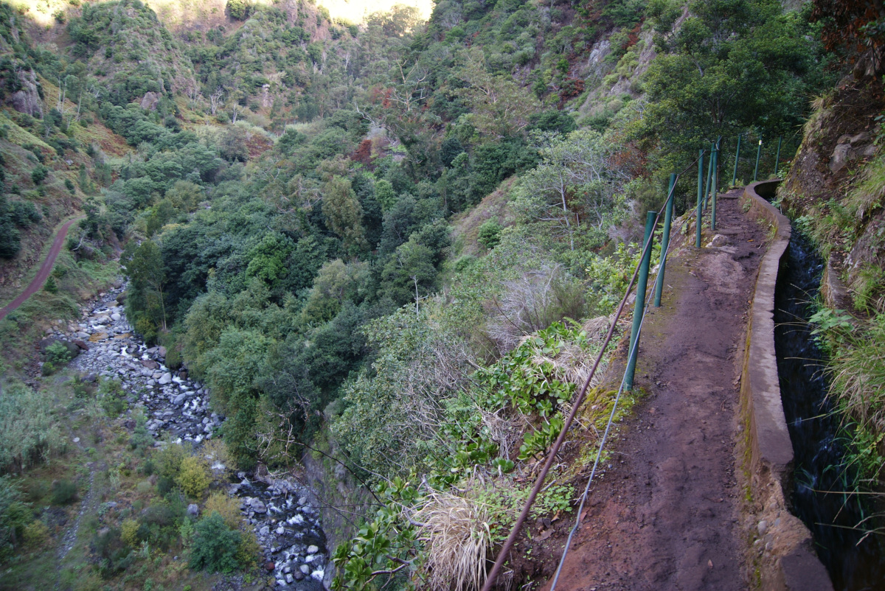

  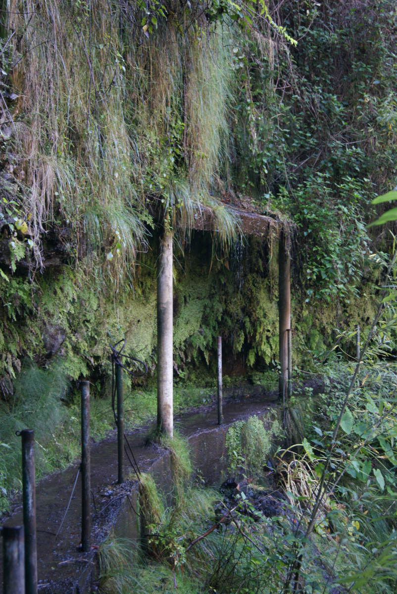
  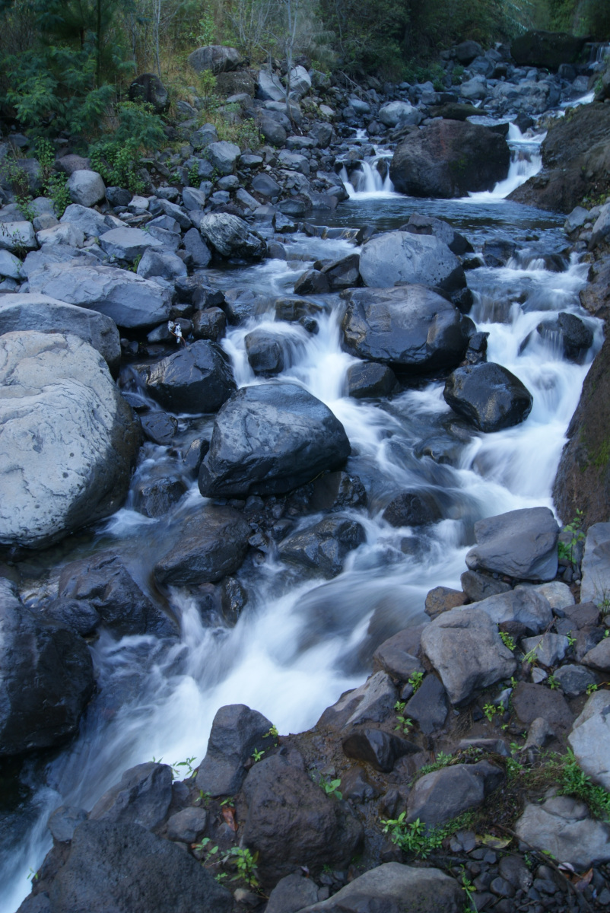

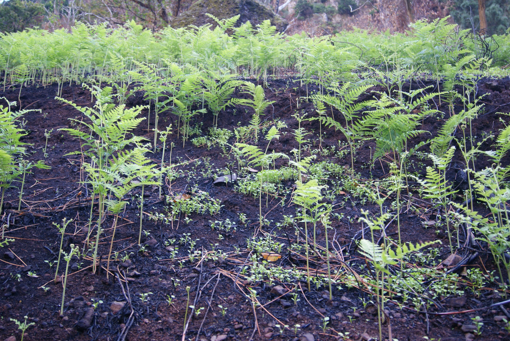

In het begin was het pad heel makkelijk en leidde het naar spectaculaire watervallen, niet zozeer door hun hoogte of
omvang, maar omdat je erachter kan doorlopen. Een waterdichte jas is een echte aanrader, want beide levadas hebben
nattere stukken waar het water boven je hoofd naar beneden drupt. Verderop lag ook een vrij lange tunnel op de route,
maar het licht van een gsm volstond om erdoor te lopen.

Na de tunnel opende het zicht zich op een enorme kloof erachter, en dat was voor mij het engste stuk van alle wandelingen
tijdens ons hele verblijf op Madeira. Ik weet niet meer wanneer ik voor het laatst zo verlamd was van angst,
waarschijnlijk toen ik jaren geleden in Frankrijk aan het klimmen was. Ik heb geen uitgesproken hoogtevrees; vliegen is
niet mijn favoriete bezigheid en paragliden vond ik stresserend, maar toch geniet ik van wandelen in het hooggebergte en
van technische rotsstukken, anders dan mijn man. Dit keer kon ik mezelf er op een bepaald punt echt niet toe brengen nog
een stap te zetten, vlak voorbij de watervallen, waar de mooie zichten op de kloof begonnen.

Het probleem was de ontbrekende leuning. Minstens de helft van het pad heeft geen handgreep, en het pad zelf is gewoon
een 30 cm brede betonnen levada die op een verticale afgrond eindigt. Er is werkelijk niets wat je beschermt, zelfs geen
bomen, dus dit stuk uitlopen bezorgde me heel veel stress. Ik zou het niet opnieuw doen. Ik ben er niet echt van
overtuigd dat de wandeling de moeite waard was. De doorgang achter de waterval is gaaf, maar verder vonden we deze
wandeling nogal middelmatig. Ik zou hem niet aanraden op een regenachtige dag, en ook niet voor kinderen of oudere
mensen. De foto hieronder werd na het problematische stuk genomen; je ziet er een heel mooie leuning, die jammer genoeg
niet het hele blootgestelde deel van de levada bestreek.

  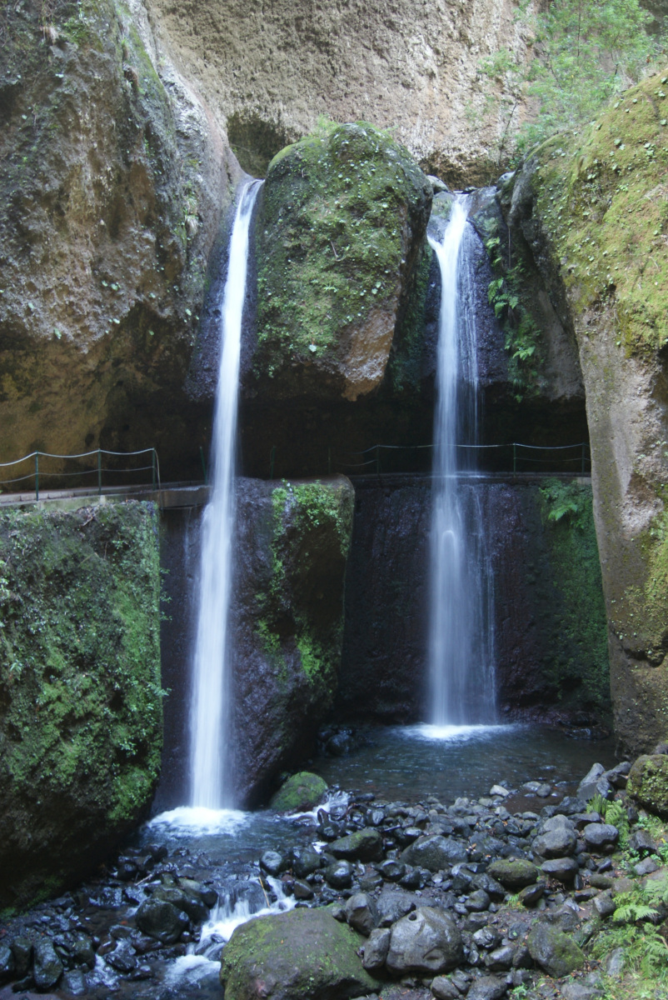
  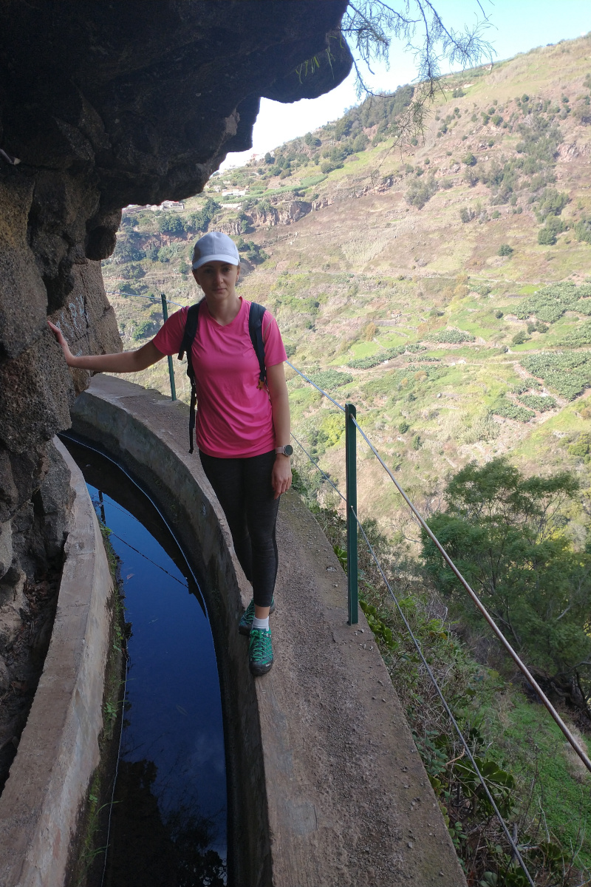

Nu was het tijd om te ontspannen, en onze eerste halte was **Madalena do Mar**, een piepklein stadje dat bekendstaat om
zijn bananenplantages. Er is een heel korte route, de RB3 Vereda da Vargem, ook wel de Bananenroute genoemd, waarmee
bezoekers zich kunnen onderdompelen in de wereld van de bananenteelt. Het was echt gaaf om te ontdekken! Het is zeker een
fijne plek om met kinderen te bezoeken, en het kan helpen om vooraf wat over bananenplanten en hun groeistadia te lezen,
zodat je begrijpt waar je naar kijkt.

Je ziet er bananen die al met blauwe plastic zakken bedekt zijn, klaar om geoogst te worden. Bananen worden gesneden
terwijl ze nog groen zijn en rijpen daarna van de plant af verder. Anderzijds zie je ook piepkleine bananen die net
beginnen te groeien, en veel bananenbloemen met fijne witte stampers die uiteindelijk bananen worden. Ik vond de
bananenbloemen bijzonder spectaculair en mooi! Zorg dat je niet bang bent van hagedissen, want we hoorden er bij elke
stap heel wat wegschieten. Ze waren moeilijk te zien omdat ze zo snel bewogen, maar wanneer we traag probeerden te lopen
en heel stil bleven, konden we er een paar spotten die in de zon lagen.

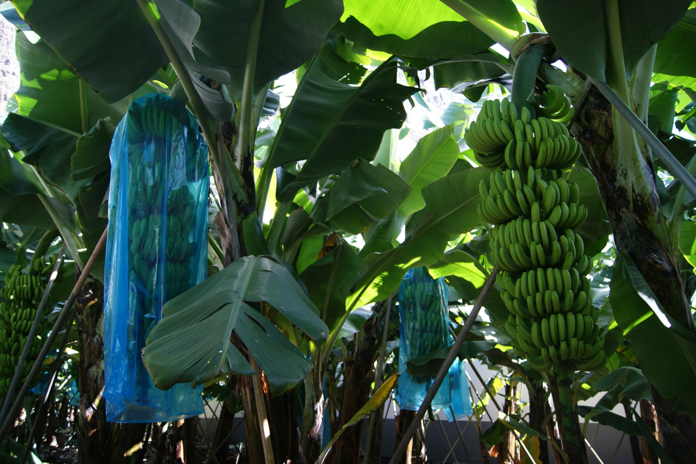
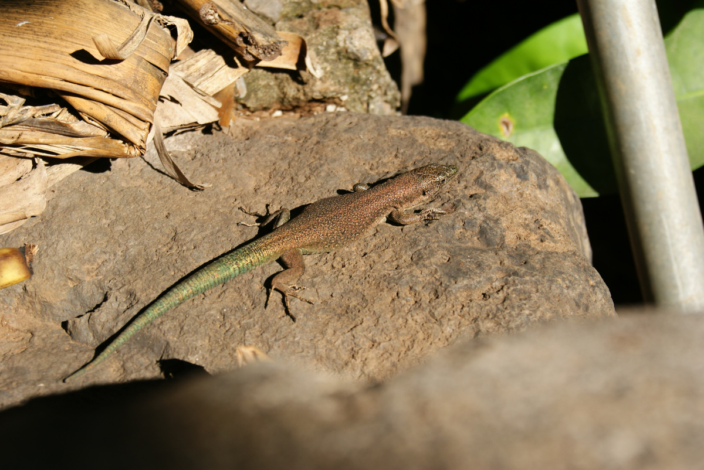

Een bananenplant doet er doorgaans 9 tot 12 maanden over om een bloem te vormen. Nadat de bloem verschijnt, duurt het 3
tot 6 maanden voor de bananen zich ontwikkelen en rijpen. De vrouwelijke bloemen bovenaan de bananenstengel groeien uit
tot bananen en vormen een "tros". Elke tros bestaat uit meerdere "handen" (bosjes bananen), en elke hand telt 10 tot 20
afzonderlijke bananen (vaak "vingers" genoemd). Een volledige tros van een bananenplant op Madeira bestaat doorgaans uit
5 tot 10 handen, wat betekent dat één bloem gemiddeld zo'n 50 tot 150 bananen oplevert. Na één enkele tros geproduceerd te
hebben, sterft de bananenplant af en groeit er een nieuwe plant uit de voet.

  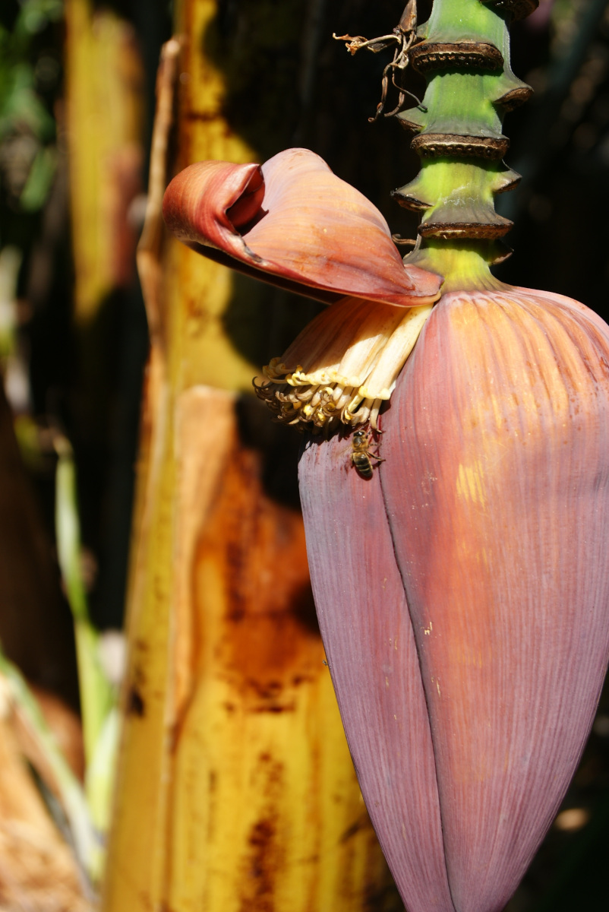
  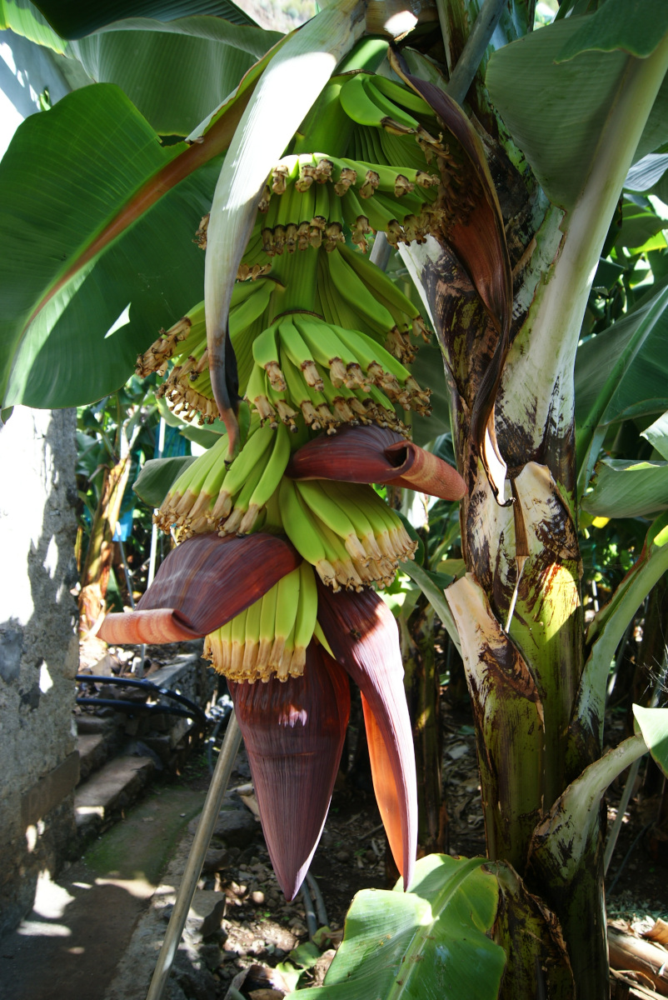

Anders dan de grotere Cavendish-bananen uit de supermarkt zijn de Madeirese bananen (banana da Madeira) kleiner, zoeter
en intenser van smaak. Voor ons hadden deze bananen een andere textuur, meer als pudding en minder melig. Ze worden
grotendeels door kleine boeren geteeld en met de hand geoogst. De meeste Madeirese bananen worden lokaal gegeten of naar
het Portugese vasteland uitgevoerd; wij hadden ze al in Lissabon geproefd.

  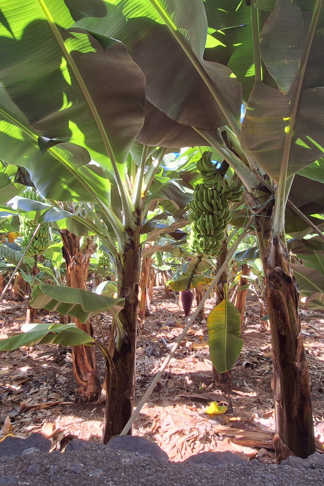
  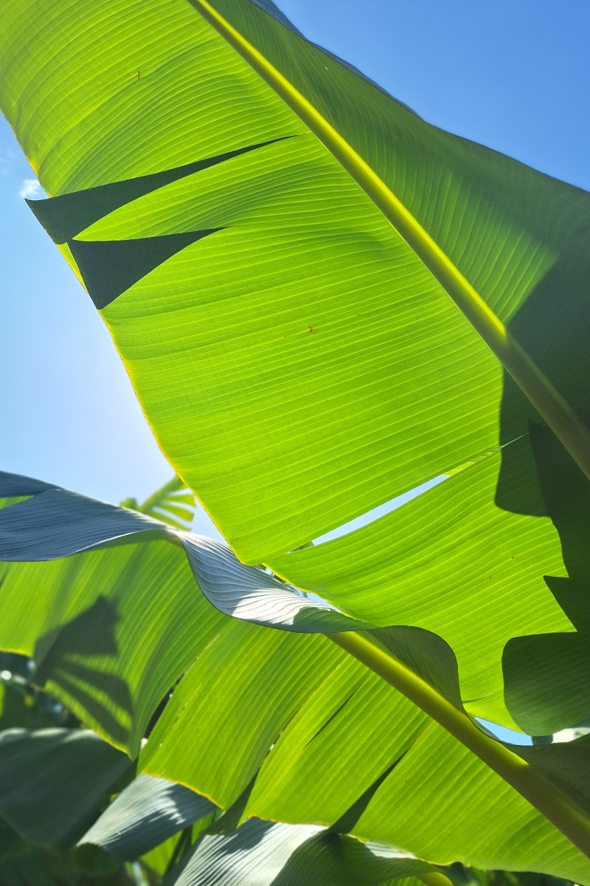

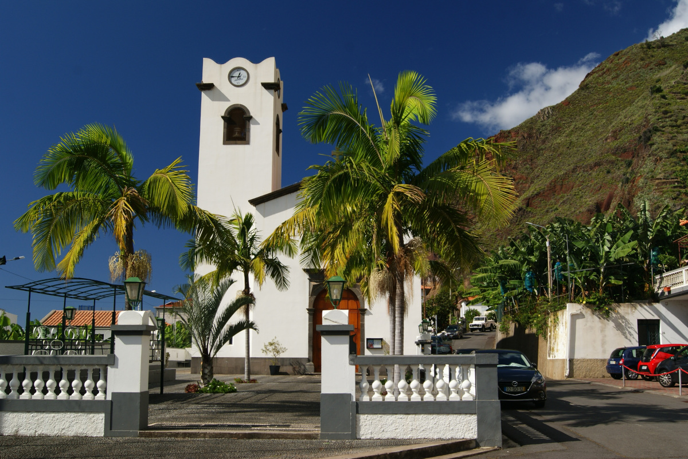

Nu was het tijd om een paar uitkijkpunten aan te doen. Onze eerste halte was de **Miradouro do Massapez**, het enige
uitkijkpunt waar we helemaal alleen waren, omringd door bloeiende aloë vera. Het bood een schitterend uitzicht en was
heel rustig, met een overdekte zithoek en een enorme stenen barbecue als je zelf kolen en eten wil meebrengen. We moesten
een kleine omweg maken om hier te raken, maar de parking was ruim en we genoten enorm van de stop! Veel mensen noemen
deze plek uitstekend om de zonsondergang te bekijken.

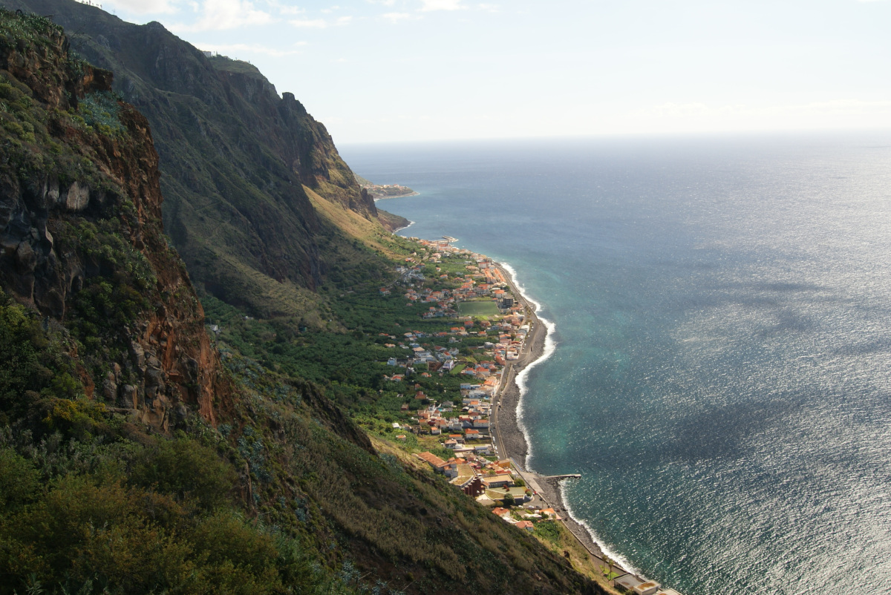
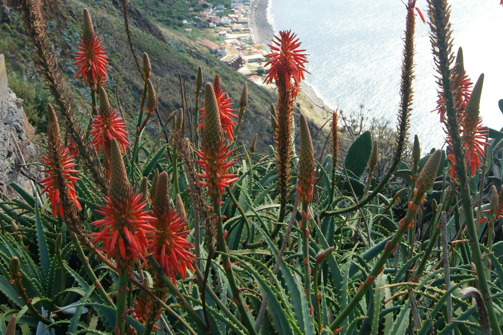

De **Miradouro do Fio**, met zijn gezellig ogende restaurant, was onze volgende halte. De kustlijn lijkt misschien op wat
we vanaf het vorige uitkijkpunt bewonderd hadden, maar dit keer duiken de bergen rechtstreeks de oceaan in. Er lag geen
stad of weg beneden, alleen pure natuur. Van hieruit zie je rechts de nabijgelegen vuurtoren, op Ponta do Pargo, het
westelijkste punt van Madeira, dus laten we daarheen gaan!

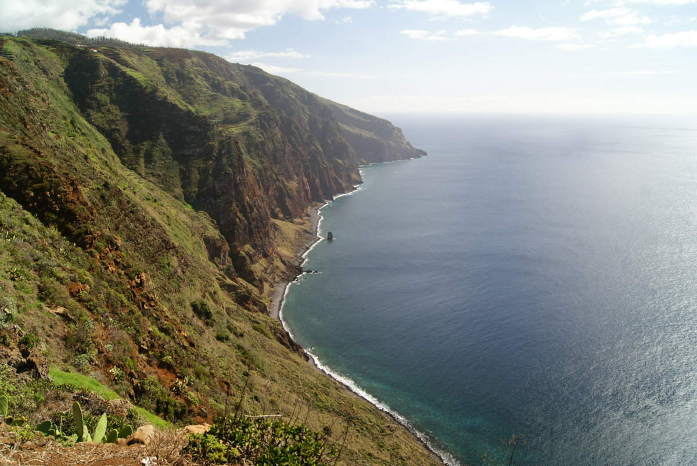

Het voelt alsof de westkust van Madeira minder toeristisch is, want dit was opnieuw een plek met heel weinig bezoekers.
We verkenden de **Miradouro Farol da Ponta do Pargo**, waar de vuurtoren 300 meter hoog staat, door eromheen te wandelen
en het spectaculaire zicht vanaf de klif te bekijken. Je kan een stukje naar beneden, maar wees voorzichtig: er is geen
beveiliging, dus kom niet te dicht bij de rand van de klif. We gingen niet in het museum, want dat was al gesloten. Er
zijn geen bankjes om op te zitten, en na een regendag wordt het hier erg modderig.

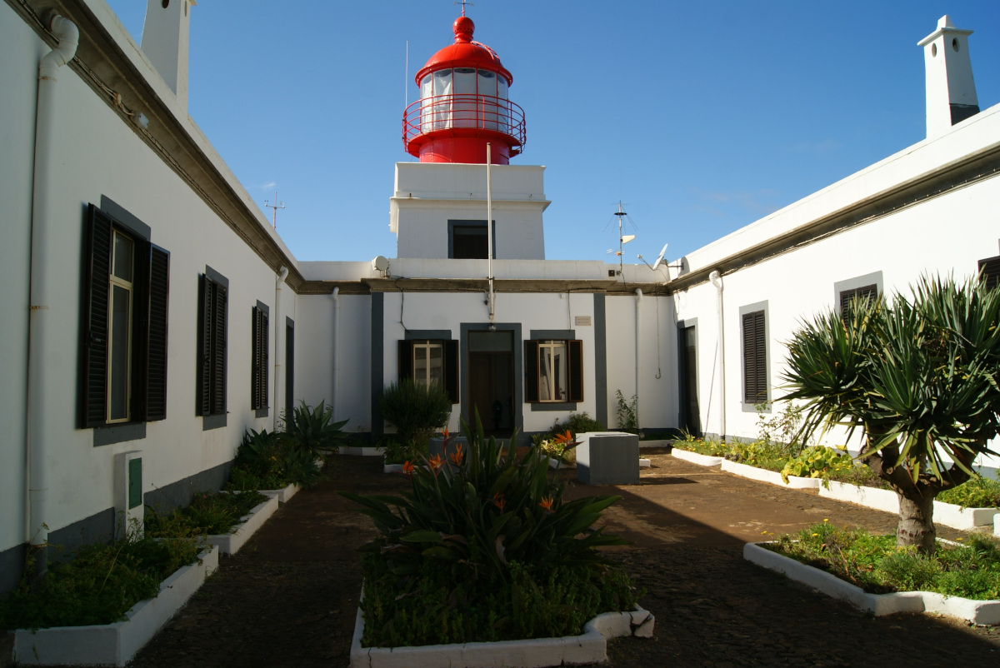
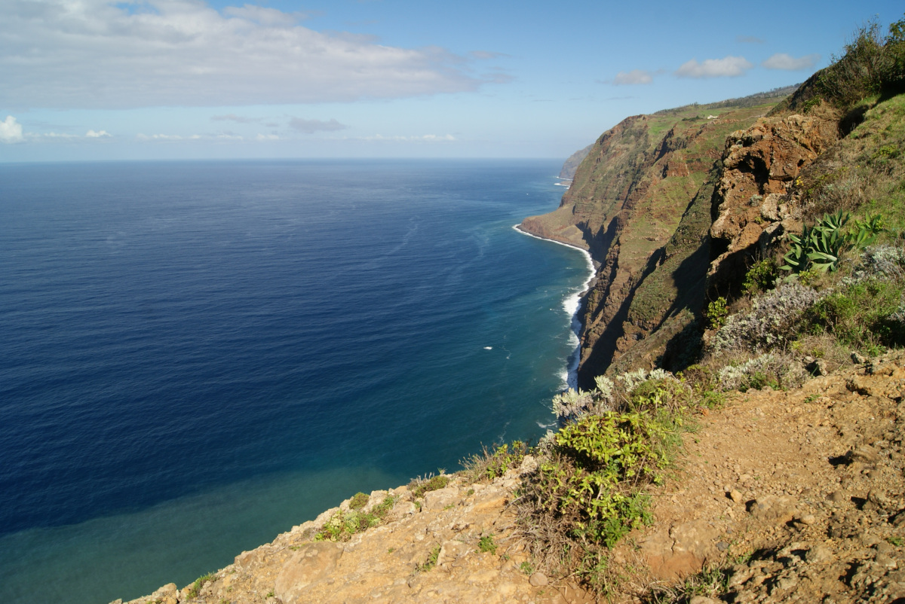

Als het over uitkijkpunten gaat, was de **Miradouro da Boa Morte** zonder twijfel een van de beste. De combinatie van de
blauwe oceaan, de diepgroene begroeiing en rondlopende koeien maakte het heel bijzonder. Het zicht vanaf de parkeerplek
en het pad naar het uitkijkpunt was best ongewoon. Vanaf het platform kan je recht naar beneden kijken en de golven
bewonderen die op de rotsen beuken.
Toen wij er waren, hielden een paar toeristen er een lunchpauze met heel wat versnaperingen, wat een enorm aantal
hagedissen aantrok die hen omringden. Eentje probeerde zelfs langs mijn been omhoog te klimmen toen ik te dichtbij kwam!
Er hangt iets magisch over deze plek: het prachtige groen, het adembenemende kustzicht, de rust en de afwezigheid van
drukte.

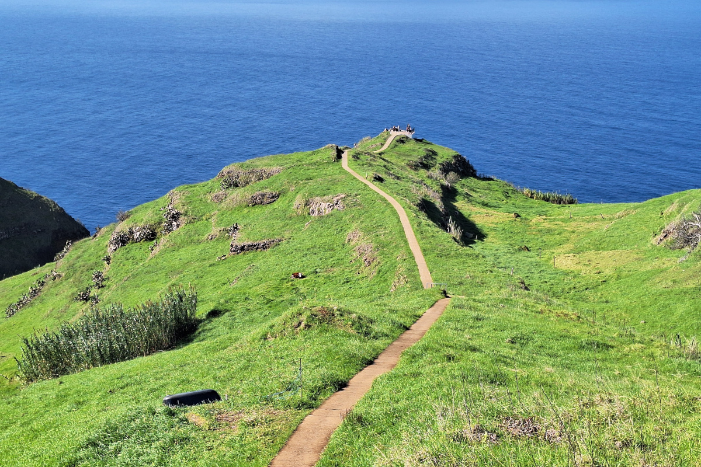
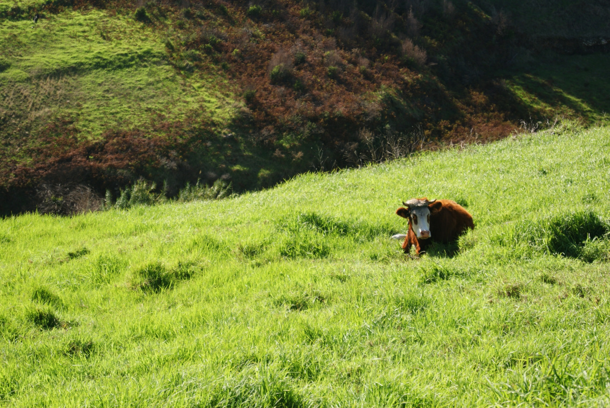
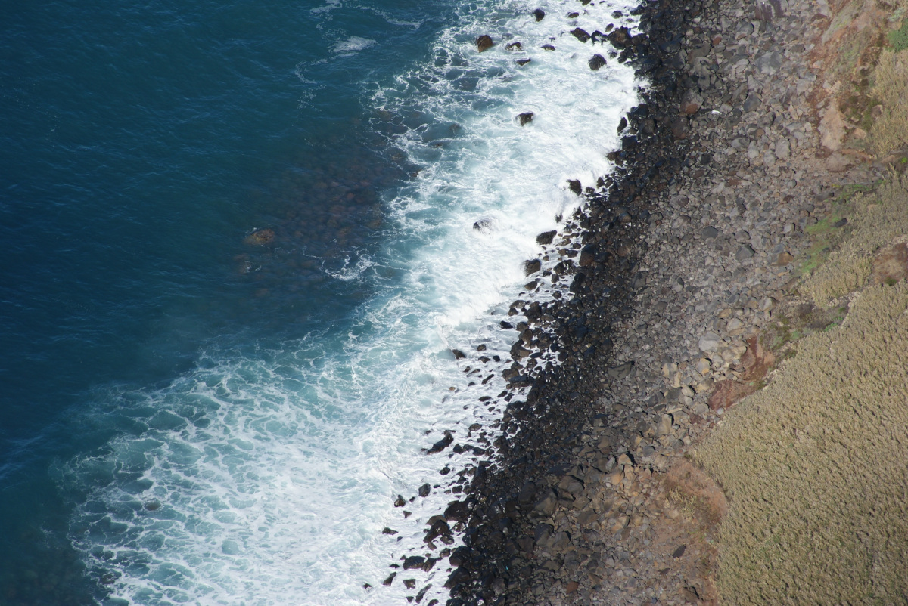

Van hieruit zie je de kustlijn richting Achadas da Cruz, waar je met een kabelbaan kan raken. Aanvankelijk wilden we die
kabelbaan nemen (Miradouro do Teleférico das Achadas da Cruz) en het gebied verkennen, maar na de stress van de
blootgestelde stukken op de Levada Nova was ons enthousiasme daarvoor verdwenen en besloten we het deze keer over te
slaan.
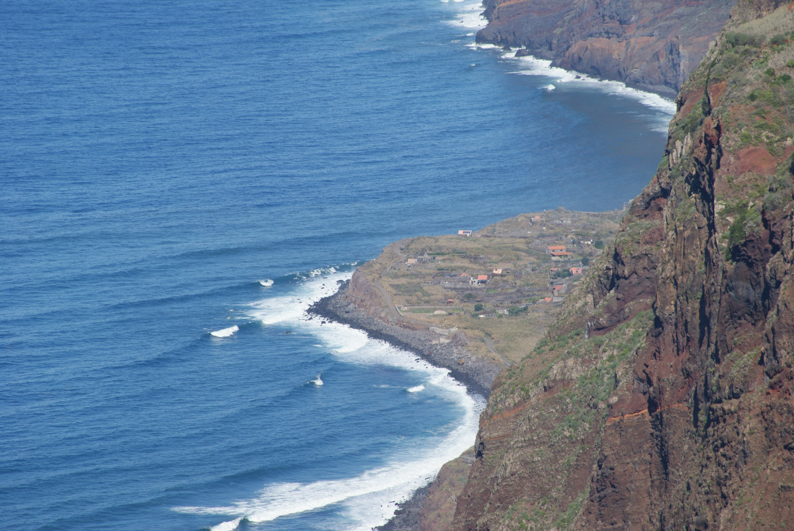

Op weg naar onze laatste halte van de dag aten we in een klein barretje bij Achadas da Cruz en hielden we ook halt om wat
gebak te kopen in een van de dorpjes langs de hoofdweg (meer details in het praktische gedeelte van deze post).
Om een mooi zicht op Porto Moniz te krijgen voor je het stadje binnenrijdt, loont het om even te stoppen bij de
**Miradouro da Santinha**, pal langs de weg; zeker een korte stop waard. Toen we in Porto Moniz aankwamen, merkten we dat
heel wat parkeerzones in verbouwing waren. Daarom parkeerden we wat verderop, zo'n 100 meter van de hoofdparkings.
Gelukkig stond die plek aangeduid in de Organic Maps-app die we altijd gebruiken, dus we vonden ze zonder moeite (adres
onderaan de post).

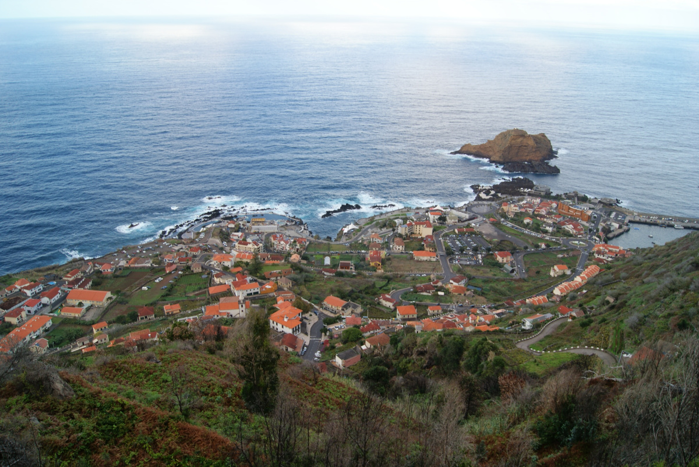

Eerst kwamen we voorbij de natuurlijke zwembaden van Porto Moniz, waar je toegang moet betalen. Er waren minder mensen
dan we verwacht hadden, maar dat kwam wellicht door het late uur en doordat de zon al achter de bergen verdwenen was. De
baden zagen er erg gaaf uit, zeker met de golven die vlakbij op de rotsen beukten, maar we besloten verder te wandelen
naar een natuurlijker plek zonder toegangsgeld. Die natuurlijke baden, gevormd in lavagesteente pal aan de rand van de
oceaan, zagen er heel interessant uit. Zwemschoenen waren wel een goed idee geweest, want de rotsen voelden behoorlijk
scherp aan. Het was er niet druk, en een paar mensen waren nog aan het zwemmen. Wat vooral onze aandacht trok, waren de
plekken waar het water volkomen kalm was en heldere, stille poelen vormde pal naast de wilde oceaangolven.

  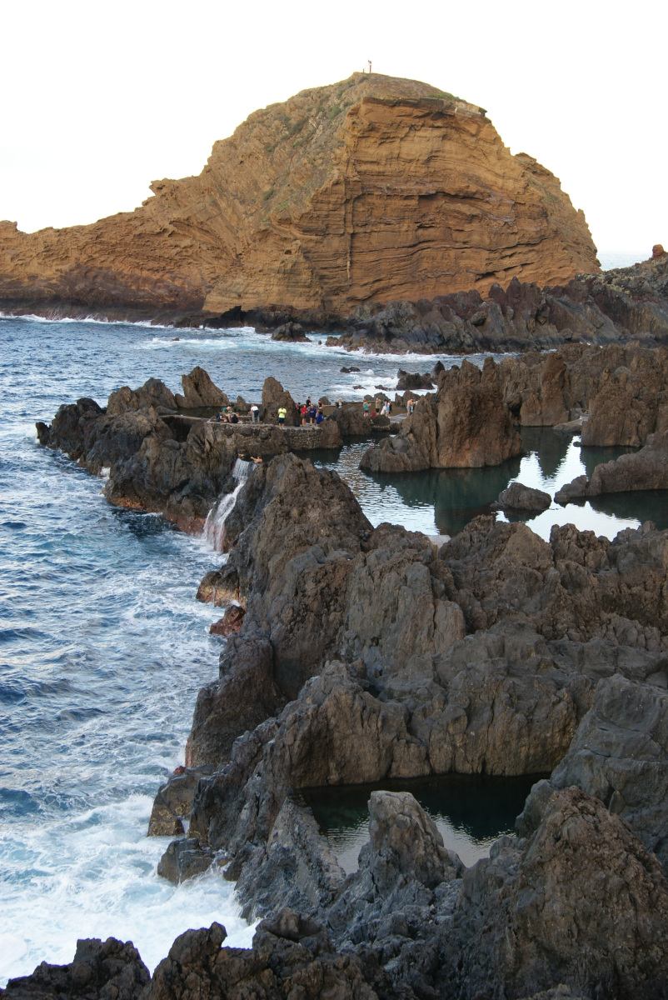
  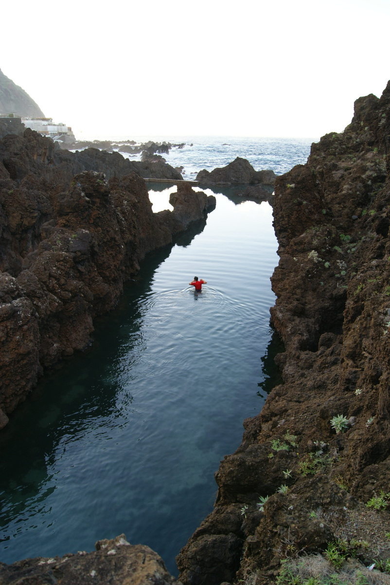

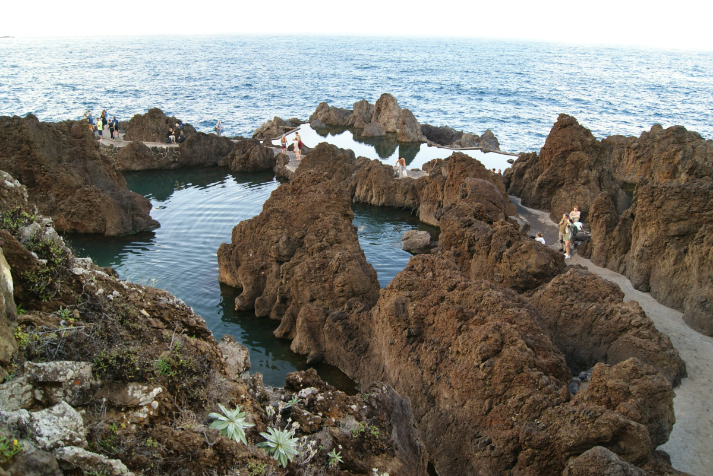

Uiteindelijk besloten we terug te keren en toch het eerste zwembad binnen te gaan, zo niet om te zwemmen, dan toch om
dichter bij de beukende golven te komen en het stadje vanuit een ander perspectief te zien. Het water bleek echter veel
te koud naar mijn zin, en ik raakte maar tot aan mijn middel het water in, dus zwemmen zat er deze keer niet in! Was het
weer zonniger geweest, dan hadden we hier denk ik echt van kunnen genieten, maar jammer genoeg kwamen we te laat aan
(rond 17 uur).

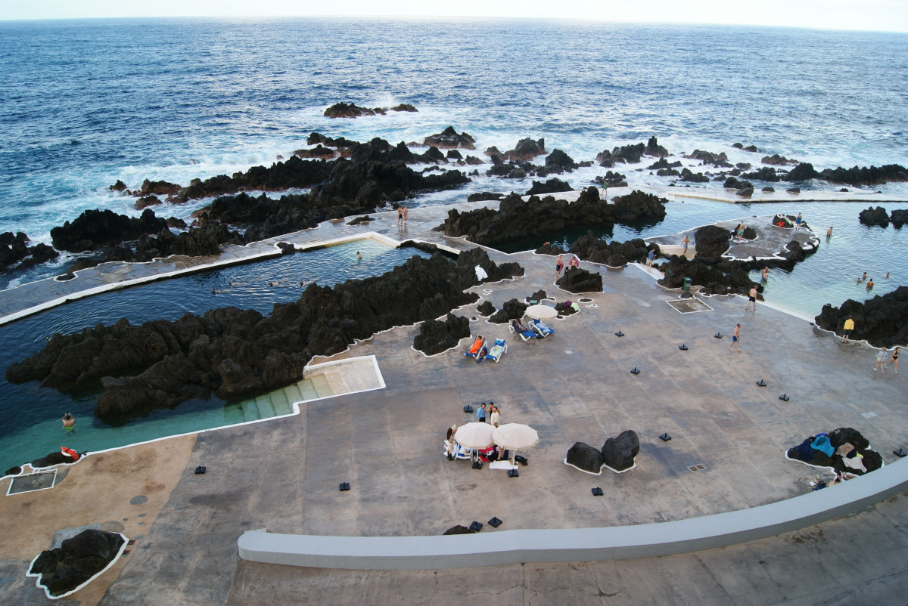
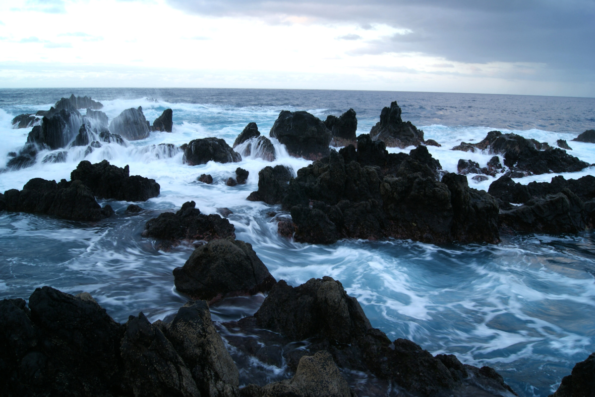
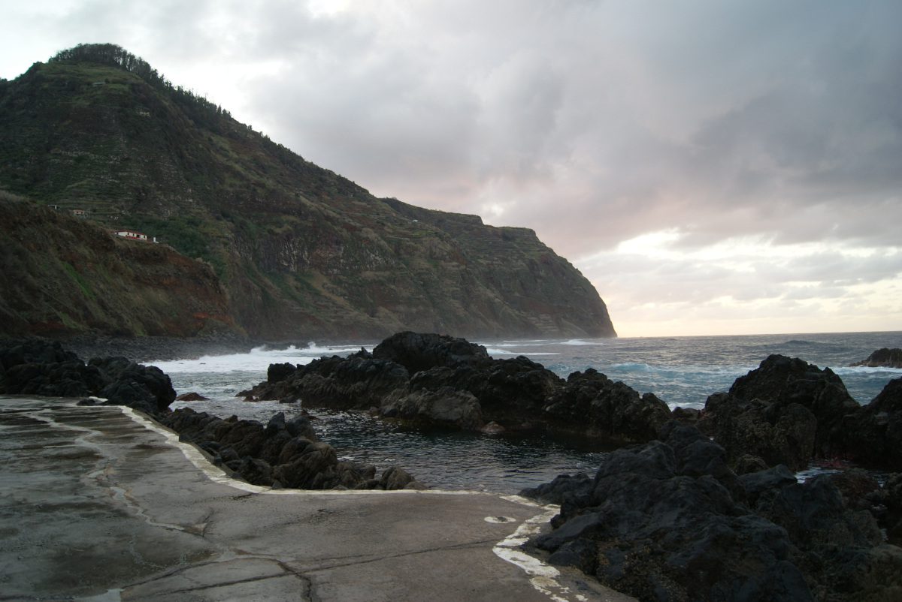

Na een uur rijden waren we terug in Funchal, klaar om ons bed op te zoeken voor we de dag erna de vallei van Curral das
Freiras zouden verkennen.

## Praktische info:

* [Officiële website](https://ifcn.madeira.gov.pt/pt/atividades-de-natureza/percursos-pedestres-recomendados/percursos-pedestres-recomendados.html)
om na te gaan of de wandelpaden open zijn na de bosbranden van afgelopen zomer.

* Tickets voor betalende wandelpaden koop je online [op deze website.](https://simplifica.madeira.gov.pt/services/78-82-259)
Vanaf 1 januari 2025 moeten niet-inwoners betalen om op meer dan 30 routes te wandelen die beheerd worden door het
Instituut voor Bossen en Natuurbehoud (ICNF) op Madeira. Dat zijn in principe alle wandelingen die als PR aangeduid staan.

* Het startpunt voor de wandeling was de kerk Igreja da Lombada in Ponta do Sol, waar we onze auto parkeerden. We deden
zowel de Levada do Moinho als de Levada Nova, als lus van 9 km.
[Ponta do Sol spine run - Levada Nova](https://visitmadeira.com/pt/o-que-fazer/exploradores-da-natureza/atividades/trail-running/lombada-da-ponta-do-sol/)

* Tijdens onze reizen gebruiken we altijd [Organic Maps: Offline Hike, Bike, Trails, and Navigation](https://organicmaps.app/),
dat op Madeira erg accuraat was; we zijn geen enkele keer verdwaald.

* RB3 Vereda da Vargem, de zogenaamde Bananenroute, heel kort en perfect voor een wandeling met kleine kinderen.
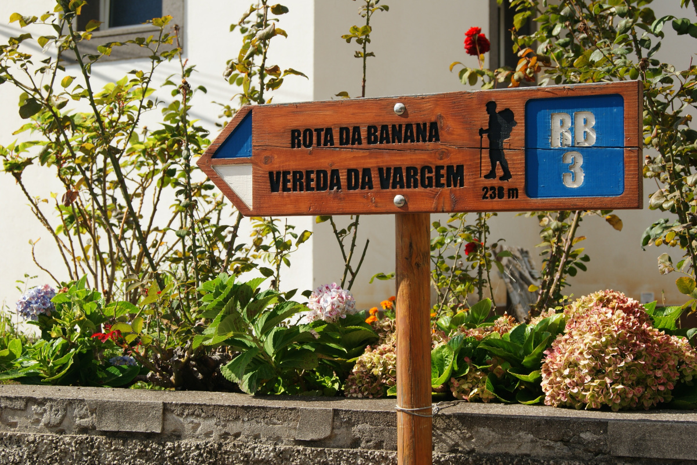

* Restaurant 101 Bar. Heel vriendelijke eigenaar. We vonden het broodje rundvlees lekker, maar het tweede gerecht viel
tegen (een soort vleesstoofpot); ik moest de helft van het vlees laten staan, want het was taai en voelde als heel lage
kwaliteit. Erg goedkoop, maar nergens stonden prijzen vermeld. We betaalden minder dan 20 euro voor ons tweeën, inclusief
twee hoofdgerechten en drankjes.
Adres: ER101, Sitio da Igreja, ER101 39, 9270-013 Achadas da Cruz, Portugal
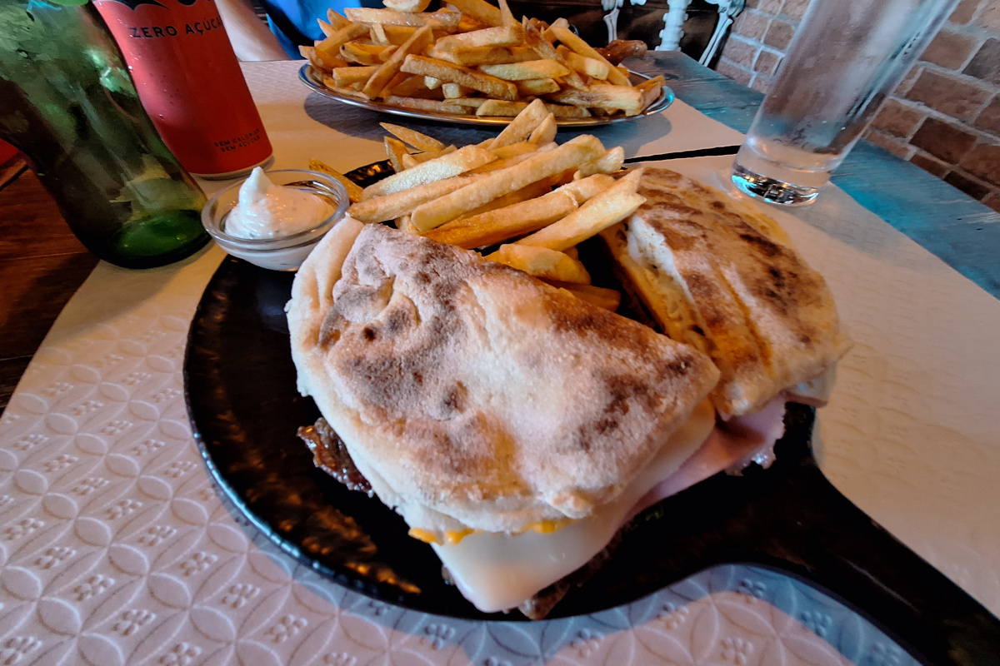
* Bakkerij Padaria Rodripan. Een heel kleine bakkerij bij iemand thuis. Erg lekker en goedkoop, met een paar soorten
gebak en brood, waaronder een zacht, zoet brood dat we voor onze wandeling de dag erna kochten. Een echte aanrader, maar
verwacht een heel eenvoudige zithoek met simpele plastic stoelen.
Adres: Rua da Terra Coimeira, Santa, 9270-093, Porto Moniz, Portugal
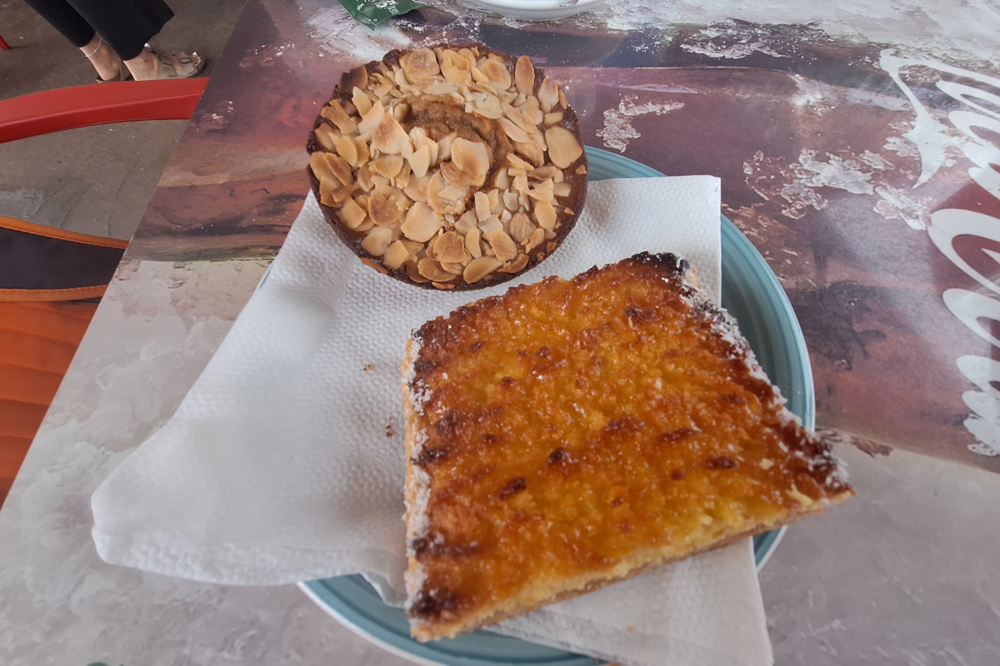
* Parking Porto Moniz: gratis parkeren op een grasveld, maar wat verstopt. Op 5 minuten wandelen van de zwembaden, al
weet ik niet hoelang het gratis zal blijven, want alle andere parkings waren intussen betalend. We zagen ook een groot
informatiebord bij de werf van een nieuwe parking dichter bij de zwembaden.
Adres: R. da Escola Velha 32, 9270-095 Porto Moniz, Portugal
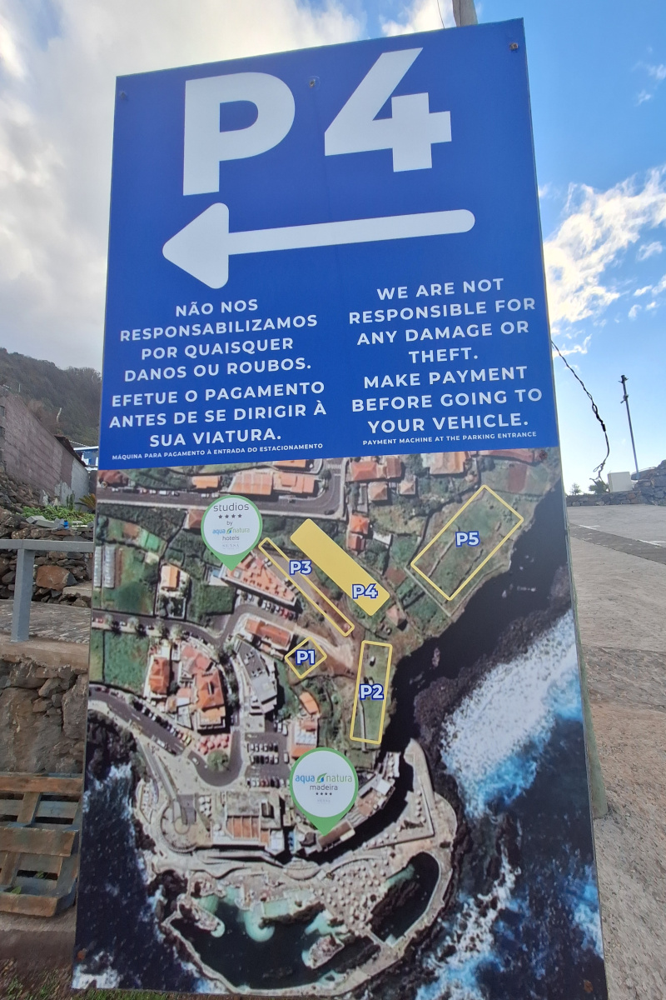
* [Natuurlijke zwembaden](https://www.portomoniz.pt/pt/) – €3 toegang. Fijne zwembaden, maar het water was erg koud! De
zon gaat er vroeg onder door de bergen, dus we kwamen te laat om echt van de zon te genieten en bleven niet lang.
