We reizen altijd tijdens de zomermaanden, wanneer de school gesloten is, maar na de hitte van vorig jaar in Spanje waren
we vastbesloten een koelere bestemming te vinden. Denemarken bleek de perfecte keuze: zacht weer, prachtige landschappen
en een ontspannen levensritme. We brachten in de tweede helft van augustus 10 volle dagen in Denemarken door, een
heerlijke manier om op te laden voor het nieuwe schooljaar. Het weer was precies zoals we gehoopt hadden: 18 tot 24 °C,
af en toe wat winderig, en maar een paar korte buien. Perfecte omstandigheden voor een roadtrip met het gezin!

## Onze route en algemene indrukken

Bij het plannen van de reis duidde ik ambitieus plekken over het hele land aan, maar ik besefte al snel dat het onmogelijk
zou zijn alles te zien. Uiteindelijk stippelden we een lus van 1.500 km uit, waarbij we vier van de vijf Deense regio's
bezochten: Sjælland (Seeland), Syddanmark (Zuid-Denemarken), Midtjylland (Midden-Jutland) en Hovedstaden (de
hoofdstedelijke regio). De enige die we oversloegen was Nordjylland (Noord-Jutland). Een slimme manier om de rijafstanden
in te korten was de veerboot tussen Jutland en Seeland te nemen. Dat bespaarde ons tijd, bracht afwisseling in de reis en
liet ons toe vanaf de westkant van het land naar Kopenhagen terug te keren zonder dezelfde route te herhalen. Bekijk de
details van onze route op de Google-kaart hieronder:

<iframe src="https://www.google.com/maps/d/u/0/embed?mid=1uhRyL-m2vsOMMu-yupzHgsqT_QSu0IM&ehbc=2E312F" width="100%" height="480" style="display: block; margin: 0 auto;"></iframe>

Reizen met een vierjarige vroeg om flexibiliteit en we moesten onze plannen vaak bijstellen, maar Denemarken bleek een van de meest
gezinsvriendelijke landen die we ooit bezochten. Er waren ontelbare openbare toiletten en fantastische speeltuinen, vaak
op mooie plekken en omringd door natuur, een echte zegen voor wie met kleine kinderen reist!
Qua architectuur had ik kleine, kleurrijke houten huisjes verwacht zoals in IJsland, maar de meeste woningen leken op die
in Duitsland: eenvoudig, netjes en modern. We vonden wel een paar charmante historische plekjes, zoals Sønderho en Ribe,
waar oude houten huizen een decor vormen dat zo van een postkaart lijkt te komen.

## Rondreizen – tips over vervoer

We huurden een auto bij **Sixt**. We haalden hem af op de luchthaven van Kopenhagen en brachten hem daar ook terug. Dat verliep over het algemeen
vlot, al hadden we twee kleine problemen:
De vooraf betaalde pas voor de Storebæltbrug werkte niet, en we moesten aan de slagboom opnieuw met een kredietkaart
betalen. Sixt betaalde het bedrag later terug, maar ik moest er meerdere e-mails voor sturen. Ze legden ook nooit uit
waarom dit gebeurde. Ze zouden geen brugtickets moeten aanbieden als die dienst niet naar behoren werkt.
Bij het inleveren waren alle voorbehouden Sixt-plaatsen bezet, en we moesten wachten tot een medewerker een auto
verplaatste voor we konden parkeren, waardoor we zenuwachtig werden of we wel op tijd op de luchthaven zouden zijn. Let
wel, we leverden de auto net voor de opening van het kantoor in, en dit probleem doet zich waarschijnlijk niet voor als je
de auto na 6 uur inlevert, wanneer het kantoor open is en er personeel aanwezig is.
Ondanks die momenten was de huurervaring positief. Onze Opel Corsa was proper, aangenaam om mee te rijden en perfect voor
de Deense wegen. Om bij het verhuurkantoor te raken neem je de gratis pendelbus vanaf de luchthaven (voor het Clarion
Hotel, om de 20 minuten); de rit duurt ongeveer 10 minuten.

Rijden in Denemarken was een plezier, met rustige chauffeurs, mooie wegen en goede infrastructuur.
De koplampen moeten altijd aan, ook overdag. Het enige verschil dat me opviel, was de regel om in te voegen op de
snelweg. Het verraste me dat er geen stippellijn was die het einde van het invoegvak aangaf, dat vaak veel korter was
dan in België. Blijkbaar horen zowel de bestuurders op de oprit als die op de hoofdrijbaan hun snelheid aan te passen om
vlot invoegen mogelijk te maken, en dat gebeurde ook echt. Auto's veranderden meteen van rijstrook of vertraagden, zodat
we altijd de snelweg op konden zonder te moeten stoppen.
Gangbare snelheidsbeperkingen zijn:
50 km/u in de bebouwde kom, 80 km/u buiten de bebouwde kom, 110 tot 130 km/u op de snelweg

**Tol en veerboten**:
 - [Storebæltbrug](https://storebaelt.dk/en/prices-and-discounts/private/): 230 DKK (31 €)
 - [Veerboot naar het eiland Fanø](https://www.fanoelinjen.dk/): 299 DKK (40 €)
 - [Veerboot Aarhus–Seeland](https://www.molslinjen.com/): 560 DKK (75 €, boek vroeg, de prijzen stijgen snel!). De zone
met de groene omlijning op de foto hieronder geeft aan waar je zonder reservatie kan gaan zitten; alles vooraan op de
veerboot is ofwel businessclass, ofwel restaurants of winkels.

  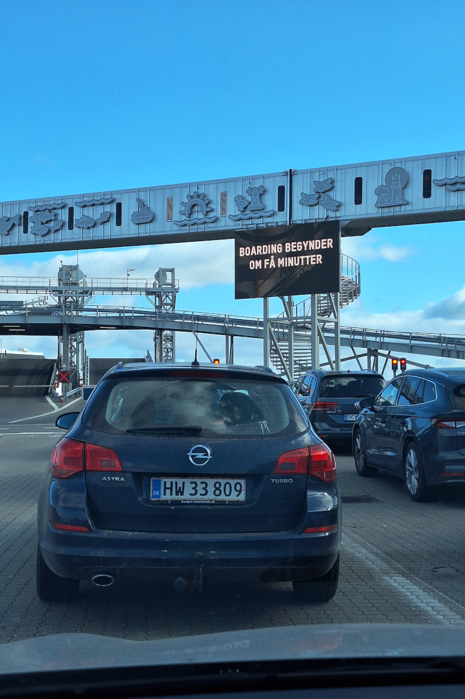
  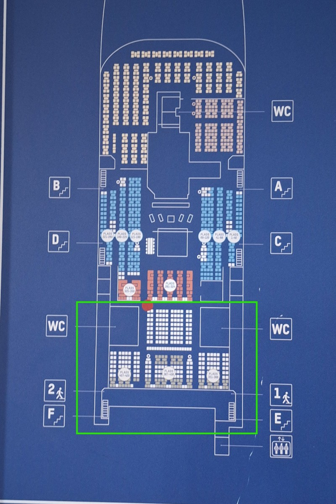

**Parkeren**: buiten de steden meestal gratis, maar reken op kosten bij de grote bezienswaardigheden. Op de foto
hieronder (links) zie je een bord dat 2 uur gratis parkeren toelaat; langer parkeren mag niet in die zone, ook al zou je
voor extra tijd willen betalen.
Tip: bekijk recente recensies op Google Maps voor parkeren, want de prijzen verschillen sterk. **Brandstofprijzen** lagen
tussen 13,39 en 13,89 DKK per liter (1,8 €/l), met Ribe als goedkoopste streek.
 - Møns Klint: 45 DKK/dag (6 €)
 - Stevns Klint: 50 DKK/dag (6,7 €). Heel beperkt gratis parkeren in het dorpje ernaast. Wij waren er op het einde van de
dag, toen het leeg was, dus we parkeerden in een van de zijstraten.
 - Aarhus: 24 DKK/uur (3,2 €); andere steden ongeveer 7 DKK/uur (0,9 €)

  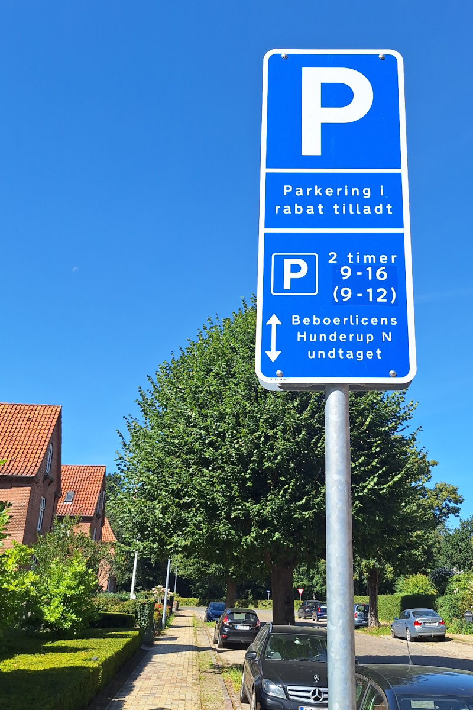
  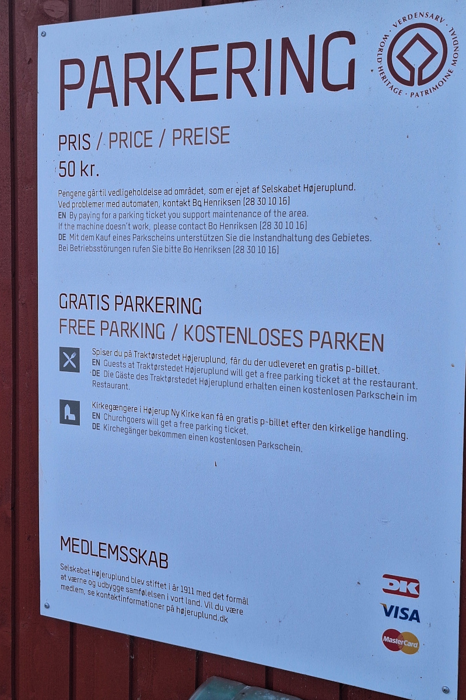

## Kopenhagen bezoeken met de trein

De lokale bevolking raadde ons af om met de auto Kopenhagen in te rijden, door de parkeerkosten (16 tot 44 DKK/uur, 2 tot
6 €/uur); bekijk [hier](https://international.kk.dk/live/transport-and-parking/parking-in-copenhagen/public-parking-in-copenhagen)
meer details. In de plaats daarvan parkeerden we gratis aan het station van Køge en namen we de trein. Tickets kunnen duur
zijn (een gewoon ticket kost zo'n 60 à 70 DKK enkele reis, 9 €), maar de [DSB Orange-tickets](https://www.dsb.dk/en/tickets-and-services/orange/)
zijn een prima kortingsoptie (20 tot 28 DKK per persoon, 3 tot 4 €), al zijn ze enkel voor bepaalde tijdsloten
beschikbaar. De treinrit duurt ongeveer 40 minuten, maar je kan aan meerdere stations in het hart van de stad afstappen
zonder tijd te verliezen met het zoeken naar een parkeerplaats. Wij kochten onze tickets een week op voorhand.

  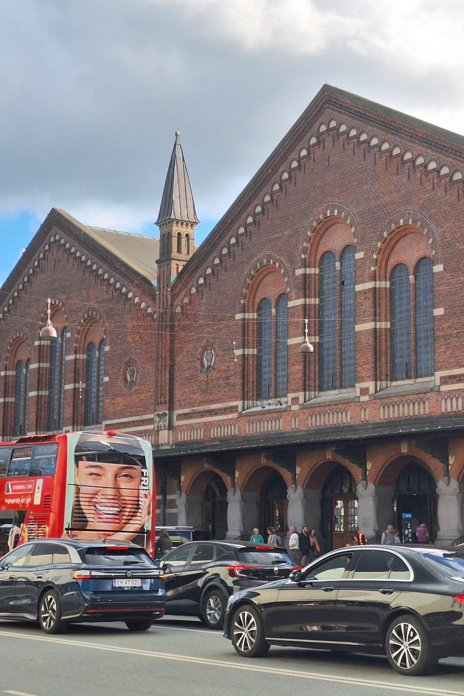
  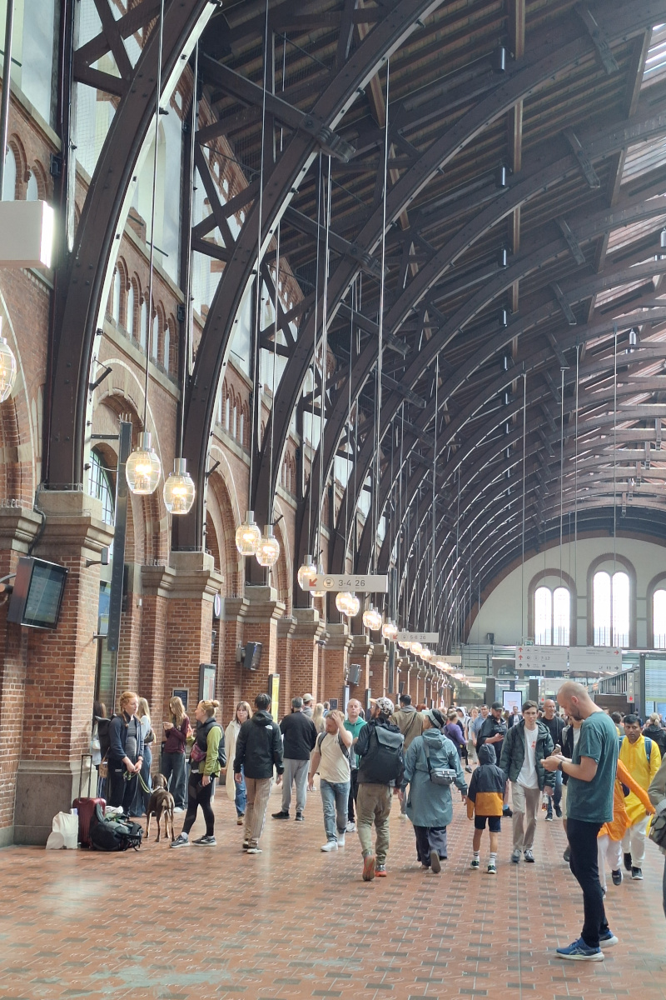

## Accommodatie

We verbleven in Airbnb-appartementen door het hele land, bijna altijd volledige appartementen, meestal buiten de steden
waar de prijzen lager lagen en het makkelijker was om met de auto te parkeren. Kopenhagen was duur, dus we kozen ervoor
om twee keer in de buurt van Køge te logeren, een perfecte uitvalsbasis voor daguitstappen naar de hoofdstad. De meeste
appartementen lieten ons via een sleutelkluis zelf inchecken, en op verschillende plaatsen verwelkomden de verhuurders ons
persoonlijk en gaven ze ons nuttige lokale tips.
 - Gemiddelde kostprijs: €110 per nacht
 - Minstens 4 à 6 maanden op voorhand boeken is ideaal voor goede deals
 - Gemiddelde beoordeling: 4,9+

De Airbnb-adressen die we met plezier aanraden:
 - [Strøby Egede](https://www.airbnb.com/rooms/1462929987769134361?source_impression_id=p3_1761981518_P3DhBjuwKo27NTWq)
 - [Vejle](https://www.airbnb.com/rooms/53997686?source_impression_id=p3_1761981599_P3eOLQWcL95MEcg3)
 - [Gemeente Aarhus - Sabro](https://www.airbnb.com/rooms/11245647?source_impression_id=p3_1761981691_P3WVhqP86RQ02twv)

## Eten & uit eten gaan

Uit eten gaan in Denemarken is duur; reken op €30 à €40 per persoon voor een maaltijd met een drankje in een goedkoop
restaurant. Zelfs eenvoudig streetfood zoals fish-and-chips kost 100 tot 140 DKK (13 tot 19 €). Daarom kookten we meestal
in onze appartementen, die allemaal uitstekende keukens met een oven hadden. Supermarkten zoals Lidl en Rema 1000
waren onze favorieten qua prijs en aanbod. We moesten in kleine hoeveelheden inkopen doen, want we verhuisden vaak
en wilden geen eten in de auto laten liggen.

Voorbeeldprijzen:
 - IJs: vanaf 50 DKK per bolletje (6,7 €)
 - Zoet gebak: 40 tot 50 DKK (5,4 tot 6,7 €)
Hoogtepunt in een lokaal restaurant: verse vis of een stevige Deense burger met frietjes en huisgemaakte jus, heerlijk!

## Budgetoverzicht (voor 10 dagen, 2 volwassenen en een vierjarig kind)

| Categorie | Totale kost (€) |
|-----------|----------------:|
| Vluchten |             423 |
| Vervoer (auto, brandstof, veerboten, tol, parkeren, trein) |           1.123 |
| Accommodatie |           1.120 |
| Restaurants |             186 |
| Boodschappen |             204 |
| Activiteiten |              80 |
| **Totaal** |       **3.136** |

## Onze ervaring met reizen met een kind

Wij vinden dit tot nog toe het meest kindvriendelijke land dat we bezocht hebben. De speeltuinen waren fantastisch en we
hebben er als gezin enorm veel plezier aan beleefd. Heel vaak liggen de speeltuinen in bossen, omringd door prachtige
natuur, en staan er ook veel houten dierenbeelden. Alle speeltuinen waren goed onderhouden en grotendeels van hout
gemaakt, zodat ze natuurlijk in de omgeving pasten in plaats van die te verstoren. Bij de Skovlegeplads-speeltuin op het
eiland Fanø stonden zelfs kleine houten karretjes waarin je je kinderen de laatste paar honderd meter dieper het bos in
kon vervoeren.

  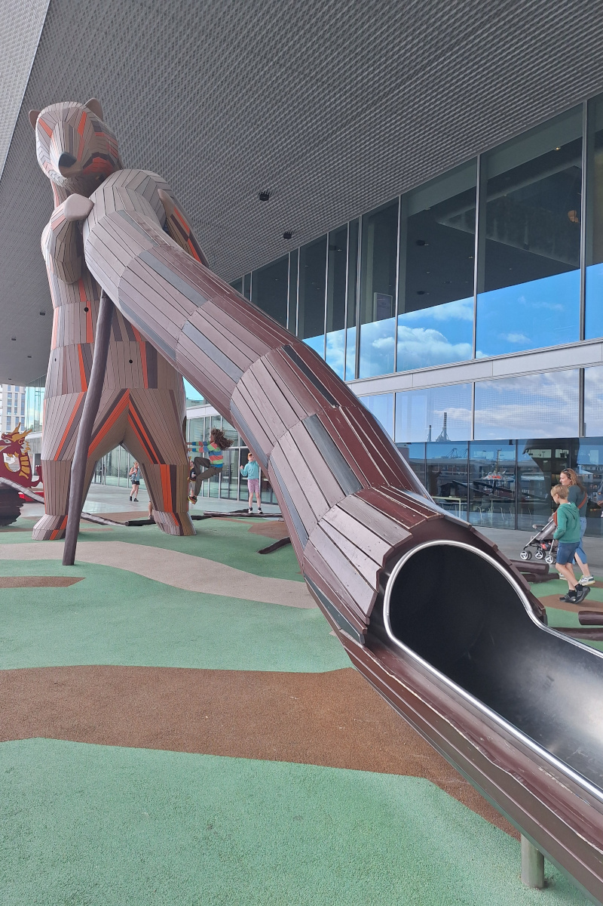
  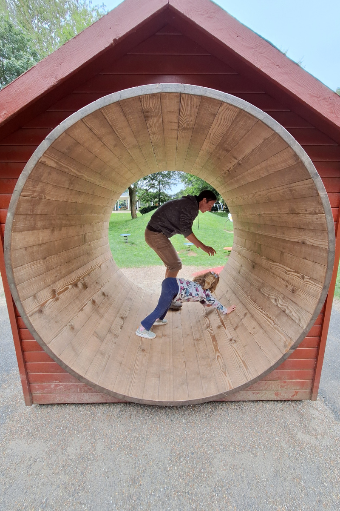

  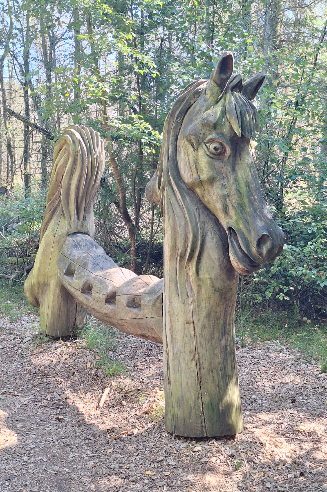
  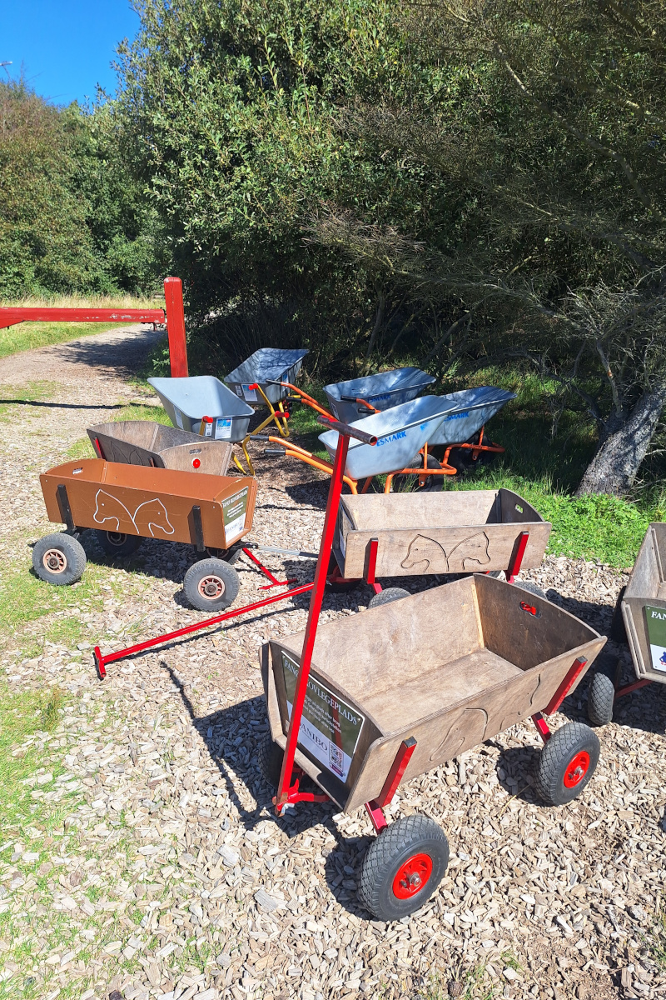

We bezochten ook verschillende gezinsgerichte attracties, waaronder een **vikingmuseum** met historisch correcte
smeeddemonstraties (het loont om na te gaan welk museum tijdens je verblijf een speciaal evenement heeft, want er zijn
zoveel vikingmusea om uit te kiezen) en het prachtige **slot Frederiksborg**, waar kinderen aan een soort schattenjacht
kunnen meedoen. Het was een perfect evenwicht tussen cultuur en speeltijd. Er waren ook maritieme musea,
wetenschapsmusea en een zandsculpturenfestival, maar dat was te veel voor ons verblijf, want ons programma zat al erg vol.

Andere hoogtepunten voor het gezin:
- Bijna overal gratis openbare toiletten (aan de ingang van stranden, naast parkings, toiletautomaten in de steden)
- Fijne speeltuinen, zelfs bij tankstations
- Vijf van de zes appartementen hadden speelgoed klaarstaan voor onze dochter, zo'n attente geste die onze avonden en
ochtenden redde. Omdat onze dochter overdag in de auto sliep tijdens het rijden, wat ons enorm hielp, betaalden we
daarvoor wel een prijs: ze ging 's avonds laat slapen. Het gebeurt echt niet vaak dat er speelgoed in de appartementen
ligt wanneer we in andere landen reizen.

Houden je kinderen van sprookjesachtige avonturen, ga dan op zoek naar de **houten trollen van Thomas Dambo** (er staan
er zo'n 60 à 70 verspreid over Denemarken, zie de [Trollenkaart](https://trollmap.com/#/ene) voor meer details). Onze
dochter schrok van de eerste (Trol nr. 81, foto links hieronder), maar voor oudere kinderen is het een leuke activiteit!
De tweede trol hieronder is die in de befaamde wijk Christianshavn, Green George genoemd.

  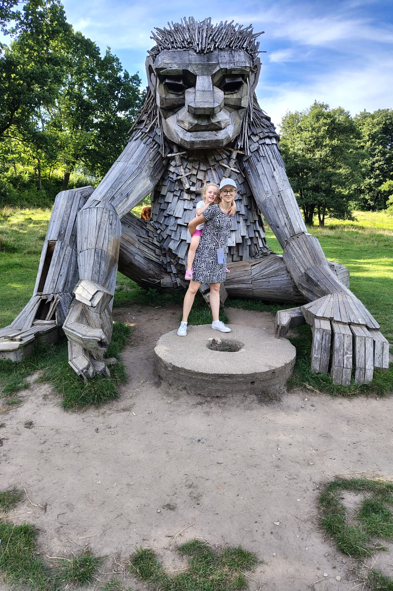
  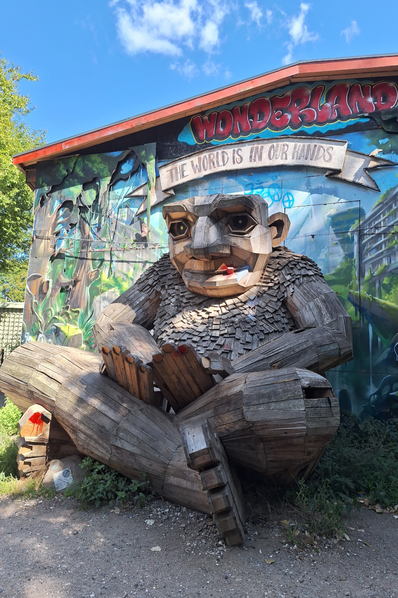

## Praktische opmerkingen en enkele verrassingen

 - Het was niet makkelijk om uit te vissen wat de producten in de supermarkt precies waren; we moesten de etiketten met
onze telefoon vertalen, want de taal verschilde te veel van de talen die we kennen.
 - Onze virtuele Revolut-kaart werkte zowat overal, behalve bij Spar en Netto (daar gebruikten we een kredietkaart).
 - Op flessen en blikjes geldt statiegeld ("pant"), en het tegoed moet je in dezelfde winkel gebruiken (het lukt
niet in een andere winkel van dezelfde keten).
 - Tijdens het hele verblijf zag ik maar één keer een Deense munt, toen mijn man er een in het park vond. Het voelde erg
vreemd om 10 dagen te reizen zonder ook maar één keer cash te gebruiken.

## Slotgedachten en aanbevelingen

We zouden Denemarken zeker opnieuw bezoeken, maar de volgende keer zouden we er misschien ook fietsen (zeker op eilanden zoals
Fanø, dat met zijn 14 km lengte perfect is om te fietsen). Dit land is ideaal voor gezinnen, oudere reizigers en iedereen
die rust zoekt in plaats van nachtleven. Het is er zelfs in de zomer minder druk dan in Spanje of Italië, en toch vol
charme. We raden aan een verrekijker mee te nemen om zeehonden en andere wilde dieren waar te nemen. Onze onvergetelijke
momenten waren:

- Bloeiende heide op het eiland **Fanø**
- Wilde herten zien in het park **Dyrehaven**
- Schattige houten huisjes in **Sønderho** en **Ribe**
- Mooie ritten langs de kust bij **Gilleleje**, een vissersstadje
- De schitterende **krijtrotsen van Møns Klint**

Elk van deze momenten krijgt binnenkort zijn eigen uitgebreide post, dus lees zeker verder!
