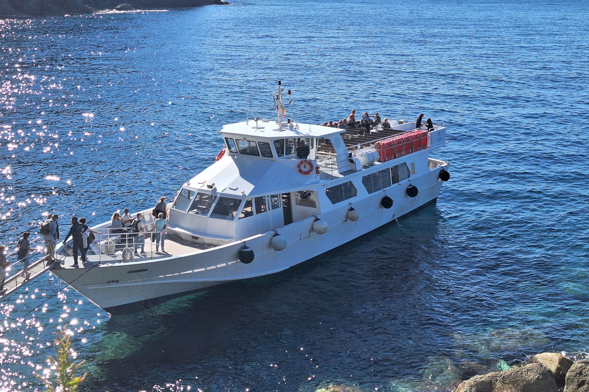
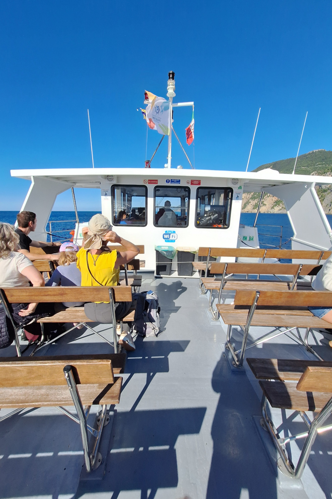
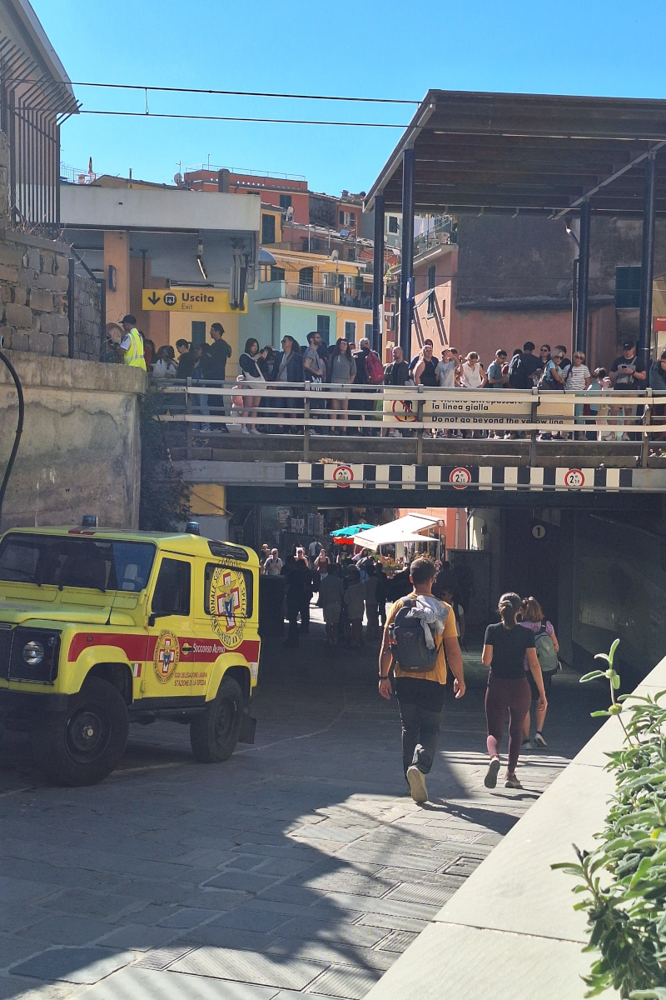
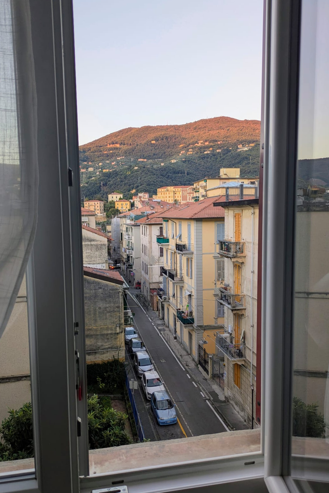
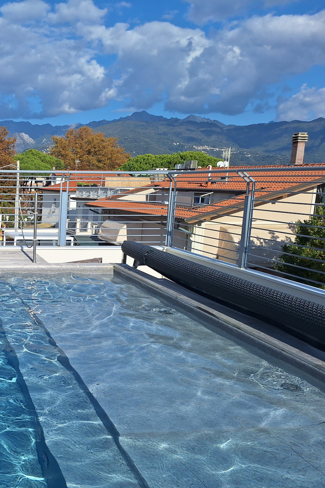
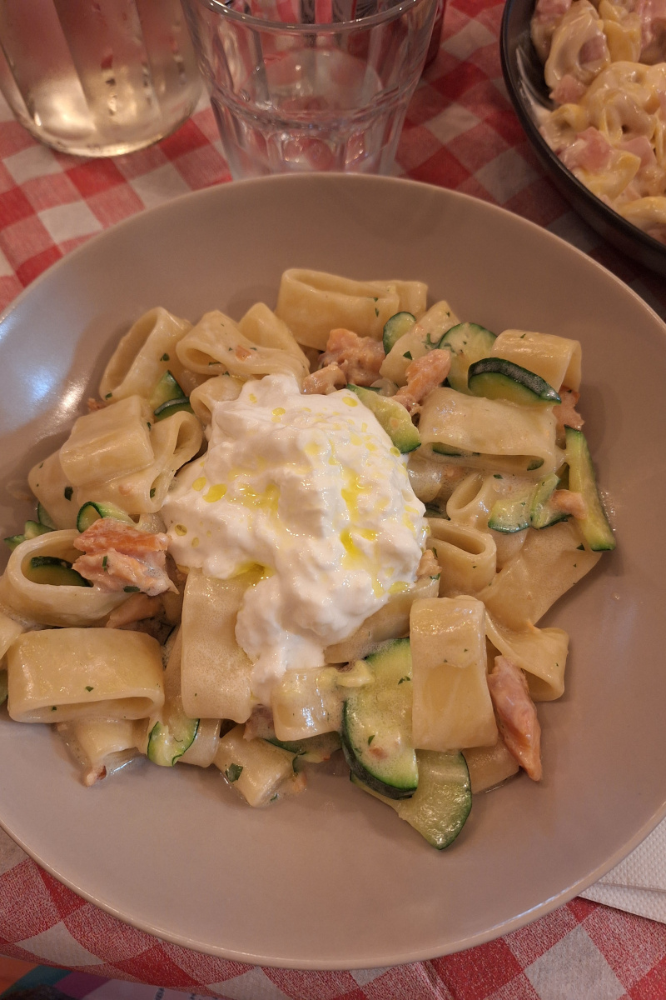
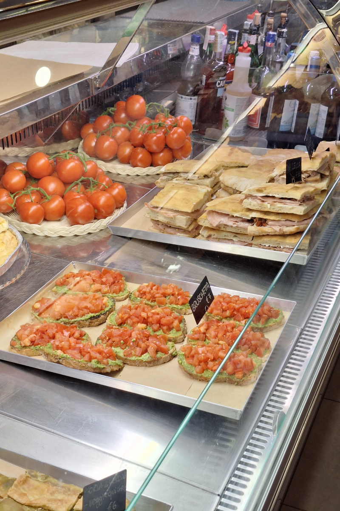

Deze reis was een van mijn favoriete manieren van reizen: met het vliegtuig een land invliegen en de reis dan meteen vanaf
de luchthaven met de trein verderzetten. Het is een ongelooflijk handige manier om met kinderen te reizen, zeker wanneer de
treinverbindingen goed zijn en de afstanden redelijk blijven. Door langs de kust met de trein te reizen kan je in meerdere
steden halt houden zonder een auto te moeten huren, wat de vervoerskosten flink drukt. Het is ook ideaal als je reist met
kinderen die niet graag lang in de auto zitten, of als je gewoon wil ontspannen en je vakantie niet achter het stuur wil
doorbrengen. We pakten het eerder al zo aan in [Málaga]() en
[Valencia](), en opnieuw werkte het perfect. Het enige echte nadeel is dat je je
bestemming zorgvuldig moet kiezen: de treinverbindingen moeten betrouwbaar zijn, de afstanden haalbaar en de
bezienswaardigheden bereikbaar zonder auto.

**Je verplaatsen – tips over vervoer**

We vlogen van Brussel naar de luchthaven van Pisa, die verrassend klein en overzichtelijk bleek. Na de landing namen we de
PisaMover naar Pisa Centrale. Die optie werd aangeprezen als de snelste, maar was ook de duurste. De PisaMover is een
snelle pendeltrein die vaak rijdt tussen de luchthaven en Pisa Centrale, van 6 uur 's ochtends tot middernacht. De rit
duurt maar 5 minuten. Prijs: €6,50 voor volwassenen / €4,50 voor kinderen (enkele reis).
Kinderen onder een bepaalde leeftijd zouden gratis reizen, maar de informatie was tegenstrijdig. We betaalden in totaal
€26 voor de rit vanaf de luchthaven. Aan het loket zeiden ze ons dat onze vierjarige geen ticket nodig had, wat ingaat
tegen de officiële website, die stelt dat alle kinderen er een nodig hebben. Aangezien de afstand minder dan 2 km bedraagt
en makkelijk te voet af te leggen is, voelde de PisaMover erg duur aan.
Op onze terugreis besloten we te kijken of we in plaats daarvan naar de luchthaven konden wandelen. De afstand vanaf het
stadscentrum was minder dan 1,6 km, en omdat we niet veel bagage hadden, waagden we het erop. Het bleek een uitstekende
beslissing: de wandeling was veilig, makkelijk en duurde minder dan 30 minuten. Onderweg passeerden we zelfs een paar
koffiebars waar we nog gebak meepikten voor we aan de luchthaven kwamen.

Vanaf het hoofdstation van Pisa zetten we onze reis verder naar La Spezia, waar we de eerste 2 nachten bleven. We namen de
regionale treinen van [Trenitalia](https://www.trenitalia.com/en.html). Daarna trokken we naar Marina di Massa voor de rest
van ons verblijf. Van daaruit maakten we een daguitstap met de trein naar Pisa.

Treintickets (totale kosten)
Pisa → La Spezia – €37,80 (€8,40 per volwassene / €4,20 per kind)  
La Spezia → Massa Centro – €22,50 (€5,00 per volwassene / €2,50 per kind)  
Massa Centro → Pisa – €27,90 (€6,40 per volwassene / €3,20 per kind)  

Stadsbussen in Massa  
Totaal uitgegeven: €25,70  
•	Ticketprijs: €1,70 per rit  
•	Geldig gedurende 70 minuten na activering  
•	Ticketten via een app mogelijk  

We installeerden de app van de lokale busmaatschappij, maakten een account aan en kochten de tickets rechtstreeks met een
kredietkaart. Je moet eraan denken je ticket te activeren voor je opstapt, wat wat verwarrend kan zijn omdat de app niet
volledig naar het Engels vertaald is. De eerste keer vroeg ik een medereiziger om bevestiging. Daarna was het heel
eenvoudig in gebruik. Je kan meerdere tickets tegelijk activeren, wat erg handig is als je in groep reist. Kinderen kleiner
dan 1 meter reizen gratis. Onze dochter (104 cm) had geen ticket, en tijdens een controle zeiden ze ons dat dat in orde
was. In de praktijk lijkt die regel moeilijk af te dwingen. We namen lijn L60 van het station van Massa tot de halte
'Marina di Massa Piazza Betti', op een paar minuten wandelen van ons appartement.

**Cinque Terre bezoeken met een combinatie van veerboot en trein**

In plaats van een dagticket voor de veerboot te kopen, kozen we voor een enkele reis met tussenstops en keerden we met de
trein terug. Zo konden we meer tijd in Monterosso doorbrengen en vermeden we een erg lange terugvaart (tot 2 uur). De boot
was in het begin rustig en stil, maar al in Riomaggiore werd het er stampvol. Op een bepaald moment zat de veerboot zo vol
dat we ons in twee groepen moesten opsplitsen omdat er geen zitplaatsen meer waren. Aan boord waren er enkel koude
drankjes en snacks, maar de toiletten kwamen erg goed van pas met een kind. Het weer was prachtig en zonnig, al waaide het
stevig, maar voor oktober was het nog heel aangenaam. We schrokken van de drukte aan het station van Riomaggiore. De
veerboot voelde al druk aan, maar het aantal mensen op het perron was heftig. We namen na 17 uur de trein terug vanuit
Monterosso. De trein zat vanaf Vernazza al vol, dus in Monterosso opstappen was net een voordeel: we vonden makkelijk
zitplaatsen en konden met de buggy binnen. Eén nadeel van de Italiaanse treinen zijn de toiletten. Er zijn er meestal maar
één of twee per trein, en vaak is er één defect. Wanneer de trein overvol zit, is het erg lastig om met een kind bij een
werkend toilet te raken.

**Onze veerboot- en treinuren**, waardoor we genoeg tijd hadden om elke halte te verkennen  
Veerboot: La Spezia 09:15 → Porto Venere 10:00 (1 u pauze)  
Veerboot: Porto Venere 11:00 → Riomaggiore 11:35 (1 u pauze)  
Veerboot: Riomaggiore 12:35 → Vernazza 13:10 (2 u pauze)  
Veerboot: Vernazza 15:10 → Monterosso 15:30  
Trein: Monterosso → La Spezia (25 min). We hadden ook in Manarola kunnen stoppen en daar de volgende trein naar La Spezia
kunnen nemen, maar we waren gewoon te moe.

Dagticket heen en terug Cinque Terre (€42 per volwassene / €15 per kind)  
Enkele reis met tussenstops (€30 per volwassene / €15 per kind)  

We bezochten Cinque Terre helemaal op het einde van het vaarseizoen. De veerboten varen van eind maart tot 1 november, met
een beperkte dienstregeling tot begin december. Meer informatie over de prijzen en de actuele uurregeling vind je
[hier](https://www.cinqueterre.eu.com/en/boat-excursions).

  
  

De **Cinque Terre Express**-treinen verbinden Levanto, Monterosso, Vernazza, Corniglia, Manarola, Riomaggiore en La Spezia.
Ze rijden frequent van vroeg in de ochtend tot laat op de avond. Tickets koop je in de stations, aan de automaten of online
via de Trenitalia-app. Koop je je ticket voor de regionale trein in het station (een papieren ticket), dan moet je het
ontwaarden aan de groene stempelautomaten op de trappen naar de perrons. Vergeet dat zeker niet, want de boetes zijn hoog!

We kochten al onze tickets aan de automaten. Die waren de eerste keer niet erg intuïtief, maar tegen het einde van de reis
kon ik alle stappen zowat met mijn ogen dicht doorlopen. De Cinque Terre Express heeft drie prijscategorieën, afhankelijk
van de dag waarop je reist. Het prijsoverzicht en de gedetailleerde dienstregeling vind je op de
[website](https://www.cinqueterre.eu.com/en/cinque-terre-timetable). Voor ons was het laagseizoen, dus categorie A (groen):
volwassenen €5, kinderen €2,50. Ben je van plan om tijdens je verblijf voortdurend tussen de dorpjes op en af de trein te
springen, dan is de Cinque Terre Card een prima keuze. Die geeft je onbeperkt reizen op de Cinque Terre Express-treinen
tussen La Spezia, Cinque Terre en Levanto. Bovendien geeft de kaart ook toegang tot de betalende wandelpaden tussen
Monterosso en Corniglia. Wij maakten er geen gebruik van, omdat we de kustlijn ook vanaf het water wilden zien.

**Accommodatie**

We verbleven in twee appartementen:  
La Spezia - geboekt via Airbnb (beoordeling 4,99).  
Zelf inchecken, heel comfortabel en goed uitgerust. Dicht bij het station gelegen, maar aan de andere kant van het
stadscentrum. Het was zo'n 2 km stappen naar de haven, maar de weg liep door de belangrijkste winkelstraat, wat het
aangenaam maakte. Een grote supermarkt vlakbij (Coop) en een rustige straat, een echte aanrader.  
Marina di Massa - geboekt via Booking.com, pal naast het strand.
Het meubilair was eenvoudiger, maar we hadden een heerlijke buitenruimte en een zwembad op het dak. De keuken was heel
minimaal uitgerust, prima voor ontbijt en tussendoortjes, maar niet om te koken. De zaak werd gerund door een lieve
familie die altijd klaarstond om te helpen. Er lag heel wat speelgoed in de tuin, maar vooral voor kinderen tot 3 jaar
(onze dochter gebruikte vaak de schommel).
Gemiddelde kostprijs: €200 per nacht

 - [La Spezia](https://www.airbnb.com/rooms/1424523201571350734?source_impression_id=p3_1769291588_P3kCjfZRNbS32n36) zicht vanuit het raam op de foto hieronder links  
 - [Marina Di Massa](https://www.residencestella.com/) zicht vanaf het dakzwembad op de foto hieronder rechts  

  
  

**Eten & uit eten gaan**

Omdat we dol zijn op Italiaans eten, gingen we naar geen enkel ander type restaurant. Meestal bestelden we primi (pasta,
risotto, gnocchi), waar we het meest van houden. Secondo (vlees, vis, zeevruchten) sprak ons minder aan, en allebei
bestellen zou meestal te veel eten zijn, zeker omdat we altijd plaats hielden voor ijs. Er werd altijd een coperto
aangerekend (€1,50–€2,50 per persoon). We kozen budgetrestaurants met heel goede recensies.

  
  

Voorbeeldprijzen:  
[Pizza Verace in La Spezia](https://share.google/lsaR5la5YGNmDT9Mg): €8–14  
[Bottega Visconti 1973 in Vernazza](https://share.google/pwJqo6vdELpDe7KDq): focaccia €8–12, hartige rijsttaart €5  
[Locanda del Tron in Massa](https://share.google/f2cCj81djdPUgIwYp): €13 vast menu (primo, secondo, koffie, water). Familiezaak met uitstekende recensies.  
[La Ghiotteria in Pisa](https://share.google/pGPcZyHeO4DN8JEir): primi €9–13 (heel grote porties)  

Beste ijssalons:  
[Gelateria Troppo Buono in Marina di Massa](https://maps.app.goo.gl/wAqh538eqZ22D1CW6)  
[Gelateria Vernazza in La Spezia](https://maps.app.goo.gl/iDzBfPcV4oJmUYjY6)  

**Budgetoverzicht (voor 6 dagen, 4 volwassenen en een vierjarig kind)**

| Categorie                            | Totale kost (€) |
|--------------------------------------|----------------:|
| Vluchten                             |             540 |
| Vervoer (trein, bus, veerboot)       |             338 |
| Accommodatie                         |            1000 |
| Restaurants                          |             417 |
| Boodschappen                         |             170 |
| Activiteiten                         |              72 |
| **Totaal**                           |        **2500** |

**Onze ervaring met reizen met een kind**

Reizen met het openbaar vervoer (trein, bus, veerboot) verliep vlot met onze dochter, want ze beweegt graag en zit niet
graag lang in een autostoeltje. We hadden een buggy bij, die we veel gebruikten in Pisa, Massa en La Spezia. In Cinque
Terre was hij minder praktisch, maar wel nodig door de lange wandeling naar de haven (zo'n 2,2 km). Buggy's mogen mee op de
veerboot, maar in sommige dorpjes moesten we hem opplooien en dragen. Riomaggiore was zo steil dat we de buggy bij een
kajakverhuur achterlieten. We reisden met een oude buggy en maakten ons dus niet al te veel zorgen over diefstal.
We vonden niet veel speeltuinen; er was er wel een op het strand naast ons appartement in Marina di Massa, en dat was echt
fijn. Dat was echter geen groot probleem, want kerken, botanische tuinen en parken bezoeken was prima vermaak voor onze
kleuter. Wat openbare toiletten betreft: we gingen er niet actief naar op zoek, want het volstond die van de restaurants te
gebruiken wanneer we aten, of die in de botanische tuin in Pisa, op de veerboot of in de trein. De trein was eigenlijk het
lastigst, want er waren meestal maar twee toiletten in de hele trein en vaak was er één defect. Soms moesten we een heel
eind door de trein stappen om bij een werkend toilet te raken, en wanneer de trein vol zat, was dat erg moeilijk.

[Speeltuin in Monterosso](https://maps.app.goo.gl/ozuxGCapAk1bWRV17) - een fijne plek om even te stoppen tijdens een bezoek aan Cinque Terre

**Slotgedachten en aanbevelingen**

Dit was een heel ontspannende reis met perfect oktoberweer, uitstekend eten en een mooie mix van bekende en minder
toeristische bestemmingen. Cinque Terre was adembenemend, Pisa verrassend aangenaam en Massa een rustige uitvalsbasis aan
zee. Met de trein langs de Italiaanse kust reizen werkte perfect voor ons, en we zouden het zo weer doen.
