Vraag je je af of het mogelijk is om Cinque Terre op één dag te bezoeken, dan is het antwoord ja, maar het vraagt wel een
slim plan. Tijdens onze reis door Italië trokken we één volledige dag uit om de kleurrijke kustdorpjes van deze
UNESCO-streek te verkennen. We combineerden overtochten met de veerboot en treinritten om onze tijd optimaal te benutten.

Vanuit La Spezia bezochten we Porto Venere, Riomaggiore, Vernazza en Monterosso al Mare, met spectaculaire uitzichten
vanaf de kliffen, charmante haventjes, middeleeuwse kerken, mooie uitkijkpunten en zelfs zandstranden. Reizen met een kind
en een buggy maakte de planning nog wat ingewikkelder. Daarom deel ik in deze gids niet alleen ons gedetailleerde programma,
maar ook praktische tips, dienstregelingen van de veerboot, advies over toegankelijkheid en eerlijke indrukken van de drukte in oktober. Alle
praktische details staan beschreven in een aparte post, die je [hier vindt]().

Plan je een daguitstap naar Cinque Terre, twijfel je tussen de veerboot of de trein, of probeer je te beslissen welke
dorpjes je voorrang wil geven, dan helpt deze gids je om een efficiënte, realistische en onvergetelijke dag uit te stippelen
langs een van de meest iconische kustlijnen van Italië.

**Porto Venere** was onze eerste halte nadat we La Spezia verlieten. Het kustlandschap onderweg was prachtig: we voeren
voorbij een marinebasis (Porta Marola Arsenale Marina Militare) en de rand van de stad voor het landschap ruiger en
dramatischer werd. De kleurrijke huisjes vanaf de boot in de verte zien opduiken was een perfecte kennismaking met Cinque
Terre.

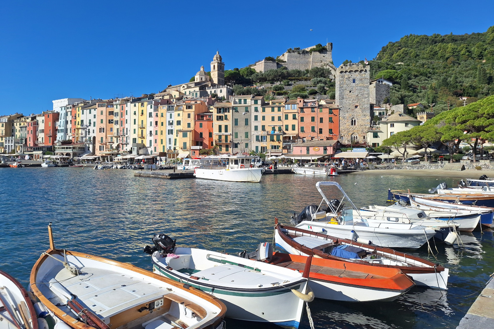

We hadden maar één uur om het stadje te verkennen, dus we trokken meteen naar de iconische **kerk van Sint-Pieter**. De kerk
werd in de 13e eeuw gebouwd en staat spectaculair op een rotsachtige landtong met uitzicht op zee. Het is een werkelijk
verbluffende plek door de opvallende zwart-wit gestreepte gevel en de adembenemende ligging op de klif.

  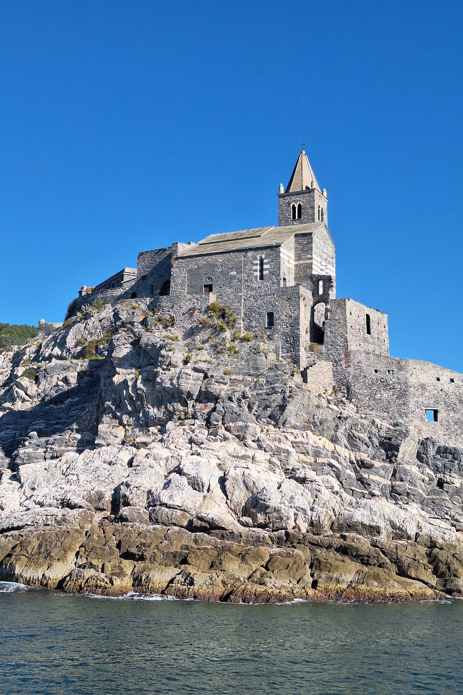
  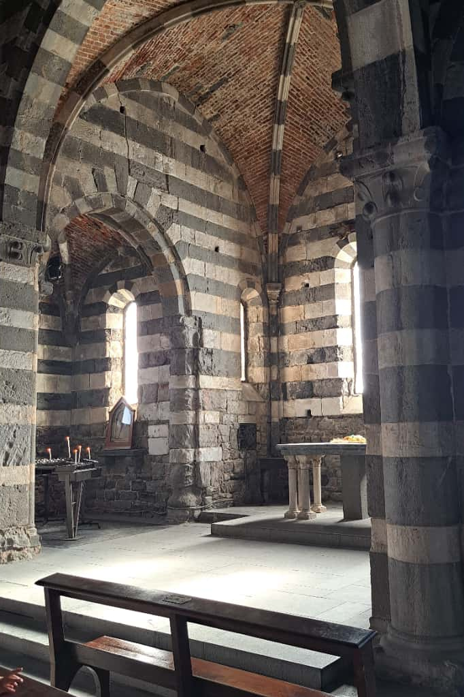

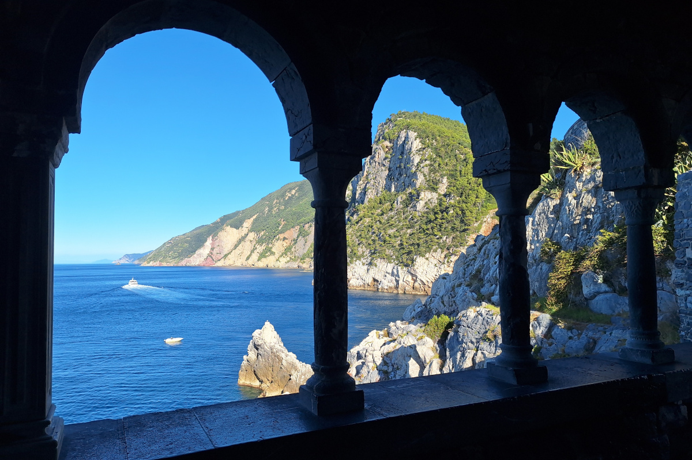

Vlak ernaast kan je werkelijk adembenemende uitzichten bewonderen vanaf het uitkijkpunt Promontorio dell'Arpaia, vaak
omschreven als een "natuurlijk balkon" boven de Ligurische Zee. Van hieruit zie je de ruige kustlijn, bergen in de verte en
boten die de haven naderen. Het contrast tussen de donkere rotsen en het turkooizen water is gewoonweg schitterend. Aan de
buitenkant van de muren loopt een smal paadje richting de kerk, waarlangs je dichter bij de zee komt. Wees wel voorzichtig,
want de rotsen zijn erg glad, zelfs op een droge dag. Ik denk dat dit ook de plek is waar mensen gaan zwemmen, want er was
een duidelijke toegang tot het water vanaf een betonnen blok.

  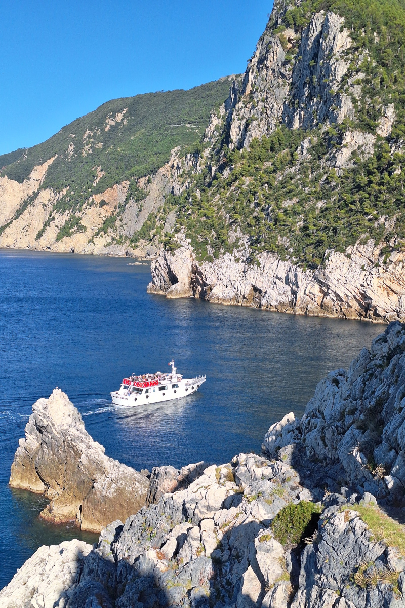
  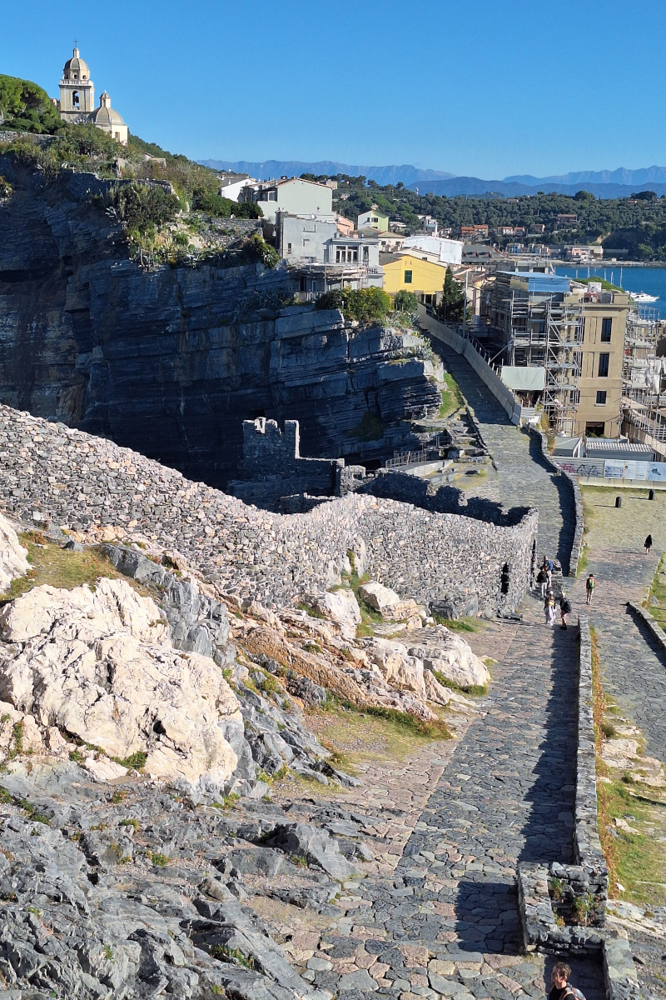

Onze volgende halte was de **kerk van Sint-Laurentius**, een romaanse kerk die iets hoger dan de haven ligt. Ze voelt rustiger
en meer beschut aan dan San Pietro, en binnen hing een serene sfeer, zeker in vergelijking met de ruige, winderige
kliffen aan zee. Vandaar klommen we verder naar het **Doria-kasteel**, dat over het stadje uitkijkt. De klim telt heel wat
trappen, maar de uitzichten van bovenaf zijn de moeite meer dan waard. Vanaf de terrassen zie je de hele haven, de kleurrijke
huizen en de eindeloze blauwe horizon. Het is een heel rustgevende plek met prachtige groene bomen, en het is er veel
minder druk dan rond de haven. De toegang kost €5, maar we hadden niet genoeg tijd om binnen te gaan. Met slechts één uur
in Porto Venere moesten we doorstappen om op tijd terug aan de haven te zijn.

  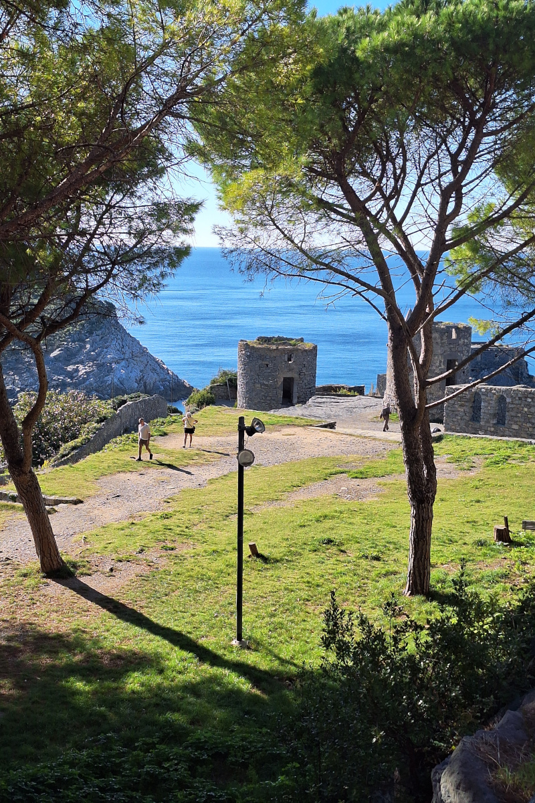
  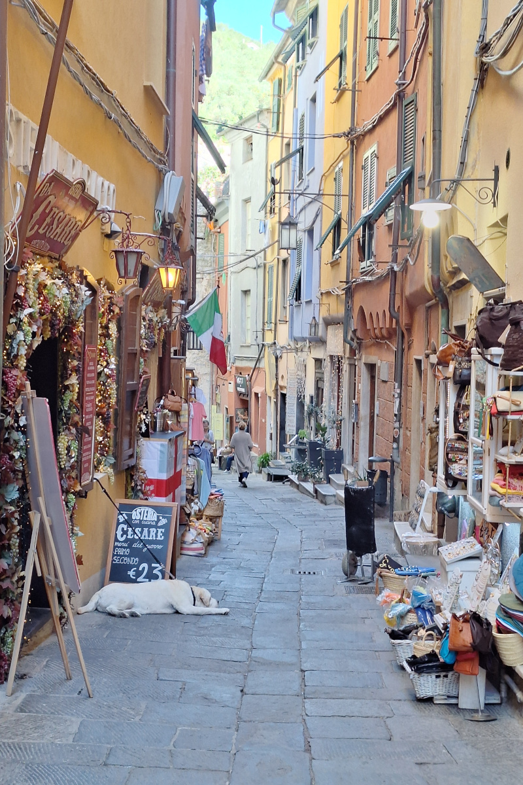

De afdaling van het kasteel was wat lastig. We volgden smalle paadjes de helling af en kwamen uiteindelijk uit op de **Via
Giovanni Capellini**, blijkbaar de belangrijkste winkelstraat die naar de stadspoort Porta del Borgo bij de haven leidt. De
klim naar het kasteel was erg steil, dus we moesten de buggy opplooien, en op de terugweg naar beneden opnieuw. Gelukkig
plooit onze buggy op als een paraplu en is hij relatief makkelijk over trappen te dragen. Anders zou een draagzak zeker een
betere optie zijn.
Optie voor een wandeling met de buggy: je kan de San Pietro-kerk vanaf de haven via de hoofdstraat wel met een buggy
bereiken, maar tot bij het kasteel raken lukt niet met een buggy.

Porto Venere is ook het startpunt van een van de bekendste wandelroutes in de streek, het
[Sentiero 1-pad](https://www.cinqueterre.eu.com/en/footpaths-cinqueterre#riomaggiore-portovenere:~:text=Hiking%20trail%20Riomaggiore%20%2D%20Portovenere ) richting
Riomaggiore. De hele kustlijn hier is een paradijs voor wandelaars, met indrukwekkende klifpaden en panoramische
uitzichten over zee. Veel mensen zeggen dat je Cinque Terre pas echt beleeft wanneer je dit stuk wandelt, los van de
bekende postkaartbeelden. We zouden hier ooit dolgraag terugkomen om de paden grondig te verkennen.

  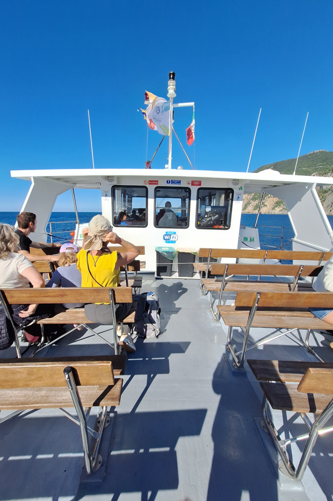
  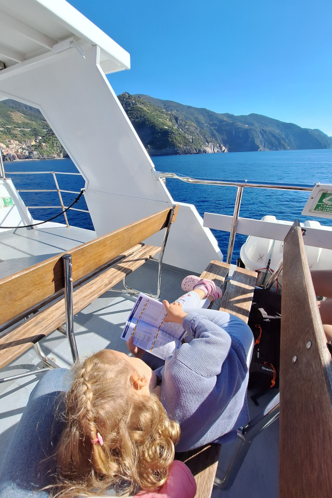

**Riomaggiore** was onze volgende halte, waar we opnieuw één uur hadden om het dorp te verkennen. Onze veerboot meerde aan de
zijkant van het dorp aan, dus in het begin zagen we de beroemde haven niet. Nadat we langs een enorme massa mensen waren
gestapt die stond te wachten om op onze veerboot naar het volgende dorp te stappen, ontvouwde het uitzicht zich plots, en
het was werkelijk verbluffend! De kleine jachthaven, omringd door hoge, kleurrijke huizen die dicht opeengestapeld tegen de
steile kliffen staan, zag er precies uit als een postkaart. Riomaggiore wordt vaak omschreven als het meest spectaculaire
van de Cinque Terre-dorpen, door zijn verticale opbouw en de smalle straatjes die steil omhoog klimmen. We lieten onze
buggy eerst achter bij de ingang van een kajakverhuur (met toestemming van de eigenaars), want de straat werd meteen erg
steil. Het dorp staat vol charmante pastelkleurige huizen met groene luiken, kleine balkonnetjes en was die tussen de
gebouwen hangt te drogen, klassieke Ligurische taferelen.

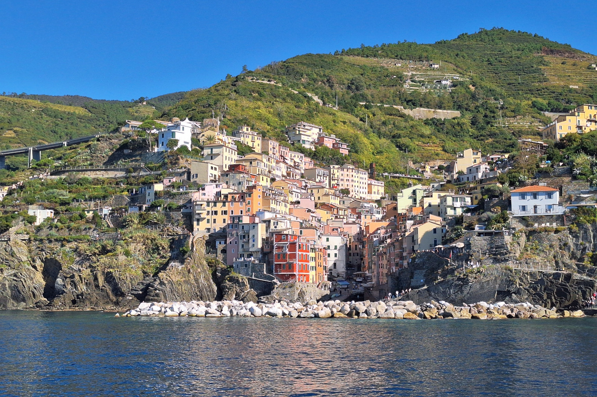

  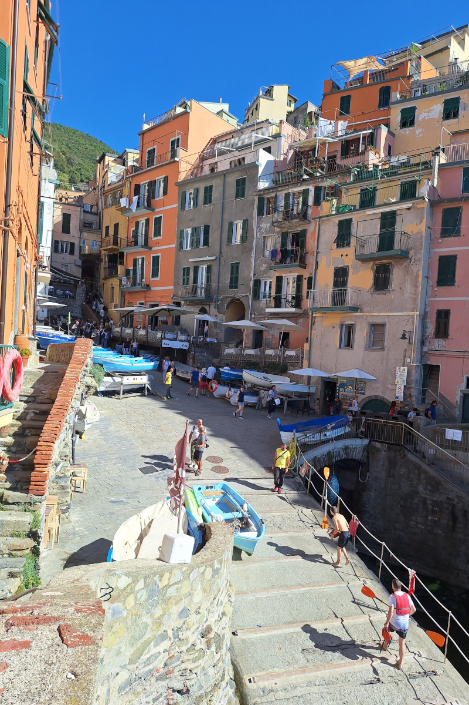
  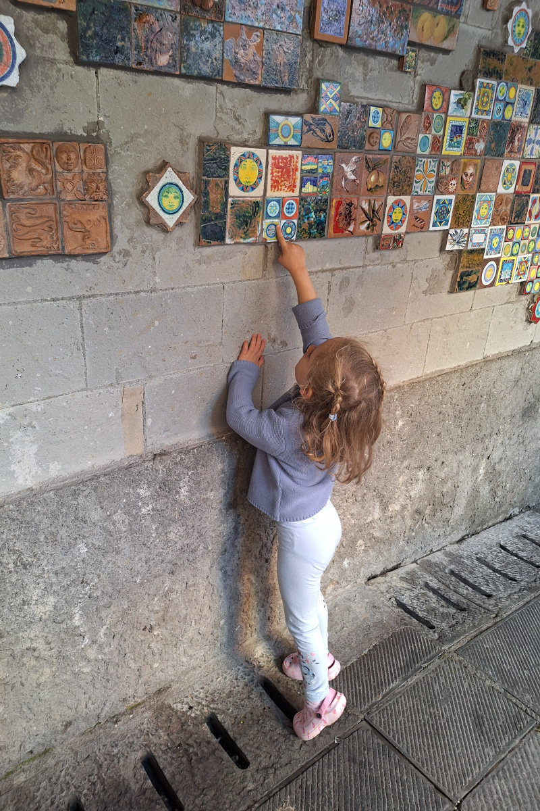

We bezochten deze plek in oktober, en het dorp zat al bomvol. Ik kan me alleen maar inbeelden hoe druk het in de
zomermaanden moet zijn. Riomaggiore is een van de meest gefotografeerde plekken van Cinque Terre, en veel dagjestoeristen
komen met de boot aan, net als wij. We liepen de hoofdstraat op richting de **kerk van San Giovanni Battista**, een gotische
kerk uit 1340. Ze ligt iets boven het drukste deel van het dorp, en de omgeving rond de kerk voelde merkbaar rustiger en
vrediger aan. Vanaf het pleintje ervoor heb je een mooi uitzicht over de daken en naar beneden richting de zee.

  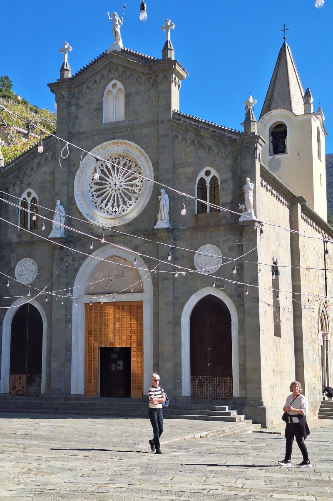
  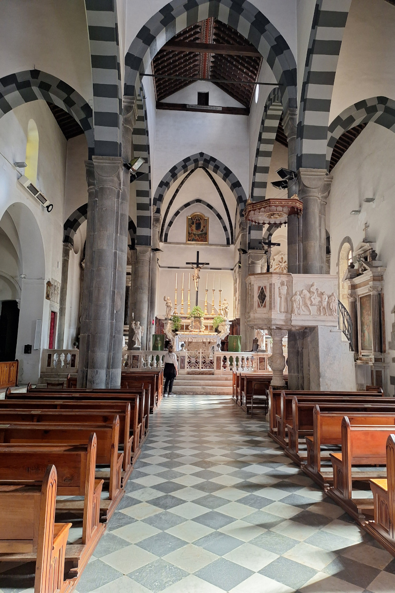

Daarna klommen we nog wat hoger naar het **Castello di Riomaggiore**, een 13e-eeuws kasteel dat gebouwd werd om het dorp
tegen piratenaanvallen te beschermen. Het panoramische terras bij het kasteel biedt een prachtig uitzicht over de kustlijn
en het dorp beneden, de perfecte plek voor een groepsfoto voor je weer afdaalt.
We keerden naar de haven terug via een korter maar steiler pad met trappen. Met zo'n 20 minuten over gingen we gewoon op de
rotsen bij het water zitten. Het was verrassend warm in de volle zon, en de omliggende heuvels hielden het grootste deel
van de wind tegen, waardoor het nog warmer aanvoelde.
De haven is ook een populair vertrekpunt voor kajaks en kleine bootjes. Je kan een kajak huren en langs de indrukwekkende
kliffen peddelen om verborgen baaitjes te ontdekken en in kristalhelder water te zwemmen. Dat lijkt een van de mooiste
manieren om Cinque Terre eens vanuit een ander perspectief te beleven, weg van de drukke straatjes (en de drukke
veerboten!). Best wat mensen huurden een kajak terwijl we daar waren. Het water was ongelooflijk helder en schitterde
prachtig in de zon. Ondanks de drukte was het erg ontspannend om aan zee te zitten en te kijken naar de boten die kwamen en
gingen en naar de kajakkers die aan hun avontuur langs de kust begonnen. Riomaggiore mag dan druk zijn, de sfeer aan de
haven, de steile kleurrijke straatjes en de spectaculaire ligging maken het onvergetelijk, ook al heb je maar één uur om
het te verkennen.

  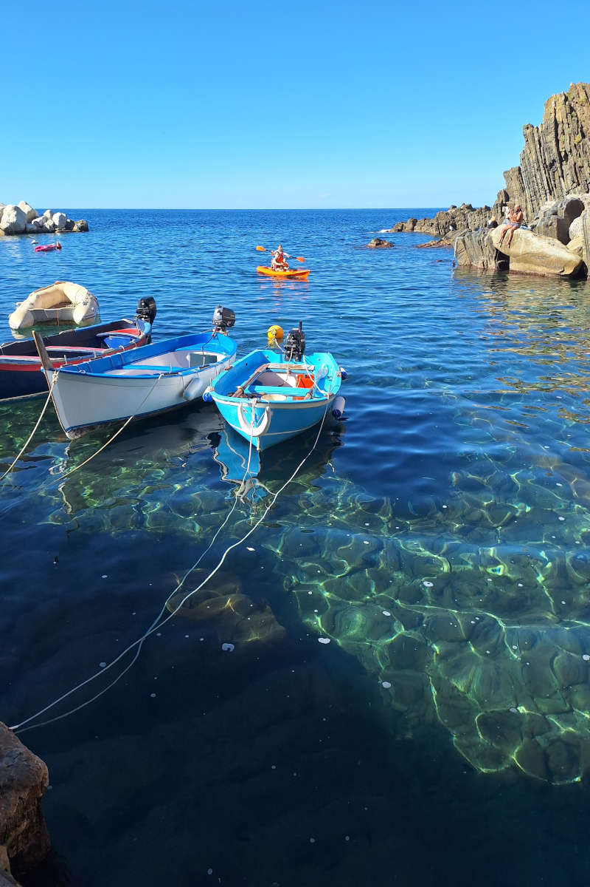
  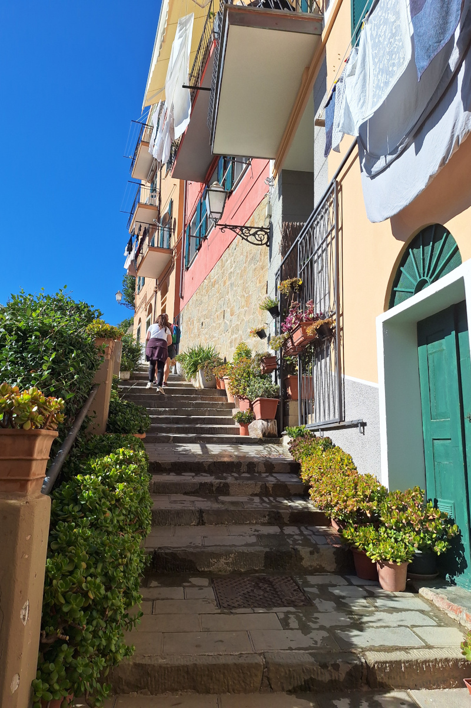

In het volgende dorp, **Vernazza**, hadden we een pauze van twee uur ingepland, wat precies genoeg tijd bleek voor
een ontspannen lunchstop. Voor het eerst die dag moesten we ons niet haasten. We waren verbaasd hoe relatief vlak het
gebied naast de haven was, heel anders dan in Riomaggiore. Het kleine natuurlijke haventje, de kleurrijke huizen en de
vissersboten vormen opnieuw een schilderachtig plaatje.

  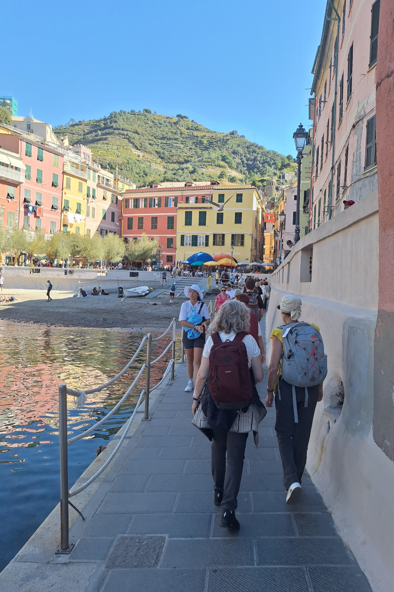
  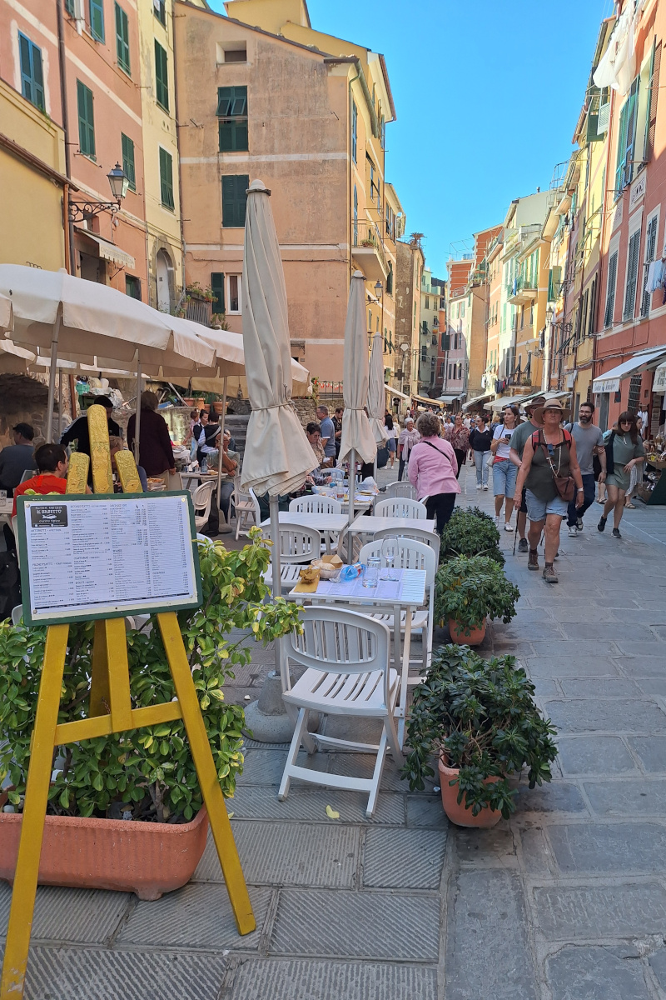

We aten snel iets bij Bottega Visconti 1973. Waar we nog altijd niet aan gewend raakten, is dat in Italië roken op de
terrassen van restaurants toegelaten is. Omdat er buiten verschillende mensen zaten te roken, besloten we binnen plaats te
nemen. Uiteindelijk bleek dat een goed idee, want zo zagen we duidelijk al het verse eten aan de toonbank liggen. Het was
een eenvoudige zaak met versgemaakte bruschetta, focaccia, hartige rijsttaart en andere snelle hapjes, perfect voor een
korte stop. Na het eten volgden we de **Via Roma**, de hoofdstraat die door het dorp loopt, en liepen we onder het
station door, waar het zwart zag van het volk. Vernazza is een van de drukste dorpen van Cinque Terre.
Toen we doorhadden dat we stilaan het centrum verlieten, sloegen we de kleinere Via Brigate Partigiane in en dwaalden we
door piepkleine, smalle straatjes richting de **kerk van Sint-Margaretha van Antiochië**. De huizen stonden hier ongelooflijk
dicht bij elkaar; je kon bijna twee gebouwen tegelijk aanraken door je armen te spreiden. Veel van die huizen waren met
steunbalken met elkaar verbonden en stonden een beetje scheef, wat de straatjes een heel authentieke, middeleeuwse sfeer
gaf. De kerk zelf zag er voor mij middeleeuws uit: opgetrokken uit steen, met minimale versiering en een sober maar elegant
ontwerp. Ze ligt pal bij de haven en haar klokkentoren is een van de meest herkenbare bezienswaardigheden van Vernazza.
Binnen voelde de sfeer rustig aan, in vergelijking met het drukke plein buiten.

  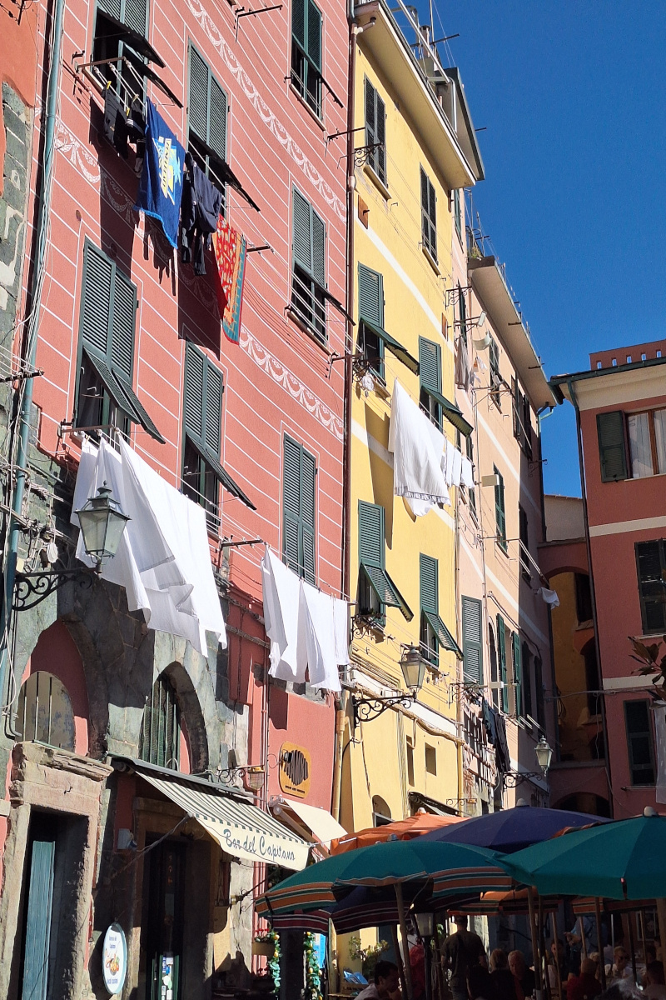
  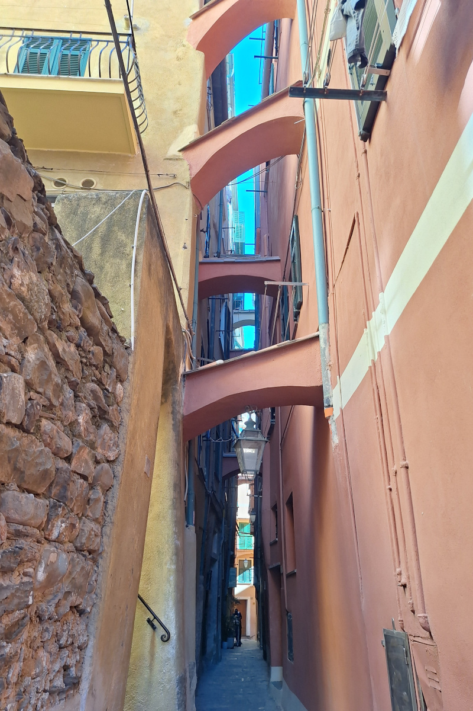

  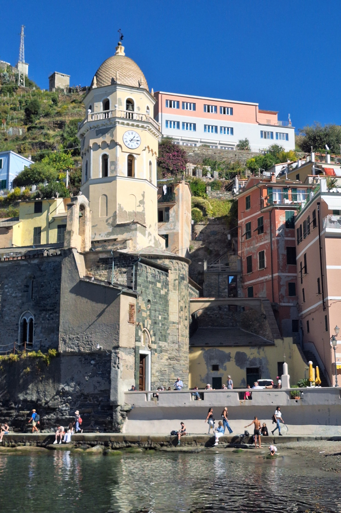
  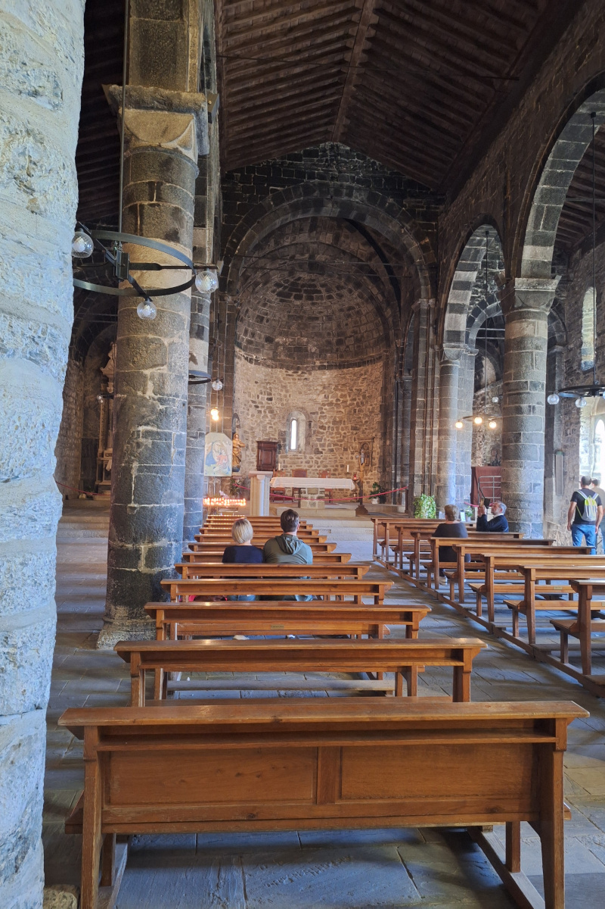

Na het kerkbezoek splitsten we op: enkelen van ons klommen naar het **Castello di Vernazza** (het Doria-kasteel), terwijl de
anderen bij onze dochter in de buurt van de kerk bleven om uit te rusten.
Zodra we het drukke havenplein achter ons lieten, stapten we een rustiger en bijna mysterieus deel van het dorp binnen. Het
pad naar het kasteel voelt als een steil doolhof van smalle steegjes, met kleine bordjes die de richting aangeven. Een heel
charmant maar steil stuk van het dorp! Na een klim van ongeveer 10 minuten kwamen we bij de ingang. Het uitzicht van
bovenaan was verbluffend: de kustlijn strekte zich aan beide kanten spectaculair uit en we zagen het hele dorp onder ons
liggen. We spotten zelfs onze reisgenoten op een bankje voor de kerk.

Het Doria-kasteel werd gebouwd door de machtige familie Doria om het dorp tegen piratenaanvallen te beschermen. Vandaag is
de belangrijkste overgebleven structuur de cilindrische wachttoren (Torre Doria), het opvallendste en best bewaarde
deel van de vesting. De rest van het kasteel bestaat vooral uit stenen muren en gedeeltelijke verdedigingswerken in plaats
van volledig bewaarde gebouwen, dus verwacht geen klassiek "kasteelinterieur" met ingerichte kamers. De plek is niet
beroemd om uitgestrekte ruïnes, maar om haar spectaculaire panoramische ligging.
Tijdens onze wandeling door het dorp hadden we eerder al terrasvormige wijngaarden op de omliggende heuvels opgemerkt, en
vanaf de toren waren ze opnieuw duidelijk in de verte te zien. Die wijngaarden zijn typisch voor de streek. Op de steile
terrassen met zicht op zee worden druiven geteeld voor de beroemde lokale Cinque Terre-wijnen. Het gaat
grotendeels om witte wijn met aroma's van kruiden en citrusvruchten.

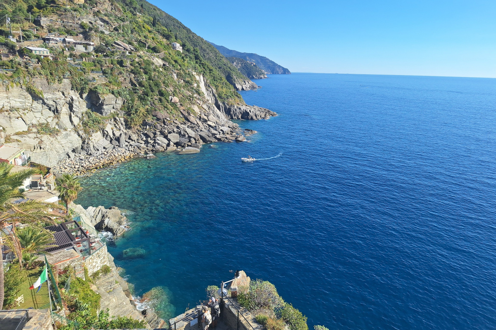
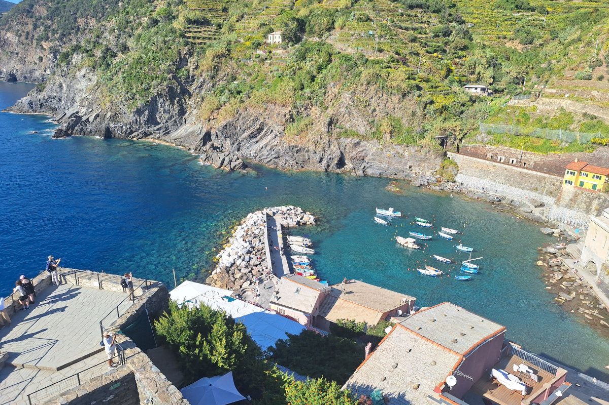

Het was tijd om naar onze laatste bestemming te trekken, **Monterosso**. Het stadje heet officieel Monterosso al Mare, maar
het is duidelijk opgedeeld in twee aparte delen: de oude stad (Borgo Antico) en de nieuwe stad (Fegina). Onze veerboot
meerde aan in de kleine haven van het oude deel.

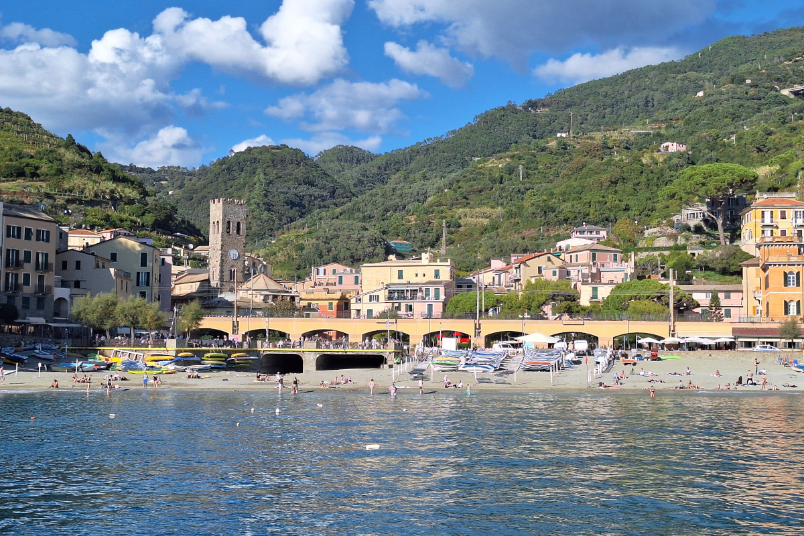

De twee delen van het stadje zijn met elkaar verbonden door een voetgangerstunnel die door de rots is uitgehouwen, vaak de
Fegina-tunnel genoemd. Je stapt er in enkele minuten doorheen, waardoor je makkelijk van het ene deel naar het andere
raakt. We besloten eerst door het oude deel te wandelen en daarna naar het nieuwe deel te stappen, waar het enige station
ligt. Het historische centrum, met zijn smalle steegjes, kleurrijke huizen, kleine pleintjes en traditionele restaurants,
was echt heerlijk om door te dwalen. Het sluit veel beter aan bij de typische Cinque Terre-sfeer. De smalle straatjes vol
kleurige souvenirs en winkeltjes waren charmant. We passeerden de **kerk van San Giovanni Battista** en volgden de
belangrijkste winkelstraat tot het geleidelijk rustiger werd en de winkels verdwenen. Daarna keerden we terug en hielden we
even halt bij het Oratorio di Santa Croce. Onze dochter bezoekt graag kerken, dus zulke korte stops vielen altijd in de
smaak. We zagen een speeltuin in een klein openbaar park (Giardino Pubblico, in het oude deel van de stad bij de ingang
van de haven), maar we kozen bewust een andere route zodat onze dochter hem niet zou opmerken: we wilden zeker genoeg tijd
hebben om onze trein terug naar La Spezia te halen.

  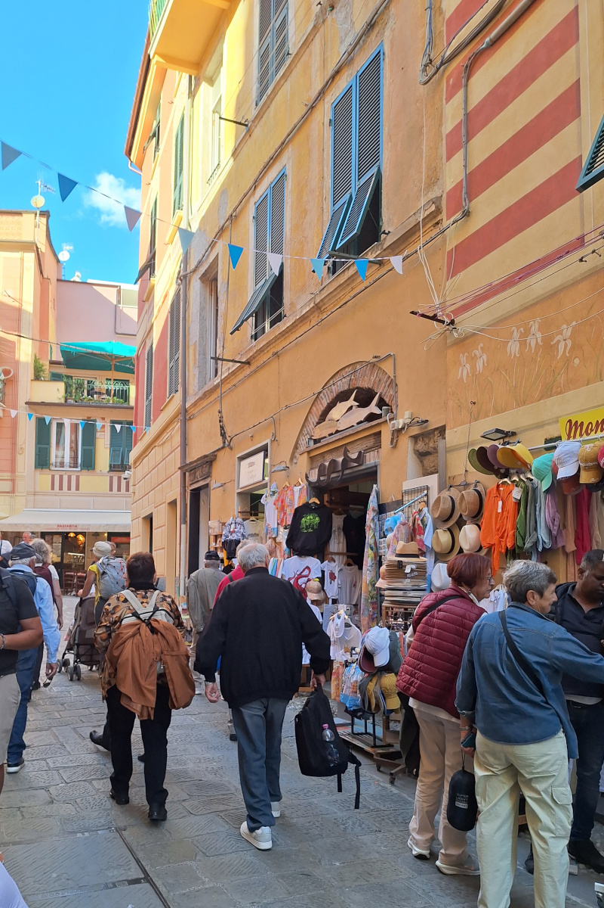
  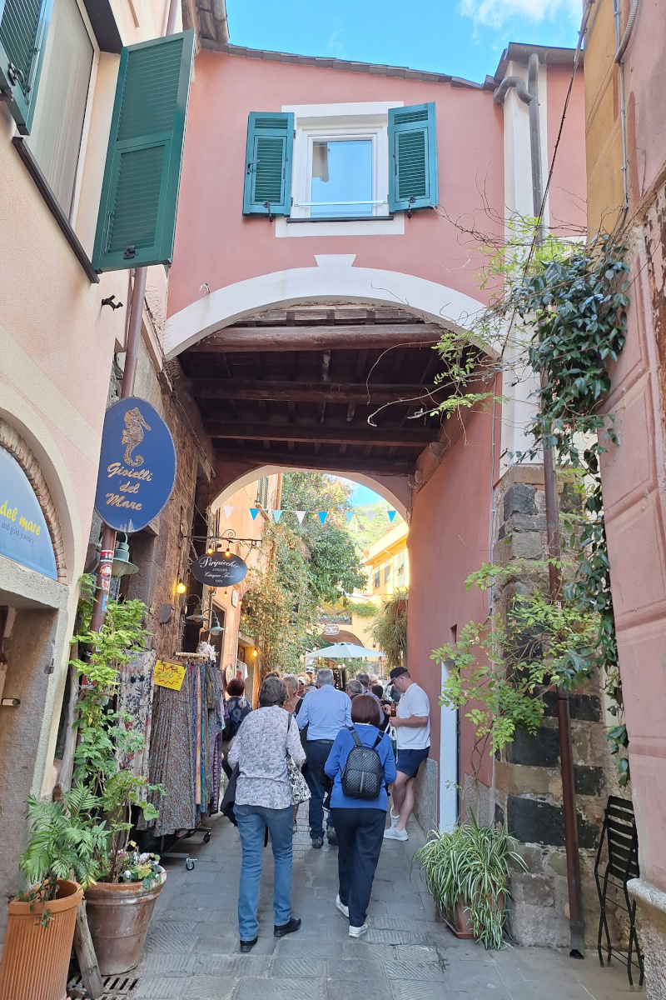

Daarna volgden we de **Via Fegina**, die zo'n 1 km richting het nieuwere deel van de stad loopt. Zodra we de tunnel uit
kwamen, veranderde de sfeer merkbaar: het gebied voelde ruimer en opener aan. In dit deel van de stad liggen het lange
zandstrand, de zeedijk, de hotels en de meeste grotere logies. Een groot deel van het strand leek uit privéstrandclubs te
bestaan, want we zagen afgebakende zones met ligbedden en parasols die te huur waren. Tussen de privézones liggen kleine
gratis stukken, maar in het hoogseizoen zijn die waarschijnlijk erg druk. Omdat we in oktober kwamen, waren veel van de
privéstrandclubs al gesloten. Monterosso is het enige Cinque Terre-dorp met een echt zandstrand, waardoor het net wat
anders aanvoelt, eerder als een badplaats, dan de andere dorpen met hun rotsachtige haventjes en zwemplekken. De Via
Fegina is erg aangenaam om over te wandelen en leidt naar de beroemde Statua del Gigante. Het beeld van Neptunus, de god
van de zee, staat imposant aan het einde van het Fegina-strand. Het werd in 1910 gebouwd en droeg ooit een terras boven
zich, al raakte het tijdens de Tweede Wereldoorlog gedeeltelijk beschadigd. Vandaag is het nog altijd een van de meest
herkenbare bezienswaardigheden van Monterosso.
Het kleine kiezelstrandje naast het beeld heeft prachtig helder, turkooizen water.

  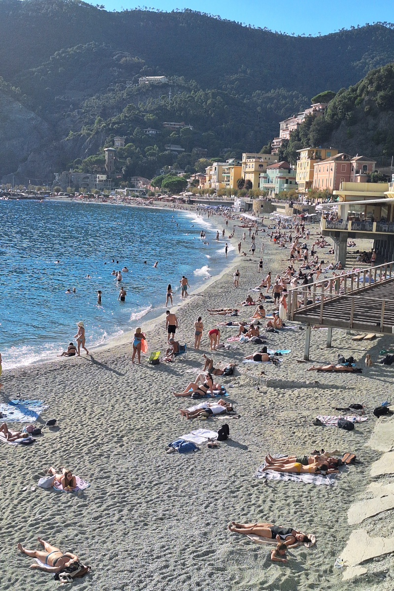
  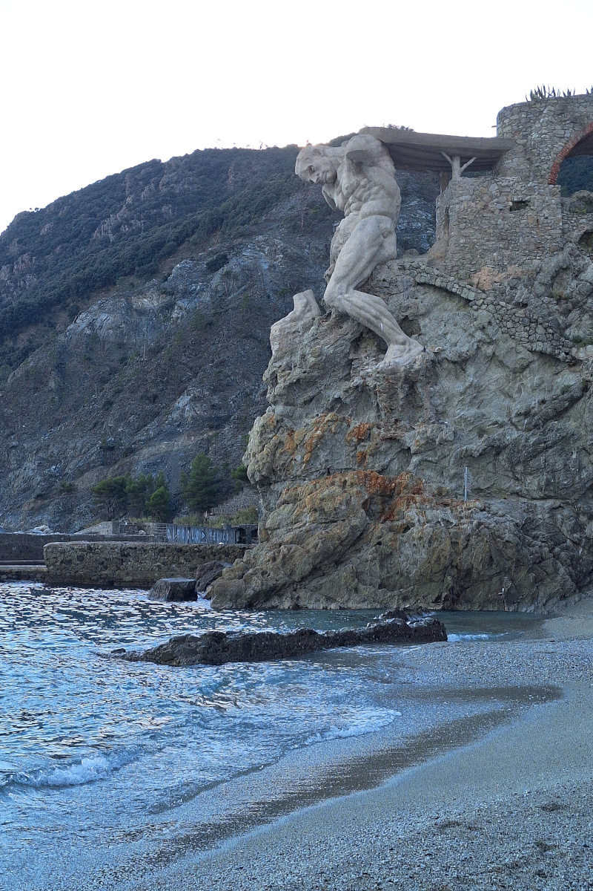

Onderweg daarnaartoe passeerden we een klein speeltuintje (tegenover Focacceria Antonio Di Liberatore V. & C.) met bankjes
in de schaduw en een mooi zeezicht. Op dat punt hadden we geen keuze: we moesten stoppen en onze dochter even laten spelen
voor we naar het station trokken. Eerder die dag had ik ook al een speeltuin in Porto Venere gezien, maar daar hadden we
absoluut geen tijd voor. Fijn om te zien dat minstens enkele van deze populaire toeristische stadjes wat plaats voor
kinderen voorzien. Uiteindelijk bereikten we het station, waar ook het toeristenkantoor gevestigd is, en namen we de trein
terug naar La Spezia (een rit van zo'n 20 minuten).
We hebben echt genoten van deze dag. Het weer had niet beter kunnen zijn. Ik vraag me wel af hoe druk deze dorpjes in de
zomermaanden moeten zijn, als ze in oktober al zo vol aanvoelden. Riomaggiore was zonder twijfel het drukst, gevolgd door
Vernazza. Monterosso en Porto Venere voelden iets rustiger aan, misschien omdat ze onze eerste en laatste halte van de dag
waren, bezocht in de ochtend en late namiddag in plaats van tijdens de piekuren rond de middag.

Achteraf bekeken was het een intense maar ongelooflijk lonende dag, een perfecte manier om Cinque Terre in korte tijd te
beleven terwijl we de eerste twee nachten van onze reis in **La Spezia** verbleven. Hoewel de stad vaak enkel als
doorgangsstad wordt gezien, heeft La Spezia een aangename, authentiek Italiaanse sfeer, met elegante 19e-eeuwse gebouwen,
lokale winkels en het dagelijkse Italiaanse leven dat zich rondom je afspeelt. Een van de belangrijkste bezienswaardigheden
van de stad is het **Castello di San Giorgio**, dat op een heuvel boven het centrum ligt. Toen we er in oktober 2025 waren,
was het kasteel zelf gesloten (waarschijnlijk door renovatie- en onderhoudswerken die soms buiten het hoogseizoen
plaatsvinden). We wandelden de heuvel op om het van buitenaf te bekijken en van het panorama over de stad en de golf te
genieten. Ook de haven van La Spezia is het vermelden waard.
Een deel ervan doet dienst als een grote Italiaanse marinebasis (een van de belangrijkste van het land), dus sommige zones
zijn niet toegankelijk. De zeedijk, de Passeggiata Morin, is wel toegankelijk voor het publiek en heel aangenaam om over te
wandelen. Je ziet er zeilboten, jachten en veerboten die richting Cinque Terre vertrekken.

  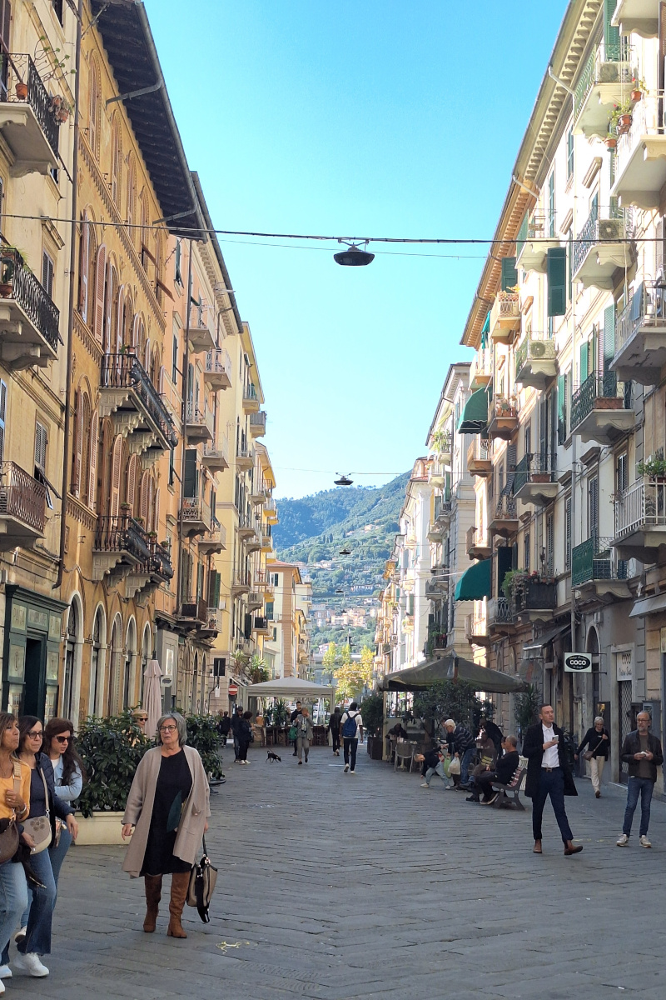
  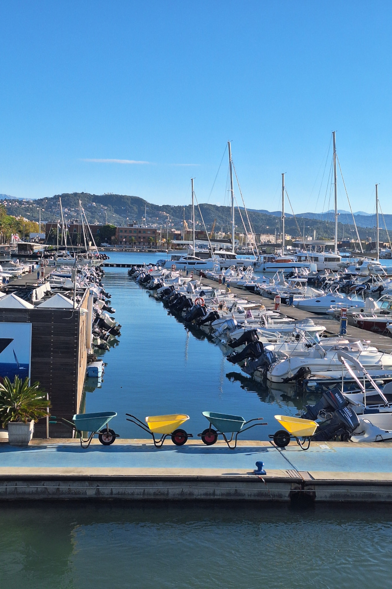

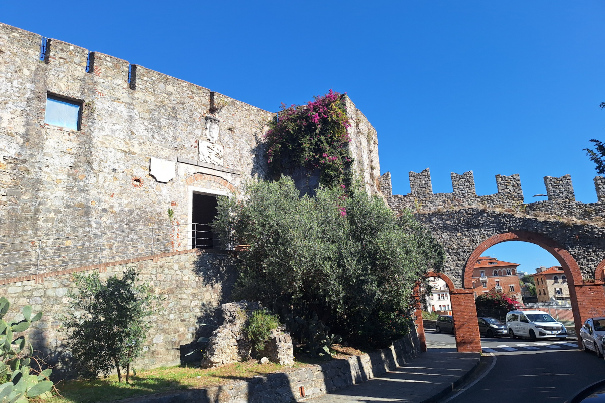
