Plan je een reis naar de Italiaanse kust en vraag je je af of Massa en Pisa een bezoek waard zijn, zeker met een kind? In
deze reisgids deel ik onze echte ervaring met een verblijf in Marina di Massa en een makkelijke daguitstap naar Pisa met
een kleuter. Dit deel van Italië wordt vaak over het hoofd gezien in vergelijking met Cinque Terre of Firenze, maar het
biedt een perfecte mix van strand, bergen, cultuur en gezinsvriendelijk reizen.

Na twee nachten in La Spezia trokken we verder zuidwaarts langs de kust naar **Massa**, waar we de laatste drie nachten van
onze reis verbleven. Massa ligt pal aan de voet van de Apuaanse Alpen, wereldwijd beroemd om hun witte marmer.
Om er te raken namen we een korte treinrit naar Massa Centro en daarna een stadsbus (L60) naar **Marina di Massa**, het
kloppende hart van de streek aan zee, waar je de meeste hotels en resorts vindt (5 km van het station). Onze rit werd een
kleine rondrit, want de bus maakte een omweg door het historische centrum voor hij naar de kust reed.

We verbleven in een appartement dat als een verborgen parel aanvoelde, vooral door het zwembad op het dak en de speeltuin
buiten. Ondanks dat het oktober was, werd het zwembad verwarmd en was het een aangename 18 °C in de schaduw. Zwemmen met
aan de ene kant zicht op de witte bergtoppen en aan de andere kant op de Tyrreense Zee was een hoogtepunt van ons verblijf.
Kijk je omhoog naar die toppen, dan verwar je de witte vlekken misschien met sneeuw. In werkelijkheid kijk je naar de
wereldberoemde marmergroeven, die al meer dan 2.000 jaar in gebruik zijn. Ons appartement lag maar 100 meter van het
strand, pal naast een levendige speeltuin die vol lokale kinderen zat toen we er 's avonds kwamen, de perfecte plek voor
onze dochter om na de reis wat energie kwijt te raken. Eén ding dat ons meteen opviel, is hoe het marmererfgoed van de
streek zelfs in de kleinste details zichtbaar is: de stoepranden hier zijn gemaakt van massief wit marmer!

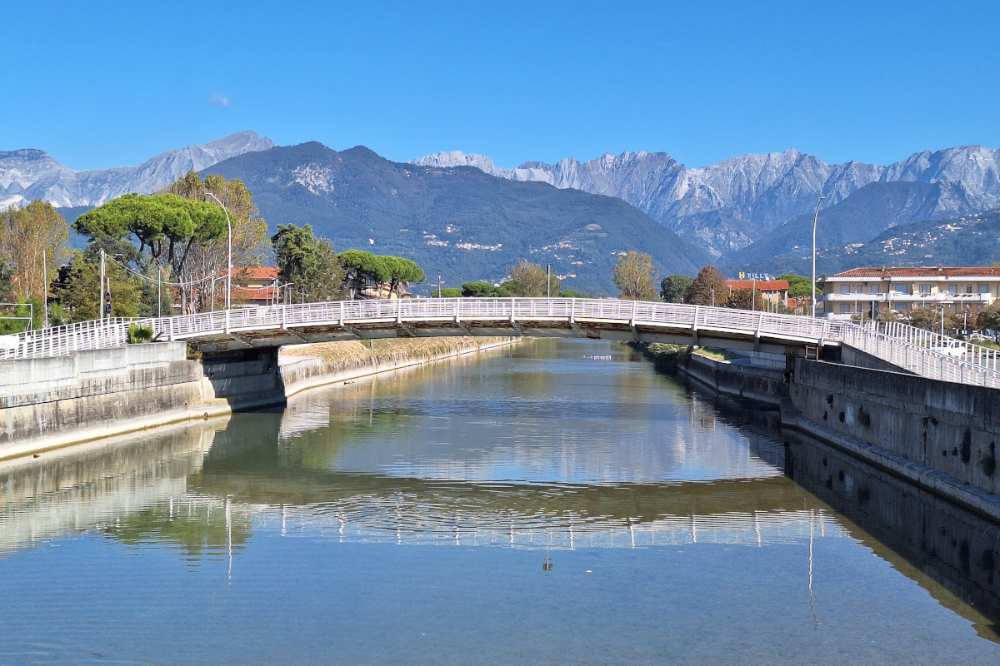

We trokken één volledige dag uit om Marina di Massa te verkennen. Een van de hoogtepunten van die dag was een kleine
fietstocht langs de kust, want ons appartement stelde fietsen ter beschikking. We legden een lus van 12 km af, naar het
natuurreservaat "Oasi WWF Dune di Forte dei Marmi" en terug. Die plek bleek eigenlijk gewoon een groter strand te zijn, wat
meer afgescheiden van de huizen die we onderweg passeerden.

  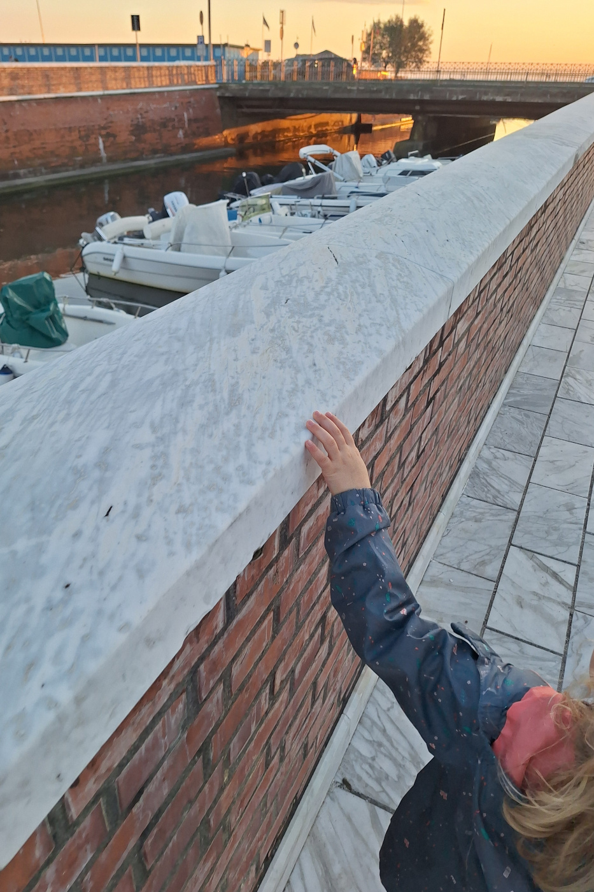
  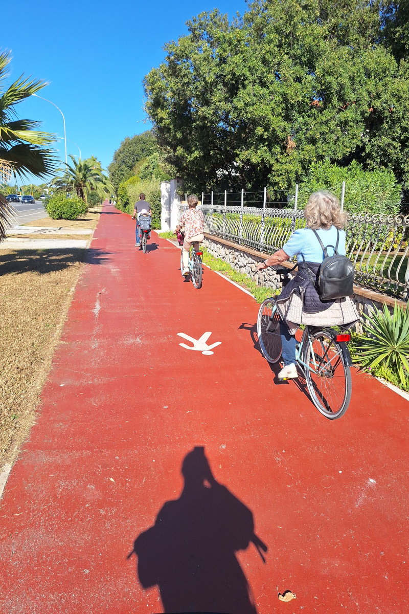

  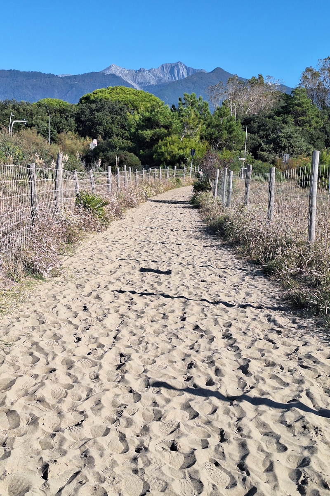
  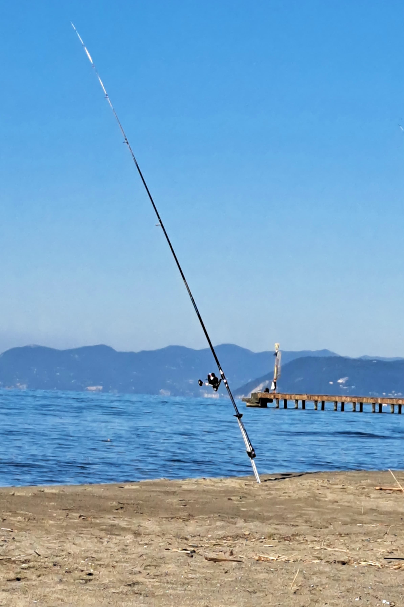

Toch moet ik eerlijk zijn over de zichten aan het strand. Anders dan de weidse promenades van
[Gandia]() in Spanje (waar we vorig jaar op vakantie waren), wordt een groot deel
van de kustlijn hier ingenomen door privéhotels en huiseigenaars. Meestal blokkeerden rijen gebouwen ons zicht op zee, met
er alleen tussenin kleine stukjes openbaar strand. Voor een korte herfstvakantie stoorde ons dat niet, maar het is iets om
in het achterhoofd te houden als je een klassieke zomervakantie aan zee met kinderen plant; het autoverkeer rijdt hier heel
dicht bij de belangrijkste wandelzones.

Ik had ook gehoopt de **Botanische Tuin Pietro Pellegrini** in de bergen te bezoeken, maar die sluit jammer genoeg in oktober
voor het seizoen. Kom je in de zomer, dan is er een speciale bus die je hoog de Alpen in brengt om de unieke flora van de
marmertoppen te zien.

Voor de verjaardag van mijn man planden we een daguitstap naar **Pisa**. Het plan was eenvoudig: een korte busrit naar het
station van Massa, gevolgd door een treinrit van 30 minuten die ons pal in het hart van de stad zou afzetten, waar we
meteen konden beginnen met rondkijken. Hieronder de lijst van de plaatsen die we die dag bezochten, in de volgorde van onze
wandeling (meer praktische informatie over tickets en prijzen [hier]().

De **Chiesa di Santa Maria della Spina** is een piepklein, rijkelijk versierd gotisch kerkje dat pal op de oever van de Arno
staat. Het trok meteen onze aandacht, want het oogt heel fijn door het lichte marmer en de vele ornamenten op de gevel. Het
is erg ongewoon door zijn nabijheid tot het water. De buitenkant is boeiender dan het interieur, dat tijdens ons bezoek
voor een tentoonstelling gebruikt werd. Binnen was er een interessant houten plafond, maar de meeste beeldhouwwerken zijn
naar andere kerken verhuisd. De **Ponte Solferino** ernaast bood een schattig uitzicht op de kleurrijke gebouwen langs de
Arno.

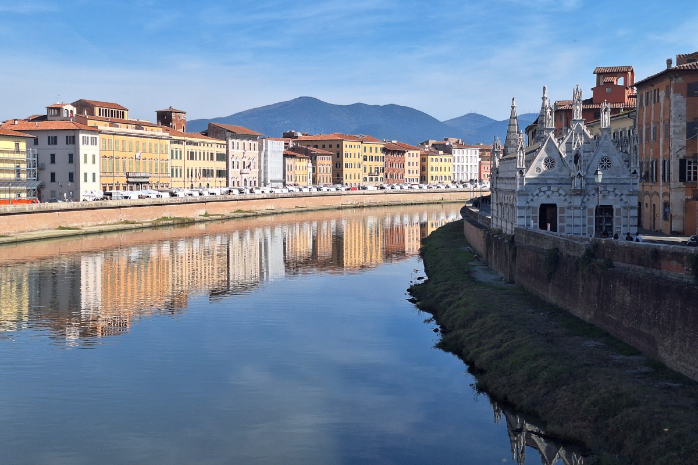

Omdat de tuin in de bergen bij Massa gesloten was, besloten we wat tijd door te brengen in de **Orto e Museo Botanico**. Het is
een van de oudste academische botanische tuinen ter wereld en biedt een heel rustige ontsnapping aan de drukte. Het kleine
museum was interessant en leerrijk, en ons kind was tijdens het hele bezoek nieuwsgierig en betrokken, maar de
tentoonstelling zelf sprak ons wat minder aan. We waren er in oktober, dus niet de periode waarin deze plek het kleurrijkst
is, maar we hebben er toch van genoten, zeker van het bamboebos en de serre met cactussen. We bezoeken graag botanische
tuinen wanneer we in grotere steden zijn, als een fijne stop om even in een rustig, verscholen stukje natuur op te gaan.

  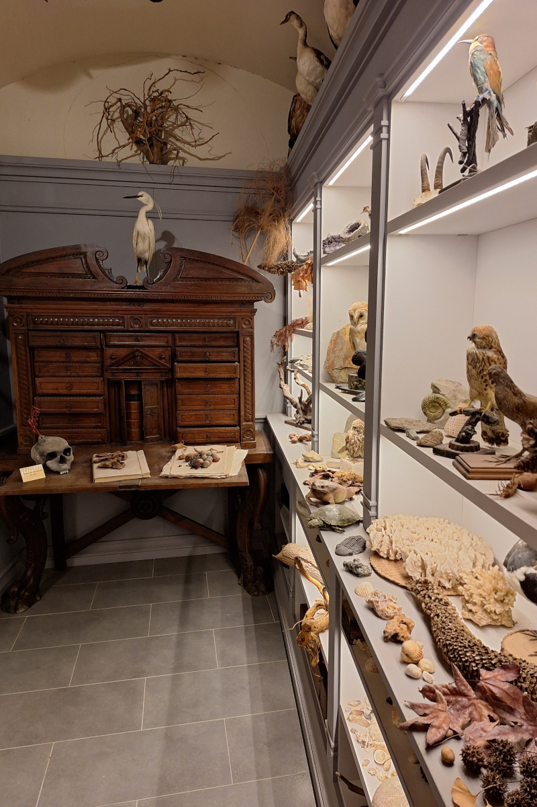
  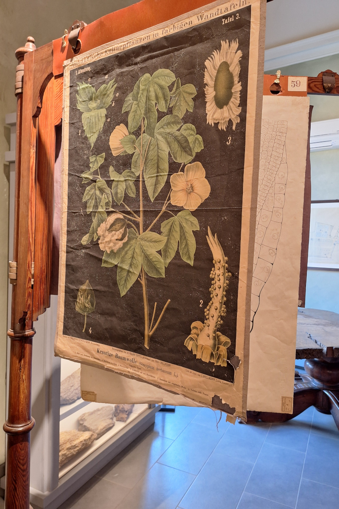

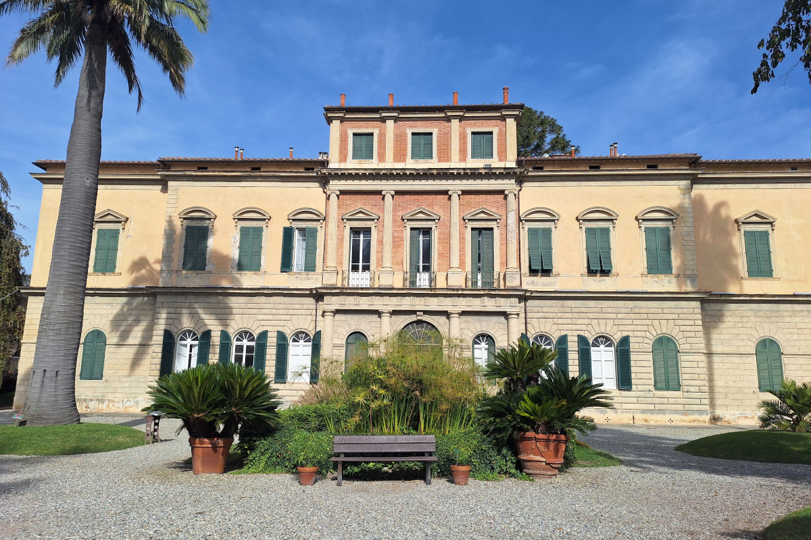

  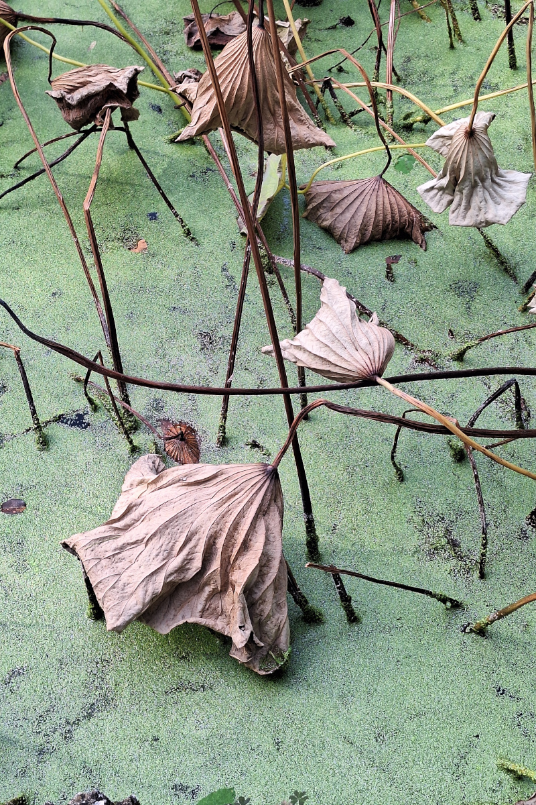
  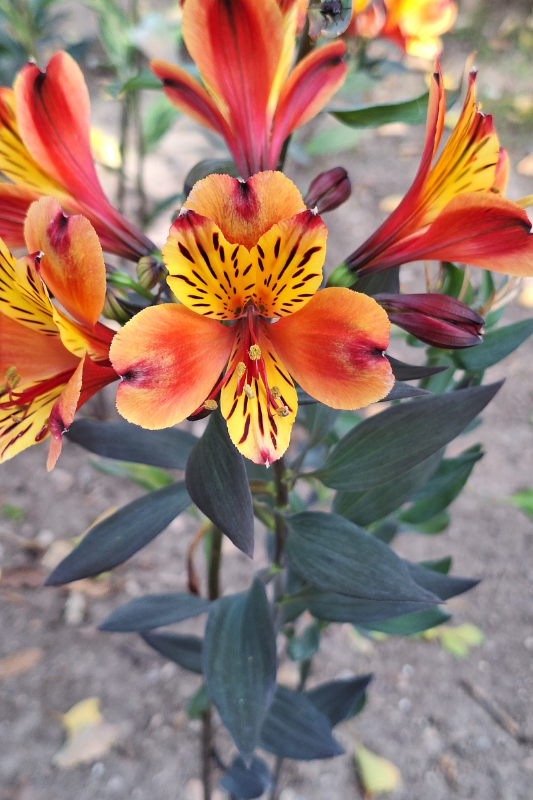

Zodra we het schitterende **Piazza dei Miracoli** bereikten, een adembenemend groots plein, zagen we meteen de beroemde toren
van Pisa en de omliggende gebouwen, die minstens even indrukwekkend waren.

**Battistero di San Giovanni**: dit is de grootste doopkapel van Italië, en in de middeleeuwen werden alle kinderen van Pisa
hier gedoopt. Het gebouw heeft een ronde vorm met een grote koepel bovenop. Blijkbaar heeft het binnenin een uitzonderlijke
akoestiek, en het personeel demonstreert vaak hoe het geluid onder de koepel weerkaatst en resoneert, maar wij hebben dat
niet kunnen horen. Reis je zonder buggy, dan kan je de steile trappen naar de eerste verdieping van de doopkapel op voor een
uniek perspectief op het interieur (wij lieten onze buggy tijdens het bezoek gewoon binnen bij de ingang staan).

  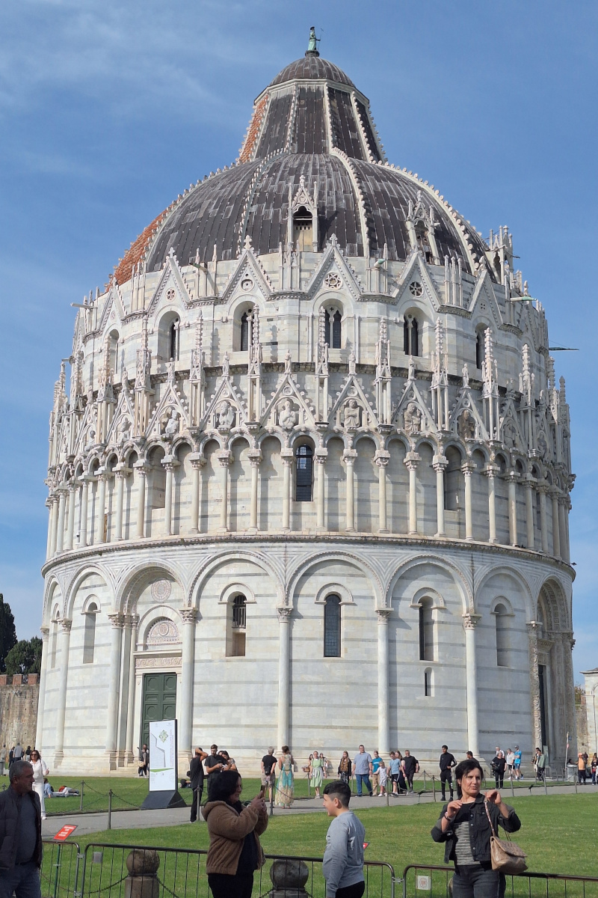
  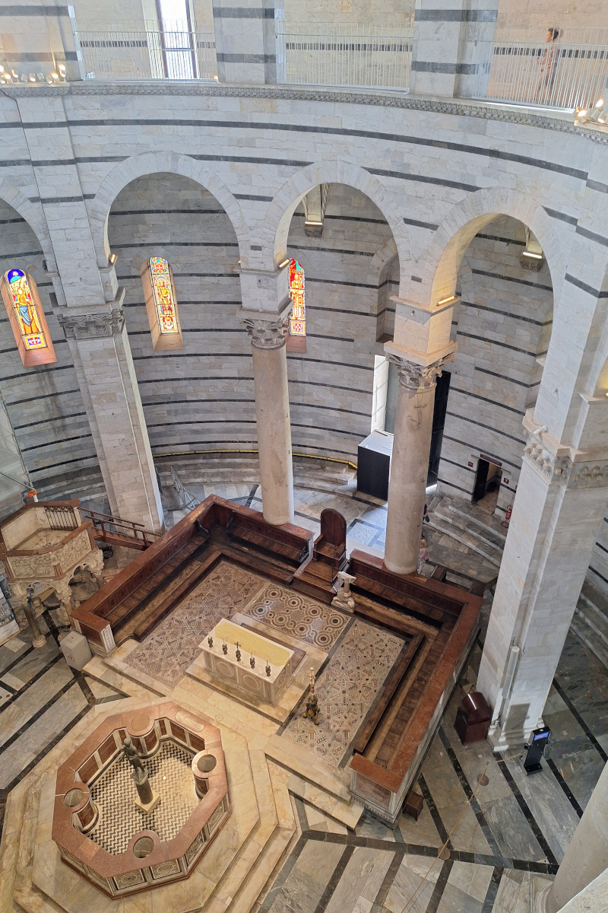

**Camposanto**: dit is een monumentaal kerkhof met prachtige fresco's en een rustige groene binnenkoer in het midden. Het
voelde veel meer als een openluchtgalerij dan als een begraafplaats, en het was mijn onverwachte favoriet. Het was de
begraafplaats van de elite en werd ontworpen als een prestigieuze rustplaats voor: belangrijke inwoners van Pisa,
adellijke families, geestelijken en intellectuelen.
Hier begraven worden was een teken van status en eer. Je ziet er grote monumenten die families en hun verwezenlijkingen
verheerlijken. De fresco's waren niet enkel versiering, ze hadden een sterk educatief en moreel doel en herinnerden de
bezoeker aan de sterfelijkheid en de broosheid van het leven.

  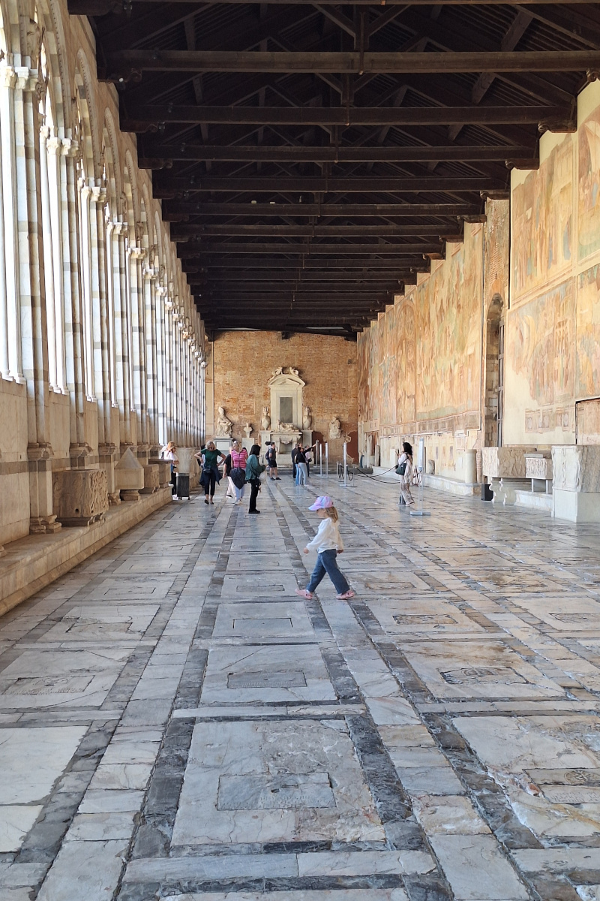
  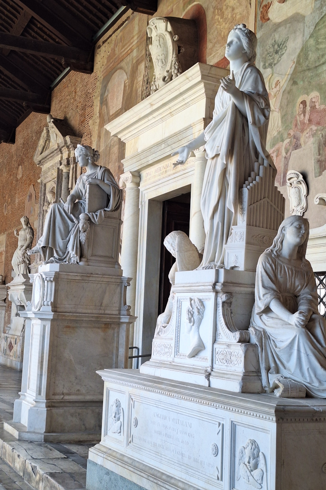

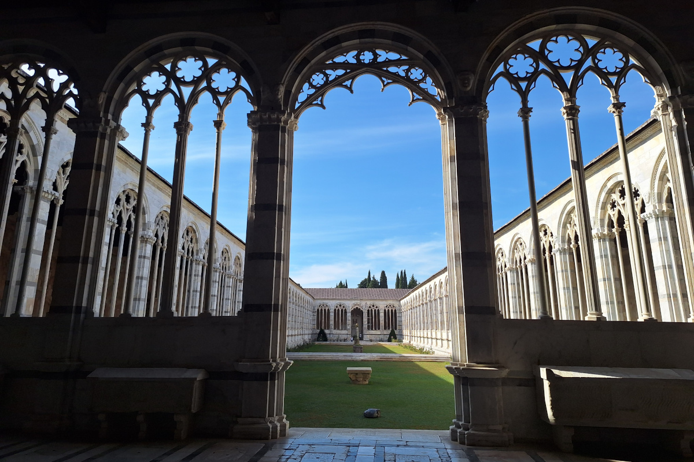

**Cattedrale di Pisa**: het interieur heeft gestreept marmer, zuilen en een enorm mozaïek in de apsis. Er waren tijdens ons
bezoek veel bezoekers binnen, maar de sfeer bleef toch rustig en monumentaal. Er wordt met tijdsloten gewerkt om het aantal
bezoekers binnen te regelen, zodat het er nooit gevaarlijk druk wordt.
Veel originele beeldhouwwerken werden door kunstenaars gemaakt, maar zijn na verloop van tijd weggehaald om ze te
beschermen tegen weer en beschadiging. Vandaag worden de originelen in het museum bewaard, terwijl op de gevel kopieën
staan.

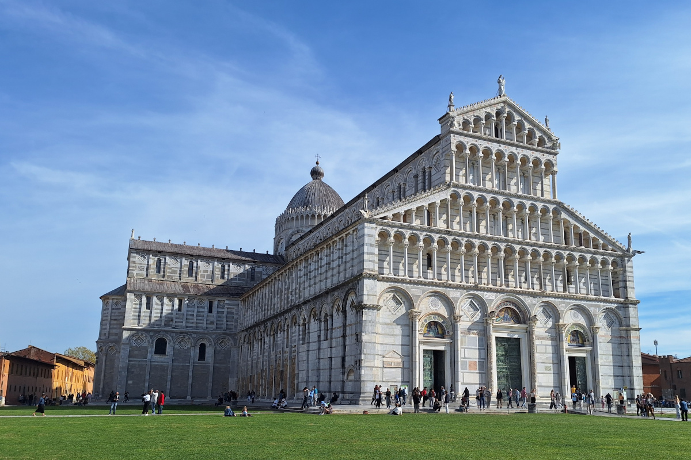

  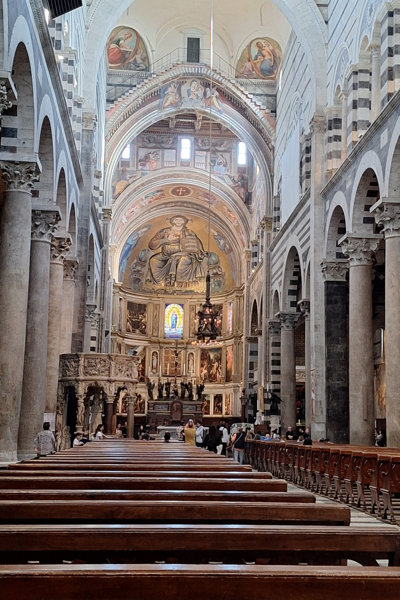
  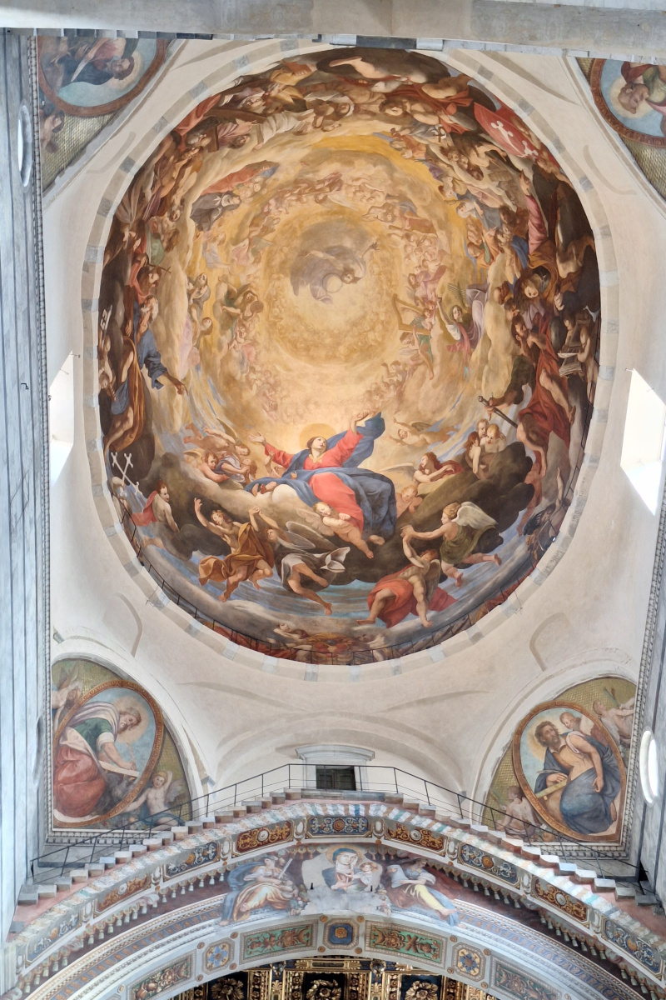

**Museo dell'Opera del Duomo**: dit museum is een onmisbare halte bij een bezoek aan het Piazza dei Miracoli, want het
bewaart originele kunstwerken en bouwelementen van de kathedraal van Pisa, de doopkapel en de scheve toren. Veel
beeldhouwwerken, deuren en marmeren versieringen die hier tentoongesteld staan, werden naar binnen gehaald om ze tegen
weersinvloeden te beschermen en buiten door kopieën vervangen. Zo kunnen bezoekers hun fijne details van dichtbij
bewonderen en tegelijk begrijpen hoe ze oorspronkelijk in de architectuur en de religieuze functie van het plein pasten. De
groene binnenkoer in het midden symboliseerde vrede en eeuwigheid.

Het museum biedt een rijke collectie beeldhouwwerken, liturgische voorwerpen en oude boeken, samen met stukken die de
geschiedenis en het ontwerp van het hele complex toelichten, waaronder een grote maquette van de scheve toren. Een
hoogtepunt is het terras van het café, met een van de beste, drukteloze uitzichten op de toren. Het bezoek zit inbegrepen
in het combiticket voor het complex, en alles bekijken duurt meestal zo'n 1 tot 1,5 uur, afhankelijk van hoe grondig je de
stukken bekijkt. Al bij al vormt het museum een sleutel om de monumenten buiten beter te begrijpen, terwijl het een
rustigere en gedetailleerdere ervaring biedt, en we hebben er echt van genoten!

  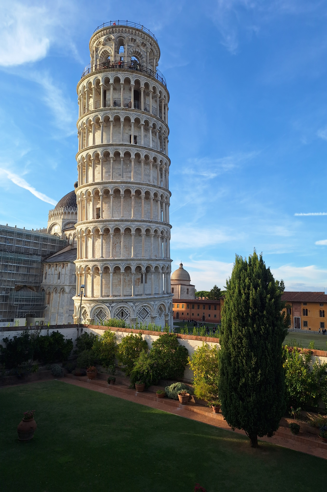
  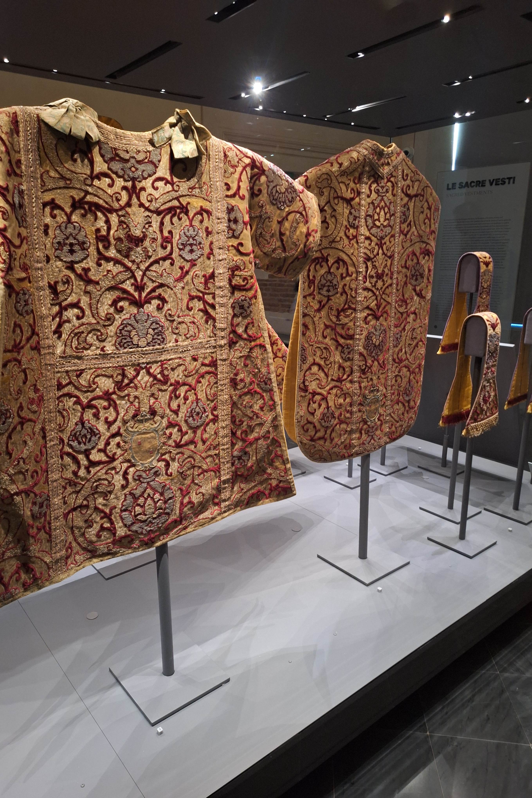

**Sinopie-museum**: na de Tweede Wereldoorlog richtte een brand in het Camposanto Monumentale zware schade aan de fresco's
aan. Om ze te redden haalden experts de geschilderde lagen van de muren, en daarbij ontdekten ze de "sinopie", de originele
schetsen eronder. De sinopie (ondertekeningen) worden bewaard in het museum, dat volledig aan die verborgen tekeningen
gewijd is. De gerestaureerde fresco's keren geleidelijk naar het Camposanto terug. "Sinopia" betekent de eerste schets van
een fresco, in rood pigment op de pleisterlaag getekend voor het schilderen begon. Anders dan afgewerkte fresco's voelen
die tekeningen dynamischer en expressiever aan; je ziet er vaak correcties, verschillende handen en het denkproces van de
kunstenaar. Ze geven je een zeldzame kans om te begrijpen hoe middeleeuwse meesterwerken werkelijk tot stand kwamen, niet
alleen hoe ze er afgewerkt uitzien. Ze waren nooit bedoeld om gezien te worden, ze zijn als het originele bouwplan van de
kunstenaar. Ik denk niet dat we dit museum bezocht zouden hebben als het niet inbegrepen was geweest. De tentoonstelling
was niet erg goed toegelicht, waardoor ze zonder voorkennis moeilijk te begrijpen valt, en voor ons was het prima om er
even kort binnen te springen als aanvulling op het bezoek aan het Camposanto, want het helpt je de fresco's beter te
begrijpen. Het bevindt zich in hetzelfde gebouw als de ticketbalie.

  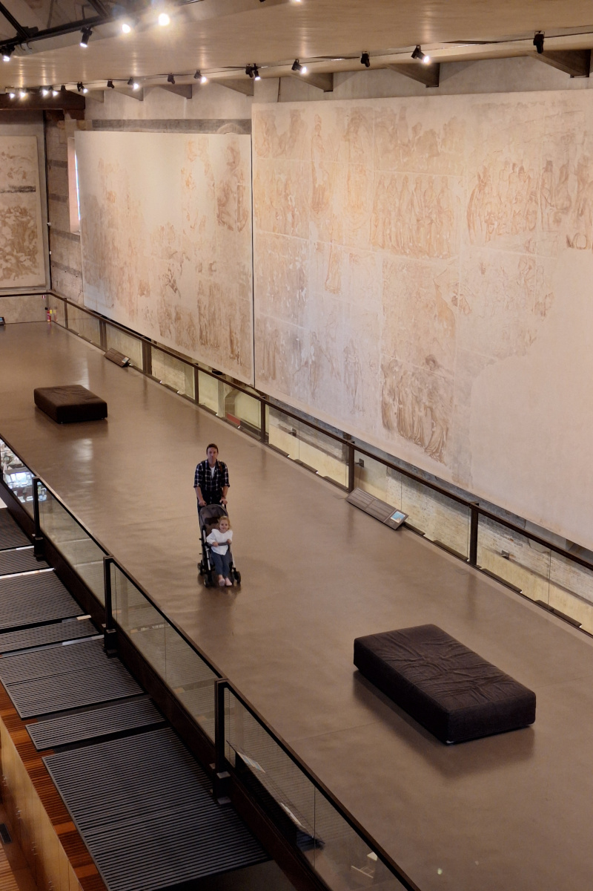
  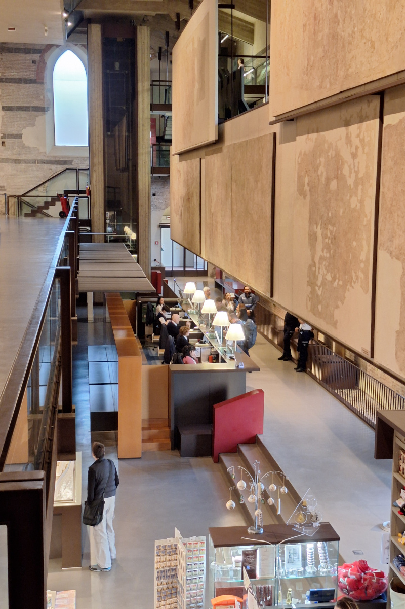

**De scheve toren van Pisa**: kinderen die nog geen 8 jaar zijn, mogen niet naar binnen. Daarom besloten we deze attractie
over te slaan. We genoten dus gewoon van het zicht van buitenaf en verkenden de gebouwen eromheen.

**Mura di Pisa**: je kan effectief over de oude stadsmuren wandelen, maar omdat we de buggy bij hadden, moesten we dit
overslaan, want ze zijn niet volledig toegankelijk voor kinderwagens. Je kan vrij in beide richtingen over de open stukken
wandelen en er zijn meerdere toegangspunten (trappen en liften), zodat je kan starten en stoppen waar je wil en enkel een
deel of de hele route kan afleggen.

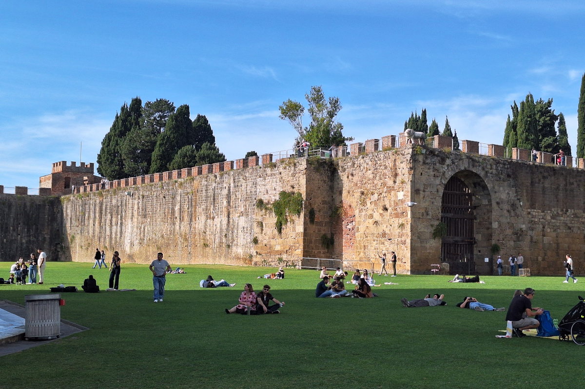

Na een lange dag stappen trokken we via het Piazza dei Cavalieri (ooit het politieke hart van middeleeuws Pisa) verder
richting **Borgo Stretto**, een van de sfeervolste straten van de stad, met middeleeuwse arcades, kleine boetieks en
koffiebars, perfect voor een ontspannen wandeling terwijl je uit de zon of de regen blijft. We doken een zijstraat in voor
een verjaardagsdiner bij **La Ghiotteria**, een gezellige zaak die bekendstaat om haar lokale Toscaanse gerechten en intieme
sfeer. Na het eten wandelden we verder richting de Arno en passeerden we het standbeeld van Vittorio Emanuele II, een
monument voor de eerste koning van het verenigde Italië. De omgeving langs het water, en dan vooral de Lungarno, komt 's
avonds vaak tot leven, en net daar stootten we onverwacht op een charmante rommelmarkt, met kraampjes vol antiek, boeken en
handgemaakte spullen, wat het einde van de dag een levendige en authentieke toets gaf.

Massa en Pisa vormden een perfect tegengewicht voor het stevige wandelen in Cinque Terre. Heb je een extra dag in de streek
rond Massa, dan raad ik een bezoek aan het stadje **Carrara** van harte aan. Je kan er een Marmo Tour meepikken tot in het
hart van de "Fantiscritti"-groeven, om precies te zien waar het marmer voor Michelangelo's David vandaan kwam. Voor ons
zouden dat gewoon te veel intensieve dagen na elkaar geweest zijn.

Meer informatie over Massa en Carrara [op de officiële website van de regio](https://www.visitrivieraapuana.it/en/)  
Meer informatie over wandelingen in de streek, zeker voor wie deze omgeving met de auto bezoekt, vind je op
[deze website](https://www.visittuscany.com/en/ideas/routes-apuan-alps/)
