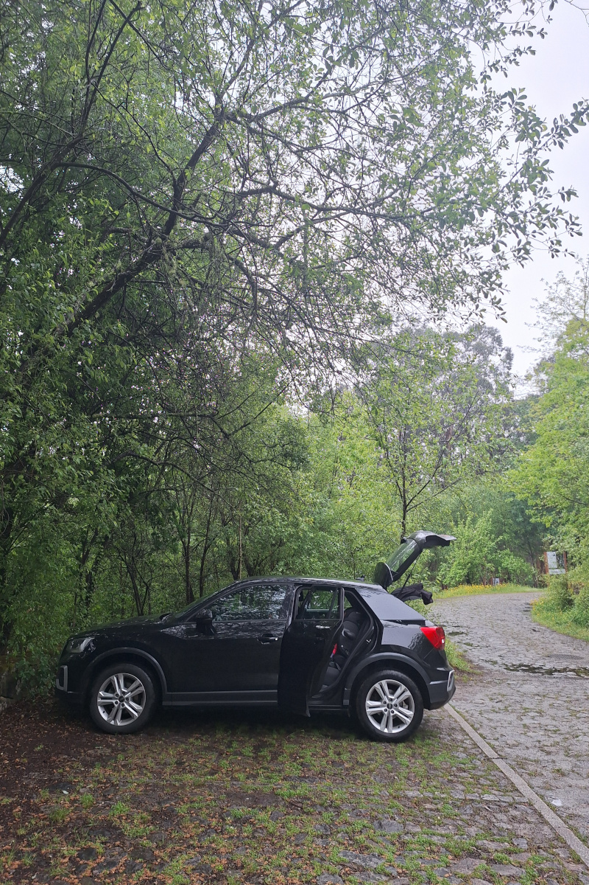
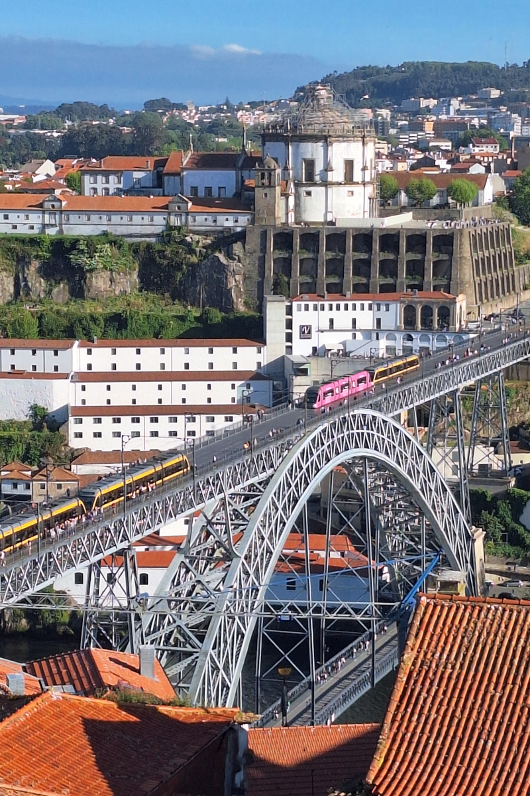
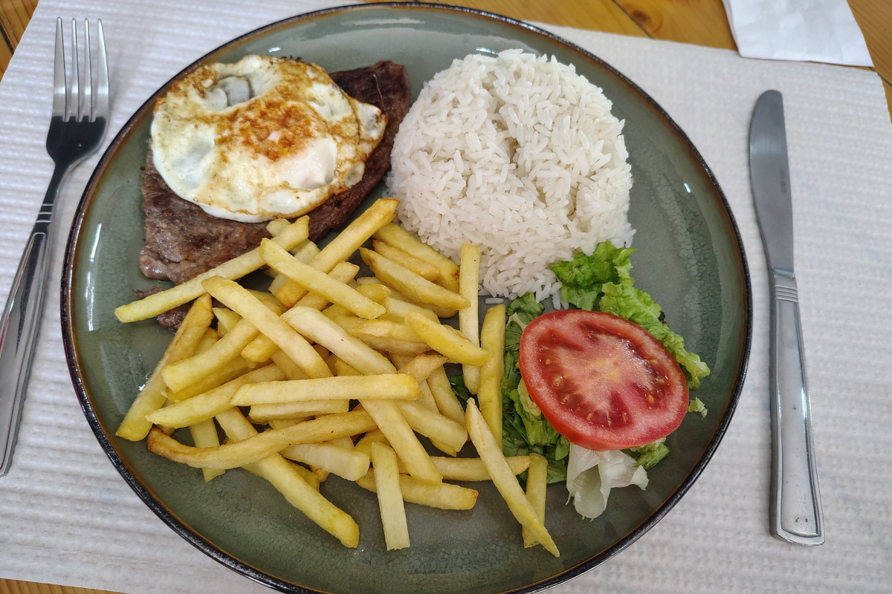
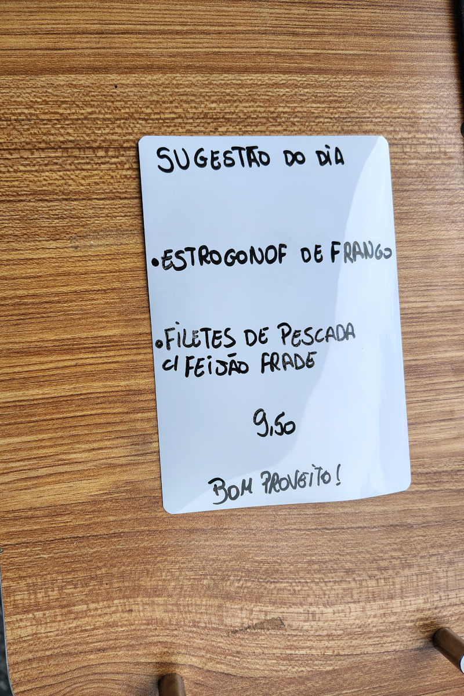
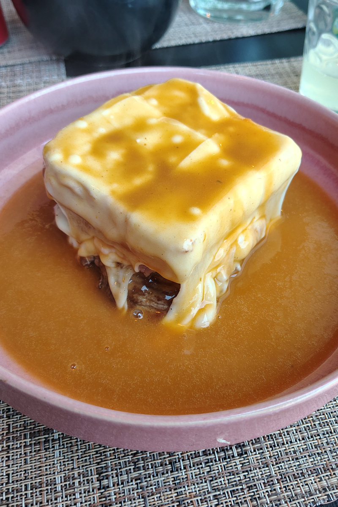
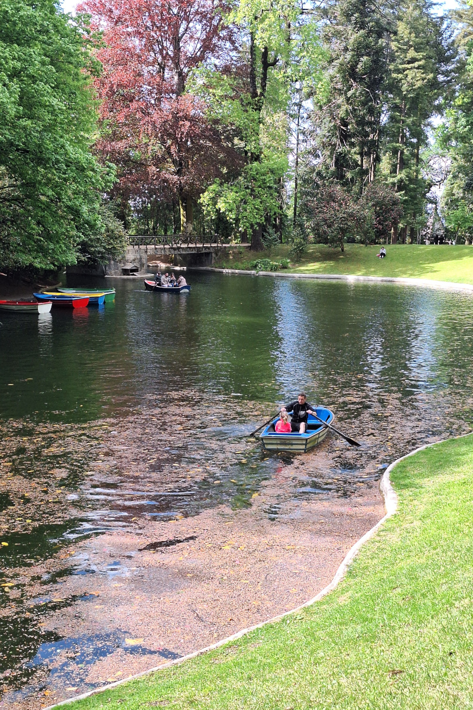
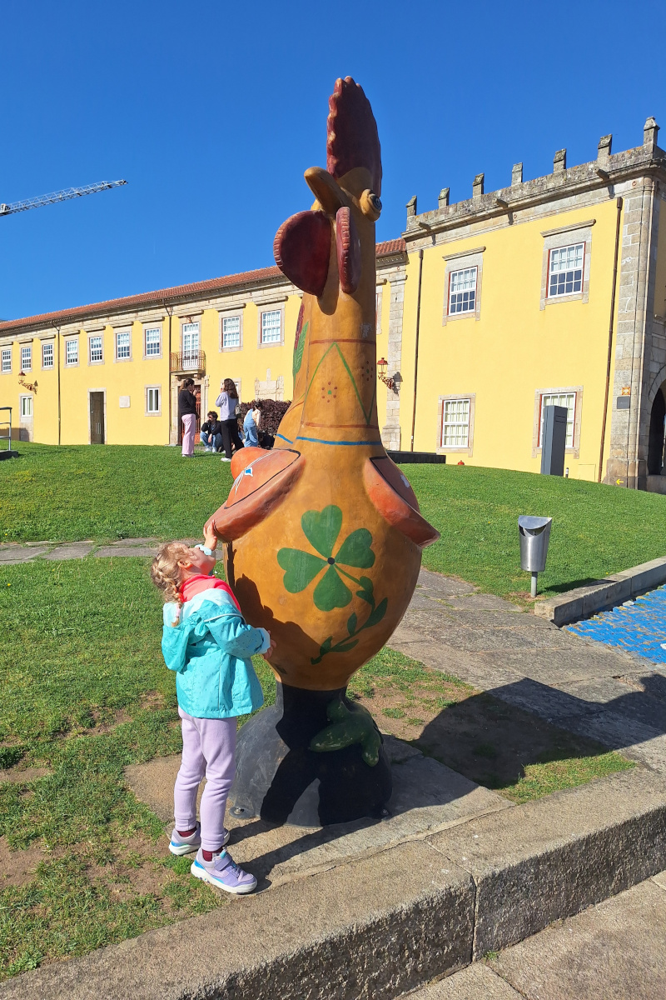

Noord-Portugal is een van de meest onderschatte regio's van Europa voor een roadtrip in de lente. Met historische steden,
prachtige stranden, berglandschappen, uitstekend eten en relatief korte rijafstanden bleek het de perfecte bestemming voor
onze gezinsreis. Zoals elk jaar hebben de kinderen in België twee weken paasvakantie.
We zochten dus een bestemming die warmer is dan België maar niet te ver weg ligt, met goede vliegverbindingen.
Noord-Portugal bleek een ideale keuze!

Tijdens onze roadtrip van 8 dagen verkenden we Porto, Braga, Barcelos, Ponte de Lima, Viana do Castelo en kleinere
kuststadjes. We combineerden stadsbezoeken met natuur en de lokale keuken. Met een vierjarige dochter en mijn vader
die uit Polen overkwam, zochten we een ontspannen plan met een goed evenwicht tussen cultuur, strand, wandelen en
kindvriendelijke attracties.

In dit artikel deel ik ons volledige programma, tips over vervoer, ervaringen met onze accommodatie, restaurantaanbevelingen,
ons reisbudget en praktisch advies om Noord-Portugal met de auto te verkennen. Plan je een roadtrip door Portugal met
kinderen, of zoek je gewoon ideeën buiten Porto, dan helpt deze gids je misschien om je eigen avontuur uit te stippelen.

## Onze route en algemene indrukken
Ik was al in december 2024 in Porto geweest voor een lang weekend bij een collega, en ik heb enorm van dat verblijf
genoten. Dit keer wilde ik meer van Noord-Portugal ontdekken met mijn gezin, door een auto te huren en een roadtrip te
maken, net zoals we [vorige zomer in Denemarken]() deden.
Mijn vader kwam vanuit Polen naar ons toe, waardoor dit onze eerste reis was waarbij iemand apart vanuit een ander land
kwam overvliegen. Dat maakt de coördinatie van een groepsreis altijd wat riskanter, zeker omdat vluchten geannuleerd
kunnen worden, maar gelukkig verliep alles vlot. Wij kwamen een dag voor mijn vader aan, maar onze terugvluchten waren op
dezelfde dag, wat de logistiek eenvoudiger maakte. Bekijk de details van onze route op de Google Maps-kaart hieronder:

<iframe src="https://www.google.com/maps/d/u/0/embed?mid=1vUmgFtmt-hGxwTlX1H6uc6AoQyJPCFE&ehbc=2E312F" width="640" height="480"></iframe>

Meer details over mijn eerdere reis vind je in deze posts: [Een regenachtige dag vol avontuur in Porto]()
, [Een magisch bezoek aan Braga en Guimarães]() en [De natuur- en cultuurpracht van
Gerês-Xurés ontdekken]()

## Je verplaatsen – tips over vervoer
We huurden de auto op de luchthaven en leverden hem daar ook weer in. De laatste 2 dagen van ons verblijf hadden we in
Porto eigenlijk helemaal geen auto nodig, want we verkenden de stad te voet. Sixt heeft meerdere inleverpunten in Porto,
waaronder een buiten het centrum, maar de auto op een andere plek inleveren dan waar je hem hebt opgehaald zou een extra
kost hebben betekend. Daarom had het voor ons meer zin om de auto terug te brengen naar de luchthaven, waar we hem hadden
opgehaald.

Een metroticket kost 2,90 euro (2,30 euro voor zone Z4 + 0,60 euro voor de Andante-kaart). De Andante-kaart is
herlaadbaar, dus je betaalt die kost één keer en kan meerdere ritten tegelijk kopen. Op de ticketautomaat hing een sticker
met alle metrostations en daarnaast de zone die geldt wanneer je er vanaf de luchthaven naartoe reist. Ik moest naar het
metrostation General Torres, dus dat was Z4. Meer details vind je ook op de [officiële website](https://en.metrodoporto.pt/pages/391).
Vergeet je ticket niet te ontwaarden voor je de metro neemt, aan de toestellen naast de ticketautomaat of op de perrons.
Je moet je ticket opnieuw ontwaarden wanneer je van lijn verandert, dus in ons geval deden we dat nog eens voor we in
Trindade op lijn D stapten. Het metronet ligt in deze omgeving deels bovengronds, waardoor het vaak eerder als een tram
dan als een metro aanvoelt. Wij namen lijn E (paars) van de luchthaven naar Trindade (eindhalte) en stapten daar over op
lijn D richting Santo Ovídio. We stapten uit bij General Torres. Lijn D rijdt frequent en steekt de iconische
Luís I-brug over.

  
  

## Parkeren en rijden
We hebben tijdens de hele reis geen enkele keer voor parkeren betaald. In kleinere stadjes en bij de meeste
bezienswaardigheden was parkeren gratis. Ook in Braga, waar we vier nachten bleven, was het in sommige zones gratis, maar
laat in de namiddag, wanneer we van onze daguitstappen terugkwamen, kon het lastig zijn om nog een plaats te vinden. Na
een paar dagen wisten we welke straten de meeste kans op een gratis plek boden. Op sommige plaatsen zagen we de
inwoners buiten de vakken parkeren, en af en toe deden we dat ook, maar altijd legaal en zonder parkeerverbodsborden te
negeren.
Ons appartement lag heel centraal, en die ligging betaalden we met beperkte parkeermogelijkheden. Vanaf de verste
parkeerplaats moesten we zo'n 250 m stappen tot aan het appartement. We duidden altijd aan waar de auto stond, om de
volgende dag geen tijd te verliezen met zoeken in de smalle straatjes!

In Porto namen we ook Bolt om vanuit ons appartement naar het Parque de Serralves te gaan. Voor die rit van 6 km betaalden
we ongeveer 6 à 7 euro per rit, wat erg voordelig is vergeleken met het openbaar vervoer als je met drie reist
(mijn vader was al naar de luchthaven vertrokken toen we op de laatste dag besloten dat park te bekijken), en het was
zonder twijfel de snelste en makkelijkste manier om er te raken.

## Brandstof en wegen
De brandstofprijzen lagen tussen €1,88 en €2,02 per liter, waarbij Auchan de goedkoopste optie was. We reden in totaal
bijna 500 km, dus we moesten niet meerdere keren tanken en gebruikten het [tankstation vlak bij de
luchthaven](https://maps.app.goo.gl/1HjWYrcv8PPcYu159).
Portugal heeft tolwegen, maar die hebben we altijd vermeden. Op onze routes bedroeg het tijdsverschil vaak minder dan 10
minuten, en door kleinere dorpjes rijden was eigenlijk aangenamer. Het was niet bijzonder druk, maar de snelheidsbeperkingen
hielden ons wel wat op. Wanneer je een auto huurt bij Sixt, rekenen ze een extra E-Toll-kost aan voor het gebruik van hun
automatische systeem op de Portugese snelwegen, zodat je niet moet aanschuiven en manueel betalen. Daardoor kan zelfs een
kort stukje snelweg, dat normaal weinig kost, onevenredig duur uitvallen door de dagelijkse kost van €2,23. Sixt rekent
die E-Toll-kost automatisch aan voor de hele huurperiode en betaalt hem nadien terug als de auto geen enkele tolpoort is
gepasseerd. Men liet me weten dat de terugbetaling binnen de 30 dagen na de huur zou gebeuren, en dat gebeurde ook zoals
beloofd. De wagens zijn uitgerust met een elektronisch tolapparaat.

## Accommodatie
We verbleven in Airbnb-appartementen in A Ver o Mar en Braga, telkens een volledig appartement. Bij beide konden we zelf inchecken
via een sleutelkluis. Ze waren erg ruim en hadden hoge beoordelingen. [Het eerste appartement](https://www.airbnb.com/rooms/1476400048216795229?source_impression_id=p3_1777192418_P3A-TqFdcgkEuJr5)
was heel comfortabel en lag vlak bij een groot strand. Het stadje zelf was niet bijzonder charmant, maar het was een prima
uitvalsbasis om de kust te verkennen en lag handig dicht bij de luchthaven, waar ik op de tweede dag van ons verblijf mijn
vader moest ophalen.
[Het appartement in Braga](https://www.airbnb.com/rooms/1049432939272944201?source_impression_id=p3_1777192408_P3XfhOAaPK4f9YVo)
was modern, goed gelegen en had een lift, maar de slaapzetel in de woonkamer was behoorlijk oncomfortabel.

In Porto vonden we een interessante aanbieding via [Booking - Cais de Gaia Historic Loft](https://www.booking.com/Share-dKIhYxt).
Ik vergelijk meestal Airbnb en Booking, zeker in grotere steden waar de concurrentie hoger ligt. Dit appartement bleek een
uitstekende keuze op een toplocatie. Het was veel kleiner dan de vorige, maar zo goed ingedeeld dat we dat helemaal
geen probleem vonden, en de gastheer verwelkomde ons persoonlijk en gaf ons heel wat nuttige tips.

Gemiddelde kostprijs: €90 per nacht  
•	Idealiter boek je minstens 3 maanden op voorhand om een goede prijs te vinden  
•	Gemiddelde beoordeling: 4,9+  

## Eten & uit eten gaan
We zochten lokale restaurants met goede recensies en een goede prijs-kwaliteitverhouding. Houd er rekening mee dat
restaurants in Portugal rond 15 uur sluiten en om 19 uur weer opengaan. Er zijn altijd wel een paar zaken die de hele dag
open blijven, maar echt veel zijn dat er niet, en vaak gaat het om fastfood. Om niet laat op de avond te moeten eten, wat
met onze dochter lastig zou zijn, aten we rond de middag, en dat bleek ook goed voor onze portemonnee, want de meeste
restaurants hadden een dagschotel, "sugestão do dia", aan een lagere prijs van zo'n 10 euro (met 2 tot 6 gerechten om uit
te kiezen). We aten altijd op restaurant, want het eten was goedkoop en erg lekker. Onze dochter proeft graag nieuwe dingen,
maar ik had het gevoel dat het sowieso makkelijk was om iets te vinden dat haar lag. Tot onze verbazing werden er bijna
altijd frietjes samen met rijst en vlees geserveerd, terwijl groenten een kleiner deel van het bord uitmaakten. We
probeerden ook de beroemde francesinha uit Porto, maar dat was niet mijn favoriete gerecht, want het was te zwaar. In de
lokale restaurants konden we niet in het Engels communiceren, dus AI kwam goed van pas. Was er niet eens een Engelse menukaart,
dan namen we een foto van de dagschotels, die vaak op een bord voor het restaurant stonden, en vroegen we AI om die te
vertalen. Daarna lieten we AI zelfs een lijstje maken met de gekozen dranken en gerechten in het Portugees, dat we dan aan
de dienster toonden. Ze waren erg blij met die duidelijke instructies. Iedereen was altijd heel vriendelijk, ook al liep de
communicatie soms wat stroef.

  
  

## Lijst van restaurants die we aanraden:
Porto: [Spice Art Indian Restaurante & Bar](https://maps.app.goo.gl/SjQhQqhTJLWr8sya9)  
Porto: [Mirone - Cachorrinhos do Morro](https://maps.app.goo.gl/s3bZUU24cY7yKSX5A)  
Porto: [Manteigaria](https://maps.app.goo.gl/zCoh84FsDt8h5q379)  
Porto: [Casa Expresso](https://maps.app.goo.gl/63yRQpKE3E2N7Rnh8)  
Barcelos: [Cafe Raiz Barcelos 2 - de enige die 's namiddags niet sluit](https://maps.app.goo.gl/eMqirbf4LDqyaec2A)  
Aver-o-Mar: [Tasquinha Sra. Das Neves](https://maps.app.goo.gl/ghn9cEL98cqAE7B9A)  
Viana do Castelo : [Recanto da Picanha](https://maps.app.goo.gl/e3jPQnhyxjK3MH81A)  
Ponte de Lima: [NACOS Restaurante](https://maps.app.goo.gl/3YfZDo8QcpXRYjDRA)  
Braga: [Atípica](https://maps.app.goo.gl/UpCRBGD8gC8D7bw88)  
Braga: [Bella Braga Caffé & Restaurante](https://maps.app.goo.gl/tsmwZfs4sLDtM2q1A)  

## Budgetoverzicht (voor 8 dagen, 3 volwassenen en een vierjarig kind)

| Categorie                                       | Totale kost (€) |
|-------------------------------------------------|----------------:|
| Vluchten                                        |             750 |
| Vervoer (auto, brandstof, metro, trein, bolt)   |             555 |
| Accommodatie                                    |             740 |
| Restaurants                                     |             355 |
| Boodschappen                                    |              86 |
| Activiteiten                                    |              44 |
| **Totaal**                                      |        **2530** |

## Onze ervaring met reizen met een kind
Deze reis verliep makkelijker door de kortere afstanden tussen de bezienswaardigheden. Hoewel goede speeltuinen erg
schaars waren, hield de natuur onze dochter bezig. Ze was blij wanneer we zelfs maar een klein speeltuintje vonden, maar
stranden, bossen of oude middeleeuwse stadjes ontdekken bleek een perfecte vervanging.
We waren ook grote fans van de Portugese keuken en deelden onderling verschillende gerechten om van alles te proeven. Meestal
bestelden we voor haar geen apart gerecht, maar kreeg ze van ons allemaal wat om te proeven. Soms bestelden we een extra
voorgerecht, maar meestal waren de porties groot genoeg om te delen. Ze kreeg in het restaurant altijd een extra bordje
zonder dat we erom moesten vragen, wat heel fijn was.
Veel wandelingen hadden verschillende varianten, dus we vonden altijd een geschikte lengte voor ons. Een van de
hoogtepunten was een bootje nemen op het meer van het Bom Jesus-park, een ritje van amper 15 minuten, maar voor haar dolle
pret. Ze vond het ook geweldig om in Barcelos naar de verschillende hanen te zoeken, waar dit symbool van Portugal op
verschillende plekken in de stad verstopt zat.
Een korte wandeling in de Serra da Labruja, met watervallen en twee hangbruggen, was een van de plekken waar ze erg
enthousiast over was. Er was ook een leuk [park](https://maps.app.goo.gl/KqtFnzwtaMAmBqcSA) bij het eerste appartement
waar we verbleven, maar de [Jardins do Palácio de Cristal](https://maps.app.goo.gl/3VEPVtXa1NSFgGso9) waren haar favoriet,
door de dieren die er leven.

  
  

## Slotgedachten en aanbevelingen
We hebben geen spijt van de plekken die we kozen. Het evenwicht tussen steden, bergen en kust werkte heel goed.
Voor een lentereis is Noord-Portugal een uitstekende optie. De lokale bevolking vond het weer niet ideaal, maar voor ons
voelde 15–20 °C comfortabel en aangenaam om op verkenning te gaan.
