De kustlijn van Noord-Portugal verraste ons veel meer dan we hadden verwacht. Tijdens onze roadtrip tussen Porto en Braga
verkenden we **Viana do Castelo, Barcelos, Parque Natural do Litoral Norte**, de beroemde windmolens van Apúlia en de oude
heuvelnederzetting **Castro de São Lourenço**. In deze post deel ik ons gedetailleerde programma voor de eerste 2 volledige dagen
van ons verblijf, praktische tips en eerlijke indrukken van een verkenning van de Noord-Portugese kust met een kind in de lente.

Ondanks de vertraagde vlucht van mijn vader konden we onze daguitstap naar Viana do Castelo toch nog voor lunchtijd
beginnen. Om mijn man en dochter een extra uur in de auto te besparen, zette ik hen af in het aangename **Parque da Cidade
da Póvoa de Varzim**, vlak bij de hoofdweg naar de luchthaven. Ons appartement lag zo'n 30 minuten verderop, dus het had
weinig zin dat zij met mij heen en weer zouden rijden.

Eerst haalde ik mijn vader op aan de luchthaven, daarna keerde ik terug voor mijn man en dochter, en samen reden we
rechtstreeks door naar **Viana do Castelo**. De bekendste bezienswaardigheid van de stad, het heiligdom van het Heilig Hart
van Jezus (Santuário de Santa Luzia), staat hoog op een heuvel met uitzicht over de stad en de Atlantische kust.
Het bleek de warmste dag van onze reis te worden, dus mijn idee om de trappen naar het heiligdom te nemen was misschien
niet de slimste keuze. Hoewel het pas net na elf uur was, was de hitte al stevig. We zetten de auto in het hoger
gelegen deel van de stad en volgden een doolhof van smalle straatjes tot we bij de grote trap naar de kerk kwamen. Jammer
genoeg lag het grootste deel van de klim volledig in de zon.

  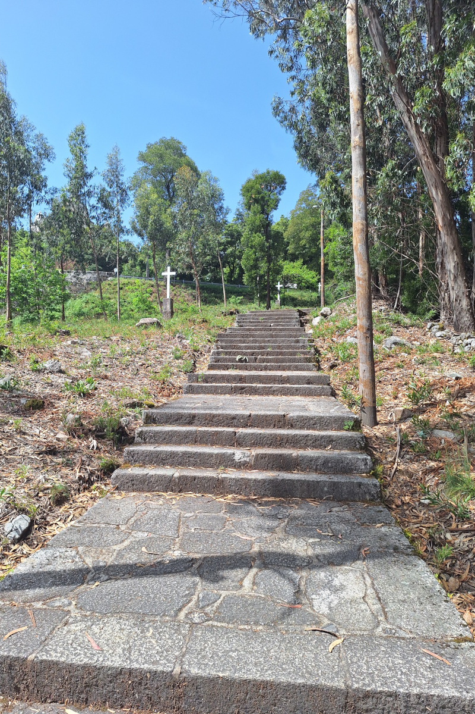
  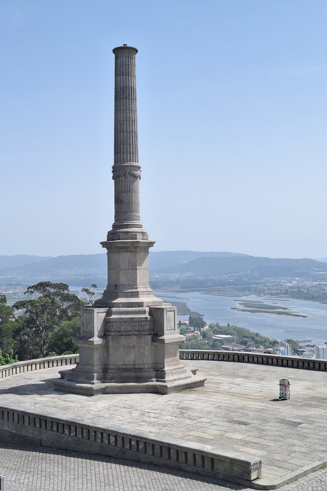

Op een bepaald moment passeerden we het bovenstation van de historische funiculaire van Santa Luzia, de langste
kabelspoorweg van Portugal. Er was niemand te bespeuren en we zagen het wagentje niet bewegen, dus even vroegen we ons
af of de funiculaire die dag wel reed. Toch wisten we dat we al snel een spectaculair uitzicht zouden krijgen, en dat klopte.
Plots dook de majestueuze kerk op, samen met het grote plein ervoor en een adembenemend panorama over de oceaan, de rivier
de Lima en de stad beneden.

Achter de kerk ligt een klein picknickterrein met tafels verscholen in de schaduw van de bomen. Er zaten heel wat mensen
uit te rusten, weg van de felle middagzon. De kerk staat op de Monte de Santa Luzia, een heuvel waar ook archeologische
resten liggen van een oude Keltische nederzetting (Citânia de Santa Luzia). Op weg naar het picknickterrein zag ik een
zij-ingang die naar de toren leidt. Er stond zelfs een ticketautomaat vlakbij, maar na onze pauze in de schaduw van de
bomen vergaten we volledig om terug te gaan en de toren te bezoeken. Het interieur van de kerk zelf was kleiner dan we hadden
verwacht, maar het echte hoogtepunt van deze plek is zonder twijfel het panoramische terras voor het heiligdom.

  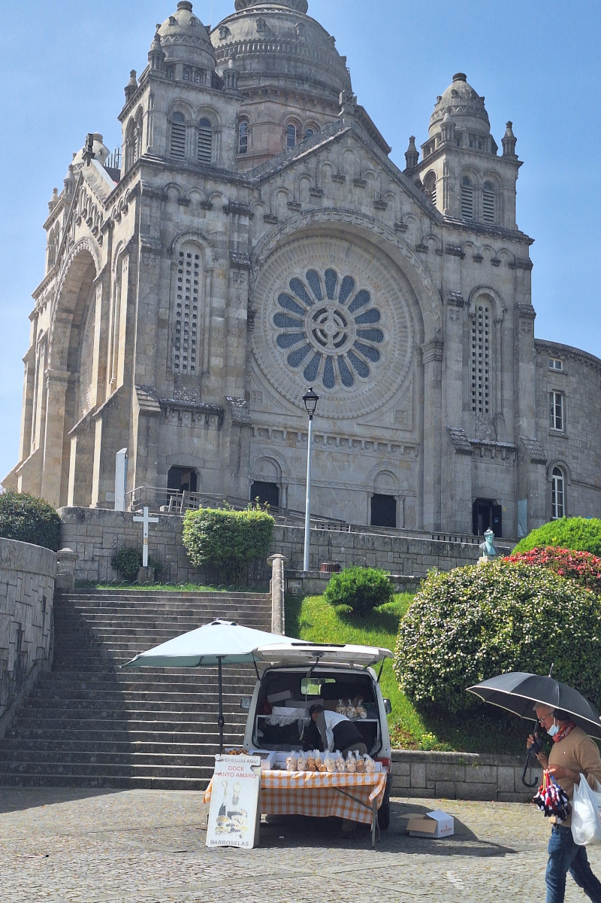
  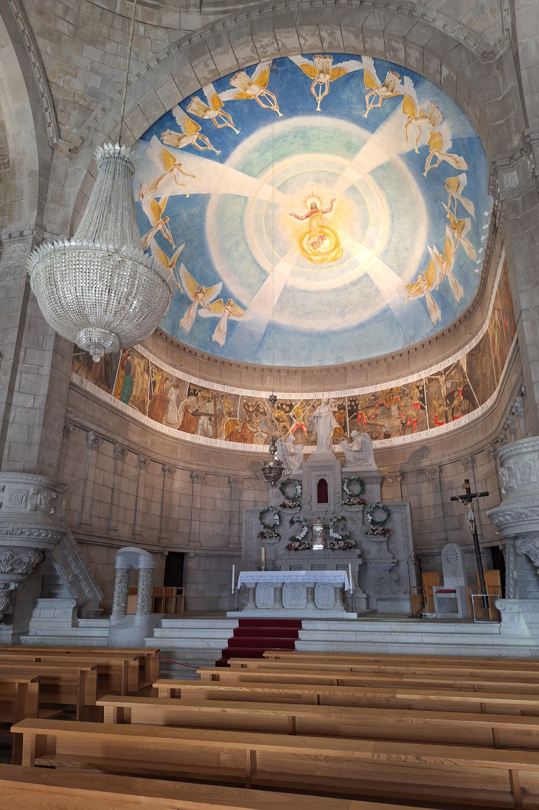

Tegen dan was het duidelijk tijd om te eten, dus daalden we af naar het stadscentrum, dit keer helemaal langs de lange
trap naar beneden. Na een lekkere lunch waren we eindelijk klaar om Viana do Castelo echt te verkennen.
Onze eerste stop was de wandelboulevard langs de rivier. Op de Praça da Liberdade liep onze dochter uitgelaten door de
grote fontein, terwijl wij het nabijgelegen monument bewonderden ter herinnering aan de Anjerrevolutie van 1974, die een
einde maakte aan de lange dictatuur in Portugal en het land zijn democratie en vrijheid teruggaf. Het monument
symboliseert die bevrijding met gebroken kettingen.

Vandaar liepen we door naar het fort, onderweg voorbij de **Gil Eannes Foundation**. Het schip Gil Eannes deed ooit dienst
als bevoorradingsschip, drijvend hospitaal en ijsbreker, maar vandaag is het een museumschip, al besloten we het interieur
niet te bezoeken. Zodra we de Rua dos Mareantes indraaiden, veranderde de sfeer helemaal. Visrestaurants, kleine
buurtwinkeltjes, visnetten en stapels lege plastic bakken gaven de buurt een uitgesproken maritiem karakter.

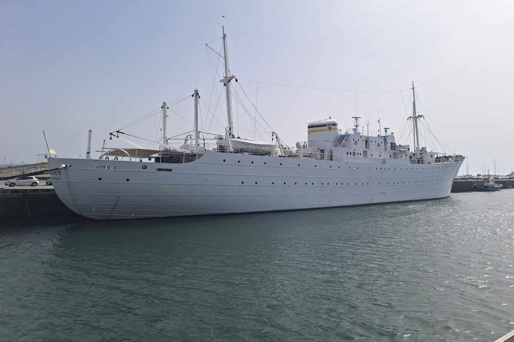

Het Forte de Santiago da Barra viel een beetje tegen. Het zicht op de Monte de Santa Luzia met het heiligdom bovenop was
mooi, maar de uitzichten op de haven en de stad waren niet bijzonder indrukwekkend. Achteraf bekeken vind ik de wandeling
ernaartoe niet echt de moeite waard, zeker omdat we daarna veel liever door de charmante oude binnenstad dwaalden. Het
historische centrum van Viana do Castelo was bijzonder sfeervol. Vooral de smalle oude straatjes rond de Sé Catedral
de Viana do Castelo waren prachtig. Op het Praça da República hing nog wat paasversiering, wat de stad nog meer karakter gaf.

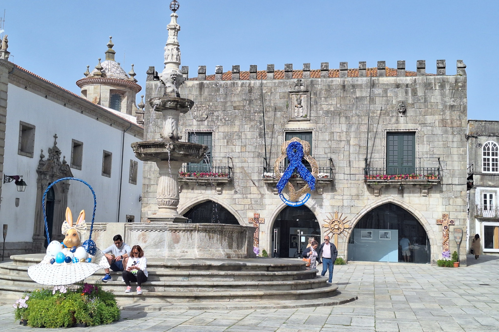

Op de terugweg naar de auto passeerden we de Mercado Municipal de Viana do Castelo, de versmarkt van de stad. Er is
ook het Museu do Traje de Viana do Castelo, gewijd aan traditionele Portugese klederdracht, dat erg goede recensies krijgt.
Het leek ons alleen niet de ideale plek om met een vierjarige te bezoeken.

In plaats daarvan verlieten we de stad om de late namiddag door te brengen in het **Parque Natural do Litoral Norte**. We
parkeerden bij de ingang van het strand van Ofir, naast de enorme appartementstorens Torres de Ofir. Die kolossen zijn van
heel ver te zien (de dag erna spotten we ze zelfs vanaf de Miradouro de São Lourenço) en, eerlijk gezegd, ze passen niet
bepaald in het omliggende natuurlandschap.
Het waaide er ontzettend hard, maar het was aangenaam rustig. We kwamen vrij laat aan, rond vijf uur, net toen de laatste
surfers het water verlieten. Bij de ingang van het strand was een oldtimerrally aan de gang, dus we bewonderden een tijdje
de klassieke wagens voor we naar het natuurreservaat trokken.

  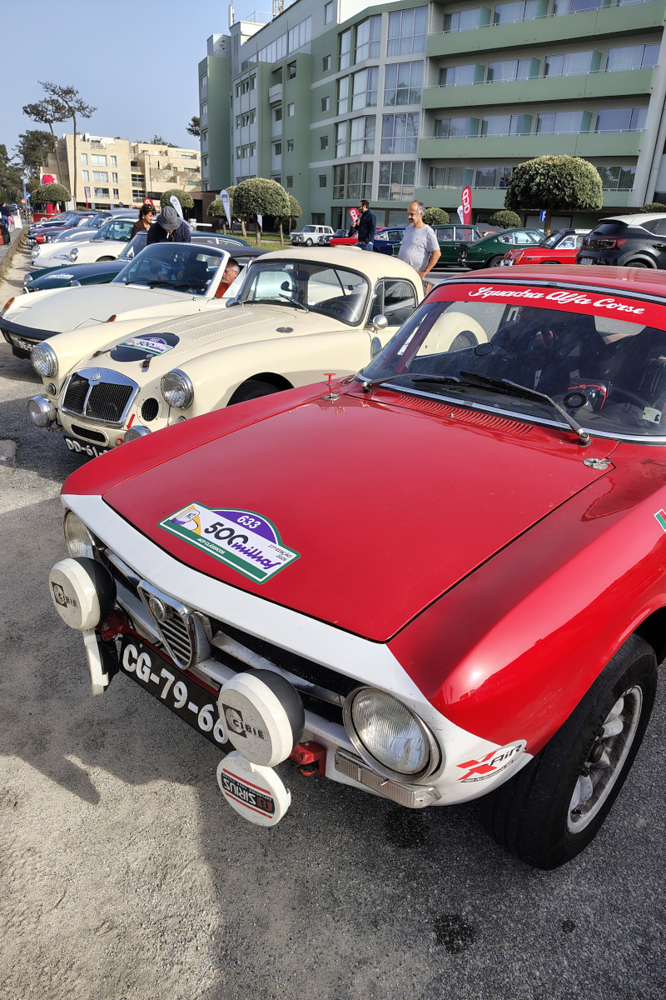
  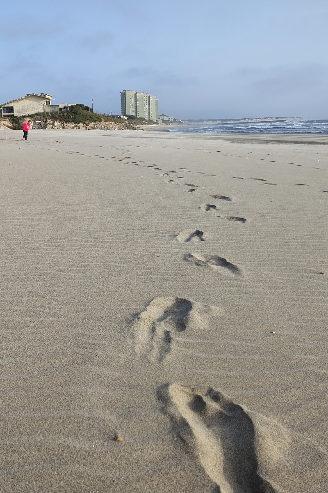

Vanaf de parking was het zo'n 1,3 km tot het begin van de houten vlonderpaden, dwars door een gebied vol vakantiehuisjes
en vakantiewoningen, verscholen tussen prachtige dennenbossen. In principe leek het mogelijk om door de smalle eenrichtingsstraatjes
te rijden, maar bij het startpunt van de wandeling was er absoluut nergens plaats om te parkeren. Houten palen en grote
rotsblokken langs de wegen moeten wildparkeren tegengaan.
De vlonderpaden door de duinen en het helmgras waren prachtig aangelegd en boden een mooi uitzicht over de rivier richting
Esposende. Tijdens onze wandeling kwamen we amper een handvol mensen tegen. Onze laatste stop was de Miradouro da Restinga
do Cávado, waar je vanaf de vlonders de moerassen en de kwetsbare begroeiing kan bewonderen zonder ze te beschadigen.

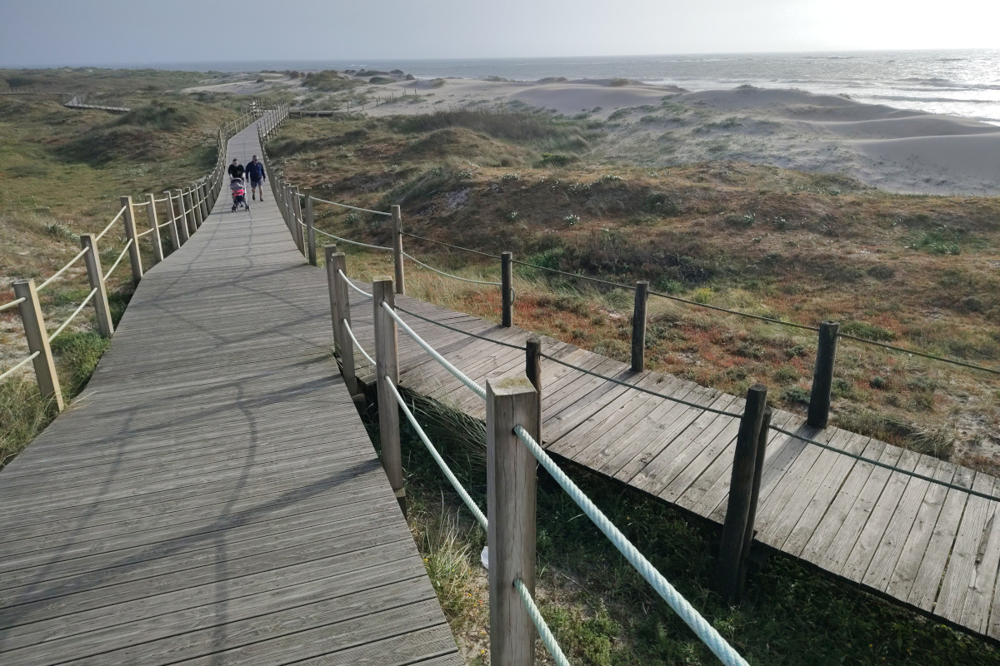

De natuurlijke duinen zagen er magisch uit, door de sterke wind in prachtige patronen geblazen. Eén van de vlonderpaden
naar het strand was echter gedeeltelijk ingestort en zag er behoorlijk gevaarlijk uit. Gelukkig konden we onze dochter net
op tijd tegenhouden voor ze de beschadigde trap op liep.

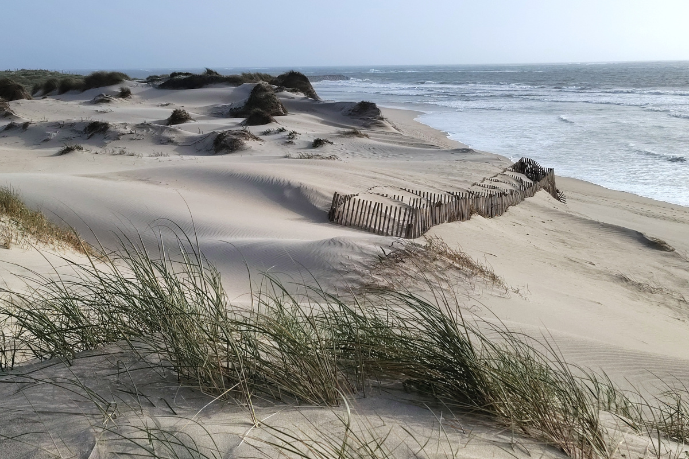

We bleven nog wat op het enorme, bijna lege strand rondlopen en genoten van het landschap, maar de wind was gewoon te
straf om lang te blijven. Er woei voortdurend zand in onze ogen en haren, waardoor we uiteindelijk moesten vertrekken.
Ondanks de wind was het een heerlijke plek voor een wandeling. Een van de grootste voordelen van een bezoek in april,
zeker laat in de namiddag, was dat we het gebied bijna helemaal voor onszelf hadden. Het was een intense maar prachtige
dag geweest, en tegen de tijd dat we terug in ons appartement waren, waren we meer dan klaar voor wat welverdiende rust.

  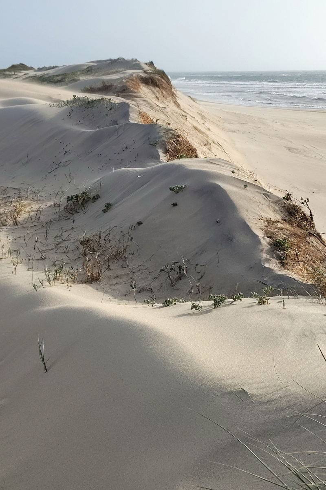
  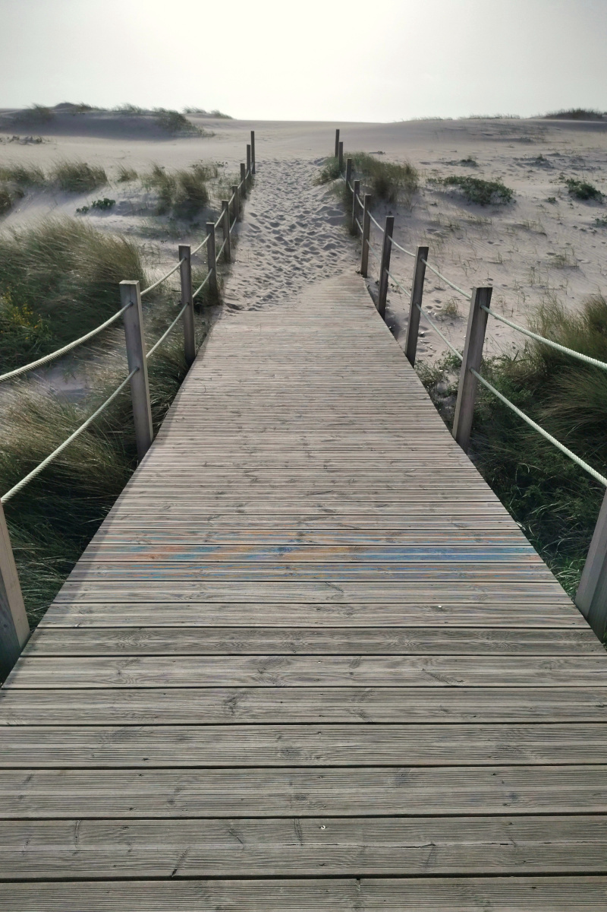

De volgende dag begonnen we met een ochtendwandeling in **Póvoa de Varzim**, de stad waar we de eerste twee nachten verbleven.
We moesten bijna 2 km stappen om de haven te bereiken, omdat we dichter bij het water geen enkele gratis parkeerplaats
vonden. Het was die zaterdag erg druk in het centrum, deels omdat er een voetbalmatch bezig was in het stadion, tenminste,
dat vermoedden we op basis van het lawaai dat we hoorden toen we er voorbijkwamen.
Behalve het casino en de kleine haven met een mooie muur versierd met azulejo-tegels, vonden we de stad niet bijzonder
interessant. Er was ook een fort, maar we gingen niet binnen omdat het er eerder klein en niet erg uitnodigend uitzag. Toch
was de wandeling langs het water aangenaam, en onderweg lagen er een paar speeltuinen.

  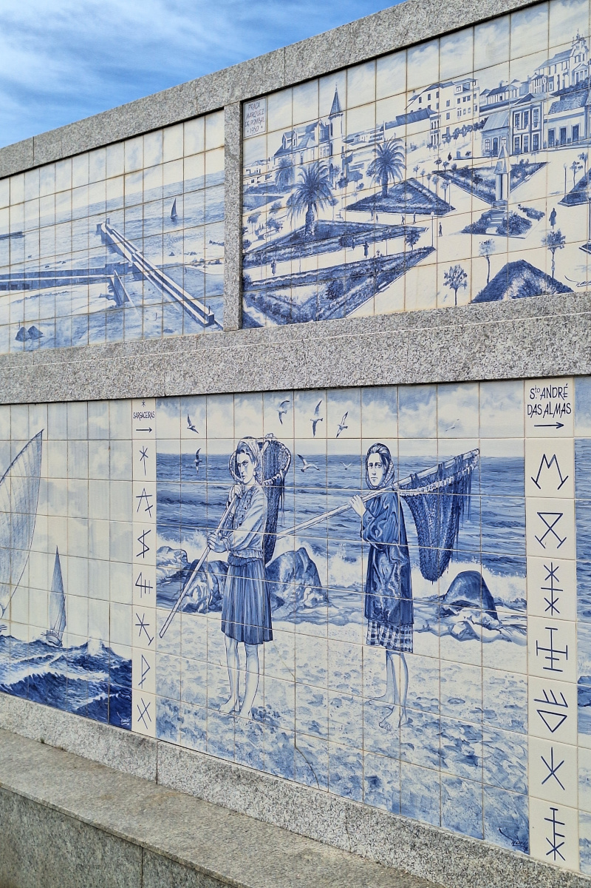
  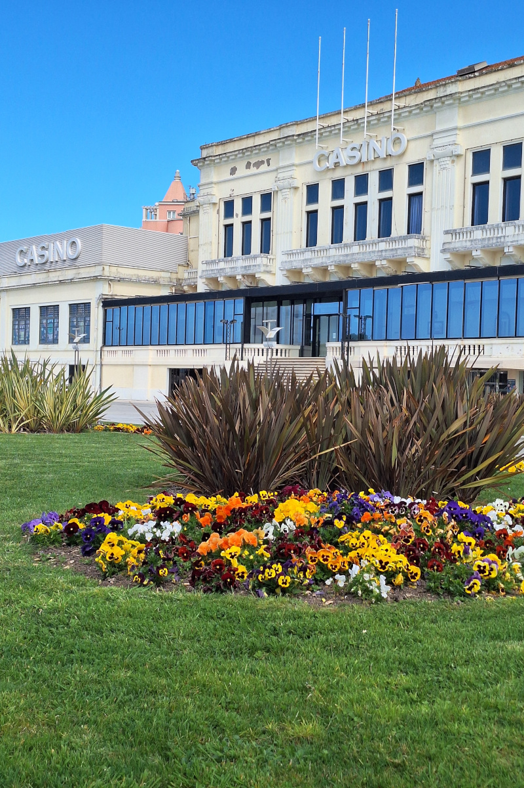

De avond ervoor waren we naar de Antigo Moinho de Vento (de oude windmolen) gewandeld om de zonsondergang te bekijken. Dat
gebied bleek veel mooier, met een leeg strand, kleine duinen en een prachtig zicht op de ondergaande zon. Houten vlonderpaden
liepen dwars door de duinen, al waren we behoorlijk verbaasd over de hoeveelheid afval die eronder en ertussen lag.

Op weg naar Braga, waar we de volgende vier nachten zouden doorbrengen, hadden we verschillende stops gepland. Onze eerste
was bij de beroemde **molens van Apúlia**. Deze iconische windmolens staan pal op de duinen bij het strand en zorgen voor een
uniek kustlandschap. Er was een kleine parking vlak ernaast, dus een plaatsje vinden was zo gebeurd.
De traditionele Portugese windmolens werden oorspronkelijk gebouwd om graan, en dan vooral mais, tot meel te malen voor de
plaatselijke bevolking. Bouwkundig hebben ze meestal een cilindrisch stenen onderstuk met een draaiend dak, zodat de wieken
naar de wind gekeerd konden worden. Door hun ligging aan de kust konden ze de sterke Atlantische winden ten volle benutten.
Dat klopte helemaal, want de wind die dag was ongelooflijk straf, waardoor een echt strandbezoek zo goed als onmogelijk werd.
We renden snel naar de rotsen om de oceaan te bewonderen, maar het opwaaiende zand striemde zo hard dat we bijna meteen
terugvluchtten. Zelfs foto's nemen was lastig, want het zand zat overal.

  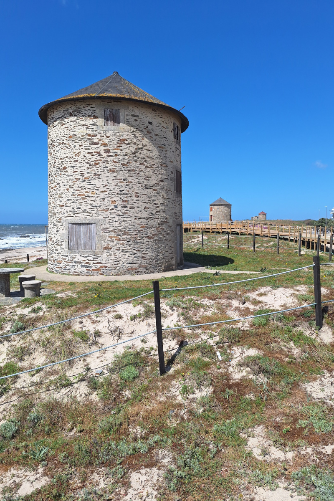
  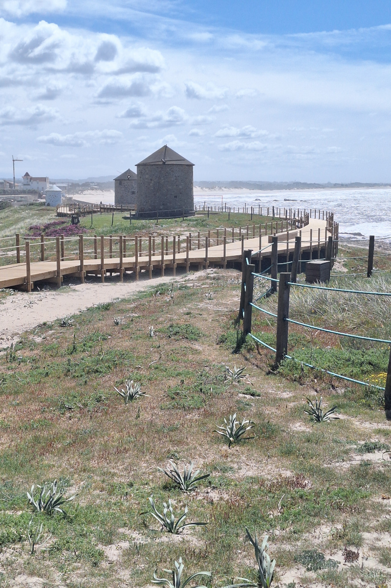

Veel van deze molens werden mettertijd verlaten, maar verschillende zijn intussen gerestaureerd, zodat bezoekers ze
vandaag kunnen bewonderen, al is dat enkel van buitenaf.
Na een halfuurtje reden we door naar onze volgende stop, Castro de São Lourenço, via een heel aangename kustweg door mooie
dennenbossen vol vakantiehuisjes. Dat was zeker een betere keuze dan de hoofdweg.

Onze volgende stop was een belangrijke archeologische vindplaats bij Esposende. **Castro de São Lourenço** ligt op een heuvel met
uitzicht over de Atlantische kust en bewaart de resten van een nederzetting uit de ijzertijd, ooit bewoond door oude
Keltische gemeenschappen. Sommige structuren zijn gereconstrueerd, wat bezoekers helpt zich de oorspronkelijke indeling
van de nederzetting voor te stellen. Omdat de huizen op terrassen tegen de heuvelflank gebouwd waren, konden de bewoners
de beschikbare ruimte maximaal benutten.

  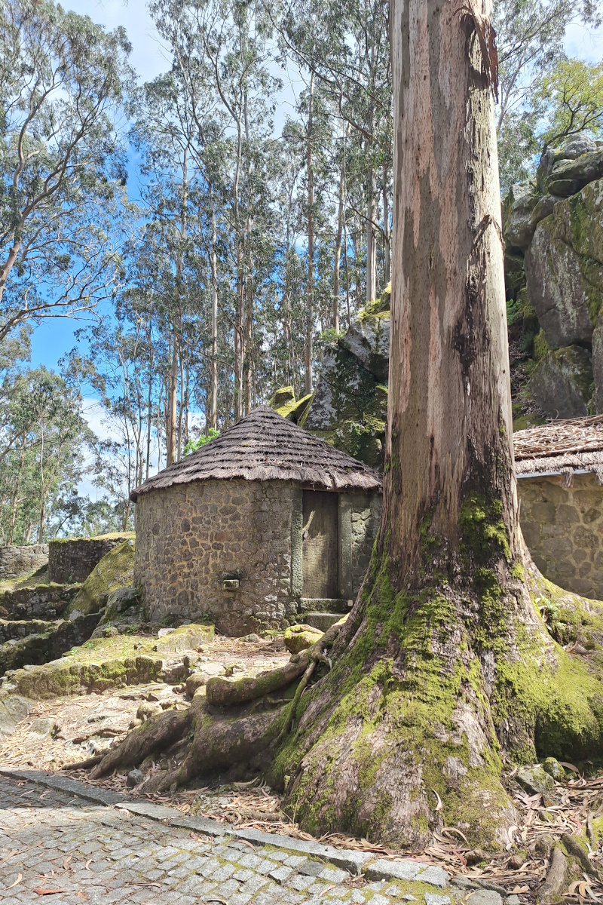
  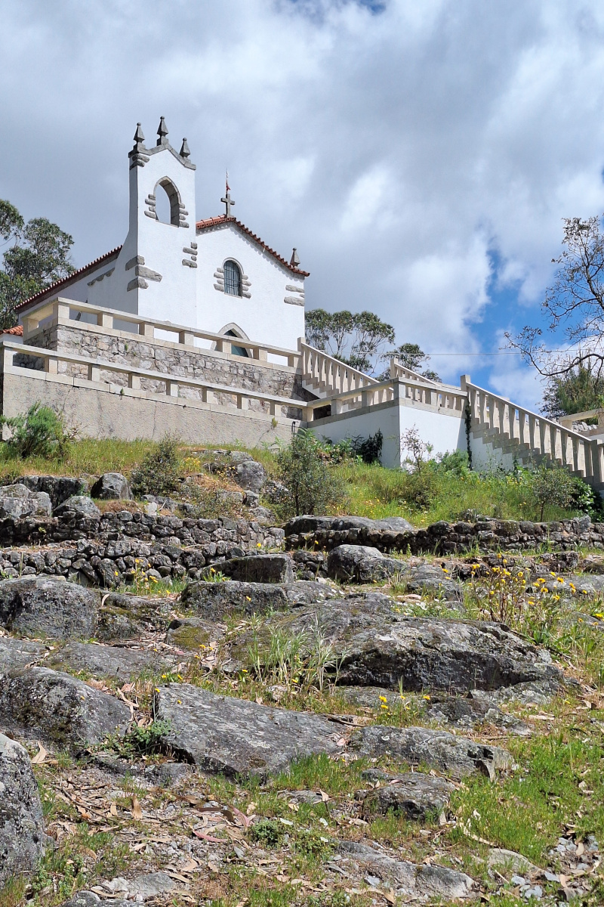

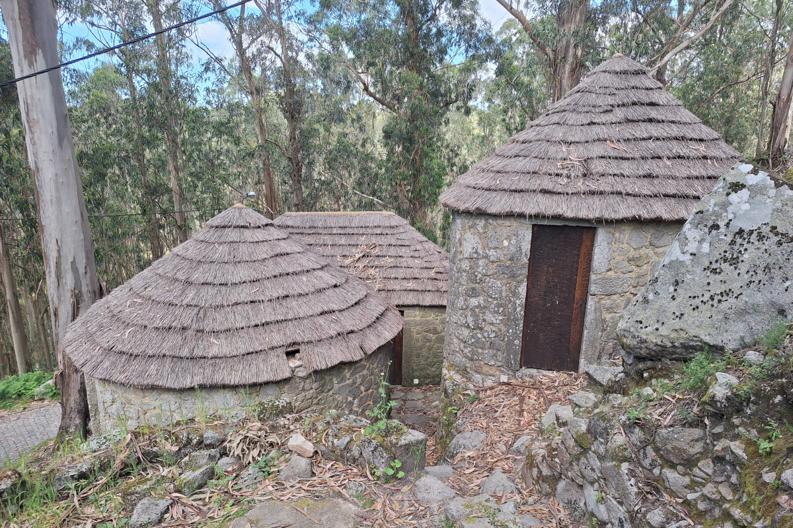

De **Miradouro de São Lourenço**, bij de nabijgelegen kapel van São Lourenço, bood een panoramisch uitzicht over de kustlijn
en het achterland. Van daaruit konden we zelfs de hoge Torres de Ofir en het natuurreservaat van de dag ervoor onderscheiden.

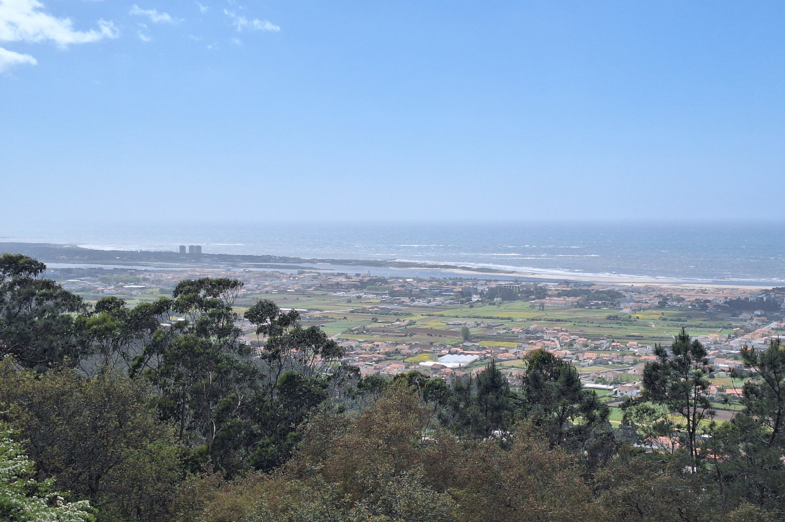

Er liepen verschillende korte wandelpaden door het omliggende bos, maar onze dochter wees dat idee meteen af. In plaats daarvan
bezochten we het kleine museum naast de vindplaats, waar een bescheiden tentoonstelling de archeologische vondsten toelicht. Het
terrein zelf is relatief klein, maar zeker een korte stop waard als je dit stuk kust verkent. Het eucalyptusbos eromheen
versterkt de sfeer nog.

Ondertussen begon iedereen honger te krijgen. Toen we in **Barcelos**, onze laatste stop van de dag, aankwamen, beseften we
dat het al na drie uur was en dat veel van de restaurants die we eerder hadden gemarkeerd al gesloten waren.
Na een intense zoektocht gingen we eerst naar een restaurant in de buurt dat gesloten bleek, ook al gaf Google Maps aan dat
het open was. In de volgende zaak vertelden ze ons dat alle hoofdgerechten al uitverkocht waren en er enkel nog bijgerechten
waren. Uitgehongerd besloten we een laatste restaurant wat verderop te proberen, hoe moe en gefrustreerd we ook waren.
Gelukkig bleek dit Braziliaanse restaurant een uitstekende keuze. De diensters waren heel vriendelijk, het eten was
heerlijk, en de snelle bediening was precies wat we nodig hadden.
Na het eten trokken we meteen het centrum in. Zodra we bij de Jardim Velho de Barcelos kwamen, werd de stad plots groener,
kleurrijker en veel charmanter dan we hadden verwacht.
Wat vooral onze aandacht trok, waren de kleurrijk versierde poorten die in een rij langs de rand van het plein stonden.
Volgens mijn collega's was elke zogenaamde feestboog door een andere parochie gemaakt voor de plaatselijke feesten en
festivals. In Noord-Portugal, en zeker rond Barcelos, Braga en de Minhostreek, maken parochies traditioneel versierde bogen,
poorten en bloemenconstructies voor religieuze feesten. De bogen zijn een bron van lokale trots en van vriendschappelijke
concurrentie tussen parochies, en gemeenschappen zijn er vaak wekenlang mee bezig, met bloemen, linten, lichtjes en
handgemaakte versieringen.

  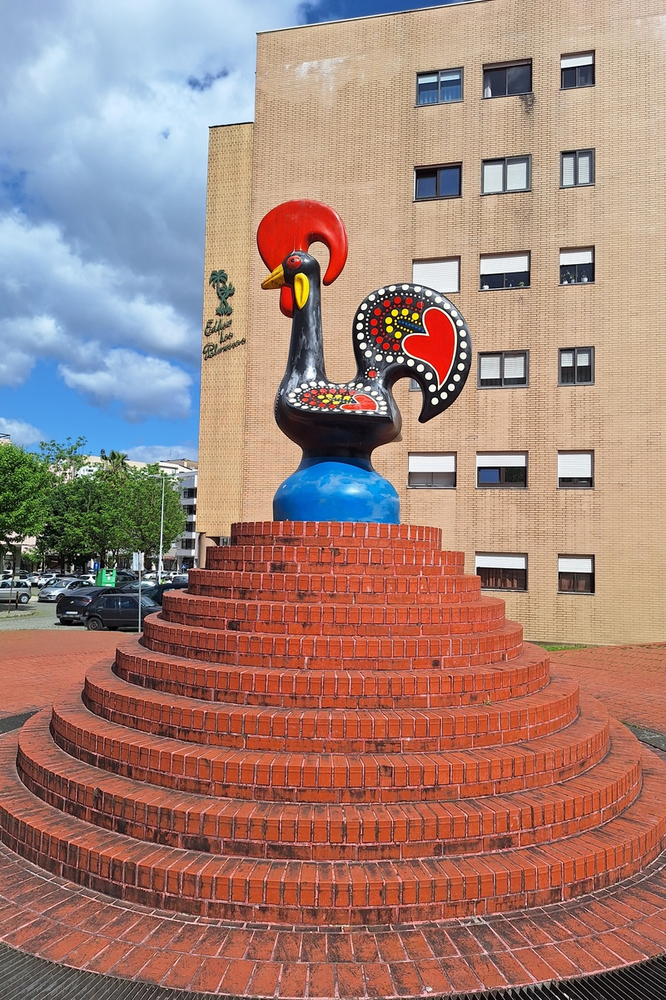
  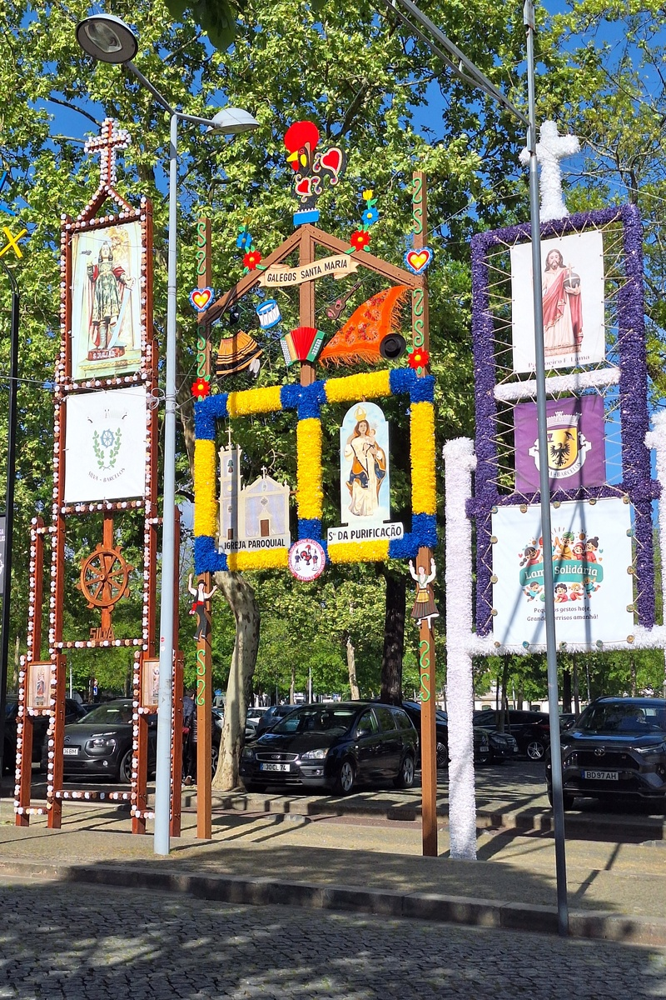

Barcelos bleek vooral heel leuk voor onze dochter, want ze bracht het hele bezoek door met het zoeken naar de haanbeelden
die verspreid door de stad staan. De haan van Barcelos is een van de nationale symbolen van Portugal en vindt zijn oorsprong
precies hier.
De legende vertelt dat een onterecht beschuldigde pelgrim in Barcelos beweerde dat een gebraden haan zou kraaien om zijn
onschuld te bewijzen. Op wonderbaarlijke wijze kraaide de haan, wat de pelgrim het leven redde, en sindsdien is de haan
een Portugees symbool van rechtvaardigheid, geloof, eerlijkheid en geluk. Er stonden ook nog veel andere beelden verstopt
in de straten, waardoor de wandeling voor haar een leuk spelletje werd.

  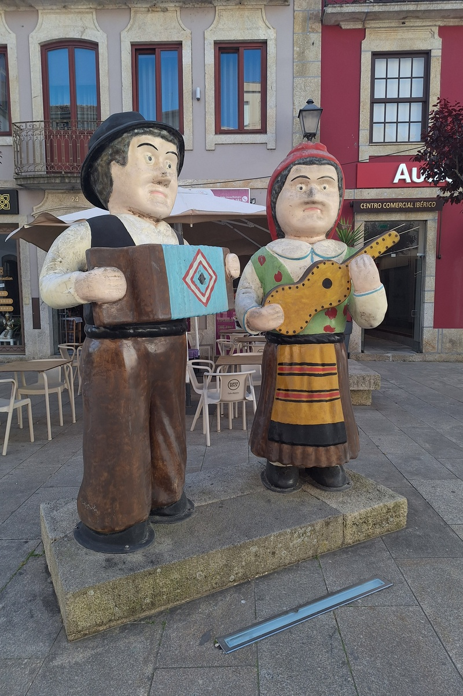
  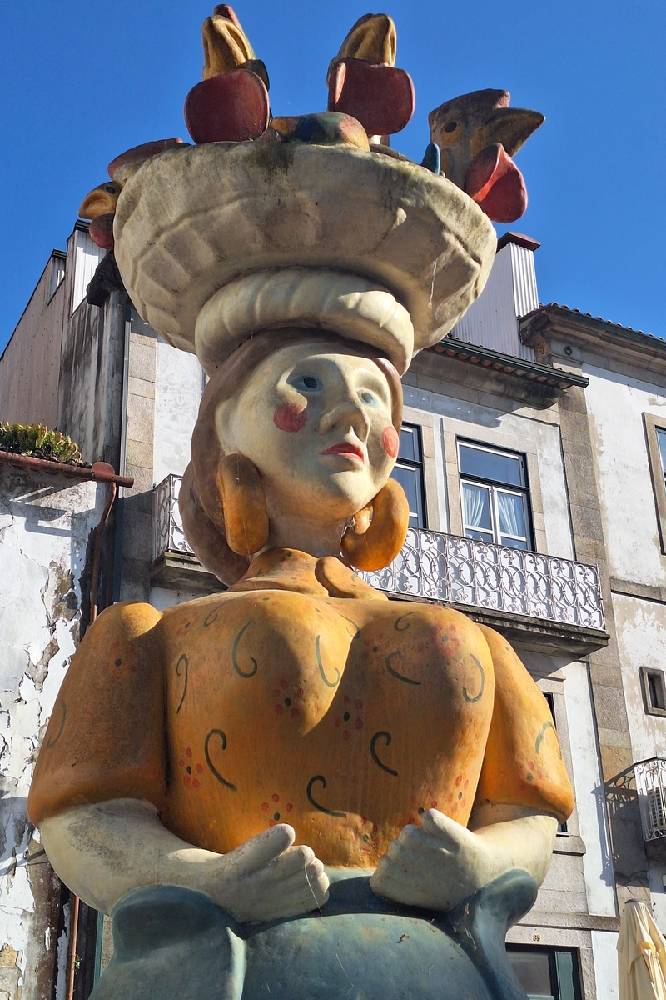

We volgden de hoofdstraat richting de **Igreja do Senhor Bom Jesus da Cruz**, die al van ver zichtbaar was. De ongewone ronde
vorm van de kerk viel ons meteen op. Binnen was ze prachtig versierd met glanzende ornamenten en talrijke beelden, wat het
interieur bijzonder rijk en indrukwekkend maakte. Naast de kerk lag een enorm plein, dat momenteel als parking wordt
gebruikt, ook al staat het op de kaart aangeduid als foorterrein.
Blijkbaar verandert het elke donderdag in een gigantische markt waar eten, kleren, aardewerk en allerlei lokale producten
verkocht worden.

  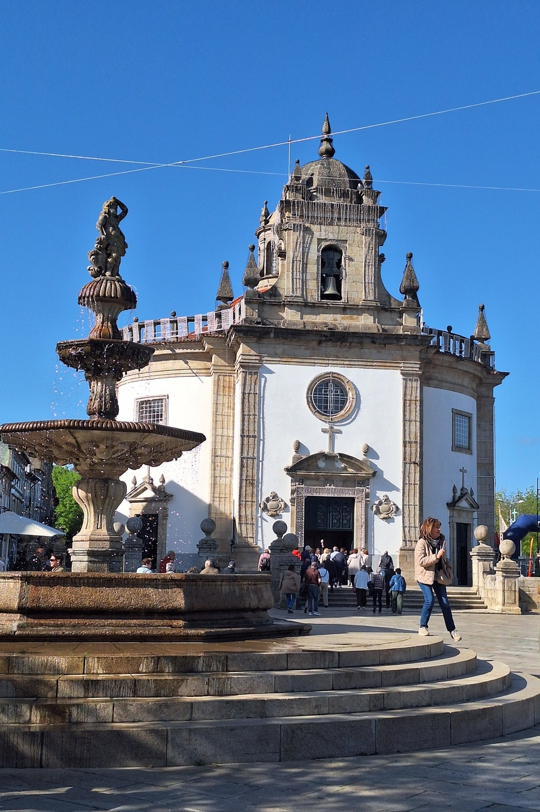
  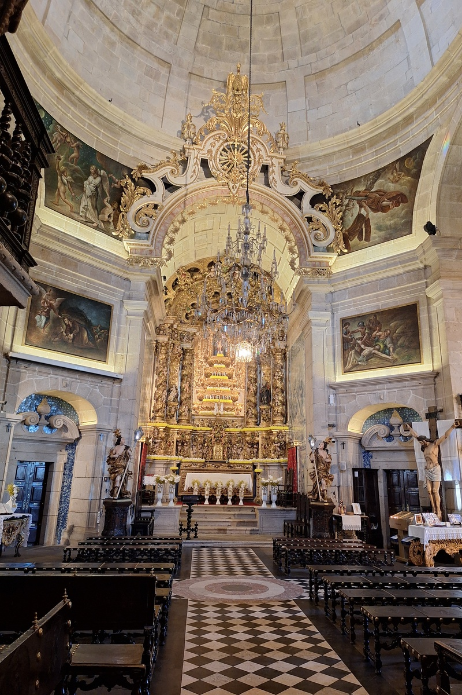

Naast de kerk ligt de mooie **Jardim das Barrocas**, waar we even pauzeerden op een bankje in de zon.
We vonden er nog een haanbeeld van Barcelos. Het haanmotief volgde ons zowat overal in de stad, op keramieken beeldjes,
azulejo-tegels, keukenversiering, magneten en ontelbare souvenirs.

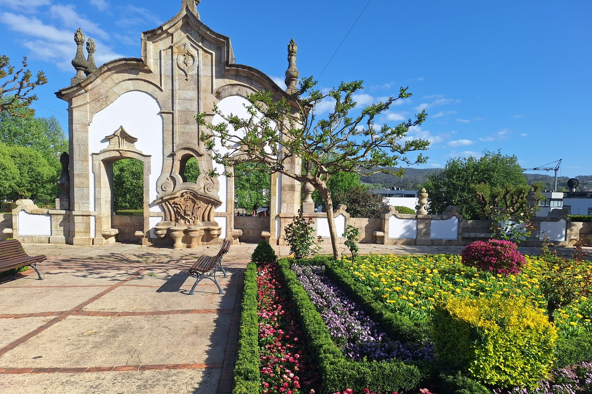

Daarna wandelden we door de belangrijkste winkelstraat, de Rua António Barroso, richting de Igreja Matriz de Santa Maria
Maior de Barcelos. De etalages lagen vol kleurige keramieken hanen, beschilderde tegels, keukenspullen en traditioneel
textiel met het beroemde motief. Het werd snel duidelijk waarom de haan van Barcelos als een van de meest herkenbare
symbolen van Portugal geldt.

  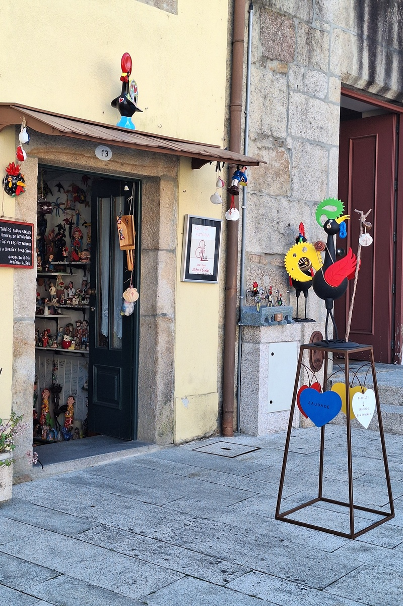
  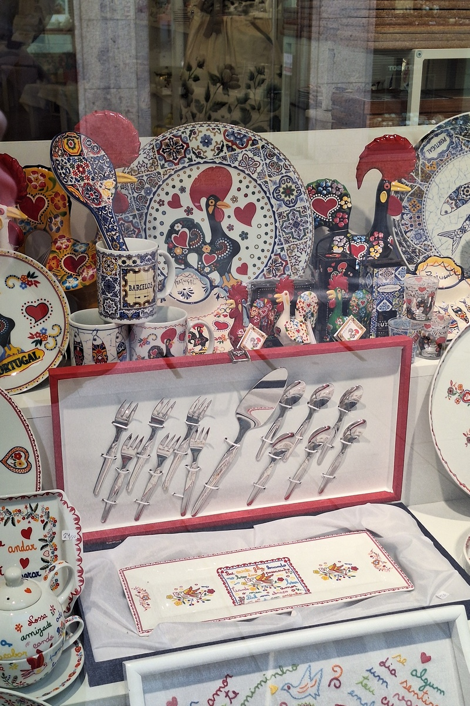

De kerk zelf was vanbinnen prachtig, vooral door de blauwe azulejo-tegels op de muren. In Portugese kerken werden azulejos
vaak niet enkel als versiering gebruikt, maar ook om religieuze verhalen te vertellen en een rustige, ingetogen sfeer te
scheppen. De blauwe kleur was geïnspireerd op Chinees porselein en stond voor elegantie en prestige. Onze dochter wilde er
een tijdje rustig blijven zitten, luisterend naar de muziek die binnen speelde.

De hele omgeving rond de kerk is heel aangenaam. Er loopt een boulevard langs de rivier waar je kan wandelen of gewoon
op een bankje uitrusten. Vlakbij liggen ook kleine archeologische ruïnes die leuk waren om te verkennen. De rivier de
Cávado die door Barcelos stroomt, is dezelfde die we de dag ervoor zagen in het Parque Natural do Litoral Norte, waar ze
in de Atlantische Oceaan uitmondt.

  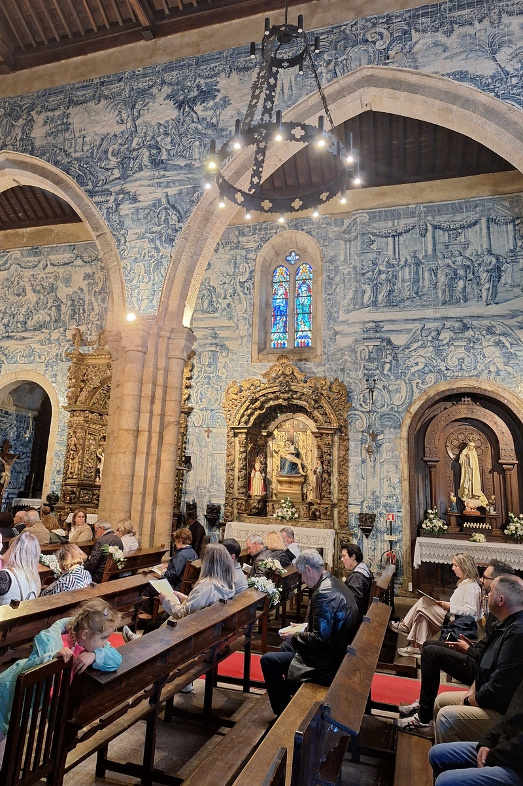
  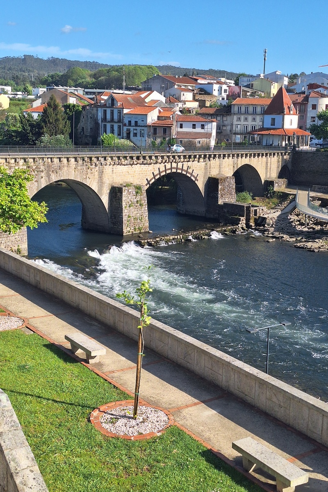

Het **Museu Arqueológico de Barcelos** is een gratis toegankelijke openluchtsite tussen de hoofdkerk en de rivier. Naast de archeologische
resten heb je er ook een fantastisch zicht op zowel de rivier als de stad. Doordat het vlak bij de middeleeuwse brug van
Barcelos ligt, heb je er ook een uitstekend uitzicht op de brug zelf.

  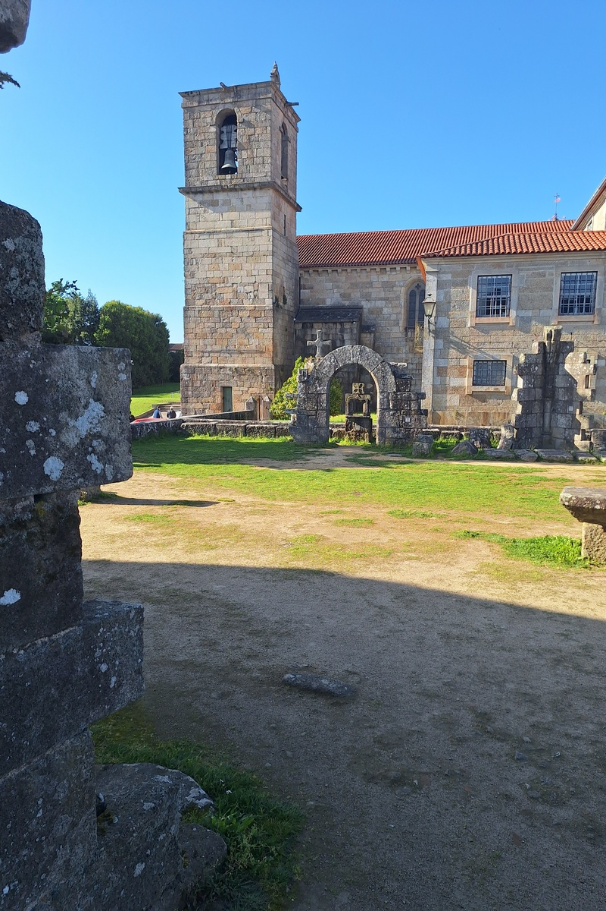
  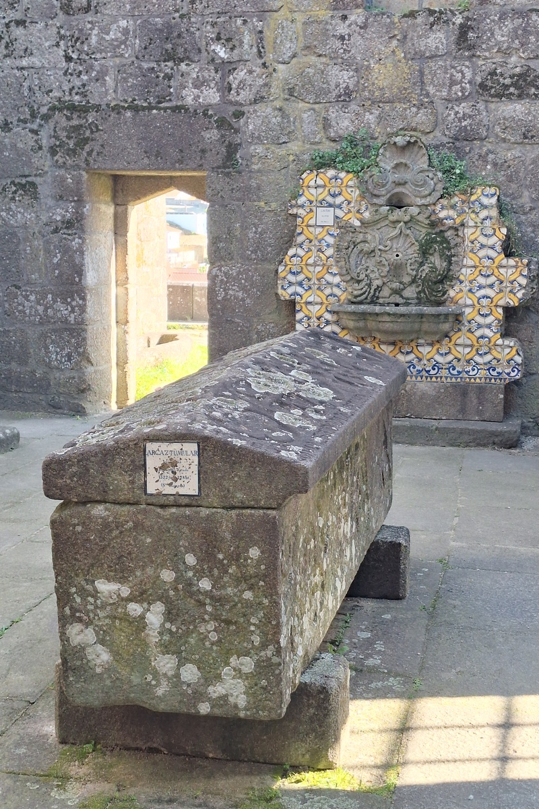

Op de terugweg naar de auto ontdekten we nog meer haanbeelden verspreid door de stad. Je wist echt nooit waar de volgende
zou opduiken.
Barcelos bleek voor ons een heerlijke verrassing: een kleurrijke, levendige en heel aangename stad voor een wandeling en
een ontspannen pauze onderweg naar Braga.

## Praktische info:

* Póvoa de Varzim:
[Parking](https://maps.app.goo.gl/zE33kPoTeKkxEbbR9)
* Heiligdom van het Heilig Hart van Jezus
Gratis toegang, behalve als je naar het uitkijkpunt bovenaan de kerk wil, dan betaal je €2. Tickets zijn ter plaatse
verkrijgbaar aan een automaat. Bovenaan is er heel wat gratis parkeergelegenheid.
Parkeerplaats in de stad: M5XF+VM Viana do Castelo, Portugal. Wij deden er 40 min over om boven te raken, met 160 m
hoogteverschil.
* Parque Natural do Litoral Norte:
[Parking](https://maps.app.goo.gl/mCgbHtMYRYJhvr5p8)
* Molens van Apúlia
Toegang: gratis. In het gebouw bij de parking zijn er openbare toiletten.
* Castro de São Lourenço
Toegang: gratis, museum inbegrepen.
* Barcelos
Toegang: gratis voor alle plekken die we in de stad bezochten.
