De volgende twee dagen brachten we door in Braga en in het toeristischere Guimarães, dat bekendstaat als de "bakermat van
Portugal". Ik had beide steden al in december 2024 bezocht en je kan erover lezen in mijn eerdere blogpost,
[Een magisch bezoek aan Braga en Guimarães]().
Toch was het echt fijn om dezelfde plekken in een compleet ander decor terug te zien, dit keer met overal prachtige
lentebloemen die de steden kleur gaven en helemaal tot leven brachten. In december hing er een magische kerstsfeer en zaten de
sinaasappelbomen vol vruchten, dus beide seizoenen hebben hun eigen charme. Omdat we in het centrum van Braga verbleven,
konden we makkelijk te voet de stad in, ook 's avonds, om iets te gaan eten en te genieten van de mooie pleinen vol kleurige
bloemen. Naast de stad zelf bezochten we ook Bom Jesus do Monte en het heiligdom van Onze-Lieve-Vrouw van Sameiro. We kregen
dat allemaal in één dag rond.

  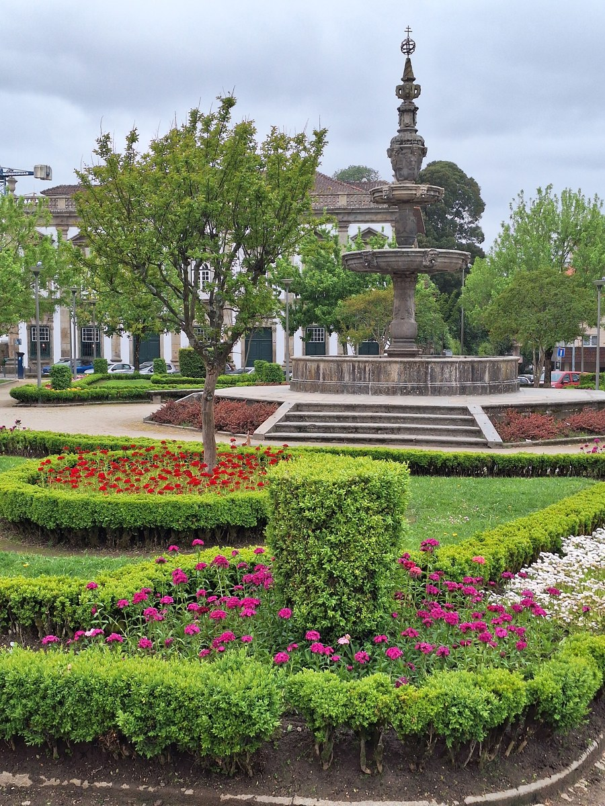
  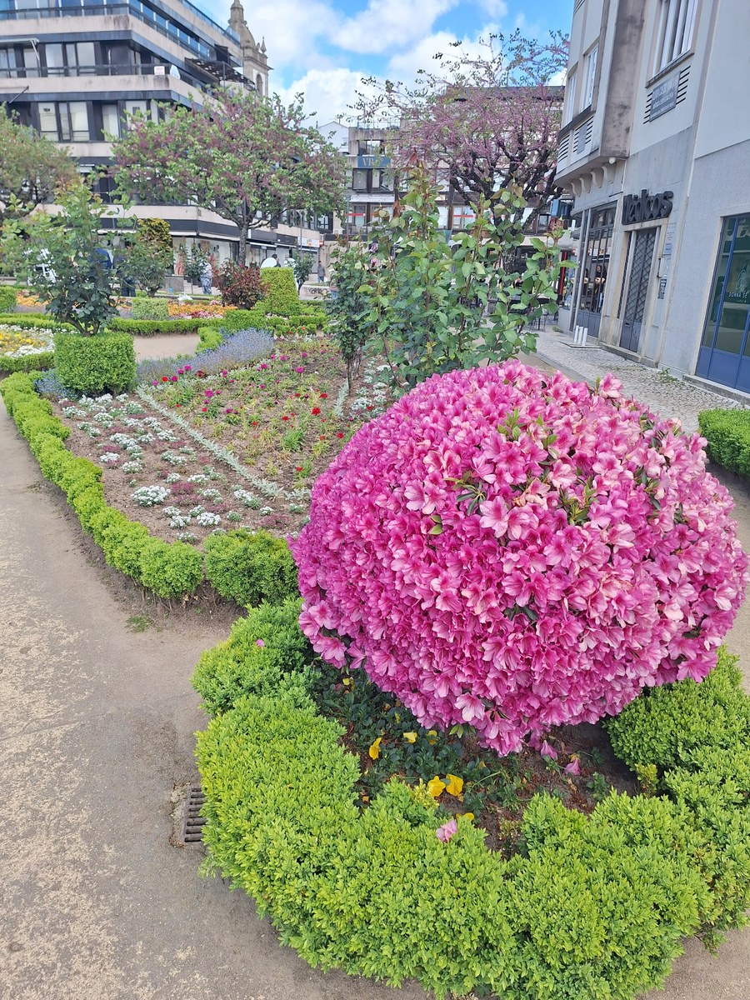

  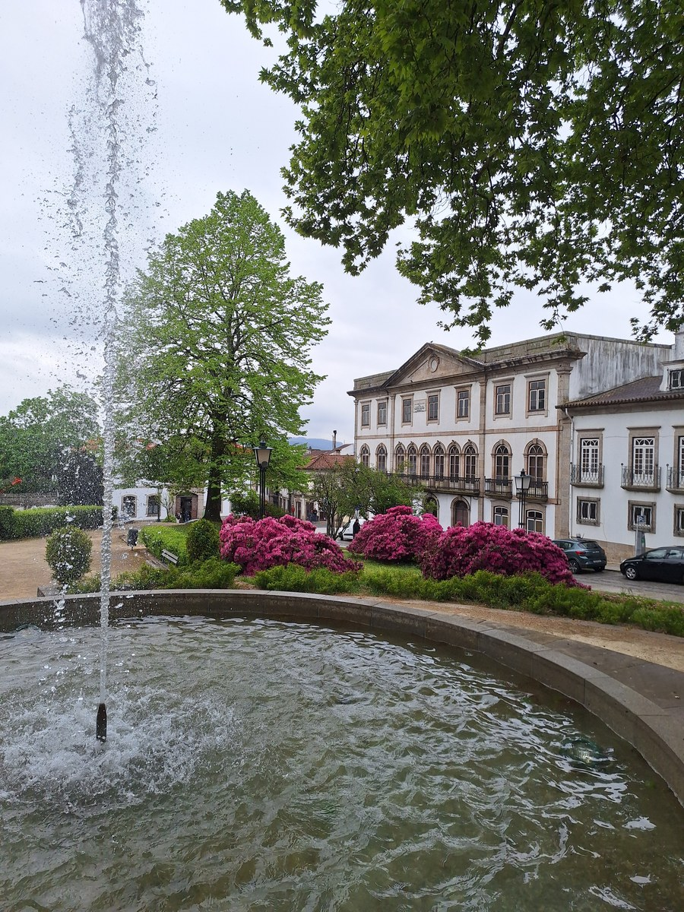
  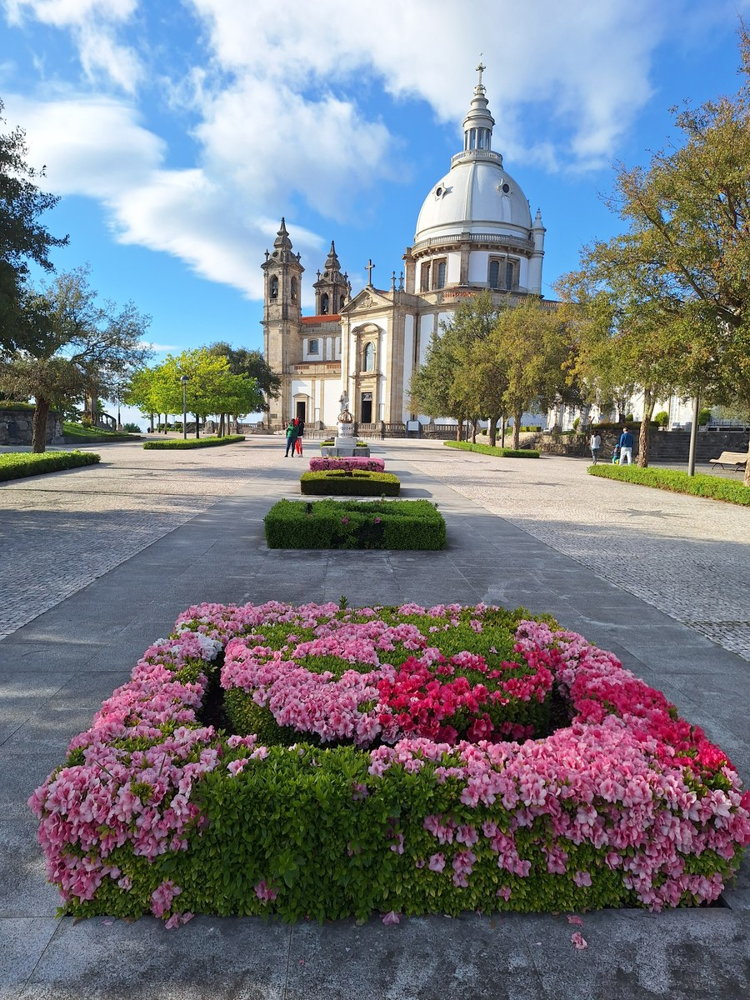

De dag dat we naar Guimarães trokken, hadden we het slechtste weer. Het regende 's ochtends, al beloofde de voorspelling
beterschap later op de dag, dus besloten we toch te gaan. Tijdens mijn vorige bezoek had ik het **heiligdom van Penha** niet
kunnen zien, dus daar gingen we eerst naartoe. Voor veel bezoekers is het veel meer dan alleen een bedevaartsoord: het is
een van de belangrijkste recreatiegebieden van Guimarães, waar de inwoners komen wandelen, picknicken en de stad even
ontvluchten. Hoewel we door het weer niet van de uitzichten konden genieten, zagen we meteen dat de berg Penha veel meer
te bieden heeft dan het heiligdom alleen. Rond de kerk stonden informatieborden over de wandelroute PR3, en er waren
picknickplaatsen waar bezoekers kunnen uitrusten in het groen. Het hele gebied is bebost en bezaaid met indrukwekkende
granieten rotsformaties, wat een landschap oplevert dat perfect lijkt voor een langere verkenningstocht. We zagen verschillende
paadjes tussen de enorme keien en door het bos lopen, en het voelde echt als een plek om op een zonnige dag naar terug te
keren, wanneer we volop kunnen genieten van het uitzicht over Guimarães en het omliggende landschap.
Het was somber en donker, en terwijl we rond het heiligdom wandelden, begon het opnieuw te regenen. We haastten ons terug
naar de auto, maar gelukkig was de regen gestopt tegen de tijd dat we de stad bereikten, en die namiddag kregen we zelfs nog wat zon.

  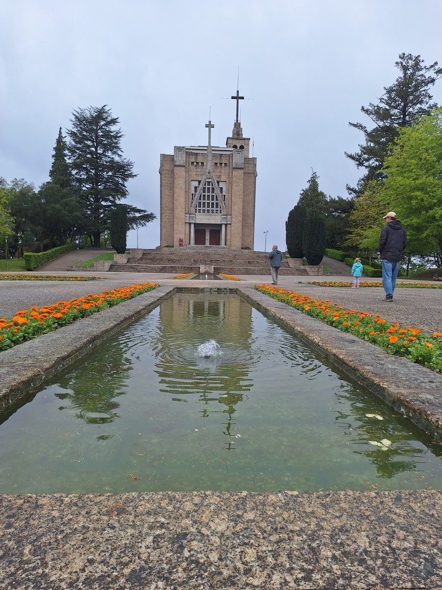
  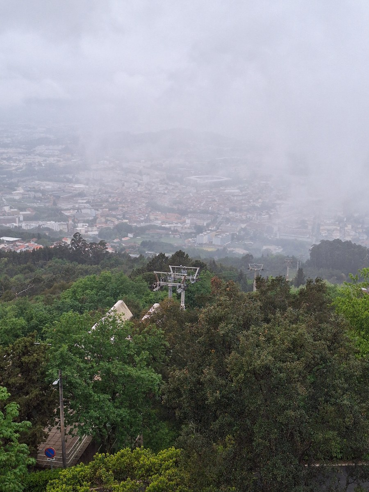

De dag erna wilden we verder noordwaarts vanuit Braga, richting de omgeving van Ponte de Lima, waar we een bezoek aan dit
middeleeuwse stadje wilden combineren met twee korte wandelingen in de buurt.
We begonnen de dag in het **beschermde landschap van de lagunes van Bertiandos en São Pedro de Arcos**. We parkeerden
naast het bezoekerscentrum, waar een grote schoolbus stond omdat een groep kinderen er natuurlessen volgde. Zij zaten binnen
in het bezoekerscentrum, waar onze dochter ook binnenliep op zoek naar een toilet. Ze raakte erg geboeid door wat de kinderen
aan het doen waren, en het kostte wat overtuigingskracht voor ze aan de wandeling wou beginnen.
Het beschermde gebied telt vijf bewegwijzerde wandelroutes, van een korte vlonderwandeling van 1,6 km rond de lagune tot
een route van 12,5 km die een groot deel van het reservaat doorkruist. Wij kozen het Rivierpad (PR3) van 2,9 km, dat de
perfecte keuze bleek met onze dochter: bos, moeras, houten vlonderpaden en geocaching, zonder dat het te lang werd.
 Op onze rit vanuit Braga had het geregend, dus het bos was nog erg nat. De regen was gestopt, maar toch voelden we voortdurend
druppels van de bomen vallen.

  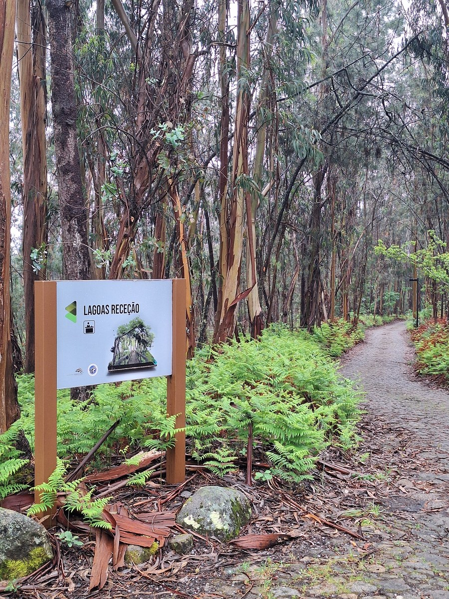
  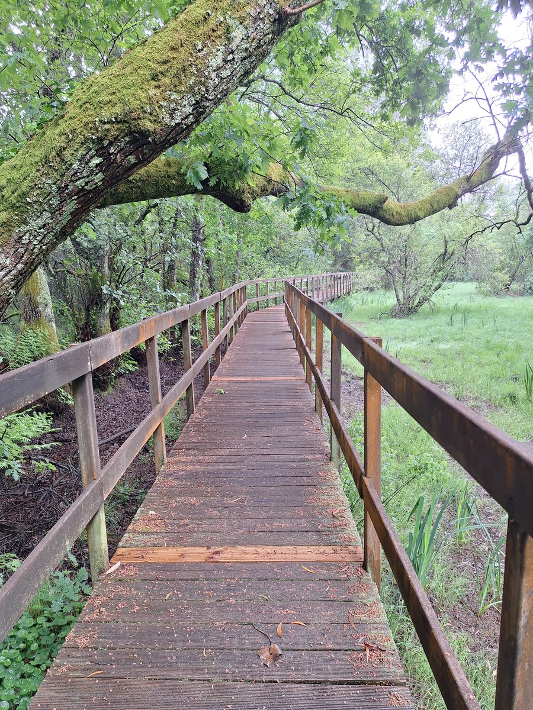

Het bos zag er mysterieus uit, en om de wandeling wat spannender te maken voor onze dochter keken we of er caches in de
buurt verstopt lagen. Er waren er twee, en dat volstond om haar de hele tocht gemotiveerd te houden.
Geocaching is een schattenjacht in de echte wereld, waarbij deelnemers met een smartphone of gps-toestel op zoek gaan naar
verstopte doosjes, geocaches genoemd, die door andere gebruikers zijn geplaatst. Het spel maakt van een gewone wandeling
of trektocht een avontuur, waarbij elke cache een nieuw doel wordt om naartoe te werken.
Wanneer je met kinderen reist, is geocaching een prima manier om ze betrokken en gemotiveerd te houden. Tijdens onze
wandelingen gaf het onze dochter een doel en een dosis enthousiasme om verder te stappen en de omgeving te verkennen. In plaats van op de
afstand te letten, zocht ze enthousiast naar de volgende verstopte cache, waardoor de weg net zo leuk werd als de
bestemming. Ze speelt dit spel al een hele tijd samen met haar papa, en ze was vooral in de wolken met een cache die onder
een enorme eucalyptusboom verstopt zat, al was het notitieboekje erin jammer genoeg helemaal doorweekt.
De wandeling zelf was heel aangenaam. Ze was niet te lang, en we zagen enorme moskussens die vol water gezogen zaten.
Op de bomen groeiden ook veel korstmossen, een teken van de zuivere lucht in de streek. Ik denk dat we Ramalina hebben
gezien, een struikvormig korstmos dat een uitstekende bio-indicator is, omdat het enkel gedijt in zuivere, onvervuilde lucht.

  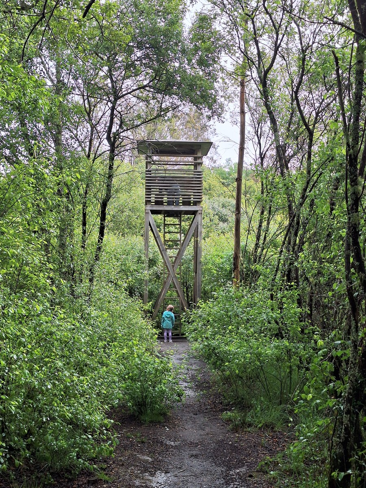
  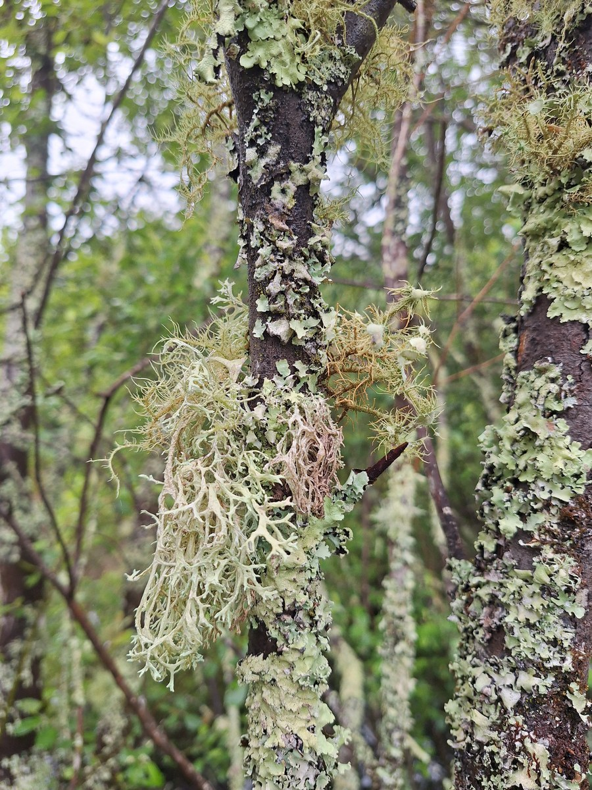

Onderweg kwamen we maar een handvol mensen tegen, waardoor het hele gebied heel rustig en ontspannend aanvoelde. De verhoogde
houten vlonderpaden waren goed bewegwijzerd, en langs de route lagen verschillende vogelkijkhutten en observatiepunten. In de
tweede helft van de wandeling volgden we de rivier de Estorãos, nadat we eerst de zoetwaterlagunes over houten vlonders
hadden omcirkeld. Omdat de grond rond de lagunes van nature modderig, nat en kwetsbaar is, werd er een uitgebreid netwerk
van verhoogde paden aangelegd, zodat bezoekers de moerassen kunnen doorkruisen zonder in de modder te zakken of het fragiele
leefgebied te beschadigen.

Op de terugweg naar het stadje stopten we in een lokaal restaurant om te lunchen. Daarna waren we klaar om **Ponte de Lima**
te ontdekken, een van de charmantste stadjes van Noord-Portugal en vaak omschreven als het oudste van het land. Het ligt
aan de oever van de Lima en is bekend om zijn middeleeuwse brug, zijn bloemrijke tuinen langs de rivier en zijn ontspannen
sfeer. De naam betekent letterlijk "brug over de Lima" en verwijst naar de historische stenen brug, een belangrijke oversteek
op de Romeinse weg die Braga met Astorga verbond.

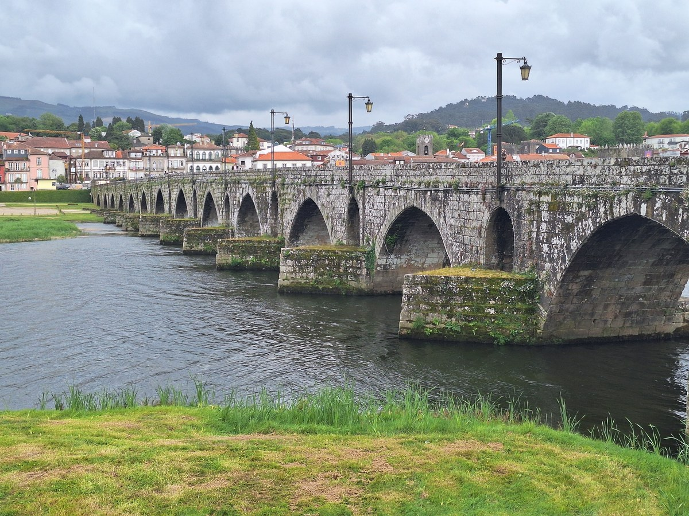

In april is Ponte de Lima extra mooi, want de parken en de rivieroevers staan vol lentebloemen en weelderig groen, met
spectaculaire blauweregen als blikvanger. We parkeerden naast het Parque Temático do Arnado, waar we sinaasappelbomen,
fonteinen, gezellige zitplekjes en een ongelooflijke zee van bloeiende blauweregen vonden. Er waren allerlei tinten paars,
en de planten waren zo geleid dat ze tunnels vormden waar je onder kon doorlopen met de bloemtrossen boven je hoofd. Gevallen
bloemblaadjes bedekten de paden, waardoor er overal in het park paarse tapijten leken te liggen. Dit was zonder twijfel mijn
favoriete plek in het stadje. Midden in het park lag ook een speeltuin, waar onze dochter zich een hele tijd heeft geamuseerd.
Goede speeltuinen bleken tijdens onze rondreis door Portugal namelijk verrassend moeilijk te vinden.

  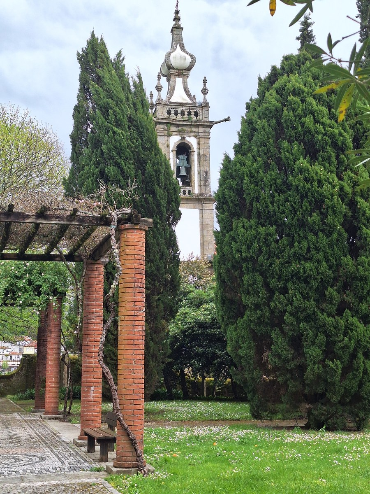
  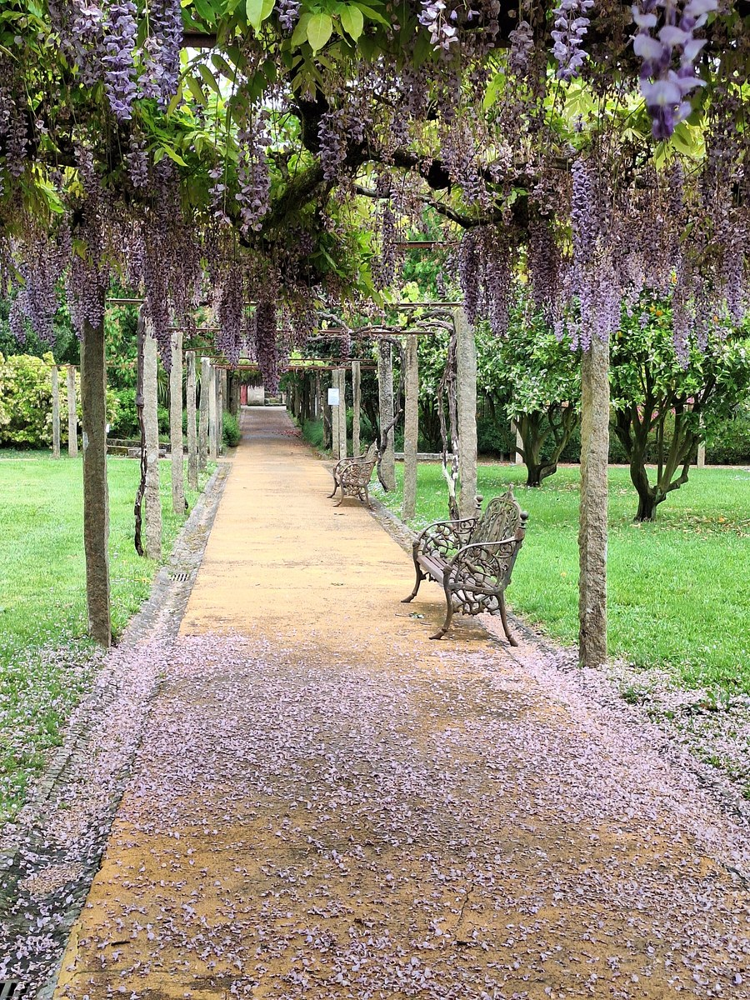

Toen we het park verlieten, wandelden we richting het centrum en staken we de beroemde brug over. Ernaast staat de Igreja
de Santo António da Torre Velha. De brug is ook nauw verbonden met de Camino de Santiago, want Ponte de Lima is een van de
belangrijke haltes op de Portugese route naar Santiago de Compostela. Terwijl we door het stadje wandelden, zagen we
verschillende pelgrims uitrusten bij de brug, die even op adem kwamen voor ze verder trokken. We zagen ook borden met
eenvoudige en betaalbare overnachtingen voor pelgrims, wat duidelijk maakte dat deze eeuwenoude traditie nog altijd deel
uitmaakt van het dagelijkse leven in Ponte de Lima.

Het historische centrum is vrij klein, maar staat vol oude gebouwen. Sommige staan leeg of zijn niet bepaald goed
gerestaureerd, en net dat geeft het stadje karakter. We passeerden de fontein op het Camõesplein met zicht op de oude
Romeinse brug en dwaalden daarna door smalle straatjes naar het kleine groene pleintje bij de Estátua de António Feijó,
waar we verrast werden door een groot ooievaarsnest.

  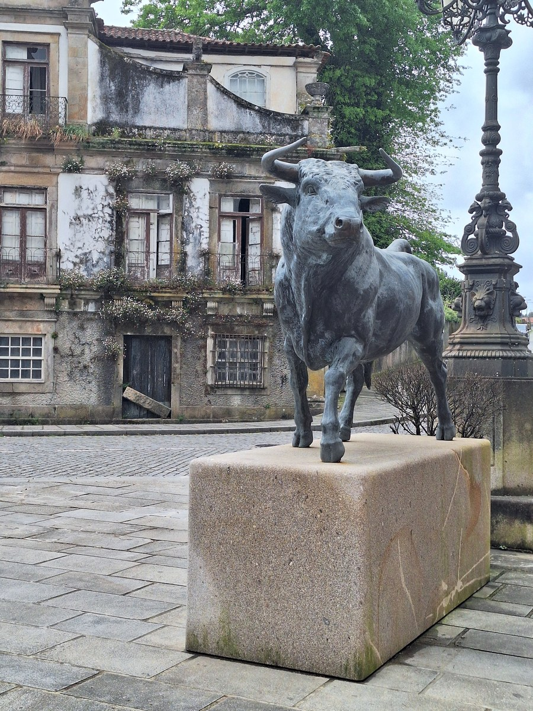
  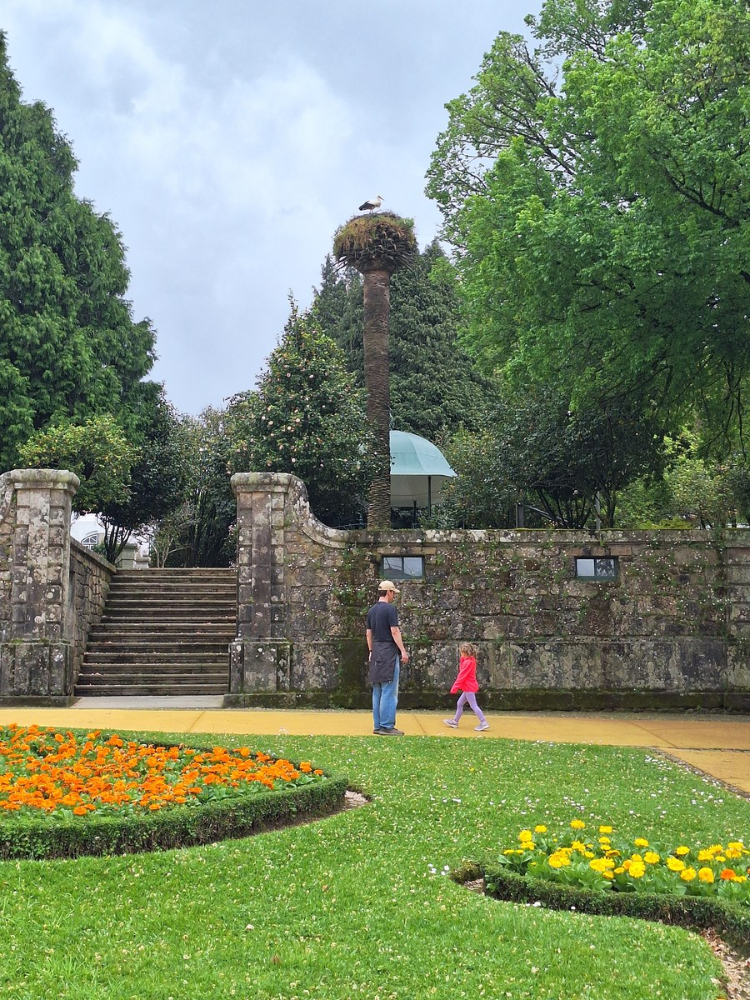

We brachten ook wat tijd door rond het Paço do Marquês de Ponte de Lima. Vanop de kasteelmuren heb je een mooi uitzicht
over het stadje beneden. In het paleis is het Interpretatiecentrum voor Militaire Geschiedenis gevestigd, een museum dat we niet
bezocht hebben omdat het ons niet echt geschikt leek voor een bezoek met onze dochter, al is het wellicht interessant voor wie van
militaire geschiedenis houdt.
Daarna volgden we de hoofdstraat, de R. Agostinho José Taveira, en bewonderden we onderweg de historische gebouwen tot we aan de
oever en de befaamde Avenida dos Plátanos kwamen. Dat is een heerlijke plek om aan de zomerhitte te ontsnappen, op een bank
onder de bomen te gaan zitten en van het rustige uitzicht op de rivier te genieten. Uiteindelijk wandelden we langs het water
terug naar de brug, die we nog een keer overstaken om bij onze auto te raken.

  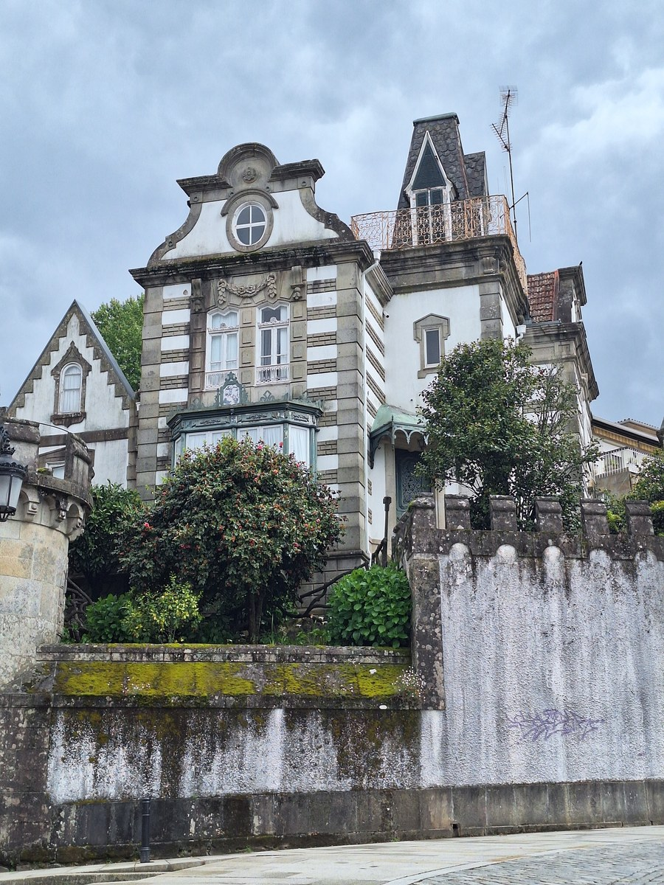
  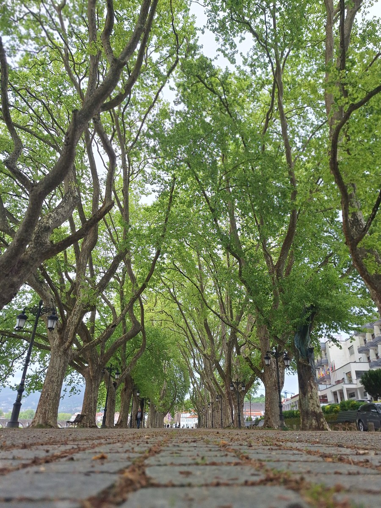

We hadden nog net genoeg tijd voor een laatste stop dichter bij de bergen, bij **Passadiços e Moinhos da Ribeira de S. João**,
en dat bleek een geweldige verrassing. Hoewel het maar een korte wandeling is (minder dan 2 km), zit ze boordevol afwisseling:
houten vlonderpaden, hangbruggetjes, kleine houten gebouwtjes die waarschijnlijk vroegere watermolens waren, en
een prachtig landschap. Onze dochter vond het oversteken van de wiebelende hangbruggetjes en het rennen over de houten
vlonderpaden geweldig, dus legde ze de hele route met plezier af, zonder één keer te klagen. Ik vind het een fantastische plek om met kinderen te
bezoeken, want achter elke bocht valt wel iets interessants te zien.

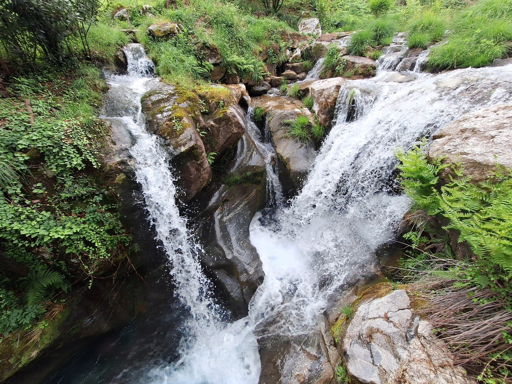

  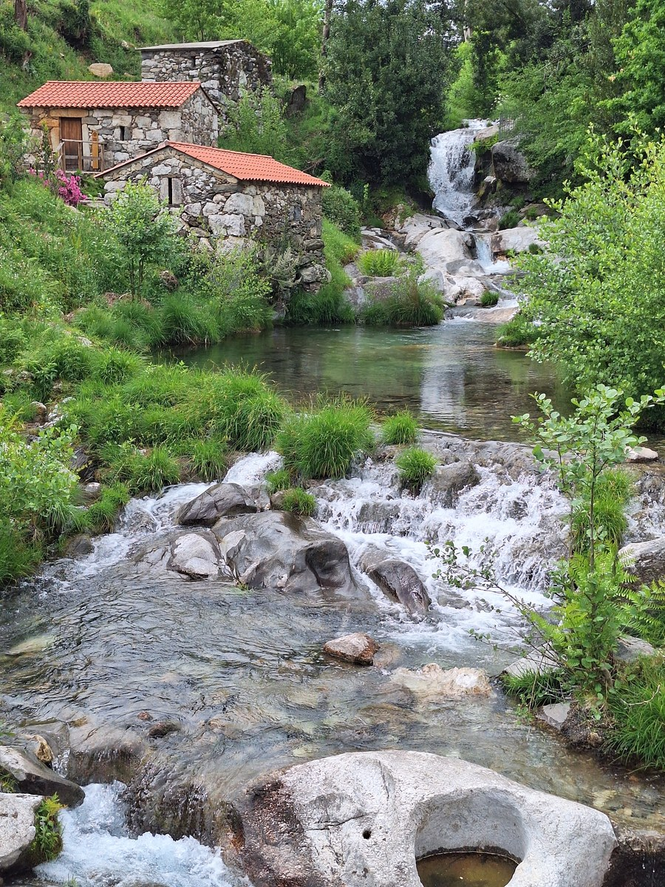
  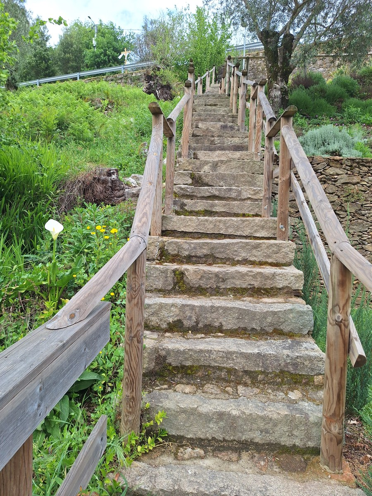

Er was een modern ogend infocentrum, maar dat was jammer genoeg gesloten, net als de toiletten naast het ecomuseum.
We kruisten enkel een paar mensen die vertrokken toen wij aankwamen, dus we hadden de plek het grootste deel van ons bezoek
zo goed als voor onszelf. Een beetje verwarrend is dat de route uit twee aparte stukken bestaat, gescheiden door
een weg. Wij begonnen met de grootste lus, waar de belangrijkste watervallen liggen. Daarna stapten we langs de weg voorbij
de plaatselijke kerk tot aan het ecomuseum, waar het tweede deel van de route achter het museumgebouw begint. Dat betekent
dat je twee keer langs die weg moet stappen om de volledige route te doen. Omdat er geen voetpad is en de weg vrij bochtig
is, moet je extra opletten wanneer je met kinderen op stap bent.

  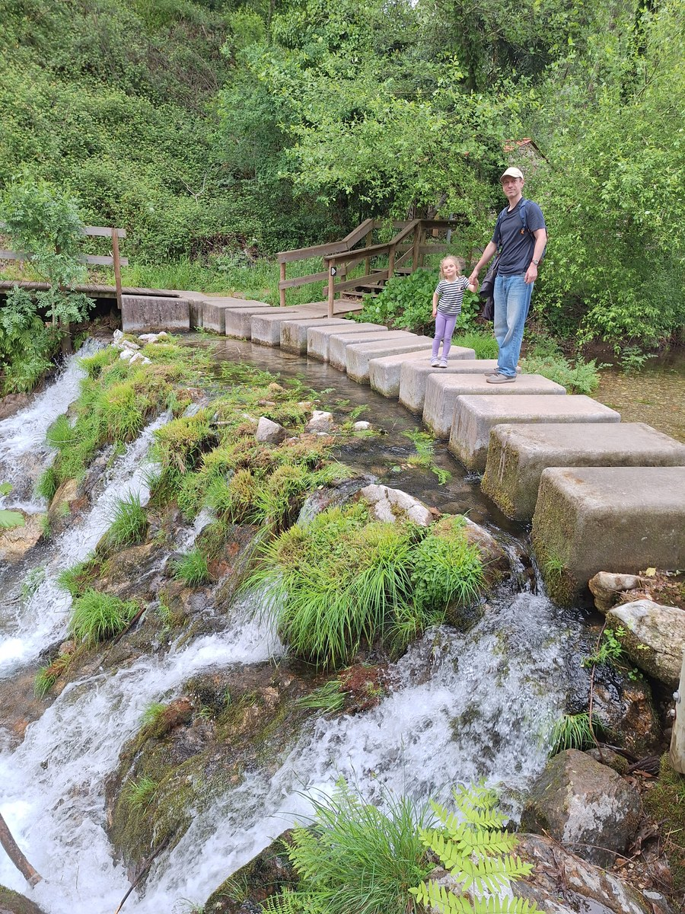
  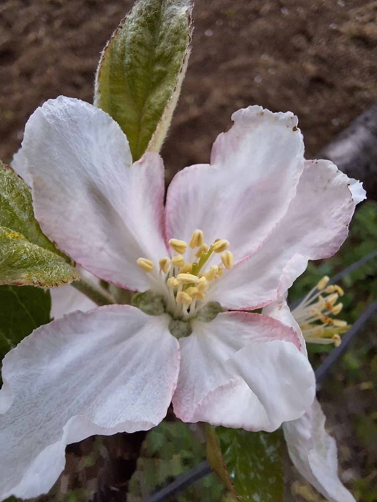

Hoewel de route kort is, is ze veel gevarieerder dan we hadden verwacht. In minder dan een uur staken we verschillende
bruggen over, ontdekten we watervallen, bewonderden we de oude molens en genoten we van het rustige bos. Het voelde als
een perfecte laatste stop voor we naar Braga terugkeerden.

Ponte de Lima bleek een van de hoogtepunten van onze reis door Noord-Portugal. We kwamen oorspronkelijk voor een kort
bezoek aan het stadje en twee korte wandelingen, maar de combinatie van lentebloemen, rustige landschappen en
kindvriendelijke paden deed ons betreuren dat we hier niet meer tijd hadden ingepland. Het is precies zo'n plek waar vertragen
deel uitmaakt van de ervaring.

## Praktische info:

* Nationaal park Lagoas de Bertiandos e São Pedro d'Arcos: gratis toegang  
De wandelingen staan beschreven op de [officiële website](https://lagoas.cm-pontedelima.pt/informacoes/atividades/percursos-e-rotas/poi/percurso-do-rio-pr-3)
waar je ook voor elke wandeling een pdf vindt (wij deden PR3), met een uitgebreide beschrijving in het Spaans en het Engels.
Duur van het bezoek: 2 uur
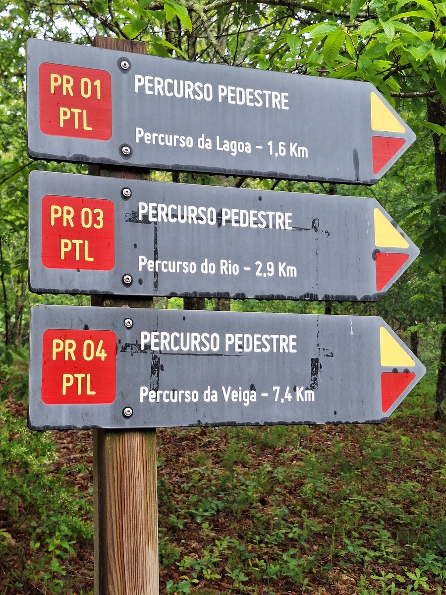

* Ponte de Lima:
[Parking](https://maps.app.goo.gl/R2tQfwCrHU248e6q9), langs de rivier is er heel wat gratis parkeergelegenheid  
Gratis openbaar toilet op het Camõesplein  
Interpretatiecentrum voor Militaire Geschiedenis - €1 toegang  
Ponte de Lima bezoeken: 1,5–2 uur  
* Restaurant: [NACOS Restaurante](https://maps.app.goo.gl/99sAeSKDWcBVUKgW7)
* Passadiços e Moinhos da Ribeira de S. João: gratis toegang.  
Duur van het bezoek: 45–60 minuten
Aan het begin van de route is er een kleine gratis parking, maar die heeft maar plaats voor een paar wagens. We zagen ook
enkele extra plaatsen bij het ecomuseum. De grootste parking die we vonden, was een [open terrein met grind naast de
kerk](https://maps.app.goo.gl/HveHTcM2D8PDLaaT9), net naast de hoofdweg. Die is waarschijnlijk vooral bedoeld voor kerkbezoekers, maar hij kan ook goed van pas
komen als de kleinere parkings vol staan.

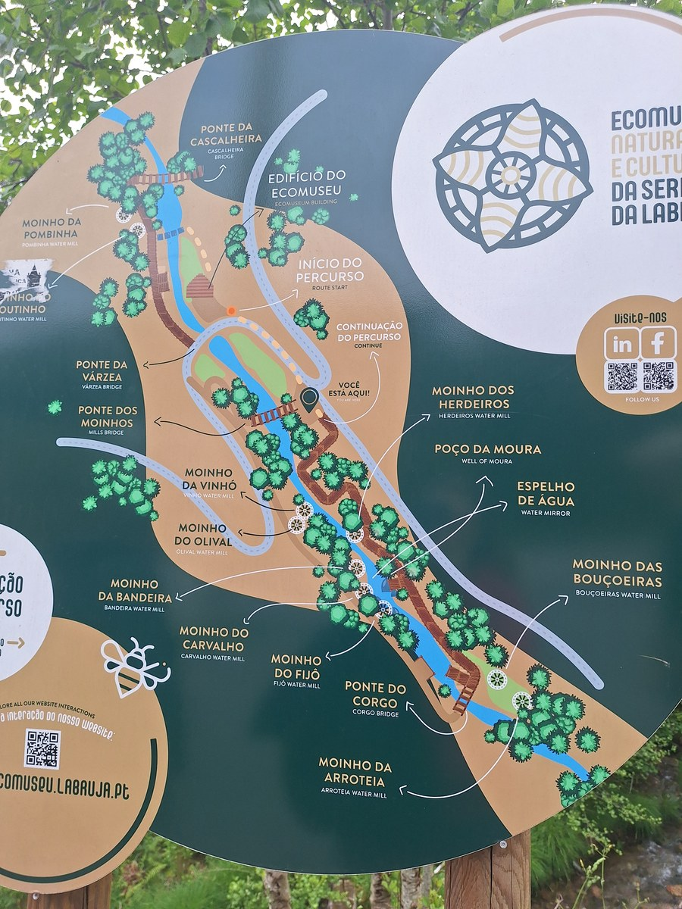
