We besloten een van de langere weekends in mei te gebruiken om eindelijk een streek in België te verkennen waar ik nog
nooit was geweest. We waren op zoek naar langere wandelingen in plaats van korte familiewandelingen, dus lieten we onze
dochter bij haar grootouders achter en reden richting Luik. Het weer had echter andere plannen. De voorspelling voor het
lange weekend was verrassend slecht, met onweer voorspeld in heel België. Omdat ons appartement in Luik lag en het weer beter leek
rond het 13e-eeuwse kasteelcomplex van **Alden Biesen**, besloten we het beste van de situatie te maken en daar onderweg
te stoppen.

## Alden Biesen - een makkelijke wandeling rond het kasteel
We besloten de wandeling met het oranje kruis te volgen, die door de velden rond het kasteel loopt en ongeveer 8,2 km lang
is. De wandeling start meteen bij de grote poort van het kasteel, waar we langs een gezellig zitplekje en een kleine houten
aanhangwagen kwamen die De Bij-Mobiel heet. Die is in Limburg ontworpen om het publiek iets
bij te brengen over bijen en biodiversiteit. Hij laat zien hoe essentieel honingbijen en solitaire bijen zijn voor
kruisbevruchting, wat van levensbelang is voor de enorme fruitboomgaarden in deze regio. Het moet een fantastische plek
zijn om te bezoeken tijdens de bloesemperiode in de lente.

  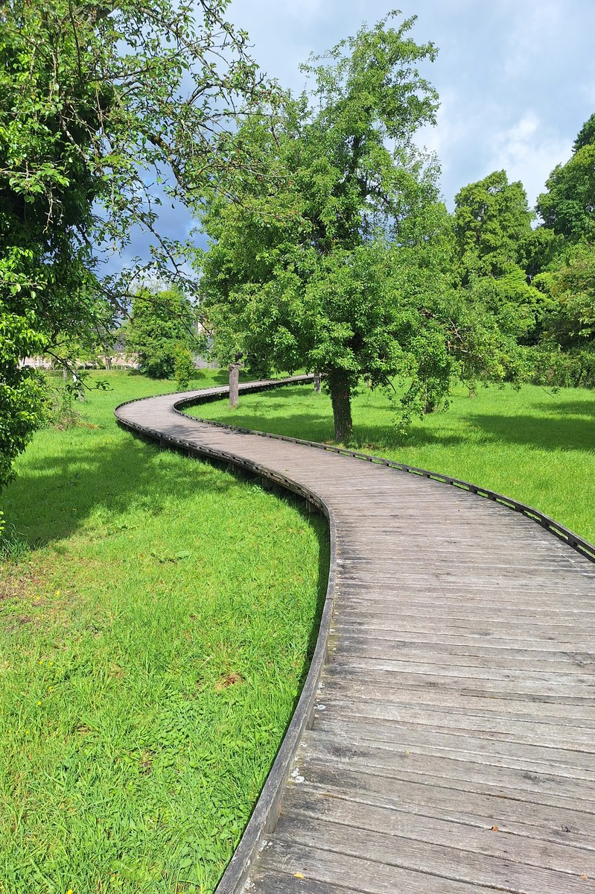
  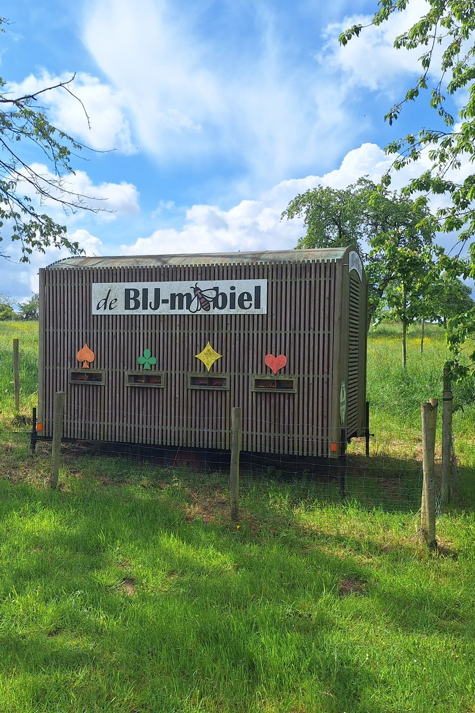

Toen we de kasteelmuren achter ons lieten, leidde het oranje kruis ons door landbouwgrond, beboste beekvalleien en weelderige
moerasgebieden, waar we een aantal houten paden langs de rivier de Demer vonden. Onderweg kwamen we meerdere mooie
picknickbanken tegen en we genoten echt van de prachtige afwisseling van deze rondwandeling. Na de wandeling verkenden we op de weg
terug naar de parking ook nog de binnenkoer en de Franse tuin van het kasteel.

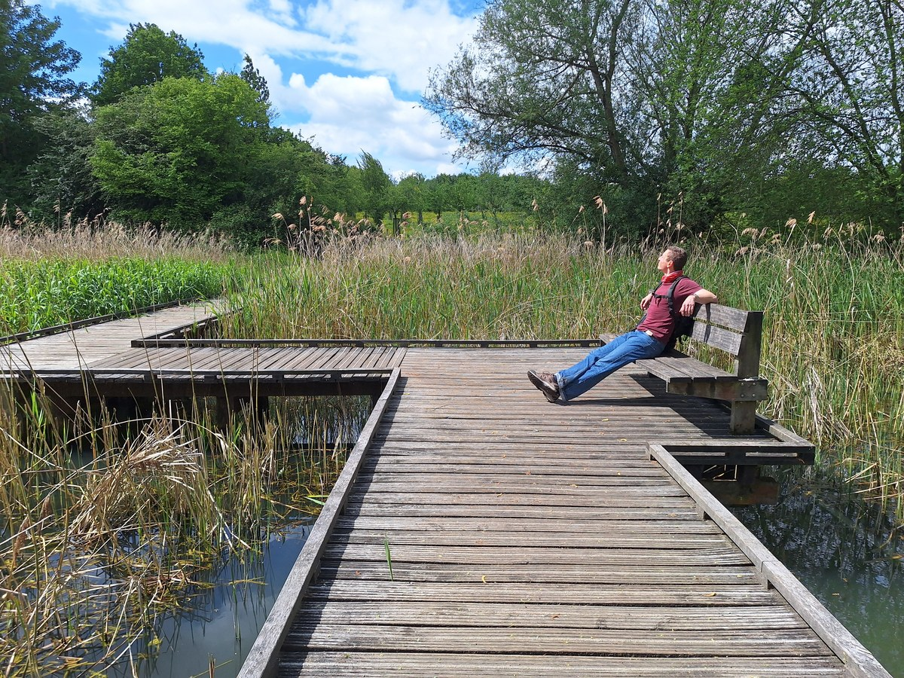

  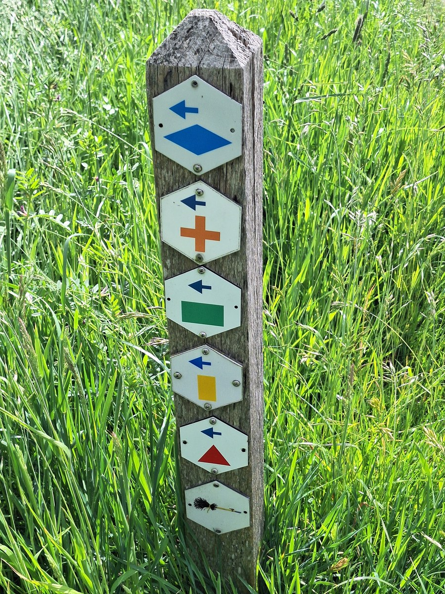
  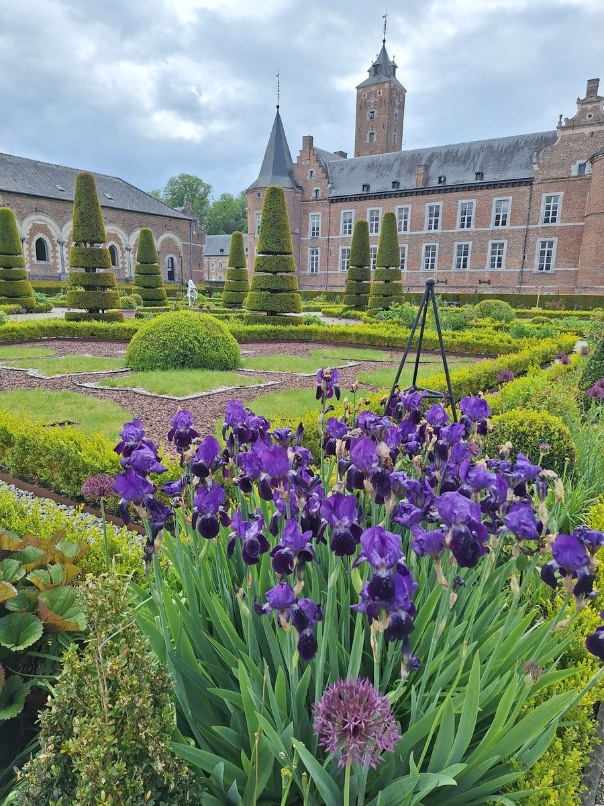

## Esneux - een wandeling onderbroken door onweer
Ondanks het onstabiele weer besloten we Esneux te bezoeken en een wandeling langs de rivier de Ourthe te proberen. De blauwe
lijn op de kaart laat de route zien die we oorspronkelijk wilden volgen, terwijl de rode lijn de route toont die we
uiteindelijk hebben gewandeld. Helaas werden we na slechts 1,5 km tegengehouden door hevige regen en onweer. Omdat
de brug waar we de rivier konden oversteken pas na ongeveer 6 km kwam, zouden we de route onmogelijk hebben kunnen
inkorten als het weer nog slechter zou worden.
Toen het onweer voorbij was, wandelden we bergop naar de Sint-Hubertuskerk en volgden daarna het pad langs de omheining van
Château Le Fy, om langzaam de helling af te dalen richting Rue Grandfosse. Vandaar liepen we langs de rivier terug naar de
auto, langs het treinstation. Het was niet de wandeling die we oorspronkelijk gepland hadden, maar we hebben tussen
de onweersbuien toch een klein stukje van de streek kunnen verkennen.

## Hoge Venen - een lange wandeling door bos en open landschap
De dag daarna was de weersvoorspelling veel beter, maar alleen tot 16 uur, dus we moesten er zeker van zijn dat we ten laatste
om 10 uur aan het begin van de wandeling stonden. We hadden nog 60 km te rijden vanaf ons appartement, dus zonder verkeer
duurde het ongeveer een uur. Je moet er echter via lokale wegen komen, dus het kan langer duren afhankelijk van het verkeer.
De parking naast het restaurant en de kleine kapel was vrij leeg toen we aankwamen. Ik had een aantal paden aangeduid in de
app Organic Maps die ik wilde volgen, maar we moesten onze route aanpassen vanwege natte stukken waar we niet door konden.
De voorgaande dagen waren beslist veel regenachtiger geweest dan de rest van de maand. In het begin liepen we over heel
goed herkenbare paden in het bos. Maar elke keer als we via kleinere paadjes dieper het bos in probeerden te gaan, werden we
tegengehouden door heel modderig terrein, dus besloten we op het hoofdpad te blijven. Een van de dingen die ik in het open
landschap bijzonder mooi vond, was het veenpluis dat overal groeide. De pluizige witte zaadpluimen kwamen prachtig uit tegen
de groene en bruine vegetatie en zorgden ervoor dat het landschap er bijna uitzag als bedekt met kleine plukjes katoen.

  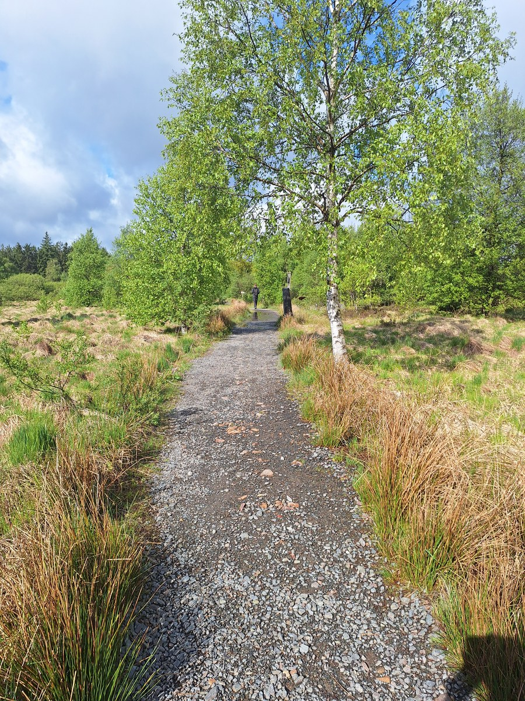
  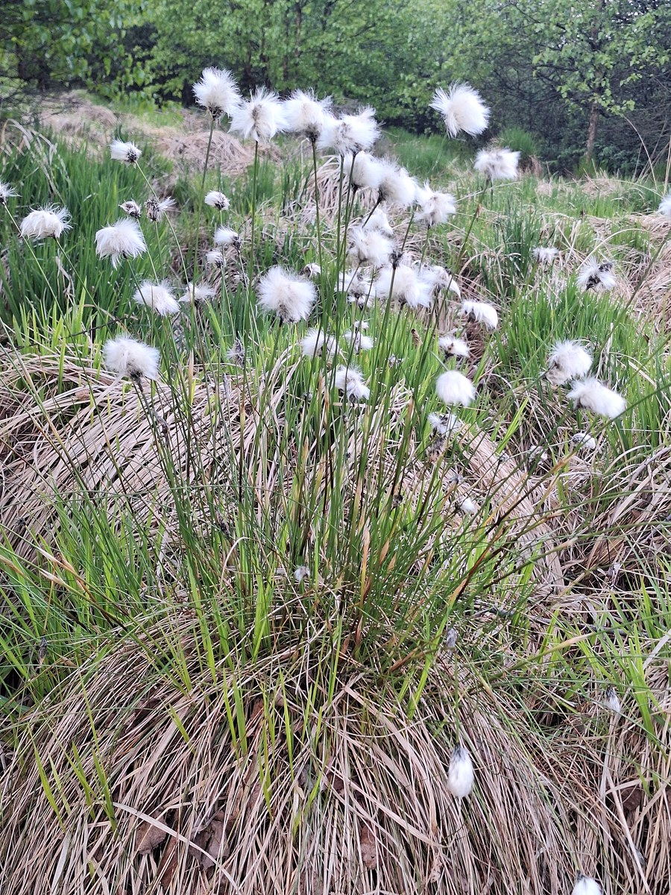

Het bos was heel stil en uitgestrekt, met borden die mountainbikeroutes in de omgeving aangaven. We liepen deels over die paden
en sloegen later kleinere paadjes door het bos in. Het verste punt dat we bereikten was een mooi uitkijkpunt met een
overdekt platform en een paar banken. Vandaar konden we kleine watervallen horen en zien in het dal onder ons. Ik had op de
kaart een klein pad gezien dat steil naar beneden liep naar de beek, en we besloten het te proberen. Dit was voor mij het
interessantste deel van de wandeling, met meer rotsen en een smal, steil pad, wat ik persoonlijk veel liever heb.
We bereikten heel snel de beek, waar we tot onze verrassing veel mensen aan de andere kant zagen. Op de kaart had ik in de
buurt de Promenade de la Hoëgne gezien, een wandeling langs de rivier, en ik denk dat dit een deel van die
route was tot aan de brug Pont du Centenaire. Het gebied rond de beek was echt interessant, met houten vlonderpaden en
bruggen, maar het was zonder twijfel het drukste deel van de wandeling. We moesten vaak wachten om mensen te laten passeren,
omdat ze veel trager waren dan wij en het pad heel smal was, waardoor inhalen niet makkelijk was.

  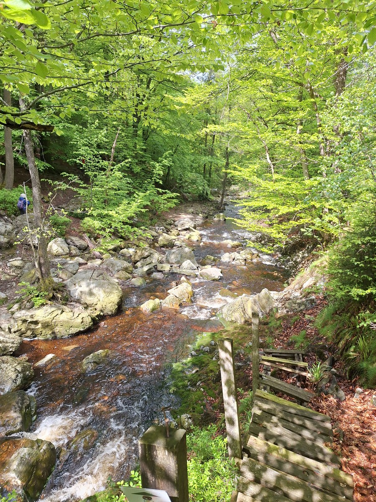
  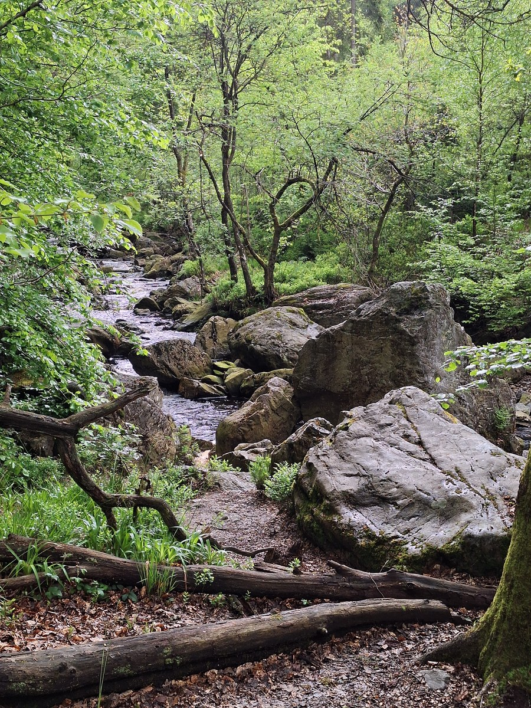

Eén ding dat onmiddellijk mijn aandacht trok, was de kleur van het water in sommige beken. Het was verrassend donker, bijna
roodbruin, en zag een beetje uit als thee. Het water was eigenlijk helder genoeg om de stenen op de bodem te zien. De kleur
komt van organisch materiaal dat vrijkomt uit het veen en de vegetatie in dit moeraslandschap, wat de beken hun kenmerkende
donkere kleur geeft. Vanaf de brug besloten we terug te keren in de richting van de parking waar we de auto hadden
achtergelaten. Na slechts een paar honderd meter waren we weer alleen.

  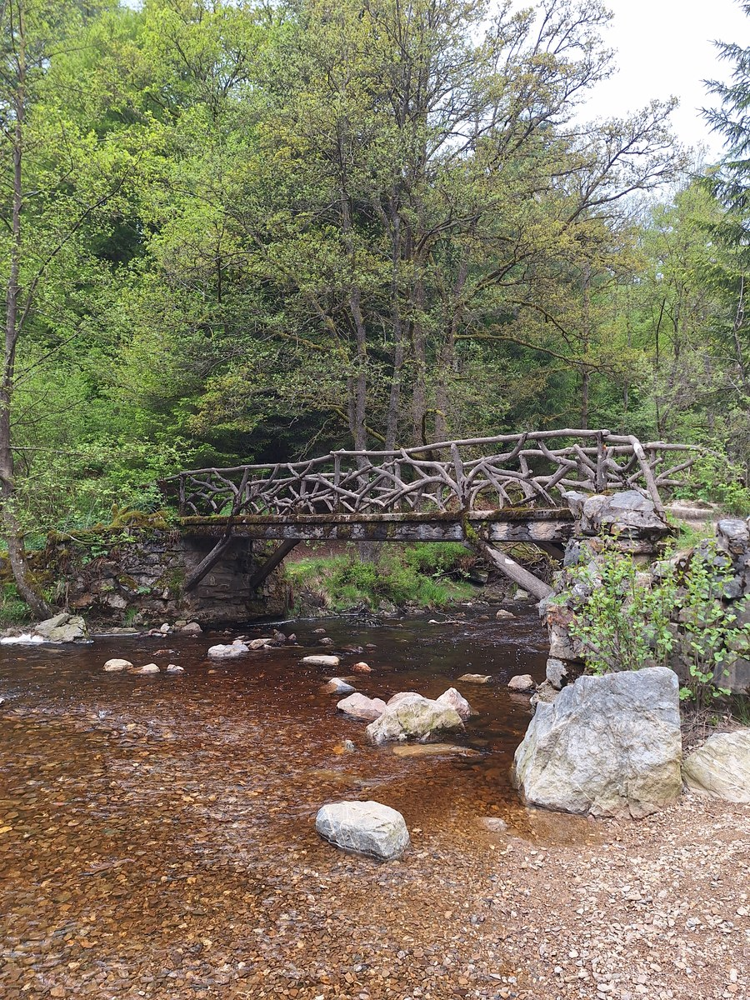
  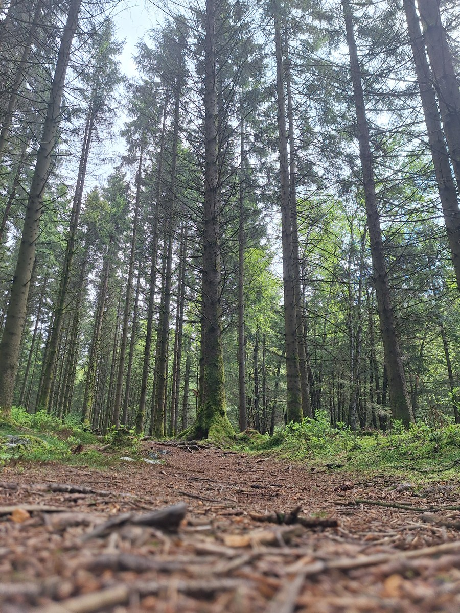

Ik vroeg mezelf af: waar zijn die kenmerkende vlonderpaden die ik op zoveel foto's had gezien? We bereikten ze uiteindelijk
tijdens de laatste 3 kilometer van de wandeling. Op dat moment klaagde mijn man al over pijn in zijn voeten, en het bleek
dat hij meerdere blaren had. Daarom besloten we, toen we bij het laatste pad naar de parking kwamen, dat ik nog een kleine
lus aan de andere kant van de hoofdweg zou doen om te zien hoe het daar was, terwijl hij in de auto zou wachten. Toen we
uiteen gingen, stak ik de hoofdweg over naast hotel Le Mont Rigi en kwam ik in het gebied dat de Hoge Venen heet, wat heel
anders was dan de rest van de wandeling. Het landschap is daar heel open, met weinig bomen aan de horizon. Je moet er
houten vlonderpaden volgen die boven de drassige bodem liggen. Je kan hier prachtige wandelingen maken
over vlonderpaden.
Ik deed vlug een lus van 3 km om het gebied te bekijken, maar je kan aan die kant van de hoofdweg een veel langere
wandeling maken, helemaal tot een ander natuurreservaat, Fagne de Brackvenn (parking Nahtsief).

  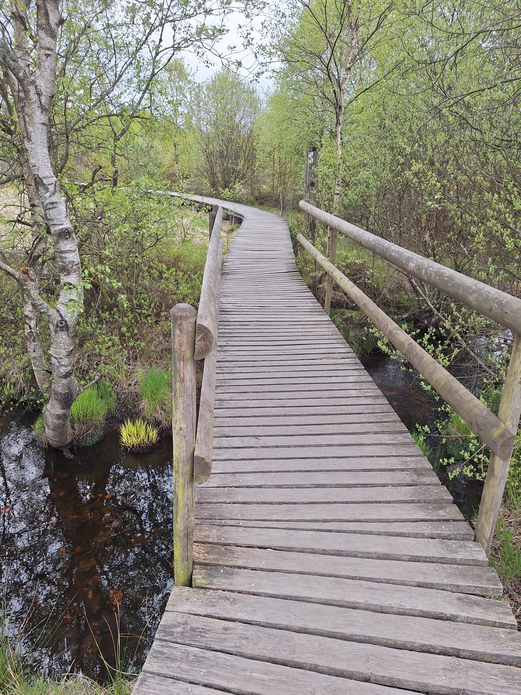
  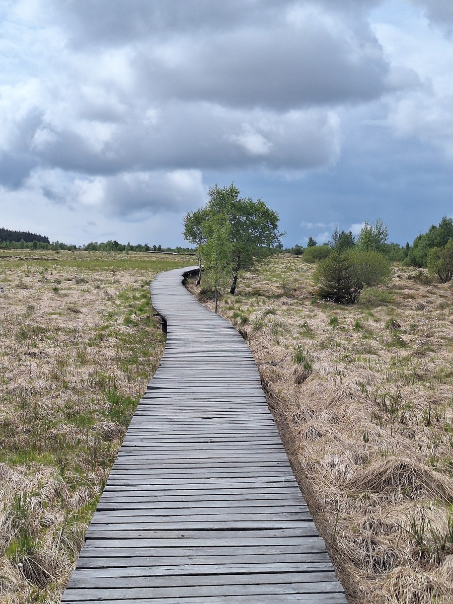

Voor mensen die echt op het hoogste punt van België willen staan: je kan iets verder doorrijden naar de parking van het
Signal de Botrange. Het is echter in feite gewoon een heuveltop met een trap naast de parking, dus wij besloten het over te
slaan. Iemand besloot in 1923 de trap te bouwen om de symbolische top precies op 700 meter te brengen, aangezien de
natuurlijke top lager is. Het kan natuurlijk wel een startpunt zijn voor een andere geweldige wandeling in deze omgeving.
Het was een intense wandeling, maar met prachtige landschappen en heel weinig mensen, afgezien van het korte stuk langs de
beek dicht bij Pont du Centenaire en de omgeving van de parking, waar de beroemde vlonderpaden liggen.

## Vallon du Ninglinspo - mooi maar veel te druk
Op de laatste dag begonnen we, na het uitchecken, de dag met een wandeling in het gebied Vallon du Ninglinspo. Dat was de
grootste teleurstelling van onze trip. Eerst moesten we de auto wat verder van de start parkeren, omdat de twee kleine
parkings zelfs voor 10 uur al helemaal vol stonden. Heel snel werd de wandeling wat verwarrend. Op sommige plekken hingen er
linten tussen de bomen die aangaven dat we een andere route moesten volgen vanwege werken in het gebied, maar het was echt
niet duidelijk waar je heen moest. Soms wezen de pijlen zelfs in richtingen waar het niet mogelijk was om de beek over te
steken. Het was ook heel druk, en hoe verder we kwamen, hoe erger het werd. Er waren veel mensen met kleine kinderen, maar
deze wandeling was eigenlijk niet makkelijk. Ik zou hem niet aanraden voor gezinnen met jonge kinderen vanwege de vele
gladde rotsen, de modder en de plekken waar je grote passen moest zetten. Ik merkte dat veel kinderen het moeilijk hadden.
We moesten ook meerdere keren wachten omdat mensen problemen hadden met het oversteken van de smalste stukken van het pad,
die toen bijzonder modderig waren. We hadden de indruk dat te veel toeristen het landschap hadden beschadigd. Er waren
overal te veel sporen van wandelaars, en het leek erop dat de natuur leed onder het hoge aantal bezoekers.

  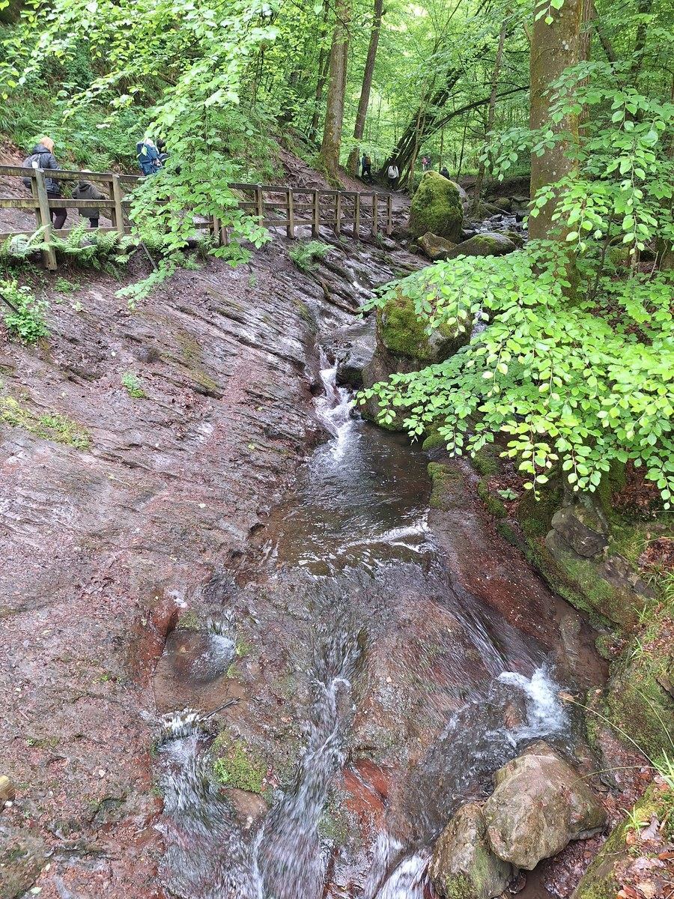
  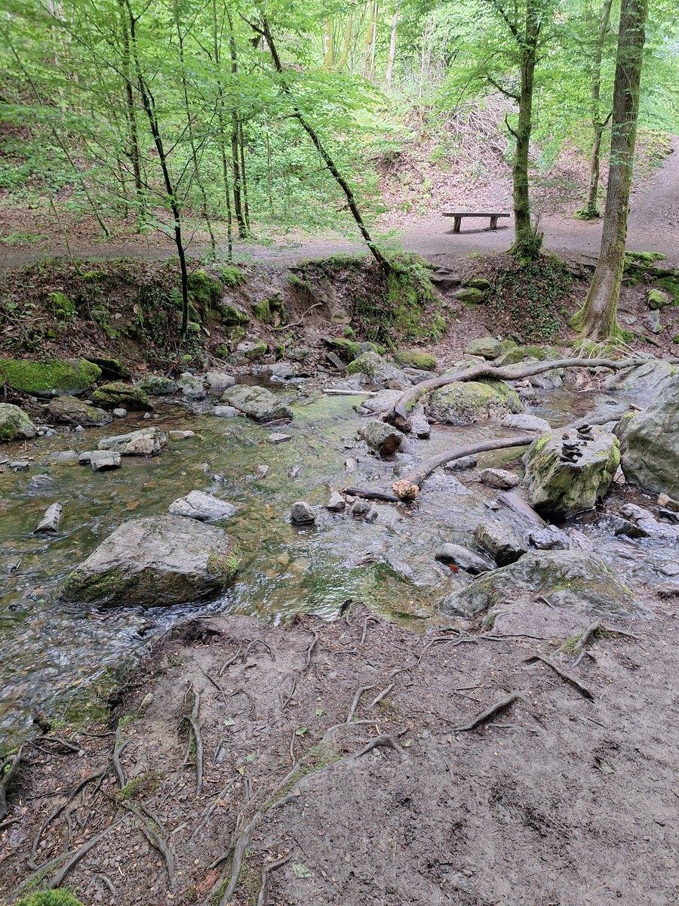

Halverwege de gewone wandeling, na ongeveer 3 km, besloten we de route te verlengen en een extra lus van 6 km te maken naar
La Charmille du Haut Marêt, een charmant pad van 573 m lang met meer dan 4.500 haagbeuken die een tunnel vormen. Tijdens
deze extra wandeling kwamen we bijna niemand tegen. We genoten het meest van dit deel, omdat we eindelijk mooie en stille
natuur konden ervaren. We volgden simpelweg paden die er goed begaanbaar uitzagen en ook op de kaart in Organic Maps stonden, en vonden
de plek zonder problemen. Op de terugweg liepen we door een ander stuk van het bos en slechts één keer, rond de 8 km, sloegen
we de verkeerde kant op. Dat deel was vrij vlak, met goed begaanbare paden. Er stonden ook borden die
fietsroutes aangaven. Toen we terug op de Ninglinspo-route waren, was de resterende helft heel makkelijk begaanbaar. Het was
een breed en mooi pad door het bos. Er waren niet veel uitzichten, dus het was zeker minder interessant dan het eerste deel,
maar er waren geen moeilijke stukken met rotsen of veel modder.

  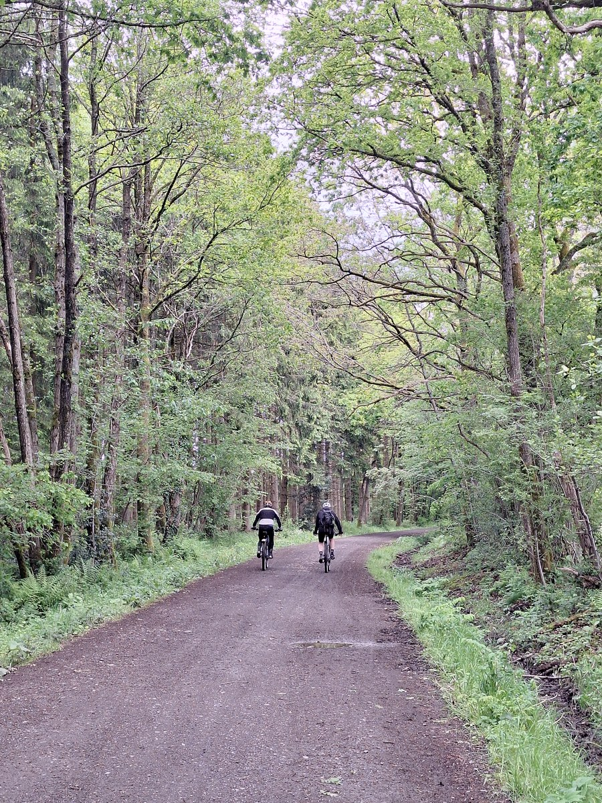
  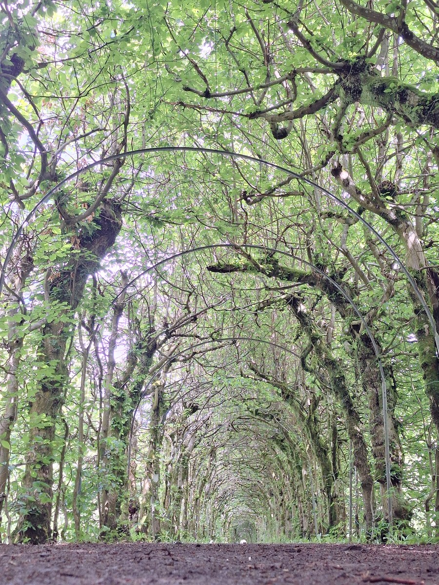

## Heid des Gattes - een korte extra wandeling bij Aywaille
Omdat we nog wat tijd hadden en het weer stabiel was, besloten we te stoppen bij Heid des Gattes, bij Aywaille.
Ik deed de wandeling alleen, terwijl mijn man op een bank aan de rivieroever bleef zitten omdat zijn blaren na de wandeling
van die ochtend echt pijnlijk werden. Ik had zelf nog wel zin om verder te wandelen. Na een steile klim werd het terrein
vlak en kreeg ik tussen de bomen mooie vergezichten op de stad en de rivier beneden. Ik kwam langs een paar kleine huizen op de
top en volgde een heel duidelijk pad tot ik bij een weide met twee ezels kwam. Het was tijd om het pad terug naar de parking
te vinden. Het was smal en steil, maar ik bereikte snel de lagere delen van de heuvel.

  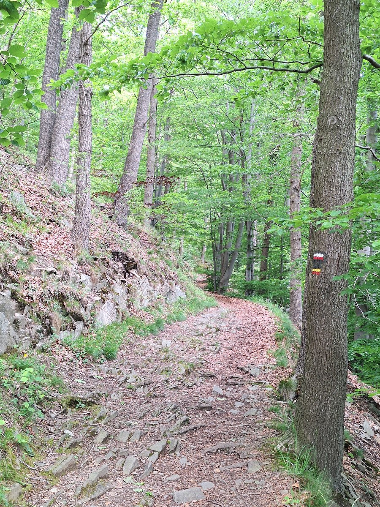
  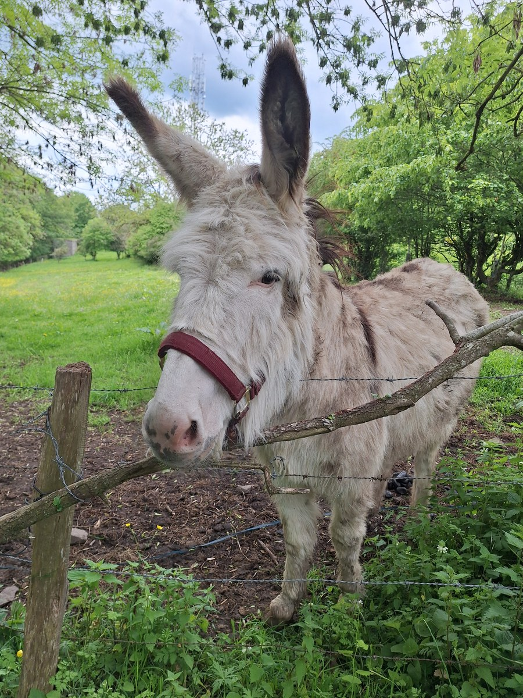

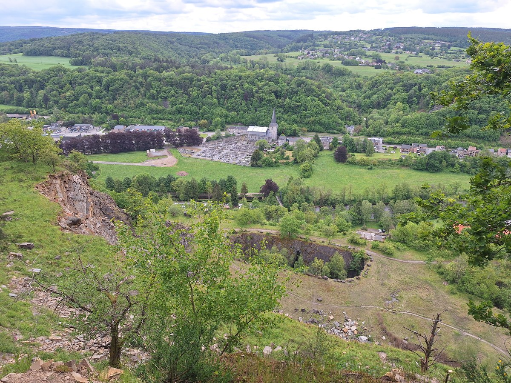

Op de weg naar beneden richting het gebied waar de geiten zouden moeten zijn, zag ik vanaf de top van de heuvel iets heel
ongewoons. Er zat een groot, diep gat in de grond, bijna als een krater, met bomen die op de bodem groeiden. Het was heel
indrukwekkend om van bovenaf te zien.
Wat me het meest verraste, was hoe plotseling de rand steil afviel. Er stond langs een groot deel van de rand geen omheining of
andere beveiliging, dus het leek erop dat iemand die niet oplet er makkelijk meters naar beneden zou kunnen vallen. Er lagen
op sommige stukken langs de rand wel enkele enorme rotsblokken, maar die leken niet alle potentieel gevaarlijke stukken te
beschermen. Later kwam ik erachter dat er in dit gebied verschillende oude steengroeven liggen, dus ik neem aan dat dit een
van de oude groeves kan zijn geweest. Er waren geen geiten te vinden in het gebied. Er stond wel een
informatiebord over het benaderen en voeren van de geiten, dus ik weet niet of je de plek op een bepaald moment in het jaar
of op bepaalde dagen moet bezoeken om ze te zien, of dat ze er helemaal niet meer zijn. Daarna was het tijd om terug te
gaan, onze dochter bij haar grootouders op te halen en verder te rijden naar Leuven.

  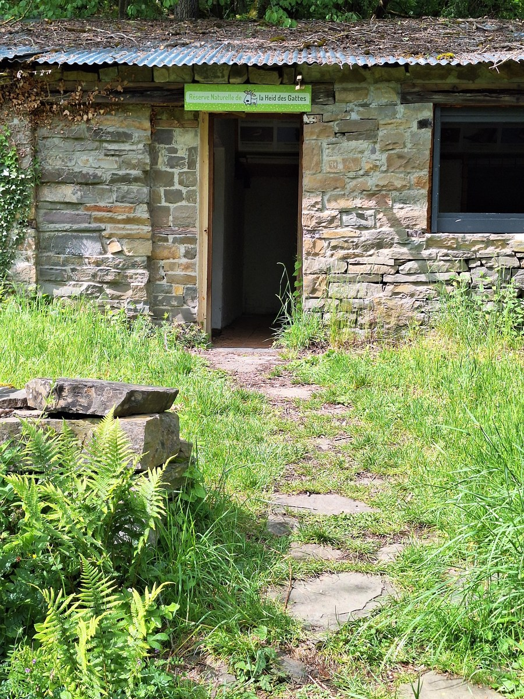
  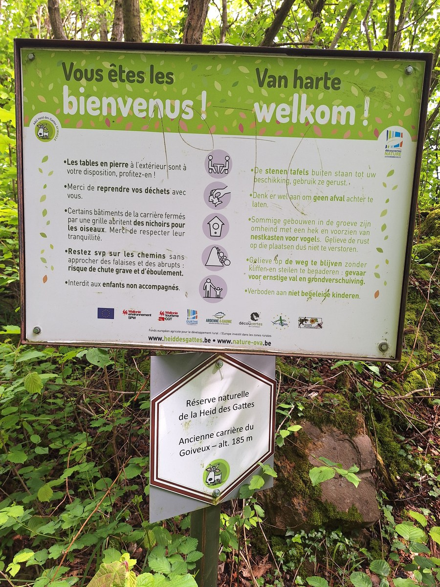

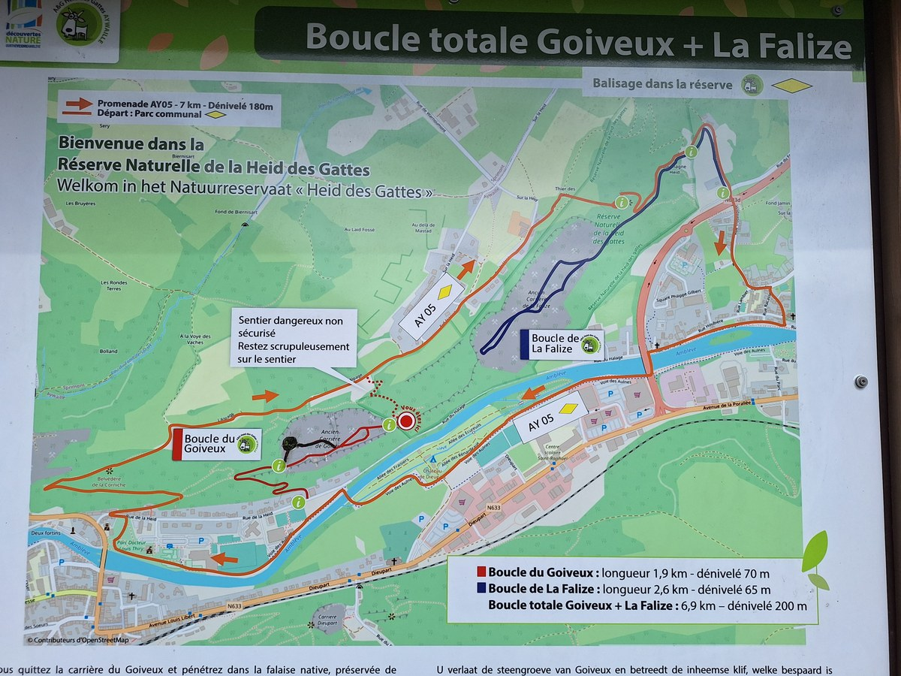

## Praktische info:

**Alden Biesen**  
Beschrijving van de wandeling: [wandeleninlimburg.be](https://www.wandeleninlimburg.be/en/wandellus/alden-biesen-orange-cross-193)  
Duur van de wandeling: 1u 45min  
Afstand: 9 km  
Onze GPX-track: [download](/assets/Belgium/Liege/2026-05-14-Alden%20Biesen.gpx)  
Gratis parking: [Google Maps](https://maps.app.goo.gl/eoudxYgX2bHpea5j8)  
Kasteel: [alden-biesen.be](http://www.alden-biesen.be/)  
De Bij-Mobiel: [boomgaardenstichting.be](https://www.boomgaardenstichting.be/activiteiten/projecten/de-bij-mobiel)  

**Esneux**  
Gratis parking naast de brug: [Google Maps](https://maps.app.goo.gl/4evZeH9sQ6nLW2499)  

**Hoge Venen**  
Gratis parking naast restaurant La Baraque Michel: [Google Maps](https://maps.app.goo.gl/ut7yH3u1873iRfbZA)  
Duur van de wandeling: 5u 45min  
Afstand: 23 km  
Onze GPX-track: [download](/assets/Belgium/Liege/2026-05-15-Hautes%20Fagnes.gpx)  
Signal de Botrange: [Google Maps](https://maps.app.goo.gl/6pebocht3KyJWsk3A)  

**Balade du Ninglinspo**  
Parkeren: langs de weg, aangezien de betalende parking al voor 10 uur volledig vol stond. We zagen ook een tweede parking,  
die gratis was, maar ook die was vol en de helft ervan was afgesloten vanwege werken.  
Het is gevaarlijk om langs de weg te lopen: door alle auto's die aan beide kanten geparkeerd staan, is er aan de zijkanten  
van de weg diepe modder ontstaan.  
Ik hoop dat er snel een nieuwe parking komt, want het gebied is momenteel erg chaotisch.  
Duur van de wandeling: 3u 45min  
Afstand: 12,5 km  
Onze GPX-track: [download](/assets/Belgium/Liege/2026-05-16-Ninglinspo.gpx)  

**Aywaille**  
Gratis parking: grote parking naast [Google Maps](https://maps.app.goo.gl/EBUZt4bvPvUK93Zh9)  
Ik volgde een pad dat op Organic Maps aangeduid stond en niet op Google Maps te zien was.  
Duur van de wandeling: 1u  
Afstand: 4 km  
Onze GPX-track: [download](/assets/Belgium/Liege/2026-05-16-Aywaille.gpx)  

**Waar we verbleven**  
Airbnb-appartement in Luik: [airbnb.com](https://www.airbnb.com/rooms/1362297371259597564)
