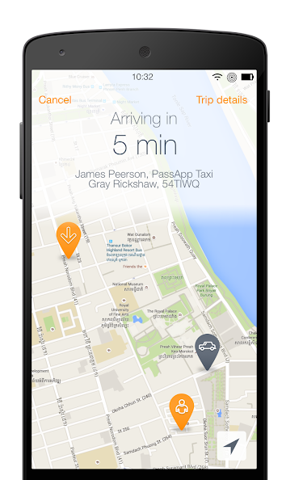
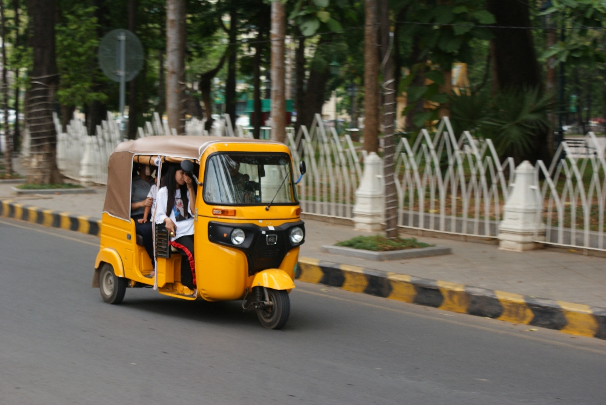

Jeśli podobnie jak my nie lubicie się targować, negocjowanie cen przejazdów taksówkami i tuk-tukami będzie zapewne najmniej przyjemną częścią podróży po Kambodży. Na szczęście istnieje alternatywa w postaci <a href="https://play.google.com/store/apps/details?id=com.multibrains.taxi.passenger.passapptaxis">PassApp</a> — przynajmniej w Phnom Penh i Siem Reap!

Interfejs aplikacji PassApp, niemal taki sam jak w aplikacjach Uber i Lyft

Aby jak najlepiej wykorzystać czas spędzony w Kambodży, zapewne nieraz trzeba będzie skorzystać z taksówki lub tuk-tuka. Zwykle można zatrzymać pojazd na ulicy i zapytać o cenę, ale prędzej czy później trafi się na kierowców żądających znacznie więcej, niż powinni. Na szczęście istnieje lepszy sposób! ...przynajmniej w Phnom Penh i Siem Reap: <a href="https://play.google.com/store/apps/details?id=com.multibrains.taxi.passenger.passapptaxis">PassApp</a>!

Nowoczesna riksza: zależnie od modelu mieści od 2 do 4 osób. Jest nieco mniejsza, ale tańsza niż tuk-tuk. Korzystaliśmy z takich riksz, by przemieszczać się między atrakcjami. Na plecaki nie ma zbyt wiele miejsca — jeśli je macie, lepiej zamówić tuk-tuka lub taksówkę.

<a href="https://play.google.com/store/apps/details?id=com.multibrains.taxi.passenger.passapptaxis">PassApp</a> to w zasadzie lokalny odpowiednik aplikacji Uber i Lyft, który działa dokładnie tak samo. Wskazuje się miejsce odbioru i cel podróży, sprawdza cenę, a aplikacja wyszukuje kierowcę. Gdy kierowca zaakceptuje kurs, można zobaczyć, gdzie się znajduje i kiedy przyjedzie. Płaci się gotówką albo kartą kredytową połączoną z kontem PassApp. Dzięki aplikacji cena jest od razu znana i — z naszego doświadczenia — znacznie niższa niż najlepsze stawki, jakie udawało nam się wynegocjować z przypadkowymi kierowcami na ulicy.

W obu miastach nie brakuje kierowców PassApp i nigdy nie musieliśmy długo czekać na przejazd.

Wadą jest to, że podobnie jak Uber i Lyft, aplikacja wymaga aktywnego połączenia z internetem, aby zamówić przejazd. Większość restauracji oferuje klientom bezpłatne Wi-Fi, ale korzystanie z aplikacji w innych miejscach może okazać się trudniejsze. Choć zawsze znajdowaliśmy jakieś rozwiązanie, turystyczna karta SIM z pakietem danych może się tutaj przydać, a jej zakup szybko się zwróci.

Dodatkowa wskazówka: jeśli zamierzacie zapłacić gotówką po zakończeniu przejazdu, zróbcie zrzut ekranu z ceną sugerowaną przez aplikację. PassApp ma swoje problemy i kiedyś zawiesiła się po stronie kierowcy. Wówczas żadne z nas nie mogło ponownie sprawdzić uzgodnionej ceny.

**Aktualizacja z listopada 2019 roku:** PassApp jest teraz dostępna w kilku kolejnych miastach, w tym w Sihanoukville i Kampot.

