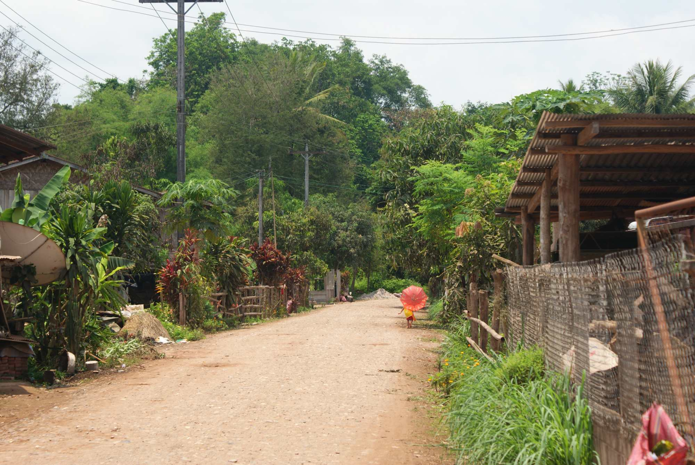
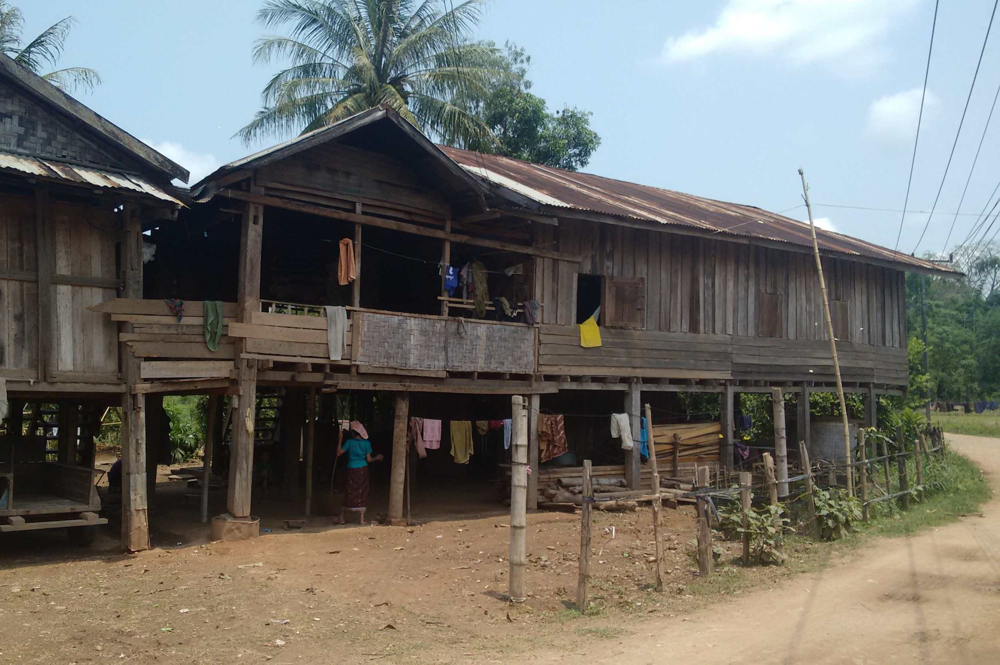
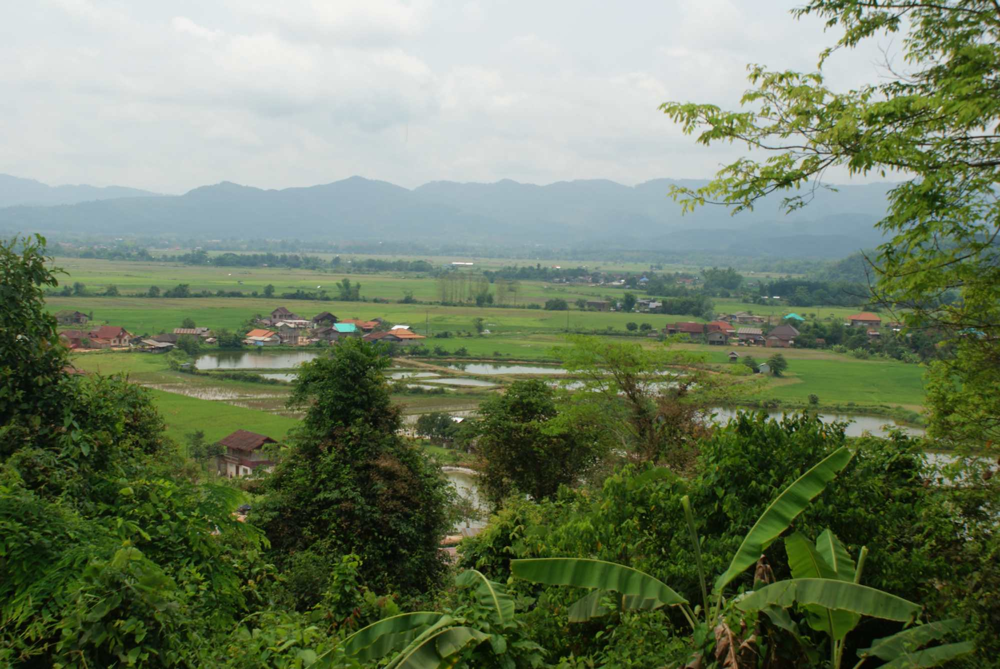
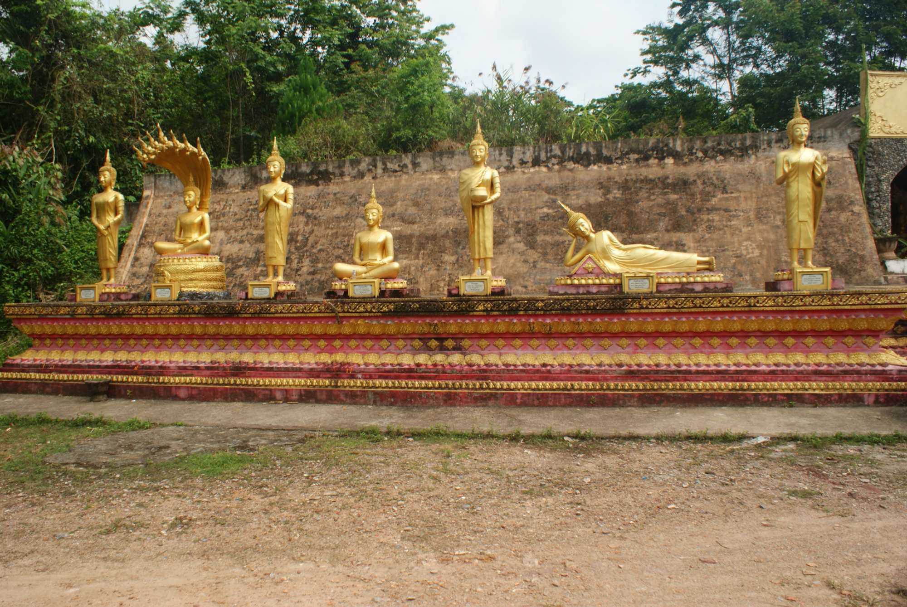
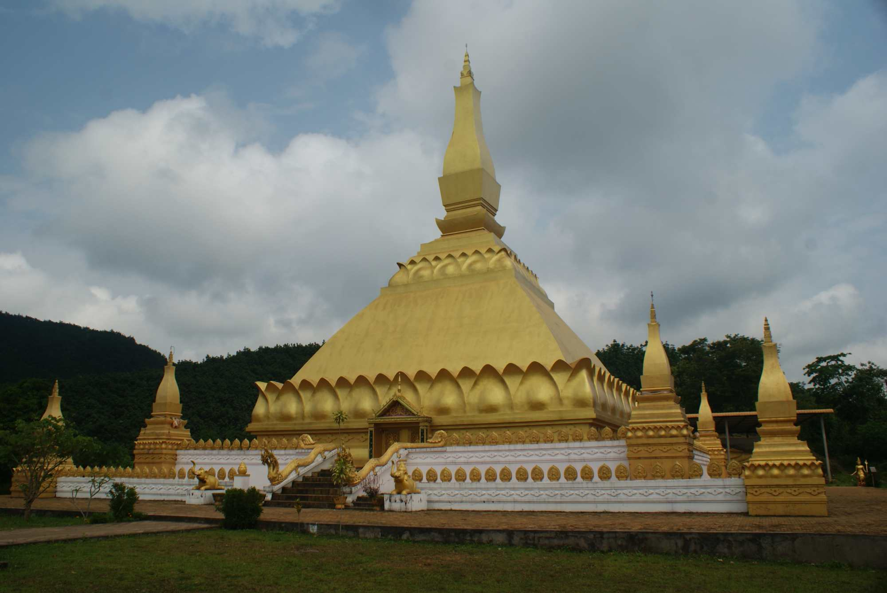
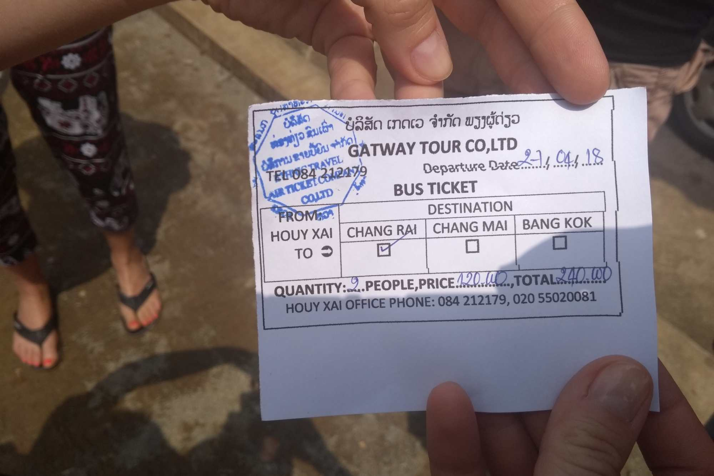
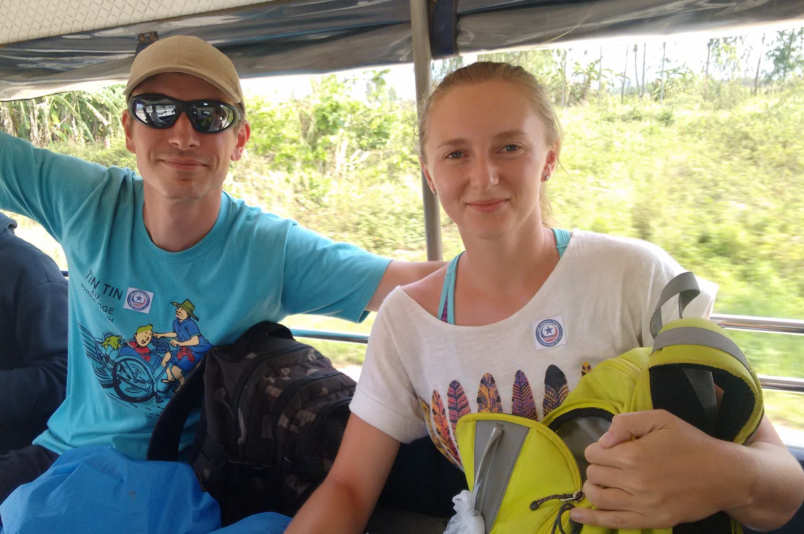
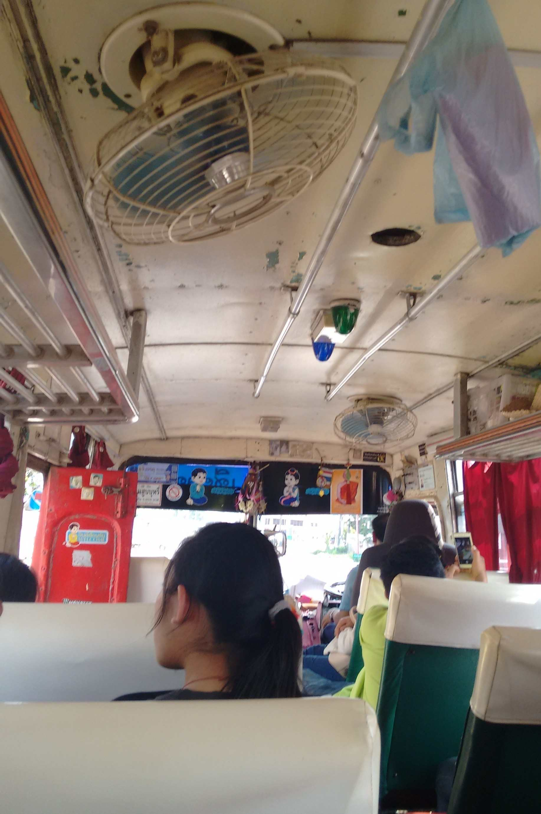
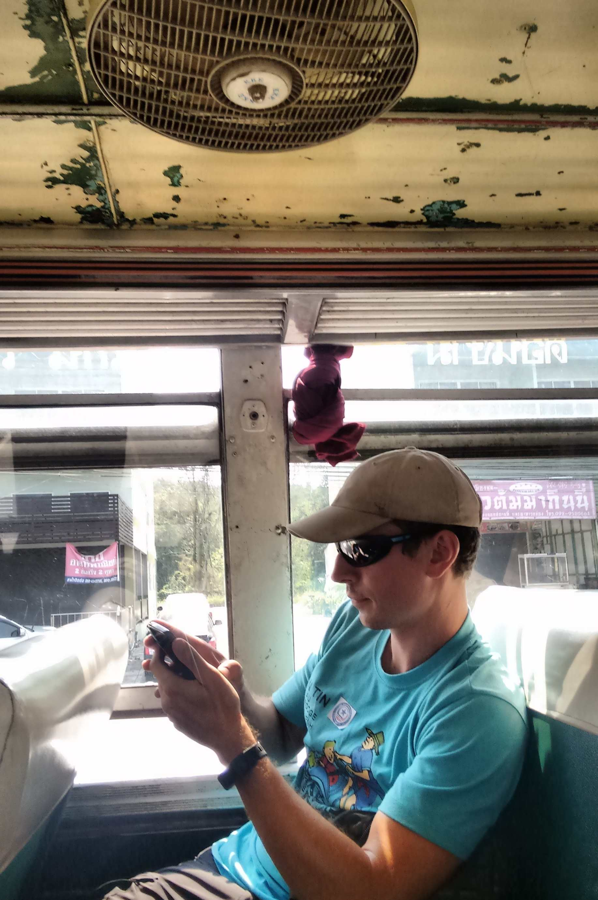

W końcu nadszedł czas, aby przekroczyć granicę z Tajlandią i rozpocząć naszą przygodę w ostatnim kraju na liście podczas tej
podróży. Wiedzieliśmy, że nie da się dojechać jednym autobusem z Nong Khiaw do oddalonej o 400km granicy z Tajlandią.
Dlatego pojechaliśmy minivanem do Luang Namtha, a stamtąd, z pomocą biura podróży, w ciągu jednego dnia przekroczyliśmy granicę
i wreszcie dotarliśmy do Chiang Rai w północnej Tajlandii. Więcej szczegółów w dalszej części wpisu.

Luang Namtha nie wydawało się szczególnie interesującym miastem, ale postanowiliśmy zostać tam 1 dzień i nie spieszyć się za bardzo
do kolejnego miejsca. Niczego nie rezerwowaliśmy z wyprzedzeniem i po 1 godzinie spaceru trafiliśmy do pensjonatu tuż przed
wejściem na nocne targowisko (bardzo skromne targowisko). Następnego dnia wypożyczyliśmy rowery górskie i pojechaliśmy do okolicznych wiosek,
zataczając wokół miasta pętlę o długości 27km, którą można zobaczyć na mapie poniżej. Widzieliśmy miejscową świątynię, stupę Samakkhixay, ludzi pracujących na polach, szkołę
pełną dzieci i wszędzie biegające zwierzęta. Było bardzo cicho, obserwowaliśmy codzienne życie lokalnej społeczności, a później zjedliśmy smaczną
kolację w Lai's Place. Zawsze miło, gdy dzieci wszędzie witają nas głośnymi okrzykami i biegną za naszymi
rowerami z szerokimi uśmiechami :)

Mieliśmy dwie możliwości przekroczenia granicy z Tajlandią: zrobić to samodzielnie albo z pomocą biura podróży.
Pierwsza opcja oznacza przejazd autobusem do Huay Xai, następnie tuk-tukiem do Mostu Przyjaźni, przekroczenie mostu kolejnym autobusem,
przejazd następnym tuk-tukiem do Chiang Khong, (prawdopodobnie nocleg na miejscu), a potem lokalnym autobusem do Chiang Rai. Nie udało nam się
znaleźć rozkładu jazdy autobusów z Chiang Khong do Chiang Rai, a tak naprawdę chcieliśmy dotrzeć do Chiang Rai jak najszybciej. Dlatego zdecydowaliśmy się
kupić łączony bilet w jednym z biur podróży. Ogólnie podróż przebiegła bardzo sprawnie, kierowcy tuk-tuków już na nas czekali,
wszystko było dobrze zorganizowane i nie musieliśmy długo czekać między przesiadkami do kolejnych środków transportu.
Samo przekroczenie granicy również było bardzo łatwe, bez korupcji i dodatkowych opłat, super! :D 

Dotarliśmy na dworzec autobusowy w Chiang Rai tuż po 5 po południu. Z radością odkryliśmy,
że zarezerwowany przez nas hostel znajduje się w pobliżu, podobnie jak nocne targowisko, które okazało się bardzo przyjemnym miejscem na wieczorne spacery!

Oczywiście, robiąc wszystko samodzielnie, za bilety zapłacicie prawdopodobnie o połowę mniej i przy odrobinie szczęścia również da się
pokonać tę trasę w ciągu jednego dnia. Trzeba zacząć od wczesnego autobusu do Huay Xai o 8.30 rano, a po około
4.5h jazdy jest się na miejscu. Zwróciliśmy uwagę na ceny niektórych biletów, np. przejazd lokalnym autobusem z Chiang Khong do
Chiang Rai kosztował 120BTH (4$), tuk-tuk do mostu 40BTH, a autobus przejeżdżający przez most również 40BTH. Wsiadając do
lokalnego autobusu do Chiang Rai, zobaczyliśmy rozkład jazdy, z którego wynikało, że autobusy kursują także po południu. 

  
  

## Informacje praktyczne:

  * minivan z Nong Khiaw do Luang Namtha - 6.5h, 70k KIP od osoby
  * przekroczenie granicy z Tajlandią z pomocą biura podróży (biuro podróży Gat Way Tour) - 200k KIP od osoby
  * tuk-tuk z dworca autobusowego do centrum Nong Khiaw - 15k KIP od osoby (8km)
  * wypożyczenie roweru górskiego - 20k KIP od osoby,
  * obiad/kolacja - 50k-70k KIP za nas oboje, polecamy <a href="https://www.tripadvisor.com/Restaurant_Review-g424933-d3935763-Reviews-Lai_s_Place-Luang_Namtha_Luang_Namtha_Province.html">restaurację Lai's Place</a>
  * pensjonat - 60k KIP za noc
  
  

